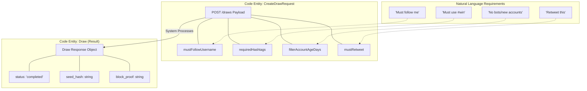
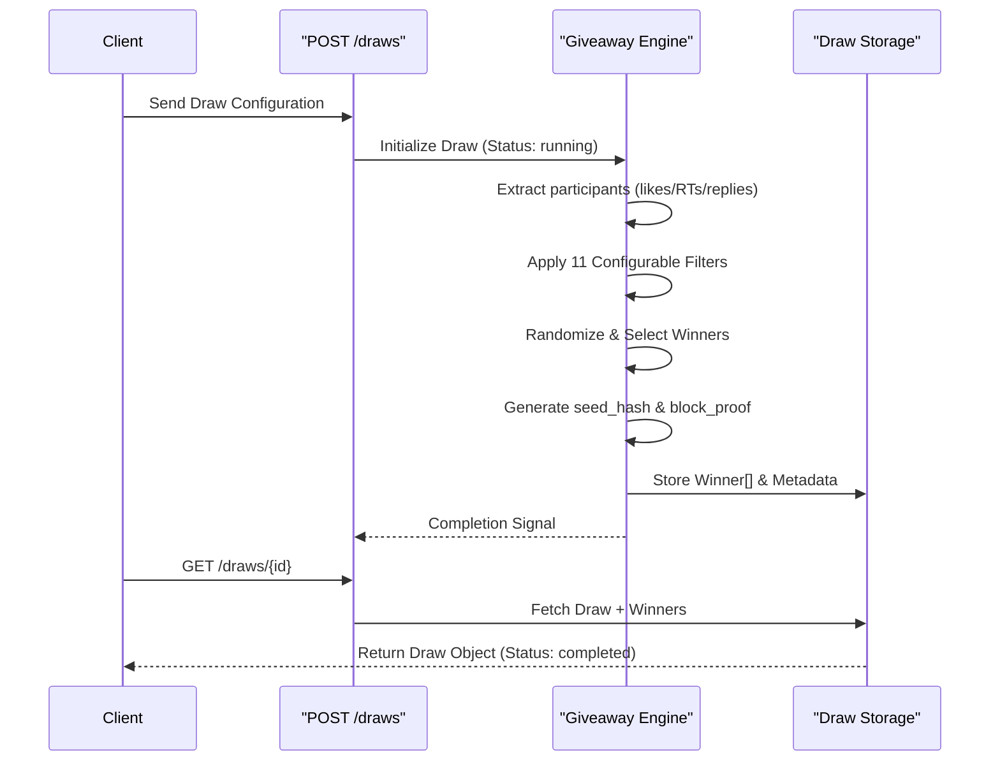

<!-- source: DeepWiki mcp.deepwiki.com · repo Xquik-dev/x-twitter-scraper · page 3.6 Giveaway Draws · fetched 2026-10-26 -->

# Giveaway Draws

<details>
<summary>Relevant source files</summary>

The following files were used as context for generating this wiki page:

- [skills/run-giveaway/SKILL.md](skills/run-giveaway/SKILL.md)
- [skills/write-tweets/SKILL.md](skills/write-tweets/SKILL.md)
- [skills/x-articles/SKILL.md](skills/x-articles/SKILL.md)
- [skills/x-twitter-scraper/references/draws.md](skills/x-twitter-scraper/references/draws.md)

</details>


The Draws sub-system provides a robust engine for running transparent and auditable contests on X (formerly Twitter). It automates the extraction of participants from tweet interactions, applies complex filtering logic to ensure eligibility, and performs randomized selection for winners and backups.

## System Overview

The Draws system operates by analyzing interactions (likes, retweets, replies, or quotes) to a target tweet. Unlike manual selection, the sub-system validates participants against 11 configurable criteria, ranging from social graph requirements (following/retweeting) to account metadata (age, follower count) and content requirements (keywords, hashtags).

### Data Flow and Lifecycle

1.  **Initialization**: A `POST /draws` request triggers the process by providing a `seed_tweet_url` or `tweetUrl`.
2.  **Extraction**: The system identifies all participants based on the `entry_source` (likes, retweets, replies, or quotes).
3.  **Filtering**: Each participant is passed through the filter pipeline (e.g., `min_followers`, `must_follow`).
4.  **Selection**: A random draw is performed from the pool of valid entries.
5.  **Completion**: Winners and backups are assigned positions and stored for retrieval.
6.  **Verification**: The system generates a `seed_hash` and `block_proof` for cryptographic auditability.

Sources: [skills/run-giveaway/SKILL.md:41-61](), [skills/run-giveaway/SKILL.md:71-73](), [skills/x-twitter-scraper/references/draws.md:1-22]()

## API Configuration

### Create Draw (`POST /draws`)

The primary entry point for the system supports both standard JSON and skill-specific payloads.

| Field | Type | Description |
| :--- | :--- | :--- |
| `tweetUrl` | `string` | **Required.** The full URL of the contest tweet (`https://x.com/user/status/ID`). |
| `entry_source` | `string` | Source of entrants: `likes`, `retweets`, `replies`, or `quotes`. |
| `winnerCount` | `number` | Number of primary winners to select (default: 1). |
| `backupCount` | `number` | Number of backup winners to select in case of disqualification. |
| `uniqueAuthorsOnly` | `boolean` | If true, multiple interactions from the same user count as one entry. |
| `mustRetweet` | `boolean` | Validates if the participant has retweeted the target tweet. |
| `mustFollowUsername`| `string` | Validates if the participant follows the specified account. |
| `filterMinFollowers`| `number` | Minimum follower threshold for the participant's account. |
| `filterAccountAgeDays`| `number` | Minimum days since the participant's account was created. |
| `filterLanguage` | `string` | ISO language code (e.g., `"en"`) required in the reply text. |
| `requiredKeywords` | `string[]` | Array of strings that must be present in the reply. |
| `requiredHashtags` | `string[]` | Specific hashtags (e.g., `["#giveaway"]`) required in the reply. |
| `requiredMentions` | `string[]` | Specific usernames (e.g., `["@xquik"]`) that must be tagged. |

Sources: [skills/run-giveaway/SKILL.md:44-58](), [skills/x-twitter-scraper/references/draws.md:7-22]()

### Draw Implementation Logic

The following diagram maps the natural language requirements of a giveaway to the internal `CreateDrawRequest` properties and the resulting `Draw` entity.

**Draw Entity Mapping**

Sources: [skills/run-giveaway/SKILL.md:44-61](), [skills/run-giveaway/SKILL.md:71-73](), [skills/x-twitter-scraper/references/draws.md:26-42]()

## Winner Selection & Pagination

Once a draw reaches the `completed` status, winners are accessible via the draw details endpoint.

### Selection Logic
Winners are selected randomly from the pool of participants who pass all configured filters. The system first fills the `winnerCount` slots (where `isBackup` is `false`) and then fills the `backupCount` slots (where `isBackup` is `true`).

### Result Retrieval
Draw history and result lists can be accessed via specific sub-resources:
*   **Status/Winners**: `GET /draws/{id}` returns the status and the final winner list.
*   **Entrant List**: `GET /draws/{id}/entrants` provides the full list of filtered participants.
*   **Export**: `GET /draws/{id}/export?format=csv` generates a downloadable file.

**Draw Result Data Flow**

Sources: [skills/run-giveaway/SKILL.md:32-37](), [skills/run-giveaway/SKILL.md:60-61](), [skills/x-twitter-scraper/references/draws.md:44-53]()

## Technical Specifications

### Data Structures

The system utilizes structured winner objects to facilitate auditability.

```typescript
// Conceptual representation based on API responses
interface DrawWinner {
  position: number;
  authorUsername: string;
  tweetId: string; // The ID of the interaction (reply/quote)
  isBackup: boolean;
}

interface DrawStatus {
  draw_id: string;
  status: "pending" | "running" | "completed" | "failed";
  winners: DrawWinner[];
  seed_hash: string;
  block_proof: string;
}
```
Sources: [skills/run-giveaway/SKILL.md:57-61](), [skills/run-giveaway/SKILL.md:71-73](), [skills/x-twitter-scraper/references/draws.md:46-49]()

### Cost and Auditing
*   **Cost**: 1 credit ($0.00015) per participant entry. This is a paid, irreversible action.
*   **Auditing**: Every draw includes a cryptographic `seed_hash` and `block_proof` so winners can be independently verified. Users are encouraged to include these in public announcements.
*   **Export**: Results are exportable in CSV format via the `/export` endpoint.

Sources: [skills/run-giveaway/SKILL.md:37-37](), [skills/run-giveaway/SKILL.md:71-73](), [skills/x-twitter-scraper/references/draws.md:52-57]()

---

