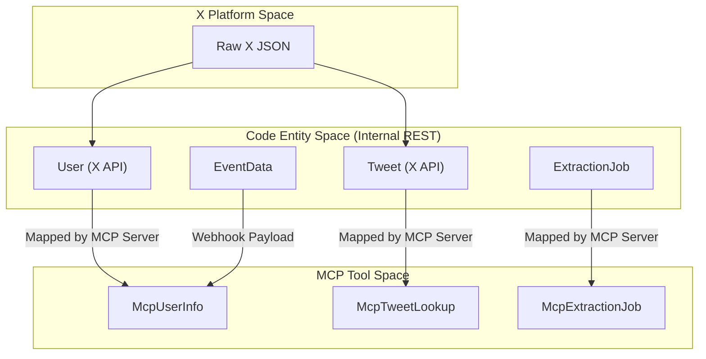
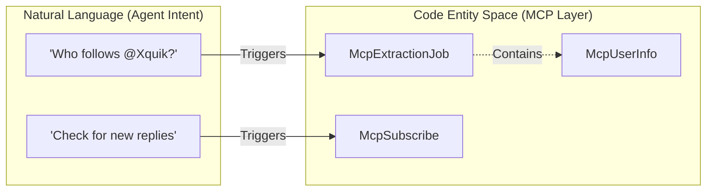

<!-- source: DeepWiki mcp.deepwiki.com · repo Xquik-dev/x-twitter-scraper · page 4 Data Types & Schemas · fetched 2026-10-26 -->

# Data Types & Schemas

Relevant source files

The following files were used as context for generating this wiki page:

- [skills/x-twitter-scraper/references/extractions.md](skills/x-twitter-scraper/references/extractions.md)
- [skills/x-twitter-scraper/references/mcp-tools.md](skills/x-twitter-scraper/references/mcp-tools.md)
- [skills/x-twitter-scraper/references/types.md](skills/x-twitter-scraper/references/types.md)

This section provides an overview of the TypeScript type system that governs the Xquik API and its Model Context Protocol (MCP) implementation. The codebase utilizes a strictly typed interface layer to ensure consistency between the internal REST API, the asynchronous extraction engine, and the tool-based MCP server.

## Overview of the Type System

The Xquik type system is divided into two primary domains:
1.  **Core Data Models**: Internal representations of X entities (Users, Tweets), system resources (Monitors, Extractions), and orchestration logic (Automations).
2.  **MCP-Specific Schemas**: Optimized data shapes designed for LLM consumption, featuring field remapping and flattened structures to improve agent reasoning.

### Data Flow & Type Mapping

The following diagram illustrates how data moves from the raw X response through the internal REST layer and finally into the MCP tool output.

**Data Transformation Pipeline**

Sources: [skills/x-twitter-scraper/references/types.md:23-301]()

---

## Core Data Models

The core models represent the persistent state of the Xquik system. These interfaces are used across the `xquik` tool execution and the standard REST API.

| Category | Key Interfaces | Description |
| :--- | :--- | :--- |
| **Identity** | `Account`, `CreditBalance` | Manages subscription tiers, monitor quotas, and credit consumption [skills/x-twitter-scraper/references/types.md:25-58](). |
| **Monitoring** | `Monitor`, `Event`, `Webhook` | Defines the real-time tracking of X accounts and the delivery of events via webhooks [skills/x-twitter-scraper/references/types.md:97-185](). |
| **Bulk Data** | `ExtractionJob`, `ExtractionResult` | Structures the asynchronous scraping of large datasets (e.g., followers, search results) [skills/x-twitter-scraper/references/types.md:268-295](). |
| **Draws** | `Draw`, `DrawWinner` | Defines the configuration and results for giveaway contests [skills/x-twitter-scraper/references/types.md:189-222](). |

For a full field-level reference including enums and optionality, see **[Core Data Models](#4.1)**.

---

## MCP-Specific Schemas

When interacting via the Model Context Protocol (MCP), the system often transforms internal REST responses into "Mcp" prefixed types. This is done to provide more descriptive field names for AI agents (e.g., changing `username` to `xUsername` to avoid ambiguity with system users).

**Natural Language to Code Mapping (MCP)**

Sources: [skills/x-twitter-scraper/references/types.md:20-21](), [skills/x-twitter-scraper/references/mcp-tools.md:16-28]()

### Key Mapping Differences
The MCP layer performs several "Quality of Life" transformations for the LLM:
*   **Flattening**: Deeply nested X metrics (likes, retweets) are often flattened into top-level properties in the `EndpointInfo` response shapes [skills/x-twitter-scraper/references/mcp-tools.md:17-25]().
*   **Explicit Naming**: Properties like `id` are mapped to `tweetId` or `xUserId` to prevent the agent from confusing internal database IDs with X platform IDs [skills/x-twitter-scraper/references/types.md:288-290]().
*   **Status Enums**: Statuses are normalized across `ExtractionJob` and `Draw` (e.g., `pending`, `running`, `completed`, `failed`) to ensure the agent can use consistent polling logic [skills/x-twitter-scraper/references/types.md:199-209](), [skills/x-twitter-scraper/references/types.md:271]().

For the complete mapping table and MCP output definitions, see **[MCP-Specific Schemas](#4.2)**.

---

## Type Safety in Tool Execution

The `xquik` tool utilizes these types to validate the requests sent by the agent. By adhering to the `ExtractionToolType` enum [skills/x-twitter-scraper/references/types.md:246-266](), the system can provide immediate feedback if an agent attempts to use an unsupported extraction method. The `explore` tool specifically exposes the `EndpointInfo` interface to allow agents to discover the `responseShape` and `parameters` before execution [skills/x-twitter-scraper/references/mcp-tools.md:17-25]().

**Sources:**
* [skills/x-twitter-scraper/references/types.md:23-301]() (Core Interface Definitions)
* [skills/x-twitter-scraper/references/types.md:246-266]() (Extraction Tool Enums)
* [skills/x-twitter-scraper/references/types.md:106-110]() (Event Type Enums)
* [skills/x-twitter-scraper/references/mcp-tools.md:12-28]() (MCP Tool Metadata Schemas)

---

