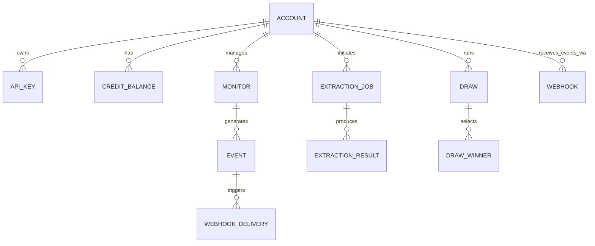
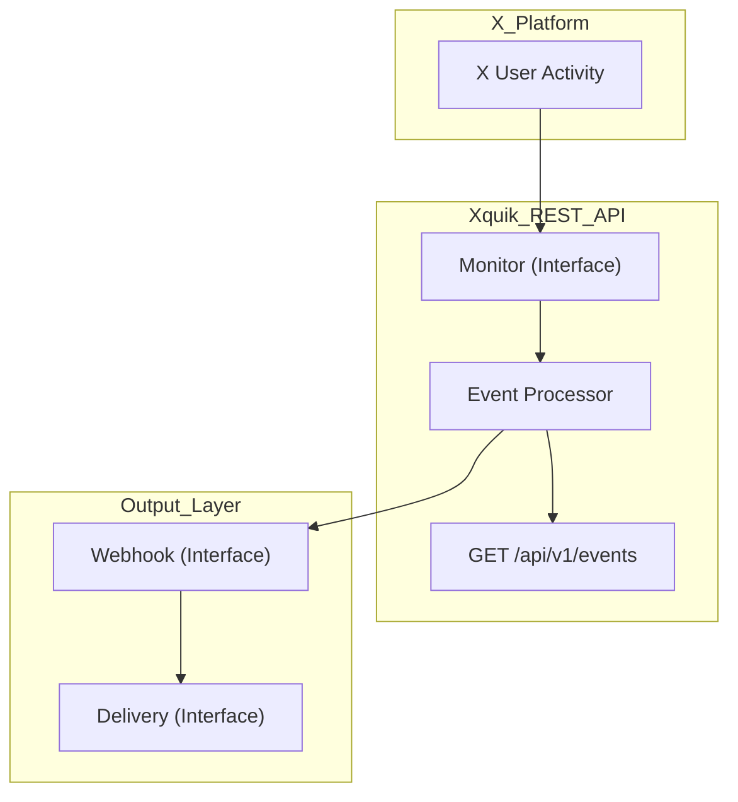
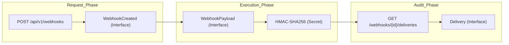

<!-- source: DeepWiki mcp.deepwiki.com · repo Xquik-dev/x-twitter-scraper · page 4.1 Core Data Models · fetched 2026-10-26 -->

# Core Data Models

Relevant source files

The following files were used as context for generating this wiki page:

- [skills/x-twitter-scraper/references/api-endpoints.md](skills/x-twitter-scraper/references/api-endpoints.md)
- [skills/x-twitter-scraper/references/extractions.md](skills/x-twitter-scraper/references/extractions.md)
- [skills/x-twitter-scraper/references/mcp-tools.md](skills/x-twitter-scraper/references/mcp-tools.md)
- [skills/x-twitter-scraper/references/types.md](skills/x-twitter-scraper/references/types.md)

This page serves as a technical reference for the primary TypeScript interfaces and data structures used throughout the Xquik platform. These models define the shape of data for account management, real-time monitoring, asynchronous extractions, and giveaway draws.

## Entity Relationship Overview

The following diagram illustrates how the core entities relate to one another within the system.

**System Entity Relationship Map**

Sources: [skills/x-twitter-scraper/references/types.md:25-284](), [skills/x-twitter-scraper/references/api-endpoints.md:113-222]()

---

## Account & Billing Models

The account and credit models track user subscription status, resource quotas, and the consumption of the credit-based billing system.

### Account
Represents the user's subscription state and monitoring limits.
*   `plan`: Current status of the account (`active` | `inactive`) [skills/x-twitter-scraper/references/types.md:26]().
*   `monitorsAllowed`: Total number of concurrent monitors the plan supports [skills/x-twitter-scraper/references/types.md:27]().
*   `monitorsUsed`: Number of monitors currently active [skills/x-twitter-scraper/references/types.md:28]().
*   `monitorBilling`: Object containing credit burn rates and intervals [skills/x-twitter-scraper/references/types.md:29-37]().

### CreditBalance
Tracks the financial state of the account.
*   `balance`: Current available credits, represented as a bigint string [skills/x-twitter-scraper/references/types.md:52]().
*   `lifetimeUsed`: Total credits consumed since account creation [skills/x-twitter-scraper/references/types.md:54]().
*   `autoTopupEnabled`: Boolean flag for automatic recharging [skills/x-twitter-scraper/references/types.md:55]().

Sources: [skills/x-twitter-scraper/references/types.md:25-58](), [skills/x-twitter-scraper/references/api-endpoints.md:32-67]()

---

## Monitoring & Events

Monitors are the foundation of the real-time pipeline, observing specific X accounts for activities.

### Monitor
Defines what account and which events are being tracked.
*   `xUserId`: The unique X ID of the target being monitored [skills/x-twitter-scraper/references/types.md:100]().
*   `eventTypes`: An array of `EventType` enums (e.g., `tweet.new`, `tweet.reply`) [skills/x-twitter-scraper/references/types.md:101]().

### Event
The data packet generated when a monitor detects activity.
*   `type`: The specific category of the activity [skills/x-twitter-scraper/references/types.md:116]().
*   `data`: A `TweetEventData` object containing `tweetId`, `text`, and engagement `metrics` [skills/x-twitter-scraper/references/types.md:120-132]().
*   `occurredAt`: ISO timestamp of the event on X [skills/x-twitter-scraper/references/types.md:119]().

**Event Data Flow: Code to Entity Space**

Sources: [skills/x-twitter-scraper/references/types.md:97-150](), [skills/x-twitter-scraper/references/api-endpoints.md:113-222]()

---

## Bulk Extractions

Extractions handle large-scale data retrieval that exceeds standard API rate limits or requires deep scraping across 23 tool types.

### ExtractionJob
The metadata for an asynchronous scraping task.
*   `toolType`: The specific scraper being used (e.g., `reply_extractor`, `follower_explorer`, `tweet_search_extractor`) [skills/x-twitter-scraper/references/types.md:246-266]().
*   `status`: Lifecycle state (`pending` | `running` | `completed` | `failed`) [skills/x-twitter-scraper/references/types.md:271]().
*   `resultsLimit`: Optional cap on results to prevent over-consumption of credits [skills/x-twitter-scraper/references/types.md:280]().

### ExtractionResult
A single row of data produced by a job.
*   Contains fields for both user profile data (`xUsername`, `xFollowersCount`) and tweet data (`tweetText`, `tweetId`) depending on the `toolType` [skills/x-twitter-scraper/references/types.md:286-300]().

Sources: [skills/x-twitter-scraper/references/types.md:244-300](), [skills/x-twitter-scraper/references/extractions.md:1-208]()

---

## Giveaway Draws

The Draws system manages random winner selection from tweet interactions with configurable filtering logic.

### Draw
*   `tweetUrl`: The source URL of the contest tweet [skills/x-twitter-scraper/references/types.md:192]().
*   `status`: The current state of the draw process [skills/x-twitter-scraper/references/types.md:199]().
*   `totalEntries`: Total number of interactions processed [skills/x-twitter-scraper/references/types.md:200]().

### CreateDrawRequest
*   `winnerCount`: Number of primary winners to select [skills/x-twitter-scraper/references/types.md:231]().
*   `mustRetweet`: Filter requiring the winner to have retweeted [skills/x-twitter-scraper/references/types.md:234]().
*   `filterMinFollowers`: Minimum follower count for eligibility [skills/x-twitter-scraper/references/types.md:236]().

Sources: [skills/x-twitter-scraper/references/types.md:189-242](), [skills/x-twitter-scraper/references/api-endpoints.md:300-326]()

---

## Webhooks & Deliveries

Webhooks provide the mechanism for external systems to receive real-time data from Xquik via signed HTTP POST requests.

### Webhook
*   `url`: The target endpoint for POST requests [skills/x-twitter-scraper/references/types.md:164]().
*   `secret`: A signing key used to generate `X-Xquik-Signature` headers for payload verification [skills/x-twitter-scraper/references/types.md:158]().

### Delivery
Tracks the status of a specific webhook transmission attempt.
*   `status`: Transmission state (`pending` | `delivered` | `failed` | `exhausted`) [skills/x-twitter-scraper/references/types.md:173]().
*   `attempts`: Number of retries performed [skills/x-twitter-scraper/references/types.md:174]().
*   `lastStatusCode`: The HTTP response code from the recipient server [skills/x-twitter-scraper/references/types.md:175]().

**Webhook Lifecycle: Code to Entity Space**

Sources: [skills/x-twitter-scraper/references/types.md:152-186](), [skills/x-twitter-scraper/references/api-endpoints.md:225-297]()

---

