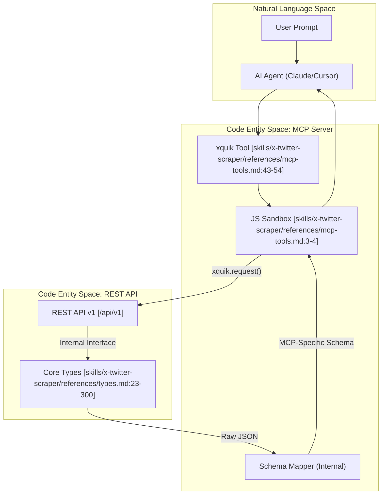
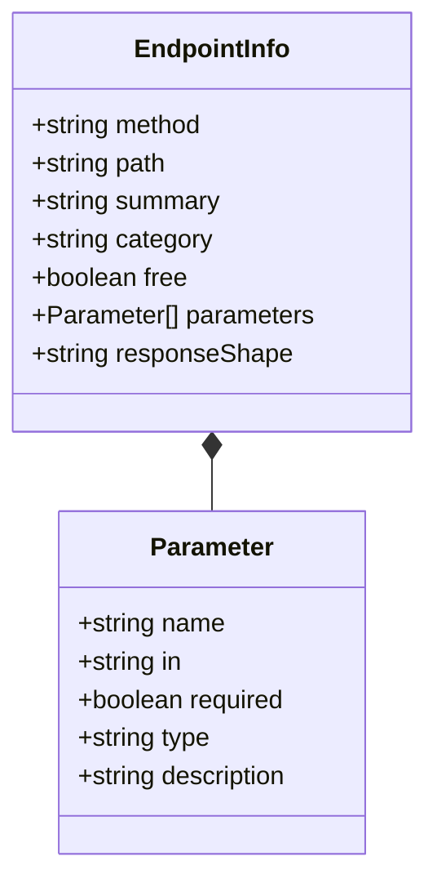

<!-- source: DeepWiki mcp.deepwiki.com · repo Xquik-dev/x-twitter-scraper · page 4.2 MCP-Specific Schemas · fetched 2026-10-26 -->

# MCP-Specific Schemas

<details>
<summary>Relevant source files</summary>

The following files were used as context for generating this wiki page:

- [server.json](server.json)
- [skills/x-twitter-scraper/references/extractions.md](skills/x-twitter-scraper/references/extractions.md)
- [skills/x-twitter-scraper/references/mcp-tools.md](skills/x-twitter-scraper/references/mcp-tools.md)
- [skills/x-twitter-scraper/references/types.md](skills/x-twitter-scraper/references/types.md)

</details>


The Model Context Protocol (MCP) server for Xquik provides a specialized interface for AI agents. While the underlying data is fetched from the Xquik REST API, the MCP layer applies transformations to ensure compatibility with LLM context windows and to provide more descriptive field names for agent reasoning. This page documents the specific TypeScript interfaces and field mappings used exclusively within the `xquik` and `explore` MCP tools.

## Data Transformation Flow

When an agent invokes the `xquik` tool, the request flows through a sandboxed environment where REST API responses are mapped into MCP-optimized schemas before being returned to the agent.

### System Architecture: REST to MCP

Title: MCP Response Transformation Pipeline

Sources: [skills/x-twitter-scraper/references/mcp-tools.md:3-54](), [skills/x-twitter-scraper/references/types.md:23-300]()

## Field Name Mappings

To improve agent comprehension, several internal field names are mapped to more descriptive aliases. The MCP server consistently applies these transformations to the `EventData` and `ExtractionResult` objects.

| Internal REST Field | MCP Schema Field | Context |
|:---|:---|:---|
| `username` | `xUsername` | User lookups and events [skills/x-twitter-scraper/references/types.md:289-289]() |
| `data` | `eventData` | Webhook and Monitor events [skills/x-twitter-scraper/references/types.md:120-120]() |
| `id` | `xUserId` | When referring specifically to X platform IDs [skills/x-twitter-scraper/references/types.md:288-288]() |
| `text` | `tweetContent` | Tweet-specific text fields [skills/x-twitter-scraper/references/types.md:127-127]() |
| `url` | `checkoutUrl` | Billing and subscription responses [skills/x-twitter-scraper/references/types.md:61-61]() |

Sources: [skills/x-twitter-scraper/references/types.md:61-289](), [skills/x-twitter-scraper/references/mcp-tools.md:43-54]()

## Specialized MCP Schemas

The following interfaces are defined specifically for the MCP tool outputs. They extend or modify the Core Data Models to provide better context for LLMs.

### McpUserInfo
Used when the agent calls `GET /api/v1/x/users/{username}`. It flattens the X profile data and ensures platform IDs are explicitly labeled.

```typescript
interface McpUserInfo {
  xUsername: string;       // Mapped from username
  xUserId: string;         // Mapped from id
  displayName: string;
  description: string;
  followerCount: number;
  followingCount: number;
  isVerified: boolean;
  profileImageUrl: string;
  location?: string;
}
```
Sources: [skills/x-twitter-scraper/references/types.md:288-295]() (referenced via extraction result mapping patterns)

### McpExtractionJob
Used for bulk data operations. The MCP version includes an explicit `progressSummary` field to help agents decide whether to continue polling or wait.

```typescript
interface McpExtractionJob {
  jobId: string;           // Mapped from id
  toolType: ExtractionToolType;
  status: "pending" | "running" | "completed" | "failed";
  resultsFound: number;    // Mapped from totalResults
  progressSummary: string; // Generated: e.g., "Extracted 500 of 1000 estimated"
  createdAt: string;
}
```
Sources: [skills/x-twitter-scraper/references/types.md:268-284](), [skills/x-twitter-scraper/references/mcp-tools.md:115-117]()

### McpSubscribe
When a 402 Payment Required error is encountered, the agent is instructed to call the subscription endpoint. The MCP schema focuses on the actionable checkout URL.

```typescript
interface McpSubscribe {
  checkoutUrl: string;     // Mapped from url
  planName: string;
  priceCents: number;
  currency: "usd";
}
```
Sources: [skills/x-twitter-scraper/references/mcp-tools.md:138-140](), [skills/x-twitter-scraper/references/types.md:60-62]()

## Tool-Specific Constants

The `explore` tool provides access to the `EndpointInfo` schema, which describes the available API surface area to the agent in-memory without network overhead.

Title: Explore Tool Schema Discovery

Sources: [skills/x-twitter-scraper/references/mcp-tools.md:17-28]()

### Category Mapping
The `category` field in `EndpointInfo` is used by agents to filter capabilities within the `explore` tool. The supported categories are:
* `account`, `composition`, `credits`, `extraction`, `media`, `monitoring`
* `support`, `twitter`, `x-accounts`, `x-write`

Sources: [skills/x-twitter-scraper/references/mcp-tools.md:21-21]()

---

