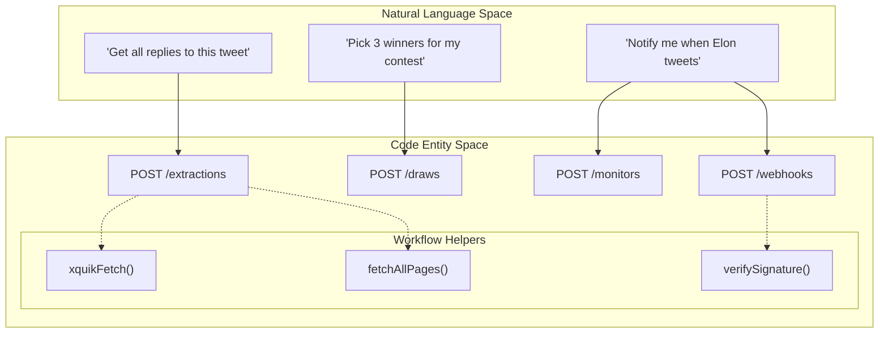
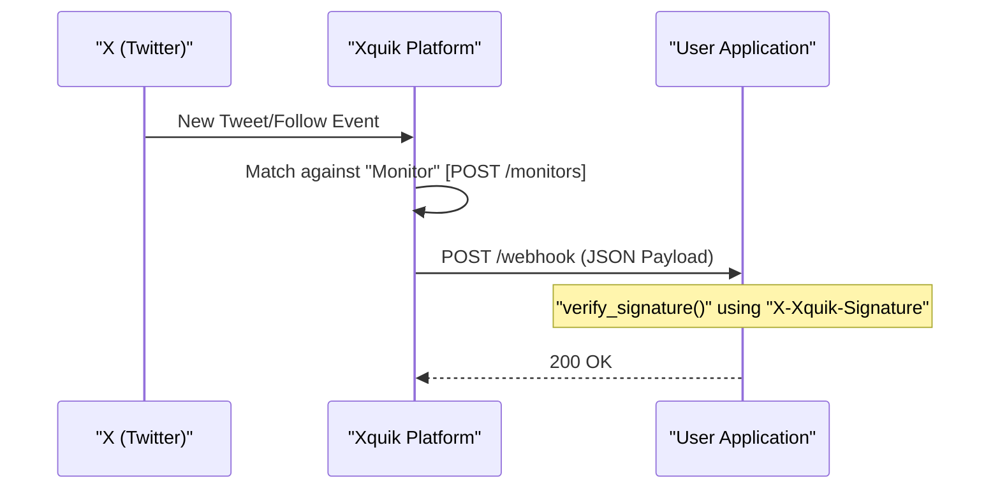

<!-- source: DeepWiki mcp.deepwiki.com · repo Xquik-dev/x-twitter-scraper · page 5 Integration Guides & Code Examples · fetched 2026-10-26 -->

# Integration Guides & Code Examples

Relevant source files

The following files were used as context for generating this wiki page:

- [commands/post.md](commands/post.md)
- [commands/search.md](commands/search.md)
- [commands/trending.md](commands/trending.md)
- [commands/user.md](commands/user.md)
- [skills/x-twitter-scraper/references/python-examples.md](skills/x-twitter-scraper/references/python-examples.md)
- [skills/x-twitter-scraper/references/webhooks.md](skills/x-twitter-scraper/references/webhooks.md)
- [skills/x-twitter-scraper/references/workflows.md](skills/x-twitter-scraper/references/workflows.md)

This section provides practical implementation guides for common integration patterns using the Xquik API. It bridges the gap between raw API endpoints and functional application logic, covering authentication, error handling, and complex multi-step workflows like asynchronous data extraction and giveaway management.

## Implementation Overview

Integrating with Xquik typically involves managing an `x-api-key` [skills/x-twitter-scraper/references/workflows.md:8-10]() and handling metered operations that deduct from a shared credit pool [skills/x-twitter-scraper/references/workflows.md:156-191](). While simple read/write actions are synchronous, advanced features like Bulk Extractions and Giveaway Draws follow an asynchronous lifecycle.

### Core Workflow Patterns

The following diagram maps the conceptual "Natural Language" requirements to the specific "Code Entities" and API paths used to fulfill them.

**Diagram: Requirement to Code Mapping**

**Sources:** [skills/x-twitter-scraper/references/workflows.md:18-42](), [skills/x-twitter-scraper/references/webhooks.md:40-43](), [skills/x-twitter-scraper/references/python-examples.md:90-100]()

---

## JavaScript / Node.js Examples

The JavaScript guide focuses on building robust integrations using modern `fetch` and Node.js built-ins. Key patterns include:
*   **Exponential Backoff:** Implementing a `xquikFetch` wrapper that automatically retries `429` (Rate Limit) and `5xx` (Server Error) responses [skills/x-twitter-scraper/references/workflows.md:18-42]().
*   **Cursor-based Pagination:** Navigating the `nextCursor` and `hasMore` fields common in extraction results and event logs [skills/x-twitter-scraper/references/workflows.md:50-67]().
*   **Extraction Lifecycle:** Managing the `estimate` -> `create` -> `poll` -> `export` flow [skills/x-twitter-scraper/references/workflows.md:74-122]().

For detailed implementation code, see [JavaScript / Node.js Examples](#5.1).

**Sources:** [skills/x-twitter-scraper/references/workflows.md:13-122]()

---

## Python Examples

The Python guide provides equivalents using the `requests` library and `Flask` for webhook handling. It demonstrates:
*   **Authentication & Requests:** Setting up the `HEADERS` and `BASE` URL for all calls [skills/x-twitter-scraper/references/python-examples.md:7-13]().
*   **Synchronous Polling:** Using `time.sleep` loops to monitor asynchronous job statuses until they transition from `pending` or `running` to completion [skills/x-twitter-scraper/references/python-examples.md:64-66]().
*   **Giveaway Logic:** Configuring complex filters like `mustRetweet`, `filterMinFollowers`, and `requiredKeywords` [skills/x-twitter-scraper/references/python-examples.md:90-100]().

For detailed implementation code, see [Python Examples](#5.2).

**Sources:** [skills/x-twitter-scraper/references/python-examples.md:1-151]()

---

## Webhooks & Real-Time Events

Xquik supports real-time monitoring via an event-driven architecture. Developers create a `Monitor` for a specific X user [skills/x-twitter-scraper/references/workflows.md:130-136]() and then receive notifications via a `Webhook` [skills/x-twitter-scraper/references/workflows.md:139-145]().

**Diagram: Webhook Event Flow**

**Sources:** [skills/x-twitter-scraper/references/webhooks.md:12-30](), [skills/x-twitter-scraper/references/workflows.md:124-152]()

### Security and Idempotency
Integrations must verify the `X-Xquik-Signature` header using `HMAC-SHA256` to ensure the payload originated from Xquik [skills/x-twitter-scraper/references/webhooks.md:30-30](). Additionally, because webhooks may be retried up to 5 times [skills/x-twitter-scraper/references/webhooks.md:191-191](), implementing idempotency checks by hashing the raw payload is recommended [skills/x-twitter-scraper/references/webhooks.md:173-187]().

For detailed verification examples in Node.js, Python, and Go, see [Monitors, Webhooks & Events](#3.3).

**Sources:** [skills/x-twitter-scraper/references/webhooks.md:32-150]()

---

## Slash Commands Reference

For users integrating Xquik into AI agents (like Claude or Cursor), built-in slash commands provide a shortcut for common operations. These commands abstract the underlying API calls into high-level user actions:

| Command | Action | Code Entity Mapping |
|---------|--------|---------------------|
| `/post` | Post a tweet | `POST /api/v1/x/tweets` [commands/post.md:9-9]() |
| `/search` | Search tweets | `GET /api/v1/x/tweets/search` [commands/search.md:7-7]() |
| `/user` | Profile lookup | `GET /api/v1/x/users/$ARGUMENTS` [commands/user.md:7-7]() |
| `/trending` | Multi-source radar | `GET /api/v1/radar` [commands/trending.md:7-7]() |

For details on command syntax and parameters, see [Slash Commands Reference](#5.3).

**Sources:** [commands/post.md:1-16](), [commands/search.md:1-17](), [commands/user.md:1-20](), [commands/trending.md:1-18]()

---

