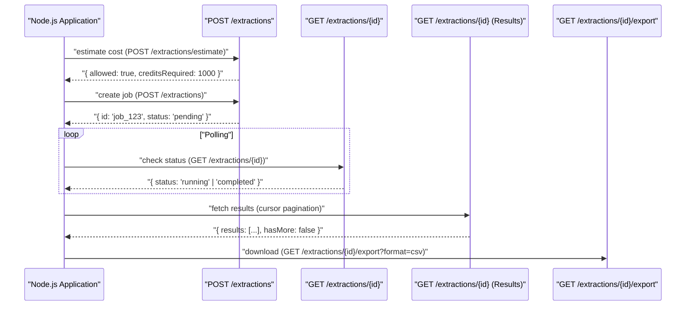

<!-- source: DeepWiki mcp.deepwiki.com · repo Xquik-dev/x-twitter-scraper · page 5.1 JavaScript / Node.js Examples · fetched 2026-10-26 -->

# JavaScript / Node.js Examples

<details>
<summary>Relevant source files</summary>

The following files were used as context for generating this wiki page:

- [skills/x-twitter-scraper/references/python-examples.md](skills/x-twitter-scraper/references/python-examples.md)
- [skills/x-twitter-scraper/references/webhooks.md](skills/x-twitter-scraper/references/webhooks.md)
- [skills/x-twitter-scraper/references/workflows.md](skills/x-twitter-scraper/references/workflows.md)

</details>


This page provides functional JavaScript and Node.js implementation patterns for the Xquik API. It covers essential integration tasks including robust authentication, error handling with exponential backoff, managing paginated datasets, executing asynchronous bulk extractions, verifying secure webhooks, and running auditable giveaway draws.

## Authentication Setup

Every request to the Xquik API must include the `x-api-key` header. API keys are 64-character hex strings prefixed with `xq_`.

| Variable | Description | Value |
| :--- | :--- | :--- |
| `BASE` | API Base URL | `https://xquik.com/api/v1` |
| `API_KEY` | Your Xquik Key | `xq_YOUR_KEY_HERE` |
| `Content-Type` | Payload Format | `application/json` |

[skills/x-twitter-scraper/references/workflows.md:8-11]()

**Sources:** [skills/x-twitter-scraper/references/workflows.md:7-11]()

## Exponential Backoff Retry Helper

To ensure reliability, clients should implement a retry mechanism. Only `429` (Too Many Requests) and `5xx` (Server Errors) should be retried. Other `4xx` errors indicate client-side issues that require manual correction. The helper should handle `Retry-After` headers if present [skills/x-twitter-scraper/references/workflows.md:29-38]().

### Retry Logic Flow
The following diagram illustrates the decision logic within the `xquikFetch` helper.

```mermaid
graph TD
    "START[Start Request]" --> "REQ[fetch(BASE + path)]"
    "REQ" --> "STATUS{Response OK?}"
    "STATUS" -- "Yes" --> "RETURN[Return JSON]"
    "STATUS" -- "No" --> "RETRYABLE{429 or 5xx?}"
    "RETRYABLE" -- "No" --> "THROW[Throw Fatal Error]"
    "RETRYABLE" -- "Yes" --> "ATTEMPTS{Attempt < 3?}"
    "ATTEMPTS" -- "No" --> "THROW"
    "ATTEMPTS" -- "Yes" --> "DELAY[Calculate Delay / Check Retry-After]"
    "DELAY" --> "WAIT[setTimeout]"
    "WAIT" --> "REQ"
```

### Implementation
The `xquikFetch` function implements a loop that retries up to 3 times with a base delay of 1000ms, using exponential backoff and jitter [skills/x-twitter-scraper/references/workflows.md:18-43]().

```javascript
async function xquikFetch(path, options = {}) {
  const baseDelay = 1000;

  for (let attempt = 0; attempt <= 3; attempt++) {
    const response = await fetch(`${BASE}${path}`, {
      ...options,
      headers: { ...headers, ...options.headers },
    });

    if (response.ok) return response.json();

    const retryable = response.status === 429 || response.status >= 500;
    if (!retryable || attempt === 3) {
      const error = await response.json();
      throw new Error(`Xquik API ${response.status}: ${error.error}`);
    }

    const retryAfter = response.headers.get("Retry-After");
    const delay = retryAfter
      ? parseInt(retryAfter, 10) * 1000
      : baseDelay * Math.pow(2, attempt) + Math.random() * 1000;

    await new Promise((resolve) => setTimeout(resolve, delay));
  }
}
```
**Sources:** [skills/x-twitter-scraper/references/workflows.md:18-43]()

## Cursor-Based Pagination

Many endpoints (Events, Draws, Extractions) use cursor-based pagination. If a response contains `hasMore: true`, use the `nextCursor` value as the `after` query parameter in the subsequent request [skills/x-twitter-scraper/references/workflows.md:47-49]().

```javascript
async function fetchAllPages(path, dataKey) {
  const results = [];
  let cursor;

  while (true) {
    const params = new URLSearchParams({ limit: "100" });
    if (cursor) params.set("after", cursor);

    const data = await xquikFetch(`${path}?${params}`);
    results.push(...data[dataKey]);

    if (!data.hasMore) break;
    cursor = data.nextCursor;
  }

  return results;
}
```
**Sources:** [skills/x-twitter-scraper/references/workflows.md:45-69]()

## Full Extraction Workflow

Bulk extractions follow a lifecycle: Estimate → Create → Poll → Paginate → Export. The system supports 23 different tool types, such as `follower_explorer` or `reply_extractor` [skills/x-twitter-scraper/references/workflows.md:78-80]().

### Extraction Entity Mapping
This diagram bridges the conceptual workflow to the specific API endpoints and job statuses.



### Implementation
The following code demonstrates the full lifecycle, including polling for job completion and handling paginated result retrieval [skills/x-twitter-scraper/references/workflows.md:73-122]().

```javascript
// Step 1: Estimate cost
const estimate = await xquikFetch("/extractions/estimate", {
  method: "POST",
  body: JSON.stringify({
    toolType: "follower_explorer",
    targetUsername: "elonmusk",
    resultsLimit: 1000,
  }),
});

if (!estimate.allowed) return;

// Step 2: Create extraction job
let job = await xquikFetch("/extractions", {
  method: "POST",
  body: JSON.stringify({
    toolType: "follower_explorer",
    targetUsername: "elonmusk",
    resultsLimit: 1000,
  }),
});

// Step 3: Poll until complete
while (job.status === "pending" || job.status === "running") {
  await new Promise((r) => setTimeout(r, 2000));
  job = await xquikFetch(`/extractions/${job.id}`);
}

// Step 4: Retrieve paginated results
let cursor;
const allResults = [];
while (true) {
  const path = `/extractions/${job.id}${cursor ? `?after=${cursor}` : ""}`;
  const page = await xquikFetch(path);
  allResults.push(...page.results);

  if (!page.hasMore) break;
  cursor = page.nextCursor;
}
```
**Sources:** [skills/x-twitter-scraper/references/workflows.md:71-122]()

## Webhook Handler with HMAC Verification

Xquik secures webhooks using HMAC-SHA256. The signature is provided in the `X-Xquik-Signature` header as `sha256={hash}`. It is computed using the `secret` (provided once at webhook registration) and the raw request body [skills/x-twitter-scraper/references/webhooks.md:3-9]().

### Implementation
Using `express.raw` is critical to ensure the HMAC is calculated over the original bytes rather than a re-serialized JSON string [skills/x-twitter-scraper/references/webhooks.md:55-57]().

```javascript
import express from "express";
import { createHmac, timingSafeEqual } from "node:crypto";

const WEBHOOK_SECRET = process.env.XQUIK_WEBHOOK_SECRET;
const app = express();

function verifySignature(payload, signature, secret) {
  if (typeof signature !== "string" || !secret) return false;

  const expected = "sha256=" + createHmac("sha256", secret).update(payload).digest("hex");
  const expectedBuffer = Buffer.from(expected, "utf8");
  const signatureBuffer = Buffer.from(signature, "utf8");

  return (
    expectedBuffer.length === signatureBuffer.length &&
    timingSafeEqual(expectedBuffer, signatureBuffer)
  );
}

app.post("/webhook", express.raw({ type: "application/json" }), (req, res) => {
  const signature = req.headers["x-xquik-signature"];
  const payload = req.body.toString();

  if (!verifySignature(payload, signature, WEBHOOK_SECRET)) {
    return res.status(401).send("Invalid signature");
  }

  const event = JSON.parse(payload);
  // Handle event.eventType (e.g., tweet.new, tweet.reply)
  res.status(200).send("OK");
});
```
**Sources:** [skills/x-twitter-scraper/references/webhooks.md:32-79](), [skills/x-twitter-scraper/references/webhooks.md:168-187]()

## Giveaway Draw Creation

Giveaway draws allow for auditable selection of winners based on engagement filters like `mustRetweet`, `mustFollowUsername`, or `filterMinFollowers`.

```javascript
const draw = await xquikFetch("/draws", {
  method: "POST",
  body: JSON.stringify({
    tweetUrl: "https://x.com/burakbayir/status/1893456789012345678",
    winnerCount: 3,
    backupCount: 2,
    uniqueAuthorsOnly: true,
    mustRetweet: true,
    mustFollowUsername: "burakbayir",
    filterMinFollowers: 50,
    filterAccountAgeDays: 30,
    requiredKeywords: ["giveaway"],
  }),
});

// Retrieve winners from the created draw
const details = await xquikFetch(`/draws/${draw.id}`);
details.winners.forEach(winner => {
    const role = winner.isBackup ? "BACKUP" : "WINNER";
    console.log(`${role} #${winner.position}: @${winner.authorUsername}`);
});
```
**Sources:** [skills/x-twitter-scraper/references/python-examples.md:86-107](), [skills/x-twitter-scraper/references/workflows.md:178]()

---

