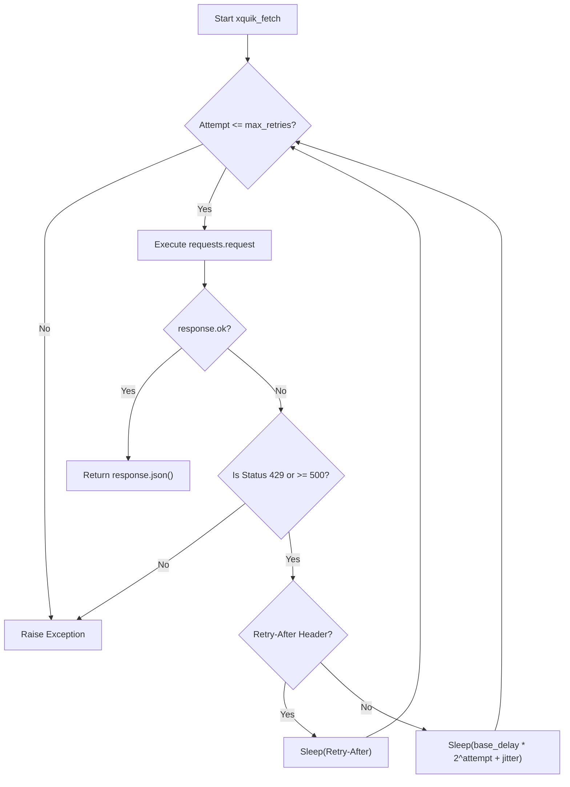
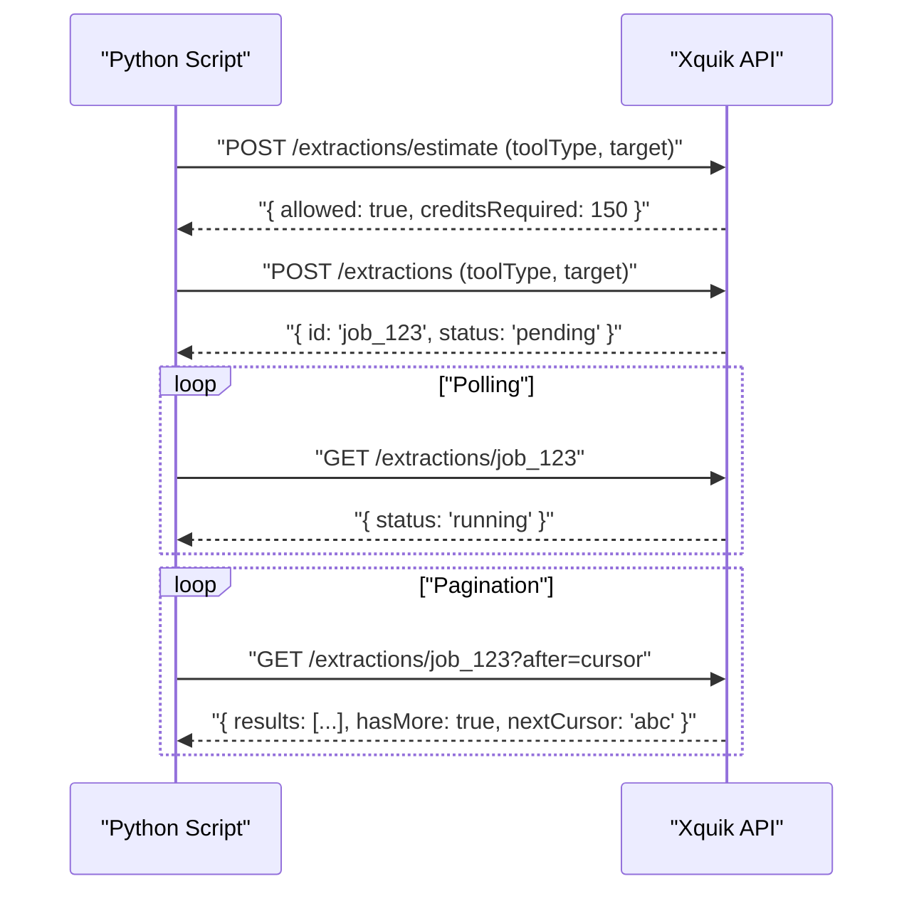
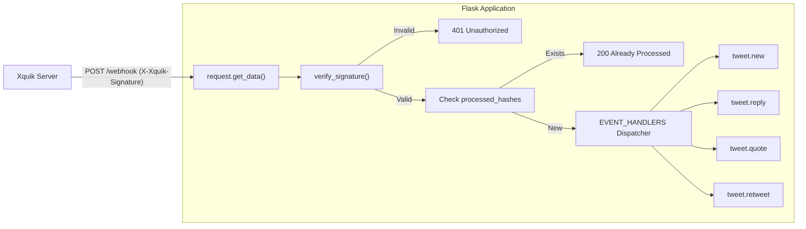

<!-- source: DeepWiki mcp.deepwiki.com · repo Xquik-dev/x-twitter-scraper · page 5.2 Python Examples · fetched 2026-10-26 -->

# Python Examples

Relevant source files

The following files were used as context for generating this wiki page:

- [skills/x-twitter-scraper/references/python-examples.md](skills/x-twitter-scraper/references/python-examples.md)
- [skills/x-twitter-scraper/references/webhooks.md](skills/x-twitter-scraper/references/webhooks.md)
- [skills/x-twitter-scraper/references/workflows.md](skills/x-twitter-scraper/references/workflows.md)

This page provides technical implementation details for integrating with the Xquik API using Python. It covers the standard patterns for authentication, resilient request handling, the asynchronous extraction lifecycle, giveaway management, and secure webhook processing.

## Authentication and Base Configuration

All requests to the Xquik API require an `x-api-key` header. The base URL for all REST operations is `https://xquik.com/api/v1`.

| Variable | Description | Source |
| :--- | :--- | :--- |
| `API_KEY` | Your Xquik API key (starts with `xq_`) | [skills/x-twitter-scraper/references/python-examples.md:10-10]() |
| `BASE` | The API root: `https://xquik.com/api/v1` | [skills/x-twitter-scraper/references/python-examples.md:11-11]() |
| `HEADERS` | Includes `x-api-key` and `Content-Type: application/json` | [skills/x-twitter-scraper/references/python-examples.md:12-12]() |

**Sources:** [skills/x-twitter-scraper/references/python-examples.md:7-13]()

---

## Resilient Request Handling

The `xquik_fetch` function implements a robust pattern for interacting with the API, incorporating exponential backoff and jitter to handle rate limits (`429`) and transient server errors (`500+`).

### Retry Logic Flow
The implementation checks for the `Retry-After` header provided by the server [skills/x-twitter-scraper/references/python-examples.md:39-39](). If absent, it falls back to a calculated delay: $base\_delay \times 2^{attempt} + jitter$ [skills/x-twitter-scraper/references/python-examples.md:40-40]().

"Request Lifecycle with Exponential Backoff"

**Sources:** [skills/x-twitter-scraper/references/python-examples.md:20-42]()

---

## Asynchronous Extraction Lifecycle

Extractions follow a four-stage lifecycle: **Estimate → Create → Poll → Paginate**. This ensures that users do not start jobs that would exceed their credit quota and allows for the retrieval of large datasets.

### Implementation Details
1.  **Estimate**: `POST /extractions/estimate` checks if the projected credit cost is within limits. [skills/x-twitter-scraper/references/python-examples.md:48-55]()
2.  **Create**: `POST /extractions` initializes the job and returns a job `id`. [skills/x-twitter-scraper/references/python-examples.md:58-61]()
3.  **Poll**: The client checks `GET /extractions/{id}` until the status is no longer `pending` or `running`. [skills/x-twitter-scraper/references/python-examples.md:64-66]()
4.  **Paginate**: Results are fetched using the `nextCursor` until `hasMore` is false. [skills/x-twitter-scraper/references/python-examples.md:72-81]()

"Extraction Data Flow"

**Sources:** [skills/x-twitter-scraper/references/python-examples.md:44-84](), [skills/x-twitter-scraper/references/workflows.md:73-122]()

---

## Giveaway Draw Implementation

The Giveaway system allows for automated winner selection based on X engagement. The `POST /draws` endpoint supports various configurable filters to ensure auditability and compliance with contest rules.

### Key Configuration Parameters
*   `winnerCount` / `backupCount`: Number of primary and reserve winners. [skills/x-twitter-scraper/references/python-examples.md:92-93]()
*   `mustRetweet` / `mustFollowUsername`: Engagement requirements. [skills/x-twitter-scraper/references/python-examples.md:95-96]()
*   `filterMinFollowers` / `filterAccountAgeDays`: Sybil resistance filters. [skills/x-twitter-scraper/references/python-examples.md:97-98]()
*   `requiredKeywords`: Ensures entries contain specific text. [skills/x-twitter-scraper/references/python-examples.md:99-99]()

**Sources:** [skills/x-twitter-scraper/references/python-examples.md:86-107]()

---

## Flask Webhook Handler

The webhook handler utilizes Flask to receive real-time notifications. It prioritizes security through HMAC-SHA256 signature verification and idempotency checks.

### Security Implementation
*   **Signature Verification**: The `verify_signature` function uses `hmac.compare_digest` for constant-time comparison to prevent timing attacks. It computes the HMAC over the raw payload bytes using the `WEBHOOK_SECRET`. [skills/x-twitter-scraper/references/python-examples.md:120-122]()
*   **Idempotency**: To prevent duplicate processing of retried deliveries, the handler can store a hash of the payload in a set or database. [skills/x-twitter-scraper/references/python-examples.md:139-142]()

"Webhook Security and Dispatching"

### Event Handlers
The `EVENT_HANDLERS` dictionary maps `eventType` strings to logic, facilitating clean separation of concerns for different event types. [skills/x-twitter-scraper/references/python-examples.md:124-129]()

**Sources:** [skills/x-twitter-scraper/references/python-examples.md:109-150](), [skills/x-twitter-scraper/references/webhooks.md:83-113]()

---

