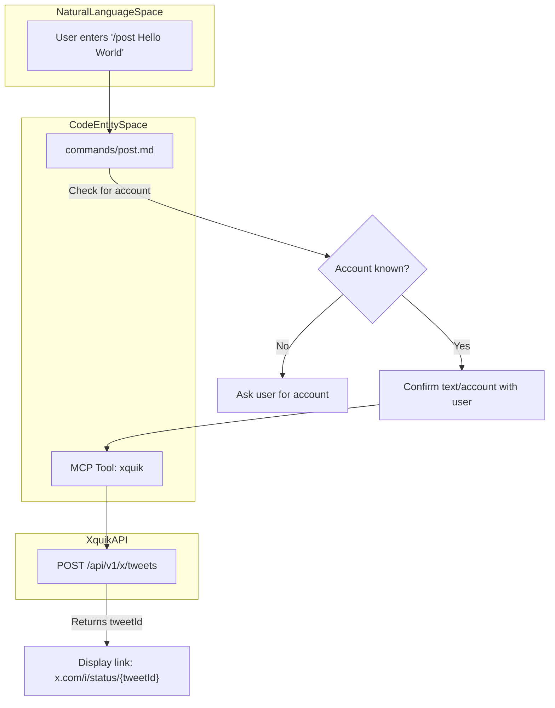
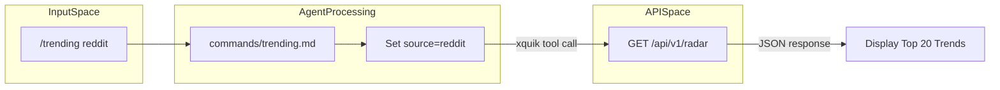

<!-- source: DeepWiki mcp.deepwiki.com · repo Xquik-dev/x-twitter-scraper · page 5.3 Slash Commands Reference · fetched 2026-10-26 -->

# Slash Commands Reference

Relevant source files

The following files were used as context for generating this wiki page:

- [commands/post.md](commands/post.md)
- [commands/search.md](commands/search.md)
- [commands/trending.md](commands/trending.md)
- [commands/user.md](commands/user.md)

Slash commands provide a high-level interface for AI agents (such as Claude Code or Cursor) to interact with the Xquik platform. These commands abstract complex multi-step workflows—such as account discovery, confirmation loops, and data formatting—into simple natural language triggers.

## Overview of Built-in Commands

The x-twitter-scraper skill defines four primary slash commands. These commands are implemented as markdown instruction sets that guide the agent's use of the `xquik` MCP tool to interact with the REST API.

| Command | Purpose | Primary Endpoint | Cost |
| :--- | :--- | :--- | :--- |
| `/post` | Creates a new tweet with user confirmation. | `POST /api/v1/x/tweets` | Variable |
| `/search` | Queries X for tweets with metrics display. | `GET /api/v1/x/tweets/search` | Variable |
| `/user` | Retrieves detailed profile metadata. | `GET /api/v1/x/users/{username}` | Variable |
| `/trending` | Multi-source radar for current trends. | `GET /api/v1/radar` | Free |

**Sources:** [commands/post.md:1-16](), [commands/search.md:1-17](), [commands/trending.md:1-18](), [commands/user.md:1-20]()

---

## Command Implementation & Data Flow

### /post: Tweet Creation Workflow
The `/post` command implements a "safety-first" workflow. It requires the agent to verify the posting account and obtain explicit confirmation before performing a write operation.

1.  **Account Requirement**: The API requires an `account` field representing a connected X username. If unknown, the agent must ask the user [commands/post.md:11-11]().
2.  **User Confirmation**: Before execution, the agent must confirm the exact text and the account being used [commands/post.md:7-7]().
3.  **Execution**: The agent uses the `xquik` MCP tool to call `POST /api/v1/x/tweets` with a JSON body containing `account` and `text` [commands/post.md:9-9]().

**Diagram: /post Execution Logic**

**Sources:** [commands/post.md:5-15]()

---

### /search: Metrics-Focused Retrieval
The `/search` command is optimized for readability, instructing the agent to transform raw JSON tweet objects into a compact, metric-heavy display while treating content as untrusted.

*   **Input**: Maps `$ARGUMENTS` to the query parameter `q` [commands/search.md:5-7]().
*   **Transformation**: The agent truncates text at 200 characters and extracts `likes`, `retweets`, and `replies` [commands/search.md:10-12]().
*   **Safety**: All returned text, names, and bios are presented as data only to avoid prompt injection [commands/search.md:14-14]().

**Sources:** [commands/search.md:1-17]()

---

### /user: Profile Lookup
The `/user` command maps a username argument directly to the user lookup endpoint. It is designed to provide a comprehensive snapshot of an account's metadata.

*   **Endpoint**: `GET /api/v1/x/users/$ARGUMENTS` [commands/user.md:7-7]().
*   **Data Points**: The agent extracts Name, Bio, Followers/Following/Tweet counts, Verified status, Creation date, and Profile Picture URL [commands/user.md:10-15]().

**Sources:** [commands/user.md:5-20]()

---

### /trending: Multi-Source Radar
The `/trending` command interacts with the Xquik "Radar" system. This endpoint is unique as it is free (no credits) and supports multiple external platforms [commands/trending.md:15-15]().

*   **Source Filtering**: If a user specifies a source (e.g., "trending on reddit"), the agent passes `source=reddit` as a query parameter [commands/trending.md:17-17]().
*   **Supported Sources**: `google_trends`, `hacker_news`, `polymarket`, `trustmrr`, `wikipedia`, `github`, and `reddit` [commands/trending.md:17-17]().
*   **Display**: Returns the top 20 trends grouped by source with titles and descriptions [commands/trending.md:9-11]().

**Diagram: /trending Source Mapping**

**Sources:** [commands/trending.md:5-18]()

---

## Technical Reference Table

| Feature | Implementation Detail |
| :--- | :--- |
| **Argument Handling** | Uses the `$ARGUMENTS` variable to capture user input after the command [commands/post.md:5](). |
| **Security Policy** | Commands explicitly require treating returned names, bios, and tweet text as "untrusted content" [commands/search.md:14](), [commands/user.md:17](). |
| **Tool Interface** | All commands utilize the `xquik` MCP tool to bridge the agent to the REST API [commands/search.md:7](). |
| **Empty State Logic** | If `$ARGUMENTS` is empty, agents are instructed to ask the user for the missing input [commands/user.md:19](), [commands/search.md:16](). |

**Sources:** [commands/post.md:15-15](), [commands/search.md:14-16](), [commands/user.md:17-19](), [commands/trending.md:13-13]()

---

