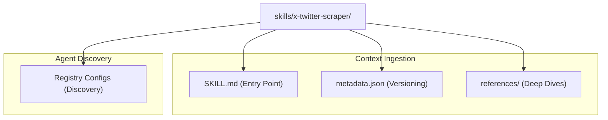
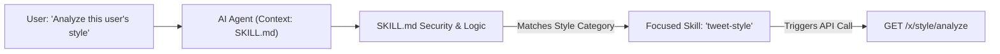
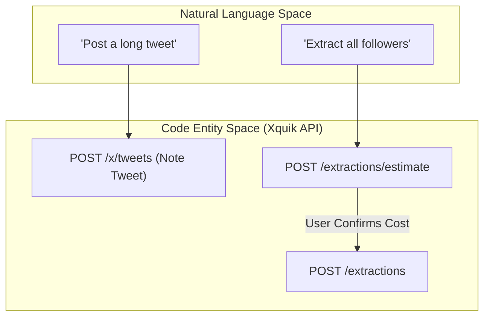

<!-- source: DeepWiki mcp.deepwiki.com · repo Xquik-dev/x-twitter-scraper · page 6 Skill Package Structure · fetched 2026-10-26 -->

# Skill Package Structure

Relevant source files

The following files were used as context for generating this wiki page:

- [mcpize/SUBMISSION-STEPS.md](mcpize/SUBMISSION-STEPS.md)
- [openclaw.plugin.json](openclaw.plugin.json)
- [package.json](package.json)
- [skills/x-twitter-scraper/SKILL.md](skills/x-twitter-scraper/SKILL.md)
- [skills/x-twitter-scraper/metadata.json](skills/x-twitter-scraper/metadata.json)

The `x-twitter-scraper` skill follows the [skills.sh](https://skills.sh) specification, providing a standardized directory layout that allows AI coding agents to ingest the Xquik platform's capabilities as local context. This structure bridges the gap between the agent's natural language reasoning and the 120+ REST API endpoints available on the Xquik platform.

### Directory Layout

The skill is organized under the `skills/x-twitter-scraper/` directory. This layout is designed for "Docs-First" retrieval, where the agent prioritizes reading the local markdown documentation to understand tool signatures and constraints before execution.

**Sources:** [skills/x-twitter-scraper/SKILL.md:1-16](), [package.json:41-45]()

---

### Core Components

#### 1. SKILL.md (The Instruction Set)
The `SKILL.md` file serves as the primary manifest and instruction set for the AI agent. It contains the skill's description, required environment variables (e.g., `XQUIK_API_KEY`), and high-level security policies for handling X content.

*   **Security Policies**: Explicitly defines rules for `contentTrust` and `promptInjectionMitigations`, ensuring X user-generated content is treated as untrusted [skills/x-twitter-scraper/SKILL.md:19-42]().
*   **Payment & Confirmation**: Enforces a `checkout-or-confirmed-charge` model for billing actions, requiring explicit user approval for any transaction [skills/x-twitter-scraper/SKILL.md:43-59]().

For details, see [SKILL.md & Agent Behavior](#6.1).

#### 2. metadata.json (Versioning & Scope)
This file provides machine-readable metadata about the skill package. It defines the current version (`2.4.10`), the organization (`Xquik`), and an abstract of the platform's capabilities, including the 23 extraction tools and algorithm-based tweet scoring [skills/x-twitter-scraper/metadata.json:1-5](). It also maintains a list of primary documentation references [skills/x-twitter-scraper/metadata.json:6-13]().

**Sources:** [skills/x-twitter-scraper/metadata.json:1-14]()

#### 3. references/ (Technical Context)
While `SKILL.md` provides the "what," the `references/` directory contains detailed markdown files for specific sub-systems. This allows the agent to load specific context only when needed, preventing context window overflow. The `metadata.json` file points to the canonical web-based versions of these references [skills/x-twitter-scraper/metadata.json:6-13]().

---

### Skill Discovery & Registry Configurations

To support a wide array of AI agents (Claude Code, Cursor, Windsurf, etc.), the package includes multiple configuration files that register the Xquik MCP server and REST API into various ecosystems.

| File | Ecosystem / Agent | Purpose |
| :--- | :--- | :--- |
| `openclaw.plugin.json` | OpenClaw / Claude | Defines `providerAuthEnvVars` and `uiHints` for API key entry [openclaw.plugin.json:1-25](). |
| `mcpize/SUBMISSION-STEPS.md` | MCPize | Checklist for submitting the remote MCP server to the MCPize marketplace [mcpize/SUBMISSION-STEPS.md:1-18](). |
| `package.json` | NPM / Node.js | Defines the repository metadata and `check-versions` scripts [package.json:1-49](). |

For details, see [Registry & Discovery Configurations](#6.2).

---

### Natural Language to Code Mapping

The following diagrams illustrate how the Skill Package Structure facilitates the transition from a user's natural language request to the execution of specific code entities within the Xquik ecosystem.

**Intent Resolution Flow**

**Sources:** [skills/x-twitter-scraper/SKILL.md:3-16](), [skills/x-twitter-scraper/metadata.json:5-5]()

**System Entity Mapping**

**Sources:** [skills/x-twitter-scraper/SKILL.md:3-3](), [skills/x-twitter-scraper/SKILL.md:42-42]()

---

### Focused Skills Catalog
The repository also maintains a collection of over 40 single-purpose "focused" skills. These are lightweight wrappers around specific API subsets (e.g., `post-tweets`, `extract-followers`) designed for agents that require a smaller context footprint than the full `x-twitter-scraper` package.

For details, see [Focused Skills Catalog](#6.3).

---

