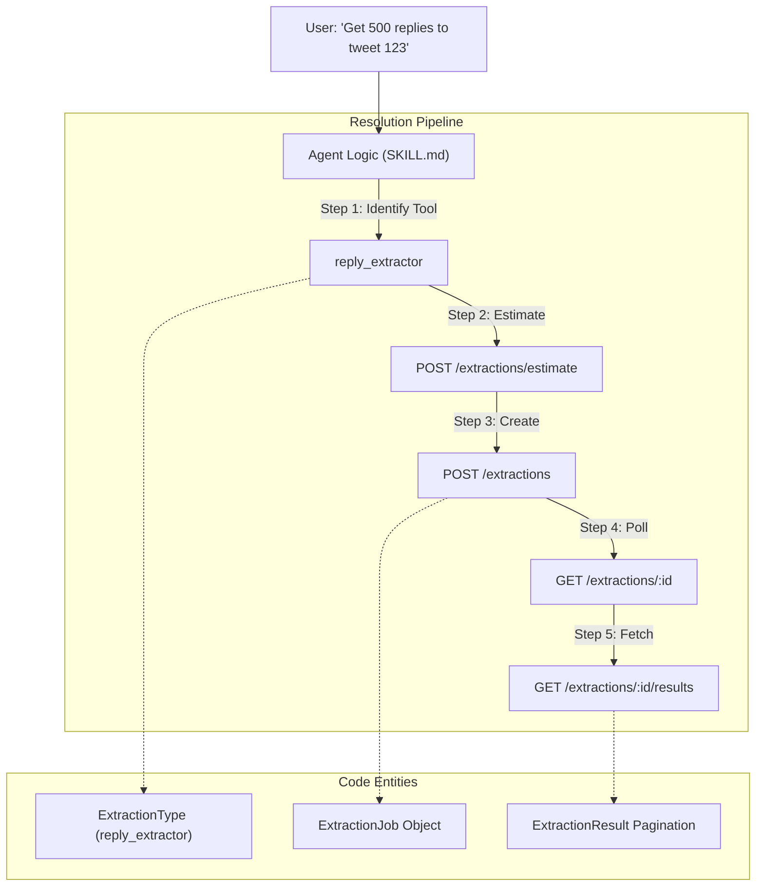
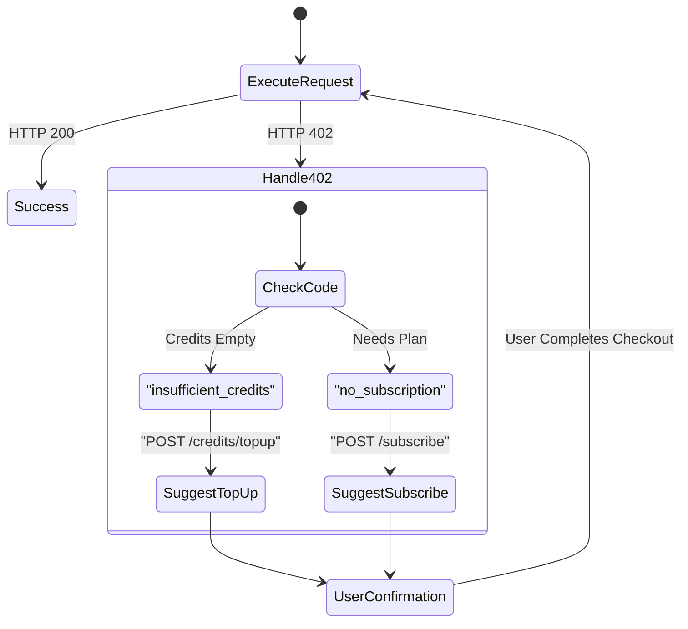

<!-- source: DeepWiki mcp.deepwiki.com · repo Xquik-dev/x-twitter-scraper · page 6.1 SKILL.md & Agent Behavior · fetched 2026-10-26 -->

# SKILL.md & Agent Behavior

Relevant source files

The following files were used as context for generating this wiki page:

- [scripts/check-versions.mjs](scripts/check-versions.mjs)
- [skills/x-twitter-scraper/SKILL.md](skills/x-twitter-scraper/SKILL.md)
- [skills/x-twitter-scraper/references/pricing.md](skills/x-twitter-scraper/references/pricing.md)

This page details the operational logic of the `x-twitter-scraper` skill package. It explains how AI agents (such as Claude, Cursor, or Windsurf) use the `SKILL.md` file as a primary instruction set to navigate the Xquik API, resolve user intent into executable pipelines, and handle complex workflows like bulk extractions and credit management.

## The Docs-First Strategy

The `SKILL.md` file explicitly enforces a **Docs-First** retrieval strategy. Because social media APIs and pricing models evolve rapidly, the agent is instructed to treat its internal training data as potentially outdated and prioritize real-time documentation retrieval.

*   **Primary Source:** [docs.xquik.com](https://docs.xquik.com) is the "source of truth" for limits, pricing, and endpoint schemas [skills/x-twitter-scraper/SKILL.md:18-18]().
*   **Discovery Tool:** The `explore` MCP tool is used to fetch the latest API spec and parameter definitions dynamically [skills/x-twitter-scraper/SKILL.md:104-104]().
*   **Conflict Resolution:** If the skill instructions and the live documentation disagree, the agent is mandated to trust the documentation [skills/x-twitter-scraper/SKILL.md:108-108]().

### Sources:
- [skills/x-twitter-scraper/SKILL.md:18-108]()
- [skills/x-twitter-scraper/SKILL.md:91-94]()

## Request Resolution Pipeline

When a user provides a natural language prompt (e.g., "Get the latest replies to this tweet: https://x.com/user/status/123"), the agent follows a structured resolution pipeline to transform that URL into a paginated data set.

### URL to ID Transformation
The agent must first normalize X (Twitter) URLs into machine-readable identifiers.
1.  **Tweet URLs:** Extracted as `tweetId` (numeric string) for endpoints like `GET /x/tweets/{id}` [skills/x-twitter-scraper/SKILL.md:41-41]().
2.  **User URLs/Handles:** Extracted as `username` (matching `^[A-Za-z0-9_]{1,15}$`) for `GET /x/users/{username}` or converted to a numeric `userId` for timeline/follower requests [skills/x-twitter-scraper/SKILL.md:41-41]().

### Bulk Extraction Lifecycle
For high-volume data needs, the agent moves from simple `GET` requests to the asynchronous extraction pipeline. This requires mandatory estimation before execution [skills/x-twitter-scraper/SKILL.md:42-42]().

| Stage | Action | Code Entity / Endpoint |
| :--- | :--- | :--- |
| **1. Identification** | Select tool type (e.g., `reply_extractor`) | [skills/x-twitter-scraper/references/pricing.md:61-65]() |
| **2. Estimation** | Get cost and time estimate | `POST /extractions/estimate` |
| **3. Execution** | Create the job | `POST /extractions` |
| **4. Polling** | Monitor job status | `GET /extractions/{id}` |
| **5. Pagination** | Fetch result rows | `GET /extractions/{id}/results` |

### Pipeline Data Flow (Natural Language to Code)

The following diagram illustrates how the agent maps a user request to the specific code entities and API endpoints defined in the system.

**Agent Intent Mapping**

### Sources:
- [skills/x-twitter-scraper/SKILL.md:41-42]()
- [skills/x-twitter-scraper/references/pricing.md:59-65]()

## Error Handling & Retry Rules

The agent is governed by strict error-handling rules to prevent unnecessary API consumption and handle billing issues gracefully.

### Retriable vs. Fatal Errors
The agent distinguishes between transient network/server issues and client-side configuration errors. Billing endpoints (like `POST /credits/topup`) are **never** auto-retried [skills/x-twitter-scraper/SKILL.md:54-54]().

| Status | Category | Agent Action |
| :--- | :--- | :--- |
| **429** | Retriable | Rate limit hit (Read: 10/1s, Write: 30/60s). Retry with backoff [skills/x-twitter-scraper/SKILL.md:73-73](). |
| **400 / 401** | Fatal | Stop and ask user to fix input or API key [skills/x-twitter-scraper/SKILL.md:12-12](). |
| **402** | Billing | Trigger the Billing Workflow [skills/x-twitter-scraper/SKILL.md:44-47](). |
| **5xx** | Retriable | Server error. Max 3 retries. |

### Sources:
- [skills/x-twitter-scraper/SKILL.md:12-16]()
- [skills/x-twitter-scraper/SKILL.md:44-59]()
- [skills/x-twitter-scraper/SKILL.md:73-73]()

## 402 Billing & Credit Workflow

Xquik uses a credit-based system where 1 credit equals $0.00015 [skills/x-twitter-scraper/references/pricing.md:14-14](). When an agent encounters a `402 Payment Required` error, it must guide the user through a specific recovery path.

### Billing Resolution Logic
1.  **Detect 402:** Identify if the user needs a subscription or a one-time top-up [skills/x-twitter-scraper/SKILL.md:46-47]().
2.  **Confirmation:** The agent **must** show the exact amount and get explicit confirmation before starting any payment flow [skills/x-twitter-scraper/SKILL.md:51-52]().
3.  **Payment Options:**
    *   **Hosted Checkout:** `POST /credits/topup` creates a Stripe session [skills/x-twitter-scraper/references/pricing.md:143-143]().
    *   **Quick Top-up:** `POST /credits/quick-topup` charges a saved method after confirmation [skills/x-twitter-scraper/references/pricing.md:143-143]().
    *   **MPP (Anonymous):** For pay-per-use via USDC/Crypto on 32 supported endpoints [skills/x-twitter-scraper/references/pricing.md:95-96]().

**Billing State Machine**

### Sources:
- [skills/x-twitter-scraper/SKILL.md:44-59]()
- [skills/x-twitter-scraper/references/pricing.md:14-14]()
- [skills/x-twitter-scraper/references/pricing.md:90-110]()
- [skills/x-twitter-scraper/references/pricing.md:141-146]()

---

