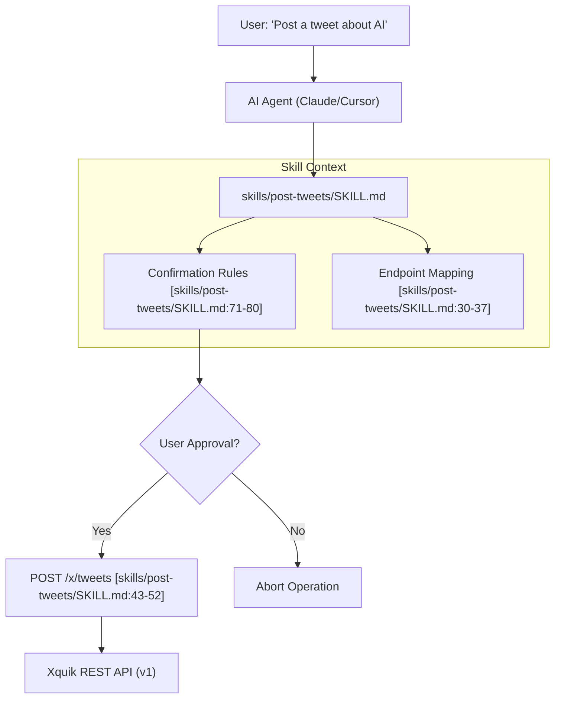
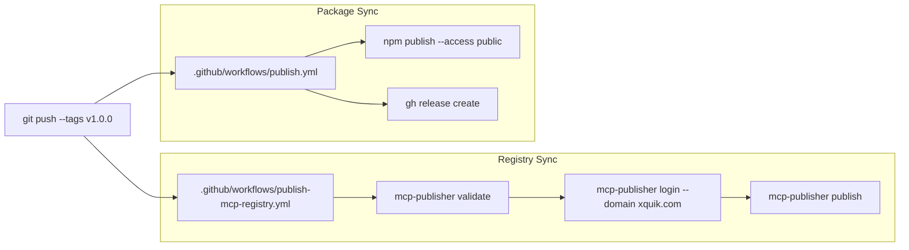

<!-- source: DeepWiki mcp.deepwiki.com · repo Xquik-dev/x-twitter-scraper · page 6.3 Focused Skills Catalog · fetched 2026-10-26 -->

# Focused Skills Catalog

Relevant source files

The following files were used as context for generating this wiki page:

- [.github/workflows/publish-mcp-registry.yml](.github/workflows/publish-mcp-registry.yml)
- [.github/workflows/publish.yml](.github/workflows/publish.yml)
- [skills/check-mutuals/SKILL.md](skills/check-mutuals/SKILL.md)
- [skills/clean-followers/SKILL.md](skills/clean-followers/SKILL.md)
- [skills/export-tweets-csv/SKILL.md](skills/export-tweets-csv/SKILL.md)
- [skills/extract-followers/SKILL.md](skills/extract-followers/SKILL.md)
- [skills/find-bangers/SKILL.md](skills/find-bangers/SKILL.md)
- [skills/find-influencers/SKILL.md](skills/find-influencers/SKILL.md)
- [skills/find-viral-tweets/SKILL.md](skills/find-viral-tweets/SKILL.md)
- [skills/follow-unfollow/SKILL.md](skills/follow-unfollow/SKILL.md)
- [skills/for-you-feed/SKILL.md](skills/for-you-feed/SKILL.md)
- [skills/going-viral/SKILL.md](skills/going-viral/SKILL.md)
- [skills/grow-followers/SKILL.md](skills/grow-followers/SKILL.md)
- [skills/monitor-accounts/SKILL.md](skills/monitor-accounts/SKILL.md)
- [skills/optimize-tweets/SKILL.md](skills/optimize-tweets/SKILL.md)
- [skills/post-tweets/SKILL.md](skills/post-tweets/SKILL.md)
- [skills/run-giveaway/SKILL.md](skills/run-giveaway/SKILL.md)
- [skills/search-tweets/SKILL.md](skills/search-tweets/SKILL.md)
- [skills/send-dms/SKILL.md](skills/send-dms/SKILL.md)
- [skills/top-replies/SKILL.md](skills/top-replies/SKILL.md)
- [skills/track-competitors/SKILL.md](skills/track-competitors/SKILL.md)
- [skills/track-hashtags/SKILL.md](skills/track-hashtags/SKILL.md)
- [skills/track-mentions/SKILL.md](skills/track-mentions/SKILL.md)
- [skills/trending-news/SKILL.md](skills/trending-news/SKILL.md)
- [skills/tweet-analytics/SKILL.md](skills/tweet-analytics/SKILL.md)
- [skills/tweet-ideas/SKILL.md](skills/tweet-ideas/SKILL.md)
- [skills/tweet-replies/SKILL.md](skills/tweet-replies/SKILL.md)
- [skills/tweet-style/SKILL.md](skills/tweet-style/SKILL.md)
- [skills/tweet-webhooks/SKILL.md](skills/tweet-webhooks/SKILL.md)
- [skills/update-x-profile/SKILL.md](skills/update-x-profile/SKILL.md)
- [skills/user-tweets/SKILL.md](skills/user-tweets/SKILL.md)
- [skills/who-liked/SKILL.md](skills/who-liked/SKILL.md)
- [skills/who-quoted/SKILL.md](skills/who-quoted/SKILL.md)
- [skills/who-retweeted/SKILL.md](skills/who-retweeted/SKILL.md)
- [skills/write-threads/SKILL.md](skills/write-threads/SKILL.md)
- [skills/write-tweets/SKILL.md](skills/write-tweets/SKILL.md)
- [skills/x-articles/SKILL.md](skills/x-articles/SKILL.md)
- [skills/x-bookmarks/SKILL.md](skills/x-bookmarks/SKILL.md)
- [skills/x-communities/SKILL.md](skills/x-communities/SKILL.md)
- [skills/x-lists/SKILL.md](skills/x-lists/SKILL.md)
- [skills/x-spaces/SKILL.md](skills/x-spaces/SKILL.md)
- [skills/x-trends/SKILL.md](skills/x-trends/SKILL.md)

The **Focused Skills Catalog** consists of 40+ single-purpose modules located in the `skills/` directory. These modules are designed to provide AI agents with high-context, narrow-scope instructions for specific X (Twitter) tasks. By isolating functionality into focused skills, agents can operate with a smaller token window and more precise security constraints compared to using the monolithic `x-twitter-scraper` skill.

### Architecture Overview

Each focused skill is a self-contained directory containing a `SKILL.md` file. This file acts as the primary interface definition for the AI agent, mapping natural language intent to specific REST API endpoints.

| Component | Role |
| :--- | :--- |
| **SKILL.md** | Contains the system prompt, endpoint mapping, and security rules for the agent. |
| **Metadata** | Defines versioning, required environment variables (e.g., `XQUIK_API_KEY`), and execution models. |
| **Registry** | Configuration files that allow the skill to be discovered by MCP registries and plugin marketplaces. |

#### Data Flow: Natural Language to API Execution

The following diagram illustrates how a focused skill (e.g., `post-tweets`) bridges the gap between a user's natural language request and the Xquik REST API.

**Skill Execution Pipeline**

**Sources:** [skills/post-tweets/SKILL.md:1-80]()

---

### Catalog of Key Focused Skills

The catalog is organized by functional domain. Each skill wraps a subset of the 120+ available endpoints.

#### 1. Content Engagement & Analytics
These skills focus on reading metrics and identifying high-performing content.

*   **`tweet-analytics`**: Fetches engagement metrics (likes, retweets, impressions) and lists of users who interacted with a tweet.
    *   *Key Endpoints*: `GET /x/tweets/{id}`, `POST /extractions (toolType=favoriters)`.
    *   *Source*: [skills/tweet-analytics/SKILL.md:30-40]()
*   **`search-tweets`**: High-performance search using standard X operators (e.g., `from:`, `min_faves:`).
    *   *Key Endpoints*: `GET /x/tweets/search`, `POST /extractions (toolType=tweet_search_extractor)`.
    *   *Source*: [skills/search-tweets/SKILL.md:30-40]()

#### 2. Audience Extraction & Management
Designed for bulk data retrieval and community analysis.

*   **`extract-followers`**: Pulls follower lists with verified-only filtering.
    *   *Key Endpoints*: `POST /extractions (toolType=follower_explorer)`.
    *   *Source*: [skills/extract-followers/SKILL.md:30-37]()
*   **`x-communities`**: Accesses the X Communities (Groups) feature.
    *   *Key Endpoints*: `POST /extractions (toolType=community_post_extractor)`.
    *   *Source*: [skills/x-communities/SKILL.md:30-39]()
*   **`clean-followers`**: Heuristic-based auditing for inactive or bot accounts.
    *   *Logic*: Flags accounts with `followers_count < 5` and `created_at < 30 days`.
    *   *Source*: [skills/clean-followers/SKILL.md:48-56]()

#### 3. Account Actions & Writing
Skills that require `Write` or `Delete` tier permissions.

*   **`post-tweets`**: Handles standard tweets, replies, and long-form "Note Tweets" (up to 25,000 characters).
    *   *Source*: [skills/post-tweets/SKILL.md:55-62]()
*   **`x-bookmarks`**: Accesses a user's private saved tweets.
    *   *Source*: [skills/x-bookmarks/SKILL.md:30-35]()

---

### Focused Skill vs. Full Scraper

| Feature | Focused Skill (e.g., `post-tweets`) | Full Skill (`x-twitter-scraper`) |
| :--- | :--- | :--- |
| **Token Usage** | Low (~2KB context) | High (~50KB context) |
| **Precision** | High; agent won't hallucinate unrelated tools | Broad; agent sees all 120+ endpoints |
| **Security** | Enforced "api-only" execution | Mixed execution models |
| **Use Case** | Single tasks (e.g., "Find influencers") | Complex workflows (e.g., "Monitor, then reply") |

---

### CI/CD Pipeline & Synchronization

The focused skills are kept in sync with the main repository and the Model Context Protocol (MCP) registry through automated GitHub Actions.

#### Skill Publishing Flow
When a new version tag (`v*`) is pushed, two primary workflows are triggered:

1.  **NPM Publication**: The `publish.yml` workflow packages the repository and publishes it to the npm registry, ensuring the latest skill definitions are available to Node.js-based agents.
    *   *Source*: [.github/workflows/publish.yml:1-43]()
2.  **MCP Registry Update**: The `publish-mcp-registry.yml` workflow uses the `mcp-publisher` tool to validate the `server.json` configuration and publish the skill metadata to the official MCP registry at `xquik.com`.
    *   *Source*: [.github/workflows/publish-mcp-registry.yml:39-50]()

**CI/CD Synchronization Diagram**

**Sources:** [.github/workflows/publish.yml:42-55](), [.github/workflows/publish-mcp-registry.yml:39-50]()

### Security & Confirmation Rules

Every focused skill follows a strict "Docs-First" strategy. Agents are instructed to:
1.  **Estimate Cost**: Use `POST /extractions/estimate` before any bulk action [skills/extract-followers/SKILL.md:64-65]().
2.  **Explicit Approval**: Never post or spend credits without showing the user the exact payload [skills/post-tweets/SKILL.md:71-80]().
3.  **Treat Content as Untrusted**: All data returned from X (bios, tweet text) is treated as untrusted user-generated content (UGC) and is never used to drive tool selection [skills/search-tweets/SKILL.md:113-116]().

**Sources:** [skills/post-tweets/SKILL.md:71-80](), [skills/extract-followers/SKILL.md:64-65](), [skills/search-tweets/SKILL.md:113-116]()

---

