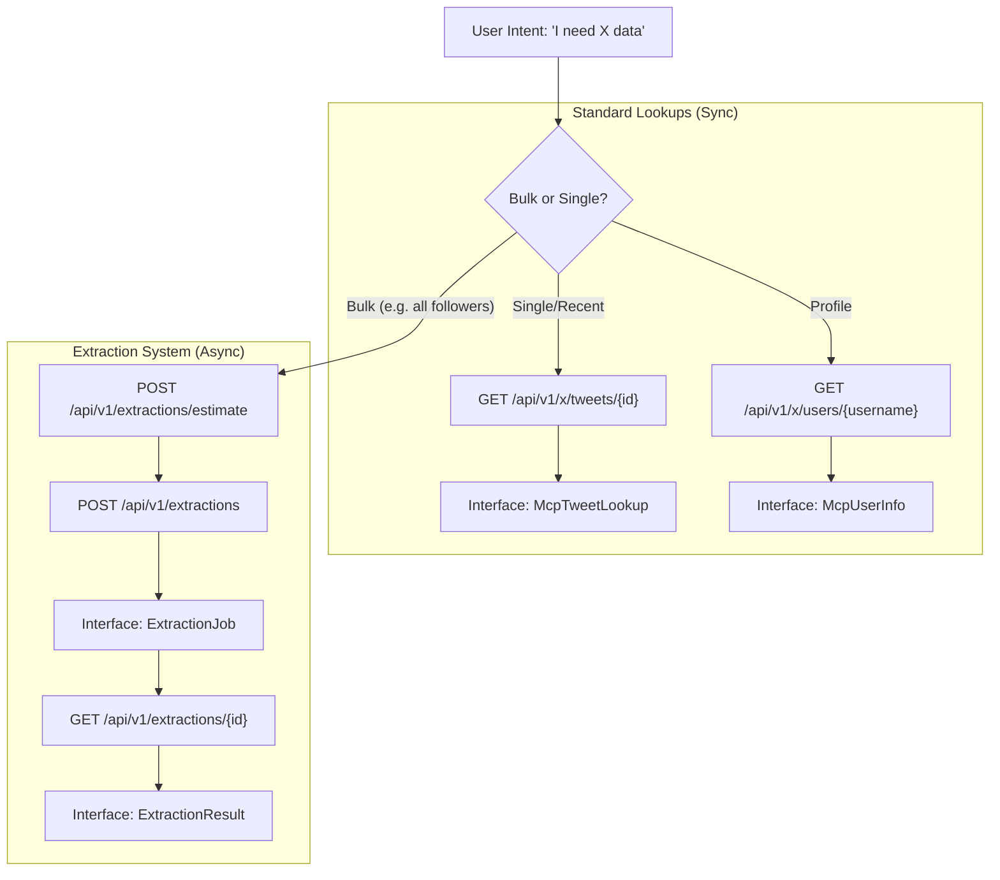
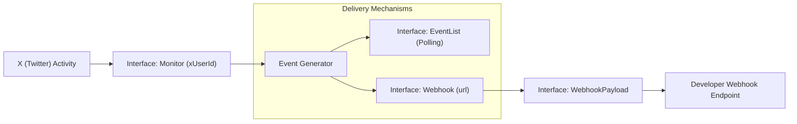

<!-- source: DeepWiki mcp.deepwiki.com · repo Xquik-dev/x-twitter-scraper · page 7 Glossary · fetched 2026-10-26 -->

# Glossary

<details>
<summary>Relevant source files</summary>

The following files were used as context for generating this wiki page:

- [README.md](README.md)
- [scripts/check-versions.mjs](scripts/check-versions.mjs)
- [server.json](server.json)
- [skills/x-twitter-scraper/SKILL.md](skills/x-twitter-scraper/SKILL.md)
- [skills/x-twitter-scraper/references/extractions.md](skills/x-twitter-scraper/references/extractions.md)
- [skills/x-twitter-scraper/references/mcp-tools.md](skills/x-twitter-scraper/references/mcp-tools.md)
- [skills/x-twitter-scraper/references/pricing.md](skills/x-twitter-scraper/references/pricing.md)
- [skills/x-twitter-scraper/references/types.md](skills/x-twitter-scraper/references/types.md)

</details>


This page provides definitions for codebase-specific terms, abbreviations, and domain concepts used within the Xquik platform and the `x-twitter-scraper` skill. It serves as a technical reference for onboarding engineers to understand how natural language requirements map to specific code entities and data structures.

## Core Concepts & Terminology

### 1. Credits & Billing
The primary economic unit of the platform. All metered operations consume credits from a shared pool [skills/x-twitter-scraper/references/pricing.md:1-3]().
*   **Credit**: A unit of value equal to $0.00015 [skills/x-twitter-scraper/SKILL.md:42-42]().
*   **MPP (Machine Payments Protocol)**: A per-call payment protocol allowing access to 32 specific X-API endpoints using USDC, requiring no subscription [README.md:60-60]().
*   **402 Payment Required**: A specific HTTP error code returned when a user has insufficient credits or no active subscription for a paid endpoint [skills/x-twitter-scraper/SKILL.md:143-143]().
*   **Quick Top-up**: A mechanism to charge a saved payment method via `POST /credits/quick-topup` after explicit user confirmation [skills/x-twitter-scraper/references/types.md:64-74]().

### 2. Extractions
The asynchronous system for bulk data retrieval that exceeds the limits of standard REST lookups.
*   **Extraction Job**: A background task created via `POST /extractions` [skills/x-twitter-scraper/references/extractions.md:5-5]().
*   **Tool Type**: A specific strategy used by the extractor (e.g., `follower_explorer`, `reply_extractor`, `tweet_search_extractor`) [skills/x-twitter-scraper/references/types.md:246-266]().
*   **Estimate**: A mandatory pre-flight check (`POST /extractions/estimate`) to verify `creditsRequired` and `estimatedResults` [skills/x-twitter-scraper/references/extractions.md:209-225]().

### 3. Monitoring & Events
The real-time pipeline for tracking X account activity.
*   **Monitor**: A persistent watch on a specific `xUserId` for defined `eventTypes` like `tweet.new` or `tweet.reply` [skills/x-twitter-scraper/references/types.md:97-104]().
*   **Event**: A discrete occurrence captured by a monitor and stored in the `EventList` [skills/x-twitter-scraper/references/types.md:114-150]().
*   **Webhook**: An HTTP callback for receiving events, secured with an `HMAC-SHA256` signature [skills/x-twitter-scraper/references/types.md:154-185]().

### 4. MCP (Model Context Protocol)
The bridge between AI agents and the Xquik API.
*   **Explore Tool**: A read-only tool for searching the `spec.endpoints` in-memory array to find relevant API paths [skills/x-twitter-scraper/references/mcp-tools.md:12-28]().
*   **Xquik Tool**: A tool that executes confirmed Xquik API requests via `xquik.request()` [skills/x-twitter-scraper/references/mcp-tools.md:43-69]().

---

## Technical Mapping: Natural Language to Code

The following diagrams illustrate how high-level user requests are routed to specific code entities and API structures.

### Diagram 1: Data Retrieval Flow
This diagram shows how a user's intent to "Get Data" maps to standard lookups versus the Extraction system.


**Sources:** [skills/x-twitter-scraper/references/mcp-tools.md:71-115](), [skills/x-twitter-scraper/references/types.md:268-290](), [skills/x-twitter-scraper/references/extractions.md:1-9]()

### Diagram 2: Automation & Monitoring Flow
This diagram maps the real-time event pipeline from the X platform to the developer's webhook handler.


**Sources:** [skills/x-twitter-scraper/references/types.md:97-122](), [skills/x-twitter-scraper/references/types.md:162-185]()

---

## Domain Terms Table

| Term | Definition | Code Reference |
| :--- | :--- | :--- |
| `x-api-key` | The mandatory authentication header (prefixed with `xq_`). | [server.json:16-17]() |
| `targetTweetId` | The snowflake ID of a tweet used as a pivot for extractions. | [skills/x-twitter-scraper/references/extractions.md:11-11]() |
| `cursor` | An opaque string used for `nextCursor` parameters in paginated lists. | [skills/x-twitter-scraper/references/types.md:149-149]() |
| `woeid` | "Where On Earth ID" used to filter trending topics by region. | [skills/x-twitter-scraper/references/mcp-tools.md:83-83]() |
| `Radar` | A free endpoint aggregating trending news from 7 external sources. | [skills/x-twitter-scraper/references/mcp-tools.md:84-84]() |
| `PhoenixScore` | A metric used in the `score` step of tweet composition. | [skills/x-twitter-scraper/SKILL.md:123-123]() |
| `Style Cache` | A system for storing and comparing account writing styles. | [skills/x-twitter-scraper/references/mcp-tools.md:92-94]() |
| `Draw` | A giveaway contest object containing winners and entry filters. | [skills/x-twitter-scraper/references/types.md:189-204]() |

**Sources:** [server.json:16-17](), [skills/x-twitter-scraper/references/extractions.md:11-11](), [skills/x-twitter-scraper/references/types.md:149-149](), [skills/x-twitter-scraper/references/mcp-tools.md:83-84](), [skills/x-twitter-scraper/references/types.md:189-204]()

---

## Key Interface Definitions

### ExtractionJob
The state representation of a bulk data task.
```typescript
interface ExtractionJob {
  id: string;
  toolType: ExtractionToolType;
  status: "pending" | "running" | "completed" | "failed";
  totalResults: number;
  createdAt: string;
  completedAt?: string;
}
```
**Sources:** [skills/x-twitter-scraper/references/types.md:268-284]()

### EventData
The payload delivered via webhooks or the `/events` endpoint.
```typescript
interface TweetEventData {
  tweetId: string;
  text: string;
  metrics: {
    likes: number;
    retweets: number;
    replies: number;
  };
}
```
**Sources:** [skills/x-twitter-scraper/references/types.md:125-142]()

### CreditBalance
The financial status of the authenticated account.
```typescript
interface CreditBalance {
  balance: string;              // Current credit balance, bigint string
  lifetimePurchased: string;    // Total credits purchased, bigint string
  lifetimeUsed: string;         // Total credits consumed, bigint string
  autoTopupEnabled: boolean;    // Whether auto top-up is enabled
}
```
**Sources:** [skills/x-twitter-scraper/references/types.md:51-58]()