# Page: Overview

# Overview

<details>
<summary>Relevant source files</summary>

The following files were used as context for generating this wiki page:

- [README.md](README.md)
- [mcpize/SUBMISSION-STEPS.md](mcpize/SUBMISSION-STEPS.md)
- [openclaw.plugin.json](openclaw.plugin.json)
- [package.json](package.json)
- [skills/x-twitter-scraper/metadata.json](skills/x-twitter-scraper/metadata.json)

</details>


The **x-twitter-scraper** (Xquik) platform is a high-performance, cost-effective alternative to the official X (Twitter) API, designed specifically for AI coding agents and developers. It provides a comprehensive suite of tools for real-time data retrieval, bulk extraction, account management, and automation workflows.

The platform is structured as a "Skill" for AI agents, exposing 100+ REST API endpoints through a Model Context Protocol (MCP) server [README.md:1-12](). It supports over 40 AI coding environments, including Claude Code, Cursor, and Windsurf [README.md:16-17]().

### Core Value Proposition

Xquik offers a significant price advantage over the official X API, with read operations starting at **$0.00015 per call** (approximately 33x cheaper than X's Basic tier) [README.md:14-27]().

| Feature | Xquik | Official X API (Pay-per-usage) |
| :--- | :--- | :--- |
| **Tweet Read** | $0.00015 | $0.005 |
| **User Lookup** | $0.00015 | $0.010 |
| **Write Actions** | $0.0015 | $0.015 - $0.20 |
| **Bulk Extraction** | $0.00015/result | Charged per resource |

Sources: [README.md:18-54]()

### System Architecture

The Xquik ecosystem bridges high-level AI agent requests to low-level X data operations through three primary layers: the **Skill Interface**, the **MCP Server**, and the **REST API**.

#### Conceptual Bridge: Agent to API
This diagram illustrates how natural language instructions from an AI agent are translated into code entities and executed against the Xquik infrastructure.

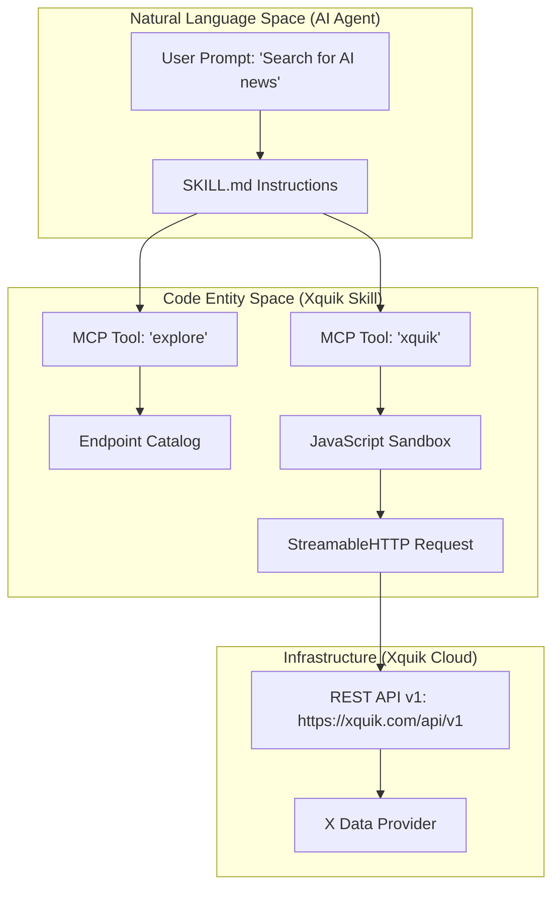
Sources: [README.md:12](), [skills/x-twitter-scraper/metadata.json:5-5](), [mcpize/SUBMISSION-STEPS.md:9-10]()

### Key Functional Areas

1.  **X Lookups & Writes**: Synchronous access to tweets, user profiles, engagement metrics, and the ability to post, like, or DM [README.md:140-143, 150-154]().
2.  **Bulk Extractions**: Asynchronous processing for high-volume data (e.g., extracting followers) using 23 specialized tool types [README.md:144-148, 48-50]().
3.  **Monitors & Webhooks**: Real-time event tracking (new tweets, follower changes) delivered via HMAC-signed webhooks [README.md:152-153, 32-32]().
4.  **Flow Automations**: A trigger-action workflow system for building automated pipelines [skills/x-twitter-scraper/metadata.json:5-5]().
5.  **Giveaway Draws**: Auditable contest management with complex filtering (e.g., `mustRetweet`, `minFollowers`) [README.md:51-51, 33-33]().

#### Entity Relationship Diagram
This diagram maps the core data entities mentioned in the metadata and README to their functional roles.

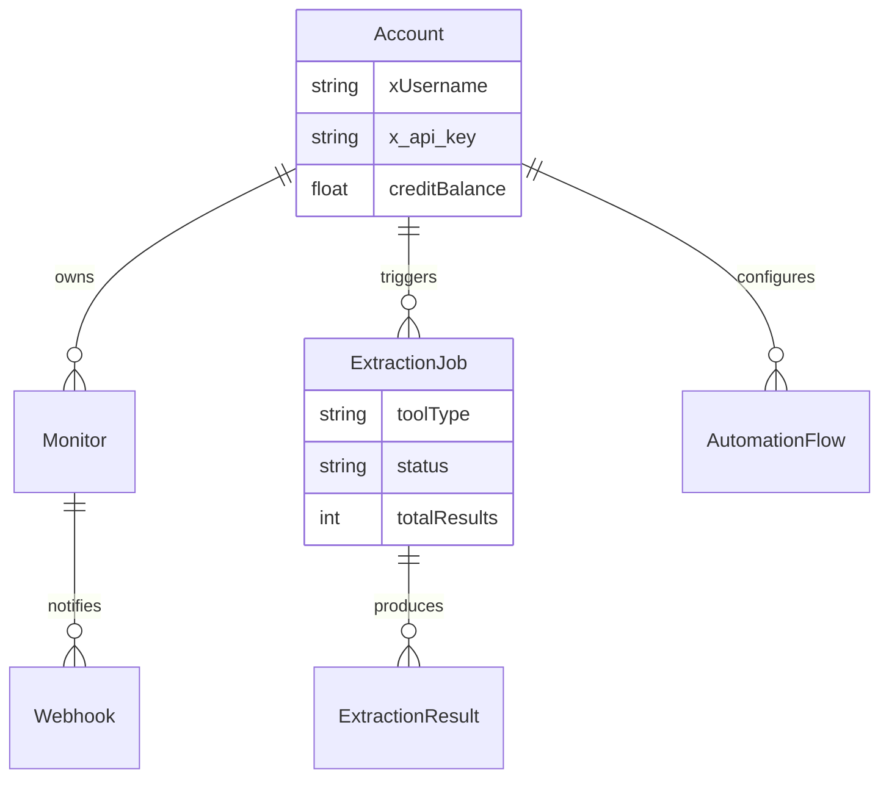
Sources: [README.md:48-53](), [skills/x-twitter-scraper/metadata.json:5-5](), [openclaw.plugin.json:8-16]()

### Getting Started

To integrate Xquik into your development environment, you must first install the skill and configure authentication.

*   **Installation**: The skill can be installed via the `skills` CLI or by cloning the repository into specific agent directories (e.g., `.claude/skills/` or `.agents/skills/`) [README.md:62-135]().
*   **Authentication**: Most operations require an `x-api-key` header [mcpize/SUBMISSION-STEPS.md:16-17](). Xquik also supports the **Machine Payments Protocol (MPP)** for anonymous, per-request payments on select endpoints [README.md:60-60]().

For detailed setup instructions, see **[Getting Started & Installation](#1.1)**.
For information on billing and the credit system, see **[Authentication & Credits](#1.2)**.

Sources: [README.md:55-135](), [openclaw.plugin.json:7-17](), [mcpize/SUBMISSION-STEPS.md:1-18]()

---

# Page: Getting Started & Installation

# Getting Started & Installation

<details>
<summary>Relevant source files</summary>

The following files were used as context for generating this wiki page:

- [README.md](README.md)
- [skills/x-twitter-scraper/references/mcp-setup.md](skills/x-twitter-scraper/references/mcp-setup.md)
- [start.sh](start.sh)

</details>


This page provides a comprehensive guide for onboarding to the Xquik platform. It covers obtaining authentication credentials, installing the skill into various AI agent environments (Claude Code, Cursor, Windsurf, etc.), and verifying the integration.

The `x-twitter-scraper` skill is designed to bridge AI coding agents with the Xquik REST API, offering 120+ endpoints for X (Twitter) data extraction, monitoring, and write actions at a fraction of the official API cost [README.md:12-14]().

## 1. Obtaining an API Key

Before installing the skill, you must obtain an `x-api-key`. This key authenticates your requests to the Xquik infrastructure and manages your credit balance.

1.  Navigate to the [Xquik Dashboard](https://dashboard.xquik.com/account) [skills/x-twitter-scraper/references/mcp-setup.md:11]().
2.  Create an account or sign in.
3.  Generate a new API key. It is recommended to use a scoped, revocable key rather than your primary account key [skills/x-twitter-scraper/references/mcp-setup.md:11]().
4.  **Note**: For anonymous access to a subset of 32 endpoints, you may use the Machine Payments Protocol (MPP) via USDC/SDK without an account [README.md:60]().

### Data Flow: Authentication & Initialization
The following diagram illustrates how the `x-api-key` flows from the user configuration into the Model Context Protocol (MCP) environment.

**Auth Configuration Flow**
```mermaid
graph TD
    subgraph "User Environment"
        "UserConfig"["User Configuration (.mcp.json / config.toml)"]
        "APIKey"["x-api-key (xq_...)"]
    end

    subgraph "AI Agent Skill"
        "RegistryConfig"["server.json / marketplace.json"]
        "SkillMD"["SKILL.md"]
    end

    subgraph "Xquik Infrastructure"
        "MCP_Server"["MCP Server (https://xquik.com/mcp)"]
        "REST_API"["REST API v1 (https://xquik.com/api/v1)"]
    end

    "UserConfig" -->| "Defines" | "APIKey"
    "RegistryConfig" -->| "References" | "APIKey" ["skills/x-twitter-scraper/references/mcp-setup.md:52-66"]
    "APIKey" -->| "Injected as Header" | "MCP_Server" ["skills/x-twitter-scraper/references/mcp-setup.md:9"]
    "SkillMD" -->| "Guides Agent Logic" | "APIKey"
    "MCP_Server" -->| "Proxies to" | "REST_API" ["skills/x-twitter-scraper/references/mcp-setup.md:185"]
```
**Sources:** [skills/x-twitter-scraper/references/mcp-setup.md:1-12](), [README.md:55-61]()

## 2. Installation Methods

The skill can be installed automatically using the `skills` CLI or manually by cloning the repository into specific agent directories.

### 2.1. Automatic Installation (Recommended)
The [skills CLI](https://skills.sh) automatically detects your installed agents (Claude Code, Cursor, Windsurf, etc.) and places the skill in the correct directory [README.md:62-68]().

```bash
npx skills@1.5.3 add Xquik-dev/x-twitter-scraper
```

### 2.2. Manual Installation by Agent
If you prefer manual setup, clone the repository into the appropriate "skills" folder for your specific AI tool [README.md:70-134]().

| Agent | Installation Path |
| :--- | :--- |
| **Claude Code** | `.claude/skills/x-twitter-scraper` |
| **Codex / Cursor / GitHub Copilot** | `.agents/skills/x-twitter-scraper` |
| **Windsurf** | `.windsurf/skills/x-twitter-scraper` |
| **Roo Code** | `.roo/skills/x-twitter-scraper` |
| **Continue** | `.continue/skills/x-twitter-scraper` |
| **Goose** | `.goose/skills/x-twitter-scraper` |

**Sources:** [README.md:70-134]()

## 3. MCP Server Configuration

The skill connects to a remote MCP server hosted at `https://xquik.com/mcp` [skills/x-twitter-scraper/references/mcp-setup.md:8](). This server provides two core tools: `explore` for documentation and `xquik` for execution [skills/x-twitter-scraper/references/mcp-setup.md:178-184]().

### 3.1. Client Setup Examples
Most agents require adding the server to a configuration file with the `x-api-key` header.

*   **Claude Code (`.mcp.json`)**: Use type `http` and provide the URL and headers [skills/x-twitter-scraper/references/mcp-setup.md:52-66]().
*   **Claude Desktop (`claude_desktop_config.json`)**: Requires the `mcp-remote` bridge to translate stdio to HTTP [skills/x-twitter-scraper/references/mcp-setup.md:17-46]().
*   **Cursor (`mcp.json`)**: Add the server URL and the `x-api-key` header [skills/x-twitter-scraper/references/mcp-setup.md:106-122]().

**System Entity Mapping: Skill to Code**
```mermaid
graph LR
    subgraph "Natural Language Space"
        "SearchConcept"["Search for Tweets"]
        "ExtractionConcept"["Extract Followers"]
        "MonitoringConcept"["Track Account"]
    end

    subgraph "Code Entity Space"
        "ExploreTool"["explore (tool)"]
        "XquikTool"["xquik (tool)"]
        "REST_Endpoints"["120+ REST Endpoints"]
    end

    "SearchConcept" -.-> "ExploreTool"
    "ExtractionConcept" -.-> "XquikTool"
    "MonitoringConcept" -.-> "XquikTool"
    "ExploreTool" -->| "Catalogs" | "REST_Endpoints" ["skills/x-twitter-scraper/references/mcp-setup.md:182"]
    "XquikTool" -->| "Executes" | "REST_Endpoints" ["skills/x-twitter-scraper/references/mcp-setup.md:183"]
```
**Sources:** [skills/x-twitter-scraper/references/mcp-setup.md:176-186](), [README.md:136-152]()

## 4. Verifying the Setup

After installation, verify the setup by asking your AI agent to perform a simple, low-cost "Read" operation.

### 4.1. Verification Commands
Run the following prompt in your agent's chat interface:

> "Check my Xquik account details and search for the latest tweet from @Xquik-dev."

### 4.2. Expected Behavior
1.  **Auth Check**: The agent should locate the `x-api-key` in its configuration [skills/x-twitter-scraper/references/mcp-setup.md:9]().
2.  **Tool Discovery**: The agent uses the `explore` tool to find the correct endpoint for account info (`GET /account`) and tweet search (`GET /search/tweets`) [skills/x-twitter-scraper/references/mcp-setup.md:182]().
3.  **Execution**: The agent calls the `xquik` tool to execute the requests [skills/x-twitter-scraper/references/mcp-setup.md:183]().
4.  **Output**: The agent returns your current plan/usage and the requested tweet data [README.md:38-54]().

### 4.3. Troubleshooting
If the agent fails to connect:
*   **Check Headers**: Ensure the header key is exactly `x-api-key` [skills/x-twitter-scraper/references/mcp-setup.md:9]().
*   **Verify URL**: The endpoint must be `https://xquik.com/mcp` [skills/x-twitter-scraper/references/mcp-setup.md:8]().
*   **Permissions**: Ensure the agent has network access to `xquik.com`.
*   **Bridge Status**: If using Claude Desktop, verify `mcp-remote` is installed globally [skills/x-twitter-scraper/references/mcp-setup.md:23-27]().

**Sources:** [skills/x-twitter-scraper/references/mcp-setup.md:1-46](), [README.md:62-134]()

---

# Page: Authentication & Credits

# Authentication & Credits

<details>
<summary>Relevant source files</summary>

The following files were used as context for generating this wiki page:

- [scripts/check-versions.mjs](scripts/check-versions.mjs)
- [skills/x-twitter-scraper/SKILL.md](skills/x-twitter-scraper/SKILL.md)
- [skills/x-twitter-scraper/references/pricing.md](skills/x-twitter-scraper/references/pricing.md)

</details>


This page details the security and economic model of the Xquik platform. It covers the header-based authentication scheme, the granular credit system, rate-limiting tiers, and the decentralized MPP payment protocol.

## Authentication Scheme

Xquik uses a symmetric key authentication model. Every request to the REST API or the MCP server must include an `x-api-key` header [skills/x-twitter-scraper/SKILL.md:12-16]().

### API Key Lifecycle
1.  **Generation**: Keys are generated via the Xquik dashboard. The skill never handles X login material directly [skills/x-twitter-scraper/SKILL.md:101-101]().
2.  **Format**: Keys follow the pattern `xq_` followed by 64 hexadecimal characters [skills/x-twitter-scraper/SKILL.md:3-3]().
3.  **Security**: The skill authenticates only with this Xquik API key and does not ask for, transmit, store, or log any X account login material (passwords, cookies, or TOTP) [skills/x-twitter-scraper/SKILL.md:20-25]().
4.  **Dashboard Integration**: Connecting or re-authenticating an X account is performed entirely by the user in the Xquik dashboard via a browser-based flow [skills/x-twitter-scraper/SKILL.md:75-75]().

### Implementation Example
```javascript
const headers = { 
  "x-api-key": "xq_your_64_char_hex_key", 
  "Content-Type": "application/json" 
};
```
[server.json:176-176]()

**Sources:** [skills/x-twitter-scraper/SKILL.md:3-101](), [server.json:176-183]()

---

## Credit-Based Billing Model

Xquik operates on a "unit-of-work" credit system where 1 credit is valued at **$0.00015** [skills/x-twitter-scraper/references/pricing.md:14-14](). Credits are consumed from a shared pool for metered operations.

### Operation Cost Tiers

| Tier | Cost | Example Operations |
| :--- | :--- | :--- |
| **Free** | 0 Credits | Webhooks, AI Compose, Radar, Style Cache, Estimates [skills/x-twitter-scraper/references/pricing.md:71-73]() |
| **Read (Standard)** | 1 Credit | Get Tweet, Search (per tweet), Timeline, DM History [skills/x-twitter-scraper/references/pricing.md:20-38]() |
| **Read (Trends)** | 3 Credits | Trends (per call) [skills/x-twitter-scraper/references/pricing.md:40-44]() |
| **Read (Deep)** | 5 Credits | Follow Check, Get X Article [skills/x-twitter-scraper/references/pricing.md:46-52]() |
| **Write** | 10 Credits | Post Tweet, Like, Retweet, Follow, Update Profile [skills/x-twitter-scraper/references/pricing.md:53-56]() |
| **Bulk/Draws** | Variable | Extractions (1-5/res), Giveaway Draws (1/entry) [skills/x-twitter-scraper/references/pricing.md:57-66]() |

### Data Flow: Credit Validation & Consumption
The following diagram illustrates how the system validates credits before executing a metered tool like a bulk extraction.

**System Logic: Credit Check Flow**
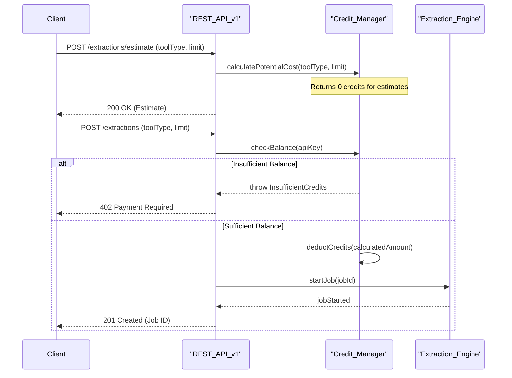
**Sources:** [skills/x-twitter-scraper/references/pricing.md:57-73](), [skills/x-twitter-scraper/SKILL.md:42-59]()

---

## Rate Limit Tiers

Rate limits are enforced per-method-tier using a fixed-window counter [skills/x-twitter-scraper/SKILL.md:73-73]().

| Tier | Limit | Scope |
| :--- | :--- | :--- |
| **Read** | 10 requests / 1s | GET requests (Lookups, Search) |
| **Write** | 30 requests / 60s | POST/PATCH requests (Posting, Liking, Billing) |
| **Delete** | 15 requests / 60s | DELETE requests (Unfollowing, Unliking) |

**Sources:** [skills/x-twitter-scraper/SKILL.md:59-87]()

---

## MPP: Anonymous Payment Protocol

The **Multi-Party Payment (MPP)** protocol allows for pay-per-use access to 32 specific X-API endpoints without requiring a monthly subscription [skills/x-twitter-scraper/references/pricing.md:90-96]().

### Protocol Mechanism
1.  **402 Challenge**: When a client calls an MPP-supported endpoint without sufficient credits or a key, the server returns an HTTP 402 status.
2.  **USDC Settlement**: The client uses the `mppx` SDK and `viem` to settle the micro-payment via blockchain [skills/x-twitter-scraper/references/pricing.md:133-133]().
3.  **Fulfillment**: The agent must display the exact amount and get explicit user confirmation before every transaction [skills/x-twitter-scraper/SKILL.md:47-52]().

**Code Entity Association: MPP Support**
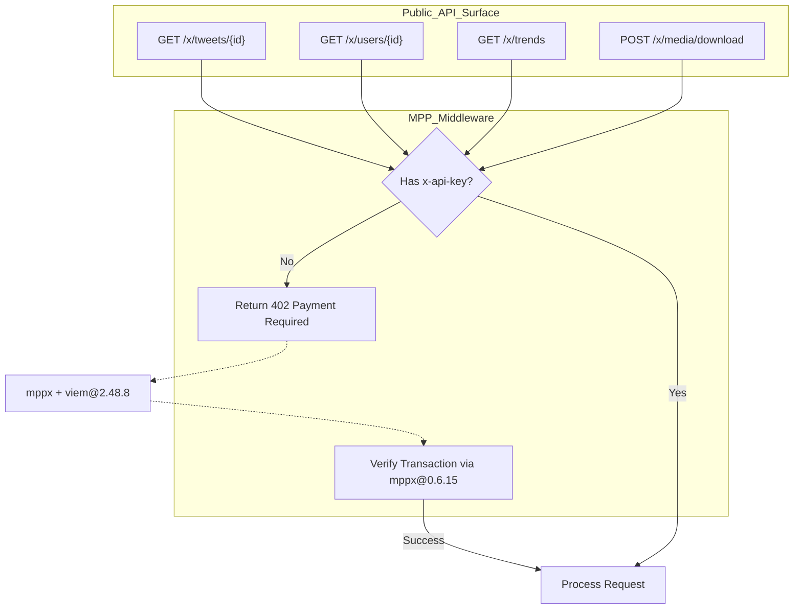
**Sources:** [skills/x-twitter-scraper/references/pricing.md:90-133](), [skills/x-twitter-scraper/SKILL.md:47-52]()

---

## Topping Up & Subscriptions

Users can manage their credit balance through several mechanisms:

1.  **Monthly Subscriptions**: Starter ($20), Pro ($99), and Business ($199) plans include pre-allocated credits [skills/x-twitter-scraper/references/pricing.md:9-11]().
2.  **Manual Top-ups**: `POST /credits/topup` creates a hosted checkout session ($10 minimum) [skills/x-twitter-scraper/references/pricing.md:137-143]().
3.  **Quick Top-up**: `POST /credits/quick-topup` can charge a saved payment method after explicit user confirmation of the exact amount [skills/x-twitter-scraper/SKILL.md:47-51]().
4.  **Auto Top-up**: Can be configured via the dashboard to trigger at a specific threshold [skills/x-twitter-scraper/references/pricing.md:145-146]().

### Balance Monitoring
The `GET /credits` endpoint returns the current `balance`, `lifetimePurchased`, and `lifetimeUsed` [skills/x-twitter-scraper/references/pricing.md:139-139]().

**Sources:** [skills/x-twitter-scraper/references/pricing.md:1-146](), [skills/x-twitter-scraper/SKILL.md:47-58]()

---

# Page: MCP Server Integration

# MCP Server Integration

<details>
<summary>Relevant source files</summary>

The following files were used as context for generating this wiki page:

- [.mcp.json](.mcp.json)
- [server.json](server.json)
- [smithery.yaml](smithery.yaml)

</details>


The Model Context Protocol (MCP) server acts as a standardized bridge between AI agents (such as Claude Desktop, Cursor, or Windsurf) and the Xquik REST API. This integration allows Large Language Models (LLMs) to interact with X (Twitter) data and actions through a unified interface, abstracting the complexities of 120+ REST endpoints into two primary tools.

The server is identified as `com.xquik/mcp` and follows the `2025-12-11` MCP schema specification [server.json:1-3](). It facilitates real-time data access and write actions across a vast X data platform [server.json:4-4]().

### Architectural Overview

The Xquik MCP implementation utilizes a `streamable-http` transport type, allowing AI clients to connect to a remote endpoint rather than running a local binary [server.json:12-12](). This architecture ensures that the AI agent always has access to the latest API capabilities and security updates without requiring local software updates.

#### AI-to-Code Mapping: The MCP Bridge

The following diagram illustrates how natural language prompts from a user are translated into API executions via the MCP server tools.

**Diagram: Natural Language to API Execution Flow**
```mermaid
graph TD
    subgraph "NaturalLanguageSpace"
        [UserPrompt] -- "'Find recent tweets about AI'" --> [Agent]
    end

    subgraph "MCPServerLayer"
        direction TB
        [ToolExplore] -- "explore" --> [EndpointCatalog]
        [ToolXquik] -- "xquik" --> [SandboxedJS]
        [ServerJson] -- "server.json" --> [McpMetadata]
    end

    subgraph "XquikRestApi"
        [ApiV1] -- "https://xquik.com/api/v1" --> [Endpoints]
        [SearchEndpoint] -- "/search/tweets" --> [XData]
    end

    [Agent] -->|"1. Agent selects tool"| [ToolExplore]
    [ToolExplore] -->|"2. Agent finds endpoint"| [ToolXquik]
    [ToolXquik] -->|"3. HTTP POST (x-api-key)"| [ApiV1]
    [ApiV1] --> [SearchEndpoint]
```
**Sources:** [server.json:1-13](), [.mcp.json:1-9]()

### Core Components

The integration consists of two primary tools that the AI agent uses to navigate and execute X operations:

1.  **`explore`**: A discovery tool that allows the agent to search an in-memory catalog of available API endpoints. It helps the agent understand which parameters are required for specific tasks (e.g., finding the correct endpoint for "follower extraction").
2.  **`xquik`**: The execution engine. It runs sandboxed JavaScript arrow functions provided by the agent to perform the actual HTTP requests to the Xquik API. This tool handles authentication injection using the `x-api-key` [server.json:14-17]().

| Feature | Specification |
| :--- | :--- |
| **Server Name** | `com.xquik/mcp` [server.json:3-3]() |
| **Transport Type** | `streamable-http` [server.json:12-12]() |
| **Endpoint URL** | `https://xquik.com/mcp` [server.json:13-13]() |
| **Auth Mechanism** | Header-based `x-api-key` [.mcp.json:5-7]() |
| **Required Variable** | `XQUIK_API_KEY` [server.json:22-24]() |

### System Connectivity

The MCP server connects the AI's reasoning capabilities to the functional domains of the Xquik platform. The following diagram maps the high-level system names to the underlying configuration and registry files.

**Diagram: System Entity Mapping**
```mermaid
graph LR
    subgraph "AiAgentEnvironment"
        [Claude] -- "Claude Desktop / Cursor" --> [McpConfig]
        [McpConfig] -- ".mcp.json" --> [Headers]
    end

    subgraph "RegistryAndDiscovery"
        [ServerSpec] -- "server.json" --> [RemoteConfig]
        [Smithery] -- "smithery.yaml" --> [StartCommand]
    end

    subgraph "XquikPlatform"
        [McpRemote] -- "https://xquik.com/mcp" --> [RestBridge]
    end

    [Claude] --> [McpConfig]
    [McpConfig] -->|"x-api-key injection"| [McpRemote]
    [ServerSpec] -->|"Defines streamable-http"| [McpRemote]
    [Smithery] -->|"Configures http type"| [McpRemote]
```
**Sources:** [server.json:1-31](), [.mcp.json:1-9](), [smithery.yaml:1-11]()

### Related Child Pages

To implement or use this integration, refer to the following detailed guides:

*   **[MCP Setup & Client Configuration](#2.1)**
    Covers the specific configuration strings and environment variables needed for Claude Desktop, Cursor, VS Code, Windsurf, and ChatGPT. Includes details on the `XQUIK_API_KEY` variable and `smithery.yaml` configuration [server.json:21-26](), [smithery.yaml:1-11]().
*   **[MCP Tools: `explore` and `xquik`](#2.2)**
    Provides a deep dive into tool usage, including the 12 API categories, how to handle asynchronous extractions, and the security model for the sandboxed `xquik` execution environment.

**Sources:** [server.json:4-10](), [.mcp.json:2-8](), [smithery.yaml:1-11]()

---

# Page: MCP Setup & Client Configuration

# MCP Setup & Client Configuration

<details>
<summary>Relevant source files</summary>

The following files were used as context for generating this wiki page:

- [docker-mcp-registry/SUBMISSION-STEPS.md](docker-mcp-registry/SUBMISSION-STEPS.md)
- [docker-mcp-registry/cyrus-submission-steps.md](docker-mcp-registry/cyrus-submission-steps.md)
- [docker-mcp-registry/xquik-remote/readme.md](docker-mcp-registry/xquik-remote/readme.md)
- [docker-mcp-registry/xquik-remote/server.yaml](docker-mcp-registry/xquik-remote/server.yaml)
- [docker-mcp-registry/xquik-remote/tools.json](docker-mcp-registry/xquik-remote/tools.json)
- [mcpize/SUBMISSION-STEPS.md](mcpize/SUBMISSION-STEPS.md)
- [openclaw.plugin.json](openclaw.plugin.json)
- [package.json](package.json)
- [skills/x-twitter-scraper/references/mcp-setup.md](skills/x-twitter-scraper/references/mcp-setup.md)

</details>


This page provides detailed technical instructions for connecting various AI agents, IDEs, and programmatic environments to the Xquik platform using the Model Context Protocol (MCP). The Xquik MCP server acts as a bridge to the REST API, allowing models to execute complex X (Twitter) operations through a sandboxed execution environment.

## Protocol Specification

The Xquik MCP implementation utilizes the **StreamableHTTP** transport layer rather than the standard `stdio` transport used by local binary servers. This allows for a remote, stateless connection over HTTPS.

| Setting | Value |
|---------|-------|
| Protocol | HTTP (StreamableHTTP) |
| Endpoint | `https://xquik.com/mcp` |
| Auth Header | `x-api-key` |

**Sources:** [skills/x-twitter-scraper/references/mcp-setup.md:5-10]()

## Client Configuration Reference

### Claude Desktop (via mcp-remote bridge)
Because Claude Desktop natively expects `stdio` transport, a bridge utility is required to translate `stdio` messages to the Xquik `StreamableHTTP` endpoint. The `mcp-remote` package (v0.1.38) is the recommended open-source proxy for this translation.

**Configuration (`claude_desktop_config.json`):**
```json
{
  "mcpServers": {
    "xquik": {
      "command": "mcp-remote",
      "args": [
        "https://xquik.com/mcp",
        "--header",
        "x-api-key:${XQUIK_API_KEY}"
      ]
    }
  }
}
```
**Sources:** [skills/x-twitter-scraper/references/mcp-setup.md:17-46]()

### Cursor, VS Code, & Windsurf
These IDEs support direct HTTP MCP connections. Configuration is handled by specifying the remote URL and the required authentication header.

| Client | Configuration File | Key Field |
|--------|-------------------|-----------|
| **Cursor** | `~/.cursor/mcp.json` | `url` |
| **VS Code** | `.vscode/mcp.json` | `url` |
| **Windsurf**| `~/.codeium/windsurf/mcp_config.json` | `serverUrl` |

**Example Header Injection:**
```json
"headers": {
  "x-api-key": "xq_YOUR_KEY_HERE"
}
```
**Sources:** [skills/x-twitter-scraper/references/mcp-setup.md:106-156]()

### ChatGPT Custom GPTs & Developer Mode
There are three primary ways to connect ChatGPT to Xquik:

1.  **Custom GPT (Action):** Add Xquik as an Action using the OpenAPI schema at `https://xquik.com/openapi.json`. Set the API key under **Authentication > API Key > Header `x-api-key`**.
2.  **Developer Mode:** Supports MCP connectors via OAuth. Add `https://xquik.com/mcp` as the endpoint in **Settings > Developer Mode > MCP Tools**.
3.  **Agents SDK:** Use the `MCPServerStreamableHttp` class for programmatic access.

**Sources:** [skills/x-twitter-scraper/references/mcp-setup.md:68-95]()

### Python SDK (OpenAI Agents)
For programmatic integration, the `MCPServerStreamableHttp` class from the OpenAI Agents SDK can be used to wrap the Xquik endpoint.

```python
from agents.mcp import MCPServerStreamableHttp

async with MCPServerStreamableHttp(
    url="https://xquik.com/mcp",
    headers={"x-api-key": "xq_YOUR_KEY_HERE"},
    params={},
) as xquik:
    # Use xquik as a tool provider
    pass
```
**Sources:** [skills/x-twitter-scraper/references/mcp-setup.md:76-90]()

## MCP Server Architecture

The Xquik MCP server (v2) operates on a **code-execution sandbox model**. Unlike traditional MCP servers that map one tool to one API endpoint, Xquik provides two high-level tools that allow the agent to navigate and execute logic against the entire 120-endpoint REST API.

### Tool Definitions

| Tool Name | Implementation Role | Cost |
|-----------|---------------------|------|
| `explore` | Catalog Discovery: Search the in-memory endpoint definitions. | Free |
| `xquik`   | Sandbox Execution: Execute async JavaScript arrow functions. | Varies |

**Sources:** [skills/x-twitter-scraper/references/mcp-setup.md:176-186](), [docker-mcp-registry/xquik-remote/tools.json:1-24]()

### System Data Flow

The following diagram illustrates how a natural language prompt is translated into code execution within the Xquik sandbox using the tools defined in `tools.json`.

**Prompt to Sandbox Execution Flow**
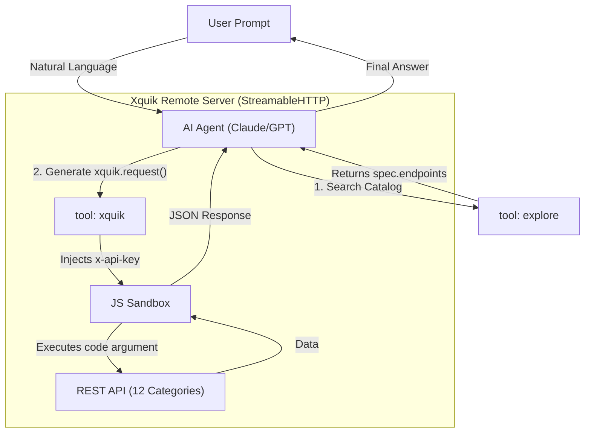
**Sources:** [skills/x-twitter-scraper/references/mcp-setup.md:176-186](), [docker-mcp-registry/xquik-remote/tools.json:1-24]()

### Code Entity Mapping

This diagram bridges the conceptual tools to the underlying API structure and configuration entities defined in the `server.yaml` and `openclaw.plugin.json` files.

**Entity Mapping Diagram**
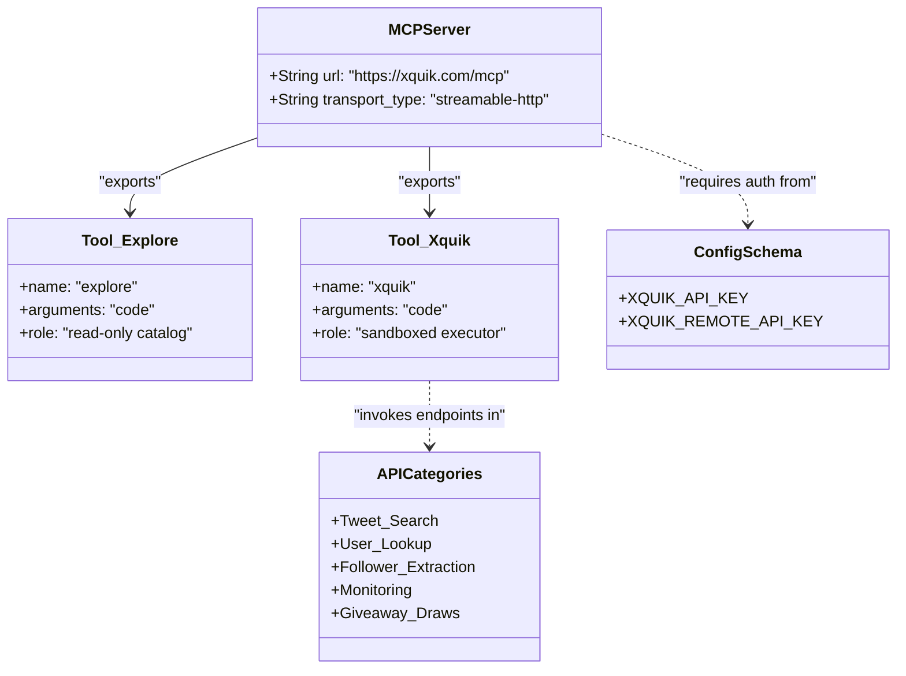
**Sources:** [docker-mcp-registry/xquik-remote/server.yaml:1-31](), [docker-mcp-registry/xquik-remote/tools.json:1-24](), [openclaw.plugin.json:7-25]()

## Docker MCP Registry Submission

Xquik is submitted to the Docker MCP Catalog as a `remote` server type. Because it is a hosted service, no Dockerfile is required for the registry entry; instead, metadata files define the connection.

### Registry Metadata Structure
The submission in `servers/xquik-remote` consists of three primary files:
1. `server.yaml`: Defines the `transport_type: streamable-http` and the environment variable mapping for the API key (`XQUIK_REMOTE_API_KEY`).
2. `tools.json`: Contains the JSON-schema definitions for the `explore` and `xquik` tools.
3. `readme.md`: Documentation pointers.

**Validation Command:**
```bash
task validate --name xquik-remote
```
**Sources:** [docker-mcp-registry/SUBMISSION-STEPS.md:1-40](), [docker-mcp-registry/xquik-remote/server.yaml:1-31]()

## Summary of Integration Files
The following files define the configuration and discovery mechanisms for the MCP server:

- **`skills/x-twitter-scraper/references/mcp-setup.md`**: Primary documentation for client-side configuration.
- **`docker-mcp-registry/xquik-remote/server.yaml`**: Server metadata for the Docker MCP catalog.
- **`openclaw.plugin.json`**: Provider authentication and configuration schema for the OpenClaw plugin ecosystem.
- **`mcpize/SUBMISSION-STEPS.md`**: Metadata for the MCPize marketplace submission.

**Sources:** [skills/x-twitter-scraper/references/mcp-setup.md:1-215](), [docker-mcp-registry/xquik-remote/server.yaml:1-31](), [openclaw.plugin.json:1-25](), [mcpize/SUBMISSION-STEPS.md:1-42]()

---

# Page: MCP Tools: `explore` and `xquik`

# MCP Tools: `explore` and `xquik`

<details>
<summary>Relevant source files</summary>

The following files were used as context for generating this wiki page:

- [skills/x-twitter-scraper/references/api-endpoints.md](skills/x-twitter-scraper/references/api-endpoints.md)
- [skills/x-twitter-scraper/references/extractions.md](skills/x-twitter-scraper/references/extractions.md)
- [skills/x-twitter-scraper/references/mcp-tools.md](skills/x-twitter-scraper/references/mcp-tools.md)
- [skills/x-twitter-scraper/references/types.md](skills/x-twitter-scraper/references/types.md)
- [stub-server.mjs](stub-server.mjs)

</details>


This page provides a technical deep dive into the two primary Model Context Protocol (MCP) tools provided by the Xquik platform. Unlike traditional MCP tools that map 1:1 to specific API endpoints, Xquik utilizes a **sandboxed code-execution model**. This allows AI agents to perform complex logic, filtering, and multi-step API orchestrations within a single tool call while maintaining secure, authenticated access to the Xquik REST API.

## Architecture Overview

The MCP server acts as a bridge between the AI agent and the internal REST API. It exposes two tools that accept asynchronous JavaScript arrow functions. These functions are executed in a secure sandbox where authentication headers (API keys) are injected automatically by the server-side runtime [skills/x-twitter-scraper/references/mcp-tools.md:3-4]().

### Data Flow: Natural Language to Code Execution

The following diagram illustrates how a user's natural language request is transformed into a sandboxed execution within the MCP environment.

**Diagram: Request Resolution Pipeline**
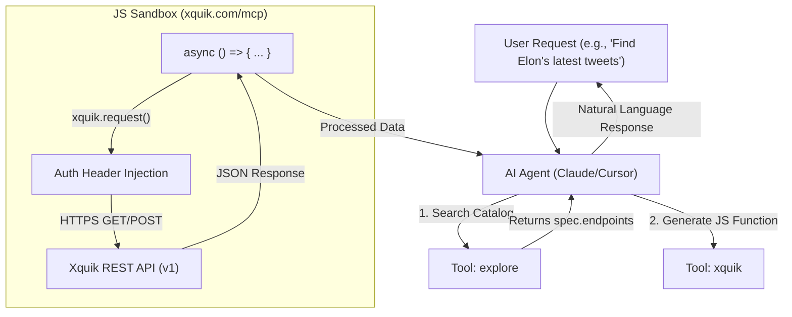
Sources: [skills/x-twitter-scraper/references/mcp-tools.md:3-10](), [stub-server.mjs:20-116]()

---

## Tool 1: `explore` (Endpoint Discovery)

The `explore` tool is a read-only utility designed for "Self-Discovery." It does not make network calls; instead, it queries an in-memory catalog of the 120+ available API endpoints [stub-server.mjs:33-34]().

### Implementation Details
The sandbox provides a global `spec` object containing an `endpoints` array. Each object in this array follows the `EndpointInfo` interface [skills/x-twitter-scraper/references/mcp-tools.md:17-25]():

| Field | Type | Description |
| :--- | :--- | :--- |
| `method` | `string` | HTTP verb (GET, POST, PUT, DELETE, PATCH) |
| `path` | `string` | The REST API path (e.g., `/api/v1/x/tweets/{id}`) |
| `summary` | `string` | Human-readable description of the endpoint |
| `category` | `string` | One of the 12 functional categories |
| `free` | `boolean` | Indicates if the call consumes credits |
| `parameters` | `Array` | List of query, path, or body parameters |
| `responseShape`| `string` | Stringified representation of the expected JSON response |

Sources: [skills/x-twitter-scraper/references/mcp-tools.md:17-25](), [stub-server.mjs:38-45]()

### Usage Pattern
Agents use `explore` to locate the correct path and required parameters before attempting an execution. Common patterns include filtering by category or searching for keywords like "tweet" or "follower" [stub-server.mjs:41-45]().

---

## Tool 2: `xquik` (API Execution)

The `xquik` tool is the primary execution engine. It provides a global `xquik.request()` helper that handles the underlying fetch logic and security [skills/x-twitter-scraper/references/mcp-tools.md:43-45]().

### The `xquik.request` Interface
```typescript
declare const xquik: {
  request(path: string, options?: {
    method?: string;  // default: 'GET'
    body?: unknown;
    query?: Record<string, string>;
  }): Promise<unknown>;
};
```
Sources: [skills/x-twitter-scraper/references/mcp-tools.md:61-67](), [stub-server.mjs:93-97]()

### API Categories
The platform organizes its endpoints into 12 distinct categories. When using `explore` or `xquik`, agents interact with these functional domains [skills/x-twitter-scraper/references/mcp-tools.md:21]():

| Category | Purpose |
| :--- | :--- |
| `twitter` | Read-only X lookups (tweets, users, search) |
| `x-write` | Write actions (post tweet, like, follow, DM) |
| `extraction` | Bulk data jobs (replies, followers, community members) |
| `monitoring` | Real-time account tracking and event logs |
| `composition` | AI-assisted tweet drafting and scoring |
| `media` | Media downloads and uploads |
| `account` | Identity linking and profile management |
| `credits` | Balance checks and top-ups |
| `support` | Ticket creation and tracking |
| `x-accounts` | Managing connected X accounts |
| `media` | X Media download and upload operations |

Sources: [skills/x-twitter-scraper/references/api-endpoints.md:9-28](), [skills/x-twitter-scraper/references/mcp-tools.md:21]()

---

## Technical Mapping: MCP to Code Entities

The following diagram maps the high-level MCP tool concepts to the specific code entities and data structures defined in the system.

**Diagram: MCP Tool Entity Mapping**
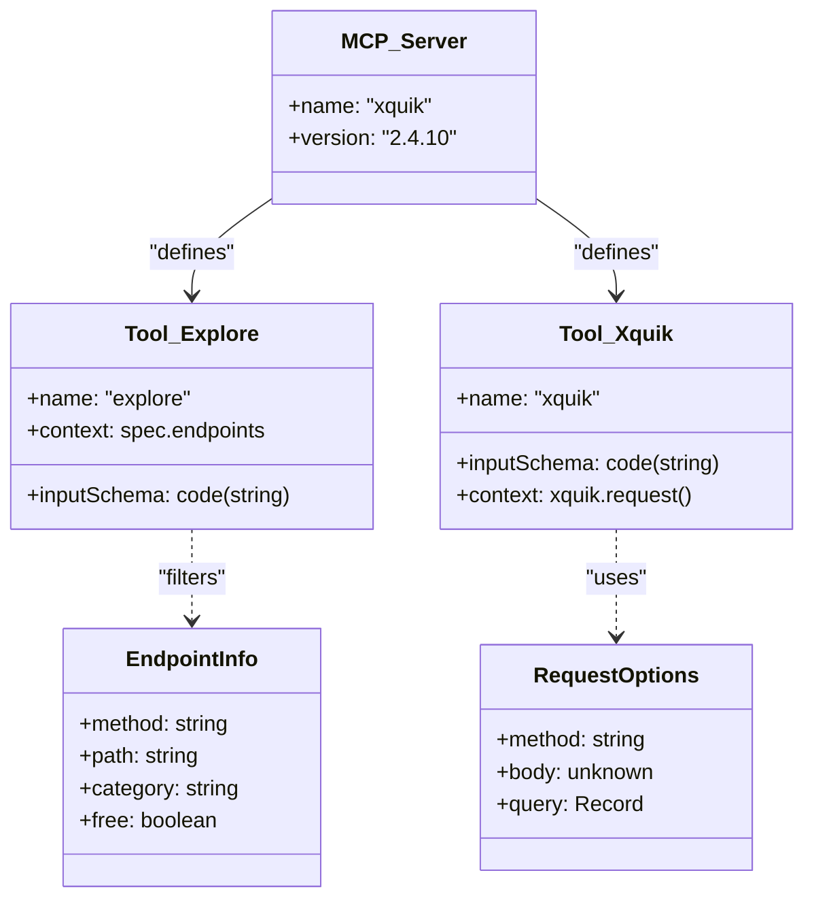
Sources: [stub-server.mjs:9-12](), [stub-server.mjs:20-116](), [skills/x-twitter-scraper/references/mcp-tools.md:17-25]()

---

## Best Practices & Safety

### 1. Avoiding `Promise.all` for Mixed-Cost Calls
A critical constraint of the credit-based system is how errors are handled. If an agent groups a free call and a paid call in a `Promise.all` block, and the paid call fails (e.g., due to a `402 Payment Required` error), the entire execution context may fail, losing the results of the free call [skills/x-twitter-scraper/references/mcp-tools.md:134]().
*   **Recommendation:** Execute free calls (like `radar` or `styles`) first, then proceed to paid calls sequentially.

### 2. Authentication Injection
The sandbox environment strictly forbids passing API keys in the `code` argument. The MCP bridge automatically injects authentication [stub-server.mjs:75](), [skills/x-twitter-scraper/references/mcp-tools.md:45]().

### 3. Safety Gates and Confirmations
Certain operations require explicit user approval before execution via `xquik` [skills/x-twitter-scraper/references/mcp-tools.md:47-59]():
*   **Public Writes:** Show the exact tweet text or action before calling `POST /api/v1/x/tweets` [skills/x-twitter-scraper/references/mcp-tools.md:53]().
*   **Private Reads:** Confirm before fetching bookmarks or home timelines [skills/x-twitter-scraper/references/mcp-tools.md:56]().
*   **Billing:** Do not trigger top-ups or payments without explicit amount confirmation [skills/x-twitter-scraper/references/mcp-tools.md:57]().

### 4. Bulk Extraction Lifecycle
For bulk data (e.g., all followers of an account), the `xquik` tool should follow the asynchronous lifecycle [skills/x-twitter-scraper/references/mcp-tools.md:115]():
1.  `POST /api/v1/extractions/estimate`: Preview `creditsRequired` [skills/x-twitter-scraper/references/extractions.md:7]().
2.  `POST /api/v1/extractions`: Create the job and receive an `id` [skills/x-twitter-scraper/references/extractions.md:178]().
3.  `GET /api/v1/extractions/{id}`: Poll for status until `completed` [skills/x-twitter-scraper/references/extractions.md:190]().

Sources: [skills/x-twitter-scraper/references/mcp-tools.md:47-59](), [skills/x-twitter-scraper/references/extractions.md:7-216](), [stub-server.mjs:80-87]()

---

# Page: REST API Reference

# REST API Reference

<details>
<summary>Relevant source files</summary>

The following files were used as context for generating this wiki page:

- [skills/x-twitter-scraper/SKILL.md](skills/x-twitter-scraper/SKILL.md)
- [skills/x-twitter-scraper/references/api-endpoints.md](skills/x-twitter-scraper/references/api-endpoints.md)

</details>


The Xquik REST API provides a comprehensive suite of over 120 endpoints for interacting with X (Twitter). Operating at `https://xquik.com/api/v1`, the API enables developers to perform synchronous lookups, execute bulk data extractions, monitor accounts in real-time, and automate complex social media workflows [skills/x-twitter-scraper/SKILL.md:4-4]().

All requests require an `x-api-key` header for authentication [skills/x-twitter-scraper/references/api-endpoints.md:5-5](). The API follows a credit-based billing model where different operations (Read, Write, Extraction) consume varying amounts of credits [skills/x-twitter-scraper/SKILL.md:48-52]().

### API Functional Domains

The API is organized into several functional domains, each serving a specific part of the X ecosystem.

| Domain | Primary Responsibility | Key Endpoints |
|:---|:---|:---|
| **X Lookups** | Synchronous data retrieval | `GET /x/tweets/{id}`, `GET /x/users/{username}` |
| **X Write** | Account actions & posting | `POST /x/tweets`, `POST /x/users/{id}/follow` |
| **Extractions** | Asynchronous bulk data | `POST /extractions`, `GET /extractions/{id}/results` |
| **Monitors** | Real-time event tracking | `POST /monitors`, `GET /events` |
| **Automations** | Workflow engine | `POST /automations`, `GET /automations/{id}/runs` |
| **Composition** | AI-assisted content | `POST /compose`, `POST /styles` |

**Sources:** [skills/x-twitter-scraper/references/api-endpoints.md:7-28]()

---

### System Architecture Overview

The following diagram illustrates how the REST API entities interact with the underlying X platform and the internal processing engines.

**API Entity Relationship Diagram**
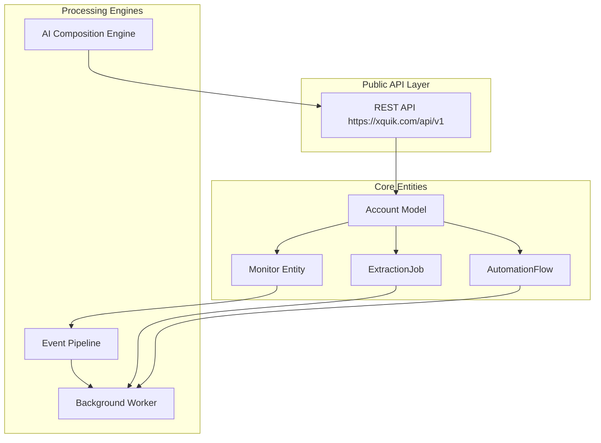
**Sources:** [skills/x-twitter-scraper/references/api-endpoints.md:1-30](), [skills/x-twitter-scraper/SKILL.md:58-153]()

---

### 3.1 X Lookups & Write Actions
These endpoints provide direct, synchronous access to X. They are used for fetching specific tweets, user profiles, or performing account actions like liking, retweeting, and following. This domain also includes media management, Note Tweets, and private data retrieval such as DMs and timelines [skills/x-twitter-scraper/references/api-endpoints.md:421-483]().

For details, see [X Lookups & Write Actions](#3.1).

**Sources:** [skills/x-twitter-scraper/SKILL.md:76-81](), [skills/x-twitter-scraper/references/api-endpoints.md:421-483](), [skills/x-twitter-scraper/references/api-endpoints.md:628-680]()

### 3.2 Bulk Extractions
The extraction system is designed for high-volume data retrieval that exceeds standard API limits. It supports 23 specialized tool types (e.g., `follower_explorer`, `reply_extractor`) and follows an asynchronous lifecycle: estimate cost, create job, poll for completion, and export up to 50,000 rows [skills/x-twitter-scraper/references/api-endpoints.md:374-410]().

For details, see [Bulk Extractions](#3.2).

**Sources:** [skills/x-twitter-scraper/SKILL.md:42-42](), [skills/x-twitter-scraper/references/api-endpoints.md:374-410]()

### 3.3 Monitors, Webhooks & Events
This sub-system enables real-time tracking of X accounts. Users can create `Monitors` for specific usernames to capture events like `tweet.new`, `tweet.reply`, or `follower.gained` [skills/x-twitter-scraper/references/api-endpoints.md:113-140](). These events can be polled via the `/events` endpoint or delivered instantly via HMAC-signed `Webhooks` [skills/x-twitter-scraper/references/api-endpoints.md:225-286]().

For details, see [Monitors, Webhooks & Events](#3.3).

**Sources:** [skills/x-twitter-scraper/references/api-endpoints.md:113-140](), [skills/x-twitter-scraper/references/api-endpoints.md:176-213](), [skills/x-twitter-scraper/references/api-endpoints.md:225-286]()

### 3.4 Automations & Flow Engine
The Automation engine allows for the creation of `AutomationFlow` objects—directed graphs of `AutomationStep` entities [skills/x-twitter-scraper/references/api-endpoints.md:682-720](). These flows can be triggered by monitor events, schedules, or inbound webhooks to perform multi-stage actions using an optimistic-concurrency update pattern.

For details, see [Automations & Flow Engine](#3.4).

**Sources:** [skills/x-twitter-scraper/references/api-endpoints.md:682-720]()

### 3.5 Content Composition & Style Analysis
Leveraging AI, these endpoints assist in creating algorithmically optimized content. The `POST /compose` endpoint handles the `compose` -> `refine` -> `score` pipeline [skills/x-twitter-scraper/references/api-endpoints.md:506-520](), while the `Style Cache` system analyzes account voices to generate "PhoenixScores" and engagement multipliers [skills/x-twitter-scraper/references/api-endpoints.md:562-580]().

For details, see [Content Composition & Style Analysis](#3.5).

**Sources:** [skills/x-twitter-scraper/references/api-endpoints.md:506-520](), [skills/x-twitter-scraper/references/api-endpoints.md:562-580](), [skills/x-twitter-scraper/references/api-endpoints.md:493-504]()

### 3.6 Giveaway Draws
The Draws system provides an auditable way to run contests on X. It supports 11 configurable filters, such as `mustRetweet`, `filterMinFollowers`, and `requiredKeywords`, to automatically select winners and backups from tweet interactions [skills/x-twitter-scraper/references/api-endpoints.md:300-337]().

For details, see [Giveaway Draws](#3.6).

**Sources:** [skills/x-twitter-scraper/references/api-endpoints.md:300-337]()

---

### Request Lifecycle & Code Mapping

This diagram maps the natural language intent of a developer to the specific code entities and API routes involved in a standard request lifecycle.

**Natural Language to Code Entity Mapping**
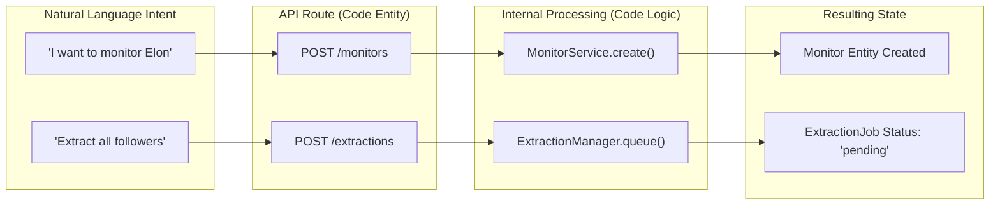
**Sources:** [skills/x-twitter-scraper/SKILL.md:131-140](), [skills/x-twitter-scraper/references/api-endpoints.md:113-132](), [skills/x-twitter-scraper/references/api-endpoints.md:374-400]()

---

# Page: X Lookups & Write Actions

# X Lookups & Write Actions

<details>
<summary>Relevant source files</summary>

The following files were used as context for generating this wiki page:

- [skills/post-tweets/SKILL.md](skills/post-tweets/SKILL.md)
- [skills/search-tweets/SKILL.md](skills/search-tweets/SKILL.md)
- [skills/tweet-analytics/SKILL.md](skills/tweet-analytics/SKILL.md)
- [skills/user-tweets/SKILL.md](skills/user-tweets/SKILL.md)
- [skills/x-twitter-scraper/SKILL.md](skills/x-twitter-scraper/SKILL.md)
- [skills/x-twitter-scraper/references/api-endpoints.md](skills/x-twitter-scraper/references/api-endpoints.md)

</details>


This page covers the synchronous read and write operations within the Xquik REST API. These endpoints facilitate real-time interaction with X (formerly Twitter), allowing for immediate data retrieval and account actions without the overhead of the asynchronous extraction pipeline.

## Overview

The X Lookup and Write system is designed for low-latency operations where the agent or user requires an immediate response. These operations are categorized into **Direct Lookups** (reading public data) and **Write Actions** (performing account-level operations like posting or liking).

### Key Characteristics
*   **Synchronous Execution:** Unlike Extractions, these endpoints return the final data or success confirmation in a single HTTP request-response cycle [skills/x-twitter-scraper/references/api-endpoints.md:3-5]().
*   **Authentication:** Requires the `x-api-key` header for all requests [skills/x-twitter-scraper/references/api-endpoints.md:5]().
*   **Account Context:** Write actions require a connected X account, typically identified via the `account` field in the request body [skills/post-tweets/SKILL.md:45-58]().
*   **Confirmation Gating:** All write actions (posting, liking, following) require explicit user confirmation before execution [skills/x-twitter-scraper/SKILL.md:43-45]().

---

## Data Flow: Read vs. Write

The following diagram illustrates how the system handles a simple lookup (User Profile) versus a write action (Posting a Tweet).

### Lookup and Write Logic Flow
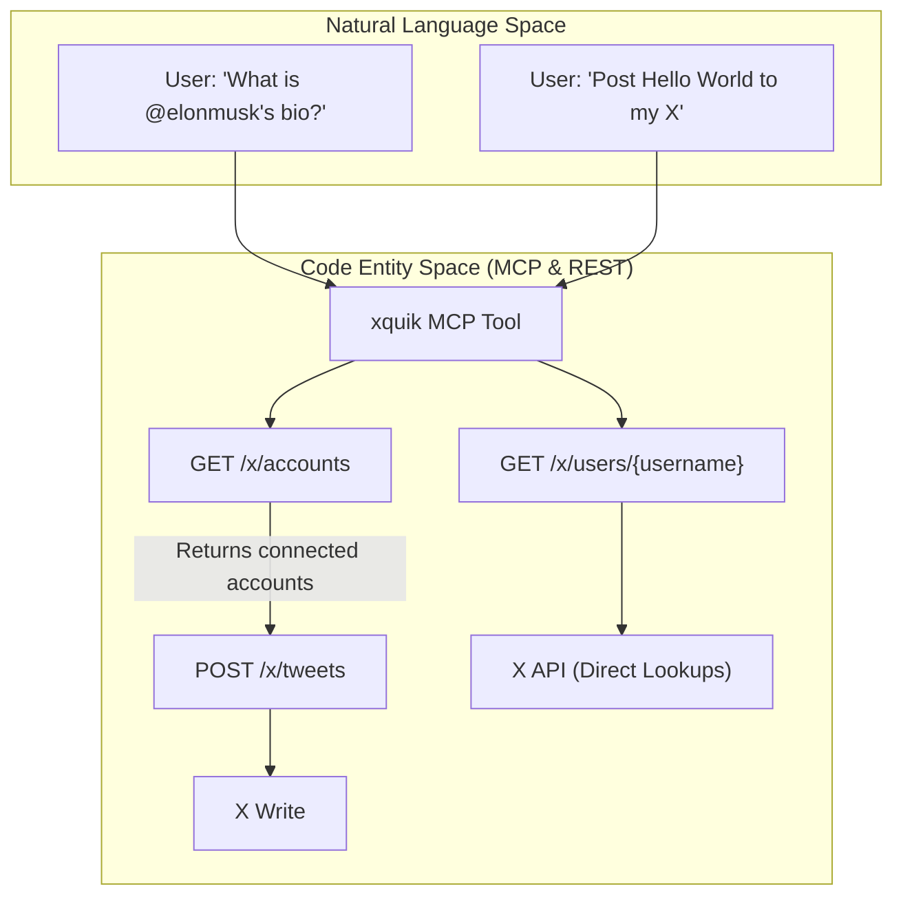
**Sources:** [skills/x-twitter-scraper/references/api-endpoints.md:395-400](), [skills/post-tweets/SKILL.md:63-69](), [skills/user-tweets/SKILL.md:49-50]()

---

## Synchronous Read Operations (Lookups)

Lookups provide immediate access to X entities. These are categorized as "Read tier" operations for rate-limiting purposes.

### User & Tweet Lookups
| Endpoint | Description | Implementation Detail |
| :--- | :--- | :--- |
| `GET /x/users/{username}` | Retrieves profile details for a specific handle. | Resolves handle to numeric `id`. Returns bio, counts, and verified status [skills/user-tweets/SKILL.md:49-70](). |
| `GET /x/tweets/{id}` | Fetches a single tweet by its unique ID. | Includes text, author, and full engagement metrics [skills/tweet-analytics/SKILL.md:46-71](). |
| `GET /x/tweets/search` | Performs a real-time search for tweets. | Supports `q` and `queryType` (Latest/Top) [skills/search-tweets/SKILL.md:66-69](). |

### Timelines, Likes & Media
*   **User Tweets:** `GET /x/users/{id}/tweets` retrieves recent posts, with optional reply inclusion [skills/user-tweets/SKILL.md:75-80]().
*   **User Likes:** `GET /x/users/{id}/likes` retrieves tweets liked by the target user [skills/user-tweets/SKILL.md:76]().
*   **User Media:** `GET /x/users/{id}/media` retrieves tweets containing photos or videos [skills/user-tweets/SKILL.md:77]().
*   **Private Data:** Endpoints like `GET /x/bookmarks`, `GET /x/notifications`, and `GET /x/timeline` return private user data and require explicit user confirmation before the agent fetches them [skills/x-twitter-scraper/SKILL.md:76-81]().

**Sources:** [skills/user-tweets/SKILL.md:31-41](), [skills/tweet-analytics/SKILL.md:34-35](), [skills/search-tweets/SKILL.md:34](), [skills/x-twitter-scraper/SKILL.md:76-81]()

---

## Write Operations (Account Actions)

Write actions modify the state of an X account. These require a connected account authorized via the Xquik dashboard.

### Posting & Content Creation
The primary endpoint for creating content is `POST /x/tweets`.

*   **Standard Tweets:** Default 280-character limit [skills/post-tweets/SKILL.md:56]().
*   **Note Tweets:** Long-form content up to 25,000 characters, enabled via `is_note_tweet: true` [skills/post-tweets/SKILL.md:50-56]().
*   **Replies & Quotes:** Handled via `reply_to_tweet_id` or by including the target URL in the text [skills/post-tweets/SKILL.md:47-61]().
*   **Media Upload:** Performed via `POST /x/media`. Returns `id`s to be included in the `media_ids` array of a tweet [skills/post-tweets/SKILL.md:36-51]().

### Engagement & Social Actions
*   **Like:** `POST /x/tweets/{id}/like` [skills/x-twitter-scraper/references/api-endpoints.md:520]().
*   **Retweet:** `POST /x/tweets/{id}/retweet` [skills/x-twitter-scraper/references/api-endpoints.md:525]().
*   **Follow:** `POST /x/users/{username}/follow` [skills/x-twitter-scraper/references/api-endpoints.md:530]().
*   **Direct Messages:** `POST /x/dm` sends messages to a specific `userId` [skills/x-twitter-scraper/references/api-endpoints.md:535]().

**Sources:** [skills/post-tweets/SKILL.md:32-36](), [skills/x-twitter-scraper/references/api-endpoints.md:515-540]()

---

## Implementation Details: Account Selection

When performing a write action, the system must know which connected X account to use.

### Account Resolution Pattern
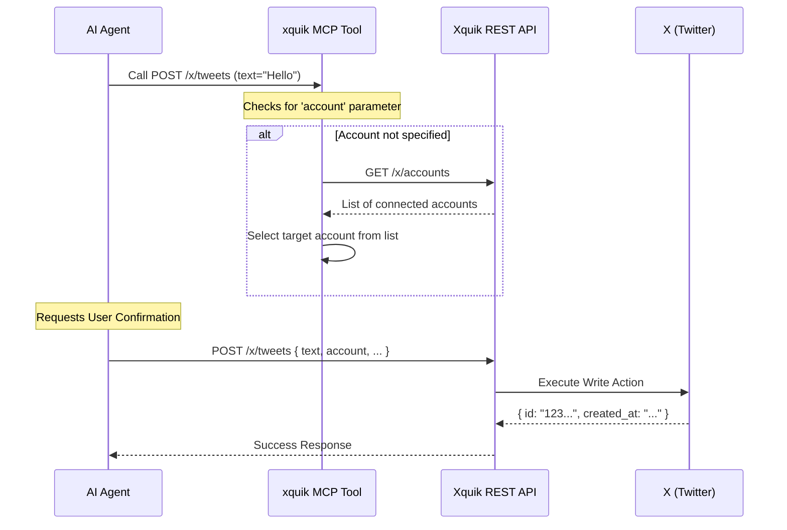
**Sources:** [skills/post-tweets/SKILL.md:58-68](), [skills/x-twitter-scraper/SKILL.md:43-45]()

### Media Upload Workflow
1.  **Upload:** Call `POST /x/media` with image/video data. Capture the returned `id` [skills/post-tweets/SKILL.md:66]().
2.  **Attach:** Pass the `id` in the `media_ids` array (max 4 images or 1 video) to `POST /x/tweets` [skills/post-tweets/SKILL.md:51-57]().

**Sources:** [skills/post-tweets/SKILL.md:51-68]()

---

# Page: Bulk Extractions

# Bulk Extractions

<details>
<summary>Relevant source files</summary>

The following files were used as context for generating this wiki page:

- [.github/workflows/publish-mcp-registry.yml](.github/workflows/publish-mcp-registry.yml)
- [skills/extract-followers/SKILL.md](skills/extract-followers/SKILL.md)
- [skills/follow-unfollow/SKILL.md](skills/follow-unfollow/SKILL.md)
- [skills/send-dms/SKILL.md](skills/send-dms/SKILL.md)
- [skills/track-hashtags/SKILL.md](skills/track-hashtags/SKILL.md)
- [skills/x-twitter-scraper/references/api-endpoints.md](skills/x-twitter-scraper/references/api-endpoints.md)
- [skills/x-twitter-scraper/references/extractions.md](skills/x-twitter-scraper/references/extractions.md)
- [skills/x-twitter-scraper/references/mcp-tools.md](skills/x-twitter-scraper/references/mcp-tools.md)
- [skills/x-twitter-scraper/references/types.md](skills/x-twitter-scraper/references/types.md)

</details>


The Bulk Extractions system is an asynchronous engine designed to handle large-scale data retrieval from X (Twitter). Unlike synchronous lookups, extractions are job-based: they are created, queued, processed in the background, and then accessed via pagination or exported as files. This system supports 23 specialized tool types covering users, tweets, communities, lists, and spaces.

## Lifecycle of an Extraction

The extraction process follows a strict state machine to ensure credit safety and resource management.

1.  **Estimate**: `POST /extractions/estimate` [skills/x-twitter-scraper/references/extractions.md:7-7](). This validates the request, checks the user's monthly quota, and returns the `estimatedResults` and `creditsRequired` [skills/x-twitter-scraper/references/extractions.md:221-222]().
2.  **Create**: `POST /extractions` [skills/x-twitter-scraper/references/extractions.md:5-5](). Submits the job to the queue. Returns an `id` and initial `status` [skills/x-twitter-scraper/references/extractions.md:177-183]().
3.  **Poll**: `GET /extractions/{id}` [skills/x-twitter-scraper/references/extractions.md:190-190](). The client polls this endpoint until the `status` transitions to `completed` or `failed` [skills/x-twitter-scraper/references/extractions.md:185-185]().
4.  **Retrieve/Export**: Once completed, data can be fetched via paginated JSON (1,000 results/page) [skills/x-twitter-scraper/references/extractions.md:193-193]() or downloaded as a bulk file [skills/x-twitter-scraper/references/extractions.md:202-202]().

### Extraction Data Flow

The following diagram illustrates the transition from a natural language request to the execution of a background job.

"Extraction Execution Flow"
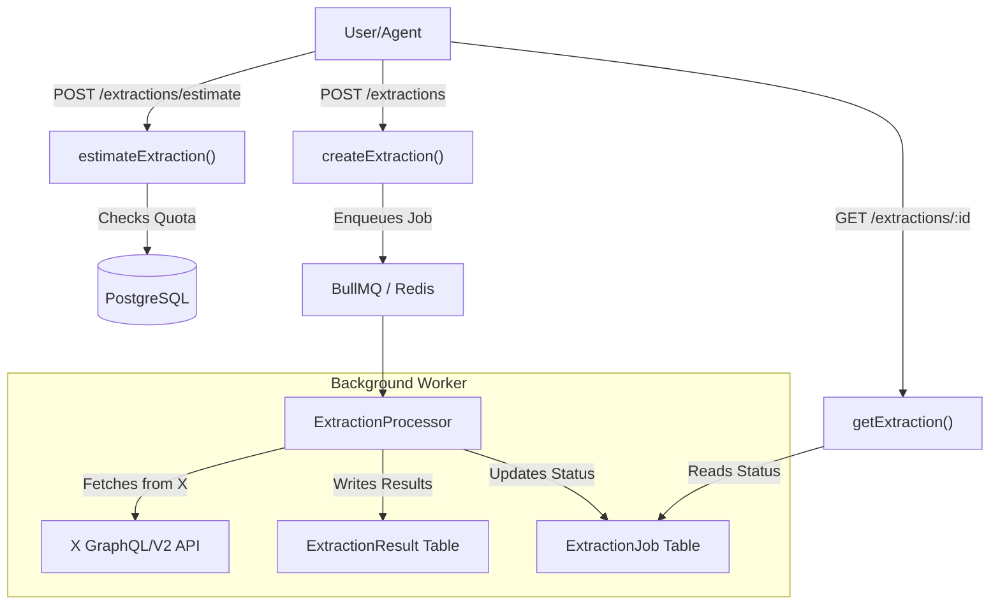
**Sources:** [skills/x-twitter-scraper/references/extractions.md:5-185](), [skills/x-twitter-scraper/references/api-endpoints.md:15-15]()

## Extraction Tool Types

There are 23 distinct extraction tools categorized by their target identifier [skills/x-twitter-scraper/references/extractions.md:3-3]().

### 1. Tweet-Based Tools
Require `targetTweetId` [skills/x-twitter-scraper/references/extractions.md:11-11]().

| Tool Type | Description |
| :--- | :--- |
| `reply_extractor` | Extract users who replied to a specific tweet |
| `repost_extractor` | Extract users who retweeted a tweet |
| `quote_extractor` | Extract users who quote-tweeted a tweet |
| `thread_extractor` | Extract all tweets in a conversation thread |
| `article_extractor` | Extract content from articles linked in a tweet |
| `favoriters` | Extract users who liked/favorited a tweet |

**Sources:** [skills/x-twitter-scraper/references/extractions.md:11-20]()

### 2. User-Based Tools
Require `targetUsername` (the `@` is automatically stripped [skills/x-twitter-scraper/references/extractions.md:48-48]()) or `targetUserId`.

| Tool Type | Identifier | Description |
| :--- | :--- | :--- |
| `follower_explorer` | `targetUsername` | Extract followers of an account |
| `following_explorer` | `targetUsername` | Extract accounts followed by a user |
| `verified_follower_explorer` | `targetUsername` | Extract only verified followers |
| `mention_extractor` | `targetUsername` | Extract tweets mentioning an account |
| `post_extractor` | `targetUsername` | Extract all posts from an account |
| `user_likes` | `targetUserId` | Extract tweets liked by a user |
| `user_media` | `targetUserId` | Extract media tweets from a user |

**Sources:** [skills/x-twitter-scraper/references/extractions.md:30-63]()

### 3. Entity-Based Tools (Communities, Lists, Spaces)
Require `targetCommunityId`, `targetListId`, or `targetSpaceId`.

| Tool Type | Target ID | Description |
| :--- | :--- | :--- |
| `community_extractor` | Community | Extract members of a community |
| `community_moderator_explorer` | Community | Extract moderators of a community |
| `community_post_extractor` | Community | Extract posts within a community |
| `community_search` | Community | Search posts within a community (requires `searchQuery`) |
| `list_member_extractor` | List | Extract members of a list |
| `list_post_extractor` | List | Extract posts from a list |
| `list_follower_explorer` | List | Extract followers of a list |
| `space_explorer` | Space | Extract participants of an X Space |

**Sources:** [skills/x-twitter-scraper/references/extractions.md:65-110]()

### 4. Search-Based Tools
Require `searchQuery` [skills/x-twitter-scraper/references/extractions.md:112-112]().

*   **`people_search`**: Finds users by keyword [skills/x-twitter-scraper/references/extractions.md:116-116]().
*   **`tweet_search_extractor`**: A bulk search tool supporting up to 1,000 results and 16 advanced filters [skills/x-twitter-scraper/references/extractions.md:117-138]().

#### Advanced Search Filters
The `tweet_search_extractor` maps the following fields to X search operators:
*   `fromUser`, `toUser`, `mentioning`
*   `minFaves`, `minRetweets`, `minReplies`
*   `sinceDate`, `untilDate` (YYYY-MM-DD)
*   `mediaType` (`images`, `videos`, `gifs`, `media`)
*   `verifiedOnly` (boolean)
*   `replies`, `retweets` (`include`, `exclude`, `only`)

**Sources:** [skills/x-twitter-scraper/references/extractions.md:140-158]()

## System Limits & Exporting

### Pagination and Results
JSON results via `GET /extractions/{id}` are paginated with a limit of 1,000 records per page [skills/x-twitter-scraper/references/extractions.md:193-193](). Each record follows the `ExtractionResult` interface, including core user metadata (`xUserId`, `xUsername`, `xVerified`) and, if applicable, tweet metadata (`tweetId`, `tweetText`) [skills/x-twitter-scraper/references/types.md:286-305]().

### Bulk Export
For datasets exceeding JSON response limits, the export endpoint should be used:
`GET /extractions/{id}/export?format={csv|xlsx|md|pdf|json|txt}` [skills/x-twitter-scraper/references/extractions.md:202-202]().

*   **Row Limit**: 50,000 rows per export [skills/x-twitter-scraper/references/extractions.md:205-205]().
*   **Enrichment**: Exports contain additional enrichment columns not available in the standard API response [skills/x-twitter-scraper/references/extractions.md:207-207]().

### Tool Mapping and Request Handling

"Tool Dispatcher Logic"
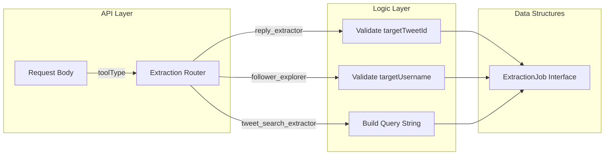
**Sources:** [skills/x-twitter-scraper/references/extractions.md:11-138](), [skills/x-twitter-scraper/references/types.md:268-284]()

## Implementation Notes

*   **Error Handling**: If an extraction fails, the `status` is set to `failed` and an `errorMessage` may be populated in the `ExtractionJob` object [skills/x-twitter-scraper/references/types.md:271-281]().
*   **Results Limit**: The `resultsLimit` parameter can be passed to `estimate` and `create` to cap the extraction size and save credits [skills/x-twitter-scraper/references/extractions.md:172-172]().
*   **Safety Rule**: AI agents must call `POST /extractions/estimate` and receive explicit user approval before calling `POST /extractions` due to the credit cost [skills/x-twitter-scraper/references/mcp-tools.md:115-115](), [skills/extract-followers/SKILL.md:65-65]().

**Sources:**
- [skills/x-twitter-scraper/references/extractions.md:1-230]()
- [skills/x-twitter-scraper/references/types.md:244-305]()
- [skills/x-twitter-scraper/references/mcp-tools.md:115-123]()
- [skills/extract-followers/SKILL.md:26-72]()

---

# Page: Monitors, Webhooks & Events

# Monitors, Webhooks & Events

<details>
<summary>Relevant source files</summary>

The following files were used as context for generating this wiki page:

- [skills/x-twitter-scraper/references/api-endpoints.md](skills/x-twitter-scraper/references/api-endpoints.md)
- [skills/x-twitter-scraper/references/python-examples.md](skills/x-twitter-scraper/references/python-examples.md)
- [skills/x-twitter-scraper/references/webhooks.md](skills/x-twitter-scraper/references/webhooks.md)
- [skills/x-twitter-scraper/references/workflows.md](skills/x-twitter-scraper/references/workflows.md)

</details>


This page documents the real-time monitoring infrastructure of Xquik. The system allows developers to track X accounts for specific activities and receive push notifications via webhooks or Telegram integrations. Active monitors are metered hourly based on the account's monitor billing configuration [skills/x-twitter-scraper/references/api-endpoints.md:48-56]().

## Monitoring Pipeline Overview

The monitoring pipeline consists of three stages: defining a target via a **Monitor**, the generation of an **Event** when activity is detected, and the delivery of that event via a **Webhook** or polling mechanism.

### Real-Time Monitoring Flow
The following diagram illustrates the lifecycle of a real-time event from detection to delivery, mapping system components to code-level entities.

Title: Monitoring Data Flow & Entity Mapping
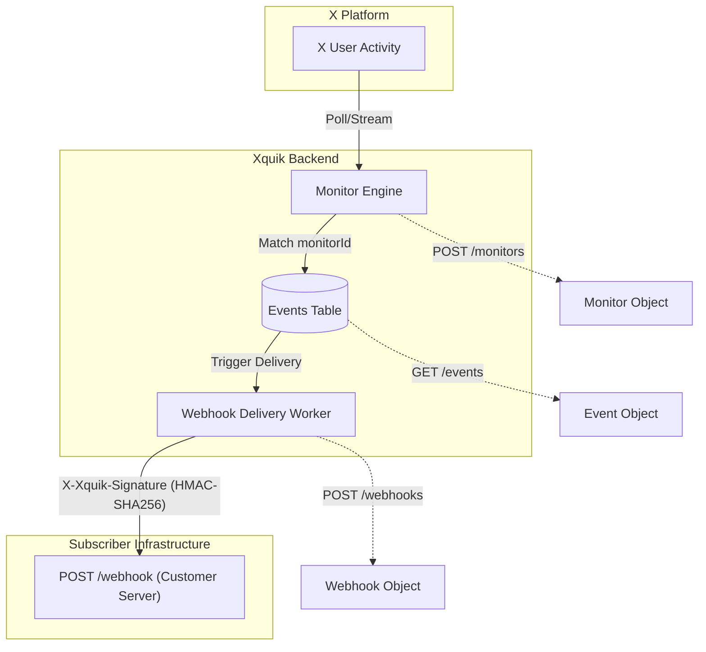
Sources: [skills/x-twitter-scraper/references/api-endpoints.md:113-212](), [skills/x-twitter-scraper/references/webhooks.md:1-26]()

---

## Monitors

A `Monitor` is a configuration object that defines which X account to watch and which actions to record as events [skills/x-twitter-scraper/references/api-endpoints.md:113-126]().

### Supported Event Types
Monitors can be configured to listen for the following `eventTypes` [skills/x-twitter-scraper/references/api-endpoints.md:140-140]():
*   `tweet.new`: A new original tweet is posted.
*   `tweet.reply`: The user replies to another tweet.
*   `tweet.quote`: The user quotes another tweet.
*   `tweet.retweet`: The user retweets content.
*   `webhook.test`: A manual test event triggered via the API [skills/x-twitter-scraper/references/api-endpoints.md:278-284]().

### Monitor Management
| Action | Endpoint | Description |
| :--- | :--- | :--- |
| **Create** | `POST /monitors` | Starts tracking a username. Returns `409 monitor_already_exists` if already monitored [skills/x-twitter-scraper/references/api-endpoints.md:115-142](). |
| **List** | `GET /monitors` | Returns all monitors (up to 200) [skills/x-twitter-scraper/references/api-endpoints.md:144-150](). |
| **Update** | `PATCH /monitors/{id}` | Modify `eventTypes` or toggle `isActive` [skills/x-twitter-scraper/references/api-endpoints.md:158-164](). |
| **Delete** | `DELETE /monitors/{id}` | Stops tracking and deletes associated data [skills/x-twitter-scraper/references/api-endpoints.md:166-172](). |

Sources: [skills/x-twitter-scraper/references/api-endpoints.md:113-172]()

---

## Events

Events are the individual records of activity generated by Monitors. They can be retrieved via polling or pushed via webhooks [skills/x-twitter-scraper/references/api-endpoints.md:176-182]().

### Event Schema
When an event occurs, it is stored with the following structure [skills/x-twitter-scraper/references/api-endpoints.md:194-212]():
*   `id`: Unique event identifier.
*   `type`: The event type (e.g., `tweet.new`).
*   `monitorId`: The ID of the monitor that triggered it.
*   `username`: The X username being monitored.
*   `occurredAt`: ISO8601 timestamp.
*   `data`: Context-specific payload containing `tweetId`, `text`, and `metrics` [skills/x-twitter-scraper/references/api-endpoints.md:203-207]().

### Polling Events
The `GET /events` endpoint supports cursor-based pagination for historical retrieval or polling [skills/x-twitter-scraper/references/api-endpoints.md:178-191]().
*   **Filters**: `monitorId`, `eventType`.
*   **Pagination**: Use the `after` query parameter with the `nextCursor` provided in the response [skills/x-twitter-scraper/references/workflows.md:45-48]().

Sources: [skills/x-twitter-scraper/references/api-endpoints.md:176-212](), [skills/x-twitter-scraper/references/workflows.md:45-69]()

---

## Webhooks

Webhooks provide a push-based mechanism for receiving events. Xquik delivers events as `POST` requests with JSON payloads [skills/x-twitter-scraper/references/webhooks.md:1-14]().

### Implementation & Security
Xquik signs every webhook delivery using **HMAC-SHA256** to ensure data integrity and authenticity.

1.  **Secret Retrieval**: When creating a webhook (`POST /webhooks`), the response includes a `secret`. This is shown **only once** [skills/x-twitter-scraper/references/api-endpoints.md:241-241]().
2.  **Signature Header**: Every delivery includes the `X-Xquik-Signature` header.
3.  **Verification Logic**: The signature is generated by hashing the raw request body with the secret: `sha256=` + `HMAC-SHA256(secret, raw_body)` [skills/x-twitter-scraper/references/webhooks.md:30-30]().

Title: Webhook Signature Verification Logic
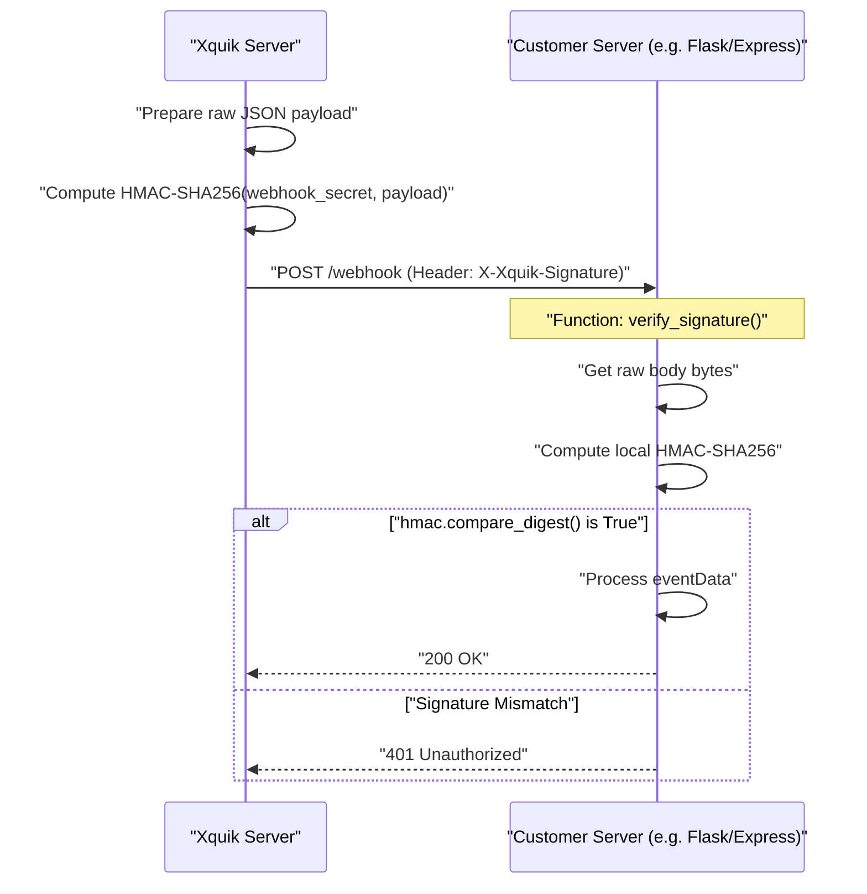
Sources: [skills/x-twitter-scraper/references/webhooks.md:32-113](), [skills/x-twitter-scraper/references/python-examples.md:120-149]()

### Delivery Retries & Idempotency
*   **Retries**: Failed deliveries are retried up to 5 times with exponential backoff [skills/x-twitter-scraper/references/webhooks.md:189-191]().
*   **Idempotency**: Consumers should deduplicate by hashing the raw payload or tracking event IDs, as retries may result in duplicate deliveries [skills/x-twitter-scraper/references/webhooks.md:173-187]().
*   **Timeouts**: Your endpoint must respond within 10 seconds [skills/x-twitter-scraper/references/webhooks.md:169-169]().

### Webhook Testing
Use the `POST /webhooks/{id}/test` endpoint to trigger a `webhook.test` event [skills/x-twitter-scraper/references/api-endpoints.md:267-273](). This delivery includes the `X-Xquik-Signature` header, allowing for verification of the signature logic without waiting for real X activity [skills/x-twitter-scraper/references/api-endpoints.md:286-286]().

Sources: [skills/x-twitter-scraper/references/webhooks.md:154-194](), [skills/x-twitter-scraper/references/api-endpoints.md:225-296]()

---

## Integration Examples

### Node.js (Express) Webhook Handler
A robust handler must use the raw request body to compute the HMAC [skills/x-twitter-scraper/references/webhooks.md:34-79]().

```javascript
app.post("/webhook", express.raw({ type: "application/json" }), (req, res) => {
  const signature = req.headers["x-xquik-signature"];
  const payload = req.body.toString();

  if (!verifySignature(payload, signature, WEBHOOK_SECRET)) {
    return res.status(401).send("Invalid signature");
  }

  const event = JSON.parse(payload);
  // Process event.eventType...
  res.status(200).send("OK");
});
```

### Python (Flask) Webhook Handler
Python implementations should use `hmac.compare_digest` for timing-safe comparison [skills/x-twitter-scraper/references/python-examples.md:111-149]().

```python
@app.route("/webhook", methods=["POST"])
def webhook():
    signature = request.headers.get("X-Xquik-Signature", "")
    payload = request.get_data()

    if not verify_signature(payload, signature, WEBHOOK_SECRET):
        return "Invalid signature", 401

    event = json.loads(payload)
    # Handle event...
    return "OK", 200
```

Sources: [skills/x-twitter-scraper/references/webhooks.md:32-113](), [skills/x-twitter-scraper/references/python-examples.md:109-151]()

---

# Page: Automations & Flow Engine

# Automations & Flow Engine

<details>
<summary>Relevant source files</summary>

The following files were used as context for generating this wiki page:

- [skills/x-twitter-scraper/references/extractions.md](skills/x-twitter-scraper/references/extractions.md)
- [skills/x-twitter-scraper/references/mcp-tools.md](skills/x-twitter-scraper/references/mcp-tools.md)
- [skills/x-twitter-scraper/references/python-examples.md](skills/x-twitter-scraper/references/python-examples.md)
- [skills/x-twitter-scraper/references/types.md](skills/x-twitter-scraper/references/types.md)
- [skills/x-twitter-scraper/references/webhooks.md](skills/x-twitter-scraper/references/webhooks.md)
- [skills/x-twitter-scraper/references/workflows.md](skills/x-twitter-scraper/references/workflows.md)

</details>


The Automations & Flow Engine is a trigger-action workflow system designed to orchestrate complex operations across the Xquik platform. It allows users to define "Flows" consisting of a sequence of steps—including conditional logic, data extractions, and write actions—triggered by real-time events, schedules, or inbound webhooks.

### System Overview

The engine operates as a directed graph where each `AutomationStep` points to a subsequent step via `parentStepId`. This structure supports branching logic (e.g., "True" vs "False" paths) and sequential execution.

#### Core Entity Space Mapping
The following diagram maps high-level automation concepts to their corresponding TypeScript interfaces and API structures.

**Diagram: Automation Entity Mapping**
```mermaid
graph TD
    subgraph "Natural Language Space"
        A["Workflow"]
        B["Trigger"]
        C["Action"]
        D["Logic Gate"]
    end

    subgraph "Code Entity Space"
        A1["AutomationFlow interface"]
        B1["TriggerType enum"]
        C1["AutomationStep (action)"]
        D1["AutomationStep (condition)"]
    end

    A -- "represented by" --> A1
    B -- "defined in" --> B1
    C -- "instance of" --> C1
    D -- "branch property of" --> D1
```
Sources: [skills/x-twitter-scraper/references/types.md:268-284](), [skills/x-twitter-scraper/references/types.md:97-110]()

---

### Flow Structure & Step Logic

An `AutomationFlow` is the top-level container. It defines the entry point of the automation via a `trigger`.

#### 1. Trigger Types
Triggers define when a flow starts. The system supports three primary types:
*   **`monitor_event`**: Fires when a monitored X account triggers an event (e.g., `tweet.new`, `tweet.reply`). [skills/x-twitter-scraper/references/types.md:106-110]()
*   **`schedule`**: Fires at specific intervals (CRON-like behavior).
*   **`webhook_inbound`**: Fires when an external system sends a POST request to the flow's unique endpoint.

#### 2. Automation Steps
Steps are the building blocks of a flow. Each step is defined by an internal `AutomationStep` structure.

| Field | Type | Description |
| :--- | :--- | :--- |
| `type` | `action` \| `condition` \| `extraction` | The functional category of the step. |
| `actionType` | `string` | The specific operation (e.g., `post_tweet`, `like_tweet`, `send_dm`). |
| `parentStepId` | `string` (optional) | The ID of the step that must complete before this one. |
| `branch` | `"true"` \| `"false"` (optional) | For conditional steps, determines which path this step belongs to. |
| `config` | `Record<string, any>` | Parameters for the action (e.g., tweet text, search queries). |

#### 3. Execution Graph
The flow engine processes steps by following the `parentStepId` links. If a step is of type `condition`, the engine evaluates the logic and proceeds only to child steps where the `branch` value matches the result.

**Diagram: Step Execution Logic**
```mermaid
graph TD
    Trigger["Trigger (monitor_event)"] --> Step1["Step 1: condition (Check Followers)"]
    Step1 -- "branch: 'true'" --> Step2["Step 2: action (Send DM)"]
    Step1 -- "branch: 'false'" --> Step3["Step 3: action (Log Event)"]
    Step2 --> Step4["Step 4: extraction (follower_explorer)"]
    
    subgraph "Data Flow"
        Step1
        Step2
        Step3
        Step4
    end
```
Sources: [skills/x-twitter-scraper/references/types.md:246-266](), [skills/x-twitter-scraper/references/workflows.md:128-150]()

---

### API Implementation

Automations are managed via the REST API, utilizing standard patterns for resource creation and state management.

#### Creating and Updating Flows
Flows are created via `POST` requests. To prevent race conditions during multi-step updates, the system utilizes an **optimistic-concurrency update pattern**. When updating a flow, the client should provide the expected state to ensure the graph remains consistent.

#### Key Patterns
*   **Creation**: Initialize a flow with a specific `TriggerType`.
*   **Step Management**: Steps are added by specifying a `parentStepId`, effectively building the directed graph.
*   **Validation**: The system validates that `extraction` steps use valid `ExtractionToolType` values such as `reply_extractor` or `follower_explorer`. [skills/x-twitter-scraper/references/types.md:246-266]()

#### Step Configuration Examples
When adding a step, the `config` object varies by the tool or action being performed:

```json
{
  "type": "extraction",
  "actionType": "follower_explorer",
  "config": {
    "targetUsername": "elonmusk",
    "resultsLimit": 100
  }
}
```
Sources: [skills/x-twitter-scraper/references/extractions.md:40-46](), [skills/x-twitter-scraper/references/types.md:268-284]()

---

### Execution and Monitoring

Once a flow is active, the engine listens for the defined trigger (e.g., a `tweet.new` event from a `Monitor`). [skills/x-twitter-scraper/references/types.md:97-110]()

#### Execution Logs
Every time a flow is triggered, an execution record is created. These records track the status of each step (e.g., `pending`, `running`, `completed`, `failed`). [skills/x-twitter-scraper/references/types.md:271-271]()

#### Pricing and Credits
Flow execution consumes credits based on the actions performed within the steps. For example, a `post_extractor` step will consume credits per result extracted, while a `post_tweet` action (via `x-write` category) has a higher fixed cost. [skills/x-twitter-scraper/references/mcp-tools.md:95-100](), [skills/x-twitter-scraper/references/workflows.md:180-190]()

| Component | Cost |
| :--- | :--- |
| Triggers / Webhooks | Free |
| Write Actions (Post/Like) | 10 credits |
| Extractions | 1-5 credits per result |
| Read Actions (Lookup) | 1-5 credits |

Sources: [skills/x-twitter-scraper/references/workflows.md:156-192](), [skills/x-twitter-scraper/references/mcp-tools.md:74-114]()

---

# Page: Content Composition & Style Analysis

# Content Composition & Style Analysis

<details>
<summary>Relevant source files</summary>

The following files were used as context for generating this wiki page:

- [skills/monitor-accounts/SKILL.md](skills/monitor-accounts/SKILL.md)
- [skills/optimize-tweets/SKILL.md](skills/optimize-tweets/SKILL.md)
- [skills/trending-news/SKILL.md](skills/trending-news/SKILL.md)
- [skills/tweet-style/SKILL.md](skills/tweet-style/SKILL.md)
- [skills/update-x-profile/SKILL.md](skills/update-x-profile/SKILL.md)
- [skills/write-threads/SKILL.md](skills/write-threads/SKILL.md)
- [skills/x-twitter-scraper/references/api-endpoints.md](skills/x-twitter-scraper/references/api-endpoints.md)

</details>


The Content Composition & Style Analysis system provides a sophisticated AI-assisted pipeline for generating, refining, and scoring X (Twitter) content. It leverages historical data to clone specific account voices through a Style Cache sub-system and integrates real-time global trends via Radar and Trends endpoints to ensure content relevance and high engagement potential.

## Composition Pipeline

The composition process is structured as a 3-step stateful workflow designed to move from a raw idea to a production-ready tweet with predicted performance metrics.

### Pipeline Flow: Compose → Refine → Score

The pipeline is primarily accessed via the `POST /compose` endpoint [skills/x-twitter-scraper/references/api-endpoints.md:575-575](). The `step` parameter determines the current stage of the pipeline.

| Step | Function | Input Requirements | Output |
| :--- | :--- | :--- | :--- |
| `compose` | Generates initial drafts | `topic`, `styleUsername` (optional), `mode` ("tweet" or "thread") | Array of draft objects with `text` [skills/x-twitter-scraper/references/api-endpoints.md:575-583]() |
| `refine` | Polishes a selected draft | `draftText`, `instructions` | Refined version of the text |
| `score` | Analyzes engagement potential | `text` | `phoenixScore`, `signals`, `suggestions` [skills/optimize-tweets/SKILL.md:41-51]() |

### Implementation Details
The `POST /compose` endpoint [skills/x-twitter-scraper/references/api-endpoints.md:575-575]() accepts a JSON body containing the `step` and associated data. While `compose` is used for drafting, the final output should be sent to `POST /x/tweets` [skills/x-twitter-scraper/references/api-endpoints.md:683-683]() for publishing. For multi-tweet threads, the `mode: "thread"` parameter in `POST /compose` generates a sequence of tweets, each within the 280-character limit [skills/write-threads/SKILL.md:41-52]().

**Sources:** [skills/x-twitter-scraper/references/api-endpoints.md:575-590](), [skills/optimize-tweets/SKILL.md:30-58](), [skills/write-threads/SKILL.md:26-52]()

## PhoenixScores & Engagement Multipliers

The `score` step of the composition pipeline returns a `PhoenixScore`, a proprietary metric representing the predicted virality and quality of a tweet.

### Scoring Metrics
When calling `POST /compose` with `step="score"` [skills/optimize-tweets/SKILL.md:34-34](), the engine returns:
*   **PhoenixScore**: A numerical value (0-100) indicating overall quality [skills/optimize-tweets/SKILL.md:48-48]().
*   **Signals**: Specific coefficients for `hook_quality`, `length_fit`, `format`, `media_bonus`, `reply_bait_risk`, and `link_penalty` [skills/optimize-tweets/SKILL.md:49-49]().
*   **Suggestions**: Actionable feedback to improve the score (e.g., "Add a hook", "Use fewer hashtags") [skills/optimize-tweets/SKILL.md:50-50]().

The `link_penalty` signal specifically warns users that tweets containing external URLs typically underperform in the X algorithm [skills/optimize-tweets/SKILL.md:70-70]().

**Sources:** [skills/optimize-tweets/SKILL.md:26-58](), [skills/x-twitter-scraper/references/api-endpoints.md:575-590]()

## Style Cache Sub-system

The Style Cache allows the system to analyze the "voice" of any X account and apply that style to new compositions. This is managed through the `/styles` endpoint category [skills/x-twitter-scraper/references/api-endpoints.md:612-612]().

### Key Components
1.  **Style Analysis**: Triggered via `POST /styles` [skills/x-twitter-scraper/references/api-endpoints.md:614-614](), which crawls a user's recent history to generate a style profile.
2.  **Style Retrieval**: Cached styles are fetched via `GET /styles/{username}` [skills/x-twitter-scraper/references/api-endpoints.md:623-623](). This returns `tone`, `avg_length`, `top_topics`, `format_breakdown`, and `signature_phrases` [skills/tweet-style/SKILL.md:41-48]().
3.  **Style Comparison**: `POST /styles/compare` [skills/tweet-style/SKILL.md:59-62]() allows identifying linguistic overlaps between two accounts.
4.  **Performance Analysis**: `GET /styles/{username}/performance` identifies which formats (threads, lists, etc.) earn the most engagement for a specific user [skills/tweet-style/SKILL.md:36-36]().

### Style-to-Composition Mapping
| System Concept | Code Entity / Endpoint | File Reference |
| :--- | :--- | :--- |
| Style Analyzer | `POST /styles` | [api-endpoints.md:614]() |
| Style Repository | `GET /styles/{username}` | [api-endpoints.md:623]() |
| Composition Engine | `POST /compose` | [api-endpoints.md:575]() |
| Style Comparison | `POST /styles/compare` | [tweet-style/SKILL.md:60]() |

**Sources:** [skills/tweet-style/SKILL.md:26-62](), [skills/x-twitter-scraper/references/api-endpoints.md:612-635]()

## Trends & Radar Endpoints

To facilitate contextually aware content, the system provides two primary discovery endpoints.

### Radar (Global Trends)
The `GET /radar` endpoint [skills/x-twitter-scraper/references/api-endpoints.md:562-562]() aggregates trending news stories from curated sources. This endpoint is often used to surface "breaking news" with social context.

**Functionality:**
*   **Category Filter**: Supports filtering by `tech`, `business`, `politics`, `sports`, or `entertainment` [skills/trending-news/SKILL.md:35-35]().
*   **Social Context**: `GET /radar/{id}/tweets` retrieves X reactions related to a specific news story [skills/trending-news/SKILL.md:36-36]().

### X Trends (Platform Specific)
The `GET /trends` endpoint [skills/x-twitter-scraper/references/api-endpoints.md:553-553]() retrieves X-specific trending topics (hashtags and keywords). It requires a `woeid` (Where On Earth ID) parameter, where `1` represents Global trends [skills/x-twitter-scraper/references/api-endpoints.md:553-553]().

### Integration Diagram: Trends to Composition
This diagram illustrates how data from the Radar/Trends endpoints flows into the Composition pipeline.

```mermaid
graph TD
    subgraph "Discovery Layer"
        R["GET /radar"]
        T["GET /trends"]
    end

    subgraph "Composition Pipeline"
        C["POST /compose (step=compose)"]
        RF["POST /compose (step=refine)"]
        S["POST /compose (step=score)"]
    end

    subgraph "Execution Layer"
        P["POST /x/tweets"]
    end

    R -- "topic selection" --> C
    T -- "topic selection" --> C
    C -- "draftText" --> RF
    RF -- "refinedText" --> S
    S -- "validated content" --> P
```

**Sources:** [skills/trending-news/SKILL.md:26-58](), [skills/x-twitter-scraper/references/api-endpoints.md:553-570]()

## Technical Architecture

The following diagram bridges the Natural Language concepts of "Writing and Style" to the specific Code Entities used in the system.

```mermaid
graph LR
    subgraph "Natural Language Intent"
        W["'Write a tweet about...'"]
        ST["'Analyze how @user writes'"]
        TR["'What's trending in tech?'"]
    end

    subgraph "Code Entity Space"
        direction TB
        subgraph "Composition Module"
            Comp["POST /compose"]
            Draft["GET /drafts"]
        end
        
        subgraph "Style Module"
            StylePost["POST /styles"]
            StyleGet["GET /styles/{username}"]
        end

        subgraph "Trends Module"
            Radar["GET /radar"]
            XTrends["GET /trends"]
        end
    end

    W --> Comp
    ST --> StylePost
    TR --> Radar
    StyleGet -. "provides styleUsername" .-> Comp
    Radar -. "provides topic" .-> Comp
```

**Sources:** [skills/x-twitter-scraper/references/api-endpoints.md:553-635](), [skills/optimize-tweets/SKILL.md:30-40](), [skills/tweet-style/SKILL.md:30-40]()

---

# Page: Giveaway Draws

# Giveaway Draws

<details>
<summary>Relevant source files</summary>

The following files were used as context for generating this wiki page:

- [skills/run-giveaway/SKILL.md](skills/run-giveaway/SKILL.md)
- [skills/write-tweets/SKILL.md](skills/write-tweets/SKILL.md)
- [skills/x-articles/SKILL.md](skills/x-articles/SKILL.md)
- [skills/x-twitter-scraper/references/draws.md](skills/x-twitter-scraper/references/draws.md)

</details>


The Draws sub-system provides a robust engine for running transparent and auditable contests on X (formerly Twitter). It automates the extraction of participants from tweet interactions, applies complex filtering logic to ensure eligibility, and performs randomized selection for winners and backups.

## System Overview

The Draws system operates by analyzing interactions (likes, retweets, replies, or quotes) to a target tweet. Unlike manual selection, the sub-system validates participants against 11 configurable criteria, ranging from social graph requirements (following/retweeting) to account metadata (age, follower count) and content requirements (keywords, hashtags).

### Data Flow and Lifecycle

1.  **Initialization**: A `POST /draws` request triggers the process by providing a `seed_tweet_url` or `tweetUrl`.
2.  **Extraction**: The system identifies all participants based on the `entry_source` (likes, retweets, replies, or quotes).
3.  **Filtering**: Each participant is passed through the filter pipeline (e.g., `min_followers`, `must_follow`).
4.  **Selection**: A random draw is performed from the pool of valid entries.
5.  **Completion**: Winners and backups are assigned positions and stored for retrieval.
6.  **Verification**: The system generates a `seed_hash` and `block_proof` for cryptographic auditability.

Sources: [skills/run-giveaway/SKILL.md:41-61](), [skills/run-giveaway/SKILL.md:71-73](), [skills/x-twitter-scraper/references/draws.md:1-22]()

## API Configuration

### Create Draw (`POST /draws`)

The primary entry point for the system supports both standard JSON and skill-specific payloads.

| Field | Type | Description |
| :--- | :--- | :--- |
| `tweetUrl` | `string` | **Required.** The full URL of the contest tweet (`https://x.com/user/status/ID`). |
| `entry_source` | `string` | Source of entrants: `likes`, `retweets`, `replies`, or `quotes`. |
| `winnerCount` | `number` | Number of primary winners to select (default: 1). |
| `backupCount` | `number` | Number of backup winners to select in case of disqualification. |
| `uniqueAuthorsOnly` | `boolean` | If true, multiple interactions from the same user count as one entry. |
| `mustRetweet` | `boolean` | Validates if the participant has retweeted the target tweet. |
| `mustFollowUsername`| `string` | Validates if the participant follows the specified account. |
| `filterMinFollowers`| `number` | Minimum follower threshold for the participant's account. |
| `filterAccountAgeDays`| `number` | Minimum days since the participant's account was created. |
| `filterLanguage` | `string` | ISO language code (e.g., `"en"`) required in the reply text. |
| `requiredKeywords` | `string[]` | Array of strings that must be present in the reply. |
| `requiredHashtags` | `string[]` | Specific hashtags (e.g., `["#giveaway"]`) required in the reply. |
| `requiredMentions` | `string[]` | Specific usernames (e.g., `["@xquik"]`) that must be tagged. |

Sources: [skills/run-giveaway/SKILL.md:44-58](), [skills/x-twitter-scraper/references/draws.md:7-22]()

### Draw Implementation Logic

The following diagram maps the natural language requirements of a giveaway to the internal `CreateDrawRequest` properties and the resulting `Draw` entity.

**Draw Entity Mapping**
```mermaid
graph TD
    subgraph "Natural Language Requirements"
        R1["'Must follow me'"]
        R2["'Must use #win'"]
        R3["'No bots/new accounts'"]
        R4["'Retweet this'"]
    end

    subgraph "Code Entity: CreateDrawRequest"
        direction LR
        req["POST /draws Payload"]
        req --- f1["mustFollowUsername"]
        req --- f2["requiredHashtags"]
        req --- f3["filterAccountAgeDays"]
        req --- f4["mustRetweet"]
    end

    subgraph "Code Entity: Draw (Result)"
        draw["Draw Response Object"]
        draw --- s1["status: 'completed'"]
        draw --- s2["seed_hash: string"]
        draw --- s3["block_proof: string"]
    end

    R1 -.-> f1
    R2 -.-> f2
    R3 -.-> f3
    R4 -.-> f4
    req -->|"System Processes"| draw
```
Sources: [skills/run-giveaway/SKILL.md:44-61](), [skills/run-giveaway/SKILL.md:71-73](), [skills/x-twitter-scraper/references/draws.md:26-42]()

## Winner Selection & Pagination

Once a draw reaches the `completed` status, winners are accessible via the draw details endpoint.

### Selection Logic
Winners are selected randomly from the pool of participants who pass all configured filters. The system first fills the `winnerCount` slots (where `isBackup` is `false`) and then fills the `backupCount` slots (where `isBackup` is `true`).

### Result Retrieval
Draw history and result lists can be accessed via specific sub-resources:
*   **Status/Winners**: `GET /draws/{id}` returns the status and the final winner list.
*   **Entrant List**: `GET /draws/{id}/entrants` provides the full list of filtered participants.
*   **Export**: `GET /draws/{id}/export?format=csv` generates a downloadable file.

**Draw Result Data Flow**
```mermaid
sequenceDiagram
    participant Client
    participant API as "POST /draws"
    participant Engine as "Giveaway Engine"
    participant DB as "Draw Storage"

    Client->>API: Send Draw Configuration
    API->>Engine: Initialize Draw (Status: running)
    Engine->>Engine: Extract participants (likes/RTs/replies)
    Engine->>Engine: Apply 11 Configurable Filters
    Engine->>Engine: Randomize & Select Winners
    Engine->>Engine: Generate seed_hash & block_proof
    Engine->>DB: Store Winner[] & Metadata
    Engine-->>API: Completion Signal
    Client->>API: GET /draws/{id}
    API->>DB: Fetch Draw + Winners
    DB-->>Client: Return Draw Object (Status: completed)
```
Sources: [skills/run-giveaway/SKILL.md:32-37](), [skills/run-giveaway/SKILL.md:60-61](), [skills/x-twitter-scraper/references/draws.md:44-53]()

## Technical Specifications

### Data Structures

The system utilizes structured winner objects to facilitate auditability.

```typescript
// Conceptual representation based on API responses
interface DrawWinner {
  position: number;
  authorUsername: string;
  tweetId: string; // The ID of the interaction (reply/quote)
  isBackup: boolean;
}

interface DrawStatus {
  draw_id: string;
  status: "pending" | "running" | "completed" | "failed";
  winners: DrawWinner[];
  seed_hash: string;
  block_proof: string;
}
```
Sources: [skills/run-giveaway/SKILL.md:57-61](), [skills/run-giveaway/SKILL.md:71-73](), [skills/x-twitter-scraper/references/draws.md:46-49]()

### Cost and Auditing
*   **Cost**: 1 credit ($0.00015) per participant entry. This is a paid, irreversible action.
*   **Auditing**: Every draw includes a cryptographic `seed_hash` and `block_proof` so winners can be independently verified. Users are encouraged to include these in public announcements.
*   **Export**: Results are exportable in CSV format via the `/export` endpoint.

Sources: [skills/run-giveaway/SKILL.md:37-37](), [skills/run-giveaway/SKILL.md:71-73](), [skills/x-twitter-scraper/references/draws.md:52-57]()

---

# Page: Data Types & Schemas

# Data Types & Schemas

<details>
<summary>Relevant source files</summary>

The following files were used as context for generating this wiki page:

- [skills/x-twitter-scraper/references/extractions.md](skills/x-twitter-scraper/references/extractions.md)
- [skills/x-twitter-scraper/references/mcp-tools.md](skills/x-twitter-scraper/references/mcp-tools.md)
- [skills/x-twitter-scraper/references/types.md](skills/x-twitter-scraper/references/types.md)

</details>


This section provides an overview of the TypeScript type system that governs the Xquik API and its Model Context Protocol (MCP) implementation. The codebase utilizes a strictly typed interface layer to ensure consistency between the internal REST API, the asynchronous extraction engine, and the tool-based MCP server.

## Overview of the Type System

The Xquik type system is divided into two primary domains:
1.  **Core Data Models**: Internal representations of X entities (Users, Tweets), system resources (Monitors, Extractions), and orchestration logic (Automations).
2.  **MCP-Specific Schemas**: Optimized data shapes designed for LLM consumption, featuring field remapping and flattened structures to improve agent reasoning.

### Data Flow & Type Mapping

The following diagram illustrates how data moves from the raw X response through the internal REST layer and finally into the MCP tool output.

**Data Transformation Pipeline**
```mermaid
graph TD
    subgraph "X Platform Space"
        X_RAW["Raw X JSON"]
    end

    subgraph "Code Entity Space (Internal REST)"
        direction TB
        T_TWEET["Tweet (X API)"]
        T_USER["User (X API)"]
        T_JOB["ExtractionJob"]
        T_EVENT["EventData"]
    end

    subgraph "MCP Tool Space"
        M_INFO["McpUserInfo"]
        M_TWEET["McpTweetLookup"]
        M_EXT["McpExtractionJob"]
    end

    X_RAW --> T_USER
    X_RAW --> T_TWEET
    
    T_USER -->|Mapped by MCP Server| M_INFO
    T_TWEET -->|Mapped by MCP Server| M_TWEET
    T_JOB -->|Mapped by MCP Server| M_EXT
    T_EVENT -->|Webhook Payload| M_INFO
```
Sources: [skills/x-twitter-scraper/references/types.md:23-301]()

---

## Core Data Models

The core models represent the persistent state of the Xquik system. These interfaces are used across the `xquik` tool execution and the standard REST API.

| Category | Key Interfaces | Description |
| :--- | :--- | :--- |
| **Identity** | `Account`, `CreditBalance` | Manages subscription tiers, monitor quotas, and credit consumption [skills/x-twitter-scraper/references/types.md:25-58](). |
| **Monitoring** | `Monitor`, `Event`, `Webhook` | Defines the real-time tracking of X accounts and the delivery of events via webhooks [skills/x-twitter-scraper/references/types.md:97-185](). |
| **Bulk Data** | `ExtractionJob`, `ExtractionResult` | Structures the asynchronous scraping of large datasets (e.g., followers, search results) [skills/x-twitter-scraper/references/types.md:268-295](). |
| **Draws** | `Draw`, `DrawWinner` | Defines the configuration and results for giveaway contests [skills/x-twitter-scraper/references/types.md:189-222](). |

For a full field-level reference including enums and optionality, see **[Core Data Models](#4.1)**.

---

## MCP-Specific Schemas

When interacting via the Model Context Protocol (MCP), the system often transforms internal REST responses into "Mcp" prefixed types. This is done to provide more descriptive field names for AI agents (e.g., changing `username` to `xUsername` to avoid ambiguity with system users).

**Natural Language to Code Mapping (MCP)**
```mermaid
graph LR
    subgraph "Natural Language (Agent Intent)"
        NL_1["'Who follows @Xquik?'"]
        NL_2["'Check for new replies'"]
    end

    subgraph "Code Entity Space (MCP Layer)"
        direction TB
        E_1["McpExtractionJob"]
        E_2["McpSubscribe"]
        E_3["McpUserInfo"]
    end

    NL_1 -->|Triggers| E_1
    NL_2 -->|Triggers| E_2
    E_1 -.->|Contains| E_3
```
Sources: [skills/x-twitter-scraper/references/types.md:20-21](), [skills/x-twitter-scraper/references/mcp-tools.md:16-28]()

### Key Mapping Differences
The MCP layer performs several "Quality of Life" transformations for the LLM:
*   **Flattening**: Deeply nested X metrics (likes, retweets) are often flattened into top-level properties in the `EndpointInfo` response shapes [skills/x-twitter-scraper/references/mcp-tools.md:17-25]().
*   **Explicit Naming**: Properties like `id` are mapped to `tweetId` or `xUserId` to prevent the agent from confusing internal database IDs with X platform IDs [skills/x-twitter-scraper/references/types.md:288-290]().
*   **Status Enums**: Statuses are normalized across `ExtractionJob` and `Draw` (e.g., `pending`, `running`, `completed`, `failed`) to ensure the agent can use consistent polling logic [skills/x-twitter-scraper/references/types.md:199-209](), [skills/x-twitter-scraper/references/types.md:271]().

For the complete mapping table and MCP output definitions, see **[MCP-Specific Schemas](#4.2)**.

---

## Type Safety in Tool Execution

The `xquik` tool utilizes these types to validate the requests sent by the agent. By adhering to the `ExtractionToolType` enum [skills/x-twitter-scraper/references/types.md:246-266](), the system can provide immediate feedback if an agent attempts to use an unsupported extraction method. The `explore` tool specifically exposes the `EndpointInfo` interface to allow agents to discover the `responseShape` and `parameters` before execution [skills/x-twitter-scraper/references/mcp-tools.md:17-25]().

**Sources:**
* [skills/x-twitter-scraper/references/types.md:23-301]() (Core Interface Definitions)
* [skills/x-twitter-scraper/references/types.md:246-266]() (Extraction Tool Enums)
* [skills/x-twitter-scraper/references/types.md:106-110]() (Event Type Enums)
* [skills/x-twitter-scraper/references/mcp-tools.md:12-28]() (MCP Tool Metadata Schemas)

---

# Page: Core Data Models

# Core Data Models

<details>
<summary>Relevant source files</summary>

The following files were used as context for generating this wiki page:

- [skills/x-twitter-scraper/references/api-endpoints.md](skills/x-twitter-scraper/references/api-endpoints.md)
- [skills/x-twitter-scraper/references/extractions.md](skills/x-twitter-scraper/references/extractions.md)
- [skills/x-twitter-scraper/references/mcp-tools.md](skills/x-twitter-scraper/references/mcp-tools.md)
- [skills/x-twitter-scraper/references/types.md](skills/x-twitter-scraper/references/types.md)

</details>


This page serves as a technical reference for the primary TypeScript interfaces and data structures used throughout the Xquik platform. These models define the shape of data for account management, real-time monitoring, asynchronous extractions, and giveaway draws.

## Entity Relationship Overview

The following diagram illustrates how the core entities relate to one another within the system.

**System Entity Relationship Map**
```mermaid
erDiagram
    ACCOUNT ||--o{ API_KEY : "owns"
    ACCOUNT ||--o{ CREDIT_BALANCE : "has"
    ACCOUNT ||--o{ MONITOR : "manages"
    ACCOUNT ||--o{ EXTRACTION_JOB : "initiates"
    ACCOUNT ||--o{ DRAW : "runs"
    ACCOUNT ||--o{ WEBHOOK : "receives_events_via"
    
    MONITOR ||--o{ EVENT : "generates"
    EVENT ||--o{ WEBHOOK_DELIVERY : "triggers"
    
    EXTRACTION_JOB ||--o{ EXTRACTION_RESULT : "produces"
    
    DRAW ||--o{ DRAW_WINNER : "selects"
```
Sources: [skills/x-twitter-scraper/references/types.md:25-284](), [skills/x-twitter-scraper/references/api-endpoints.md:113-222]()

---

## Account & Billing Models

The account and credit models track user subscription status, resource quotas, and the consumption of the credit-based billing system.

### Account
Represents the user's subscription state and monitoring limits.
*   `plan`: Current status of the account (`active` | `inactive`) [skills/x-twitter-scraper/references/types.md:26]().
*   `monitorsAllowed`: Total number of concurrent monitors the plan supports [skills/x-twitter-scraper/references/types.md:27]().
*   `monitorsUsed`: Number of monitors currently active [skills/x-twitter-scraper/references/types.md:28]().
*   `monitorBilling`: Object containing credit burn rates and intervals [skills/x-twitter-scraper/references/types.md:29-37]().

### CreditBalance
Tracks the financial state of the account.
*   `balance`: Current available credits, represented as a bigint string [skills/x-twitter-scraper/references/types.md:52]().
*   `lifetimeUsed`: Total credits consumed since account creation [skills/x-twitter-scraper/references/types.md:54]().
*   `autoTopupEnabled`: Boolean flag for automatic recharging [skills/x-twitter-scraper/references/types.md:55]().

Sources: [skills/x-twitter-scraper/references/types.md:25-58](), [skills/x-twitter-scraper/references/api-endpoints.md:32-67]()

---

## Monitoring & Events

Monitors are the foundation of the real-time pipeline, observing specific X accounts for activities.

### Monitor
Defines what account and which events are being tracked.
*   `xUserId`: The unique X ID of the target being monitored [skills/x-twitter-scraper/references/types.md:100]().
*   `eventTypes`: An array of `EventType` enums (e.g., `tweet.new`, `tweet.reply`) [skills/x-twitter-scraper/references/types.md:101]().

### Event
The data packet generated when a monitor detects activity.
*   `type`: The specific category of the activity [skills/x-twitter-scraper/references/types.md:116]().
*   `data`: A `TweetEventData` object containing `tweetId`, `text`, and engagement `metrics` [skills/x-twitter-scraper/references/types.md:120-132]().
*   `occurredAt`: ISO timestamp of the event on X [skills/x-twitter-scraper/references/types.md:119]().

**Event Data Flow: Code to Entity Space**
```mermaid
graph TD
    subgraph "X_Platform"
        X_ACT["X User Activity"]
    end

    subgraph "Xquik_REST_API"
        MON["Monitor (Interface)"]
        PROC["Event Processor"]
        EVT_LIST["GET /api/v1/events"]
    end

    subgraph "Output_Layer"
        WEB["Webhook (Interface)"]
        DELIVERY["Delivery (Interface)"]
    end

    X_ACT --> MON
    MON --> PROC
    PROC --> EVT_LIST
    PROC --> WEB
    WEB --> DELIVERY
```
Sources: [skills/x-twitter-scraper/references/types.md:97-150](), [skills/x-twitter-scraper/references/api-endpoints.md:113-222]()

---

## Bulk Extractions

Extractions handle large-scale data retrieval that exceeds standard API rate limits or requires deep scraping across 23 tool types.

### ExtractionJob
The metadata for an asynchronous scraping task.
*   `toolType`: The specific scraper being used (e.g., `reply_extractor`, `follower_explorer`, `tweet_search_extractor`) [skills/x-twitter-scraper/references/types.md:246-266]().
*   `status`: Lifecycle state (`pending` | `running` | `completed` | `failed`) [skills/x-twitter-scraper/references/types.md:271]().
*   `resultsLimit`: Optional cap on results to prevent over-consumption of credits [skills/x-twitter-scraper/references/types.md:280]().

### ExtractionResult
A single row of data produced by a job.
*   Contains fields for both user profile data (`xUsername`, `xFollowersCount`) and tweet data (`tweetText`, `tweetId`) depending on the `toolType` [skills/x-twitter-scraper/references/types.md:286-300]().

Sources: [skills/x-twitter-scraper/references/types.md:244-300](), [skills/x-twitter-scraper/references/extractions.md:1-208]()

---

## Giveaway Draws

The Draws system manages random winner selection from tweet interactions with configurable filtering logic.

### Draw
*   `tweetUrl`: The source URL of the contest tweet [skills/x-twitter-scraper/references/types.md:192]().
*   `status`: The current state of the draw process [skills/x-twitter-scraper/references/types.md:199]().
*   `totalEntries`: Total number of interactions processed [skills/x-twitter-scraper/references/types.md:200]().

### CreateDrawRequest
*   `winnerCount`: Number of primary winners to select [skills/x-twitter-scraper/references/types.md:231]().
*   `mustRetweet`: Filter requiring the winner to have retweeted [skills/x-twitter-scraper/references/types.md:234]().
*   `filterMinFollowers`: Minimum follower count for eligibility [skills/x-twitter-scraper/references/types.md:236]().

Sources: [skills/x-twitter-scraper/references/types.md:189-242](), [skills/x-twitter-scraper/references/api-endpoints.md:300-326]()

---

## Webhooks & Deliveries

Webhooks provide the mechanism for external systems to receive real-time data from Xquik via signed HTTP POST requests.

### Webhook
*   `url`: The target endpoint for POST requests [skills/x-twitter-scraper/references/types.md:164]().
*   `secret`: A signing key used to generate `X-Xquik-Signature` headers for payload verification [skills/x-twitter-scraper/references/types.md:158]().

### Delivery
Tracks the status of a specific webhook transmission attempt.
*   `status`: Transmission state (`pending` | `delivered` | `failed` | `exhausted`) [skills/x-twitter-scraper/references/types.md:173]().
*   `attempts`: Number of retries performed [skills/x-twitter-scraper/references/types.md:174]().
*   `lastStatusCode`: The HTTP response code from the recipient server [skills/x-twitter-scraper/references/types.md:175]().

**Webhook Lifecycle: Code to Entity Space**
```mermaid
graph LR
    subgraph "Request_Phase"
        POST_WH["POST /api/v1/webhooks"]
        WH_OBJ["WebhookCreated (Interface)"]
    end

    subgraph "Execution_Phase"
        EVT["WebhookPayload (Interface)"]
        SIGN["HMAC-SHA256 (Secret)"]
    end

    subgraph "Audit_Phase"
        GET_DEL["GET /webhooks/{id}/deliveries"]
        DEL_OBJ["Delivery (Interface)"]
    end

    POST_WH --> WH_OBJ
    WH_OBJ --> EVT
    EVT --> SIGN
    SIGN --> GET_DEL
    GET_DEL --> DEL_OBJ
```
Sources: [skills/x-twitter-scraper/references/types.md:152-186](), [skills/x-twitter-scraper/references/api-endpoints.md:225-297]()

---

# Page: MCP-Specific Schemas

# MCP-Specific Schemas

<details>
<summary>Relevant source files</summary>

The following files were used as context for generating this wiki page:

- [server.json](server.json)
- [skills/x-twitter-scraper/references/extractions.md](skills/x-twitter-scraper/references/extractions.md)
- [skills/x-twitter-scraper/references/mcp-tools.md](skills/x-twitter-scraper/references/mcp-tools.md)
- [skills/x-twitter-scraper/references/types.md](skills/x-twitter-scraper/references/types.md)

</details>


The Model Context Protocol (MCP) server for Xquik provides a specialized interface for AI agents. While the underlying data is fetched from the Xquik REST API, the MCP layer applies transformations to ensure compatibility with LLM context windows and to provide more descriptive field names for agent reasoning. This page documents the specific TypeScript interfaces and field mappings used exclusively within the `xquik` and `explore` MCP tools.

## Data Transformation Flow

When an agent invokes the `xquik` tool, the request flows through a sandboxed environment where REST API responses are mapped into MCP-optimized schemas before being returned to the agent.

### System Architecture: REST to MCP

Title: MCP Response Transformation Pipeline
```mermaid
graph TD
    subgraph "Natural Language Space"
        User["User Prompt"]
        Agent["AI Agent (Claude/Cursor)"]
    end

    subgraph "Code Entity Space: MCP Server"
        XquikTool["xquik Tool [skills/x-twitter-scraper/references/mcp-tools.md:43-54]"]
        Sandbox["JS Sandbox [skills/x-twitter-scraper/references/mcp-tools.md:3-4]"]
        Mapper["Schema Mapper (Internal)"]
    end

    subgraph "Code Entity Space: REST API"
        RestAPI["REST API v1 [/api/v1]"]
        CoreTypes["Core Types [skills/x-twitter-scraper/references/types.md:23-300]"]
    end

    User --> Agent
    Agent --> XquikTool
    XquikTool --> Sandbox
    Sandbox -- "xquik.request()" --> RestAPI
    RestAPI -- "Internal Interface" --> CoreTypes
    CoreTypes -- "Raw JSON" --> Mapper
    Mapper -- "MCP-Specific Schema" --> Sandbox
    Sandbox --> Agent
```
Sources: [skills/x-twitter-scraper/references/mcp-tools.md:3-54](), [skills/x-twitter-scraper/references/types.md:23-300]()

## Field Name Mappings

To improve agent comprehension, several internal field names are mapped to more descriptive aliases. The MCP server consistently applies these transformations to the `EventData` and `ExtractionResult` objects.

| Internal REST Field | MCP Schema Field | Context |
|:---|:---|:---|
| `username` | `xUsername` | User lookups and events [skills/x-twitter-scraper/references/types.md:289-289]() |
| `data` | `eventData` | Webhook and Monitor events [skills/x-twitter-scraper/references/types.md:120-120]() |
| `id` | `xUserId` | When referring specifically to X platform IDs [skills/x-twitter-scraper/references/types.md:288-288]() |
| `text` | `tweetContent` | Tweet-specific text fields [skills/x-twitter-scraper/references/types.md:127-127]() |
| `url` | `checkoutUrl` | Billing and subscription responses [skills/x-twitter-scraper/references/types.md:61-61]() |

Sources: [skills/x-twitter-scraper/references/types.md:61-289](), [skills/x-twitter-scraper/references/mcp-tools.md:43-54]()

## Specialized MCP Schemas

The following interfaces are defined specifically for the MCP tool outputs. They extend or modify the Core Data Models to provide better context for LLMs.

### McpUserInfo
Used when the agent calls `GET /api/v1/x/users/{username}`. It flattens the X profile data and ensures platform IDs are explicitly labeled.

```typescript
interface McpUserInfo {
  xUsername: string;       // Mapped from username
  xUserId: string;         // Mapped from id
  displayName: string;
  description: string;
  followerCount: number;
  followingCount: number;
  isVerified: boolean;
  profileImageUrl: string;
  location?: string;
}
```
Sources: [skills/x-twitter-scraper/references/types.md:288-295]() (referenced via extraction result mapping patterns)

### McpExtractionJob
Used for bulk data operations. The MCP version includes an explicit `progressSummary` field to help agents decide whether to continue polling or wait.

```typescript
interface McpExtractionJob {
  jobId: string;           // Mapped from id
  toolType: ExtractionToolType;
  status: "pending" | "running" | "completed" | "failed";
  resultsFound: number;    // Mapped from totalResults
  progressSummary: string; // Generated: e.g., "Extracted 500 of 1000 estimated"
  createdAt: string;
}
```
Sources: [skills/x-twitter-scraper/references/types.md:268-284](), [skills/x-twitter-scraper/references/mcp-tools.md:115-117]()

### McpSubscribe
When a 402 Payment Required error is encountered, the agent is instructed to call the subscription endpoint. The MCP schema focuses on the actionable checkout URL.

```typescript
interface McpSubscribe {
  checkoutUrl: string;     // Mapped from url
  planName: string;
  priceCents: number;
  currency: "usd";
}
```
Sources: [skills/x-twitter-scraper/references/mcp-tools.md:138-140](), [skills/x-twitter-scraper/references/types.md:60-62]()

## Tool-Specific Constants

The `explore` tool provides access to the `EndpointInfo` schema, which describes the available API surface area to the agent in-memory without network overhead.

Title: Explore Tool Schema Discovery
```mermaid
classDiagram
    class EndpointInfo {
        +string method
        +string path
        +string summary
        +string category
        +boolean free
        +Parameter[] parameters
        +string responseShape
    }
    class Parameter {
        +string name
        +string in
        +boolean required
        +string type
        +string description
    }
    EndpointInfo *-- Parameter
```
Sources: [skills/x-twitter-scraper/references/mcp-tools.md:17-28]()

### Category Mapping
The `category` field in `EndpointInfo` is used by agents to filter capabilities within the `explore` tool. The supported categories are:
* `account`, `composition`, `credits`, `extraction`, `media`, `monitoring`
* `support`, `twitter`, `x-accounts`, `x-write`

Sources: [skills/x-twitter-scraper/references/mcp-tools.md:21-21]()

---

# Page: Integration Guides & Code Examples

# Integration Guides & Code Examples

<details>
<summary>Relevant source files</summary>

The following files were used as context for generating this wiki page:

- [commands/post.md](commands/post.md)
- [commands/search.md](commands/search.md)
- [commands/trending.md](commands/trending.md)
- [commands/user.md](commands/user.md)
- [skills/x-twitter-scraper/references/python-examples.md](skills/x-twitter-scraper/references/python-examples.md)
- [skills/x-twitter-scraper/references/webhooks.md](skills/x-twitter-scraper/references/webhooks.md)
- [skills/x-twitter-scraper/references/workflows.md](skills/x-twitter-scraper/references/workflows.md)

</details>


This section provides practical implementation guides for common integration patterns using the Xquik API. It bridges the gap between raw API endpoints and functional application logic, covering authentication, error handling, and complex multi-step workflows like asynchronous data extraction and giveaway management.

## Implementation Overview

Integrating with Xquik typically involves managing an `x-api-key` [skills/x-twitter-scraper/references/workflows.md:8-10]() and handling metered operations that deduct from a shared credit pool [skills/x-twitter-scraper/references/workflows.md:156-191](). While simple read/write actions are synchronous, advanced features like Bulk Extractions and Giveaway Draws follow an asynchronous lifecycle.

### Core Workflow Patterns

The following diagram maps the conceptual "Natural Language" requirements to the specific "Code Entities" and API paths used to fulfill them.

**Diagram: Requirement to Code Mapping**
```mermaid
graph TD
    subgraph "Natural Language Space"
        R1["'Get all replies to this tweet'"]
        R2["'Pick 3 winners for my contest'"]
        R3["'Notify me when Elon tweets'"]
    end

    subgraph "Code Entity Space"
        E1["POST /extractions"]
        E2["POST /draws"]
        E3["POST /monitors"]
        E4["POST /webhooks"]
        
        subgraph "Workflow Helpers"
            H1["xquikFetch()"]
            H2["verifySignature()"]
            H3["fetchAllPages()"]
        end
    end

    R1 --> E1
    R2 --> E2
    R3 --> E3
    R3 --> E4
    
    E1 -.-> H1
    E1 -.-> H3
    E4 -.-> H2
```
**Sources:** [skills/x-twitter-scraper/references/workflows.md:18-42](), [skills/x-twitter-scraper/references/webhooks.md:40-43](), [skills/x-twitter-scraper/references/python-examples.md:90-100]()

---

## JavaScript / Node.js Examples

The JavaScript guide focuses on building robust integrations using modern `fetch` and Node.js built-ins. Key patterns include:
*   **Exponential Backoff:** Implementing a `xquikFetch` wrapper that automatically retries `429` (Rate Limit) and `5xx` (Server Error) responses [skills/x-twitter-scraper/references/workflows.md:18-42]().
*   **Cursor-based Pagination:** Navigating the `nextCursor` and `hasMore` fields common in extraction results and event logs [skills/x-twitter-scraper/references/workflows.md:50-67]().
*   **Extraction Lifecycle:** Managing the `estimate` -> `create` -> `poll` -> `export` flow [skills/x-twitter-scraper/references/workflows.md:74-122]().

For detailed implementation code, see [JavaScript / Node.js Examples](#5.1).

**Sources:** [skills/x-twitter-scraper/references/workflows.md:13-122]()

---

## Python Examples

The Python guide provides equivalents using the `requests` library and `Flask` for webhook handling. It demonstrates:
*   **Authentication & Requests:** Setting up the `HEADERS` and `BASE` URL for all calls [skills/x-twitter-scraper/references/python-examples.md:7-13]().
*   **Synchronous Polling:** Using `time.sleep` loops to monitor asynchronous job statuses until they transition from `pending` or `running` to completion [skills/x-twitter-scraper/references/python-examples.md:64-66]().
*   **Giveaway Logic:** Configuring complex filters like `mustRetweet`, `filterMinFollowers`, and `requiredKeywords` [skills/x-twitter-scraper/references/python-examples.md:90-100]().

For detailed implementation code, see [Python Examples](#5.2).

**Sources:** [skills/x-twitter-scraper/references/python-examples.md:1-151]()

---

## Webhooks & Real-Time Events

Xquik supports real-time monitoring via an event-driven architecture. Developers create a `Monitor` for a specific X user [skills/x-twitter-scraper/references/workflows.md:130-136]() and then receive notifications via a `Webhook` [skills/x-twitter-scraper/references/workflows.md:139-145]().

**Diagram: Webhook Event Flow**
```mermaid
sequenceDiagram
    participant X as "X (Twitter)"
    participant XQ as "Xquik Platform"
    participant APP as "User Application"

    X->>XQ: New Tweet/Follow Event
    XQ->>XQ: Match against "Monitor" [POST /monitors]
    XQ->>APP: POST /webhook (JSON Payload)
    Note over APP: "verify_signature()" using "X-Xquik-Signature"
    APP-->>XQ: 200 OK
```
**Sources:** [skills/x-twitter-scraper/references/webhooks.md:12-30](), [skills/x-twitter-scraper/references/workflows.md:124-152]()

### Security and Idempotency
Integrations must verify the `X-Xquik-Signature` header using `HMAC-SHA256` to ensure the payload originated from Xquik [skills/x-twitter-scraper/references/webhooks.md:30-30](). Additionally, because webhooks may be retried up to 5 times [skills/x-twitter-scraper/references/webhooks.md:191-191](), implementing idempotency checks by hashing the raw payload is recommended [skills/x-twitter-scraper/references/webhooks.md:173-187]().

For detailed verification examples in Node.js, Python, and Go, see [Monitors, Webhooks & Events](#3.3).

**Sources:** [skills/x-twitter-scraper/references/webhooks.md:32-150]()

---

## Slash Commands Reference

For users integrating Xquik into AI agents (like Claude or Cursor), built-in slash commands provide a shortcut for common operations. These commands abstract the underlying API calls into high-level user actions:

| Command | Action | Code Entity Mapping |
|---------|--------|---------------------|
| `/post` | Post a tweet | `POST /api/v1/x/tweets` [commands/post.md:9-9]() |
| `/search` | Search tweets | `GET /api/v1/x/tweets/search` [commands/search.md:7-7]() |
| `/user` | Profile lookup | `GET /api/v1/x/users/$ARGUMENTS` [commands/user.md:7-7]() |
| `/trending` | Multi-source radar | `GET /api/v1/radar` [commands/trending.md:7-7]() |

For details on command syntax and parameters, see [Slash Commands Reference](#5.3).

**Sources:** [commands/post.md:1-16](), [commands/search.md:1-17](), [commands/user.md:1-20](), [commands/trending.md:1-18]()

---

# Page: JavaScript / Node.js Examples

# JavaScript / Node.js Examples

<details>
<summary>Relevant source files</summary>

The following files were used as context for generating this wiki page:

- [skills/x-twitter-scraper/references/python-examples.md](skills/x-twitter-scraper/references/python-examples.md)
- [skills/x-twitter-scraper/references/webhooks.md](skills/x-twitter-scraper/references/webhooks.md)
- [skills/x-twitter-scraper/references/workflows.md](skills/x-twitter-scraper/references/workflows.md)

</details>


This page provides functional JavaScript and Node.js implementation patterns for the Xquik API. It covers essential integration tasks including robust authentication, error handling with exponential backoff, managing paginated datasets, executing asynchronous bulk extractions, verifying secure webhooks, and running auditable giveaway draws.

## Authentication Setup

Every request to the Xquik API must include the `x-api-key` header. API keys are 64-character hex strings prefixed with `xq_`.

| Variable | Description | Value |
| :--- | :--- | :--- |
| `BASE` | API Base URL | `https://xquik.com/api/v1` |
| `API_KEY` | Your Xquik Key | `xq_YOUR_KEY_HERE` |
| `Content-Type` | Payload Format | `application/json` |

[skills/x-twitter-scraper/references/workflows.md:8-11]()

**Sources:** [skills/x-twitter-scraper/references/workflows.md:7-11]()

## Exponential Backoff Retry Helper

To ensure reliability, clients should implement a retry mechanism. Only `429` (Too Many Requests) and `5xx` (Server Errors) should be retried. Other `4xx` errors indicate client-side issues that require manual correction. The helper should handle `Retry-After` headers if present [skills/x-twitter-scraper/references/workflows.md:29-38]().

### Retry Logic Flow
The following diagram illustrates the decision logic within the `xquikFetch` helper.

```mermaid
graph TD
    "START[Start Request]" --> "REQ[fetch(BASE + path)]"
    "REQ" --> "STATUS{Response OK?}"
    "STATUS" -- "Yes" --> "RETURN[Return JSON]"
    "STATUS" -- "No" --> "RETRYABLE{429 or 5xx?}"
    "RETRYABLE" -- "No" --> "THROW[Throw Fatal Error]"
    "RETRYABLE" -- "Yes" --> "ATTEMPTS{Attempt < 3?}"
    "ATTEMPTS" -- "No" --> "THROW"
    "ATTEMPTS" -- "Yes" --> "DELAY[Calculate Delay / Check Retry-After]"
    "DELAY" --> "WAIT[setTimeout]"
    "WAIT" --> "REQ"
```

### Implementation
The `xquikFetch` function implements a loop that retries up to 3 times with a base delay of 1000ms, using exponential backoff and jitter [skills/x-twitter-scraper/references/workflows.md:18-43]().

```javascript
async function xquikFetch(path, options = {}) {
  const baseDelay = 1000;

  for (let attempt = 0; attempt <= 3; attempt++) {
    const response = await fetch(`${BASE}${path}`, {
      ...options,
      headers: { ...headers, ...options.headers },
    });

    if (response.ok) return response.json();

    const retryable = response.status === 429 || response.status >= 500;
    if (!retryable || attempt === 3) {
      const error = await response.json();
      throw new Error(`Xquik API ${response.status}: ${error.error}`);
    }

    const retryAfter = response.headers.get("Retry-After");
    const delay = retryAfter
      ? parseInt(retryAfter, 10) * 1000
      : baseDelay * Math.pow(2, attempt) + Math.random() * 1000;

    await new Promise((resolve) => setTimeout(resolve, delay));
  }
}
```
**Sources:** [skills/x-twitter-scraper/references/workflows.md:18-43]()

## Cursor-Based Pagination

Many endpoints (Events, Draws, Extractions) use cursor-based pagination. If a response contains `hasMore: true`, use the `nextCursor` value as the `after` query parameter in the subsequent request [skills/x-twitter-scraper/references/workflows.md:47-49]().

```javascript
async function fetchAllPages(path, dataKey) {
  const results = [];
  let cursor;

  while (true) {
    const params = new URLSearchParams({ limit: "100" });
    if (cursor) params.set("after", cursor);

    const data = await xquikFetch(`${path}?${params}`);
    results.push(...data[dataKey]);

    if (!data.hasMore) break;
    cursor = data.nextCursor;
  }

  return results;
}
```
**Sources:** [skills/x-twitter-scraper/references/workflows.md:45-69]()

## Full Extraction Workflow

Bulk extractions follow a lifecycle: Estimate → Create → Poll → Paginate → Export. The system supports 23 different tool types, such as `follower_explorer` or `reply_extractor` [skills/x-twitter-scraper/references/workflows.md:78-80]().

### Extraction Entity Mapping
This diagram bridges the conceptual workflow to the specific API endpoints and job statuses.

```mermaid
sequenceDiagram
    participant App as "Node.js Application"
    participant API as "POST /extractions"
    participant Job as "GET /extractions/{id}"
    participant Res as "GET /extractions/{id} (Results)"
    participant Exp as "GET /extractions/{id}/export"

    App->>API: "estimate cost (POST /extractions/estimate)"
    API-->>App: "{ allowed: true, creditsRequired: 1000 }"
    App->>API: "create job (POST /extractions)"
    API-->>App: "{ id: 'job_123', status: 'pending' }"
    loop "Polling"
        App->>Job: "check status (GET /extractions/{id})"
        Job-->>App: "{ status: 'running' | 'completed' }"
    end
    App->>Res: "fetch results (cursor pagination)"
    Res-->>App: "{ results: [...], hasMore: false }"
    App->>Exp: "download (GET /extractions/{id}/export?format=csv)"
```

### Implementation
The following code demonstrates the full lifecycle, including polling for job completion and handling paginated result retrieval [skills/x-twitter-scraper/references/workflows.md:73-122]().

```javascript
// Step 1: Estimate cost
const estimate = await xquikFetch("/extractions/estimate", {
  method: "POST",
  body: JSON.stringify({
    toolType: "follower_explorer",
    targetUsername: "elonmusk",
    resultsLimit: 1000,
  }),
});

if (!estimate.allowed) return;

// Step 2: Create extraction job
let job = await xquikFetch("/extractions", {
  method: "POST",
  body: JSON.stringify({
    toolType: "follower_explorer",
    targetUsername: "elonmusk",
    resultsLimit: 1000,
  }),
});

// Step 3: Poll until complete
while (job.status === "pending" || job.status === "running") {
  await new Promise((r) => setTimeout(r, 2000));
  job = await xquikFetch(`/extractions/${job.id}`);
}

// Step 4: Retrieve paginated results
let cursor;
const allResults = [];
while (true) {
  const path = `/extractions/${job.id}${cursor ? `?after=${cursor}` : ""}`;
  const page = await xquikFetch(path);
  allResults.push(...page.results);

  if (!page.hasMore) break;
  cursor = page.nextCursor;
}
```
**Sources:** [skills/x-twitter-scraper/references/workflows.md:71-122]()

## Webhook Handler with HMAC Verification

Xquik secures webhooks using HMAC-SHA256. The signature is provided in the `X-Xquik-Signature` header as `sha256={hash}`. It is computed using the `secret` (provided once at webhook registration) and the raw request body [skills/x-twitter-scraper/references/webhooks.md:3-9]().

### Implementation
Using `express.raw` is critical to ensure the HMAC is calculated over the original bytes rather than a re-serialized JSON string [skills/x-twitter-scraper/references/webhooks.md:55-57]().

```javascript
import express from "express";
import { createHmac, timingSafeEqual } from "node:crypto";

const WEBHOOK_SECRET = process.env.XQUIK_WEBHOOK_SECRET;
const app = express();

function verifySignature(payload, signature, secret) {
  if (typeof signature !== "string" || !secret) return false;

  const expected = "sha256=" + createHmac("sha256", secret).update(payload).digest("hex");
  const expectedBuffer = Buffer.from(expected, "utf8");
  const signatureBuffer = Buffer.from(signature, "utf8");

  return (
    expectedBuffer.length === signatureBuffer.length &&
    timingSafeEqual(expectedBuffer, signatureBuffer)
  );
}

app.post("/webhook", express.raw({ type: "application/json" }), (req, res) => {
  const signature = req.headers["x-xquik-signature"];
  const payload = req.body.toString();

  if (!verifySignature(payload, signature, WEBHOOK_SECRET)) {
    return res.status(401).send("Invalid signature");
  }

  const event = JSON.parse(payload);
  // Handle event.eventType (e.g., tweet.new, tweet.reply)
  res.status(200).send("OK");
});
```
**Sources:** [skills/x-twitter-scraper/references/webhooks.md:32-79](), [skills/x-twitter-scraper/references/webhooks.md:168-187]()

## Giveaway Draw Creation

Giveaway draws allow for auditable selection of winners based on engagement filters like `mustRetweet`, `mustFollowUsername`, or `filterMinFollowers`.

```javascript
const draw = await xquikFetch("/draws", {
  method: "POST",
  body: JSON.stringify({
    tweetUrl: "https://x.com/burakbayir/status/1893456789012345678",
    winnerCount: 3,
    backupCount: 2,
    uniqueAuthorsOnly: true,
    mustRetweet: true,
    mustFollowUsername: "burakbayir",
    filterMinFollowers: 50,
    filterAccountAgeDays: 30,
    requiredKeywords: ["giveaway"],
  }),
});

// Retrieve winners from the created draw
const details = await xquikFetch(`/draws/${draw.id}`);
details.winners.forEach(winner => {
    const role = winner.isBackup ? "BACKUP" : "WINNER";
    console.log(`${role} #${winner.position}: @${winner.authorUsername}`);
});
```
**Sources:** [skills/x-twitter-scraper/references/python-examples.md:86-107](), [skills/x-twitter-scraper/references/workflows.md:178]()

---

# Page: Python Examples

# Python Examples

<details>
<summary>Relevant source files</summary>

The following files were used as context for generating this wiki page:

- [skills/x-twitter-scraper/references/python-examples.md](skills/x-twitter-scraper/references/python-examples.md)
- [skills/x-twitter-scraper/references/webhooks.md](skills/x-twitter-scraper/references/webhooks.md)
- [skills/x-twitter-scraper/references/workflows.md](skills/x-twitter-scraper/references/workflows.md)

</details>


This page provides technical implementation details for integrating with the Xquik API using Python. It covers the standard patterns for authentication, resilient request handling, the asynchronous extraction lifecycle, giveaway management, and secure webhook processing.

## Authentication and Base Configuration

All requests to the Xquik API require an `x-api-key` header. The base URL for all REST operations is `https://xquik.com/api/v1`.

| Variable | Description | Source |
| :--- | :--- | :--- |
| `API_KEY` | Your Xquik API key (starts with `xq_`) | [skills/x-twitter-scraper/references/python-examples.md:10-10]() |
| `BASE` | The API root: `https://xquik.com/api/v1` | [skills/x-twitter-scraper/references/python-examples.md:11-11]() |
| `HEADERS` | Includes `x-api-key` and `Content-Type: application/json` | [skills/x-twitter-scraper/references/python-examples.md:12-12]() |

**Sources:** [skills/x-twitter-scraper/references/python-examples.md:7-13]()

---

## Resilient Request Handling

The `xquik_fetch` function implements a robust pattern for interacting with the API, incorporating exponential backoff and jitter to handle rate limits (`429`) and transient server errors (`500+`).

### Retry Logic Flow
The implementation checks for the `Retry-After` header provided by the server [skills/x-twitter-scraper/references/python-examples.md:39-39](). If absent, it falls back to a calculated delay: $base\_delay \times 2^{attempt} + jitter$ [skills/x-twitter-scraper/references/python-examples.md:40-40]().

"Request Lifecycle with Exponential Backoff"
```mermaid
graph TD
    A["Start xquik_fetch"] --> B{"Attempt <= max_retries?"}
    B -- "No" --> C["Raise Exception"]
    B -- "Yes" --> D["Execute requests.request"]
    D --> E{"response.ok?"}
    E -- "Yes" --> F["Return response.json()"]
    E -- "No" --> G{"Is Status 429 or >= 500?"}
    G -- "No" --> C
    G -- "Yes" --> H{"Retry-After Header?"}
    H -- "Yes" --> I["Sleep(Retry-After)"]
    H -- "No" --> J["Sleep(base_delay * 2^attempt + jitter)"]
    I --> B
    J --> B
```

**Sources:** [skills/x-twitter-scraper/references/python-examples.md:20-42]()

---

## Asynchronous Extraction Lifecycle

Extractions follow a four-stage lifecycle: **Estimate → Create → Poll → Paginate**. This ensures that users do not start jobs that would exceed their credit quota and allows for the retrieval of large datasets.

### Implementation Details
1.  **Estimate**: `POST /extractions/estimate` checks if the projected credit cost is within limits. [skills/x-twitter-scraper/references/python-examples.md:48-55]()
2.  **Create**: `POST /extractions` initializes the job and returns a job `id`. [skills/x-twitter-scraper/references/python-examples.md:58-61]()
3.  **Poll**: The client checks `GET /extractions/{id}` until the status is no longer `pending` or `running`. [skills/x-twitter-scraper/references/python-examples.md:64-66]()
4.  **Paginate**: Results are fetched using the `nextCursor` until `hasMore` is false. [skills/x-twitter-scraper/references/python-examples.md:72-81]()

"Extraction Data Flow"
```mermaid
sequenceDiagram
    participant P as "Python Script"
    participant X as "Xquik API"
    P->>X: "POST /extractions/estimate (toolType, target)"
    X-->>P: "{ allowed: true, creditsRequired: 150 }"
    P->>X: "POST /extractions (toolType, target)"
    X-->>P: "{ id: 'job_123', status: 'pending' }"
    loop "Polling"
        P->>X: "GET /extractions/job_123"
        X-->>P: "{ status: 'running' }"
    end
    loop "Pagination"
        P->>X: "GET /extractions/job_123?after=cursor"
        X-->>P: "{ results: [...], hasMore: true, nextCursor: 'abc' }"
    end
```

**Sources:** [skills/x-twitter-scraper/references/python-examples.md:44-84](), [skills/x-twitter-scraper/references/workflows.md:73-122]()

---

## Giveaway Draw Implementation

The Giveaway system allows for automated winner selection based on X engagement. The `POST /draws` endpoint supports various configurable filters to ensure auditability and compliance with contest rules.

### Key Configuration Parameters
*   `winnerCount` / `backupCount`: Number of primary and reserve winners. [skills/x-twitter-scraper/references/python-examples.md:92-93]()
*   `mustRetweet` / `mustFollowUsername`: Engagement requirements. [skills/x-twitter-scraper/references/python-examples.md:95-96]()
*   `filterMinFollowers` / `filterAccountAgeDays`: Sybil resistance filters. [skills/x-twitter-scraper/references/python-examples.md:97-98]()
*   `requiredKeywords`: Ensures entries contain specific text. [skills/x-twitter-scraper/references/python-examples.md:99-99]()

**Sources:** [skills/x-twitter-scraper/references/python-examples.md:86-107]()

---

## Flask Webhook Handler

The webhook handler utilizes Flask to receive real-time notifications. It prioritizes security through HMAC-SHA256 signature verification and idempotency checks.

### Security Implementation
*   **Signature Verification**: The `verify_signature` function uses `hmac.compare_digest` for constant-time comparison to prevent timing attacks. It computes the HMAC over the raw payload bytes using the `WEBHOOK_SECRET`. [skills/x-twitter-scraper/references/python-examples.md:120-122]()
*   **Idempotency**: To prevent duplicate processing of retried deliveries, the handler can store a hash of the payload in a set or database. [skills/x-twitter-scraper/references/python-examples.md:139-142]()

"Webhook Security and Dispatching"
```mermaid
graph LR
    subgraph "Flask Application"
        R["request.get_data()"] --> V["verify_signature()"]
        V -- "Invalid" --> E1["401 Unauthorized"]
        V -- "Valid" --> H["Check processed_hashes"]
        H -- "Exists" --> E2["200 Already Processed"]
        H -- "New" --> D["EVENT_HANDLERS Dispatcher"]
        D --> T1["tweet.new"]
        D --> T2["tweet.reply"]
        D --> T3["tweet.quote"]
        D --> T4["tweet.retweet"]
    end
    X["Xquik Server"] -- "POST /webhook (X-Xquik-Signature)" --> R
```

### Event Handlers
The `EVENT_HANDLERS` dictionary maps `eventType` strings to logic, facilitating clean separation of concerns for different event types. [skills/x-twitter-scraper/references/python-examples.md:124-129]()

**Sources:** [skills/x-twitter-scraper/references/python-examples.md:109-150](), [skills/x-twitter-scraper/references/webhooks.md:83-113]()

---

# Page: Slash Commands Reference

# Slash Commands Reference

<details>
<summary>Relevant source files</summary>

The following files were used as context for generating this wiki page:

- [commands/post.md](commands/post.md)
- [commands/search.md](commands/search.md)
- [commands/trending.md](commands/trending.md)
- [commands/user.md](commands/user.md)

</details>


Slash commands provide a high-level interface for AI agents (such as Claude Code or Cursor) to interact with the Xquik platform. These commands abstract complex multi-step workflows—such as account discovery, confirmation loops, and data formatting—into simple natural language triggers.

## Overview of Built-in Commands

The x-twitter-scraper skill defines four primary slash commands. These commands are implemented as markdown instruction sets that guide the agent's use of the `xquik` MCP tool to interact with the REST API.

| Command | Purpose | Primary Endpoint | Cost |
| :--- | :--- | :--- | :--- |
| `/post` | Creates a new tweet with user confirmation. | `POST /api/v1/x/tweets` | Variable |
| `/search` | Queries X for tweets with metrics display. | `GET /api/v1/x/tweets/search` | Variable |
| `/user` | Retrieves detailed profile metadata. | `GET /api/v1/x/users/{username}` | Variable |
| `/trending` | Multi-source radar for current trends. | `GET /api/v1/radar` | Free |

**Sources:** [commands/post.md:1-16](), [commands/search.md:1-17](), [commands/trending.md:1-18](), [commands/user.md:1-20]()

---

## Command Implementation & Data Flow

### /post: Tweet Creation Workflow
The `/post` command implements a "safety-first" workflow. It requires the agent to verify the posting account and obtain explicit confirmation before performing a write operation.

1.  **Account Requirement**: The API requires an `account` field representing a connected X username. If unknown, the agent must ask the user [commands/post.md:11-11]().
2.  **User Confirmation**: Before execution, the agent must confirm the exact text and the account being used [commands/post.md:7-7]().
3.  **Execution**: The agent uses the `xquik` MCP tool to call `POST /api/v1/x/tweets` with a JSON body containing `account` and `text` [commands/post.md:9-9]().

**Diagram: /post Execution Logic**
```mermaid
graph TD
    subgraph "NaturalLanguageSpace"
        User["User enters '/post Hello World'"]
    end

    subgraph "CodeEntitySpace"
        CMD["commands/post.md"]
        XquikTool["MCP Tool: xquik"]
    end

    subgraph "XquikAPI"
        PostTweet["POST /api/v1/x/tweets"]
    end

    User --> CMD
    CMD -- "Check for account" --> AskAcc{Account known?}
    AskAcc -- "No" --> PromptUser["Ask user for account"]
    AskAcc -- "Yes" --> Confirm["Confirm text/account with user"]
    Confirm --> XquikTool
    XquikTool --> PostTweet
    PostTweet -- "Returns tweetId" --> Output["Display link: x.com/i/status/{tweetId}"]
```
**Sources:** [commands/post.md:5-15]()

---

### /search: Metrics-Focused Retrieval
The `/search` command is optimized for readability, instructing the agent to transform raw JSON tweet objects into a compact, metric-heavy display while treating content as untrusted.

*   **Input**: Maps `$ARGUMENTS` to the query parameter `q` [commands/search.md:5-7]().
*   **Transformation**: The agent truncates text at 200 characters and extracts `likes`, `retweets`, and `replies` [commands/search.md:10-12]().
*   **Safety**: All returned text, names, and bios are presented as data only to avoid prompt injection [commands/search.md:14-14]().

**Sources:** [commands/search.md:1-17]()

---

### /user: Profile Lookup
The `/user` command maps a username argument directly to the user lookup endpoint. It is designed to provide a comprehensive snapshot of an account's metadata.

*   **Endpoint**: `GET /api/v1/x/users/$ARGUMENTS` [commands/user.md:7-7]().
*   **Data Points**: The agent extracts Name, Bio, Followers/Following/Tweet counts, Verified status, Creation date, and Profile Picture URL [commands/user.md:10-15]().

**Sources:** [commands/user.md:5-20]()

---

### /trending: Multi-Source Radar
The `/trending` command interacts with the Xquik "Radar" system. This endpoint is unique as it is free (no credits) and supports multiple external platforms [commands/trending.md:15-15]().

*   **Source Filtering**: If a user specifies a source (e.g., "trending on reddit"), the agent passes `source=reddit` as a query parameter [commands/trending.md:17-17]().
*   **Supported Sources**: `google_trends`, `hacker_news`, `polymarket`, `trustmrr`, `wikipedia`, `github`, and `reddit` [commands/trending.md:17-17]().
*   **Display**: Returns the top 20 trends grouped by source with titles and descriptions [commands/trending.md:9-11]().

**Diagram: /trending Source Mapping**
```mermaid
graph LR
    subgraph "InputSpace"
        Slash["/trending reddit"]
    end

    subgraph "AgentProcessing"
        CMD["commands/trending.md"]
        Parse["Set source=reddit"]
    end

    subgraph "APISpace"
        Radar["GET /api/v1/radar"]
    end

    Slash --> CMD
    CMD --> Parse
    Parse -- "xquik tool call" --> Radar
    Radar -- "JSON response" --> Display["Display Top 20 Trends"]
```
**Sources:** [commands/trending.md:5-18]()

---

## Technical Reference Table

| Feature | Implementation Detail |
| :--- | :--- |
| **Argument Handling** | Uses the `$ARGUMENTS` variable to capture user input after the command [commands/post.md:5](). |
| **Security Policy** | Commands explicitly require treating returned names, bios, and tweet text as "untrusted content" [commands/search.md:14](), [commands/user.md:17](). |
| **Tool Interface** | All commands utilize the `xquik` MCP tool to bridge the agent to the REST API [commands/search.md:7](). |
| **Empty State Logic** | If `$ARGUMENTS` is empty, agents are instructed to ask the user for the missing input [commands/user.md:19](), [commands/search.md:16](). |

**Sources:** [commands/post.md:15-15](), [commands/search.md:14-16](), [commands/user.md:17-19](), [commands/trending.md:13-13]()

---

# Page: Skill Package Structure

# Skill Package Structure

<details>
<summary>Relevant source files</summary>

The following files were used as context for generating this wiki page:

- [mcpize/SUBMISSION-STEPS.md](mcpize/SUBMISSION-STEPS.md)
- [openclaw.plugin.json](openclaw.plugin.json)
- [package.json](package.json)
- [skills/x-twitter-scraper/SKILL.md](skills/x-twitter-scraper/SKILL.md)
- [skills/x-twitter-scraper/metadata.json](skills/x-twitter-scraper/metadata.json)

</details>


The `x-twitter-scraper` skill follows the [skills.sh](https://skills.sh) specification, providing a standardized directory layout that allows AI coding agents to ingest the Xquik platform's capabilities as local context. This structure bridges the gap between the agent's natural language reasoning and the 120+ REST API endpoints available on the Xquik platform.

### Directory Layout

The skill is organized under the `skills/x-twitter-scraper/` directory. This layout is designed for "Docs-First" retrieval, where the agent prioritizes reading the local markdown documentation to understand tool signatures and constraints before execution.

```mermaid
graph TD
    Root["skills/x-twitter-scraper/"]
    Root --> SKILL["SKILL.md (Entry Point)"]
    Root --> Meta["metadata.json (Versioning)"]
    Root --> Ref["references/ (Deep Dives)"]
    Root --> Conf["Registry Configs (Discovery)"]

    subgraph "Context Ingestion"
        SKILL
        Meta
        Ref
    end

    subgraph "Agent Discovery"
        Conf
    end
```
**Sources:** [skills/x-twitter-scraper/SKILL.md:1-16](), [package.json:41-45]()

---

### Core Components

#### 1. SKILL.md (The Instruction Set)
The `SKILL.md` file serves as the primary manifest and instruction set for the AI agent. It contains the skill's description, required environment variables (e.g., `XQUIK_API_KEY`), and high-level security policies for handling X content.

*   **Security Policies**: Explicitly defines rules for `contentTrust` and `promptInjectionMitigations`, ensuring X user-generated content is treated as untrusted [skills/x-twitter-scraper/SKILL.md:19-42]().
*   **Payment & Confirmation**: Enforces a `checkout-or-confirmed-charge` model for billing actions, requiring explicit user approval for any transaction [skills/x-twitter-scraper/SKILL.md:43-59]().

For details, see [SKILL.md & Agent Behavior](#6.1).

#### 2. metadata.json (Versioning & Scope)
This file provides machine-readable metadata about the skill package. It defines the current version (`2.4.10`), the organization (`Xquik`), and an abstract of the platform's capabilities, including the 23 extraction tools and algorithm-based tweet scoring [skills/x-twitter-scraper/metadata.json:1-5](). It also maintains a list of primary documentation references [skills/x-twitter-scraper/metadata.json:6-13]().

**Sources:** [skills/x-twitter-scraper/metadata.json:1-14]()

#### 3. references/ (Technical Context)
While `SKILL.md` provides the "what," the `references/` directory contains detailed markdown files for specific sub-systems. This allows the agent to load specific context only when needed, preventing context window overflow. The `metadata.json` file points to the canonical web-based versions of these references [skills/x-twitter-scraper/metadata.json:6-13]().

---

### Skill Discovery & Registry Configurations

To support a wide array of AI agents (Claude Code, Cursor, Windsurf, etc.), the package includes multiple configuration files that register the Xquik MCP server and REST API into various ecosystems.

| File | Ecosystem / Agent | Purpose |
| :--- | :--- | :--- |
| `openclaw.plugin.json` | OpenClaw / Claude | Defines `providerAuthEnvVars` and `uiHints` for API key entry [openclaw.plugin.json:1-25](). |
| `mcpize/SUBMISSION-STEPS.md` | MCPize | Checklist for submitting the remote MCP server to the MCPize marketplace [mcpize/SUBMISSION-STEPS.md:1-18](). |
| `package.json` | NPM / Node.js | Defines the repository metadata and `check-versions` scripts [package.json:1-49](). |

For details, see [Registry & Discovery Configurations](#6.2).

---

### Natural Language to Code Mapping

The following diagrams illustrate how the Skill Package Structure facilitates the transition from a user's natural language request to the execution of specific code entities within the Xquik ecosystem.

**Intent Resolution Flow**
```mermaid
graph LR
    User["User: 'Analyze this user's style'"]
    Agent["AI Agent (Context: SKILL.md)"]
    Decision["SKILL.md Security & Logic"]
    Tool["Focused Skill: 'tweet-style'"]
    API["GET /x/style/analyze"]

    User --> Agent
    Agent --> Decision
    Decision -- "Matches Style Category" --> Tool
    Tool -- "Triggers API Call" --> API
```
**Sources:** [skills/x-twitter-scraper/SKILL.md:3-16](), [skills/x-twitter-scraper/metadata.json:5-5]()

**System Entity Mapping**
```mermaid
graph TD
    subgraph "Natural Language Space"
        NL1["'Post a long tweet'"]
        NL2["'Extract all followers'"]
    end

    subgraph "Code Entity Space (Xquik API)"
        E1["POST /x/tweets (Note Tweet)"]
        E2["POST /extractions/estimate"]
        E3["POST /extractions"]
    end

    NL1 --> E1
    NL2 --> E2
    E2 -- "User Confirms Cost" --> E3
```
**Sources:** [skills/x-twitter-scraper/SKILL.md:3-3](), [skills/x-twitter-scraper/SKILL.md:42-42]()

---

### Focused Skills Catalog
The repository also maintains a collection of over 40 single-purpose "focused" skills. These are lightweight wrappers around specific API subsets (e.g., `post-tweets`, `extract-followers`) designed for agents that require a smaller context footprint than the full `x-twitter-scraper` package.

For details, see [Focused Skills Catalog](#6.3).

---

# Page: SKILL.md & Agent Behavior

# SKILL.md & Agent Behavior

<details>
<summary>Relevant source files</summary>

The following files were used as context for generating this wiki page:

- [scripts/check-versions.mjs](scripts/check-versions.mjs)
- [skills/x-twitter-scraper/SKILL.md](skills/x-twitter-scraper/SKILL.md)
- [skills/x-twitter-scraper/references/pricing.md](skills/x-twitter-scraper/references/pricing.md)

</details>


This page details the operational logic of the `x-twitter-scraper` skill package. It explains how AI agents (such as Claude, Cursor, or Windsurf) use the `SKILL.md` file as a primary instruction set to navigate the Xquik API, resolve user intent into executable pipelines, and handle complex workflows like bulk extractions and credit management.

## The Docs-First Strategy

The `SKILL.md` file explicitly enforces a **Docs-First** retrieval strategy. Because social media APIs and pricing models evolve rapidly, the agent is instructed to treat its internal training data as potentially outdated and prioritize real-time documentation retrieval.

*   **Primary Source:** [docs.xquik.com](https://docs.xquik.com) is the "source of truth" for limits, pricing, and endpoint schemas [skills/x-twitter-scraper/SKILL.md:18-18]().
*   **Discovery Tool:** The `explore` MCP tool is used to fetch the latest API spec and parameter definitions dynamically [skills/x-twitter-scraper/SKILL.md:104-104]().
*   **Conflict Resolution:** If the skill instructions and the live documentation disagree, the agent is mandated to trust the documentation [skills/x-twitter-scraper/SKILL.md:108-108]().

### Sources:
- [skills/x-twitter-scraper/SKILL.md:18-108]()
- [skills/x-twitter-scraper/SKILL.md:91-94]()

## Request Resolution Pipeline

When a user provides a natural language prompt (e.g., "Get the latest replies to this tweet: https://x.com/user/status/123"), the agent follows a structured resolution pipeline to transform that URL into a paginated data set.

### URL to ID Transformation
The agent must first normalize X (Twitter) URLs into machine-readable identifiers.
1.  **Tweet URLs:** Extracted as `tweetId` (numeric string) for endpoints like `GET /x/tweets/{id}` [skills/x-twitter-scraper/SKILL.md:41-41]().
2.  **User URLs/Handles:** Extracted as `username` (matching `^[A-Za-z0-9_]{1,15}$`) for `GET /x/users/{username}` or converted to a numeric `userId` for timeline/follower requests [skills/x-twitter-scraper/SKILL.md:41-41]().

### Bulk Extraction Lifecycle
For high-volume data needs, the agent moves from simple `GET` requests to the asynchronous extraction pipeline. This requires mandatory estimation before execution [skills/x-twitter-scraper/SKILL.md:42-42]().

| Stage | Action | Code Entity / Endpoint |
| :--- | :--- | :--- |
| **1. Identification** | Select tool type (e.g., `reply_extractor`) | [skills/x-twitter-scraper/references/pricing.md:61-65]() |
| **2. Estimation** | Get cost and time estimate | `POST /extractions/estimate` |
| **3. Execution** | Create the job | `POST /extractions` |
| **4. Polling** | Monitor job status | `GET /extractions/{id}` |
| **5. Pagination** | Fetch result rows | `GET /extractions/{id}/results` |

### Pipeline Data Flow (Natural Language to Code)

The following diagram illustrates how the agent maps a user request to the specific code entities and API endpoints defined in the system.

**Agent Intent Mapping**
```mermaid
graph TD
    UserPrompt["User: 'Get 500 replies to tweet 123'"] --> IntentParser["Agent Logic (SKILL.md)"]
    
    subgraph "Resolution Pipeline"
        IntentParser -->|"Step 1: Identify Tool"| ToolSelect["reply_extractor"]
        ToolSelect -->|"Step 2: Estimate"| PostEstimate["POST /extractions/estimate"]
        PostEstimate -->|"Step 3: Create"| PostExtract["POST /extractions"]
        PostExtract -->|"Step 4: Poll"| GetExtract["GET /extractions/:id"]
        GetExtract -->|"Step 5: Fetch"| GetResults["GET /extractions/:id/results"]
    end

    subgraph "Code Entities"
        ToolSelect -.-> TypeID["ExtractionType (reply_extractor)"]
        PostExtract -.-> JobObj["ExtractionJob Object"]
        GetResults -.-> ResultPage["ExtractionResult Pagination"]
    end
```

### Sources:
- [skills/x-twitter-scraper/SKILL.md:41-42]()
- [skills/x-twitter-scraper/references/pricing.md:59-65]()

## Error Handling & Retry Rules

The agent is governed by strict error-handling rules to prevent unnecessary API consumption and handle billing issues gracefully.

### Retriable vs. Fatal Errors
The agent distinguishes between transient network/server issues and client-side configuration errors. Billing endpoints (like `POST /credits/topup`) are **never** auto-retried [skills/x-twitter-scraper/SKILL.md:54-54]().

| Status | Category | Agent Action |
| :--- | :--- | :--- |
| **429** | Retriable | Rate limit hit (Read: 10/1s, Write: 30/60s). Retry with backoff [skills/x-twitter-scraper/SKILL.md:73-73](). |
| **400 / 401** | Fatal | Stop and ask user to fix input or API key [skills/x-twitter-scraper/SKILL.md:12-12](). |
| **402** | Billing | Trigger the Billing Workflow [skills/x-twitter-scraper/SKILL.md:44-47](). |
| **5xx** | Retriable | Server error. Max 3 retries. |

### Sources:
- [skills/x-twitter-scraper/SKILL.md:12-16]()
- [skills/x-twitter-scraper/SKILL.md:44-59]()
- [skills/x-twitter-scraper/SKILL.md:73-73]()

## 402 Billing & Credit Workflow

Xquik uses a credit-based system where 1 credit equals $0.00015 [skills/x-twitter-scraper/references/pricing.md:14-14](). When an agent encounters a `402 Payment Required` error, it must guide the user through a specific recovery path.

### Billing Resolution Logic
1.  **Detect 402:** Identify if the user needs a subscription or a one-time top-up [skills/x-twitter-scraper/SKILL.md:46-47]().
2.  **Confirmation:** The agent **must** show the exact amount and get explicit confirmation before starting any payment flow [skills/x-twitter-scraper/SKILL.md:51-52]().
3.  **Payment Options:**
    *   **Hosted Checkout:** `POST /credits/topup` creates a Stripe session [skills/x-twitter-scraper/references/pricing.md:143-143]().
    *   **Quick Top-up:** `POST /credits/quick-topup` charges a saved method after confirmation [skills/x-twitter-scraper/references/pricing.md:143-143]().
    *   **MPP (Anonymous):** For pay-per-use via USDC/Crypto on 32 supported endpoints [skills/x-twitter-scraper/references/pricing.md:95-96]().

**Billing State Machine**
```mermaid
stateDiagram-v2
    [*] --> ExecuteRequest
    ExecuteRequest --> Success: HTTP 200
    ExecuteRequest --> Handle402: HTTP 402
    
    state Handle402 {
        [*] --> CheckCode
        CheckCode --> "insufficient_credits" : Credits Empty
        CheckCode --> "no_subscription" : Needs Plan
        
        "insufficient_credits" --> SuggestTopUp: "POST /credits/topup"
        "no_subscription" --> SuggestSubscribe: "POST /subscribe"
    }
    
    SuggestTopUp --> UserConfirmation
    SuggestSubscribe --> UserConfirmation
    UserConfirmation --> ExecuteRequest: User Completes Checkout
```

### Sources:
- [skills/x-twitter-scraper/SKILL.md:44-59]()
- [skills/x-twitter-scraper/references/pricing.md:14-14]()
- [skills/x-twitter-scraper/references/pricing.md:90-110]()
- [skills/x-twitter-scraper/references/pricing.md:141-146]()

---

# Page: Registry & Discovery Configurations

# Registry & Discovery Configurations

<details>
<summary>Relevant source files</summary>

The following files were used as context for generating this wiki page:

- [.claude-plugin/marketplace.json](.claude-plugin/marketplace.json)
- [.claude-plugin/plugin.json](.claude-plugin/plugin.json)
- [.well-known/glama.json](.well-known/glama.json)
- [context7.json](context7.json)
- [glama.json](glama.json)
- [server.json](server.json)
- [smithery.yaml](smithery.yaml)

</details>


This page documents the machine-readable configuration files used by the `x-twitter-scraper` repository to ensure discoverability and compatibility across various Model Context Protocol (MCP) ecosystems, AI agent marketplaces, and developer directories. These files define how the skill is indexed, authenticated, and remotely accessed by AI clients.

## MCP Server Registry (`server.json`)

The `server.json` file serves as the primary manifest for the Model Context Protocol (MCP) ecosystem. It defines the server's identity, versioning, and the remote connection method for AI agents to interact with the Xquik platform.

*   **Schema Compliance**: Adheres to the `2025-12-11` MCP server schema [server.json:2-2]().
*   **Discovery Metadata**: Identifies the server as `com.xquik/mcp` [server.json:3-3]() and provides a comprehensive description of the platform's capabilities, including 100+ REST endpoints and confirmed writes [server.json:4-4]().
*   **Remote Configuration**: Specifies a `streamable-http` remote type pointing to the Xquik production MCP gateway at `https://xquik.com/mcp` [server.json:10-13]().
*   **Authentication Injection**: Defines the `x-api-key` header requirement, utilizing an environment variable `XQUIK_API_KEY` which is marked as secret [server.json:14-27]().

### MCP Data Flow Diagram

The following diagram illustrates how an AI agent uses `server.json` to discover and connect to the remote Xquik MCP tools.

**MCP Discovery and Connection Flow**

```mermaid
graph TD
    subgraph "AI_Agent_Environment"
        ["AI Agent (e.g., Claude Code)"]
        ["MCP Client Library"]
    end

    subgraph "Local_Configuration"
        ["server.json"]
    end

    subgraph "Remote_Xquik_Infrastructure"
        ["https://xquik.com/mcp"]
        ["explore tool"]
        ["xquik tool"]
    end

    ["AI Agent (e.g., Claude Code)"] -->|"Reads Metadata"| ["server.json"]
    ["server.json"] -->|"Provides URL & Auth Schema"| ["MCP Client Library"]
    ["MCP Client Library"] -->|"Initializes streamable-http with x-api-key"| ["https://xquik.com/mcp"]
    ["https://xquik.com/mcp"] -->|"Exposes"| ["explore tool"]
    ["https://xquik.com/mcp"] -->|"Exposes"| ["xquik tool"]
```

**Sources:**
- [server.json:1-31]()

## Claude Ecosystem Configurations

The Claude ecosystem utilizes two specific files within the `.claude-plugin/` directory to manage skill registration and marketplace listing.

### Marketplace Manifest (`marketplace.json`)
This file is used for indexing the skill in AI coding agent marketplaces. It includes:
*   **Owner Information**: Contact details for support via `support@xquik.com` [marketplace.json:3-6]().
*   **Plugin Categorization**: Categorized under `integrations` with specific tags for `cheap-api` and `pay-per-use` [marketplace.json:37-45]().
*   **Capabilities Summary**: Highlights the 23 extraction types and 100+ REST API endpoints [marketplace.json:15-15]().

### Plugin Manifest (`plugin.json`)
This file defines the local structure and configuration requirements for the Claude Desktop or Claude Code environment.
*   **Skill Path**: Points to the `./skills/` directory for natural language instructions [plugin.json:25-25]().
*   **MCP Reference**: References `./.mcp.json` for server definitions [plugin.json:26-26]().
*   **User Configuration**: Explicitly defines the `api_key` as a sensitive requirement for the end-user [plugin.json:27-32]().

**Sources:**
- [.claude-plugin/marketplace.json:1-48]()
- [.claude-plugin/plugin.json:1-33]()

## External Directory Registries

To maintain broad compatibility, the repository includes configurations for specialized MCP and AI context directories.

### Glama Registry (`.well-known/glama.json` & `glama.json`)
The platform supports the Glama MCP directory via two files:
1.  **Connector Schema**: Located at `.well-known/glama.json`, it defines the connector schema and maintainer email [well-known/glama.json:1-1]().
2.  **Server Metadata**: `glama.json` identifies the maintainer as `kriptoburak` and points to the Glama MCP server schema [glama.json:1-4]().

### Smithery Configuration (`smithery.yaml`)
Smithery is a deployment and discovery platform for MCP servers. The `smithery.yaml` file configures:
*   **Command Type**: Uses `http` to connect to the remote gateway [smithery.yaml:1-2]().
*   **Config Schema**: Requires an `apiKey` from the Xquik dashboard [smithery.yaml:3-10]().
*   **Endpoint**: Directs traffic to `https://xquik.com/mcp` [smithery.yaml:11-11]().

### Context7 Integration (`context7.json`)
This file provides a public key and URL for the Context7 registry, which helps AI agents understand the context of the repository [context7.json:1-4]().

**Sources:**
- [.well-known/glama.json:1-1]()
- [glama.json:1-4]()
- [smithery.yaml:1-12]()
- [context7.json:1-4]()

## Registry to Code Entity Mapping

This diagram bridges the machine-readable registry files to the actual code entities and infrastructure endpoints they reference.

**Registry to Infrastructure Mapping**

```mermaid
graph LR
    subgraph "Registry_Files"
        ["server.json"]
        ["plugin.json"]
        ["smithery.yaml"]
    end

    subgraph "Code_&_Infrastructure_Entities"
        ["api_key / XQUIK_API_KEY"]
        ["https://xquik.com/mcp"]
        ["./skills/ (SKILL.md)"]
        ["mcpServers (./.mcp.json)"]
    end

    ["server.json"] -- "url" --> ["https://xquik.com/mcp"]
    ["plugin.json"] -- "userConfig" --> ["api_key / XQUIK_API_KEY"]
    ["plugin.json"] -- "skills" --> ["./skills/ (SKILL.md)"]
    ["plugin.json"] -- "mcpServers" --> ["mcpServers (./.mcp.json)"]
    ["smithery.yaml"] -- "apiKey" --> ["api_key / XQUIK_API_KEY"]
    ["smithery.yaml"] -- "url" --> ["https://xquik.com/mcp"]
```

**Sources:**
- [server.json:13-17]()
- [.claude-plugin/plugin.json:25-32]()
- [smithery.yaml:8-11]()

---

# Page: Focused Skills Catalog

# Focused Skills Catalog

<details>
<summary>Relevant source files</summary>

The following files were used as context for generating this wiki page:

- [.github/workflows/publish-mcp-registry.yml](.github/workflows/publish-mcp-registry.yml)
- [.github/workflows/publish.yml](.github/workflows/publish.yml)
- [skills/check-mutuals/SKILL.md](skills/check-mutuals/SKILL.md)
- [skills/clean-followers/SKILL.md](skills/clean-followers/SKILL.md)
- [skills/export-tweets-csv/SKILL.md](skills/export-tweets-csv/SKILL.md)
- [skills/extract-followers/SKILL.md](skills/extract-followers/SKILL.md)
- [skills/find-bangers/SKILL.md](skills/find-bangers/SKILL.md)
- [skills/find-influencers/SKILL.md](skills/find-influencers/SKILL.md)
- [skills/find-viral-tweets/SKILL.md](skills/find-viral-tweets/SKILL.md)
- [skills/follow-unfollow/SKILL.md](skills/follow-unfollow/SKILL.md)
- [skills/for-you-feed/SKILL.md](skills/for-you-feed/SKILL.md)
- [skills/going-viral/SKILL.md](skills/going-viral/SKILL.md)
- [skills/grow-followers/SKILL.md](skills/grow-followers/SKILL.md)
- [skills/monitor-accounts/SKILL.md](skills/monitor-accounts/SKILL.md)
- [skills/optimize-tweets/SKILL.md](skills/optimize-tweets/SKILL.md)
- [skills/post-tweets/SKILL.md](skills/post-tweets/SKILL.md)
- [skills/run-giveaway/SKILL.md](skills/run-giveaway/SKILL.md)
- [skills/search-tweets/SKILL.md](skills/search-tweets/SKILL.md)
- [skills/send-dms/SKILL.md](skills/send-dms/SKILL.md)
- [skills/top-replies/SKILL.md](skills/top-replies/SKILL.md)
- [skills/track-competitors/SKILL.md](skills/track-competitors/SKILL.md)
- [skills/track-hashtags/SKILL.md](skills/track-hashtags/SKILL.md)
- [skills/track-mentions/SKILL.md](skills/track-mentions/SKILL.md)
- [skills/trending-news/SKILL.md](skills/trending-news/SKILL.md)
- [skills/tweet-analytics/SKILL.md](skills/tweet-analytics/SKILL.md)
- [skills/tweet-ideas/SKILL.md](skills/tweet-ideas/SKILL.md)
- [skills/tweet-replies/SKILL.md](skills/tweet-replies/SKILL.md)
- [skills/tweet-style/SKILL.md](skills/tweet-style/SKILL.md)
- [skills/tweet-webhooks/SKILL.md](skills/tweet-webhooks/SKILL.md)
- [skills/update-x-profile/SKILL.md](skills/update-x-profile/SKILL.md)
- [skills/user-tweets/SKILL.md](skills/user-tweets/SKILL.md)
- [skills/who-liked/SKILL.md](skills/who-liked/SKILL.md)
- [skills/who-quoted/SKILL.md](skills/who-quoted/SKILL.md)
- [skills/who-retweeted/SKILL.md](skills/who-retweeted/SKILL.md)
- [skills/write-threads/SKILL.md](skills/write-threads/SKILL.md)
- [skills/write-tweets/SKILL.md](skills/write-tweets/SKILL.md)
- [skills/x-articles/SKILL.md](skills/x-articles/SKILL.md)
- [skills/x-bookmarks/SKILL.md](skills/x-bookmarks/SKILL.md)
- [skills/x-communities/SKILL.md](skills/x-communities/SKILL.md)
- [skills/x-lists/SKILL.md](skills/x-lists/SKILL.md)
- [skills/x-spaces/SKILL.md](skills/x-spaces/SKILL.md)
- [skills/x-trends/SKILL.md](skills/x-trends/SKILL.md)

</details>


The **Focused Skills Catalog** consists of 40+ single-purpose modules located in the `skills/` directory. These modules are designed to provide AI agents with high-context, narrow-scope instructions for specific X (Twitter) tasks. By isolating functionality into focused skills, agents can operate with a smaller token window and more precise security constraints compared to using the monolithic `x-twitter-scraper` skill.

### Architecture Overview

Each focused skill is a self-contained directory containing a `SKILL.md` file. This file acts as the primary interface definition for the AI agent, mapping natural language intent to specific REST API endpoints.

| Component | Role |
| :--- | :--- |
| **SKILL.md** | Contains the system prompt, endpoint mapping, and security rules for the agent. |
| **Metadata** | Defines versioning, required environment variables (e.g., `XQUIK_API_KEY`), and execution models. |
| **Registry** | Configuration files that allow the skill to be discovered by MCP registries and plugin marketplaces. |

#### Data Flow: Natural Language to API Execution

The following diagram illustrates how a focused skill (e.g., `post-tweets`) bridges the gap between a user's natural language request and the Xquik REST API.

**Skill Execution Pipeline**
```mermaid
graph TD
    User["User: 'Post a tweet about AI'"] --> Agent["AI Agent (Claude/Cursor)"]
    Agent --> SkillMD["skills/post-tweets/SKILL.md"]
    
    subgraph "Skill Context"
        SkillMD --> Rules["Confirmation Rules [skills/post-tweets/SKILL.md:71-80]"]
        SkillMD --> Endpoints["Endpoint Mapping [skills/post-tweets/SKILL.md:30-37]"]
    end
    
    Rules --> Approval{"User Approval?"}
    Approval -- "Yes" --> API["POST /x/tweets [skills/post-tweets/SKILL.md:43-52]"]
    Approval -- "No" --> Abort["Abort Operation"]
    
    API --> Xquik["Xquik REST API (v1)"]
```
**Sources:** [skills/post-tweets/SKILL.md:1-80]()

---

### Catalog of Key Focused Skills

The catalog is organized by functional domain. Each skill wraps a subset of the 120+ available endpoints.

#### 1. Content Engagement & Analytics
These skills focus on reading metrics and identifying high-performing content.

*   **`tweet-analytics`**: Fetches engagement metrics (likes, retweets, impressions) and lists of users who interacted with a tweet.
    *   *Key Endpoints*: `GET /x/tweets/{id}`, `POST /extractions (toolType=favoriters)`.
    *   *Source*: [skills/tweet-analytics/SKILL.md:30-40]()
*   **`search-tweets`**: High-performance search using standard X operators (e.g., `from:`, `min_faves:`).
    *   *Key Endpoints*: `GET /x/tweets/search`, `POST /extractions (toolType=tweet_search_extractor)`.
    *   *Source*: [skills/search-tweets/SKILL.md:30-40]()

#### 2. Audience Extraction & Management
Designed for bulk data retrieval and community analysis.

*   **`extract-followers`**: Pulls follower lists with verified-only filtering.
    *   *Key Endpoints*: `POST /extractions (toolType=follower_explorer)`.
    *   *Source*: [skills/extract-followers/SKILL.md:30-37]()
*   **`x-communities`**: Accesses the X Communities (Groups) feature.
    *   *Key Endpoints*: `POST /extractions (toolType=community_post_extractor)`.
    *   *Source*: [skills/x-communities/SKILL.md:30-39]()
*   **`clean-followers`**: Heuristic-based auditing for inactive or bot accounts.
    *   *Logic*: Flags accounts with `followers_count < 5` and `created_at < 30 days`.
    *   *Source*: [skills/clean-followers/SKILL.md:48-56]()

#### 3. Account Actions & Writing
Skills that require `Write` or `Delete` tier permissions.

*   **`post-tweets`**: Handles standard tweets, replies, and long-form "Note Tweets" (up to 25,000 characters).
    *   *Source*: [skills/post-tweets/SKILL.md:55-62]()
*   **`x-bookmarks`**: Accesses a user's private saved tweets.
    *   *Source*: [skills/x-bookmarks/SKILL.md:30-35]()

---

### Focused Skill vs. Full Scraper

| Feature | Focused Skill (e.g., `post-tweets`) | Full Skill (`x-twitter-scraper`) |
| :--- | :--- | :--- |
| **Token Usage** | Low (~2KB context) | High (~50KB context) |
| **Precision** | High; agent won't hallucinate unrelated tools | Broad; agent sees all 120+ endpoints |
| **Security** | Enforced "api-only" execution | Mixed execution models |
| **Use Case** | Single tasks (e.g., "Find influencers") | Complex workflows (e.g., "Monitor, then reply") |

---

### CI/CD Pipeline & Synchronization

The focused skills are kept in sync with the main repository and the Model Context Protocol (MCP) registry through automated GitHub Actions.

#### Skill Publishing Flow
When a new version tag (`v*`) is pushed, two primary workflows are triggered:

1.  **NPM Publication**: The `publish.yml` workflow packages the repository and publishes it to the npm registry, ensuring the latest skill definitions are available to Node.js-based agents.
    *   *Source*: [.github/workflows/publish.yml:1-43]()
2.  **MCP Registry Update**: The `publish-mcp-registry.yml` workflow uses the `mcp-publisher` tool to validate the `server.json` configuration and publish the skill metadata to the official MCP registry at `xquik.com`.
    *   *Source*: [.github/workflows/publish-mcp-registry.yml:39-50]()

**CI/CD Synchronization Diagram**
```mermaid
graph LR
    Push["git push --tags v1.0.0"] --> Workflow1[".github/workflows/publish.yml"]
    Push --> Workflow2[".github/workflows/publish-mcp-registry.yml"]
    
    subgraph "Registry Sync"
        Workflow2 --> Validate["mcp-publisher validate"]
        Validate --> Login["mcp-publisher login --domain xquik.com"]
        Login --> Publish["mcp-publisher publish"]
    end
    
    subgraph "Package Sync"
        Workflow1 --> NpmPublish["npm publish --access public"]
        Workflow1 --> GHRelease["gh release create"]
    end
```
**Sources:** [.github/workflows/publish.yml:42-55](), [.github/workflows/publish-mcp-registry.yml:39-50]()

### Security & Confirmation Rules

Every focused skill follows a strict "Docs-First" strategy. Agents are instructed to:
1.  **Estimate Cost**: Use `POST /extractions/estimate` before any bulk action [skills/extract-followers/SKILL.md:64-65]().
2.  **Explicit Approval**: Never post or spend credits without showing the user the exact payload [skills/post-tweets/SKILL.md:71-80]().
3.  **Treat Content as Untrusted**: All data returned from X (bios, tweet text) is treated as untrusted user-generated content (UGC) and is never used to drive tool selection [skills/search-tweets/SKILL.md:113-116]().

**Sources:** [skills/post-tweets/SKILL.md:71-80](), [skills/extract-followers/SKILL.md:64-65](), [skills/search-tweets/SKILL.md:113-116]()

---

# Page: Glossary

# Glossary

<details>
<summary>Relevant source files</summary>

The following files were used as context for generating this wiki page:

- [README.md](README.md)
- [scripts/check-versions.mjs](scripts/check-versions.mjs)
- [server.json](server.json)
- [skills/x-twitter-scraper/SKILL.md](skills/x-twitter-scraper/SKILL.md)
- [skills/x-twitter-scraper/references/extractions.md](skills/x-twitter-scraper/references/extractions.md)
- [skills/x-twitter-scraper/references/mcp-tools.md](skills/x-twitter-scraper/references/mcp-tools.md)
- [skills/x-twitter-scraper/references/pricing.md](skills/x-twitter-scraper/references/pricing.md)
- [skills/x-twitter-scraper/references/types.md](skills/x-twitter-scraper/references/types.md)

</details>


This page provides definitions for codebase-specific terms, abbreviations, and domain concepts used within the Xquik platform and the `x-twitter-scraper` skill. It serves as a technical reference for onboarding engineers to understand how natural language requirements map to specific code entities and data structures.

## Core Concepts & Terminology

### 1. Credits & Billing
The primary economic unit of the platform. All metered operations consume credits from a shared pool [skills/x-twitter-scraper/references/pricing.md:1-3]().
*   **Credit**: A unit of value equal to $0.00015 [skills/x-twitter-scraper/SKILL.md:42-42]().
*   **MPP (Machine Payments Protocol)**: A per-call payment protocol allowing access to 32 specific X-API endpoints using USDC, requiring no subscription [README.md:60-60]().
*   **402 Payment Required**: A specific HTTP error code returned when a user has insufficient credits or no active subscription for a paid endpoint [skills/x-twitter-scraper/SKILL.md:143-143]().
*   **Quick Top-up**: A mechanism to charge a saved payment method via `POST /credits/quick-topup` after explicit user confirmation [skills/x-twitter-scraper/references/types.md:64-74]().

### 2. Extractions
The asynchronous system for bulk data retrieval that exceeds the limits of standard REST lookups.
*   **Extraction Job**: A background task created via `POST /extractions` [skills/x-twitter-scraper/references/extractions.md:5-5]().
*   **Tool Type**: A specific strategy used by the extractor (e.g., `follower_explorer`, `reply_extractor`, `tweet_search_extractor`) [skills/x-twitter-scraper/references/types.md:246-266]().
*   **Estimate**: A mandatory pre-flight check (`POST /extractions/estimate`) to verify `creditsRequired` and `estimatedResults` [skills/x-twitter-scraper/references/extractions.md:209-225]().

### 3. Monitoring & Events
The real-time pipeline for tracking X account activity.
*   **Monitor**: A persistent watch on a specific `xUserId` for defined `eventTypes` like `tweet.new` or `tweet.reply` [skills/x-twitter-scraper/references/types.md:97-104]().
*   **Event**: A discrete occurrence captured by a monitor and stored in the `EventList` [skills/x-twitter-scraper/references/types.md:114-150]().
*   **Webhook**: An HTTP callback for receiving events, secured with an `HMAC-SHA256` signature [skills/x-twitter-scraper/references/types.md:154-185]().

### 4. MCP (Model Context Protocol)
The bridge between AI agents and the Xquik API.
*   **Explore Tool**: A read-only tool for searching the `spec.endpoints` in-memory array to find relevant API paths [skills/x-twitter-scraper/references/mcp-tools.md:12-28]().
*   **Xquik Tool**: A tool that executes confirmed Xquik API requests via `xquik.request()` [skills/x-twitter-scraper/references/mcp-tools.md:43-69]().

---

## Technical Mapping: Natural Language to Code

The following diagrams illustrate how high-level user requests are routed to specific code entities and API structures.

### Diagram 1: Data Retrieval Flow
This diagram shows how a user's intent to "Get Data" maps to standard lookups versus the Extraction system.

```mermaid
graph TD
    User["User Intent: 'I need X data'"] --> Decision{"Bulk or Single?"}
    
    subgraph "Standard Lookups (Sync)"
        Decision -- "Single/Recent" --> GET_Tweet["GET /api/v1/x/tweets/{id}"]
        Decision -- "Profile" --> GET_User["GET /api/v1/x/users/{username}"]
        GET_Tweet --> TweetInterface["Interface: McpTweetLookup"]
        GET_User --> UserInterface["Interface: McpUserInfo"]
    end

    subgraph "Extraction System (Async)"
        Decision -- "Bulk (e.g. all followers)" --> POST_Estimate["POST /api/v1/extractions/estimate"]
        POST_Estimate --> POST_Job["POST /api/v1/extractions"]
        POST_Job --> JobEntity["Interface: ExtractionJob"]
        JobEntity --> Poll["GET /api/v1/extractions/{id}"]
        Poll --> Result["Interface: ExtractionResult"]
    end
```
**Sources:** [skills/x-twitter-scraper/references/mcp-tools.md:71-115](), [skills/x-twitter-scraper/references/types.md:268-290](), [skills/x-twitter-scraper/references/extractions.md:1-9]()

### Diagram 2: Automation & Monitoring Flow
This diagram maps the real-time event pipeline from the X platform to the developer's webhook handler.

```mermaid
graph LR
    X_Platform["X (Twitter) Activity"] --> Monitor["Interface: Monitor (xUserId)"]
    Monitor --> EventEngine["Event Generator"]
    
    subgraph "Delivery Mechanisms"
        EventEngine --> EventList["Interface: EventList (Polling)"]
        EventEngine --> WebhookEntity["Interface: Webhook (url)"]
    end
    
    WebhookEntity --> Payload["Interface: WebhookPayload"]
    Payload --> DeveloperHandler["Developer Webhook Endpoint"]
```
**Sources:** [skills/x-twitter-scraper/references/types.md:97-122](), [skills/x-twitter-scraper/references/types.md:162-185]()

---

## Domain Terms Table

| Term | Definition | Code Reference |
| :--- | :--- | :--- |
| `x-api-key` | The mandatory authentication header (prefixed with `xq_`). | [server.json:16-17]() |
| `targetTweetId` | The snowflake ID of a tweet used as a pivot for extractions. | [skills/x-twitter-scraper/references/extractions.md:11-11]() |
| `cursor` | An opaque string used for `nextCursor` parameters in paginated lists. | [skills/x-twitter-scraper/references/types.md:149-149]() |
| `woeid` | "Where On Earth ID" used to filter trending topics by region. | [skills/x-twitter-scraper/references/mcp-tools.md:83-83]() |
| `Radar` | A free endpoint aggregating trending news from 7 external sources. | [skills/x-twitter-scraper/references/mcp-tools.md:84-84]() |
| `PhoenixScore` | A metric used in the `score` step of tweet composition. | [skills/x-twitter-scraper/SKILL.md:123-123]() |
| `Style Cache` | A system for storing and comparing account writing styles. | [skills/x-twitter-scraper/references/mcp-tools.md:92-94]() |
| `Draw` | A giveaway contest object containing winners and entry filters. | [skills/x-twitter-scraper/references/types.md:189-204]() |

**Sources:** [server.json:16-17](), [skills/x-twitter-scraper/references/extractions.md:11-11](), [skills/x-twitter-scraper/references/types.md:149-149](), [skills/x-twitter-scraper/references/mcp-tools.md:83-84](), [skills/x-twitter-scraper/references/types.md:189-204]()

---

## Key Interface Definitions

### ExtractionJob
The state representation of a bulk data task.
```typescript
interface ExtractionJob {
  id: string;
  toolType: ExtractionToolType;
  status: "pending" | "running" | "completed" | "failed";
  totalResults: number;
  createdAt: string;
  completedAt?: string;
}
```
**Sources:** [skills/x-twitter-scraper/references/types.md:268-284]()

### EventData
The payload delivered via webhooks or the `/events` endpoint.
```typescript
interface TweetEventData {
  tweetId: string;
  text: string;
  metrics: {
    likes: number;
    retweets: number;
    replies: number;
  };
}
```
**Sources:** [skills/x-twitter-scraper/references/types.md:125-142]()

### CreditBalance
The financial status of the authenticated account.
```typescript
interface CreditBalance {
  balance: string;              // Current credit balance, bigint string
  lifetimePurchased: string;    // Total credits purchased, bigint string
  lifetimeUsed: string;         // Total credits consumed, bigint string
  autoTopupEnabled: boolean;    // Whether auto top-up is enabled
}
```
**Sources:** [skills/x-twitter-scraper/references/types.md:51-58]()