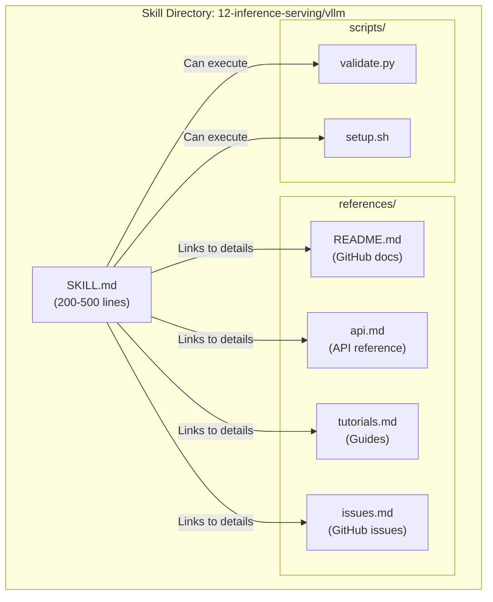
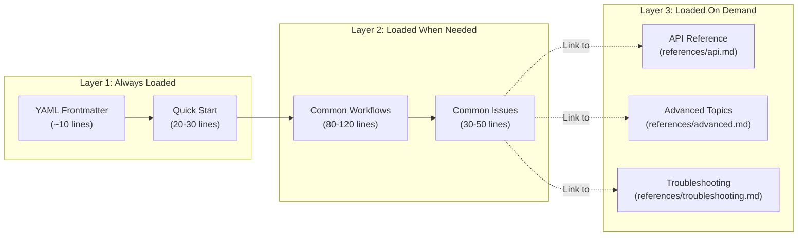
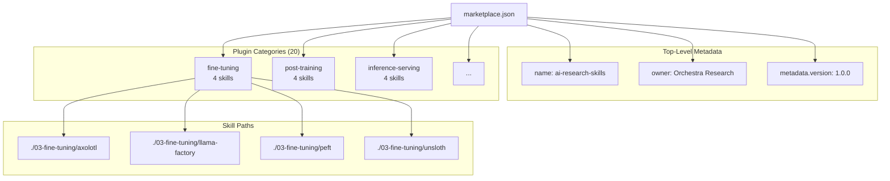
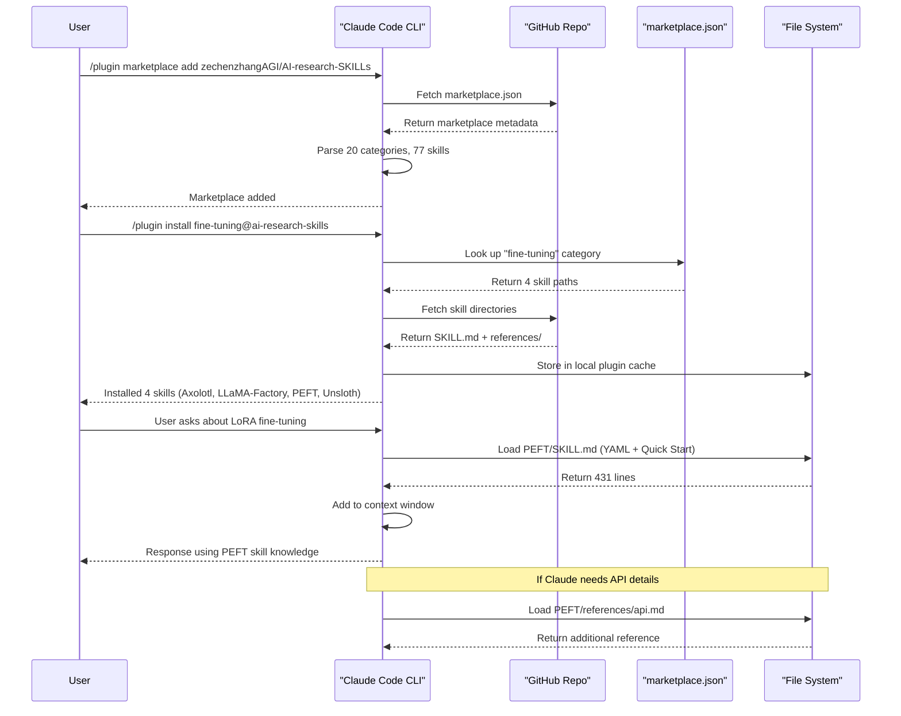
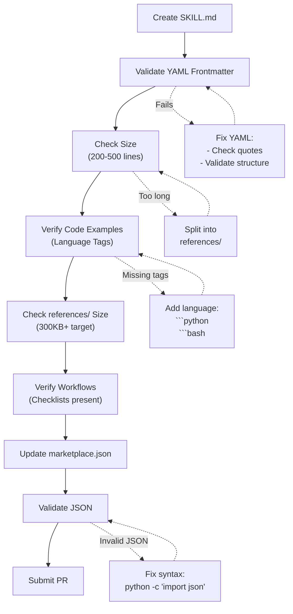

<!-- source: DeepWiki mcp.deepwiki.com · repo zechenzhangAGI/AI-research-SKILLs · page 1.1 What are AI Research Skills? · fetched 2026-10-26 -->

# What are AI Research Skills?

<details>
<summary>Relevant source files</summary>

The following files were used as context for generating this wiki page:

- [.claude-plugin/marketplace.json](.claude-plugin/marketplace.json)
- [CONTRIBUTING.md](CONTRIBUTING.md)
- [README.md](README.md)
- [demos/README.md](demos/README.md)
- [docs/ROADMAP.md](docs/ROADMAP.md)
- [docs/SKILL_CREATION_GUIDE.md](docs/SKILL_CREATION_GUIDE.md)
- [docs/SKILL_TEMPLATE.md](docs/SKILL_TEMPLATE.md)
- [docs/christmas-tree.svg](docs/christmas-tree.svg)
- [docs/skills.png](docs/skills.png)
- [docs/tech-tree.svg](docs/tech-tree.svg)

</details>


**Purpose**: This document explains the fundamental structure and design principles of AI Research Skills—the standardized documentation format that enables AI agents to access expert-level knowledge about ML/AI frameworks and tools.

**Scope**: Covers the SKILL.md + references/ architecture, YAML frontmatter requirements, Progressive Disclosure principles, and how skills integrate with the Claude Code CLI marketplace. For information about contributing new skills, see [Contributing to the Library](#5). For the 20-category taxonomy, see [Library Architecture](#1.3).

---

## Overview: Skills as Expert Knowledge Packages

AI Research Skills are **structured documentation packages** designed to give AI agents (primarily Claude Code) expert-level knowledge about specific ML/AI frameworks. Each skill follows a battle-tested format optimized for context window efficiency and progressive information disclosure.

**Key Design Constraint**: The context window is a shared resource between system prompts, conversation history, and multiple skills. Skills must be concise, actionable, and assume the AI agent is already intelligent.

Sources: [README.md:48-65](), [README.md:280-313]()

---

## Skill File Structure

### Physical Organization

Every skill follows this exact directory structure:

```
skill-name/
├── SKILL.md                    # Quick reference (200-500 lines target)
│   ├── YAML frontmatter        # Metadata (name, description, version)
│   ├── Quick start section
│   ├── Common workflows (2-3)
│   ├── When to use guidance
│   ├── Common issues
│   └── Links to references/
│
├── references/                 # Deep documentation (300KB+ target)
│   ├── README.md              # From GitHub/official docs
│   ├── api.md                 # API reference
│   ├── tutorials.md           # Step-by-step guides
│   ├── issues.md              # Real GitHub issues (if available)
│   ├── releases.md            # Version history
│   └── file_structure.md      # Codebase navigation
│
├── scripts/                    # Helper scripts (optional)
└── assets/                     # Templates & examples (optional)
```

**Critical Files**:
- `SKILL.md`: Always present, 200-500 lines, contains YAML frontmatter
- `references/*.md`: Optional but recommended (300KB+ for "gold standard")
- `scripts/`: Executable helpers that solve problems rather than punt to Claude
- `assets/`: Templates, config examples, schemas

Sources: [README.md:284-302](), [CONTRIBUTING.md:288-309]()

---

### Skill Structure Diagram



**Design Principle**: SKILL.md is the entry point. All reference files are **one level deep** from SKILL.md—no nested references (e.g., SKILL.md → ref1.md → ref2.md is prohibited).

Sources: [docs/SKILL_CREATION_GUIDE.md:54-64](), [CONTRIBUTING.md:288-309]()

---

## YAML Frontmatter Structure

Every `SKILL.md` file begins with YAML frontmatter containing structured metadata. This metadata enables:
- Skill discovery in the marketplace
- Version tracking and dependency management
- Automated validation and sync pipelines

### Required Frontmatter Format

```yaml
---
name: skill-name-here
description: Third-person description of what this does and when to use it
version: 1.0.0
author: Orchestra Research
license: MIT
tags: [Tag One, Tag Two, Tag Three]
dependencies: [package1>=1.0.0, package2>=2.0.0]
---
```

### Field Requirements Table

| Field | Required | Format | Validation Rules | Example |
|-------|----------|--------|------------------|---------|
| `name` | ✅ Yes | kebab-case | Max 64 chars, lowercase with hyphens, no quotes, no reserved words ("anthropic", "claude") | `grpo-rl-training` |
| `description` | ✅ Yes | Plain text | Max 1024 chars, third person, includes WHAT and WHEN, no quotes | `Expert guidance for GRPO/RL fine-tuning...` |
| `version` | ✅ Yes | Semantic | Format: `MAJOR.MINOR.PATCH` | `1.0.0` |
| `author` | ✅ Yes | Plain text | Typically "Orchestra Research" | `Orchestra Research` |
| `license` | ✅ Yes | Identifier | Usually `MIT` | `MIT` |
| `tags` | ✅ Yes | Array | Title Case, 5-10 tags, UPPERCASE acronyms | `[RLHF, GRPO, Post-Training]` |
| `dependencies` | ⚠️ Optional | Array | Version constraints with `>=` | `[transformers>=4.47.0]` |

Sources: [CONTRIBUTING.md:126-187](), [docs/SKILL_CREATION_GUIDE.md:122-227]()

---

### Frontmatter Example from Real Skill

From [06-post-training/grpo-rl-training/SKILL.md:1-10]():

```yaml
---
name: grpo-rl-training
description: Expert guidance for GRPO/RL fine-tuning with TRL for reasoning and task-specific model training
version: 1.0.0
author: Orchestra Research
license: MIT
tags: [Reinforcement Learning, GRPO, TRL, Post-Training, RLHF, Reward Modeling, Reasoning, DPO, PPO, Structured Output]
dependencies: [transformers>=4.47.0, trl>=0.14.0, datasets>=3.2.0, peft>=0.14.0, torch]
---
```

**Naming Convention**: Use gerund form (e.g., `serving-llms`, `processing-data`, `training-models`) rather than nouns to emphasize action.

**Description Convention**: Must be third-person ("Serves LLMs..." not "I can help you serve...") and include both WHAT it does and WHEN to use it.

Sources: [CONTRIBUTING.md:176-187](), [docs/SKILL_CREATION_GUIDE.md:156-163]()

---

## Progressive Disclosure Principle

### The Problem: Context Window Efficiency

The context window is a **shared resource** between:
- System prompts
- Conversation history  
- All loaded skills
- User queries

**Constraint**: Claude Code loads skills dynamically based on task needs. Skills compete for limited context space.

**Solution**: Progressive Disclosure—organize information in layers of increasing detail.

Sources: [docs/SKILL_CREATION_GUIDE.md:42-76]()

---

### Progressive Disclosure Architecture



**Design Rules**:
1. **SKILL.md body**: 200-500 lines maximum (enforced in validation)
2. **One level deep**: Reference files link directly from SKILL.md, never nested
3. **Assume intelligence**: Don't explain basics Claude already knows
4. **Link, don't duplicate**: Point to reference files for deep dives

Sources: [docs/SKILL_CREATION_GUIDE.md:42-64](), [CONTRIBUTING.md:82-112]()

---

### Content Density: Good vs Bad Example

**❌ Bad (150 tokens, over-explaining)**:
```markdown
## Extract PDF text

PDF (Portable Document Format) files are a common file format that contains
text, images, and other content. To extract text from a PDF, you'll need to
use a library. There are many libraries available for PDF processing, but we
recommend pdfplumber because it's easy to use and handles most cases well.
First, you'll need to install it using pip. Then you can use the code below...
```

**✅ Good (50 tokens, assumes intelligence)**:
```markdown
## Extract PDF text

Use pdfplumber for text extraction:

```python
import pdfplumber
with pdfplumber.open("file.pdf") as pdf:
    text = pdf.pages[0].extract_text()
```
```

Sources: [docs/SKILL_CREATION_GUIDE.md:10-42]()

---

## Workflow Structure with Checklists

Skills must provide **copy-paste checklists** for multi-step tasks. This enables Claude to track progress and verify each step before proceeding.

### Workflow Template Pattern

From [docs/SKILL_TEMPLATE.md:26-49]():

```markdown
### Workflow 1: [Primary Use Case]

Copy this checklist and track progress:

```
Task Progress:
- [ ] Step 1: [First action]
- [ ] Step 2: [Second action]
- [ ] Step 3: [Validation step]
- [ ] Step 4: [Completion step]
```

**Step 1: [First action]**

[Brief instruction - assume Claude knows basics]

```[language]
# Code example
[concise code]
```

**Step 2: [Second action]**

[Brief instruction with code]

**Step 3: [Validation step]**

Run validator and fix errors if found:

```bash
validate_script.py input.json
# If errors: fix → validate again → continue
```

**Step 4: [Completion step]**

[Final action]
```

**Key Elements**:
- Copy-pasteable checkbox list
- Brief instructions (assume intelligence)
- Code examples with language tags (```python, ```bash)
- Validation/feedback loops for quality-critical operations

Sources: [docs/SKILL_TEMPLATE.md:26-72](), [docs/SKILL_CREATION_GUIDE.md:65-120]()

---

## Marketplace Integration

Skills are registered in `.claude-plugin/marketplace.json` for discovery via Claude Code CLI.

### Marketplace.json Structure



Sources: [.claude-plugin/marketplace.json:1-250]()

---

### Plugin Definition Format

From [.claude-plugin/marketplace.json:34-45]():

```json
{
  "name": "fine-tuning",
  "description": "LLM fine-tuning frameworks including Axolotl, LLaMA-Factory, PEFT, and Unsloth. Use when fine-tuning models with LoRA, QLoRA, or full fine-tuning.",
  "source": "./",
  "strict": false,
  "skills": [
    "./03-fine-tuning/axolotl",
    "./03-fine-tuning/llama-factory",
    "./03-fine-tuning/peft",
    "./03-fine-tuning/unsloth"
  ]
}
```

**Fields**:
- `name`: Category identifier for CLI installation
- `description`: What the category covers and when to use it
- `source`: Root directory (always `./`)
- `strict`: Validation mode (always `false` for flexible loading)
- `skills`: Array of relative paths to skill directories

Sources: [.claude-plugin/marketplace.json:34-45](), [CONTRIBUTING.md:196-224]()

---

## Claude Code CLI Integration

### Installation Flow



**Key Points**:
1. Marketplace added once, contains all 77 skills
2. Skills installed by category (e.g., `fine-tuning`, `post-training`)
3. SKILL.md loaded into context when relevant
4. Reference files loaded on-demand when needed

Sources: [README.md:70-84](), [.claude-plugin/marketplace.json:1-10]()

---

### How Skills Are Discovered

Claude Code CLI uses **semantic matching** between:
- Skill `name` field (e.g., `grpo-rl-training`)
- Skill `description` field (includes key terms like "RLHF", "reward modeling")
- Skill `tags` (e.g., `[Reinforcement Learning, GRPO, Post-Training]`)
- Plugin category `description` (e.g., "RLHF and preference alignment...")

**Example**: User asks "How do I do RLHF training?"
1. CLI scans marketplace for skills with "RLHF" in tags/description
2. Finds `post-training` category and `grpo-rl-training` skill
3. Loads SKILL.md into context
4. Claude responds with GRPO/TRL guidance

Sources: [.claude-plugin/marketplace.json:69-78](), [CONTRIBUTING.md:126-150]()

---

## Quality Standards & Validation

### Size Requirements

| Component | Minimum | Target | Maximum |
|-----------|---------|--------|---------|
| SKILL.md body | 50 lines | 200-300 lines | 500 lines |
| references/ total | 100 KB | 300 KB | No limit |
| Code examples | 2+ | 5+ | - |
| Workflows | 1 | 2-3 | - |
| Reference files | 0 | 3-5 | - |

**Gold Standard**: 200-300 line SKILL.md + 300KB+ references + real GitHub issues + production examples

Sources: [CONTRIBUTING.md:81-112](), [README.md:324-337]()

---

### Required Content Elements

**SKILL.md must contain**:
1. ✅ YAML frontmatter (name, description, version, tags)
2. ✅ Quick start section with minimal working example
3. ✅ 2-3 common workflows with copy-paste checklists
4. ✅ "When to use vs alternatives" section
5. ✅ Common issues with solutions
6. ✅ Links to reference files (if complex)
7. ✅ Code examples with language tags (```python, ```bash)

**Optional but recommended**:
- GitHub issues with solutions (in `references/issues.md`)
- Release notes with breaking changes (in `references/releases.md`)
- Codebase navigation guide (in `references/file_structure.md`)
- Performance benchmarks
- Troubleshooting guide

Sources: [CONTRIBUTING.md:82-112](), [docs/SKILL_CREATION_GUIDE.md:515-548]()

---

### Validation Process



**Validation Commands** (from [CONTRIBUTING.md:362-382]()):

```bash
# 1. Check SKILL.md has YAML frontmatter and code examples
cat 12-inference-serving/vllm/SKILL.md

# 2. Verify reference files exist
ls -lh 12-inference-serving/vllm/references/

# 3. Check documentation size (300KB+ target)
du -sh 12-inference-serving/vllm/references/

# 4. Validate code blocks have language tags
grep -A 1 '```' 12-inference-serving/vllm/SKILL.md | head -20

# 5. Validate marketplace.json syntax
python3 -c "import json; json.load(open('.claude-plugin/marketplace.json'))"
```

Sources: [CONTRIBUTING.md:362-382](), [CONTRIBUTING.md:189-224]()

---

## Example: Anatomy of a Gold Standard Skill

### GRPO-RL-Training Skill Structure

From [06-post-training/grpo-rl-training/]():

```
06-post-training/grpo-rl-training/
├── SKILL.md                          # 569 lines (comprehensive)
│   ├── YAML frontmatter (10 lines)
│   ├── Quick start (30 lines)
│   ├── Workflow 1: SFT + GRPO (120 lines)
│   ├── Workflow 2: DPO vs GRPO (80 lines)
│   ├── Workflow 3: Structured outputs (100 lines)
│   ├── When to use (40 lines)
│   ├── Common issues (80 lines)
│   └── Advanced topics (links)
│
├── references/
│   ├── README.md                     # TRL official docs
│   ├── grpo_paper.md                 # GRPO algorithm paper
│   ├── trl_api.md                    # Detailed API reference
│   └── examples.md                   # Production examples
│
└── scripts/
    └── validate_config.py            # Config validator
```

**Why it's Gold Standard**:
1. ✅ 569-line SKILL.md with 3 complete workflows
2. ✅ Copy-paste checklists for each workflow
3. ✅ 10+ code examples with proper language tags
4. ✅ "When to use GRPO vs DPO vs PPO" comparison
5. ✅ Common issues section with solutions
6. ✅ Comprehensive references/ with paper details
7. ✅ Validation script included

Sources: [README.md:138](), [CONTRIBUTING.md:388-396]()

---

### GRPO Workflow Example Structure

From [docs/SKILL_TEMPLATE.md:26-72]():

```markdown
## Workflow 1: SFT + GRPO Pipeline

Copy this checklist and track progress:

```
Task Progress:
- [ ] Step 1: Supervised fine-tuning (SFT) on base model
- [ ] Step 2: Create reward model or use LLM-as-judge
- [ ] Step 3: Configure GRPO training config
- [ ] Step 4: Run GRPO training with checkpointing
- [ ] Step 5: Evaluate aligned model
```

**Step 1: Supervised fine-tuning (SFT) on base model**

Start with SFT on your instruction dataset:

```python
from transformers import AutoModelForCausalLM, AutoTokenizer
from trl import SFTTrainer, SFTConfig

model = AutoModelForCausalLM.from_pretrained("meta-llama/Llama-3.2-1B")
tokenizer = AutoTokenizer.from_pretrained("meta-llama/Llama-3.2-1B")

config = SFTConfig(
    output_dir="./sft_output",
    max_seq_length=1024,
    num_train_epochs=3,
)

trainer = SFTTrainer(
    model=model,
    args=config,
    train_dataset=sft_dataset,
)
trainer.train()
```

**Step 2: Create reward model or use LLM-as-judge**

[Continue with remaining steps...]
```

**Pattern**: Each step has brief instruction + concise code + validation point.

Sources: [docs/SKILL_TEMPLATE.md:26-72]()

---

## Skill Distribution Pipeline

Skills flow from GitHub to users through an automated sync pipeline.

```mermaid
graph LR
    subgraph "Contribution"
        DEV["Developer"]
        FORK["Fork Repo"]
        CREATE["Create Skill"]
        PR["Submit PR"]
        REVIEW["Maintainer Review"]
        MERGE["Merge to main"]
    end
    
    subgraph "Auto-Sync"
        TRIGGER["GitHub Actions<br/>Push Event"]
        DETECT["Git Diff<br/>Detect Changed Skills"]
        PACKAGE["ZIP + Base64<br/>Encode Skill"]
        API["POST to Orchestra<br/>Admin API"]
    end
    
    subgraph "Distribution"
        ORCH_DB["Orchestra DB"]
        STORAGE["Supabase Storage"]
        MARKETPLACE["Web Marketplace"]
        CLAUDE["Claude Code CLI"]
    end
    
    DEV --> FORK
    FORK --> CREATE
    CREATE --> PR
    PR --> REVIEW
    REVIEW --> MERGE
    
    MERGE --> TRIGGER
    TRIGGER --> DETECT
    DETECT --> PACKAGE
    PACKAGE --> API
    
    API --> ORCH_DB
    API --> STORAGE
    ORCH_DB --> MARKETPLACE
    STORAGE --> MARKETPLACE
    MARKETPLACE --> CLAUDE
```



**Key Points**:
- Contributors only interact with GitHub (familiar tools)
- Merge to `main` automatically triggers sync
- Skills available in Orchestra marketplace within minutes
- Claude Code CLI pulls from either GitHub or Orchestra

Sources: [README.md:227-243](), High-level diagrams in the context

---

## Summary: Why This Structure?

The AI Research Skills format optimizes for:

1. **Context Window Efficiency**: 200-500 line SKILL.md leaves room for conversation
2. **Progressive Disclosure**: Load details only when needed via references/
3. **Semantic Discovery**: Rich YAML frontmatter enables accurate skill matching
4. **Copy-Paste Workflows**: Checklists enable Claude to track multi-step tasks
5. **Validation Loops**: Explicit validation steps prevent errors
6. **Assume Intelligence**: No over-explaining basics Claude already knows
7. **Production Ready**: Real code examples, GitHub issues, troubleshooting guides

**Design Philosophy**: Skills are not tutorials—they're expert reference materials that assume the AI agent is already competent and just needs domain-specific knowledge.

Sources: [docs/SKILL_CREATION_GUIDE.md:1-76](), [README.md:48-65]()

---

## Cross-References

For more information, see:
- **Library Structure**: [Library Architecture](#1.3) - 20 categories, marketplace structure
- **Installation**: [Getting Started with Claude Code](#1.2) - CLI commands, usage
- **Contributing**: [Contributing to the Library](#5) - How to add skills
- **Quality Standards**: [Skill Structure & Documentation Standards](#5.1) - Detailed requirements

---

