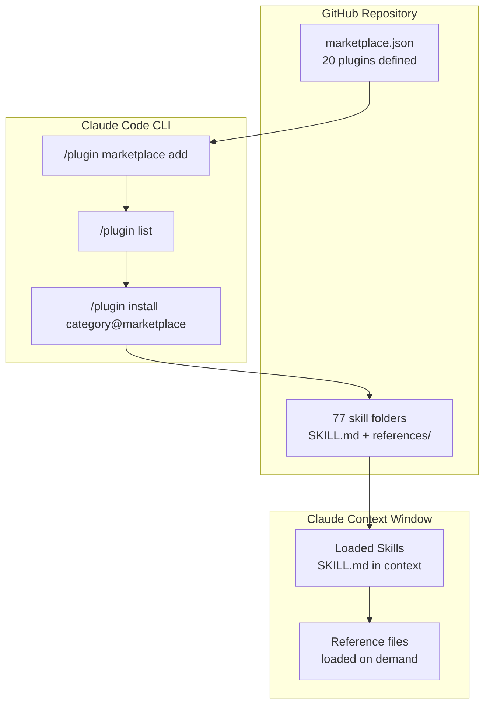
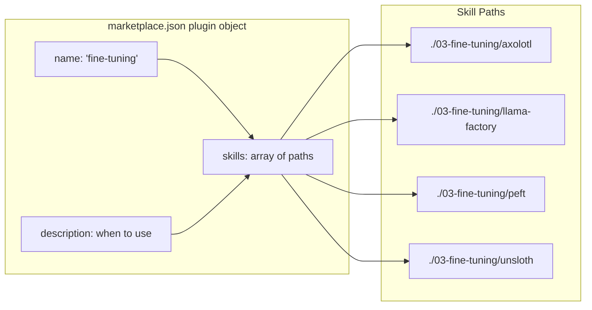
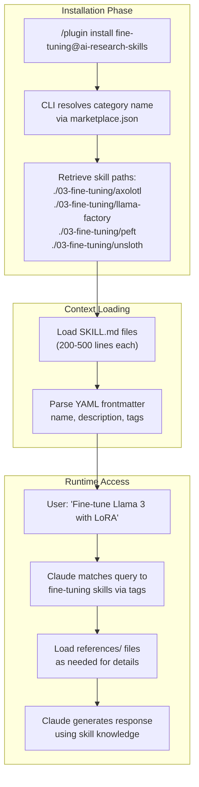
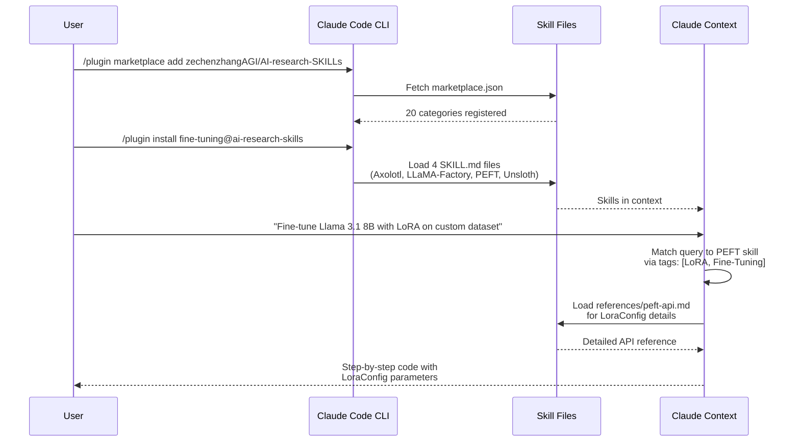
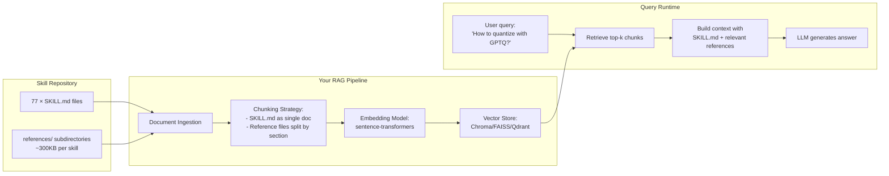

<!-- source: DeepWiki mcp.deepwiki.com · repo zechenzhangAGI/AI-research-SKILLs · page 1.2 Getting Started with Claude Code · fetched 2026-10-26 -->

# Getting Started with Claude Code

<details>
<summary>Relevant source files</summary>

The following files were used as context for generating this wiki page:

- [.claude-plugin/marketplace.json](.claude-plugin/marketplace.json)
- [CONTRIBUTING.md](CONTRIBUTING.md)
- [README.md](README.md)
- [demos/README.md](demos/README.md)
- [docs/ROADMAP.md](docs/ROADMAP.md)
- [docs/SKILL_CREATION_GUIDE.md](docs/SKILL_CREATION_GUIDE.md)
- [docs/SKILL_TEMPLATE.md](docs/SKILL_TEMPLATE.md)
- [docs/christmas-tree.svg](docs/christmas-tree.svg)
- [docs/tech-tree.svg](docs/tech-tree.svg)

</details>


**Purpose:** This guide covers how to install and use AI Research Skills through the Claude Code CLI, navigate the 20-category marketplace system, and integrate skills into your development workflow. It provides concrete commands, explains the plugin loading mechanism, and shows alternative usage methods for other AI coding assistants.

**Scope:** This document focuses on the consumption side—how to discover, install, and use existing skills. For information about skill structure and documentation format, see [What are AI Research Skills?](#1.1). For the complete marketplace sync architecture and how skills are published, see [Orchestra Marketplace Integration](#6). For contributing new skills, see [Contributing to the Library](#5).

---

## Overview: The Marketplace System

The AI Research Skills library uses a marketplace manifest ([.claude-plugin/marketplace.json:1-250]()) to organize 77 skills into 20 installable categories. Claude Code CLI consumes this manifest to provide category-based skill discovery and installation.



**How it works:**
1. **Marketplace registration**: `marketplace.json` defines plugin names, descriptions, and skill paths
2. **CLI discovery**: Claude Code reads the manifest to list available categories
3. **Installation**: Installing a category adds all its skill folders to Claude's context
4. **Progressive disclosure**: `SKILL.md` files load immediately; reference files load when relevant

**Sources:** [README.md:70-109](), [.claude-plugin/marketplace.json:1-250]()

---

## Installing the Marketplace

### Step 1: Add the Marketplace Repository

```bash
/plugin marketplace add zechenzhangAGI/AI-research-SKILLs
```

This command registers the marketplace with Claude Code CLI. Under the hood, it:
- Fetches [marketplace.json:1-10]() to read metadata
- Reads the `plugins` array ([marketplace.json:11-249]()) containing 20 category definitions
- Makes all categories discoverable via `/plugin list`

### Step 2: Verify Installation

```bash
/plugin list
```

You should see output listing all 20 categories:
- `model-architecture@ai-research-skills` (5 skills)
- `fine-tuning@ai-research-skills` (4 skills)
- `inference-serving@ai-research-skills` (4 skills)
- ... and 17 more categories

**Sources:** [README.md:74-76](), [.claude-plugin/marketplace.json:2-9]()

---

## Understanding the Category Structure

Each category in `marketplace.json` maps to a plugin object with specific skill paths:



**Example from [marketplace.json:34-45]():**

```json
{
  "name": "fine-tuning",
  "description": "LLM fine-tuning frameworks including Axolotl, LLaMA-Factory, PEFT, and Unsloth. Use when fine-tuning models with LoRA, QLoRA, or full fine-tuning.",
  "source": "./",
  "strict": false,
  "skills": [
    "./03-fine-tuning/axolotl",
    "./03-fine-tuning/llama-factory",
    "./03-fine-tuning/peft",
    "./03-fine-tuning/unsloth"
  ]
}
```

**Key fields:**
- `name`: Installation identifier (e.g., `fine-tuning@ai-research-skills`)
- `description`: Triggers for when Claude should suggest this category
- `skills`: Array of directory paths containing `SKILL.md` files

**Sources:** [.claude-plugin/marketplace.json:34-45](), [CONTRIBUTING.md:197-217]()

---

## Installing Skills by Category

### Basic Installation Syntax

```bash
/plugin install <category>@ai-research-skills
```

### Common Installation Commands

| Use Case | Command | Skills Loaded |
|----------|---------|---------------|
| Fine-tune models | `/plugin install fine-tuning@ai-research-skills` | Axolotl, LLaMA-Factory, PEFT, Unsloth |
| RLHF alignment | `/plugin install post-training@ai-research-skills` | TRL, GRPO, OpenRLHF, SimPO |
| Production serving | `/plugin install inference-serving@ai-research-skills` | vLLM, TensorRT-LLM, llama.cpp, SGLang |
| Distributed training | `/plugin install distributed-training@ai-research-skills` | DeepSpeed, FSDP, Accelerate, Megatron, Lightning, Ray |
| Model compression | `/plugin install optimization@ai-research-skills` | Flash Attention, bitsandbytes, GPTQ, AWQ, HQQ, GGUF |

**Full category list:** [README.md:86-108]()

### Installing Multiple Categories

```bash
/plugin install fine-tuning@ai-research-skills
/plugin install post-training@ai-research-skills
/plugin install evaluation@ai-research-skills
```

Claude Code loads all skills from installed categories into its context window. Skills use [Progressive Disclosure](#1.1) to keep context efficient—only `SKILL.md` loads initially, with reference files loaded when needed.

**Sources:** [README.md:74-84](), [README.md:86-108]()

---

## How Skills Are Loaded and Accessed



### Loading Mechanism

1. **Category resolution**: CLI reads [marketplace.json:34-45]() to find skill paths for `fine-tuning`
2. **File loading**: Each `SKILL.md` (200-500 lines) loads into context
3. **Metadata extraction**: YAML frontmatter ([CONTRIBUTING.md:127-148]()) provides `name`, `description`, and `tags` for skill discovery
4. **Progressive disclosure**: Reference files in `references/` subdirectories load only when Claude needs detailed information

### YAML Frontmatter Example

From a typical `SKILL.md` ([CONTRIBUTING.md:176-187]()):

```yaml
---
name: grpo-rl-training
description: Expert guidance for GRPO/RL fine-tuning with TRL for reasoning and task-specific model training
version: 1.0.0
author: Orchestra Research
license: MIT
tags: [Reinforcement Learning, GRPO, TRL, Post-Training, RLHF, Reward Modeling]
dependencies: [transformers>=4.47.0, trl>=0.14.0, datasets>=3.2.0]
---
```

Claude uses `tags` to match user queries to relevant skills, and `description` to determine when to suggest the skill.

**Sources:** [CONTRIBUTING.md:127-187](), [docs/SKILL_CREATION_GUIDE.md:230-263]()

---

## Practical Usage Workflow

### Example: Setting Up LLM Fine-Tuning



### Common Query Patterns

| User Intent | Claude Skill Matching | Loaded Content |
|-------------|----------------------|----------------|
| "Fine-tune with LoRA" | Matches `peft` skill via tags `[LoRA, Fine-Tuning]` | `SKILL.md` + `references/lora-config.md` |
| "Train with DeepSpeed ZeRO-3" | Matches `deepspeed` skill via tags `[ZeRO, Distributed Training]` | `SKILL.md` + `references/zero-stages.md` |
| "Serve model with vLLM" | Matches `vllm` skill via tags `[Inference, Serving, PagedAttention]` | `SKILL.md` + `references/server-deployment.md` |

**Sources:** [README.md:372-387](), [.claude-plugin/marketplace.json:34-45]()

---

## Alternative Usage Methods

### For Gemini CLI Users

The skill library is tool-agnostic—skills are just markdown files with references.

```bash
# Clone repository
git clone https://github.com/zechenzhangAGI/AI-research-SKILLs.git
cd AI-research-SKILLs

# Point Gemini CLI to skill directories
gemini --context-path 03-fine-tuning/axolotl
```

### For Cursor/Windsurf Users

Add skill folders to your project's knowledge base:

1. Open Cursor settings → "Codebase Context"
2. Add directory: `AI-research-SKILLs/03-fine-tuning/`
3. Cursor indexes all `SKILL.md` + `references/` files
4. Use `@workspace` to query skills

### For Grok Code Users

```bash
# Use skill folder as context
grok --context AI-research-SKILLs/12-inference-serving/vllm/
```

### For Custom RAG Systems



**Implementation approach:**

1. **Ingestion**: Parse all `SKILL.md` files with YAML frontmatter extraction
2. **Chunking**: Treat each section of `SKILL.md` as a chunk (50-200 lines)
3. **Metadata**: Store `name`, `tags`, `dependencies` from YAML for filtering
4. **Embedding**: Use `sentence-transformers` (see [15-rag/sentence-transformers]())
5. **Storage**: Index in vector DB like Chroma ([15-rag/chroma]()) or FAISS ([15-rag/faiss]())
6. **Retrieval**: Query with user intent, filter by `tags`, return top-k chunks

**Sources:** [README.md:245-265](), [15-rag/]()

---

## Skill Structure and File Organization

### Directory Layout

Each installed category adds skill directories to Claude's context:

```
03-fine-tuning/
├── axolotl/
│   ├── SKILL.md              # 156 lines
│   └── references/
│       ├── config-guide.md
│       ├── multi-gpu.md
│       └── troubleshooting.md
├── llama-factory/
│   ├── SKILL.md              # 78 lines
│   └── references/
│       ├── webui-usage.md
│       └── cli-reference.md
├── peft/
│   ├── SKILL.md              # 431 lines
│   └── references/
│       ├── lora-config.md
│       └── qlora-guide.md
└── unsloth/
    ├── SKILL.md              # 75 lines
    └── references/
        ├── 2x-speedup.md
        └── memory-efficient.md
```

### File Size Guidelines

| File Type | Target Size | Example |
|-----------|-------------|---------|
| `SKILL.md` | 200-500 lines | Quick reference with workflows |
| `references/*.md` | Variable | Deep dive topics (APIs, configs) |
| Total per skill | 300KB+ | Comprehensive documentation |

**Sources:** [README.md:280-313](), [CONTRIBUTING.md:280-309]()

---

## Troubleshooting

### Issue: Category Not Found

**Error**: `Plugin 'category@ai-research-skills' not found`

**Solution**: Verify marketplace is registered:
```bash
/plugin marketplace list
# Should show: zechenzhangAGI/AI-research-SKILLs

# If missing, re-add:
/plugin marketplace add zechenzhangAGI/AI-research-SKILLs
```

### Issue: Skills Not Loading

**Error**: Claude doesn't use skill knowledge after installation

**Solution**: Check installation status:
```bash
/plugin list
# Verify category appears in list

# Reinstall if needed:
/plugin uninstall fine-tuning@ai-research-skills
/plugin install fine-tuning@ai-research-skills
```

### Issue: Context Window Full

**Symptom**: Claude reports context limit reached

**Solution**: Skills use Progressive Disclosure ([docs/SKILL_CREATION_GUIDE.md:44-63]()). Uninstall unused categories:
```bash
/plugin uninstall multimodal@ai-research-skills
/plugin uninstall emerging-techniques@ai-research-skills
```

Only install categories you need for the current task.

**Sources:** [docs/SKILL_CREATION_GUIDE.md:44-63]()

---

## Next Steps

- **Explore categories**: See [Library Architecture](#1.3) for the complete 20-category taxonomy
- **Understand skill structure**: See [What are AI Research Skills?](#1.1) for documentation format
- **View demos**: Check [demos/README.md:1-137]() for example projects using skills
- **Contribute skills**: Follow [Contributing to the Library](#5) to add new skills

**Sources:** [README.md:1-585](), [demos/README.md:1-137]()

---

