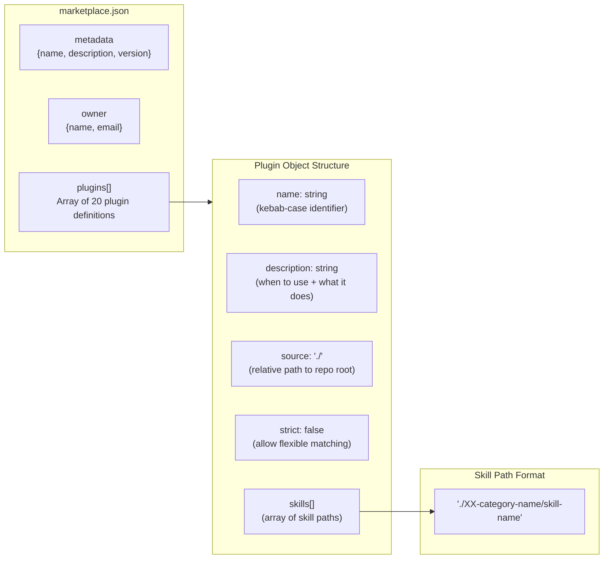
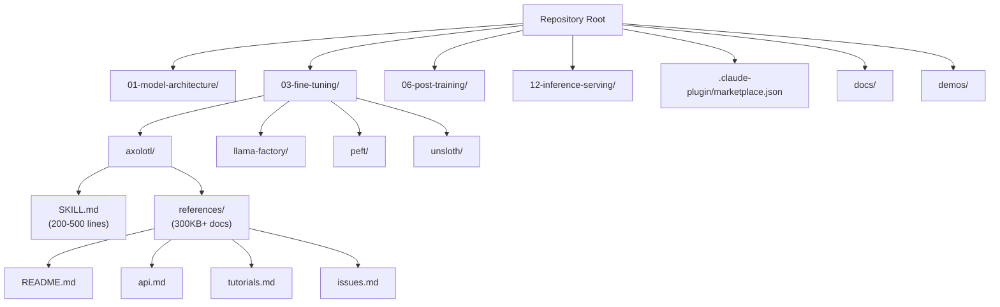
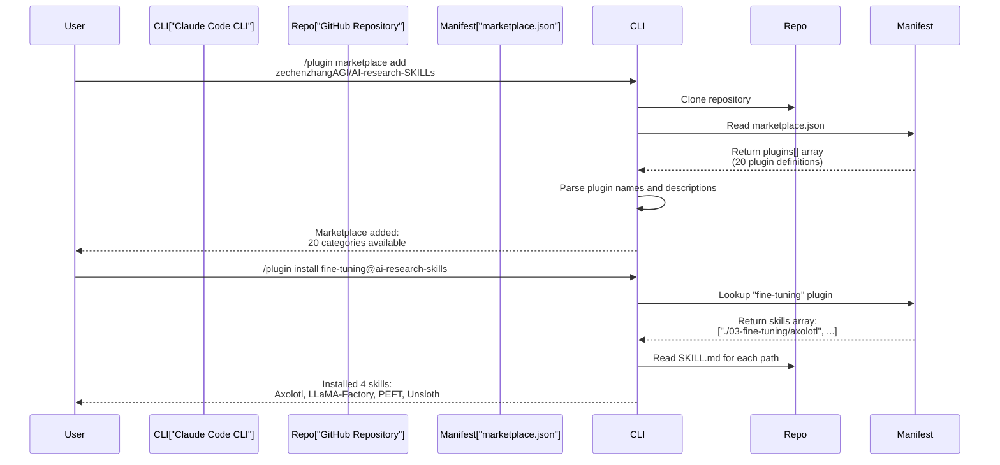
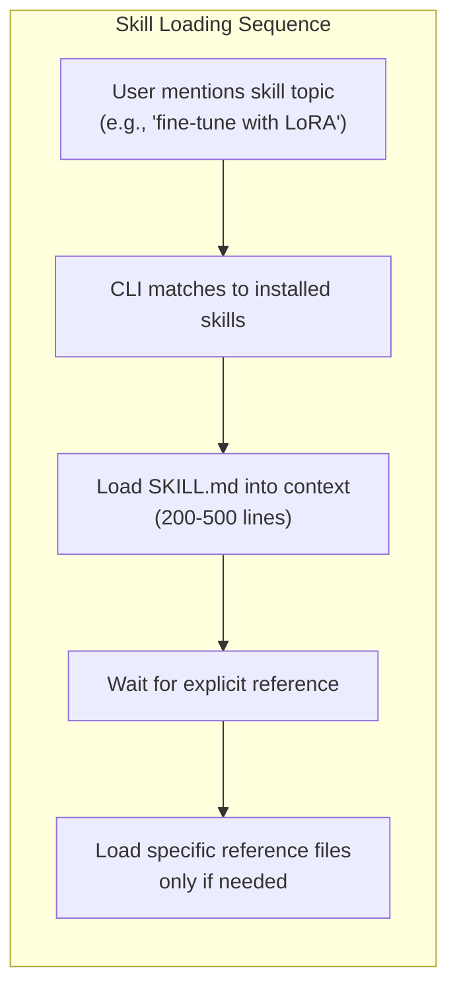
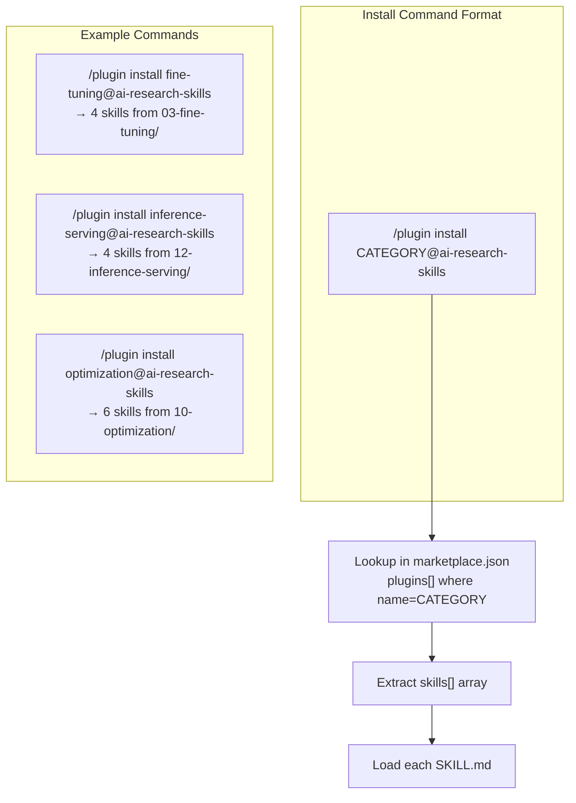
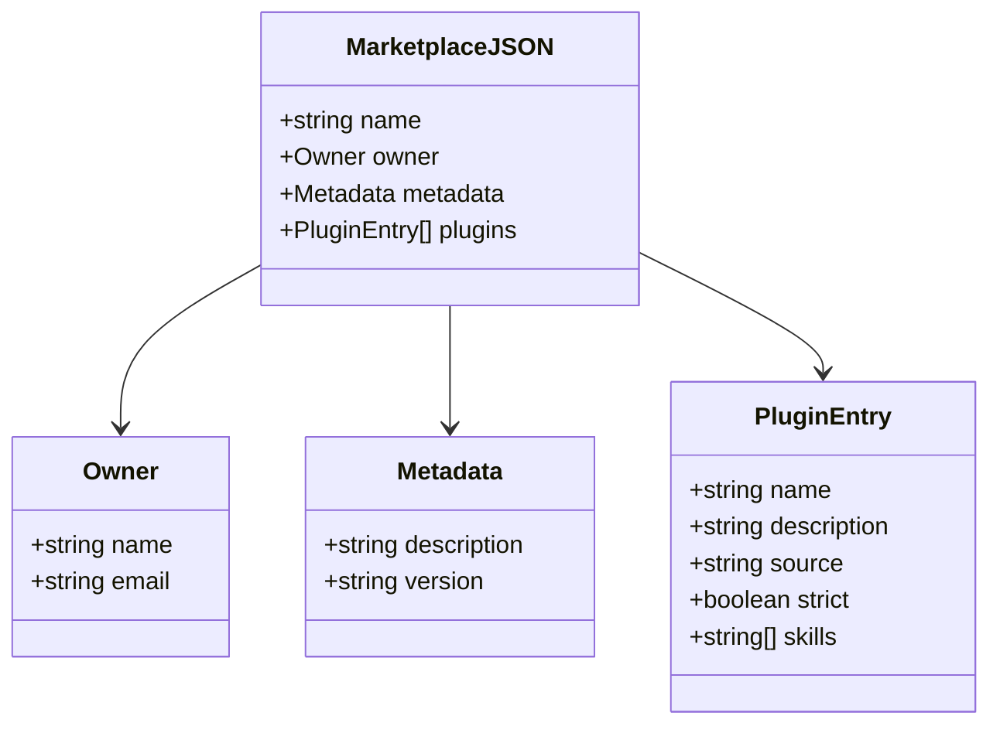
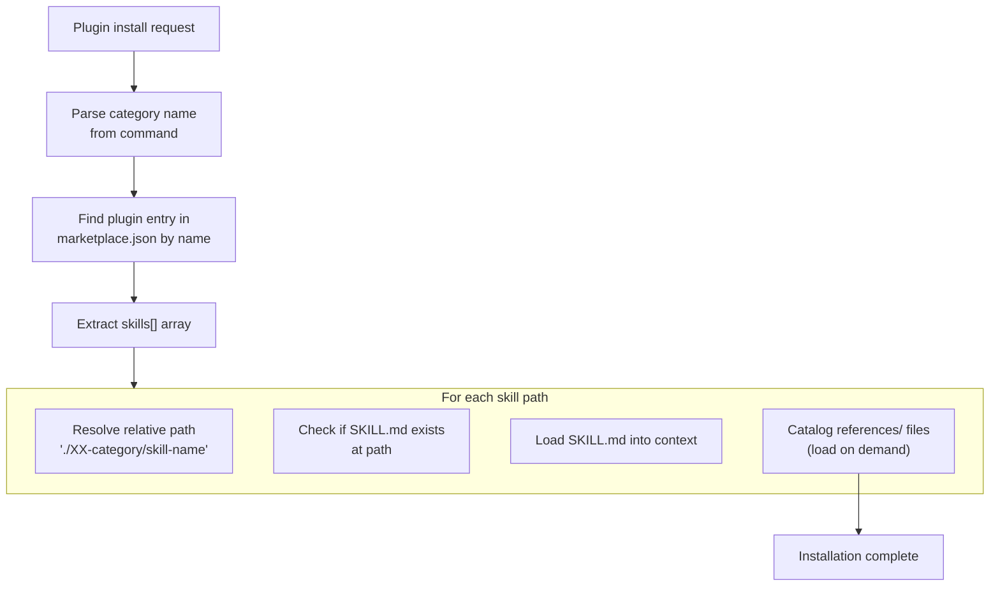
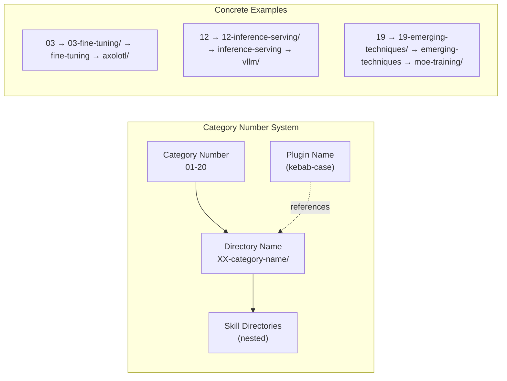
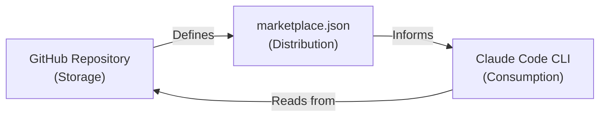

<!-- source: DeepWiki mcp.deepwiki.com · repo zechenzhangAGI/AI-research-SKILLs · page 1.3 Library Architecture · fetched 2026-10-26 -->

# Library Architecture

<details>
<summary>Relevant source files</summary>

The following files were used as context for generating this wiki page:

- [.claude-plugin/marketplace.json](.claude-plugin/marketplace.json)
- [CONTRIBUTING.md](CONTRIBUTING.md)
- [README.md](README.md)
- [demos/README.md](demos/README.md)
- [docs/ROADMAP.md](docs/ROADMAP.md)
- [docs/SKILL_CREATION_GUIDE.md](docs/SKILL_CREATION_GUIDE.md)
- [docs/SKILL_TEMPLATE.md](docs/SKILL_TEMPLATE.md)
- [docs/christmas-tree.svg](docs/christmas-tree.svg)
- [docs/tech-tree.svg](docs/tech-tree.svg)

</details>


## Purpose and Scope

This document explains the architectural organization of the AI Research SKILLs library, covering:
- The 20-category taxonomy that structures all 77 skills
- The `marketplace.json` manifest and its role in skill discovery
- Directory structure conventions and file organization
- How Claude Code CLI discovers, loads, and presents skills to users

For information about individual skill structures and documentation standards, see [What are AI Research Skills?](#1.1). For installation and usage instructions, see [Getting Started with Claude Code](#1.2).

## Category Taxonomy Overview

The library organizes 77 skills into 20 categories that map to the complete AI research lifecycle. Each category represents a distinct phase or capability area.

```mermaid
graph TD
    subgraph Foundation["Foundation Layer (9 skills)"]
        C01["01-model-architecture<br/>(5 skills)"]
        C02["02-tokenization<br/>(2 skills)"]
        C04["04-mechanistic-interpretability<br/>(4 skills)"]
    end
    
    subgraph DataTraining["Data & Training Layer (13 skills)"]
        C05["05-data-processing<br/>(2 skills)"]
        C03["03-fine-tuning<br/>(4 skills)"]
        C08["08-distributed-training<br/>(5 skills)"]
        C06["06-post-training<br/>(4 skills)"]
    end
    
    subgraph SafetyOpt["Safety & Optimization Layer (12 skills)"]
        C07["07-safety-alignment<br/>(3 skills)"]
        C10["10-optimization<br/>(6 skills)"]
        C11["11-evaluation<br/>(3 skills)"]
    end
    
    subgraph Deployment["Deployment Layer (10 skills)"]
        C09["09-infrastructure<br/>(3 skills)"]
        C12["12-inference-serving<br/>(4 skills)"]
        C13["13-mlops<br/>(3 skills)"]
    end
    
    subgraph Applications["Application Layer (20 skills)"]
        C14["14-agents<br/>(4 skills)"]
        C15["15-rag<br/>(5 skills)"]
        C16["16-prompt-engineering<br/>(4 skills)"]
        C17["17-observability<br/>(2 skills)"]
    end
    
    subgraph Advanced["Advanced Capabilities (13 skills)"]
        C18["18-multimodal<br/>(7 skills)"]
        C19["19-emerging-techniques<br/>(6 skills)"]
        C20["20-ml-paper-writing<br/>(1 skill)"]
    end
    
    Foundation --> DataTraining
    DataTraining --> SafetyOpt
    SafetyOpt --> Deployment
    Deployment --> Applications
    Applications --> Advanced
```



**Category Organization Principles**:

| Layer | Categories | Purpose |
|-------|-----------|---------|
| **Foundation** | 01, 02, 04 | Core architectures, tokenization, interpretability |
| **Data & Training** | 03, 05, 06, 08 | Data preparation, fine-tuning, distributed training, RLHF |
| **Safety & Optimization** | 07, 10, 11 | Safety systems, quantization, evaluation |
| **Deployment** | 09, 12, 13 | Infrastructure, inference engines, MLOps |
| **Application** | 14, 15, 16, 17 | Agents, RAG, prompt engineering, observability |
| **Advanced** | 18, 19, 20 | Multimodal, emerging techniques, academic writing |

Sources: [README.md:36-368](), [.claude-plugin/marketplace.json:11-249]()

## Marketplace Manifest Structure

The `marketplace.json` file at [.claude-plugin/marketplace.json:1-251]() serves as the central manifest for skill discovery and installation. It defines metadata, ownership, and the complete plugin catalog.



**Key Manifest Fields**:

```json
{
  "name": "ai-research-skills",
  "owner": {
    "name": "Orchestra Research",
    "email": "zechen@orchestra-research.com"
  },
  "metadata": {
    "description": "Comprehensive library of 77 AI research engineering skills...",
    "version": "1.0.0"
  },
  "plugins": [...]
}
```

Each plugin entry in the `plugins` array follows this structure:

```json
{
  "name": "fine-tuning",
  "description": "LLM fine-tuning frameworks including Axolotl, LLaMA-Factory, PEFT, and Unsloth. Use when fine-tuning models with LoRA, QLoRA, or full fine-tuning.",
  "source": "./",
  "strict": false,
  "skills": [
    "./03-fine-tuning/axolotl",
    "./03-fine-tuning/llama-factory",
    "./03-fine-tuning/peft",
    "./03-fine-tuning/unsloth"
  ]
}
```

**Naming Conventions**:
- Plugin `name`: Lowercase with hyphens, matches install command (`fine-tuning@ai-research-skills`)
- Plugin `description`: Third-person, includes both capabilities and use cases
- Skill paths: Relative to repo root, format `./XX-category-name/skill-name`

Sources: [.claude-plugin/marketplace.json:1-251](), [CONTRIBUTING.md:196-226]()

## Directory Structure and File Organization

The repository uses a strict numerical prefix system for category ordering and consistent file organization within each skill directory.



**Standard Skill Directory Structure**:

```
XX-category-name/
├── skill-name/
│   ├── SKILL.md                    # Primary documentation (200-500 lines)
│   │                               # Contains YAML frontmatter + focused guide
│   └── references/                 # Deep documentation (300KB+ target)
│       ├── README.md              # From official GitHub/docs
│       ├── api.md                 # API reference
│       ├── tutorials.md           # Step-by-step guides
│       ├── issues.md              # Real GitHub issues (optional)
│       ├── releases.md            # Version history (optional)
│       └── file_structure.md      # Codebase navigation (optional)
```

**Category Prefix Mapping**:

| Prefix | Category | Directory Name |
|--------|----------|----------------|
| `01-` | Model Architecture | `01-model-architecture` |
| `02-` | Tokenization | `02-tokenization` |
| `03-` | Fine-Tuning | `03-fine-tuning` |
| `04-` | Mechanistic Interpretability | `04-mechanistic-interpretability` |
| `05-` | Data Processing | `05-data-processing` |
| `06-` | Post-Training | `06-post-training` |
| `07-` | Safety & Alignment | `07-safety-alignment` |
| `08-` | Distributed Training | `08-distributed-training` |
| `09-` | Infrastructure | `09-infrastructure` |
| `10-` | Optimization | `10-optimization` |
| `11-` | Evaluation | `11-evaluation` |
| `12-` | Inference & Serving | `12-inference-serving` |
| `13-` | MLOps | `13-mlops` |
| `14-` | Agents | `14-agents` |
| `15-` | RAG | `15-rag` |
| `16-` | Prompt Engineering | `16-prompt-engineering` |
| `17-` | Observability | `17-observability` |
| `18-` | Multimodal | `18-multimodal` |
| `19-` | Emerging Techniques | `19-emerging-techniques` |
| `20-` | ML Paper Writing | `20-ml-paper-writing` |

Sources: [README.md:341-369](), [CONTRIBUTING.md:260-282]()

## Skill Discovery and Loading Process

Claude Code CLI uses the marketplace manifest to discover available skill categories and load individual skills on demand. The process involves several distinct phases.

### Discovery Phase



### Loading Phase

When a skill is activated in a conversation, Claude Code loads the skill files into context:



**Progressive Disclosure Principle**: 
- `SKILL.md` loads first (primary documentation)
- Reference files load only when explicitly mentioned in `SKILL.md` or requested
- Prevents context window bloat from unused documentation

### Installation Command Mapping



**Category Name to Plugin Name Mapping**:

The plugin `name` field in `marketplace.json` determines the install command. Common patterns:

| Directory | Plugin Name | Install Command |
|-----------|-------------|-----------------|
| `03-fine-tuning/` | `fine-tuning` | `/plugin install fine-tuning@ai-research-skills` |
| `08-distributed-training/` | `distributed-training` | `/plugin install distributed-training@ai-research-skills` |
| `12-inference-serving/` | `inference-serving` | `/plugin install inference-serving@ai-research-skills` |
| `16-prompt-engineering/` | `prompt-engineering` | `/plugin install prompt-engineering@ai-research-skills` |

Sources: [README.md:70-109](), [.claude-plugin/marketplace.json:11-249]()

## Category Definitions and Skill Counts

Each category in the taxonomy serves a specific purpose in the AI research lifecycle. The following table maps category identifiers to their technical scope and skill counts.

### Complete Category Reference

| ID | Category | Plugin Name | Skill Count | Technical Scope |
|----|----------|-------------|-------------|-----------------|
| 01 | Model Architecture | `model-architecture` | 5 | LLM implementations (LitGPT, Mamba, NanoGPT, RWKV, Megatron-Core) |
| 02 | Tokenization | `tokenization` | 2 | Text tokenization systems (HuggingFace Tokenizers, SentencePiece) |
| 03 | Fine-Tuning | `fine-tuning` | 4 | LoRA, QLoRA, full fine-tuning (Axolotl, LLaMA-Factory, PEFT, Unsloth) |
| 04 | Mechanistic Interpretability | `mechanistic-interpretability` | 4 | Neural network analysis (TransformerLens, SAELens, pyvene, nnsight) |
| 05 | Data Processing | `data-processing` | 2 | Large-scale data curation (NeMo Curator, Ray Data) |
| 06 | Post-Training | `post-training` | 4 | RLHF, DPO, preference alignment (TRL, GRPO, OpenRLHF, SimPO) |
| 07 | Safety & Alignment | `safety-alignment` | 3 | Content moderation, guardrails (Constitutional AI, LlamaGuard, NeMo Guardrails) |
| 08 | Distributed Training | `distributed-training` | 5 | Multi-GPU training (DeepSpeed, FSDP, Accelerate, Lightning, Ray Train, Megatron) |
| 09 | Infrastructure | `infrastructure` | 3 | GPU cloud orchestration (Modal, Lambda Labs, SkyPilot) |
| 10 | Optimization | `optimization` | 6 | Quantization, kernels (Flash Attention, bitsandbytes, GPTQ, AWQ, HQQ, GGUF) |
| 11 | Evaluation | `evaluation` | 3 | Benchmarking systems (lm-eval-harness, BigCode, NeMo Evaluator) |
| 12 | Inference & Serving | `inference-serving` | 4 | Production inference (vLLM, TensorRT-LLM, llama.cpp, SGLang) |
| 13 | MLOps | `mlops` | 3 | Experiment tracking (W&B, MLflow, TensorBoard) |
| 14 | Agents | `agents` | 4 | Autonomous agents (LangChain, LlamaIndex, CrewAI, AutoGPT) |
| 15 | RAG | `rag` | 5 | Vector databases, retrieval (Chroma, FAISS, Pinecone, Qdrant, Sentence Transformers) |
| 16 | Prompt Engineering | `prompt-engineering` | 4 | Structured outputs (DSPy, Instructor, Guidance, Outlines) |
| 17 | Observability | `observability` | 2 | LLM monitoring (LangSmith, Phoenix) |
| 18 | Multimodal | `multimodal` | 7 | Vision, audio models (CLIP, Whisper, LLaVA, Stable Diffusion, SAM, BLIP-2, AudioCraft) |
| 19 | Emerging Techniques | `emerging-techniques` | 6 | MoE, merging, long context, speculative decoding, distillation, pruning |
| 20 | ML Paper Writing | `ml-paper-writing` | 1 | Academic writing, LaTeX templates, citation verification |

Sources: [README.md:86-109](), [.claude-plugin/marketplace.json:11-249]()

## Marketplace.json Plugin Entry Schema

Each plugin entry in the `plugins` array follows a strict schema that enables Claude Code CLI to discover and load skills correctly.

### Plugin Object Structure



**Field Specifications**:

| Field | Type | Required | Format | Purpose |
|-------|------|----------|--------|---------|
| `name` | string | Yes | kebab-case | Plugin identifier for install commands |
| `description` | string | Yes | Plain text | What the plugin does AND when to use it |
| `source` | string | Yes | `"./"` | Relative path to repository root |
| `strict` | boolean | Yes | `false` | Whether to enforce exact path matching |
| `skills` | string[] | Yes | `["./XX-category/skill"]` | Array of skill directory paths |

**Example Plugin Entry**:

```json
{
  "name": "post-training",
  "description": "RLHF and preference alignment including TRL, GRPO, OpenRLHF, and SimPO. Use when aligning models with human preferences or training reward models.",
  "source": "./",
  "strict": false,
  "skills": [
    "./06-post-training/grpo-rl-training",
    "./06-post-training/openrlhf",
    "./06-post-training/simpo",
    "./06-post-training/trl-fine-tuning"
  ]
}
```

**Description Best Practices**:
- Start with technical capabilities (e.g., "RLHF and preference alignment")
- List included tools/frameworks
- End with use case triggers (e.g., "Use when aligning models...")
- Maximum 1024 characters
- Third-person voice (not "I can help you...")

Sources: [.claude-plugin/marketplace.json:68-79](), [CONTRIBUTING.md:196-226](), [docs/SKILL_CREATION_GUIDE.md:126-179]()

## Skill Path Resolution

Claude Code CLI resolves skill paths from `marketplace.json` entries to actual filesystem locations using a deterministic algorithm.



**Path Resolution Examples**:

| marketplace.json Entry | Resolved Filesystem Path | Primary File |
|------------------------|-------------------------|--------------|
| `"./03-fine-tuning/axolotl"` | `03-fine-tuning/axolotl/` | `SKILL.md` |
| `"./12-inference-serving/vllm"` | `12-inference-serving/vllm/` | `SKILL.md` |
| `"./10-optimization/flash-attention"` | `10-optimization/flash-attention/` | `SKILL.md` |

**File Loading Priority**:
1. `SKILL.md` - Always loaded first (primary documentation)
2. `references/README.md` - Loaded if explicitly referenced
3. `references/api.md` - Loaded if explicitly referenced
4. `references/*.md` - Loaded only on demand via progressive disclosure

Sources: [.claude-plugin/marketplace.json:1-251](), [README.md:280-314]()

## Category-to-Code Mapping

This table provides the complete mapping from category numbers to directory names, plugin identifiers, and representative skill paths for code navigation.



### Directory to Plugin Name Mapping

| Category # | Directory Name | Plugin Name | Sample Skill Path |
|-----------|----------------|-------------|-------------------|
| 01 | `01-model-architecture` | `model-architecture` | `01-model-architecture/litgpt` |
| 02 | `02-tokenization` | `tokenization` | `02-tokenization/huggingface-tokenizers` |
| 03 | `03-fine-tuning` | `fine-tuning` | `03-fine-tuning/axolotl` |
| 04 | `04-mechanistic-interpretability` | `mechanistic-interpretability` | `04-mechanistic-interpretability/transformer-lens` |
| 05 | `05-data-processing` | `data-processing` | `05-data-processing/nemo-curator` |
| 06 | `06-post-training` | `post-training` | `06-post-training/grpo-rl-training` |
| 07 | `07-safety-alignment` | `safety-alignment` | `07-safety-alignment/nemo-guardrails` |
| 08 | `08-distributed-training` | `distributed-training` | `08-distributed-training/deepspeed` |
| 09 | `09-infrastructure` | `infrastructure` | `09-infrastructure/modal` |
| 10 | `10-optimization` | `optimization` | `10-optimization/flash-attention` |
| 11 | `11-evaluation` | `evaluation` | `11-evaluation/lm-evaluation-harness` |
| 12 | `12-inference-serving` | `inference-serving` | `12-inference-serving/vllm` |
| 13 | `13-mlops` | `mlops` | `13-mlops/weights-and-biases` |
| 14 | `14-agents` | `agents` | `14-agents/langchain` |
| 15 | `15-rag` | `rag` | `15-rag/chroma` |
| 16 | `16-prompt-engineering` | `prompt-engineering` | `16-prompt-engineering/dspy` |
| 17 | `17-observability` | `observability` | `17-observability/phoenix` |
| 18 | `18-multimodal` | `multimodal` | `18-multimodal/whisper` |
| 19 | `19-emerging-techniques` | `emerging-techniques` | `19-emerging-techniques/moe-training` |
| 20 | `20-ml-paper-writing` | `ml-paper-writing` | `20-ml-paper-writing/` |

**Navigation Pattern for Code Search**:
- To find category definition: Search `marketplace.json` for plugin `name`
- To find skill files: Navigate to `./XX-category-name/skill-name/SKILL.md`
- To find all skills in category: List contents of `./XX-category-name/`

Sources: [.claude-plugin/marketplace.json:11-249](), [README.md:341-369]()

## Architectural Design Principles

The library follows several key architectural principles that inform the organization and distribution system.

### Principle 1: Category Stability

Category numbers (01-20) are immutable identifiers that never change, even if:
- Skills are added or removed from a category
- Category names are refined
- Directory structures are reorganized

**Rationale**: Preserves backward compatibility for existing installations and references.

### Principle 2: Progressive Disclosure

Skills use a two-tier documentation system:
- **Tier 1**: `SKILL.md` (200-500 lines) - Always loaded, provides overview and navigation
- **Tier 2**: `references/*.md` (300KB+ total) - Loaded on demand via explicit references

**Implementation**:
```markdown
# SKILL.md structure
## Quick start
[Minimal working example]

## Common workflows
[Step-by-step guides with checklists]

## Advanced topics
**Advanced feature**: See [references/advanced.md](references/advanced.md)
```

### Principle 3: Separation of Concerns

The architecture separates three concerns:
1. **Storage**: GitHub repository (source of truth)
2. **Distribution**: `marketplace.json` manifest (discovery layer)
3. **Consumption**: Claude Code CLI (presentation layer)



### Principle 4: Flat Skill Hierarchy

Skills are organized in a flat two-level hierarchy: `category/skill/`. No deeper nesting is permitted.

**Allowed**:
```
03-fine-tuning/
  axolotl/
    SKILL.md
    references/
  llama-factory/
    SKILL.md
```

**Not Allowed**:
```
03-fine-tuning/
  lora-methods/
    axolotl/
      SKILL.md
```

**Rationale**: Simplifies discovery, path resolution, and marketplace.json maintenance.

Sources: [README.md:280-314](), [docs/SKILL_CREATION_GUIDE.md:45-67](), [CONTRIBUTING.md:256-314]()

## Versioning and Evolution

The library uses semantic versioning for the overall collection while individual skills maintain independent versions.

### Repository-Level Versioning

**Location**: [.claude-plugin/marketplace.json:8-10]()

```json
"metadata": {
  "description": "Comprehensive library of 77 AI research engineering skills...",
  "version": "1.0.0"
}
```

**Version Format**: `MAJOR.MINOR.PATCH`
- `MAJOR`: Breaking changes to marketplace.json structure or category reorganization
- `MINOR`: New categories or significant skill additions (10+ skills)
- `PATCH`: Individual skill updates, bug fixes, documentation improvements

### Skill-Level Versioning

**Location**: YAML frontmatter in each `SKILL.md`

```yaml
---
name: skill-name
description: Third-person description
version: 1.0.0
author: Orchestra Research
license: MIT
tags: [Tag One, Tag Two]
dependencies: [package>=1.0.0]
---
```

**Version Independence**: Skills version independently of the repository. A skill at version 2.3.1 can coexist with repository version 1.0.0.

### Category Evolution

Categories remain stable, but their contents evolve:

| Change Type | Impact | Example |
|-------------|--------|---------|
| Add skill to category | Minor version bump | Add 5th skill to `03-fine-tuning` |
| Remove deprecated skill | Patch version bump | Remove outdated framework |
| Update skill documentation | Patch version bump | Refresh API references |
| Add new category | Major version bump | Create `21-quantum-ml` |
| Renumber categories | Major version bump | Reorganize 01-20 structure |

Sources: [.claude-plugin/marketplace.json:1-10](), [docs/SKILL_CREATION_GUIDE.md:126-179]()

---

