<!-- source: DeepWiki mcp.deepwiki.com · repo zechenzhangAGI/AI-research-SKILLs · page 2 Skill Categories Reference · fetched 2026-10-26 -->

# Skill Categories Reference

<details>
<summary>Relevant source files</summary>

The following files were used as context for generating this wiki page:

- [.claude-plugin/marketplace.json](.claude-plugin/marketplace.json)
- [CONTRIBUTING.md](CONTRIBUTING.md)
- [README.md](README.md)
- [demos/README.md](demos/README.md)
- [docs/ROADMAP.md](docs/ROADMAP.md)
- [docs/SKILL_CREATION_GUIDE.md](docs/SKILL_CREATION_GUIDE.md)
- [docs/SKILL_TEMPLATE.md](docs/SKILL_TEMPLATE.md)
- [docs/christmas-tree.svg](docs/christmas-tree.svg)
- [docs/tech-tree.svg](docs/tech-tree.svg)

</details>


## Purpose and Scope

This document provides a comprehensive reference for the 20 skill categories that organize the 77 skills in the AI Research SKILLs library. Each category groups related tools and frameworks that serve a specific phase of the AI research lifecycle, from data preparation and model training to deployment and monitoring.

For information about individual skills within each category, see the respective category sections [2.1](#2.1) through [2.13](#2.13). For detailed implementation guides on specific systems like TorchTitan or NeMo Curator, see Deep Dives [3](#3). For deployment strategies, see Inference & Deployment Patterns [4](#4).

Sources: [README.md:36-109](), [.claude-plugin/marketplace.json:11-250]()

## Category Taxonomy Overview

The library organizes skills into 20 categories covering 77 total skills. Categories are numbered sequentially and map to directory names in the repository structure.

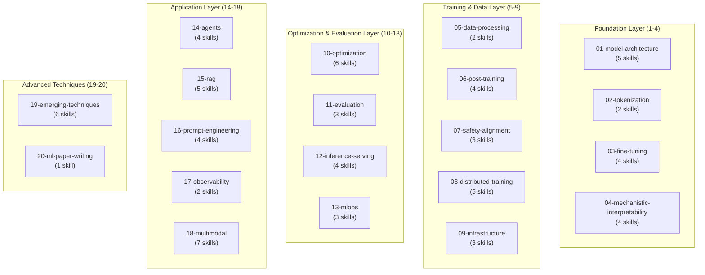

**Category Organization Principles**

Sources: [README.md:341-369](), [.claude-plugin/marketplace.json:11-250]()

| Category Number | Directory Name | Plugin Name | Skill Count | Layer |
|-----------------|----------------|-------------|-------------|-------|
| 01 | `01-model-architecture` | `model-architecture` | 5 | Foundation |
| 02 | `02-tokenization` | `tokenization` | 2 | Foundation |
| 03 | `03-fine-tuning` | `fine-tuning` | 4 | Foundation |
| 04 | `04-mechanistic-interpretability` | `mechanistic-interpretability` | 4 | Foundation |
| 05 | `05-data-processing` | `data-processing` | 2 | Training |
| 06 | `06-post-training` | `post-training` | 4 | Training |
| 07 | `07-safety-alignment` | `safety-alignment` | 3 | Training |
| 08 | `08-distributed-training` | `distributed-training` | 5 | Training |
| 09 | `09-infrastructure` | `infrastructure` | 3 | Training |
| 10 | `10-optimization` | `optimization` | 6 | Optimization |
| 11 | `11-evaluation` | `evaluation` | 3 | Optimization |
| 12 | `12-inference-serving` | `inference-serving` | 4 | Optimization |
| 13 | `13-mlops` | `mlops` | 3 | Optimization |
| 14 | `14-agents` | `agents` | 4 | Applications |
| 15 | `15-rag` | `rag` | 5 | Applications |
| 16 | `16-prompt-engineering` | `prompt-engineering` | 4 | Applications |
| 17 | `17-observability` | `observability` | 2 | Applications |
| 18 | `18-multimodal` | `multimodal` | 7 | Applications |
| 19 | `19-emerging-techniques` | `emerging-techniques` | 6 | Advanced |
| 20 | `20-ml-paper-writing` | `ml-paper-writing` | 1 | Advanced |

Sources: [README.md:341-369](), [.claude-plugin/marketplace.json:11-250]()

## Research Lifecycle Mapping

Categories map to distinct phases of the AI research lifecycle, with dependencies flowing from data preparation through training, optimization, deployment, and application.

```mermaid
graph LR
    subgraph DataPrep["Data Preparation"]
        DP["05-data-processing<br/>NeMo Curator, Ray Data"]
    end
    
    subgraph ModelDev["Model Development"]
        ARCH["01-model-architecture<br/>LitGPT, Mamba, Megatron"]
        TOK["02-tokenization<br/>HF Tokenizers, SentencePiece"]
    end
    
    subgraph Training["Training"]
        FT["03-fine-tuning<br/>Axolotl, Unsloth, PEFT"]
        DIST["08-distributed-training<br/>DeepSpeed, FSDP, TorchTitan"]
        INFRA["09-infrastructure<br/>Modal, SkyPilot, Lambda"]
    end
    
    subgraph PostTrain["Post-Training"]
        PT["06-post-training<br/>TRL, GRPO, OpenRLHF"]
        SAFETY["07-safety-alignment<br/>Constitutional AI, Guardrails"]
    end
    
    subgraph Optimization["Optimization"]
        OPT["10-optimization<br/>Flash Attention, GPTQ, HQQ"]
        EVAL["11-evaluation<br/>lm-eval, BigCode, NeMo"]
    end
    
    subgraph Deploy["Deployment"]
        INF["12-inference-serving<br/>vLLM, TensorRT-LLM, SGLang"]
        MLOPS["13-mlops<br/>W&B, MLflow, TensorBoard"]
        OBS["17-observability<br/>Phoenix, LangSmith"]
    end
    
    subgraph Apps["Applications"]
        AGENT["14-agents<br/>LangChain, CrewAI, AutoGPT"]
        RAG["15-rag<br/>Chroma, FAISS, Qdrant"]
        PROMPT["16-prompt-engineering<br/>DSPy, Instructor, Outlines"]
        MULTI["18-multimodal<br/>CLIP, Whisper, LLaVA"]
    end
    
    subgraph Analysis["Analysis & Research"]
        INTERP["04-mechanistic-interpretability<br/>TransformerLens, SAELens"]
        EMERG["19-emerging-techniques<br/>MoE, Model Merging, Pruning"]
        PAPER["20-ml-paper-writing<br/>LaTeX templates, Citations"]
    end
    
    DP --> ARCH
    DP --> TOK
    ARCH --> FT
    TOK --> FT
    FT --> DIST
    DIST --> PT
    PT --> SAFETY
    SAFETY --> OPT
    OPT --> EVAL
    EVAL --> INF
    INF --> MLOPS
    MLOPS --> OBS
    INF --> AGENT
    INF --> RAG
    RAG --> AGENT
    AGENT --> PROMPT
    INF --> MULTI
    INFRA -.supports.-> DIST
    INTERP -.analyzes.-> ARCH
    INTERP -.analyzes.-> FT
    EMERG -.enhances.-> OPT
    PAPER -.documents.-> EVAL
```

Sources: [README.md:36-109](), [.claude-plugin/marketplace.json:11-250]()

## Marketplace Plugin Definitions

The `.claude-plugin/marketplace.json` file defines all categories as installable plugins. Each plugin entry specifies the category name, description, source directory, and individual skill paths.

**Plugin Entry Structure**

```json
{
  "name": "category-name",
  "description": "When to use this category",
  "source": "./",
  "strict": false,
  "skills": [
    "./XX-category-name/skill-1",
    "./XX-category-name/skill-2"
  ]
}
```

Sources: [.claude-plugin/marketplace.json:1-250]()

### Installation Commands

```bash
# Add marketplace
/plugin marketplace add zechenzhangAGI/AI-research-SKILLs

# Install entire category
/plugin install model-architecture@ai-research-skills
/plugin install fine-tuning@ai-research-skills
/plugin install inference-serving@ai-research-skills
```

Sources: [README.md:70-109]()

## Foundation Skills (Categories 1-4)

### Category 01: Model Architecture

**Plugin Name**: `model-architecture`  
**Directory**: `01-model-architecture/`  
**Skills**: 5 (LitGPT, Mamba, NanoGPT, RWKV, Megatron-Core)

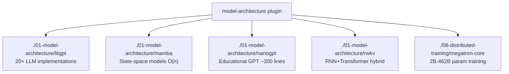

**When to Use**: Implementing, training, or understanding transformer and alternative architectures. Use LitGPT for production training recipes, Mamba for efficient sequence modeling, NanoGPT for learning fundamentals, RWKV for infinite context, Megatron-Core for massive-scale pretraining.

Sources: [.claude-plugin/marketplace.json:12-23](), [README.md:110-114](), [README.md:148-149]()

### Category 02: Tokenization

**Plugin Name**: `tokenization`  
**Directory**: `02-tokenization/`  
**Skills**: 2 (HuggingFace Tokenizers, SentencePiece)

**When to Use**: Training custom tokenizers or handling multilingual text. HuggingFace Tokenizers provides Rust-based BPE/WordPiece/Unigram algorithms with <20s/GB processing. SentencePiece offers language-independent tokenization at 50k sentences/sec.

Sources: [.claude-plugin/marketplace.json:24-33](), [README.md:116-118]()

### Category 03: Fine-Tuning

**Plugin Name**: `fine-tuning`  
**Directory**: `03-fine-tuning/`  
**Skills**: 4 (Axolotl, LLaMA-Factory, PEFT, Unsloth)

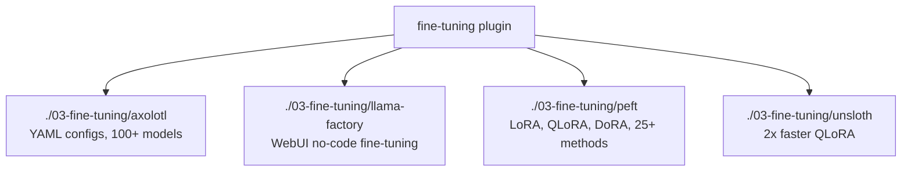

**When to Use**: Fine-tuning models with LoRA, QLoRA, or full fine-tuning. Use Axolotl for YAML-driven workflows, LLaMA-Factory for no-code WebUI, PEFT for parameter-efficient methods library, Unsloth for maximum QLoRA speed.

Sources: [.claude-plugin/marketplace.json:34-45](), [README.md:120-124]()

### Category 04: Mechanistic Interpretability

**Plugin Name**: `mechanistic-interpretability`  
**Directory**: `04-mechanistic-interpretability/`  
**Skills**: 4 (TransformerLens, SAELens, pyvene, nnsight)

**When to Use**: Analyzing model internals, finding circuits, understanding how models compute. TransformerLens provides HookPoints and activation caching. SAELens trains sparse autoencoders for feature discovery. pyvene implements causal interventions with declarative configs. nnsight enables remote interpretability via NDIF for 70B+ models.

Sources: [.claude-plugin/marketplace.json:46-57](), [README.md:126-130]()

## Training & Data Skills (Categories 5-9)

### Category 05: Data Processing

**Plugin Name**: `data-processing`  
**Directory**: `05-data-processing/`  
**Skills**: 2 (NeMo Curator, Ray Data)

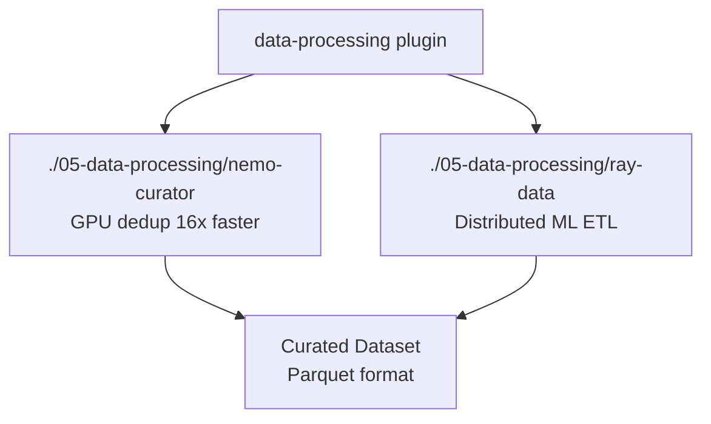

**When to Use**: Preparing training datasets or processing large-scale data. NeMo Curator provides GPU-accelerated curation with 16× faster deduplication than CPU alternatives. Ray Data offers distributed ML data processing with streaming execution and GPU support.

Sources: [.claude-plugin/marketplace.json:58-67](), [README.md:132-134]()

### Category 06: Post-Training

**Plugin Name**: `post-training`  
**Directory**: `06-post-training/`  
**Skills**: 4 (TRL, GRPO, OpenRLHF, SimPO)

**When to Use**: Aligning models with human preferences or training reward models. TRL provides Transformer Reinforcement Learning framework. GRPO implements Group Relative Policy Optimization with TRL (569 lines, gold standard). OpenRLHF offers full RLHF pipeline with Ray + vLLM. SimPO provides Simple Preference Optimization without reference models.

Sources: [.claude-plugin/marketplace.json:68-79](), [README.md:136-140]()

### Category 07: Safety & Alignment

**Plugin Name**: `safety-alignment`  
**Directory**: `07-safety-alignment/`  
**Skills**: 3 (Constitutional AI, LlamaGuard, NeMo Guardrails)

**When to Use**: Implementing safety filters or content moderation. Constitutional AI enables AI-driven self-improvement via principles. LlamaGuard provides safety classifier for LLM inputs/outputs. NeMo Guardrails implements programmable guardrails with Colang DSL.

Sources: [.claude-plugin/marketplace.json:80-90](), [README.md:142-145]()

### Category 08: Distributed Training

**Plugin Name**: `distributed-training`  
**Directory**: `08-distributed-training/`  
**Skills**: 5 (DeepSpeed, FSDP, Accelerate, Megatron-Core, PyTorch Lightning, Ray Train)

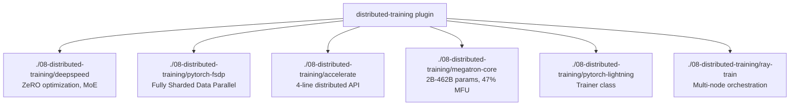

**When to Use**: Training large models across GPUs. Use DeepSpeed for ZeRO stages and 3D parallelism, FSDP for PyTorch-native sharding, Accelerate for minimal API overhead, Megatron-Core for 512B+ parameter pretraining with 4D parallelism, Lightning for high-level abstractions, Ray Train for multi-node hyperparameter tuning.

Sources: [.claude-plugin/marketplace.json:91-104](), [README.md:147-153]()

### Category 09: Infrastructure

**Plugin Name**: `infrastructure`  
**Directory**: `09-infrastructure/`  
**Skills**: 3 (Modal, Lambda Labs, SkyPilot)

**When to Use**: Deploying training jobs or managing GPU resources. Modal provides serverless GPU cloud with Python-native API and T4-H200 on-demand. Lambda Labs offers reserved/on-demand GPU cloud with H100/A100 and persistent filesystems. SkyPilot enables multi-cloud orchestration across 20+ providers with spot recovery.

Sources: [.claude-plugin/marketplace.json:105-115](), [README.md:168-171]()

## Optimization & Evaluation Skills (Categories 10-13)

### Category 10: Optimization

**Plugin Name**: `optimization`  
**Directory**: `10-optimization/`  
**Skills**: 6 (Flash Attention, bitsandbytes, GPTQ, AWQ, HQQ, GGUF)

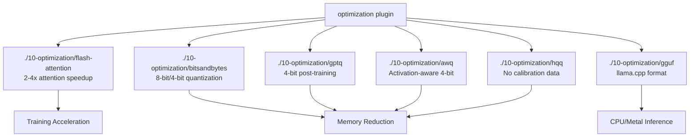

**When to Use**: Reducing memory, accelerating inference, or quantizing models. Flash Attention provides 2-4× speedup with IO-aware algorithms. Bitsandbytes enables 8-bit/4-bit quantization for 50-75% memory reduction. GPTQ offers 4-bit post-training quantization with <2% accuracy loss. AWQ provides activation-aware weight quantization. HQQ implements Half-Quadratic Quantization without calibration data. GGUF supports llama.cpp quantization format for CPU/Metal inference.

Sources: [.claude-plugin/marketplace.json:116-129](), [README.md:155-161]()

### Category 11: Evaluation

**Plugin Name**: `evaluation`  
**Directory**: `11-evaluation/`  
**Skills**: 3 (lm-evaluation-harness, BigCode, NeMo Evaluator)

**When to Use**: Benchmarking models or measuring performance. lm-evaluation-harness provides EleutherAI's standard for 60+ tasks (MMLU, GSM8K, etc.). BigCode Evaluation Harness specializes in code model benchmarking with HumanEval, MBPP, MultiPL-E. NeMo Evaluator offers NVIDIA's enterprise platform for 100+ benchmarks across 18+ harnesses with multi-backend execution.

Sources: [.claude-plugin/marketplace.json:130-140](), [README.md:163-166]()

### Category 12: Inference & Serving

**Plugin Name**: `inference-serving`  
**Directory**: `12-inference-serving/`  
**Skills**: 4 (vLLM, TensorRT-LLM, llama.cpp, SGLang)

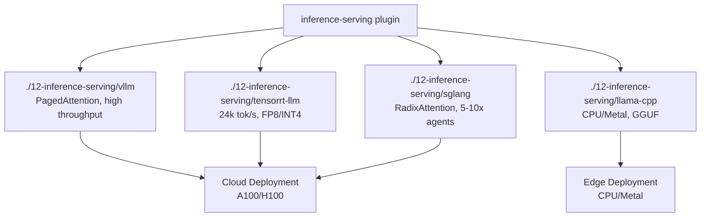

**When to Use**: Deploying models for production inference. vLLM provides high-throughput serving with PagedAttention (production-ready). TensorRT-LLM delivers NVIDIA's fastest inference at 24k tok/s with FP8/INT4. llama.cpp enables CPU/Apple Silicon inference with GGUF quantization. SGLang implements structured generation with RadixAttention, 5-10× faster for agents.

Sources: [.claude-plugin/marketplace.json:141-152](), [README.md:173-177]()

### Category 13: MLOps

**Plugin Name**: `mlops`  
**Directory**: `13-mlops/`  
**Skills**: 3 (Weights & Biases, MLflow, TensorBoard)

**When to Use**: Tracking experiments or managing models. Weights & Biases provides experiment tracking, sweeps, artifacts, and model registry. MLflow offers model registry, tracking, deployment, and autologging. TensorBoard enables visualization, profiling, embeddings, and scalars/images.

Sources: [.claude-plugin/marketplace.json:153-163](), [README.md:207-210]()

## Application Skills (Categories 14-18)

### Category 14: Agents

**Plugin Name**: `agents`  
**Directory**: `14-agents/`  
**Skills**: 4 (LangChain, LlamaIndex, CrewAI, AutoGPT)

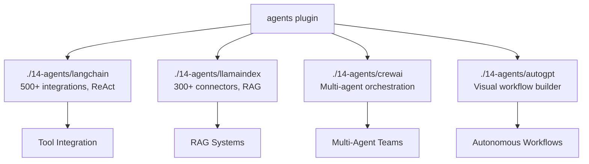

**When to Use**: Building chatbots, autonomous agents, or tool-using systems. LangChain provides most popular agent framework with 500+ integrations and ReAct pattern. LlamaIndex offers data framework for LLM apps with 300+ connectors, RAG-focused. CrewAI enables multi-agent orchestration with role-based collaboration. AutoGPT provides autonomous AI agent platform with visual workflow builder.

Sources: [.claude-plugin/marketplace.json:164-175](), [README.md:179-183]()

### Category 15: RAG

**Plugin Name**: `rag`  
**Directory**: `15-rag/`  
**Skills**: 5 (Chroma, FAISS, Pinecone, Qdrant, Sentence Transformers)

**When to Use**: Building semantic search or document retrieval systems. Chroma provides open-source embedding database with local/cloud support. FAISS offers Facebook's billion-scale similarity search with GPU acceleration. Sentence Transformers supplies 5000+ embedding models with multilingual support. Pinecone delivers managed vector database with auto-scaling and <100ms latency. Qdrant enables high-performance vector search with Rust-powered hybrid search and filtering.

Sources: [.claude-plugin/marketplace.json:176-188](), [README.md:185-190]()

### Category 16: Prompt Engineering

**Plugin Name**: `prompt-engineering`  
**Directory**: `16-prompt-engineering/`  
**Skills**: 4 (DSPy, Instructor, Guidance, Outlines)

**When to Use**: Extracting structured data or constraining LLM outputs. DSPy provides declarative prompt programming with optimizers from Stanford NLP. Instructor enables structured LLM outputs with Pydantic validation. Guidance implements constrained generation with regex/grammars from Microsoft Research. Outlines offers structured text with FSM and zero-overhead.

Sources: [.claude-plugin/marketplace.json:189-200](), [README.md:201-205]()

### Category 17: Observability

**Plugin Name**: `observability`  
**Directory**: `17-observability/`  
**Skills**: 2 (LangSmith, Phoenix)

**When to Use**: Debugging LLM apps or monitoring production systems. LangSmith provides LLM observability, tracing, evaluation, and monitoring for AI apps. Phoenix offers open-source AI observability with OpenTelemetry tracing and LLM evaluation.

Sources: [.claude-plugin/marketplace.json:201-210](), [README.md:212-214]()

### Category 18: Multimodal

**Plugin Name**: `multimodal`  
**Directory**: `18-multimodal/`  
**Skills**: 7 (CLIP, Whisper, LLaVA, BLIP-2, Segment Anything, Stable Diffusion, AudioCraft)

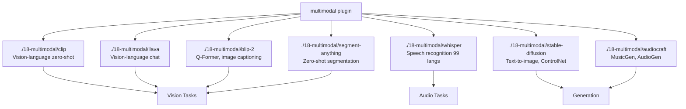

**When to Use**: Working with images, audio, or multimodal tasks. CLIP provides OpenAI's vision-language model for zero-shot classification. Whisper offers robust speech recognition for 99 languages. LLaVA delivers vision-language assistant at GPT-4V level. BLIP-2 implements vision-language pretraining with Q-Former for image captioning and VQA. Segment Anything enables Meta's zero-shot image segmentation with points/boxes/masks. Stable Diffusion provides text-to-image generation via Diffusers with SDXL, ControlNet, LoRA. AudioCraft offers Meta's MusicGen/AudioGen for text-to-music and text-to-sound.

Sources: [.claude-plugin/marketplace.json:211-225](), [README.md:192-199]()

## Advanced Techniques (Categories 19-20)

### Category 19: Emerging Techniques

**Plugin Name**: `emerging-techniques`  
**Directory**: `19-emerging-techniques/`  
**Skills**: 6 (MoE Training, Model Merging, Long Context, Speculative Decoding, Knowledge Distillation, Model Pruning)

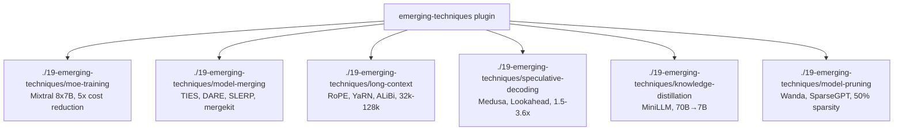

**When to Use**: Implementing cutting-edge optimization or architecture techniques. MoE Training enables Mixture of Experts with DeepSpeed/Mixtral 8x7B for 5× cost reduction. Model Merging combines models with TIES, DARE, SLERP using mergekit. Long Context extends context windows with RoPE, YaRN, ALiBi to 32k-128k tokens. Speculative Decoding achieves 1.5-3.6× faster inference with Medusa, Lookahead. Knowledge Distillation compresses models 70B→7B with MiniLLM, temperature scaling. Model Pruning achieves 50% sparsity with Wanda, SparseGPT, <1% accuracy loss.

Sources: [.claude-plugin/marketplace.json:226-239](), [README.md:216-222]()

### Category 20: ML Paper Writing

**Plugin Name**: `ml-paper-writing`  
**Directory**: `20-ml-paper-writing/`  
**Skills**: 1 (ML Paper Writing)

**When to Use**: Writing publication-ready ML/AI papers for NeurIPS, ICML, ICLR, ACL, AAAI, COLM. Includes LaTeX templates, citation verification workflow to prevent hallucinated references, reviewer guidelines, and writing best practices from top researchers (Neel Nanda, Farquhar, Gopen & Swan, Lipton, Perez).

Sources: [.claude-plugin/marketplace.json:240-248](), [README.md:224-225]()

## Directory-to-Plugin Mapping

The repository structure directly maps to plugin installation names and skill paths.

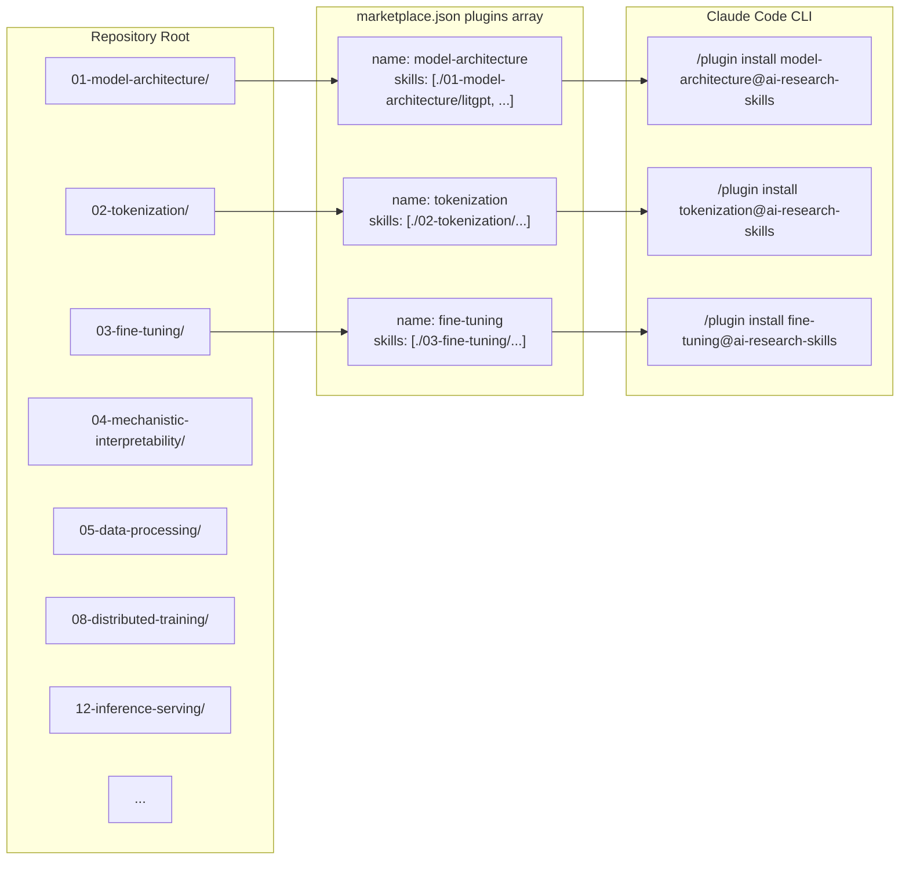

**Mapping Pattern**:
- Directory `XX-category-name/` → Plugin `category-name` → Install command `/plugin install category-name@ai-research-skills`
- Each skill path in `marketplace.json` references a subdirectory: `./XX-category-name/skill-folder`
- Skills are loaded from the `SKILL.md` file in each skill folder

Sources: [.claude-plugin/marketplace.json:1-250](), [README.md:70-109](), [README.md:341-369]()

## Category Selection Guide

Choose categories based on the research phase and specific task requirements.

| Research Phase | Primary Categories | Supporting Categories |
|----------------|-------------------|----------------------|
| Dataset Preparation | 05 (data-processing) | 02 (tokenization) |
| Model Development | 01 (model-architecture), 03 (fine-tuning) | 02 (tokenization), 10 (optimization) |
| Large-Scale Training | 08 (distributed-training), 09 (infrastructure) | 10 (optimization), 13 (mlops) |
| Post-Training Alignment | 06 (post-training), 07 (safety-alignment) | 11 (evaluation) |
| Model Analysis | 04 (mechanistic-interpretability), 11 (evaluation) | 13 (mlops) |
| Deployment | 12 (inference-serving), 17 (observability) | 10 (optimization), 13 (mlops) |
| Application Development | 14 (agents), 15 (rag), 16 (prompt-engineering) | 12 (inference-serving), 17 (observability) |
| Multimodal Systems | 18 (multimodal) | 15 (rag), 16 (prompt-engineering) |
| Advanced Optimization | 19 (emerging-techniques) | 10 (optimization), 11 (evaluation) |
| Publication | 20 (ml-paper-writing) | 11 (evaluation) |

Sources: [README.md:36-109](), [.claude-plugin/marketplace.json:11-250]()

## Installation Patterns

Multiple installation patterns support different workflows.

**Pattern 1: Full Stack Installation**

```bash
# Complete research pipeline
/plugin install model-architecture@ai-research-skills
/plugin install data-processing@ai-research-skills
/plugin install fine-tuning@ai-research-skills
/plugin install distributed-training@ai-research-skills
/plugin install evaluation@ai-research-skills
/plugin install inference-serving@ai-research-skills
```

**Pattern 2: Specific Task Installation**

```bash
# Fine-tuning workflow only
/plugin install fine-tuning@ai-research-skills
/plugin install optimization@ai-research-skills
/plugin install mlops@ai-research-skills
```

**Pattern 3: Application Development Installation**

```bash
# Agent + RAG development
/plugin install agents@ai-research-skills
/plugin install rag@ai-research-skills
/plugin install prompt-engineering@ai-research-skills
/plugin install observability@ai-research-skills
```

**Pattern 4: Production Deployment Installation**

```bash
# Inference + monitoring
/plugin install inference-serving@ai-research-skills
/plugin install optimization@ai-research-skills
/plugin install observability@ai-research-skills
/plugin install safety-alignment@ai-research-skills
```

Sources: [README.md:70-109]()

## Category Dependencies

Some categories have functional dependencies on others for complete workflows.

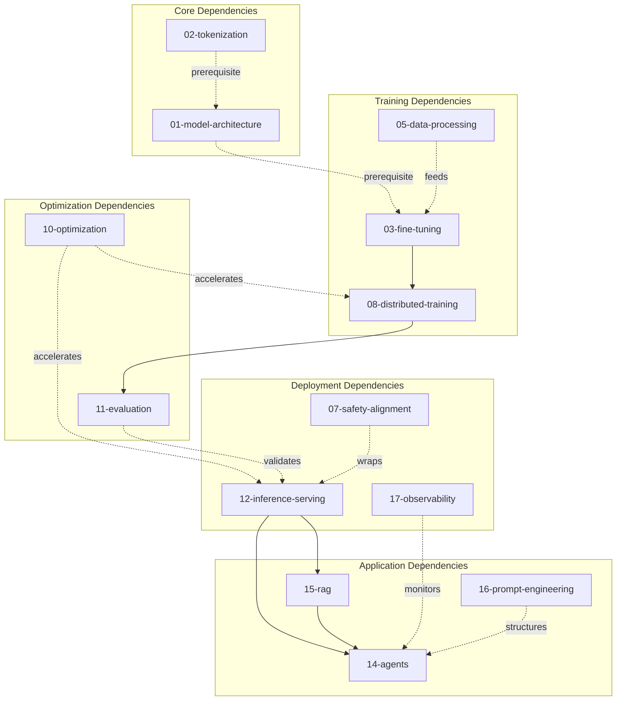

**Dependency Types**:
- **Prerequisite**: Required for basic functionality (solid arrows)
- **Feeds**: Provides input data (dashed arrows with "feeds")
- **Accelerates**: Improves performance (dashed arrows with "accelerates")
- **Validates**: Ensures quality (dashed arrows with "validates")
- **Wraps**: Adds safety layer (dashed arrows with "wraps")
- **Monitors**: Observes behavior (dashed arrows with "monitors")
- **Structures**: Constrains output (dashed arrows with "structures")

Sources: [README.md:36-109](), [.claude-plugin/marketplace.json:11-250]()

## Category Statistics

**Size Distribution by Layer**:

| Layer | Categories | Total Skills | Avg Skills/Category |
|-------|-----------|--------------|---------------------|
| Foundation | 4 | 15 | 3.75 |
| Training & Data | 5 | 17 | 3.40 |
| Optimization & Evaluation | 4 | 16 | 4.00 |
| Applications | 5 | 22 | 4.40 |
| Advanced | 2 | 7 | 3.50 |
| **Total** | **20** | **77** | **3.85** |

**Largest Categories**:
1. Category 18 (multimodal): 7 skills
2. Category 10 (optimization): 6 skills
3. Category 19 (emerging-techniques): 6 skills
4. Category 08 (distributed-training): 5 skills
5. Category 15 (rag): 5 skills

**Smallest Categories**:
1. Category 20 (ml-paper-writing): 1 skill
2. Category 02 (tokenization): 2 skills
3. Category 05 (data-processing): 2 skills
4. Category 17 (observability): 2 skills

Sources: [README.md:15-32](), [README.md:341-369]()

---

