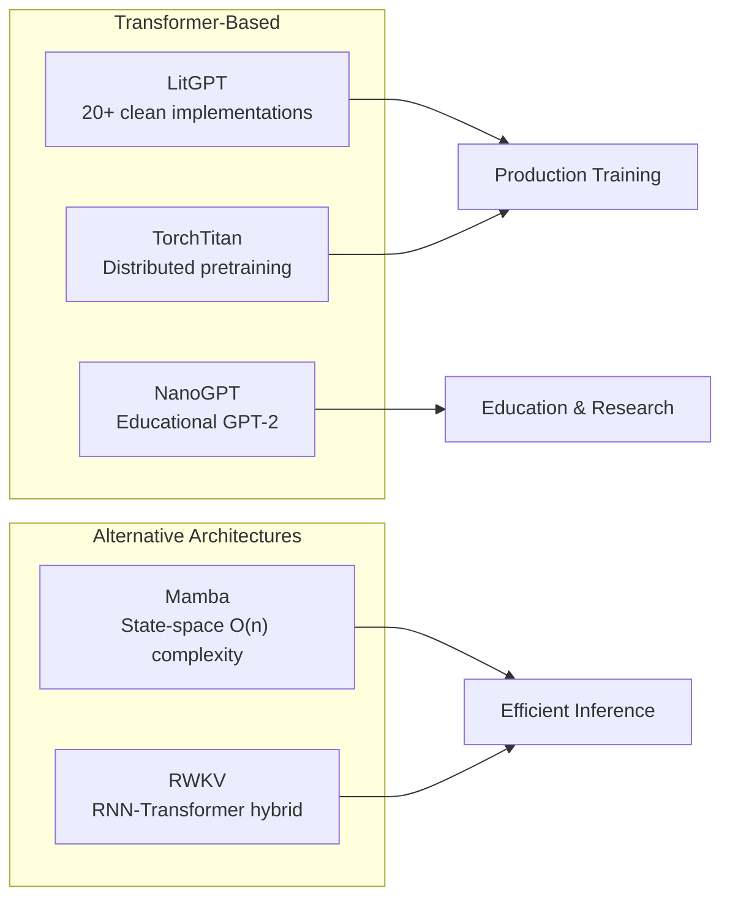
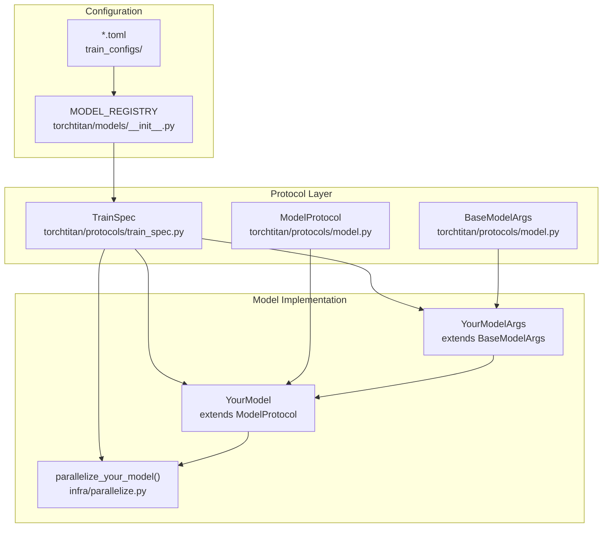
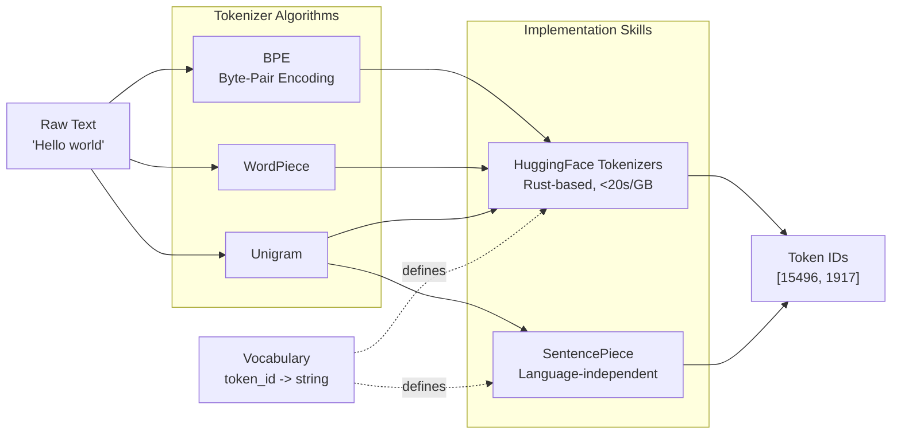
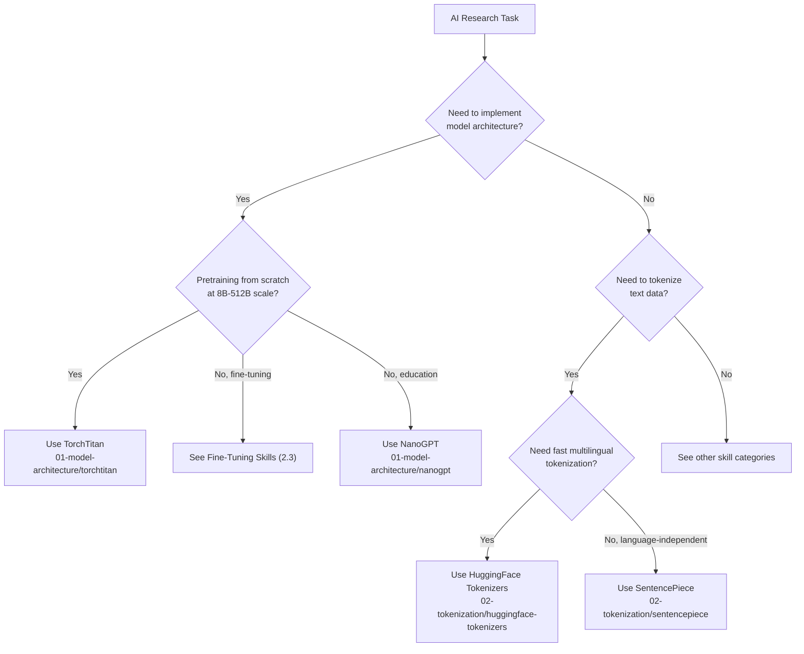

<!-- source: DeepWiki mcp.deepwiki.com · repo zechenzhangAGI/AI-research-SKILLs · page 2.1 Foundation Skills · fetched 2026-10-26 -->

# Foundation Skills

<details>
<summary>Relevant source files</summary>

The following files were used as context for generating this wiki page:

- [.claude-plugin/marketplace.json](.claude-plugin/marketplace.json)
- [01-model-architecture/torchtitan/SKILL.md](01-model-architecture/torchtitan/SKILL.md)
- [01-model-architecture/torchtitan/references/checkpoint.md](01-model-architecture/torchtitan/references/checkpoint.md)
- [01-model-architecture/torchtitan/references/custom-models.md](01-model-architecture/torchtitan/references/custom-models.md)
- [01-model-architecture/torchtitan/references/float8.md](01-model-architecture/torchtitan/references/float8.md)
- [01-model-architecture/torchtitan/references/fsdp.md](01-model-architecture/torchtitan/references/fsdp.md)
- [CONTRIBUTING.md](CONTRIBUTING.md)
- [README.md](README.md)
- [demos/README.md](demos/README.md)
- [docs/ROADMAP.md](docs/ROADMAP.md)
- [docs/SKILL_CREATION_GUIDE.md](docs/SKILL_CREATION_GUIDE.md)
- [docs/SKILL_TEMPLATE.md](docs/SKILL_TEMPLATE.md)
- [docs/christmas-tree.svg](docs/christmas-tree.svg)
- [docs/tech-tree.svg](docs/tech-tree.svg)

</details>


## Purpose and Scope

Foundation Skills provide the core building blocks for AI research: model architectures and tokenization systems. These skills enable implementation of LLM architectures (GPT, Mamba, RWKV variants) and text tokenization pipelines that convert raw text into model-compatible token sequences.

This page covers the two foundational skill categories:
- **Model Architecture** (5 skills): LLM implementations and pretraining frameworks
- **Tokenization** (2 skills): Text-to-token conversion systems

For training these models at scale, see [Training & Fine-Tuning Skills](#2.3). For inference deployment, see [Inference & Serving Skills](#2.8).

Sources: [README.md:110-118](), [.claude-plugin/marketplace.json:13-32]()

---

## Foundation Skills in the Research Lifecycle

```mermaid
graph TB
    subgraph Foundation["Foundation Layer (2.1)"]
        ARCH["Model Architecture<br/>(5 skills)"]
        TOKEN["Tokenization<br/>(2 skills)"]
    end
    
    subgraph Next["Downstream Layers"]
        DATA["Data Processing<br/>(2.2)"]
        TRAIN["Training & Fine-Tuning<br/>(2.3)"]
        INFERENCE["Inference & Serving<br/>(2.8)"]
    end
    
    RAW["Raw Text Data"]
    
    RAW --> TOKEN
    TOKEN --> DATA
    ARCH --> TRAIN
    DATA --> TRAIN
    TRAIN --> INFERENCE
    
    TOKEN -.defines.-> ARCH
    
    style Foundation fill:#2d3748
    style Next fill:#1a202c
```



Foundation skills define the architecture space (GPT, Mamba, RWKV) and tokenization space (BPE, WordPiece, Unigram) that all downstream training and inference operations consume.

Sources: [README.md:36-65](), Diagram 3 from high-level architecture

---

## Directory Structure

```
AI-research-SKILLs/
├── 01-model-architecture/      # 5 architecture skills
│   ├── litgpt/
│   ├── mamba/
│   ├── nanogpt/
│   ├── rwkv/
│   └── torchtitan/            # Distributed pretraining framework
│
└── 02-tokenization/           # 2 tokenization skills
    ├── huggingface-tokenizers/
    └── sentencepiece/
```

Each skill directory contains:
- `SKILL.md` - Main skill documentation (200-500 lines)
- `references/` - Detailed API docs, tutorials, GitHub issues (300KB+)
- `scripts/` - Helper utilities (optional)

Sources: [README.md:341-370](), [CONTRIBUTING.md:286-309]()

---

## Model Architecture Skills

### Architecture Taxonomy



Sources: [README.md:110-114](), [.claude-plugin/marketplace.json:13-22]()

---

### TorchTitan: Distributed Pretraining Framework

**Path**: `01-model-architecture/torchtitan/`

TorchTitan is PyTorch's official platform for large-scale LLM pretraining with composable 4D parallelism.

#### Core Components



Sources: [01-model-architecture/torchtitan/SKILL.md:1-358](), [01-model-architecture/torchtitan/references/custom-models.md:1-259]()

#### Parallelism Configuration

| Parallelism Type | TOML Config Key | Implementation | ZeRO Equivalent |
|------------------|-----------------|----------------|-----------------|
| FSDP2 (Data Parallel Sharding) | `data_parallel_shard_degree` | `fully_shard()` from `torch.distributed._composable.fsdp` | ZeRO-3 (when `reshard_after_forward=True`) |
| Tensor Parallel (TP) | `tensor_parallel_degree` | `parallelize_module()` from `torch.distributed.tensor.parallel` | N/A |
| Pipeline Parallel (PP) | `pipeline_parallel_degree` | `pipeline_fn` in TrainSpec | N/A |
| Context Parallel (CP) | `context_parallel_degree` | Sequence dimension sharding | N/A |

**Example Configuration**:
```toml
[parallelism]
data_parallel_shard_degree = 32  # FSDP across 32 ranks
tensor_parallel_degree = 8        # TP within node
pipeline_parallel_degree = 1      # No PP
context_parallel_degree = 1       # No CP
```

Sources: [01-model-architecture/torchtitan/SKILL.md:136-142](), [01-model-architecture/torchtitan/references/fsdp.md:33-40]()

#### FSDP2 State Dict Behavior

TorchTitan uses FSDP2 with DTensor-based sharding, which changes state dict semantics:

| Operation | FSDP1 | FSDP2 |
|-----------|-------|-------|
| `model.state_dict()` | Returns full state dict (all-gather) | Returns sharded state dict (no communication) |
| `optim.state_dict()` | Returns local optimizer state | Returns sharded optimizer state |
| Parameter type | `FlatParameter` wrapper | `DTensor` on dim-0 |
| Gradient clipping | `FSDP.clip_grad_norm_()` | `torch.nn.utils.clip_grad_norm_()` |

To convert FSDP2 sharded checkpoint to single file:
```bash
python -m torch.distributed.checkpoint.format_utils \
  dcp_to_torch checkpoint/step-1000 checkpoint.pt
```

Sources: [01-model-architecture/torchtitan/references/fsdp.md:69-76]()

#### Float8 Training (H100 Optimization)

Float8 provides 30-50% speedup on H100 GPUs by using FP8 Tensor Cores.

**Configuration**:
```toml
[model]
converters = ["quantize.linear.float8"]

[quantize.linear.float8]
enable_fsdp_float8_all_gather = true
precompute_float8_dynamic_scale_for_fsdp = true
filter_fqns = ["output", "auto_filter_small_kn"]

[compile]
enable = true
```

**Performance Gains** (H100, Llama 3.1 8B):

| Configuration | TPS/GPU | Speedup |
|---------------|---------|---------|
| FSDP only | 5,762 | Baseline |
| FSDP + compile + FP8 | 8,532 | +48% |

Sources: [01-model-architecture/torchtitan/SKILL.md:173-213](), [01-model-architecture/torchtitan/references/float8.md:117-125]()

#### Adding Custom Models

To add a new model architecture to TorchTitan:

1. **Define model arguments** extending `BaseModelArgs`:
```python
# model/args.py
from torchtitan.protocols.model import BaseModelArgs

@dataclass
class YourModelArgs(BaseModelArgs):
    dim: int = 4096
    n_layers: int = 32
    n_heads: int = 32
    
    def get_nparams_and_flops(self, seq_len: int) -> tuple[int, int]:
        # Return (num_params, flops_per_token)
```

2. **Implement model** extending `ModelProtocol`:
```python
# model/model.py
from torchtitan.protocols.model import ModelProtocol

class YourModel(ModelProtocol):
    def __init__(self, args: YourModelArgs):
        self.layers = nn.ModuleDict({
            str(i): TransformerBlock(args) for i in range(args.n_layers)
        })
```

3. **Create `TrainSpec`** registration:
```python
# __init__.py
from torchtitan.protocols.train_spec import TrainSpec, register_train_spec

register_train_spec("your_model", get_train_spec)
```

Sources: [01-model-architecture/torchtitan/references/custom-models.md:29-160]()

---

### Other Architecture Skills

#### LitGPT

**Path**: `01-model-architecture/litgpt/`

Lightning AI's collection of 20+ clean LLM implementations with production training recipes.

**Key Features**:
- Pre-configured architectures (GPT-2, Llama, Mistral, Phi, Gemma)
- Training scripts with known-good hyperparameters
- 462 lines SKILL.md + 4 reference files

Sources: [README.md:111]()

#### Mamba

**Path**: `01-model-architecture/mamba/`

State-space model with O(n) complexity, 5× faster than Transformers for long sequences.

**Architecture**: Selective state-space models (SSMs) with hardware-aware algorithm.

Sources: [README.md:112]()

#### RWKV

**Path**: `01-model-architecture/rwkv/`

RNN-Transformer hybrid with infinite context window, Linux Foundation project.

**Key Property**: Combines RNN linear inference cost with Transformer parallelizable training.

Sources: [README.md:113]()

#### NanoGPT

**Path**: `01-model-architecture/nanogpt/`

Educational GPT implementation in ~300 lines by Andrej Karpathy.

**Purpose**: Learning reference for understanding transformer architectures.

Sources: [README.md:114]()

---

## Tokenization Skills

Tokenization converts raw text strings into integer token sequences that models consume.



Sources: [README.md:116-118](), [.claude-plugin/marketplace.json:25-32]()

### HuggingFace Tokenizers

**Path**: `02-tokenization/huggingface-tokenizers/`

Rust-based tokenization library with <20s/GB processing speed.

**Supported Algorithms**:
- BPE (Byte-Pair Encoding) - Used by GPT-2, GPT-3, Llama
- WordPiece - Used by BERT, DistilBERT
- Unigram - Used by T5, ALBERT

**Key Classes**:
```python
from tokenizers import Tokenizer
from tokenizers.models import BPE, WordPiece, Unigram
from tokenizers.trainers import BpeTrainer, WordPieceTrainer, UnigramTrainer
```

**Example Usage**:
```python
tokenizer = Tokenizer(BPE())
trainer = BpeTrainer(vocab_size=30000)
tokenizer.train(files=["data.txt"], trainer=trainer)
```

Sources: [README.md:117]()

### SentencePiece

**Path**: `02-tokenization/sentencepiece/`

Language-independent tokenizer processing 50k sentences/sec.

**Key Feature**: Treats whitespace as normal character, enabling language-agnostic tokenization without pre-tokenization.

**Training**:
```python
import sentencepiece as spm

spm.SentencePieceTrainer.train(
    input='data.txt',
    model_prefix='m',
    vocab_size=8000,
    model_type='unigram'  # or 'bpe'
)
```

**Usage**:
```python
sp = spm.SentencePieceProcessor(model_file='m.model')
tokens = sp.encode('Hello world', out_type=int)
text = sp.decode(tokens)
```

Sources: [README.md:118]()

---

## Marketplace Integration

Foundation skills are distributed via the Claude Code CLI marketplace.

### Installation

```bash
# Add marketplace
/plugin marketplace add zechenzhangAGI/AI-research-SKILLs

# Install model architecture skills
/plugin install model-architecture@ai-research-skills

# Install tokenization skills
/plugin install tokenization@ai-research-skills
```

### Marketplace Definition

The marketplace manifest defines plugin groupings:

```json
{
  "plugins": [
    {
      "name": "model-architecture",
      "description": "LLM architectures and implementations...",
      "source": "./",
      "skills": [
        "./01-model-architecture/litgpt",
        "./01-model-architecture/mamba",
        "./01-model-architecture/nanogpt",
        "./01-model-architecture/rwkv"
      ]
    },
    {
      "name": "tokenization",
      "description": "Text tokenization for LLMs...",
      "source": "./",
      "skills": [
        "./02-tokenization/huggingface-tokenizers",
        "./02-tokenization/sentencepiece"
      ]
    }
  ]
}
```

Sources: [.claude-plugin/marketplace.json:11-32](), [README.md:70-84]()

---

## Skill Metadata Structure

All foundation skills follow standardized YAML frontmatter format:

```yaml
---
name: skill-name-in-kebab-case
description: Third-person description including what it does and when to use it
version: 1.0.0
author: Orchestra Research
license: MIT
tags: [Model Architecture, Training, Distributed Systems, ...]
dependencies: [torch>=2.0.0, transformers>=4.35.0]
---
```

**Requirements**:
- `name`: kebab-case, no spaces, gerund form preferred
- `description`: Third-person, includes triggers for discovery, max 1024 chars
- `tags`: Title Case, uppercase acronyms (FSDP, RLHF, MLOps)
- `dependencies`: Direct dependencies only, version constraints with `>=`

Sources: [CONTRIBUTING.md:126-196](), [docs/SKILL_TEMPLATE.md:1-9]()

---

## When to Use Foundation Skills



**Use Foundation Skills when**:
- Implementing new LLM architectures
- Pretraining models from scratch (not fine-tuning)
- Training custom tokenizers on domain data
- Experimenting with alternative architectures (Mamba, RWKV)

**Use other categories instead**:
- Fine-tuning existing models → [Training & Fine-Tuning Skills](#2.3)
- Data preparation → [Data Processing Skills](#2.2)
- Inference deployment → [Inference & Serving Skills](#2.8)
- Model evaluation → [Evaluation Skills](#2.7)

Sources: [README.md:86-109](), [01-model-architecture/torchtitan/SKILL.md:259-273]()

---

## Skill Quality Standards

Foundation skills follow Anthropic best practices for AI agent documentation:

### Progressive Disclosure

- **SKILL.md**: 200-500 lines overview with quick start, workflows, common issues
- **references/**: Detailed docs (API reference, advanced features, troubleshooting)
- **Maximum depth**: One level (SKILL.md → reference files, no nested references)

### Workflow Structure

Each workflow includes copy-paste checklist:

```markdown
## Deployment workflow

Copy this checklist:

```
Task Progress:
- [ ] Step 1: Configure settings
- [ ] Step 2: Validate configuration
- [ ] Step 3: Deploy
- [ ] Step 4: Verify
```

**Step 1: Configure settings**
[Brief instruction with code example]
```

### Validation Checkpoints

Quality-critical operations include validation loops:

```bash
python validate.py config.yaml
# If errors: fix → validate again → continue
```

Sources: [docs/SKILL_CREATION_GUIDE.md:1-644](), [CONTRIBUTING.md:82-112]()

---

## Contributing Foundation Skills

To add a new foundation skill:

1. **Choose directory**: `01-model-architecture/` or `02-tokenization/`
2. **Create structure**:
   ```
   skill-name/
   ├── SKILL.md              # 200-500 lines
   └── references/           # 300KB+ documentation
       ├── api.md
       ├── tutorials.md
       └── issues.md
   ```
3. **Update marketplace**: Add entry to `.claude-plugin/marketplace.json`
4. **Validate**: Ensure YAML frontmatter, code examples, workflows present
5. **Submit PR**: Review within 48-72 hours

**Quality Requirements**:
- YAML frontmatter with all required fields
- Workflow checklists for complex tasks
- "When to use vs alternatives" section
- Common issues with solutions
- Code examples with language tags

Sources: [CONTRIBUTING.md:30-278](), [docs/SKILL_TEMPLATE.md:1-107]()

---

## Architecture Comparison Table

| Skill | Architecture Type | Complexity | Context Length | Best For |
|-------|------------------|------------|----------------|----------|
| TorchTitan | Transformer (Llama variants) | O(n²) attention | 8K-128K | Distributed pretraining 8B-512B params |
| LitGPT | Transformer (20+ variants) | O(n²) attention | Model-dependent | Production training with recipes |
| Mamba | State-space model | O(n) linear | Infinite | Efficient long-sequence inference |
| RWKV | RNN-Transformer hybrid | O(n) linear | Infinite | Combining RNN inference with Transformer training |
| NanoGPT | Transformer (GPT-2) | O(n²) attention | 1K | Education and understanding |

| Skill | Training Speed | Memory Efficiency | Hardware Support | Maturity |
|-------|---------------|-------------------|------------------|----------|
| TorchTitan | Fastest (65%+ MFU H100) | High (4D parallelism) | NVIDIA (H100 FP8) | Production |
| LitGPT | Fast | Medium | Multi-vendor | Production |
| Mamba | 5× faster (long seq) | Very High | General | Research |
| RWKV | Fast | High | General | Research |
| NanoGPT | Moderate | Low | General | Educational |

Sources: [README.md:110-114](), [01-model-architecture/torchtitan/SKILL.md:332-341]()

---

## Related Skills

Foundation skills integrate with downstream categories:

- **Data Processing** [#2.2]: Prepare datasets for training (NeMo Curator, Ray Data)
- **Training & Fine-Tuning** [#2.3]: Train foundation models (Unsloth, Axolotl, PEFT)
- **Distributed Training** [#2.3]: Scale training across GPUs (DeepSpeed, FSDP)
- **Optimization** [#2.6]: Quantize models (GPTQ, HQQ, Bitsandbytes)
- **Inference & Serving** [#2.8]: Deploy models (vLLM, TensorRT-LLM, SGLang)

Sources: [README.md:36-109](), High-level architecture diagrams

---

