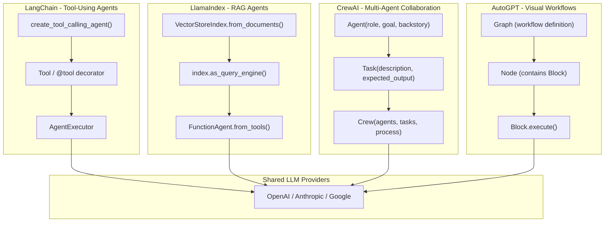
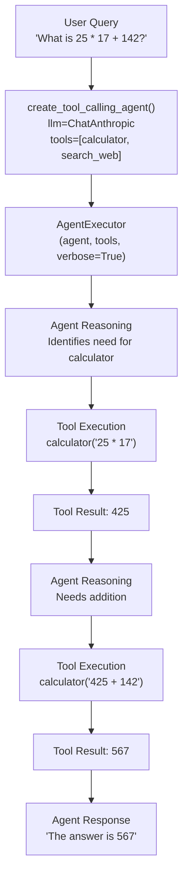
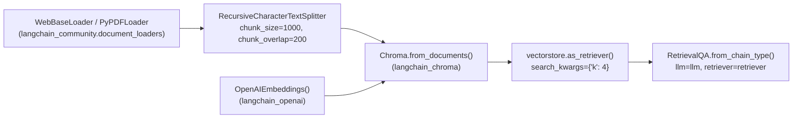
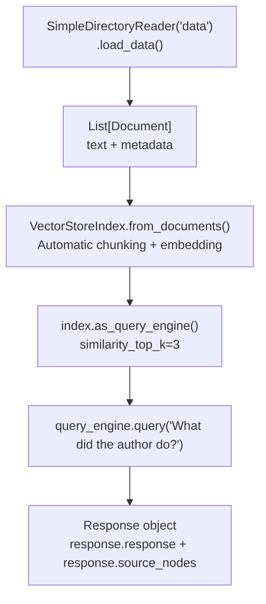
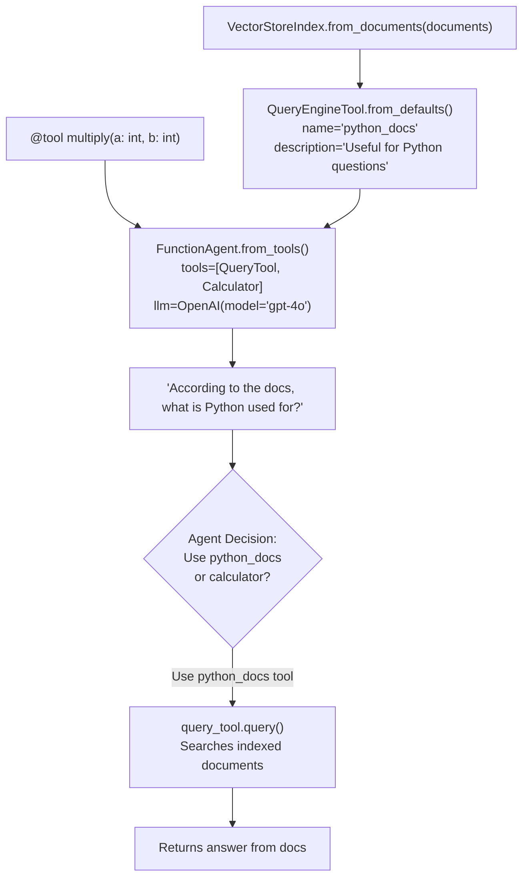
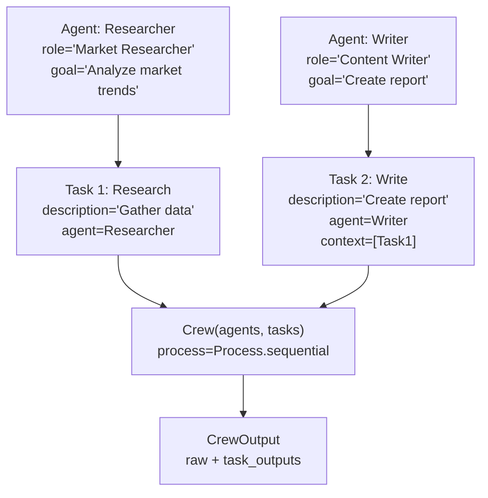
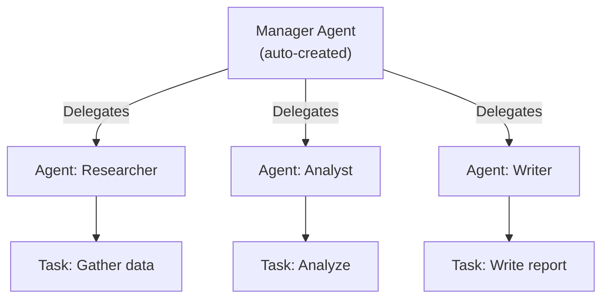
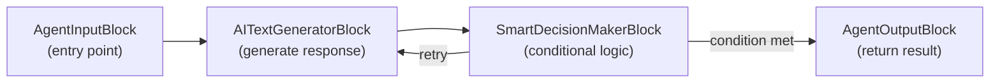
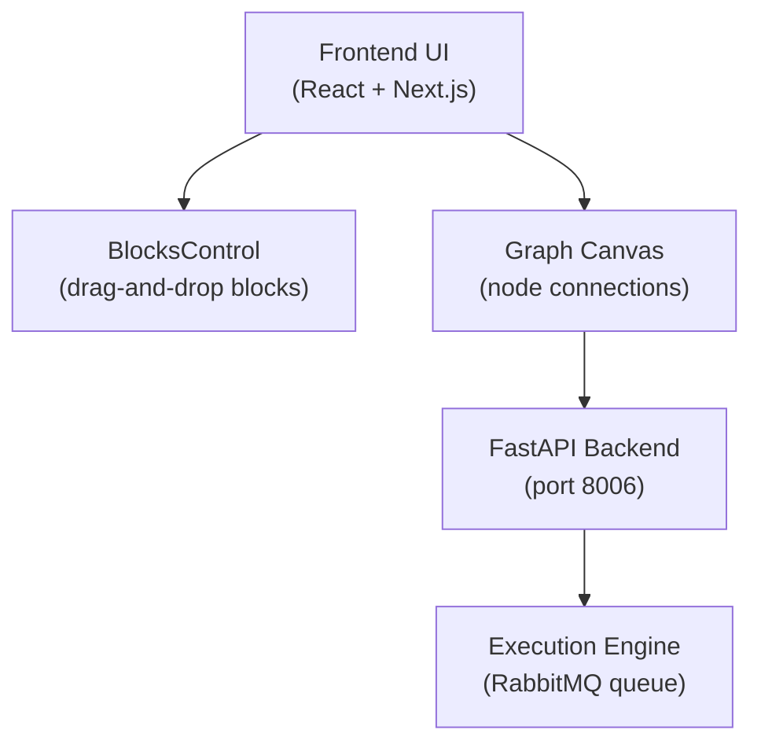

<!-- source: DeepWiki mcp.deepwiki.com · repo zechenzhangAGI/AI-research-SKILLs · page 2.10 Agent Framework Skills · fetched 2026-10-26 -->

# Agent Framework Skills

<details>
<summary>Relevant source files</summary>

The following files were used as context for generating this wiki page:

- [.claude-plugin/marketplace.json](.claude-plugin/marketplace.json)
- [10-optimization/gguf/SKILL.md](10-optimization/gguf/SKILL.md)
- [10-optimization/gguf/references/advanced-usage.md](10-optimization/gguf/references/advanced-usage.md)
- [10-optimization/gguf/references/troubleshooting.md](10-optimization/gguf/references/troubleshooting.md)
- [10-optimization/hqq/SKILL.md](10-optimization/hqq/SKILL.md)
- [10-optimization/hqq/references/advanced-usage.md](10-optimization/hqq/references/advanced-usage.md)
- [10-optimization/hqq/references/troubleshooting.md](10-optimization/hqq/references/troubleshooting.md)
- [14-agents/autogpt/SKILL.md](14-agents/autogpt/SKILL.md)
- [14-agents/autogpt/references/advanced-usage.md](14-agents/autogpt/references/advanced-usage.md)
- [14-agents/autogpt/references/troubleshooting.md](14-agents/autogpt/references/troubleshooting.md)
- [17-observability/phoenix/SKILL.md](17-observability/phoenix/SKILL.md)
- [17-observability/phoenix/references/advanced-usage.md](17-observability/phoenix/references/advanced-usage.md)
- [CONTRIBUTING.md](CONTRIBUTING.md)
- [README.md](README.md)
- [demos/README.md](demos/README.md)
- [docs/ROADMAP.md](docs/ROADMAP.md)
- [docs/SKILL_CREATION_GUIDE.md](docs/SKILL_CREATION_GUIDE.md)
- [docs/SKILL_TEMPLATE.md](docs/SKILL_TEMPLATE.md)
- [docs/christmas-tree.svg](docs/christmas-tree.svg)
- [docs/tech-tree.svg](docs/tech-tree.svg)

</details>


This document covers the four primary agent frameworks included in the AI Research SKILLs library: **LangChain**, **LlamaIndex**, **CrewAI**, and **AutoGPT**. These frameworks provide different approaches to building autonomous agents, from general-purpose tool-using agents (LangChain) to specialized multi-agent collaboration (CrewAI) to visual workflow builders (AutoGPT).

**Framework Positioning**:
- **LangChain**: General-purpose agents with 500+ integrations, ReAct pattern
- **LlamaIndex**: RAG-focused with 300+ data connectors, document Q&A
- **CrewAI**: Role-based multi-agent collaboration, hierarchical workflows
- **AutoGPT**: Visual workflow builder, continuous autonomous agents

**Sources**: [README.md:179-183](), [.claude-plugin/marketplace.json:164-174]()

## Framework Architecture Overview

The following diagram shows how the four agent frameworks differ in their core design patterns:



**Framework Comparison**:

| Framework | Primary Pattern | Key Abstraction | Execution Model |
|-----------|----------------|-----------------|-----------------|
| **LangChain** | ReAct (Reasoning + Acting) | `AgentExecutor` with tools | Sequential tool calls |
| **LlamaIndex** | RAG + Tool Calling | `QueryEngine` + `FunctionAgent` | Document retrieval + synthesis |
| **CrewAI** | Multi-Agent Collaboration | `Crew` with role-based agents | Parallel or sequential task delegation |
| **AutoGPT** | Visual Workflow Graphs | `Graph` with executable blocks | Node-based continuous execution |

**Sources**: [14-agents/langchain/SKILL.md:136-161](), [14-agents/llamaindex/SKILL.md:166-191](), [14-agents/crewai/SKILL.md:108-133](), [14-agents/autogpt/SKILL.md:82-109]()

## LangChain Framework

LangChain is a general-purpose framework for building LLM-powered applications with emphasis on agents, tool calling, and flexible integrations. It provides high-level abstractions that enable rapid prototyping and production deployments.

### Core Components

| Component | Class/Function | Purpose | File Reference |
|-----------|---------------|---------|----------------|
| **Models** | `ChatAnthropic`, `ChatOpenAI`, `ChatGoogleGenerativeAI` | LLM provider abstraction | [14-agents/langchain/SKILL.md:98-113]() |
| **Chains** | `LLMChain`, `RetrievalQA`, `ConversationalRetrievalChain` | Sequential operations | [14-agents/langchain/SKILL.md:116-132]() |
| **Agents** | `create_agent()`, `create_tool_calling_agent()`, `AgentExecutor` | Tool-using reasoning | [14-agents/langchain/SKILL.md:136-161]() |
| **Memory** | `ConversationBufferMemory` | Conversation history tracking | [14-agents/langchain/SKILL.md:164-181]() |
| **Tools** | `Tool`, `@tool` decorator | Function calling interface | [14-agents/langchain/SKILL.md:142-147]() |
| **Retrievers** | `vectorstore.as_retriever()` | Document retrieval | [14-agents/langchain/SKILL.md:212-224]() |

**Sources**: [14-agents/langchain/SKILL.md:98-181]()

### ReAct Agent Pattern

LangChain implements the ReAct (Reasoning + Acting) pattern, where agents iteratively reason about which tools to call and act by executing them. The agent loop continues until a final answer is reached.



**Implementation**: The `create_agent()` function provides a simplified API (10 lines of code) that wraps `create_tool_calling_agent()` and `AgentExecutor`. Tools are defined as Python functions decorated with `@tool` or wrapped in `Tool` objects.

**Sources**: [14-agents/langchain/SKILL.md:69-94](), [14-agents/langchain/SKILL.md:136-161]()

### RAG Implementation

LangChain's RAG pipeline consists of five stages: document loading, text splitting, embedding, vector storage, and retrieval-based question answering.



**Key Classes**:
- **Document Loaders**: `WebBaseLoader`, `PyPDFLoader`, `CSVLoader`, `GithubFileLoader` - Load data from various sources
- **Text Splitters**: `RecursiveCharacterTextSplitter` (general), `PythonCodeTextSplitter` (code-aware), `SemanticChunker` (meaning-based)
- **QA Chains**: `RetrievalQA` (one-shot), `ConversationalRetrievalChain` (with memory)

**Sources**: [14-agents/langchain/SKILL.md:187-225](), [14-agents/langchain/SKILL.md:389-425]()

### Vector Store Integration

LangChain provides unified interfaces for multiple vector stores through the `langchain_*` integration packages:

| Vector Store | Integration Package | Key Features | Usage Pattern |
|--------------|-------------------|--------------|---------------|
| **Chroma** | `langchain_chroma` | Local, open-source, metadata filtering | `Chroma.from_documents(docs, OpenAIEmbeddings())` |
| **Pinecone** | `langchain_pinecone` | Managed, serverless, hybrid search | `PineconeVectorStore.from_documents(docs, embeddings, index_name="my-index")` |
| **FAISS** | `langchain_community.vectorstores` | Fast similarity search, GPU acceleration | `FAISS.from_documents(docs, OpenAIEmbeddings())` |

All vector stores expose the same `as_retriever()` method, enabling easy swapping:

```python
# Chroma retriever
retriever = Chroma.from_documents(docs, OpenAIEmbeddings()).as_retriever(search_kwargs={"k": 5})

# Pinecone retriever (same interface)
retriever = PineconeVectorStore.from_documents(docs, OpenAIEmbeddings(), index_name="my-index").as_retriever(search_kwargs={"k": 5})
```

**Sources**: [14-agents/langchain/SKILL.md:350-385](), [15-rag/chroma/SKILL.md:306-329](), [15-rag/pinecone/SKILL.md:237-261](), [15-rag/faiss/SKILL.md:160-181]()

### Advanced Patterns

**Structured Output**: LangChain supports Pydantic schema validation through `llm.with_structured_output()`:

```python
class WeatherReport(BaseModel):
    city: str = Field(description="City name")
    temperature: float
    condition: str

structured_llm = llm.with_structured_output(WeatherReport)
result = structured_llm.invoke("What's the weather in SF? It's 65F and sunny")
# Returns: WeatherReport(city="SF", temperature=65.0, condition="sunny")
```

**Parallel Tool Execution**: Agents automatically detect when tool calls are independent and execute them concurrently.

**Streaming**: Both model responses and agent execution steps can be streamed for improved UX.

**LangSmith Observability**: Set `LANGCHAIN_TRACING_V2=true` to automatically trace all chains and agents to LangSmith for debugging and monitoring.

**Sources**: [14-agents/langchain/SKILL.md:250-292](), [14-agents/langchain/SKILL.md:334-347]()

## LlamaIndex Framework

LlamaIndex is a data-centric framework specializing in RAG applications. It provides 300+ data connectors (LlamaHub) and emphasizes document ingestion, indexing, and querying workflows.

### Core Components

| Component | Class/Function | Purpose | File Reference |
|-----------|---------------|---------|----------------|
| **Documents** | `Document`, `SimpleDirectoryReader` | Data representation and loading | [14-agents/llamaindex/SKILL.md:72-94]() |
| **Indices** | `VectorStoreIndex`, `ListIndex`, `TreeIndex` | Data structures for efficient retrieval | [14-agents/llamaindex/SKILL.md:98-117]() |
| **Query Engines** | `index.as_query_engine()` | Question answering interface | [14-agents/llamaindex/SKILL.md:119-139]() |
| **Chat Engines** | `index.as_chat_engine()` | Conversational interface with memory | [14-agents/llamaindex/SKILL.md:220-235]() |
| **Retrievers** | `index.as_retriever()`, `BaseRetriever` | Chunk retrieval | [14-agents/llamaindex/SKILL.md:142-161]() |
| **Agents** | `FunctionAgent.from_tools()` | Tool-using agents | [14-agents/llamaindex/SKILL.md:166-191]() |

**Sources**: [14-agents/llamaindex/SKILL.md:69-191]()

### RAG Pipeline Architecture

LlamaIndex's RAG pipeline is simpler than LangChain's, requiring only 5 lines for a complete system:



**Key Differences from LangChain**:
- Text splitting is automatic (no explicit splitter needed)
- Embedding happens during index creation
- Query engine combines retrieval + synthesis in one step
- Source nodes included in response by default

**Sources**: [14-agents/llamaindex/SKILL.md:52-68](), [14-agents/llamaindex/SKILL.md:119-139]()

### Data Connectors

LlamaIndex provides 300+ data connectors through LlamaHub, organized by source type:

| Category | Connectors | Example Classes |
|----------|-----------|-----------------|
| **Files** | Local, S3, Google Drive | `SimpleDirectoryReader` |
| **Web** | Web scraping, sitemap | `SimpleWebPageReader`, `BeautifulSoupWebReader` |
| **Code** | GitHub, GitLab, Bitbucket | `GithubRepositoryReader` |
| **Databases** | SQL, NoSQL, Graph | `DatabaseReader` (supports PostgreSQL, MySQL, MongoDB) |
| **APIs** | REST, GraphQL | `JSONReader` |
| **Productivity** | Notion, Confluence, Slack | `NotionReader`, `ConfluenceReader` |

All readers follow the same interface: `.load_data()` returns `List[Document]`.

**Sources**: [14-agents/llamaindex/SKILL.md:72-94](), [14-agents/llamaindex/SKILL.md:279-322]()

### Query Engine Modes

LlamaIndex supports multiple response synthesis modes for different use cases:

| Mode | Description | Best For | Configuration |
|------|-------------|----------|---------------|
| **compact** | Concatenate chunks, single LLM call | Most queries, cost-effective | `response_mode="compact"` |
| **tree_summarize** | Hierarchical summarization | Long documents | `response_mode="tree_summarize"` |
| **simple_summarize** | Sequential processing | Large context | `response_mode="simple_summarize"` |
| **refine** | Iterative refinement | High quality answers | `response_mode="refine"` |

**Sources**: [14-agents/llamaindex/SKILL.md:119-139]()

### Agent Implementation

LlamaIndex agents combine tool calling with RAG retrieval. Query engines can be wrapped as tools:



The agent decides when to search documents vs. perform calculations based on the query.

**Sources**: [14-agents/llamaindex/SKILL.md:194-216]()

### Vector Store Integration

LlamaIndex uses the `StorageContext` pattern for vector store integration:

```python
# Chroma integration
import chromadb
from llama_index.vector_stores.chroma import ChromaVectorStore
from llama_index.core import StorageContext

db = chromadb.PersistentClient(path="./chroma_db")
collection = db.get_or_create_collection("my_collection")
vector_store = ChromaVectorStore(chroma_collection=collection)
storage_context = StorageContext.from_defaults(vector_store=vector_store)

index = VectorStoreIndex.from_documents(documents, storage_context=storage_context)
```

**Supported Vector Stores**:
- **Chroma**: `llama_index.vector_stores.chroma.ChromaVectorStore`
- **Pinecone**: `llama_index.vector_stores.pinecone.PineconeVectorStore`
- **FAISS**: `llama_index.vector_stores.faiss.FaissVectorStore`

**Sources**: [14-agents/llamaindex/SKILL.md:324-376](), [15-rag/chroma/SKILL.md:331-355]()

## Integration Patterns

Both frameworks integrate with the same vector stores and embedding models, but use different abstractions:

```mermaid
graph TB
    subgraph "LangChain Pattern"
        LC_VectorStore["PineconeVectorStore.from_documents()<br/>or Chroma.from_documents()"]
        LC_Retriever["vectorstore.as_retriever()"]
        LC_Chain["RetrievalQA.from_chain_type()"]
    end
    
    subgraph "LlamaIndex Pattern"
        LI_VectorStore["PineconeVectorStore(pinecone_index)<br/>or ChromaVectorStore(chroma_collection)"]
        LI_StorageContext["StorageContext.from_defaults(vector_store)"]
        LI_Index["VectorStoreIndex.from_documents(docs, storage_context)"]
    end
    
    subgraph "Shared Components"
        Embeddings2["OpenAIEmbeddings / HuggingFaceEmbedding"]
        VectorDB["Pinecone API / Chroma Client / FAISS Index"]
    end
    
    LC_VectorStore --> LC_Retriever
    LC_Retriever --> LC_Chain
    LC_VectorStore -.-> VectorDB
    LC_VectorStore -.-> Embeddings2
    
    LI_VectorStore --> LI_StorageContext
    LI_StorageContext --> LI_Index
    LI_VectorStore -.-> VectorDB
    LI_Index -.-> Embeddings2
```



**Key Differences**:
- **LangChain**: Vector stores are created with documents in one call (`.from_documents()`)
- **LlamaIndex**: Vector stores wrap existing clients, then passed via `StorageContext`
- **LangChain**: Retriever is explicit (`as_retriever()`)
- **LlamaIndex**: Retrieval is implicit in query engine

**Sources**: [14-agents/langchain/SKILL.md:350-385](), [14-agents/llamaindex/SKILL.md:324-376]()

## CrewAI Framework

CrewAI specializes in multi-agent collaboration with role-based task delegation. It's designed for scenarios where multiple AI agents with different expertise work together on complex problems.

### Core Components

| Component | Class | Purpose | File Reference |
|-----------|-------|---------|----------------|
| **Agent** | `Agent(role, goal, backstory, tools)` | Individual agent with specific role | [14-agents/crewai/SKILL.md:108-133]() |
| **Task** | `Task(description, expected_output, agent)` | Work unit assigned to agent | [14-agents/crewai/SKILL.md:136-153]() |
| **Crew** | `Crew(agents, tasks, process, verbose)` | Orchestrates multi-agent execution | [14-agents/crewai/SKILL.md:156-178]() |
| **Tools** | Decorated functions or classes | Capabilities agents can use | [14-agents/crewai/SKILL.md:184-202]() |
| **Process** | `Process.sequential` or `Process.hierarchical` | Task execution order | [14-agents/crewai/SKILL.md:156-178]() |

**Sources**: [14-agents/crewai/SKILL.md:108-202]()

### Multi-Agent Collaboration Pattern

CrewAI implements a crew-based execution model where agents work together on tasks:



**Key Features**:
- **Role-based design**: Each agent has a role, goal, and backstory
- **Task dependencies**: Tasks can reference context from previous tasks
- **Process types**: Sequential (one after another) or Hierarchical (manager delegates)
- **Memory**: Agents can share knowledge across tasks
- **Delegation**: Agents can ask other agents for help

**Sources**: [14-agents/crewai/SKILL.md:108-178]()

### Hierarchical Process

In hierarchical mode, CrewAI creates a manager agent that delegates tasks:



The manager decides task order and can re-assign tasks if needed.

**Sources**: [14-agents/crewai/SKILL.md:205-225]()

### Integration with LangChain Tools

CrewAI can use LangChain tools directly:

```python
from crewai import Agent, Task, Crew
from langchain.agents import Tool
from langchain_community.tools import DuckDuckGoSearchRun

search = DuckDuckGoSearchRun()
search_tool = Tool(
    name="Search",
    func=search.run,
    description="Search the web for information"
)

researcher = Agent(
    role="Researcher",
    goal="Find relevant information",
    tools=[search_tool]
)
```

**Sources**: [14-agents/crewai/SKILL.md:184-202]()

## AutoGPT Framework

AutoGPT provides a visual agent builder and platform for continuous autonomous agents. Unlike other frameworks that focus on code-first development, AutoGPT emphasizes a no-code/low-code approach with a graph-based UI.

### Core Components

| Component | Class/API | Purpose | File Reference |
|-----------|-----------|---------|----------------|
| **Graph** | `GraphModel` (backend) | Agent workflow definition | [14-agents/autogpt/SKILL.md:82-96]() |
| **Node** | `NodeModel` | Contains a block, positioned in graph | [14-agents/autogpt/SKILL.md:82-96]() |
| **Block** | `Block.execute()` | Functional component (LLM, tool, etc.) | [14-agents/autogpt/SKILL.md:98-109]() |
| **Execution** | `/api/v1/graphs/{id}/execute` | Run agent with inputs | [14-agents/autogpt/SKILL.md:154-179]() |
| **Forge** | CLI toolkit | Development framework for custom agents | [14-agents/autogpt/SKILL.md:199-238]() |

**Sources**: [14-agents/autogpt/SKILL.md:82-238]()

### Graph-Based Execution Architecture

AutoGPT represents agents as directed graphs where nodes execute sequentially or in parallel:



**Block Types**:
- `INPUT`: Agent entry points (user queries, webhooks)
- `AI`: LLM calls, text generation
- `WEBHOOK`: External triggers
- `STANDARD`: General operations (HTTP, file I/O)
- `OUTPUT`: Agent outputs
- `AGENT`: Nested agent execution

**Sources**: [14-agents/autogpt/SKILL.md:98-109]()

### Visual Agent Builder

AutoGPT includes a React-based visual editor at `http://localhost:3000`:



**Workflow**:
1. Drag blocks from palette onto canvas
2. Connect nodes by dragging between handles
3. Configure inputs in each node
4. Run agent using `PrimaryActionBar`
5. View execution results in real-time via WebSocket

**Sources**: [14-agents/autogpt/SKILL.md:121-128](), [14-agents/autogpt/SKILL.md:70-77]()

### Continuous Execution

Unlike traditional agents that run once per query, AutoGPT supports continuous execution with triggers:

| Trigger Type | Configuration | Use Case |
|--------------|--------------|----------|
| **Manual** | POST `/api/v1/graphs/{id}/execute` | On-demand execution |
| **Webhook** | POST `/api/v1/webhooks/{id}` | External event triggers |
| **Schedule** | Cron expression | Periodic tasks |

**Sources**: [14-agents/autogpt/SKILL.md:154-179]()

### Forge Development Toolkit

For custom agent development, AutoGPT provides the Forge CLI:

```bash
# Create new agent
./run forge create my-agent

# Directory structure created:
my-agent/
├── agent.py          # Main agent logic
├── abilities/        # Custom abilities
│   ├── __init__.py
│   └── custom.py
├── prompts/          # Prompt templates
└── config.yaml       # Agent configuration
```

Custom abilities can be defined with decorators:

```python
from forge import Ability, ability

@ability(
    name="custom_search",
    description="Search for information",
    parameters={"query": {"type": "string"}}
)
def custom_search(query: str) -> str:
    # Implementation
    return results
```

**Sources**: [14-agents/autogpt/SKILL.md:199-238]()

## Framework Comparison

| Feature | LangChain | LlamaIndex | CrewAI | AutoGPT |
|---------|-----------|------------|--------|---------|
| **Primary Focus** | General-purpose agents | RAG, document Q&A | Multi-agent collaboration | Visual workflows, continuous agents |
| **Stars** | 119,000+ | 45,100+ | 28,000+ | 176,000+ |
| **Integrations** | 500+ | 300+ data connectors | LangChain tools compatible | Marketplace blocks |
| **Code to Start** | <10 lines | 5 lines (RAG) | ~15 lines | No-code (UI) or ~20 lines |
| **Agent Pattern** | ReAct, tool calling | RAG + function agents | Role-based crews | Graph-based blocks |
| **Multi-Agent** | Manual orchestration | N/A | Built-in (sequential/hierarchical) | Nested graph execution |
| **Memory** | `ConversationBufferMemory` | Built into chat engines | Shared across crew | Persistent state |
| **Customization** | Very high | High | Medium | High (custom blocks) |
| **Observability** | LangSmith (paid) | Built-in metrics | Crew output tracking | Phoenix, WebSocket updates |
| **UI Builder** | No | No | No | Yes (visual workflow editor) |
| **Continuous Execution** | No | No | No | Yes (webhooks, schedules) |
| **License** | MIT | MIT | MIT | MIT |

**Sources**: [README.md:179-183](), [14-agents/langchain/SKILL.md:17-35](), [14-agents/llamaindex/SKILL.md:17-36](), [14-agents/crewai/SKILL.md:17-32](), [14-agents/autogpt/SKILL.md:17-36]()

## Selection Guide

### Use LangChain When:

- **Building single-agent systems** with multiple tools and reasoning steps
- **Need provider flexibility** - easy swapping between OpenAI, Anthropic, Google
- **Creating general-purpose chatbots** with memory and conversation history
- **Rapid prototyping** with high-level abstractions
- **Production deployments** requiring LangSmith observability
- **Parallel tool execution** is important (automatic in LangChain)

**Example Use Cases**: Customer support bots, autonomous research agents, multi-step workflows, tool-using assistants

### Use LlamaIndex When:

- **Primary use case is RAG** - document question answering is the core feature
- **Need many data connectors** - 300+ sources through LlamaHub
- **Building knowledge retrieval systems** over enterprise data
- **Structured data extraction** from documents with Pydantic validation
- **Multi-modal applications** - combining text, images, audio
- **Simpler API preferred** for document Q&A (5 lines vs 25)
- **Evaluation is critical** - built-in relevance and faithfulness metrics

**Example Use Cases**: Internal knowledge bases, document search engines, technical documentation Q&A, research paper assistants, enterprise data retrieval

### Use CrewAI When:

- **Multiple agents with distinct roles** need to collaborate
- **Tasks require specialization** - research, analysis, writing, etc.
- **Delegation and task handoff** between agents is needed
- **Hierarchical workflows** - manager agent coordinates team
- **Role-based context** improves output quality
- **Simpler than manually orchestrating multiple LangChain agents**

**Example Use Cases**: Content creation pipelines (research → write → edit), business analysis workflows, multi-step research projects, task automation with handoffs

### Use AutoGPT When:

- **Non-technical users** need to build agents (no-code UI)
- **Visual workflow design** is preferred over code
- **Continuous execution** with external triggers (webhooks, schedules)
- **Deploying persistent agents** that run 24/7
- **Complex branching logic** requires visual representation
- **Agent marketplace** - sharing and reusing agent templates

**Example Use Cases**: Business process automation, scheduled data processing, webhook-driven workflows, agent templates for non-developers, continuous monitoring agents

### Hybrid Approach:

Multiple frameworks can coexist in the same application:
- Use **LlamaIndex** for document ingestion and indexing (data pipeline)
- Use **CrewAI** for multi-agent coordination (application layer)
- Use **LangChain** tools with CrewAI agents (tool compatibility)
- Share vector stores (Chroma, Pinecone, FAISS) between all frameworks
- Use **AutoGPT** for non-developer facing agent builders while using other frameworks in backend

**Sources**: [14-agents/langchain/SKILL.md:17-35](), [14-agents/llamaindex/SKILL.md:17-36](), [14-agents/crewai/SKILL.md:17-32](), [14-agents/autogpt/SKILL.md:17-36]()

## Production Considerations

### Performance Benchmarks

| Operation | LangChain | LlamaIndex | Notes |
|-----------|-----------|------------|-------|
| **Simple LLM call** | ~1-2s | ~1-2s | Provider-dependent |
| **Agent with 1 tool** | ~3-5s | ~3-5s | ReAct reasoning overhead |
| **RAG retrieval** | ~0.5-1s | ~0.5-2s | Vector search + LLM synthesis |
| **Index 100 docs** | N/A (external) | ~10-30s | One-time cost, can persist |
| **Streaming query** | ~0.5s first token | ~0.5s first token | Better UX |

**Sources**: [14-agents/langchain/SKILL.md:439-446](), [14-agents/llamaindex/SKILL.md:522-529]()

### Best Practices

**LangChain**:
1. Enable streaming for long responses (`llm.stream()`)
2. Add error handling in tools (agents handle failures gracefully)
3. Use LangSmith for debugging (set `LANGCHAIN_TRACING_V2=true`)
4. Optimize chunk size for RAG (500-1000 characters)
5. Cache embeddings (expensive to recompute)
6. Monitor token usage and costs
7. Version prompts in production

**LlamaIndex**:
1. Use vector indices for most cases (best performance)
2. Save indices to disk (`index.storage_context.persist()`)
3. Chunk documents properly (512-1024 tokens optimal)
4. Add metadata for filtering and tracking
5. Enable verbose during development (see retrieval process)
6. Evaluate responses (relevance, faithfulness metrics)
7. Use chat engine for conversations (built-in memory)
8. Monitor embedding and LLM costs

**Sources**: [14-agents/langchain/SKILL.md:428-437](), [14-agents/llamaindex/SKILL.md:470-481]()

### Common Pitfalls

1. **Not persisting indices/vector stores**: Re-embedding documents on every run is expensive
2. **Chunk size too large/small**: 500-1000 chars for general text, 200-500 for code
3. **Missing metadata**: Prevents filtering and source attribution
4. **No streaming**: Poor UX for long responses
5. **Ignoring costs**: LLM calls and embeddings add up quickly
6. **Over-retrieving**: Top-k too high increases latency and cost
7. **No error handling**: Tools and APIs can fail

**Sources**: [14-agents/langchain/SKILL.md:428-437](), [14-agents/llamaindex/SKILL.md:470-481]()

## References

For detailed implementation guides:
- **[RAG and Vector Stores](#3.5.2)** - Chroma, FAISS, Pinecone integration details
- **[Structured Output Frameworks](#3.5.3)** - DSPy, Instructor, Guidance for reliable outputs
- **[Multimodal Capabilities](#3.5.4)** - CLIP, Whisper for cross-modal RAG

**Sources**: [14-agents/langchain/SKILL.md:465-479](), [14-agents/llamaindex/SKILL.md:553-568]()

---

