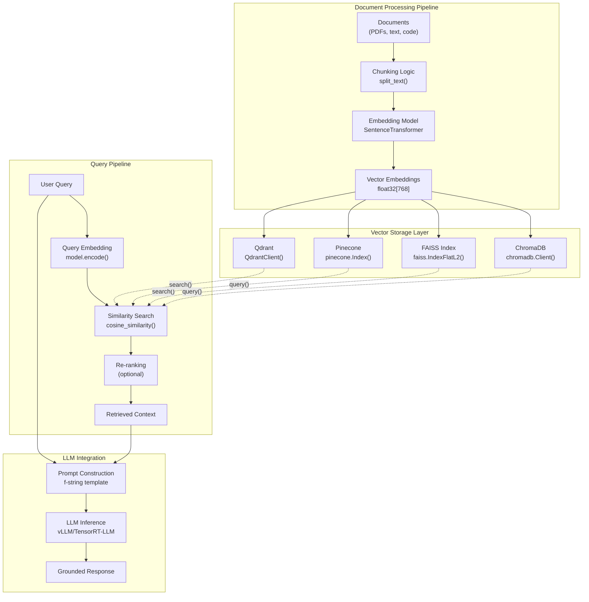
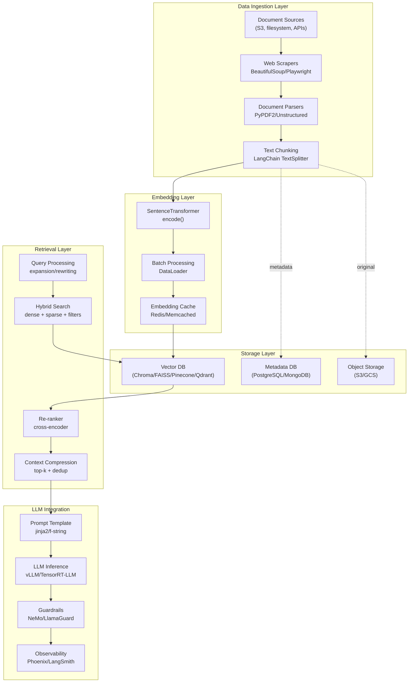

<!-- source: DeepWiki mcp.deepwiki.com · repo zechenzhangAGI/AI-research-SKILLs · page 2.11 RAG & Retrieval Skills · fetched 2026-10-26 -->

# RAG & Retrieval Skills

<details>
<summary>Relevant source files</summary>

The following files were used as context for generating this wiki page:

- [.claude-plugin/marketplace.json](.claude-plugin/marketplace.json)
- [CONTRIBUTING.md](CONTRIBUTING.md)
- [README.md](README.md)
- [demos/README.md](demos/README.md)
- [docs/ROADMAP.md](docs/ROADMAP.md)
- [docs/SKILL_CREATION_GUIDE.md](docs/SKILL_CREATION_GUIDE.md)
- [docs/SKILL_TEMPLATE.md](docs/SKILL_TEMPLATE.md)
- [docs/christmas-tree.svg](docs/christmas-tree.svg)
- [docs/tech-tree.svg](docs/tech-tree.svg)

</details>


## Purpose and Scope

This document covers the five RAG (Retrieval-Augmented Generation) and vector retrieval skills available in the AI Research SKILLs library. These skills provide production-ready guidance for building semantic search, document retrieval, and knowledge-grounded LLM applications using vector databases and embedding models.

**Covered in this document:**
- Vector database implementations (Chroma, FAISS, Pinecone, Qdrant)
- Embedding models and encoding systems (Sentence Transformers)
- Retrieval architectures and query patterns
- Hybrid search and filtering strategies

**Related topics covered elsewhere:**
- For agent frameworks that consume RAG systems, see [Agent Framework Skills](#2.10)
- For LLM serving that provides embeddings APIs, see [Inference & Serving Skills](#2.8)
- For prompt engineering with retrieved context, see [Prompt Engineering & Structured Output Skills](#2.12)

Sources: [README.md:103](), [.claude-plugin/marketplace.json:176-187]()

## RAG System Architecture

RAG systems augment LLM responses with retrieved external knowledge by encoding documents into vector representations, storing them in specialized databases, and performing similarity-based retrieval at query time.


**Diagram: RAG Pipeline Architecture showing document ingestion, vector storage, and retrieval flow**

Sources: [README.md:185-190](), [.claude-plugin/marketplace.json:177-178]()

## Skill Comparison Matrix

The five RAG skills address different deployment constraints and performance requirements. The following table compares their core characteristics:

| Skill | Type | Scale | Performance | Key Features | Use Case |
|-------|------|-------|-------------|--------------|----------|
| **Chroma** | Local/Cloud | Millions | <100ms | SQLite backend, local-first, HTTP API | Development, small-scale production |
| **FAISS** | Library | Billions | <10ms | GPU acceleration, 30+ index types, CPU-optimized | High-throughput batch retrieval |
| **Sentence Transformers** | Model Library | N/A (encoding only) | Varies by model | 5000+ pre-trained models, fine-tuning | Embedding generation for any backend |
| **Pinecone** | Managed Cloud | Billions | <100ms P99 | Auto-scaling, metadata filtering, namespaces | Production with zero ops overhead |
| **Qdrant** | Self-hosted/Cloud | Billions | <50ms | Rust-powered, HNSW, hybrid search with filters | High-performance with complex filtering |

**Key decision factors:**
- **Infrastructure preference**: Local (Chroma, FAISS) vs. Managed (Pinecone) vs. Self-hosted (Qdrant)
- **Scale requirements**: Millions (Chroma) vs. Billions (FAISS, Pinecone, Qdrant)
- **Query complexity**: Simple similarity (FAISS) vs. Hybrid search with filters (Qdrant)
- **Operational overhead**: Zero-ops (Pinecone) vs. Self-managed (Chroma, FAISS, Qdrant)

Sources: [README.md:185-190](), [.claude-plugin/marketplace.json:181-186]()

## Vector Database Core Components

All vector databases share common architectural patterns but differ in implementation details. Understanding these components helps select the right skill for your use case.

```mermaid
graph TB
    subgraph "Chroma Implementation"
        CHROMA_CLIENT["chromadb.Client<br/>persistent_client()"]
        CHROMA_COLL["Collection<br/>get_or_create_collection()"]
        CHROMA_EMBED["EmbeddingFunction<br/>SentenceTransformerEF"]
        CHROMA_META["Metadata Store<br/>SQLite/DuckDB"]
        CHROMA_INDEX["HNSW Index<br/>hnswlib backend"]
    end
    
    subgraph "FAISS Implementation"
        FAISS_INDEX["faiss.Index<br/>IndexFlatL2/IndexIVFPQ"]
        FAISS_GPU["GPU Indices<br/>faiss.index_cpu_to_gpu()"]
        FAISS_QUANT["Quantization<br/>IndexPQ/IndexIVFPQ"]
        FAISS_CLUSTER["Clustering<br/>train() on centroids"]
    end
    
    subgraph "Pinecone Implementation"
        PINE_INDEX["pinecone.Index<br/>serverless/pod-based"]
        PINE_NAMESPACE["Namespaces<br/>logical isolation"]
        PINE_META["Metadata Filtering<br/>$eq/$in/$gte"]
        PINE_SCALE["Auto-scaling<br/>managed by platform"]
    end
    
    subgraph "Qdrant Implementation"
        QDRANT_CLIENT["QdrantClient<br/>http/grpc protocols"]
        QDRANT_COLL["Collection<br/>create_collection()"]
        QDRANT_HNSW["HNSW Config<br/>m/ef_construct params"]
        QDRANT_FILTER["Payload Filtering<br/>must/should/must_not"]
        QDRANT_QUANTIZE["Quantization<br/>scalar/product/binary"]
    end
    
    CHROMA_CLIENT --> CHROMA_COLL
    CHROMA_COLL --> CHROMA_EMBED
    CHROMA_COLL --> CHROMA_META
    CHROMA_COLL --> CHROMA_INDEX
    
    FAISS_INDEX --> FAISS_GPU
    FAISS_INDEX --> FAISS_QUANT
    FAISS_INDEX --> FAISS_CLUSTER
    
    PINE_INDEX --> PINE_NAMESPACE
    PINE_INDEX --> PINE_META
    PINE_INDEX --> PINE_SCALE
    
    QDRANT_CLIENT --> QDRANT_COLL
    QDRANT_COLL --> QDRANT_HNSW
    QDRANT_COLL --> QDRANT_FILTER
    QDRANT_COLL --> QDRANT_QUANTIZE
```


**Diagram: Vector Database Implementation Details mapping skill names to core classes and methods**

**Key implementation patterns:**

**Chroma** (`chromadb.Client`):
- Persistent client via `chromadb.PersistentClient(path="./chroma_db")`
- Collection management with `collection.add(ids=[], embeddings=[], metadatas=[])`
- Built-in embedding functions: `SentenceTransformerEmbeddingFunction(model_name)`
- Query interface: `collection.query(query_embeddings=[], n_results=10)`

**FAISS** (`faiss.Index*`):
- Index types: `IndexFlatL2` (exact), `IndexIVFPQ` (compressed), `IndexHNSW` (HNSW)
- GPU acceleration: `faiss.index_cpu_to_gpu(res, device, cpu_index)`
- Training for IVF indices: `index.train(training_vectors)` before adding
- Search: `distances, indices = index.search(query_vectors, k)`

**Pinecone** (`pinecone.Index`):
- Serverless: Auto-scaling, pay-per-query, cold starts possible
- Pod-based: Reserved capacity, predictable latency, higher cost
- Metadata filters: `filter={"category": {"$eq": "research"}}`
- Namespaces: `index.query(vector=[...], namespace="prod")`

**Qdrant** (`QdrantClient`):
- Collection creation: `create_collection(collection_name, vectors_config=VectorParams(size=768, distance=Distance.COSINE))`
- HNSW tuning: `hnsw_config=HnswConfigDiff(m=16, ef_construct=100)`
- Payload filters: `Filter(must=[FieldCondition(key="year", range=Range(gte=2020))])`
- Hybrid search: Combine vector similarity with payload filtering in single query

Sources: [README.md:185-190]()

## Embedding Pipeline Architecture

Sentence Transformers provides the encoding layer that all vector databases consume. Understanding the encoding pipeline is critical for optimizing RAG performance.

```mermaid
graph LR
    subgraph "Model Selection"
        MTEB["MTEB Leaderboard<br/>benchmark rankings"]
        MODEL_CARD["Model Card<br/>use case requirements"]
        DOMAIN["Domain Specificity<br/>general vs specialized"]
    end
    
    subgraph "SentenceTransformer API"
        LOAD["SentenceTransformer<br/>model = ST(model_name)"]
        ENCODE_SINGLE["encode()<br/>single text"]
        ENCODE_BATCH["encode()<br/>batch processing"]
        NORMALIZE["normalize_embeddings<br/>True/False"]
        POOLING["Pooling Strategy<br/>mean/cls/max"]
    end
    
    subgraph "Optimization Layer"
        PRECISION["Mixed Precision<br/>fp16/bf16"]
        BATCH_SIZE["Batch Size<br/>trade memory/speed"]
        DEVICE["Device Placement<br/>CPU/CUDA/MPS"]
        CACHE["Embedding Cache<br/>redis/memcached"]
    end
    
    subgraph "Output Interface"
        NUMPY["numpy.ndarray<br/>float32[N, D]"]
        TORCH["torch.Tensor<br/>requires_grad=False"]
        NORMALIZE_L2["L2 Normalized<br/>cosine similarity"]
    end
    
    MTEB --> MODEL_CARD
    MODEL_CARD --> DOMAIN
    DOMAIN --> LOAD
    
    LOAD --> ENCODE_SINGLE
    LOAD --> ENCODE_BATCH
    ENCODE_SINGLE --> NORMALIZE
    ENCODE_BATCH --> NORMALIZE
    NORMALIZE --> POOLING
    
    POOLING --> PRECISION
    PRECISION --> BATCH_SIZE
    BATCH_SIZE --> DEVICE
    DEVICE --> CACHE
    
    CACHE --> NUMPY
    CACHE --> TORCH
    NUMPY --> NORMALIZE_L2
    TORCH --> NORMALIZE_L2
```


**Diagram: Sentence Transformers encoding pipeline with model selection, optimization, and output formats**

**Critical encoding parameters:**

**Model selection criteria:**
- **General retrieval**: `all-MiniLM-L6-v2` (384D, fast), `all-mpnet-base-v2` (768D, accuracy)
- **Code search**: `sentence-transformers/all-MiniLM-L6-v2-code-search`
- **Multilingual**: `paraphrase-multilingual-mpnet-base-v2` (50+ languages)
- **Long documents**: `sentence-transformers/LaBSE` (768D, 512 tokens)

**Performance optimization:**
```python
# Batch encoding for throughput
model = SentenceTransformer('all-mpnet-base-v2')
model.encode(
    sentences=text_batch,
    batch_size=32,           # Tune for GPU memory
    show_progress_bar=True,
    normalize_embeddings=True,  # For cosine similarity
    convert_to_numpy=True,
    device='cuda'
)
```

**Dimensionality considerations:**
- 384D models: Faster, lower storage, sufficient for most use cases
- 768D models: Higher accuracy, recommended for critical retrieval
- 1024D+ models: Specialized (e.g., `text-embedding-ada-002` at 1536D)

Sources: [README.md:188](), [.claude-plugin/marketplace.json:185]()

## Skill Deep Dive: Chroma

Chroma is a local-first embedding database designed for development and small-scale production with minimal operational overhead.

**Core API patterns:**

```python
# Persistent client with local storage
import chromadb
client = chromadb.PersistentClient(path="./chroma_db")

# Collection with built-in embedding function
from chromadb.utils import embedding_functions
sentence_transformer_ef = embedding_functions.SentenceTransformerEmbeddingFunction(
    model_name="all-MiniLM-L6-v2"
)

collection = client.get_or_create_collection(
    name="documents",
    embedding_function=sentence_transformer_ef,
    metadata={"hnsw:space": "cosine"}
)

# Add documents with automatic embedding
collection.add(
    ids=["doc1", "doc2"],
    documents=["Document text 1", "Document text 2"],
    metadatas=[{"source": "wiki"}, {"source": "arxiv"}]
)

# Query with natural language (automatic embedding)
results = collection.query(
    query_texts=["search query"],
    n_results=10,
    where={"source": "wiki"}  # Metadata filtering
)
```

**Key features:**
- **SQLite backend**: Single-file database for easy deployment
- **HTTP server mode**: `chroma run --path ./chroma_db --port 8000`
- **Embedding functions**: Built-in support for Sentence Transformers, OpenAI, Cohere
- **Metadata filtering**: Simple `where` clause syntax for filtering
- **HNSW indexing**: Efficient approximate nearest neighbor search

**Deployment patterns:**
- **Development**: Local SQLite file, in-process client
- **Production**: HTTP server with persistent storage, Docker container
- **Cloud**: Chroma Cloud (managed service) for zero-ops deployment

**Limitations:**
- Single-writer constraint (SQLite limitation)
- Performance degrades beyond ~1M vectors
- Limited query optimization compared to specialized databases

Sources: [README.md:186]()

## Skill Deep Dive: FAISS

FAISS (Facebook AI Similarity Search) is a library optimized for billion-scale dense vector similarity search with extensive GPU acceleration support.

**Index type selection:**

```python
import faiss
import numpy as np

# Exact search (baseline)
d = 768  # Dimension
index = faiss.IndexFlatL2(d)  # L2 distance
# OR
index = faiss.IndexFlatIP(d)  # Inner product (cosine after normalization)

# Approximate search with IVF (Inverted File)
nlist = 100  # Number of clusters
quantizer = faiss.IndexFlatL2(d)
index = faiss.IndexIVFFlat(quantizer, d, nlist, faiss.METRIC_L2)
index.train(training_vectors)  # Required for IVF indices

# Compressed search with Product Quantization
m = 8  # Number of subquantizers
nbits = 8  # Bits per subquantizer
index = faiss.IndexPQ(d, m, nbits)
index.train(training_vectors)

# HNSW (Hierarchical Navigable Small World)
M = 32  # Number of connections per layer
index = faiss.IndexHNSWFlat(d, M)
index.hnsw.efConstruction = 40
index.hnsw.efSearch = 16
```

**GPU acceleration:**

```python
# Single GPU
res = faiss.StandardGpuResources()
gpu_index = faiss.index_cpu_to_gpu(res, 0, cpu_index)

# Multi-GPU
ngpus = faiss.get_num_gpus()
cpu_index = faiss.IndexFlatL2(d)
gpu_index = faiss.index_cpu_to_all_gpus(cpu_index, ngpus=ngpus)
```

**Performance characteristics:**

| Index Type | Build Time | Search Speed | Memory Usage | Recall@10 |
|------------|------------|--------------|--------------|-----------|
| `IndexFlatL2` | O(1) | ~10k QPS | 100% | 100% |
| `IndexIVFFlat` | Minutes | ~100k QPS | 100% | 95-98% |
| `IndexIVFPQ` | Minutes | ~200k QPS | 2-5% | 90-95% |
| `IndexHNSWFlat` | Hours | ~50k QPS | 110% | 98-99% |
| GPU `IndexFlatL2` | O(1) | ~1M QPS | 100% | 100% |

**Advanced patterns:**
- **Multi-index search**: Combine multiple indices for different embedding spaces
- **Clustering preprocessing**: Use `faiss.Kmeans` for data partitioning
- **Quantization tuning**: Balance `nbits` and `m` for compression vs accuracy
- **Batched search**: Process queries in batches for GPU efficiency

Sources: [README.md:187]()

## Skill Deep Dive: Sentence Transformers

Sentence Transformers is the de facto standard for encoding text into dense vector embeddings, with over 5000 pre-trained models available on HuggingFace Hub.

**Model ecosystem:**

```python
from sentence_transformers import SentenceTransformer

# General-purpose models
model = SentenceTransformer('all-MiniLM-L6-v2')      # Fast, 384D
model = SentenceTransformer('all-mpnet-base-v2')     # Accurate, 768D
model = SentenceTransformer('all-MiniLM-L12-v2')     # Balanced, 384D

# Specialized models
model = SentenceTransformer('msmarco-distilbert-base-v4')  # Passage retrieval
model = SentenceTransformer('multi-qa-mpnet-base-dot-v1')  # Q&A retrieval
model = SentenceTransformer('paraphrase-multilingual-mpnet-base-v2')  # 50+ languages

# Fine-tuned for specific domains
model = SentenceTransformer('sentence-transformers/allenai-specter')  # Scientific papers
```

**Encoding strategies:**

```python
# Standard encoding
embeddings = model.encode(
    sentences=['Query text', 'Document text'],
    batch_size=32,
    show_progress_bar=True,
    normalize_embeddings=True,  # Essential for cosine similarity
    convert_to_numpy=True
)

# Semantic search optimization
from sentence_transformers import util

query_embedding = model.encode("What is RAG?", convert_to_tensor=True)
doc_embeddings = model.encode(corpus, convert_to_tensor=True)

# Compute cosine similarity
cos_scores = util.cos_sim(query_embedding, doc_embeddings)[0]
top_k = torch.topk(cos_scores, k=5)

# Semantic textual similarity
similarity = util.pytorch_cos_sim(embedding1, embedding2)
```

**Fine-tuning workflow:**

```python
from sentence_transformers import SentenceTransformer, InputExample, losses
from torch.utils.data import DataLoader

# Prepare training data
train_examples = [
    InputExample(texts=['anchor', 'positive'], label=1.0),
    InputExample(texts=['anchor', 'negative'], label=0.0)
]
train_dataloader = DataLoader(train_examples, shuffle=True, batch_size=16)

# Define loss function
train_loss = losses.CosineSimilarityLoss(model)

# Fine-tune
model.fit(
    train_objectives=[(train_dataloader, train_loss)],
    epochs=4,
    warmup_steps=100,
    output_path="./fine_tuned_model"
)
```

**Performance benchmarks (MTEB leaderboard):**

| Model | Avg Score | Retrieval | Clustering | Classification |
|-------|-----------|-----------|------------|----------------|
| `all-mpnet-base-v2` | 63.3 | 50.4 | 47.4 | 72.1 |
| `all-MiniLM-L6-v2` | 58.8 | 42.9 | 41.8 | 68.4 |
| `multi-qa-mpnet-base-dot-v1` | 57.6 | 52.2 | 39.1 | 65.8 |

Sources: [README.md:188]()

## Skill Deep Dive: Pinecone

Pinecone is a fully-managed vector database with automatic scaling, designed for production deployments with zero operational overhead.

**Index configuration:**

```python
import pinecone

# Initialize client
pinecone.init(api_key="YOUR_API_KEY", environment="us-west1-gcp")

# Create serverless index (auto-scaling)
pinecone.create_index(
    name="documents",
    dimension=768,
    metric="cosine",  # or "euclidean", "dotproduct"
    spec=pinecone.ServerlessSpec(
        cloud="aws",
        region="us-east-1"
    )
)

# Create pod-based index (reserved capacity)
pinecone.create_index(
    name="documents",
    dimension=768,
    metric="cosine",
    pods=1,
    pod_type="p1.x1",  # p1.x1, p2.x1, p2.x2, s1.x1, s1.x2
    replicas=2         # For high availability
)
```

**Upsert and query patterns:**

```python
index = pinecone.Index("documents")

# Batch upsert
vectors = [
    ("doc1", embedding1.tolist(), {"category": "research", "year": 2023}),
    ("doc2", embedding2.tolist(), {"category": "blog", "year": 2024})
]
index.upsert(vectors=vectors, namespace="prod")

# Query with metadata filtering
results = index.query(
    vector=query_embedding.tolist(),
    top_k=10,
    namespace="prod",
    filter={
        "category": {"$eq": "research"},
        "year": {"$gte": 2020, "$lte": 2024}
    },
    include_metadata=True
)

# Hybrid search (sparse + dense)
results = index.query(
    vector=dense_embedding.tolist(),
    sparse_vector={"indices": sparse_indices, "values": sparse_values},
    top_k=10,
    alpha=0.5  # Balance between dense and sparse
)
```

**Namespace organization:**

Namespaces provide logical isolation within a single index:
- **Multi-tenancy**: Separate namespace per customer
- **Environment separation**: `dev`, `staging`, `prod` namespaces
- **Data partitioning**: `current`, `archive` for time-based partitioning

**Metadata filtering operators:**

```python
# Equality
filter={"category": {"$eq": "research"}}

# Inequality
filter={"year": {"$ne": 2020}}

# Range
filter={"score": {"$gte": 0.5, "$lte": 1.0}}

# Set membership
filter={"tags": {"$in": ["ml", "ai", "nlp"]}}

# Logical operators
filter={
    "$and": [
        {"category": {"$eq": "research"}},
        {"year": {"$gte": 2020}}
    ]
}
```

**Performance characteristics:**
- Query latency: <100ms P99 (serverless), <50ms P99 (pod-based)
- Throughput: Auto-scales to 100k+ QPS
- Storage: Up to billions of vectors per index
- Availability: 99.95% SLA with replicas

Sources: [README.md:189]()

## Skill Deep Dive: Qdrant

Qdrant is a high-performance vector search engine written in Rust, offering advanced filtering capabilities and hybrid search with optimal performance.

**Collection creation and configuration:**

```python
from qdrant_client import QdrantClient
from qdrant_client.models import Distance, VectorParams, HnswConfigDiff

client = QdrantClient(url="http://localhost:6333")

# Create collection with HNSW configuration
client.create_collection(
    collection_name="documents",
    vectors_config=VectorParams(
        size=768,
        distance=Distance.COSINE  # or DOT, EUCLID, MANHATTAN
    ),
    hnsw_config=HnswConfigDiff(
        m=16,              # Number of edges per node (memory vs speed)
        ef_construct=100,  # Build quality (higher = better recall)
        full_scan_threshold=10000  # Use exact search below this size
    ),
    optimizers_config=OptimizersConfigDiff(
        indexing_threshold=20000,  # Start building HNSW after N vectors
        memmap_threshold=50000     # Use memory-mapped files after N vectors
    )
)
```

**Advanced payload filtering:**

```python
from qdrant_client.models import Filter, FieldCondition, Range, MatchValue

# Upload points with structured payloads
points = [
    {
        "id": 1,
        "vector": embedding1.tolist(),
        "payload": {
            "category": "research",
            "year": 2023,
            "tags": ["ml", "nlp"],
            "metadata": {"author": "John Doe", "citations": 42}
        }
    }
]
client.upsert(collection_name="documents", points=points)

# Complex filtering with logical operators
results = client.search(
    collection_name="documents",
    query_vector=query_embedding.tolist(),
    limit=10,
    query_filter=Filter(
        must=[
            FieldCondition(key="year", range=Range(gte=2020, lte=2024)),
            FieldCondition(key="category", match=MatchValue(value="research"))
        ],
        should=[
            FieldCondition(key="tags", match=MatchValue(any=["ml", "ai"])),
        ],
        must_not=[
            FieldCondition(key="metadata.citations", range=Range(lt=10))
        ]
    )
)
```

**Hybrid search with payload-based scoring:**

```python
# Search with payload scoring (filter + vector similarity)
results = client.search(
    collection_name="documents",
    query_vector=query_embedding.tolist(),
    limit=10,
    score_threshold=0.7,  # Minimum similarity score
    query_filter=Filter(
        must=[
            FieldCondition(key="year", range=Range(gte=2023))
        ]
    ),
    with_payload=True,
    with_vectors=False
)

# Recommendation API (find similar to multiple examples)
results = client.recommend(
    collection_name="documents",
    positive=[1, 2, 3],  # IDs of positive examples
    negative=[4],         # IDs of negative examples
    limit=10,
    query_filter=Filter(...)
)

# Scroll API (iterate through all vectors)
records, next_page_offset = client.scroll(
    collection_name="documents",
    limit=100,
    with_payload=True,
    with_vectors=False
)
```

**Quantization for memory optimization:**

```python
from qdrant_client.models import ScalarQuantization, ScalarQuantizationConfig

# Scalar quantization (reduce precision)
client.update_collection(
    collection_name="documents",
    quantization_config=ScalarQuantization(
        scalar=ScalarQuantizationConfig(
            type="int8",  # or "int4"
            quantile=0.99,
            always_ram=True
        )
    )
)

# Product quantization
from qdrant_client.models import ProductQuantization, ProductQuantizationConfig

client.update_collection(
    collection_name="documents",
    quantization_config=ProductQuantization(
        product=ProductQuantizationConfig(
            compression="x16",  # or "x32", "x64"
            always_ram=True
        )
    )
)
```

**Performance characteristics:**
- Written in Rust with zero-copy operations
- HNSW algorithm with dynamic indexing
- Filtering before vector search (vs. post-filtering in other DBs)
- Horizontal scaling via sharding
- Typical latency: <50ms for 10M+ vectors with complex filters

Sources: [README.md:190]()

## Integration Patterns

RAG skills integrate with other components of the AI research lifecycle to form complete applications.


**Diagram: Complete RAG pipeline integration showing connections to other skill categories**

**Key integration points:**

**With Agent Frameworks** ([Agent Framework Skills](#2.10)):
- LangChain: `VectorStoreRetriever` interface for all vector DBs
- LlamaIndex: `VectorStoreIndex` with query engines
- CrewAI: Tool integration with retrieval capabilities
- AutoGPT: Memory backends using vector databases

**With Inference Engines** ([Inference & Serving Skills](#2.8)):
- vLLM: Batch inference for embedding generation
- TensorRT-LLM: FP8 inference for embedding models
- SGLang: Structured generation with retrieved context

**With Prompt Engineering** ([Prompt Engineering Skills](#2.12)):
- DSPy: Optimized retrieval prompts via `dspy.ChainOfThought`
- Instructor: Structured output from retrieved context
- Outlines: Constrained generation with RAG

**With Observability** ([Observability Skills](#2.9)):
- Phoenix: Trace retrieval quality and latency
- LangSmith: Debug RAG chain performance

Sources: [README.md:103-106](), [.claude-plugin/marketplace.json:176-210]()

## Selection Decision Tree

Choose the right RAG skill based on your deployment requirements and constraints.

**Start here: What is your deployment model?**

**Local Development / Prototyping:**
→ **Chroma** 
- Pros: Zero-ops, single-file database, built-in embeddings
- Cons: Limited scale (<1M vectors), single-writer
- Use when: Building MVPs, local testing, small datasets

**High-Throughput Batch Processing:**
→ **FAISS**
- Pros: Fastest search (1M+ QPS on GPU), 30+ index types, compression
- Cons: No built-in persistence, requires custom metadata handling
- Use when: Offline batch retrieval, research experiments, custom pipelines

**Production with Zero Ops Overhead:**
→ **Pinecone**
- Pros: Fully managed, auto-scaling, 99.95% SLA
- Cons: Cost (pay-per-query), vendor lock-in
- Use when: Production apps, unpredictable traffic, need SLA

**Production with Complex Filtering:**
→ **Qdrant**
- Pros: Advanced filtering, hybrid search, self-hosted control
- Cons: Requires infrastructure management
- Use when: Complex metadata queries, need full control, high-scale requirements

**Embedding Generation (Required for all):**
→ **Sentence Transformers**
- Always required unless using built-in embeddings (Chroma, OpenAI)
- Choose model based on: domain (general/specialized), speed (384D/768D), language support

**Typical multi-skill patterns:**

| Pattern | Skills | Use Case |
|---------|--------|----------|
| **Local RAG** | Sentence Transformers + Chroma | MVP, development, testing |
| **High-throughput research** | Sentence Transformers + FAISS | Batch experiments, benchmarking |
| **Production RAG** | Sentence Transformers + Pinecone | SaaS apps, chatbots |
| **Enterprise RAG** | Sentence Transformers + Qdrant | Self-hosted, complex queries |
| **Hybrid system** | Sentence Transformers + FAISS (cache) + Pinecone (primary) | Performance + scalability |

Sources: [README.md:185-190](), [.claude-plugin/marketplace.json:177-187]()

## Installation and Quick Start

Install RAG skills via Claude Code CLI based on your specific needs:

```bash
# Install all 5 RAG skills
/plugin install rag@ai-research-skills

# Or install individual skills
/plugin install sentence-transformers@ai-research-skills  # Required for encoding
/plugin install chroma@ai-research-skills                 # Local development
/plugin install faiss@ai-research-skills                  # High-throughput
/plugin install pinecone@ai-research-skills               # Managed cloud
/plugin install qdrant@ai-research-skills                 # Self-hosted production
```

**Minimal working example (Sentence Transformers + Chroma):**

```python
from sentence_transformers import SentenceTransformer
import chromadb

# Initialize embedding model
model = SentenceTransformer('all-MiniLM-L6-v2')

# Create Chroma client and collection
client = chromadb.PersistentClient(path="./chroma_db")
collection = client.get_or_create_collection("docs")

# Encode and store documents
docs = ["RAG combines retrieval with generation", "Vector databases enable semantic search"]
embeddings = model.encode(docs, normalize_embeddings=True)
collection.add(ids=["doc1", "doc2"], embeddings=embeddings.tolist(), documents=docs)

# Query
query_embedding = model.encode("What is RAG?", normalize_embeddings=True)
results = collection.query(query_embeddings=[query_embedding.tolist()], n_results=1)
print(results['documents'][0][0])
```

**Each skill's SKILL.md provides:**
- Detailed API documentation with all methods and parameters
- Production deployment patterns and configurations
- Performance optimization techniques
- Troubleshooting guides for common issues
- Integration examples with other frameworks

Sources: [README.md:72-84](), [README.md:103]()

---

