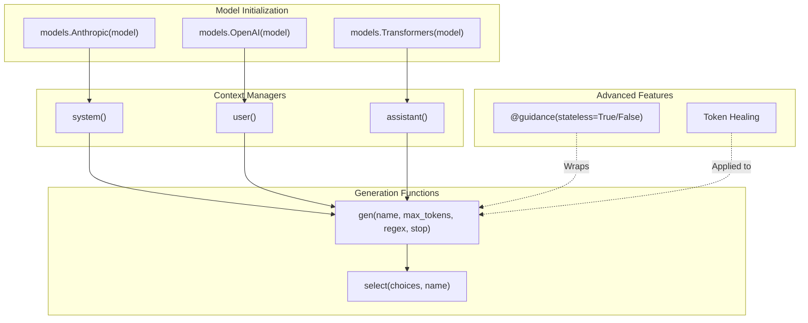
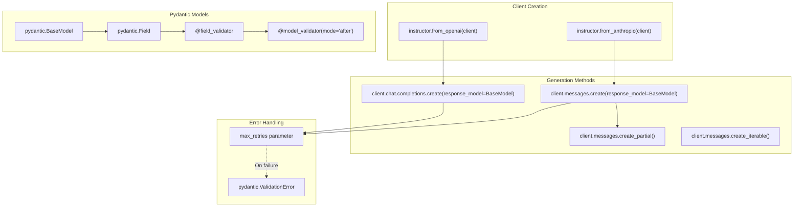
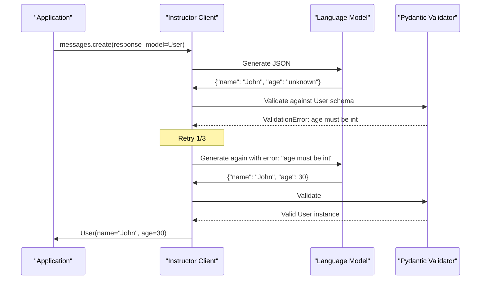
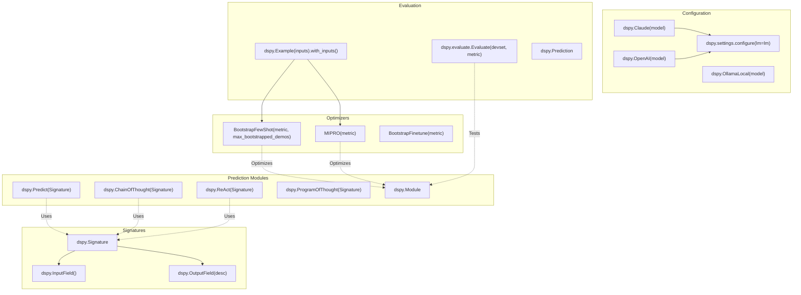
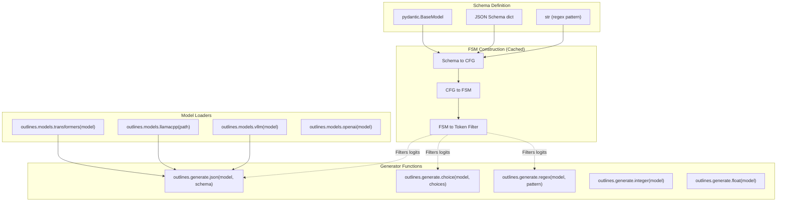
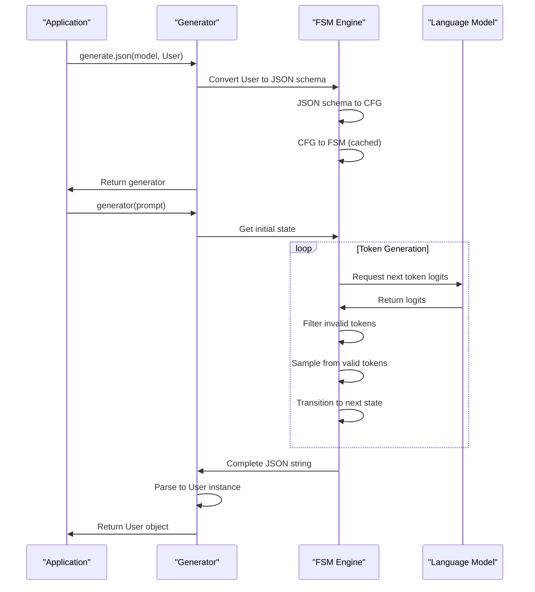
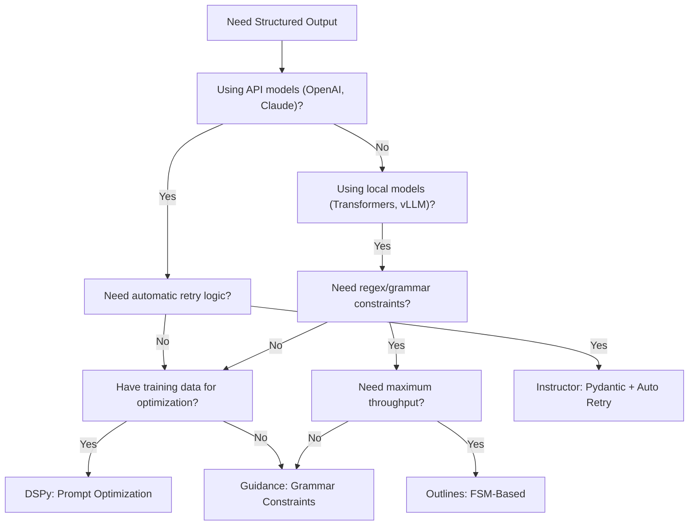

<!-- source: DeepWiki mcp.deepwiki.com · repo zechenzhangAGI/AI-research-SKILLs · page 2.12 Prompt Engineering & Structured Output Skills · fetched 2026-10-26 -->

# Prompt Engineering & Structured Output Skills

<details>
<summary>Relevant source files</summary>

The following files were used as context for generating this wiki page:

- [.claude-plugin/marketplace.json](.claude-plugin/marketplace.json)
- [CONTRIBUTING.md](CONTRIBUTING.md)
- [README.md](README.md)
- [demos/README.md](demos/README.md)
- [docs/ROADMAP.md](docs/ROADMAP.md)
- [docs/SKILL_CREATION_GUIDE.md](docs/SKILL_CREATION_GUIDE.md)
- [docs/SKILL_TEMPLATE.md](docs/SKILL_TEMPLATE.md)
- [docs/christmas-tree.svg](docs/christmas-tree.svg)
- [docs/tech-tree.svg](docs/tech-tree.svg)

</details>


## Purpose and Scope

This category covers four frameworks that ensure LLM outputs conform to specific formats and optimize prompts for reliability: **DSPy** (declarative prompt optimization), **Instructor** (Pydantic validation with retries), **Guidance** (grammar-based constraints), and **Outlines** (FSM-based generation). These frameworks solve the reliability problem in LLM outputs by enforcing structure at different stages of the generation pipeline—from prompt construction to token sampling to post-generation validation.

Together, these skills enable systematic prompt engineering and structured output extraction for production LLM applications. For agent frameworks that consume structured outputs, see [2.10](#2.10). For RAG systems that benefit from structured queries, see [2.11](#2.11).

---

## Problem Space

Unstructured LLM outputs create three core problems:

| Problem | Impact | Solution Approach |
|---------|--------|-------------------|
| **Invalid Format** | JSON parsing errors, malformed XML | Grammar constraints (Guidance, Outlines) |
| **Missing Fields** | Application crashes, incomplete data | Schema validation (Instructor, DSPy) |
| **Wrong Types** | Type errors, data corruption | Type enforcement (all frameworks) |
| **Inconsistent Output** | Brittle downstream processing | Automatic retries (Instructor, DSPy) |

Structured output frameworks intervene at different points in the generation pipeline to prevent these failures.

Sources: [16-prompt-engineering/guidance/SKILL.md:13-21](), [16-prompt-engineering/instructor/SKILL.md:15-21](), [16-prompt-engineering/dspy/SKILL.md:15-21](), [16-prompt-engineering/outlines/SKILL.md:15-21]()

---

## Framework Architecture Comparison

**Framework Architecture: Intervention Points in LLM Generation**

```mermaid
graph TB
    subgraph GenPipeline["Generation Pipeline Stages"]
        Prompt["Prompt Construction"]
        Sampling["Token Sampling"]
        Validation["Output Validation"]
        Retry["Retry on Failure"]
    end
    
    subgraph DSPyArch["DSPy Architecture"]
        DSignature["dspy.Signature"]
        DInputField["dspy.InputField"]
        DOutputField["dspy.OutputField"]
        DPredict["dspy.Predict"]
        DChainOfThought["dspy.ChainOfThought"]
        DBootstrapFewShot["BootstrapFewShot"]
        DMIPRO["MIPRO"]
    end
    
    subgraph InstructorArch["Instructor Architecture"]
        IFromAnthropic["instructor.from_anthropic"]
        IFromOpenAI["instructor.from_openai"]
        IMessagesCreate["client.messages.create"]
        IPydanticModel["pydantic.BaseModel"]
        IFieldValidator["@field_validator"]
        IModelValidator["@model_validator"]
    end
    
    subgraph GuidanceArch["Guidance Architecture"]
        GModelsAnthropic["models.Anthropic"]
        GModelsOpenAI["models.OpenAI"]
        GSystem["system()"]
        GUser["user()"]
        GAssistant["assistant()"]
        GGen["gen(name, regex, stop)"]
        GSelect["select(choices)"]
    end
    
    subgraph OutlinesArch["Outlines Architecture"]
        OModelsTransformers["outlines.models.transformers"]
        OModelsVLLM["outlines.models.vllm"]
        OModelsLlamacpp["outlines.models.llamacpp"]
        OGenerateJSON["outlines.generate.json"]
        OGenerateChoice["outlines.generate.choice"]
        OGenerateRegex["outlines.generate.regex"]
    end
    
    Prompt --> Sampling
    Sampling --> Validation
    Validation -->|"Invalid"| Retry
    Retry --> Prompt
    
    DSignature -.->|"Defines"| Prompt
    DBootstrapFewShot -.->|"Optimizes"| Prompt
    
    IMessagesCreate -.->|"Wraps"| Prompt
    IFieldValidator -.->|"Validates"| Validation
    IModelValidator -.->|"Validates"| Validation
    
    GGen -.->|"Constrains"| Sampling
    GSelect -.->|"Constrains"| Sampling
    
    OGenerateJSON -.->|"FSM Filter"| Sampling
    OGenerateChoice -.->|"FSM Filter"| Sampling
```



**Key Differences:**

- **DSPy**: Pre-generation prompt optimization using `BootstrapFewShot` and `MIPRO` optimizers on training data
- **Instructor**: Post-generation validation with `@field_validator` and `@model_validator`, automatic retry via `max_retries`
- **Guidance**: During-sampling constraints using `gen(regex=...)` and `select(choices)` with token healing
- **Outlines**: Pre-sampling FSM construction from JSON Schema, zero-overhead logit filtering with `outlines.generate.*`

Sources: [16-prompt-engineering/guidance/SKILL.md:71-210](), [16-prompt-engineering/instructor/SKILL.md:86-250](), [16-prompt-engineering/dspy/SKILL.md:88-219](), [16-prompt-engineering/outlines/SKILL.md:81-114]()

---

## Guidance: Grammar-Constrained Generation

### Core Classes and Functions

**Guidance API Structure**



### Key APIs

| API | Purpose | Example |
|-----|---------|---------|
| `models.Anthropic(model)` | Configure Claude models | `lm = models.Anthropic("claude-sonnet-4-5-20250929")` |
| `gen(name, regex)` | Constrained generation | `gen("email", regex=r"[a-z]+@[a-z]+\.[a-z]+")` |
| `select(choices, name)` | Multiple choice | `select(["positive", "negative"], name="sentiment")` |
| `@guidance` decorator | Reusable patterns | `@guidance def extract(lm): ...` |
| `system()`, `user()`, `assistant()` | Chat context | `with user(): lm += "Question"` |

Sources: [16-prompt-engineering/guidance/SKILL.md:54-69](), [16-prompt-engineering/guidance/SKILL.md:73-101](), [16-prompt-engineering/guidance/SKILL.md:264-306]()

### Token Healing Mechanism

Token healing solves boundary artifacts by backing up one token and regenerating:

```
Without healing:
  Prompt: "The capital of France is " [tokenized: "is ", " "]
  Generated: " Paris" [leading space causes double space]
  Result: "The capital of France is  Paris" ❌

With healing:
  1. Back up one token ("is ")
  2. Regenerate from "is"
  3. Result: "The capital of France is Paris" ✅
```

Sources: [16-prompt-engineering/guidance/SKILL.md:151-181]()

### Common Pattern: ReAct Agent

[16-prompt-engineering/guidance/SKILL.md:376-414]() implements a stateful ReAct agent using `@guidance(stateless=False)`:

```python
@guidance(stateless=False)
def react_agent(lm, question):
    tools = {
        "calculator": lambda expr: eval(expr),
        "search": lambda query: f"Search results for: {query}",
    }
    
    for round in range(5):
        # Thought: free generation
        lm += f"Thought: " + gen("thought", stop="\n")
        
        # Action: constrained to tool names
        lm += "Action: " + select(["calculator", "search", "answer"], name="action")
        
        # Execute tool or finish
        if lm["action"] == "answer":
            lm += "\nFinal Answer: " + gen("answer", max_tokens=100)
            break
```

Key features:
- `select()` constrains action to valid tool names
- `gen(stop="\n")` ensures single-line outputs
- Stateful execution maintains conversation history

Sources: [16-prompt-engineering/guidance/SKILL.md:376-414]()

---

## Instructor: Pydantic-Driven Validation

### Core Classes and Functions

**Instructor API Structure**



### Key APIs

| API | Purpose | Example |
|-----|---------|---------|
| `instructor.from_anthropic(client)` | Create Instructor client | `client = instructor.from_anthropic(Anthropic())` |
| `response_model=BaseModel` | Specify output schema | `messages.create(..., response_model=User)` |
| `@field_validator` | Field-level validation | `@field_validator('age') def check_age(cls, v): ...` |
| `@model_validator` | Cross-field validation | `@model_validator(mode='after') def check_dates(self): ...` |
| `max_retries=3` | Retry count | `create(..., max_retries=5)` |
| `create_partial()` | Stream partial results | `for partial in create_partial(...): ...` |

Sources: [16-prompt-engineering/instructor/SKILL.md:42-83](), [16-prompt-engineering/instructor/SKILL.md:336-367]()

### Validation Flow

**Instructor Validation Flow**



The retry loop sends validation errors back to the LLM, allowing it to self-correct.

Sources: [16-prompt-engineering/instructor/SKILL.md:252-278]()

### Custom Validators

[16-prompt-engineering/instructor/SKILL.md:206-228]() shows field-level validation:

```python
from pydantic import field_validator

class Event(BaseModel):
    name: str
    date: str
    attendees: int

    @field_validator('date')
    def validate_date(cls, v):
        """Ensure date is in YYYY-MM-DD format."""
        import re
        if not re.match(r'\d{4}-\d{2}-\d{2}', v):
            raise ValueError('Date must be YYYY-MM-DD format')
        return v

    @field_validator('attendees')
    def validate_attendees(cls, v):
        """Ensure positive attendees."""
        if v < 1:
            raise ValueError('Must have at least 1 attendee')
        return v
```

When validation fails, Instructor includes the `ValueError` message in the retry prompt.

[16-prompt-engineering/instructor/SKILL.md:231-248]() shows model-level validation:

```python
from pydantic import model_validator

class DateRange(BaseModel):
    start_date: str
    end_date: str

    @model_validator(mode='after')
    def check_dates(self):
        """Ensure end_date is after start_date."""
        from datetime import datetime
        start = datetime.strptime(self.start_date, '%Y-%m-%d')
        end = datetime.strptime(self.end_date, '%Y-%m-%d')

        if end < start:
            raise ValueError('end_date must be after start_date')
        return self
```

Sources: [16-prompt-engineering/instructor/SKILL.md:186-248]()

### Streaming Pattern

[16-prompt-engineering/instructor/SKILL.md:284-330]() demonstrates partial streaming:

```python
from instructor import Partial

class Story(BaseModel):
    title: str
    content: str
    tags: list[str]

# Stream partial updates as LLM generates
for partial_story in client.messages.create_partial(
    model="claude-sonnet-4-5-20250929",
    max_tokens=1024,
    messages=[{"role": "user", "content": "Write a short sci-fi story"}],
    response_model=Story
):
    print(f"Title: {partial_story.title}")
    print(f"Content so far: {partial_story.content[:100]}...")
```

Streaming enables real-time UI updates as the model generates structured data.

Sources: [16-prompt-engineering/instructor/SKILL.md:280-330]()

---

## DSPy: Declarative Prompt Programming

### Core Classes and Functions

**DSPy API Structure**



### Key APIs

| API | Purpose | Example |
|-----|---------|---------|
| `dspy.Signature` | Define task structure | `class QA(dspy.Signature): question = dspy.InputField()` |
| `dspy.Predict(Signature)` | Basic prediction | `predictor = dspy.Predict("question -> answer")` |
| `dspy.ChainOfThought(Signature)` | Add reasoning | `cot = dspy.ChainOfThought("question -> answer")` |
| `dspy.Module` | Custom pipeline | `class RAG(dspy.Module): def forward(self, q): ...` |
| `BootstrapFewShot(metric)` | Few-shot optimizer | `optimizer.compile(module, trainset=data)` |
| `dspy.Example` | Training data | `Example(question="...", answer="...").with_inputs("question")` |

Sources: [16-prompt-engineering/dspy/SKILL.md:44-85](), [16-prompt-engineering/dspy/SKILL.md:88-161](), [16-prompt-engineering/dspy/SKILL.md:163-218]()

### Signature Types

**Inline Signature** (quick prototyping):
```python
qa = dspy.Predict("question -> answer")
summarizer = dspy.Predict("text -> summary")
```

**Class Signature** (detailed specification):
```python
class Summarize(dspy.Signature):
    """Summarize text into key points."""
    text = dspy.InputField()
    summary = dspy.OutputField(desc="bullet points, 3-5 items")

summarizer = dspy.ChainOfThought(Summarize)
```

Sources: [16-prompt-engineering/dspy/SKILL.md:88-108]()

### Module Types Comparison

| Module | Reasoning | Use Case | Output Fields |
|--------|-----------|----------|---------------|
| `dspy.Predict` | None | Direct prediction | Output only |
| `dspy.ChainOfThought` | Step-by-step | Complex reasoning | `rationale`, `answer` |
| `dspy.ReAct` | Tool-based | Agent workflows | `thought`, `action`, `answer` |
| `dspy.ProgramOfThought` | Code execution | Math/logic | Code + result |

Sources: [16-prompt-engineering/dspy/SKILL.md:111-161]()

### Multi-Stage Pipeline Pattern

[16-prompt-engineering/dspy/SKILL.md:223-248]() implements a multi-hop QA system:

```python
class MultiHopQA(dspy.Module):
    def __init__(self):
        super().__init__()
        self.retrieve = dspy.Retrieve(k=3)
        self.generate_query = dspy.ChainOfThought("question -> search_query")
        self.generate_answer = dspy.ChainOfThought("context, question -> answer")

    def forward(self, question):
        # Stage 1: Generate search query
        search_query = self.generate_query(question=question).search_query

        # Stage 2: Retrieve context
        passages = self.retrieve(search_query).passages
        context = "\n".join(passages)

        # Stage 3: Generate answer
        answer = self.generate_answer(context=context, question=question).answer
        return dspy.Prediction(answer=answer, context=context)
```

Key concepts:
- `dspy.Module`: Custom pipeline class
- `forward()`: Execution method
- Multiple `dspy.ChainOfThought` modules chained
- `dspy.Prediction`: Return structured output

Sources: [16-prompt-engineering/dspy/SKILL.md:223-248]()

### Optimization with BootstrapFewShot

[16-prompt-engineering/dspy/SKILL.md:163-187]() shows automatic prompt improvement:

```python
from dspy.teleprompt import BootstrapFewShot

# Training data
trainset = [
    dspy.Example(question="What is 2+2?", answer="4").with_inputs("question"),
    dspy.Example(question="What is 3+5?", answer="8").with_inputs("question"),
]

# Define metric
def validate_answer(example, pred, trace=None):
    return example.answer == pred.answer

# Optimize
optimizer = BootstrapFewShot(metric=validate_answer, max_bootstrapped_demos=3)
optimized_qa = optimizer.compile(qa, trainset=trainset)
```

The optimizer:
1. Generates predictions on training data
2. Filters successful examples using metric
3. Creates few-shot prompts from successful traces
4. Returns optimized module with improved prompts

Sources: [16-prompt-engineering/dspy/SKILL.md:163-187]()

### RAG with Optimization

[16-prompt-engineering/dspy/SKILL.md:251-281]() combines retrieval and optimization:

```python
from dspy.retrieve.chromadb_rm import ChromadbRM

# Configure retriever
retriever = ChromadbRM(
    collection_name="documents",
    persist_directory="./chroma_db"
)

class RAG(dspy.Module):
    def __init__(self, num_passages=3):
        super().__init__()
        self.retrieve = dspy.Retrieve(k=num_passages)
        self.generate = dspy.ChainOfThought("context, question -> answer")

    def forward(self, question):
        context = self.retrieve(question).passages
        return self.generate(context=context, question=question)

# Optimize retrieval and generation jointly
optimizer = BootstrapFewShot(metric=validate_answer)
optimized_rag = optimizer.compile(rag, trainset=trainset)
```

Sources: [16-prompt-engineering/dspy/SKILL.md:251-281]()

---

## Outlines: FSM-Based Generation

### Core Classes and Functions

**Outlines API Structure**



### Key APIs

| API | Purpose | Example |
|-----|---------|---------|
| `outlines.models.transformers(model)` | Load HF model | `model = outlines.models.transformers("Phi-3-mini")` |
| `outlines.generate.json(model, schema)` | JSON generation | `generator = outlines.generate.json(model, User)` |
| `outlines.generate.choice(model, choices)` | Classification | `generator = outlines.generate.choice(model, ["yes", "no"])` |
| `outlines.generate.regex(model, pattern)` | Pattern matching | `generator = outlines.generate.regex(model, r"\d{3}-\d{3}-\d{4}")` |
| `outlines.models.vllm(model)` | High-throughput | `model = outlines.models.vllm("Llama-3.1-8B")` |

Sources: [16-prompt-engineering/outlines/SKILL.md:40-78](), [16-prompt-engineering/outlines/SKILL.md:117-174](), [16-prompt-engineering/outlines/SKILL.md:177-229]()

### FSM Construction Pipeline

**Outlines FSM Construction Pipeline**



The FSM is compiled once per schema and cached. Token filtering happens at each step with zero overhead.

Sources: [16-prompt-engineering/outlines/SKILL.md:81-114]()

### Backend Configuration Comparison

| Backend | API | Use Case | Example |
|---------|-----|----------|---------|
| Transformers | `outlines.models.transformers()` | Local development | [16-prompt-engineering/outlines/SKILL.md:179-192]() |
| llama.cpp | `outlines.models.llamacpp()` | CPU/GPU inference | [16-prompt-engineering/outlines/SKILL.md:195-204]() |
| vLLM | `outlines.models.vllm()` | Production serving | [16-prompt-engineering/outlines/SKILL.md:207-217]() |
| OpenAI | `outlines.models.openai()` | API access | [16-prompt-engineering/outlines/SKILL.md:220-229]() |

**Transformers Backend**:
```python
model = outlines.models.transformers(
    "microsoft/Phi-3-mini-4k-instruct",
    device="cuda",
    model_kwargs={"torch_dtype": "float16"}
)
```

**vLLM Backend** (production):
```python
model = outlines.models.vllm(
    "meta-llama/Llama-3.1-70B-Instruct",
    tensor_parallel_size=4  # Multi-GPU
)
```

Sources: [16-prompt-engineering/outlines/SKILL.md:454-510]()

### Pydantic Model Support

[16-prompt-engineering/outlines/SKILL.md:235-293]() demonstrates automatic schema translation:

```python
from pydantic import BaseModel, Field

class Article(BaseModel):
    title: str = Field(description="Article title")
    author: str = Field(description="Author name")
    word_count: int = Field(description="Number of words", gt=0)
    tags: list[str] = Field(description="List of tags")

model = outlines.models.transformers("microsoft/Phi-3-mini-4k-instruct")
generator = outlines.generate.json(model, Article)

article = generator("Generate article about AI")
```

The generator:
1. Extracts JSON schema from `Article`
2. Converts schema to CFG
3. Builds FSM from CFG
4. Filters tokens during generation
5. Parses result into `Article` instance

Supports:
- Nested models
- Optional fields
- Enums and Literals
- Field constraints (gt, ge, lt, le, min_length, max_length)

Sources: [16-prompt-engineering/outlines/SKILL.md:232-293]()

### Classification Pattern

[16-prompt-engineering/outlines/SKILL.md:327-350]() shows multi-class classification:

```python
from typing import Literal

# Binary classification
generator = outlines.generate.choice(model, ["spam", "not_spam"])
result = generator("Email: Buy now! 50% off!")

# Multi-class classification
categories = ["technology", "business", "sports", "entertainment"]
category_gen = outlines.generate.choice(model, categories)
category = category_gen("Article: Apple announces new iPhone...")

# With confidence
class Classification(BaseModel):
    label: Literal["positive", "negative", "neutral"]
    confidence: float

classifier = outlines.generate.json(model, Classification)
result = classifier("Review: This product is okay, nothing special")
```

Sources: [16-prompt-engineering/outlines/SKILL.md:327-350]()

---

## Framework Comparison Matrix

### Constraint Mechanisms

| Framework | Constraint Method | Stage | Overhead |
|-----------|------------------|-------|----------|
| **Guidance** | Regex/Grammar → Token filtering | During sampling | Low |
| **Instructor** | Pydantic validation → Retry | Post-generation | Medium |
| **DSPy** | Few-shot examples → Prompt optimization | Pre-generation | None at runtime |
| **Outlines** | JSON Schema → FSM → Logit filtering | During sampling | Zero |

Sources: [16-prompt-engineering/guidance/SKILL.md:542-558](), [16-prompt-engineering/instructor/SKILL.md:705-726](), [16-prompt-engineering/dspy/SKILL.md:554-575](), [16-prompt-engineering/outlines/SKILL.md:622-638]()

### Model Backend Support

| Backend | Guidance | Instructor | DSPy | Outlines |
|---------|----------|------------|------|----------|
| **OpenAI** | ✅ Full | ✅ Full | ✅ Full | ⚠️ Limited |
| **Anthropic Claude** | ✅ Full | ✅ Full | ✅ Full | ❌ No |
| **Transformers (local)** | ✅ Full | ⚠️ Limited | ✅ Full | ✅ Full |
| **llama.cpp** | ✅ Full | ❌ No | ❌ No | ✅ Full |
| **vLLM** | ❌ No | ❌ No | ❌ No | ✅ Full |
| **Ollama** | ❌ No | ✅ Via OpenAI API | ✅ Full | ✅ Via OpenAI API |

Sources: [16-prompt-engineering/guidance/SKILL.md:264-306](), [16-prompt-engineering/instructor/SKILL.md:336-388](), [16-prompt-engineering/dspy/SKILL.md:285-333](), [16-prompt-engineering/outlines/SKILL.md:177-229]()

### Feature Comparison

| Feature | Guidance | Instructor | DSPy | Outlines |
|---------|----------|------------|------|----------|
| **Regex Constraints** | ✅ Yes | ❌ No | ❌ No | ✅ Yes |
| **Grammar Support** | ✅ CFG | ❌ No | ❌ No | ✅ CFG |
| **Pydantic Validation** | ❌ No | ✅ Yes | ⚠️ TypedPredictor | ✅ Yes |
| **Automatic Retry** | ❌ No | ✅ Yes | ⚠️ Via optimizer | ❌ No |
| **Token Healing** | ✅ Yes | ❌ No | ❌ No | ✅ Fast-forward |
| **Prompt Optimization** | ❌ No | ❌ No | ✅ Yes | ❌ No |
| **Streaming** | ❌ No | ✅ Yes | ❌ No | ❌ No |
| **Multi-Provider** | ✅ Yes | ✅ Yes | ✅ Yes | ⚠️ Limited |
| **Zero Overhead** | ⚠️ Low | ❌ No | ✅ After optimization | ✅ Yes |

Sources: [16-prompt-engineering/guidance/SKILL.md:517-541](), [16-prompt-engineering/instructor/SKILL.md:705-726](), [16-prompt-engineering/dspy/SKILL.md:554-575](), [16-prompt-engineering/outlines/SKILL.md:598-621]()

### Performance Characteristics

| Metric | Guidance | Instructor | DSPy | Outlines |
|--------|----------|------------|------|----------|
| **Latency** | 30-50% faster than prompting | +10-50% due to retries | Same as baseline | 1.2-2x faster |
| **Token Efficiency** | High (no invalid tokens) | Low (retries waste tokens) | Improves over time | High (no invalid tokens) |
| **First-time Setup** | None | None | Requires training data | Schema compilation (cached) |
| **Memory Overhead** | Minimal | Minimal | Minimal | FSM cache per schema |
| **Throughput** | Good | Variable | Good | Excellent (vLLM) |

Sources: [16-prompt-engineering/guidance/SKILL.md:542-558](), [16-prompt-engineering/instructor/SKILL.md:599-638](), [16-prompt-engineering/dspy/SKILL.md:436-481](), [16-prompt-engineering/outlines/SKILL.md:622-638]()

---

## Decision Tree: Choosing a Framework

**Framework Selection Decision Tree**



### Use Case Matrix

| Use Case | Best Framework | Reasoning |
|----------|---------------|-----------|
| **Data extraction from API** | Instructor | Automatic retry, Pydantic validation, API support |
| **Local model with strict format** | Outlines | FSM guarantees, vLLM throughput, zero overhead |
| **Complex multi-step agents** | Guidance | Control flow, tool use, stateful execution |
| **Improving prompts systematically** | DSPy | Optimization with training data, portable across models |
| **Email/phone validation** | Guidance or Outlines | Regex constraints enforce exact patterns |
| **Classification tasks** | Instructor or Outlines | Type-safe enums, multiple choice |
| **RAG systems** | DSPy | Joint optimization of retrieval and generation |
| **Streaming UI updates** | Instructor | Partial result streaming |

Sources: [16-prompt-engineering/guidance/SKILL.md:530-541](), [16-prompt-engineering/instructor/SKILL.md:716-726](), [16-prompt-engineering/dspy/SKILL.md:565-575](), [16-prompt-engineering/outlines/SKILL.md:610-621]()

---

## Integration Patterns

### Pattern 1: Cascade Validation (Instructor + Custom)

Combine Pydantic validation with application-level checks:

```python
class User(BaseModel):
    username: str = Field(pattern=r"^[a-z0-9_]{3,20}$")
    email: EmailStr
    age: int = Field(ge=18, le=120)

# Instructor validates schema
user = client.messages.create(
    model="claude-sonnet-4-5-20250929",
    max_tokens=1024,
    messages=[{"role": "user", "content": "Extract user..."}],
    response_model=User,
    max_retries=3
)

# Application-level validation
def check_user_exists(username: str) -> bool:
    # Check database
    return db.query(User).filter_by(username=username).exists()

if check_user_exists(user.username):
    raise ValueError(f"Username {user.username} already taken")
```

Sources: [16-prompt-engineering/instructor/SKILL.md:186-228]()

### Pattern 2: DSPy + Guidance (Optimization + Constraints)

Use DSPy for prompt optimization, Guidance for format enforcement:

```python
# DSPy optimized module
class OptimizedExtractor(dspy.Module):
    def __init__(self):
        super().__init__()
        self.extract = dspy.ChainOfThought("text -> json_string")
    
    def forward(self, text):
        return self.extract(text=text)

# Optimize with training data
optimizer = BootstrapFewShot(metric=validate_extraction)
optimized = optimizer.compile(OptimizedExtractor(), trainset=data)

# Use Guidance for final format enforcement
lm = models.Anthropic("claude-sonnet-4-5-20250929")
with user():
    lm += optimized(text=input_text).json_string

with assistant():
    lm += gen("validated_json", regex=r'\{[^}]+\}')
```

Sources: [16-prompt-engineering/dspy/SKILL.md:163-187](), [16-prompt-engineering/guidance/SKILL.md:106-124]()

### Pattern 3: Multi-Model Pipeline (Outlines + Instructor)

Use Outlines for fast local classification, Instructor for API refinement:

```python
# Step 1: Fast local classification with Outlines
local_model = outlines.models.transformers("Phi-3-mini-4k-instruct")
classifier = outlines.generate.choice(
    local_model, 
    ["needs_expert", "simple_query"]
)
category = classifier(f"Classify: {user_input}")

# Step 2: If complex, use Claude via Instructor
if category == "needs_expert":
    client = instructor.from_anthropic(Anthropic())
    
    class DetailedAnalysis(BaseModel):
        reasoning: str
        answer: str
        confidence: float
    
    result = client.messages.create(
        model="claude-sonnet-4-5-20250929",
        max_tokens=2048,
        messages=[{"role": "user", "content": user_input}],
        response_model=DetailedAnalysis
    )
```

Sources: [16-prompt-engineering/outlines/SKILL.md:117-131](), [16-prompt-engineering/instructor/SKILL.md:336-351]()

### Pattern 4: Guidance ReAct + DSPy Optimization

Optimize ReAct agent prompts with DSPy, execute with Guidance constraints:

```python
# Define DSPy signature for ReAct
class AgentStep(dspy.Signature):
    """Agent reasoning step with tool use."""
    context = dspy.InputField()
    thought = dspy.OutputField(desc="reasoning about next action")
    action = dspy.OutputField(desc="tool name or 'answer'")
    
# Create DSPy module
agent_module = dspy.ChainOfThought(AgentStep)

# Optimize with training traces
optimizer = BootstrapFewShot(metric=validate_agent_trace)
optimized_agent = optimizer.compile(agent_module, trainset=traces)

# Execute with Guidance for tool name constraints
lm = models.Anthropic("claude-sonnet-4-5-20250929")

for step in range(5):
    # Use optimized prompt
    result = optimized_agent(context=context)
    
    # Enforce tool names with Guidance
    lm += "Action: " + select(["calculator", "search", "answer"], name="action")
    
    if lm["action"] == "answer":
        break
```

Sources: [16-prompt-engineering/dspy/SKILL.md:137-161](), [16-prompt-engineering/guidance/SKILL.md:376-414]()

---

## Common Pitfalls and Solutions

### Pitfall 1: Over-Constrained Schemas

**Problem**: Pydantic/JSON schemas too strict, LLM cannot satisfy.

```python
# ❌ Too strict
class Person(BaseModel):
    name: str = Field(pattern=r"^[A-Z][a-z]+ [A-Z][a-z]+$")  # Only "John Doe" format
    age: int = Field(ge=18, le=65)  # Excludes children and elderly

# ✅ Better
class Person(BaseModel):
    name: str = Field(min_length=2, max_length=100)  # Accept variations
    age: int = Field(ge=0, le=120)  # Reasonable bounds
```

**Solution**: Start with loose constraints, tighten based on failures.

Sources: [16-prompt-engineering/instructor/SKILL.md:641-703](), [16-prompt-engineering/outlines/SKILL.md:512-547]()

### Pitfall 2: Infinite Retry Loops (Instructor)

**Problem**: Validation always fails, max_retries exhausted.

```python
class StrictData(BaseModel):
    value: int = Field(ge=1000000)  # Very high minimum

# If LLM cannot extract million+ values, retries fail
try:
    result = client.messages.create(
        model="claude-sonnet-4-5-20250929",
        max_tokens=1024,
        messages=[{"role": "user", "content": "Extract: value is 50"}],
        response_model=StrictData,
        max_retries=3
    )
except ValidationError:
    # All retries failed
    print("Could not satisfy constraints")
```

**Solution**: Set reasonable max_retries, catch ValidationError, provide fallback.

Sources: [16-prompt-engineering/instructor/SKILL.md:598-617]()

### Pitfall 3: FSM Compilation Overhead (Outlines)

**Problem**: First call slow due to schema → FSM compilation.

```python
# ❌ Compile FSM on every request
def extract(text: str):
    model = outlines.models.transformers("Phi-3-mini")
    generator = outlines.generate.json(model, ComplexSchema)  # Slow!
    return generator(text)

# ✅ Compile once, reuse
model = outlines.models.transformers("Phi-3-mini")
generator = outlines.generate.json(model, ComplexSchema)  # Cached

def extract(text: str):
    return generator(text)  # Fast
```

**Solution**: Instantiate generators once at module level, reuse across requests.

Sources: [16-prompt-engineering/outlines/SKILL.md:622-638]()

### Pitfall 4: Missing Training Data (DSPy)

**Problem**: Cannot optimize without representative training examples.

```python
# ❌ Not enough data
trainset = [
    dspy.Example(question="Q1", answer="A1").with_inputs("question")
]

optimizer = BootstrapFewShot(metric=exact_match)
optimized = optimizer.compile(module, trainset=trainset)  # Poor optimization

# ✅ Diverse training set
trainset = [
    dspy.Example(question="factual", answer="...").with_inputs("question"),
    dspy.Example(question="reasoning", answer="...").with_inputs("question"),
    dspy.Example(question="calculation", answer="...").with_inputs("question"),
    # ... 20+ examples covering different question types
]
```

**Solution**: Collect 20-100 diverse examples, validate optimizer improves metric.

Sources: [16-prompt-engineering/dspy/SKILL.md:484-526]()

---

## Resources

### Documentation

- **Guidance**: https://guidance.readthedocs.io
- **Instructor**: https://python.useinstructor.com
- **DSPy**: https://dspy.ai
- **Outlines**: https://outlines-dev.github.io/outlines

### GitHub Repositories

- Guidance: https://github.com/guidance-ai/guidance (18k+ stars)
- Instructor: https://github.com/jxnl/instructor (15k+ stars)
- DSPy: https://github.com/stanfordnlp/dspy (22k+ stars)
- Outlines: https://github.com/outlines-dev/outlines (8k+ stars)

### Reference Materials

See skill documentation for comprehensive examples:
- [16-prompt-engineering/guidance/references/]()
- [16-prompt-engineering/instructor/references/]()
- [16-prompt-engineering/dspy/references/]()
- [16-prompt-engineering/outlines/references/]()

Sources: [16-prompt-engineering/guidance/SKILL.md:559-571](), [16-prompt-engineering/instructor/SKILL.md:727-739](), [16-prompt-engineering/dspy/SKILL.md:576-589](), [16-prompt-engineering/outlines/SKILL.md:639-651]()

---

