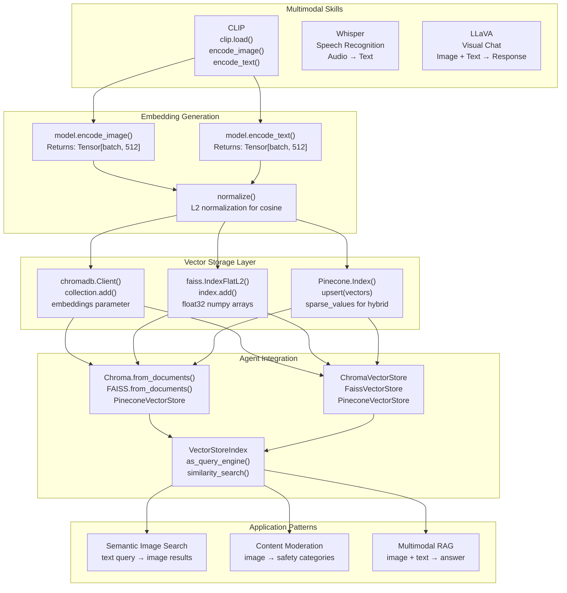
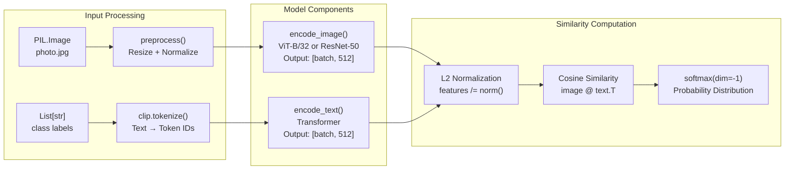
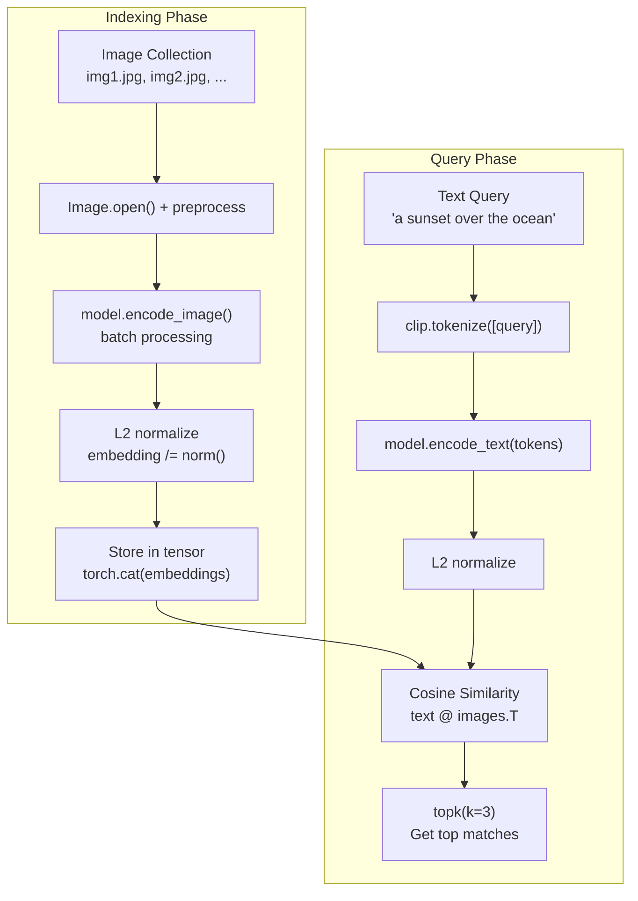
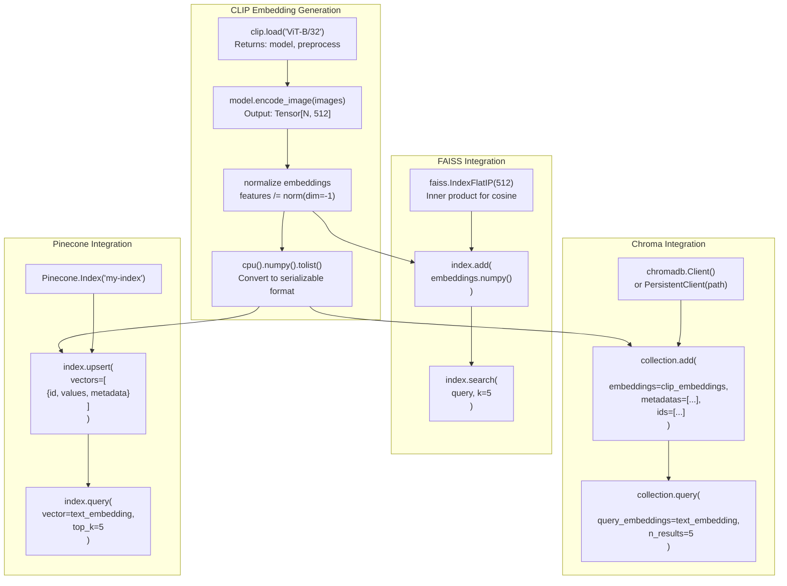
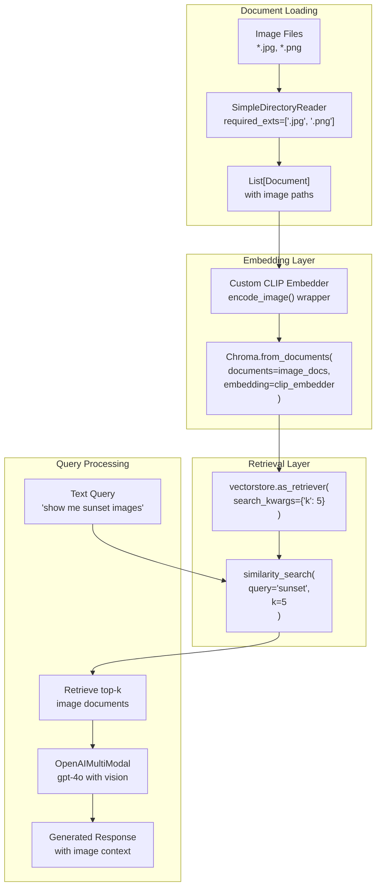
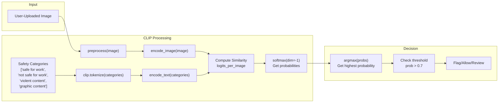

<!-- source: DeepWiki mcp.deepwiki.com · repo zechenzhangAGI/AI-research-SKILLs · page 2.13 Multimodal Skills · fetched 2026-10-26 -->

# Multimodal Capabilities

<details>
<summary>Relevant source files</summary>

The following files were used as context for generating this wiki page:

- [.claude-plugin/marketplace.json](.claude-plugin/marketplace.json)
- [CONTRIBUTING.md](CONTRIBUTING.md)
- [README.md](README.md)
- [demos/README.md](demos/README.md)
- [docs/ROADMAP.md](docs/ROADMAP.md)
- [docs/SKILL_CREATION_GUIDE.md](docs/SKILL_CREATION_GUIDE.md)
- [docs/SKILL_TEMPLATE.md](docs/SKILL_TEMPLATE.md)
- [docs/christmas-tree.svg](docs/christmas-tree.svg)
- [docs/tech-tree.svg](docs/tech-tree.svg)

</details>


This document covers multimodal AI skills that enable cross-modal understanding and retrieval across vision, language, and audio. These skills allow AI research agents to work with images, text, and speech in unified embedding spaces, enabling zero-shot classification, semantic search, and multimodal RAG applications.

For general agent frameworks and RAG systems that can consume multimodal data, see [Agent Frameworks](#3.5.1) and [RAG and Vector Stores](#3.5.2). For structured output from multimodal models, see [Structured Output Frameworks](#3.5.3).

## Overview

The multimodal skills library provides three core capabilities:

| Skill | Modalities | Primary Use Case | Key Metric |
|-------|-----------|------------------|------------|
| **CLIP** | Vision + Language | Zero-shot image classification, semantic search | 25,300+ GitHub stars, 400M training pairs |
| **Whisper** | Audio → Text | Speech recognition, transcription | State-of-the-art ASR accuracy |
| **LLaVA** | Vision + Language → Language | Visual question answering, image chat | Multimodal conversation |

These skills integrate with vector databases ([Chroma](#3.5.2), [FAISS](#3.5.2), [Pinecone](#3.5.2)) and agent frameworks ([LangChain](#3.5.1), [LlamaIndex](#3.5.1)) to enable multimodal RAG pipelines.

**Sources:** [18-multimodal/clip/SKILL.md:1-254]()

## Multimodal Skills Architecture



**Sources:** [18-multimodal/clip/SKILL.md:1-254](), [15-rag/chroma/SKILL.md:196-218](), [15-rag/faiss/SKILL.md:160-194](), [15-rag/pinecone/SKILL.md:238-261]()

## CLIP - Contrastive Language-Image Pre-Training

CLIP is OpenAI's vision-language model that learns visual concepts from natural language supervision. Trained on 400 million image-text pairs, it enables zero-shot image classification without fine-tuning.

### Core Architecture



### Model Loading and Basic Usage

The `clip.load()` function returns both the model and preprocessing pipeline:

```python
import clip

model, preprocess = clip.load("ViT-B/32", device=device)
```

**Available models** ([18-multimodal/clip/SKILL.md:77-97]()):

| Model | Parameters | Architecture | Use Case |
|-------|-----------|--------------|----------|
| `RN50` | 102M | ResNet-50 | Fast inference |
| `ViT-B/32` | 151M | Vision Transformer | Recommended default |
| `ViT-B/16` | 151M | Vision Transformer | Better quality |
| `ViT-L/14` | 428M | Vision Transformer | Best quality |

### Zero-Shot Classification

CLIP performs classification without training by computing similarity between image embeddings and text embeddings:

```python
# Load and preprocess image
image = preprocess(Image.open("photo.jpg")).unsqueeze(0).to(device)

# Define possible labels
text = clip.tokenize(["a dog", "a cat", "a bird", "a car"]).to(device)

# Compute features
with torch.no_grad():
    image_features = model.encode_image(image)
    text_features = model.encode_text(text)
    
    # Compute similarity
    logits_per_image, logits_per_text = model(image, text)
    probs = logits_per_image.softmax(dim=-1).cpu().numpy()
```

The `model()` forward pass internally computes `(image_features @ text_features.T) * temperature` ([18-multimodal/clip/SKILL.md:45-75]()).

**Sources:** [18-multimodal/clip/SKILL.md:36-97]()

### Embedding Normalization for Cosine Similarity

CLIP embeddings must be normalized for proper cosine similarity computation:

```python
# Generate embeddings
image_features = model.encode_image(image)
text_features = model.encode_text(text)

# Normalize to unit vectors
image_features /= image_features.norm(dim=-1, keepdim=True)
text_features /= text_features.norm(dim=-1, keepdim=True)

# Cosine similarity (dot product of normalized vectors)
similarity = (image_features @ text_features.T).item()
```

This normalization is critical for integration with vector databases that expect normalized embeddings for cosine distance metrics ([18-multimodal/clip/SKILL.md:98-112]()).

**Sources:** [18-multimodal/clip/SKILL.md:98-143]()

### Semantic Image Search

CLIP enables text-to-image search by indexing image embeddings and querying with text:



Implementation pattern ([18-multimodal/clip/SKILL.md:114-143]()):

```python
# Index images
image_embeddings = []
for img_path in image_paths:
    image = preprocess(Image.open(img_path)).unsqueeze(0).to(device)
    with torch.no_grad():
        embedding = model.encode_image(image)
        embedding /= embedding.norm(dim=-1, keepdim=True)
    image_embeddings.append(embedding)

image_embeddings = torch.cat(image_embeddings)

# Search with text
query = "a sunset over the ocean"
text_embedding = model.encode_text(clip.tokenize([query]).to(device))
text_embedding /= text_embedding.norm(dim=-1, keepdim=True)

similarities = (text_embedding @ image_embeddings.T).squeeze(0)
top_k = similarities.topk(3)
```

**Sources:** [18-multimodal/clip/SKILL.md:114-143]()

## Vector Database Integration

CLIP embeddings integrate with all major vector databases for persistent storage and efficient retrieval.

### Integration Architecture



### Chroma Integration

Chroma stores CLIP embeddings with metadata for filtered retrieval:

```python
import chromadb
import clip

# Generate CLIP embeddings
model, preprocess = clip.load("ViT-B/32")
image_embeddings = []
for img_path in image_paths:
    image = preprocess(Image.open(img_path)).unsqueeze(0)
    embedding = model.encode_image(image)
    embedding /= embedding.norm(dim=-1, keepdim=True)
    image_embeddings.append(embedding.cpu().numpy().tolist())

# Store in Chroma
client = chromadb.Client()
collection = client.create_collection("image_embeddings")

collection.add(
    embeddings=image_embeddings,
    metadatas=[{"path": path} for path in image_paths],
    ids=image_paths
)

# Query with text
text_embedding = model.encode_text(clip.tokenize(["query"]))
results = collection.query(
    query_embeddings=[text_embedding.cpu().numpy().tolist()],
    n_results=5
)
```

The `collection.add()` method accepts pre-computed embeddings, bypassing Chroma's default embedding function ([18-multimodal/clip/SKILL.md:194-218](), [15-rag/chroma/SKILL.md:104-124]()).

### FAISS Integration

FAISS provides high-performance similarity search for CLIP embeddings. Use `IndexFlatIP` (inner product) for normalized embeddings:

```python
import faiss
import numpy as np

# Create FAISS index for cosine similarity
d = 512  # CLIP embedding dimension
index = faiss.IndexFlatIP(d)  # Inner product (cosine if normalized)

# Add normalized CLIP embeddings
embeddings_np = np.vstack([e.cpu().numpy() for e in image_embeddings])
index.add(embeddings_np.astype('float32'))

# Search
text_embedding = model.encode_text(clip.tokenize(["sunset"]))
text_embedding /= text_embedding.norm(dim=-1, keepdim=True)
distances, indices = index.search(text_embedding.cpu().numpy(), k=5)
```

FAISS requires `float32` numpy arrays. The `IndexFlatIP` performs exact inner product search, equivalent to cosine similarity for normalized vectors ([18-multimodal/clip/SKILL.md:194-218](), [15-rag/faiss/SKILL.md:73-83]()).

### Pinecone Integration

Pinecone's managed service scales CLIP embeddings to billions of vectors:

```python
from pinecone import Pinecone, ServerlessSpec

# Initialize Pinecone
pc = Pinecone(api_key="your-api-key")
pc.create_index(
    name="clip-images",
    dimension=512,
    metric="cosine",
    spec=ServerlessSpec(cloud="aws", region="us-east-1")
)

index = pc.Index("clip-images")

# Upsert CLIP embeddings
vectors = [
    {
        "id": img_path,
        "values": embedding.cpu().numpy().tolist(),
        "metadata": {"path": img_path, "category": "nature"}
    }
    for img_path, embedding in zip(image_paths, image_embeddings)
]

index.upsert(vectors=vectors, batch_size=100)

# Query
text_embedding = model.encode_text(clip.tokenize(["ocean sunset"]))
results = index.query(
    vector=text_embedding.cpu().numpy().tolist(),
    top_k=5,
    include_metadata=True
)
```

Pinecone's `metric="cosine"` expects normalized embeddings ([18-multimodal/clip/SKILL.md:194-218](), [15-rag/pinecone/SKILL.md:44-77]()).

**Sources:** [18-multimodal/clip/SKILL.md:194-218](), [15-rag/chroma/SKILL.md:49-218](), [15-rag/faiss/SKILL.md:48-159](), [15-rag/pinecone/SKILL.md:44-234]()

## Agent Framework Integration

LangChain and LlamaIndex provide high-level abstractions for multimodal RAG with CLIP embeddings.

### LangChain Multimodal RAG



LangChain's `Chroma.from_documents()` accepts custom embedding functions for CLIP:

```python
from langchain_chroma import Chroma
from langchain.schema import Document

# Create custom CLIP embedding function
class CLIPEmbeddings:
    def __init__(self, model):
        self.model = model
    
    def embed_documents(self, texts):
        tokens = clip.tokenize(texts)
        with torch.no_grad():
            embeddings = self.model.encode_text(tokens)
            embeddings /= embeddings.norm(dim=-1, keepdim=True)
        return embeddings.cpu().numpy().tolist()
    
    def embed_query(self, text):
        return self.embed_documents([text])[0]

# Create vector store with CLIP
clip_model, _ = clip.load("ViT-B/32")
vectorstore = Chroma.from_documents(
    documents=image_documents,
    embedding=CLIPEmbeddings(clip_model),
    persist_directory="./clip_db"
)

# Query
results = vectorstore.similarity_search("ocean sunset", k=5)
```

The `embed_documents()` and `embed_query()` methods must return lists of floats ([14-agents/langchain/SKILL.md:352-385](), [15-rag/chroma/SKILL.md:306-329]()).

### LlamaIndex Multimodal RAG

LlamaIndex supports multimodal documents natively through `SimpleDirectoryReader` with image extensions:

```python
from llama_index.core import VectorStoreIndex, SimpleDirectoryReader
from llama_index.multi_modal_llms.openai import OpenAIMultiModal

# Load images and documents
documents = SimpleDirectoryReader(
    "./data",
    required_exts=[".jpg", ".png", ".pdf"]
).load_data()

# Create multimodal index
index = VectorStoreIndex.from_documents(documents)

# Query with multimodal LLM
multi_modal_llm = OpenAIMultiModal(model="gpt-4o")
query_engine = index.as_query_engine(llm=multi_modal_llm)

response = query_engine.query("What is in the diagram on page 3?")
```

The `SimpleDirectoryReader` automatically handles image files when `required_exts` includes image formats. The `OpenAIMultiModal` LLM processes both text and image content ([14-agents/llamaindex/SKILL.md:422-443](), [14-agents/llamaindex/SKILL.md:78-94]()).

**LlamaIndex vector store integration** with CLIP embeddings:

```python
from llama_index.vector_stores.chroma import ChromaVectorStore
from llama_index.core import StorageContext
import chromadb

# Store CLIP embeddings in Chroma via LlamaIndex
db = chromadb.PersistentClient(path="./chroma_db")
collection = db.get_or_create_collection("clip_images")

vector_store = ChromaVectorStore(chroma_collection=collection)
storage_context = StorageContext.from_defaults(vector_store=vector_store)

index = VectorStoreIndex.from_documents(
    documents,
    storage_context=storage_context
)
```

The `ChromaVectorStore` wrapper integrates Chroma with LlamaIndex's indexing system ([14-agents/llamaindex/SKILL.md:324-375]()).

**Sources:** [14-agents/langchain/SKILL.md:352-385](), [14-agents/llamaindex/SKILL.md:324-443](), [15-rag/chroma/SKILL.md:306-355]()

## Content Moderation Pattern

CLIP enables zero-shot content moderation by classifying images into safety categories:



Implementation ([18-multimodal/clip/SKILL.md:145-168]()):

```python
# Define safety categories
categories = [
    "safe for work",
    "not safe for work",
    "violent content",
    "graphic content"
]

text = clip.tokenize(categories).to(device)

# Classify image
with torch.no_grad():
    logits_per_image, _ = model(image, text)
    probs = logits_per_image.softmax(dim=-1)

max_idx = probs.argmax().item()
max_prob = probs[0, max_idx].item()

# Apply threshold
if categories[max_idx] != "safe for work" and max_prob > 0.7:
    flag_for_review(image)
```

**Key considerations:**
- Use descriptive category labels ("safe for work" vs "SFW") for better zero-shot performance
- Set appropriate confidence thresholds (0.7-0.8 typical)
- CLIP can be biased by training data; validate on your use case

**Sources:** [18-multimodal/clip/SKILL.md:145-168]()

## Batch Processing for Scale

CLIP supports batch processing for efficient embedding generation:

```python
# Process multiple images in parallel
images = [preprocess(Image.open(f"img{i}.jpg")) for i in range(10)]
images = torch.stack(images).to(device)

with torch.no_grad():
    image_features = model.encode_image(images)  # [10, 512]
    image_features /= image_features.norm(dim=-1, keepdim=True)

# Batch text encoding
texts = ["a dog", "a cat", "a bird"]
text_tokens = clip.tokenize(texts).to(device)

with torch.no_grad():
    text_features = model.encode_text(text_tokens)  # [3, 512]
    text_features /= text_features.norm(dim=-1, keepdim=True)

# Compute full similarity matrix (10 images × 3 texts)
similarities = image_features @ text_features.T  # [10, 3]
```

The `model.encode_image()` and `model.encode_text()` methods accept batched inputs, returning tensors of shape `[batch_size, embedding_dim]` ([18-multimodal/clip/SKILL.md:170-192]()).

**Performance benchmarks** ([18-multimodal/clip/SKILL.md:230-237]()):

| Operation | CPU | GPU (V100) |
|-----------|-----|------------|
| Image encoding | ~200ms | ~20ms |
| Text encoding | ~50ms | ~5ms |
| Batch (10 images) | ~2s | ~200ms |

**Sources:** [18-multimodal/clip/SKILL.md:170-192](), [18-multimodal/clip/SKILL.md:230-237]()

## Best Practices

### Model Selection

| Model | Use Case | Performance |
|-------|----------|-------------|
| `ViT-B/32` | Default choice, good balance | 151M params, ~20ms/image on GPU |
| `ViT-B/16` | Better quality, acceptable speed | 151M params, ~40ms/image |
| `ViT-L/14` | Best quality, production use | 428M params, ~80ms/image |
| `RN50` | Legacy, fast inference | 102M params, ~15ms/image |

### Embedding Storage and Retrieval

1. **Always normalize embeddings** - Required for cosine similarity: `features /= features.norm(dim=-1, keepdim=True)`
2. **Use float32 precision** - FAISS and most vector DBs expect `float32` numpy arrays
3. **Batch encoding** - 10-50x faster than sequential encoding
4. **Cache embeddings** - Store in vector DB rather than recomputing
5. **Choose right vector DB**:
   - Chroma: Development, self-hosted, metadata filtering
   - FAISS: High-performance, offline, billions of vectors
   - Pinecone: Managed, production, auto-scaling

### Label Engineering for Zero-Shot

1. **Use descriptive labels** - "a photo of a dog" > "dog"
2. **Add context** - "a sunset over the ocean" > "sunset"
3. **Test label phrasing** - Try variations to find best performance
4. **Avoid ambiguous labels** - "content" is too vague
5. **Use ensemble labels** - Multiple phrasings averaged

### Integration Patterns

```mermaid
graph TB
    subgraph "Development Pattern"
        LocalFiles["Local Image Files"]
        CLIPLocal["CLIP encode_image()"]
        ChromaDev["Chroma PersistentClient<br/>./chroma_db"]
        LangChainDev["LangChain Chroma<br/>similarity_search()"]
    end
    
    subgraph "Production Pattern"
        S3Images["S3 Image Storage"]
        CLIPProd["CLIP batch encode<br/>GPU instance"]
        PineconeProd["Pinecone Serverless<br/>Auto-scaling"]
        LlamaIndexProd["LlamaIndex<br/>PineconeVectorStore"]
        MultimodalLLM["GPT-4o Vision<br/>Final response"]
    end
    
    LocalFiles --> CLIPLocal
    CLIPLocal --> ChromaDev
    ChromaDev --> LangChainDev
    
    S3Images --> CLIPProd
    CLIPProd --> PineconeProd
    PineconeProd --> LlamaIndexProd
    LlamaIndexProd --> MultimodalLLM
```



**Development workflow:**
1. Use Chroma locally with `PersistentClient(path="./chroma_db")`
2. Test with ViT-B/32 on CPU for rapid iteration
3. Store embeddings locally for reproducibility

**Production workflow:**
1. Use Pinecone for managed scaling
2. Deploy ViT-L/14 on GPU instances for quality
3. Implement embedding caching layer
4. Monitor latency and costs

**Sources:** [18-multimodal/clip/SKILL.md:220-245](), [15-rag/chroma/SKILL.md:377-389](), [15-rag/pinecone/SKILL.md:317-329]()

## Limitations and Considerations

### CLIP Limitations

1. **Broad categories only** - Not suitable for fine-grained classification (e.g., dog breeds)
2. **Whole-image understanding** - No bounding boxes or object localization
3. **Weak spatial reasoning** - Poor at counting, position, spatial relationships
4. **Text dependency** - Requires descriptive labels; vague text = poor performance
5. **Training bias** - Inherits biases from web-scraped training data

### Alternative Skills

| Limitation | Alternative Skill | Use Case |
|------------|------------------|----------|
| No image captions | BLIP-2 | Generate descriptive captions |
| No visual chat | LLaVA | Conversational Q&A about images |
| No segmentation | Segment Anything | Object detection and masks |
| No OCR | PaddleOCR, Tesseract | Extract text from images |

### Performance Considerations

| Metric | Value | Mitigation |
|--------|-------|-----------|
| Embedding time (CPU) | ~200ms/image | Use GPU, batch processing |
| Embedding time (GPU) | ~20ms/image | Acceptable for most use cases |
| Memory (ViT-L/14) | ~1.7GB GPU VRAM | Use smaller model or quantization |
| Storage (1M images) | ~2GB (512 dims × float32) | Use PQ compression in FAISS |

**Sources:** [18-multimodal/clip/SKILL.md:238-245]()

## Resources

- **CLIP GitHub**: https://github.com/openai/CLIP (25,300+ stars)
- **CLIP Paper**: "Learning Transferable Visual Models From Natural Language Supervision" (ICML 2021)
- **Colab Demo**: https://colab.research.google.com/github/openai/clip/
- **License**: MIT

**Integration documentation:**
- Chroma: [RAG and Vector Stores](#3.5.2)
- FAISS: [RAG and Vector Stores](#3.5.2)
- Pinecone: [RAG and Vector Stores](#3.5.2)
- LangChain: [Agent Frameworks](#3.5.1)
- LlamaIndex: [Agent Frameworks](#3.5.1)

**Sources:** [18-multimodal/clip/SKILL.md:246-254]()

---

