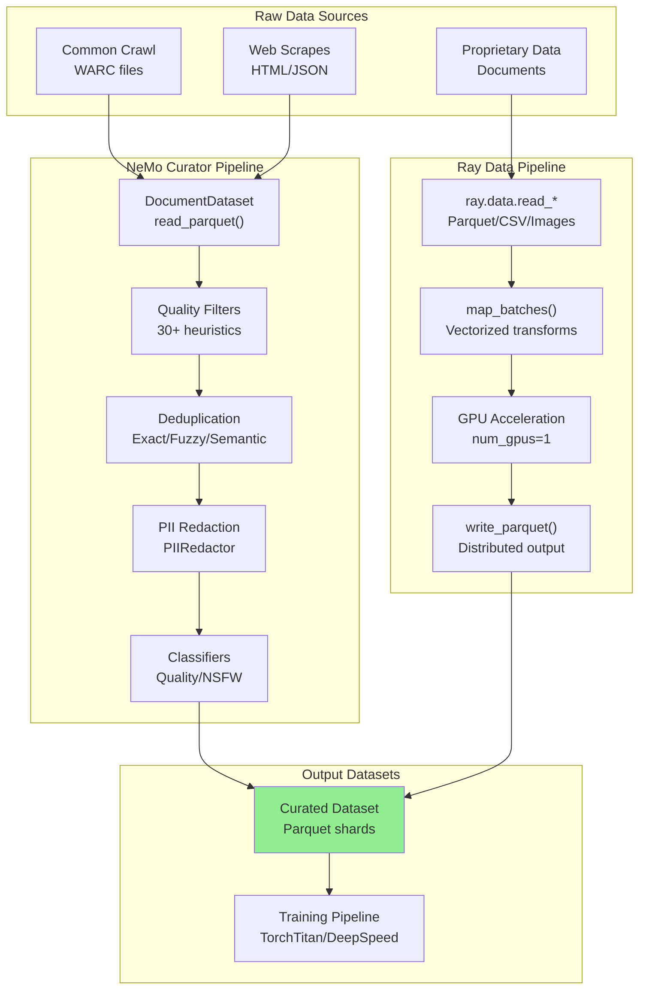
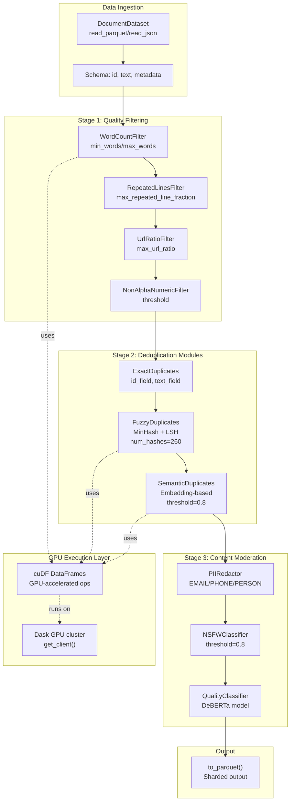
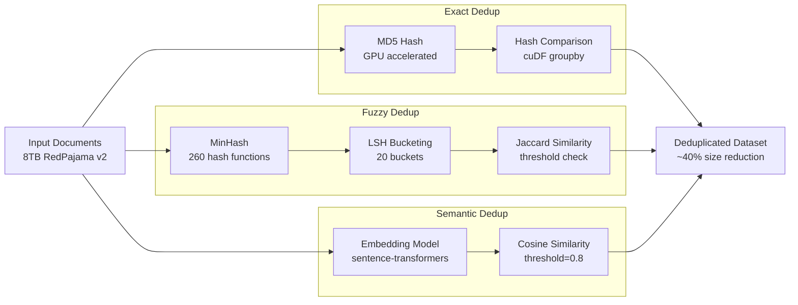
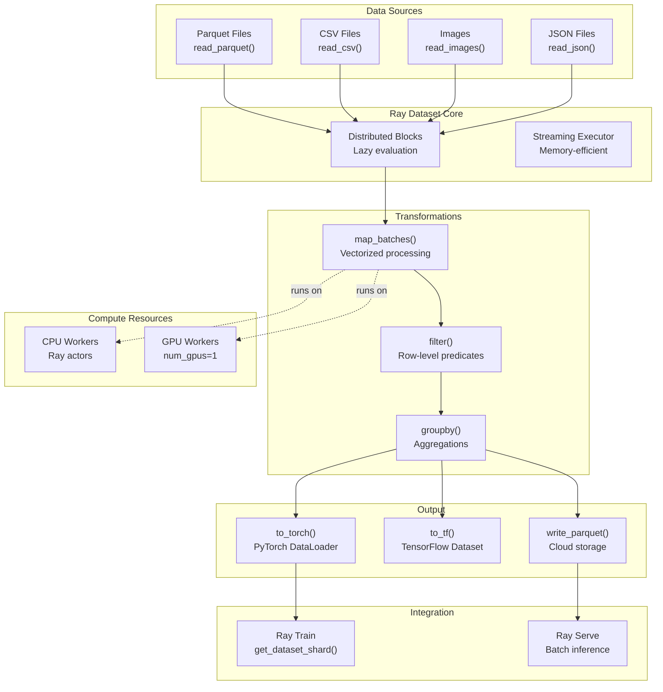
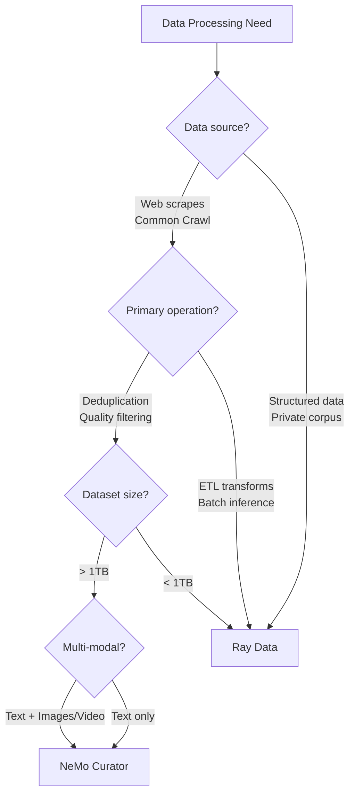
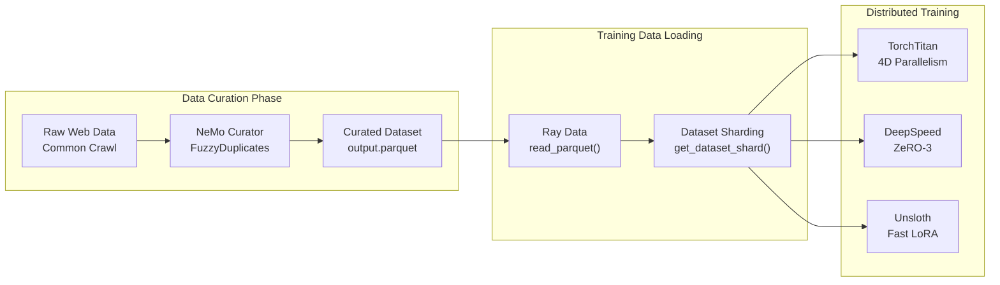

<!-- source: DeepWiki mcp.deepwiki.com · repo zechenzhangAGI/AI-research-SKILLs · page 2.2 Data Processing Skills · fetched 2026-10-26 -->

# Data Processing Skills

<details>
<summary>Relevant source files</summary>

The following files were used as context for generating this wiki page:

- [03-fine-tuning/unsloth/SKILL.md](03-fine-tuning/unsloth/SKILL.md)
- [05-data-processing/nemo-curator/SKILL.md](05-data-processing/nemo-curator/SKILL.md)
- [05-data-processing/ray-data/SKILL.md](05-data-processing/ray-data/SKILL.md)
- [06-post-training/grpo-rl-training/SKILL.md](06-post-training/grpo-rl-training/SKILL.md)
- [08-distributed-training/deepspeed/SKILL.md](08-distributed-training/deepspeed/SKILL.md)

</details>


This document covers the **data processing skills** in the AI Research SKILLs library, which provide GPU-accelerated data curation and distributed ETL capabilities for preparing large-scale LLM training datasets. These skills bridge the gap between raw data sources (Common Crawl, web scrapes, proprietary corpora) and the cleaned, deduplicated, high-quality datasets required for effective model training.

**Scope**: This page documents NeMo Curator and Ray Data, the two foundational data processing systems in the library. For model training that consumes these datasets, see [Training & Fine-Tuning Skills](#2.3). For post-training data workflows, see [Post-Training & Alignment Skills](#2.4).

## Data Processing in the LLM Pipeline

Data processing sits at the foundation of the LLM training lifecycle. Raw data from web scrapes, document collections, or proprietary sources must be transformed into high-quality training datasets through multiple stages: quality filtering, deduplication, format standardization, PII redaction, and classifier-based filtering. The skills in this category address two distinct but complementary use cases:

**NeMo Curator**: GPU-accelerated data curation focused on quality and deduplication. Optimized for large-scale web data (Common Crawl, RedPajama) with 16× speedup over CPU alternatives.

**Ray Data**: Distributed data processing framework for general ML workloads. Handles ETL pipelines, batch inference, and multi-modal data loading across clusters.



**Pipeline Architecture: Raw Data to Training-Ready Datasets**

Sources: [05-data-processing/nemo-curator/SKILL.md:1-383](), [05-data-processing/ray-data/SKILL.md:1-327]()

## NeMo Curator: GPU-Accelerated Data Curation

NeMo Curator is NVIDIA's toolkit for preparing high-quality LLM training data at scale. It achieves 16× speedup over CPU-based alternatives by leveraging GPU parallelism through RAPIDS cuDF and Dask for data-parallel operations. The primary use case is curating massive web corpora (Common Crawl, RedPajama) where deduplication and quality filtering dominate processing time.

### Architecture



**NeMo Curator Processing Pipeline with Code Entities**

Sources: [05-data-processing/nemo-curator/SKILL.md:74-303]()

### Core Components

#### DocumentDataset and Data Loading

The `DocumentDataset` class wraps cuDF DataFrames and provides the primary interface for data operations. It enforces a consistent schema with required fields (`id`, `text`) and optional metadata columns.

```python
# Key pattern from skill documentation
from nemo_curator.datasets import DocumentDataset
import pandas as pd

df = pd.DataFrame({"text": ["doc1", "doc2"], "id": [1, 2]})
dataset = DocumentDataset(df)
```

Loading methods support standard ML formats with automatic sharding across GPU workers:
- `DocumentDataset.read_parquet()` - Primary input format
- `DocumentDataset.read_json()` - JSONL support
- Multi-file glob patterns for distributed reading

Sources: [05-data-processing/nemo-curator/SKILL.md:50-72]()

#### Quality Filtering Modules

NeMo Curator implements 30+ heuristic filters as composable modules. Each filter extends the base `Filter` class and operates on document-level features:

| Filter Class | Parameters | Rejection Criteria |
|--------------|------------|-------------------|
| `WordCountFilter` | `min_words`, `max_words` | Document length outside range |
| `RepeatedLinesFilter` | `max_repeated_line_fraction` | Excessive repetitive content |
| `UrlRatioFilter` | `max_url_ratio` | High URL density |
| `SymbolToWordRatioFilter` | `max_symbol_to_word_ratio` | Low text quality indicators |
| `LanguageIdentificationFilter` | `target_languages` | Non-target language |

Filters are applied via `ScoreFilter` wrapper or chained directly on the dataset:

```python
# Pattern from skill
from nemo_curator.filters import WordCountFilter, RepeatedLinesFilter

dataset = dataset.filter(WordCountFilter(min_words=50, max_words=100000))
dataset = dataset.filter(RepeatedLinesFilter(max_repeated_line_fraction=0.3))
```

Sources: [05-data-processing/nemo-curator/SKILL.md:76-97]()

#### Deduplication Engines

NeMo Curator provides three deduplication strategies, each optimized for different similarity detection requirements:

**Exact Deduplication** (`ExactDuplicates` module):
- Hash-based duplicate detection
- O(n) complexity with GPU-accelerated hashing
- Constructor: `ExactDuplicates(id_field="id", text_field="text")`

**Fuzzy Deduplication** (`FuzzyDuplicates` module):
- MinHash + Locality-Sensitive Hashing (LSH)
- 16× faster than CPU implementations (e.g., datasketch)
- Key parameters: `num_hashes=260`, `num_buckets=20`, `hash_method="md5"`
- Detects near-duplicates with configurable Jaccard similarity threshold

**Semantic Deduplication** (`SemanticDuplicates` module):
- Embedding-based similarity using transformer models
- Constructor: `SemanticDuplicates(embedding_model="sentence-transformers/all-MiniLM-L6-v2", threshold=0.8)`
- Cosine similarity threshold determines duplicate pairs
- Most computationally expensive but highest precision



**Three Deduplication Strategies with Performance Trade-offs**

Performance characteristics on 8TB RedPajama v2 dataset:
- **CPU baseline** (256 cores): 120 hours
- **GPU implementation** (8× A100): 7.5 hours
- **Speedup**: 16×
- **Data reduction**: 30-40% typical for web corpora

Sources: [05-data-processing/nemo-curator/SKILL.md:99-138]()

#### PII Redaction and Content Moderation

The `PIIRedactor` modifier uses pattern matching and NER models to identify and redact personally identifiable information:

```python
from nemo_curator.modifiers import PIIRedactor

pii_redactor = PIIRedactor(
    supported_entities=["EMAIL_ADDRESS", "PHONE_NUMBER", "PERSON", "LOCATION"],
    anonymize_action="replace"  # or "redact"
)
```

Classifier-based filtering uses fine-tuned DeBERTa models for:
- **Quality classification**: `QualityClassifier(model_path="nvidia/quality-classifier-deberta")`
- **NSFW detection**: `NSFWClassifier(threshold=0.8)`

Both run in batched mode with configurable GPU allocation (`batch_size=256`, `device="cuda"`).

Sources: [05-data-processing/nemo-curator/SKILL.md:140-169]()

### Multi-GPU Scaling

NeMo Curator uses Dask for distributed execution across GPU clusters:

```python
from nemo_curator import get_client
import dask_cuda

# Initialize GPU cluster
client = get_client(cluster_type="gpu", n_workers=8)

# Automatic data sharding across 8 GPUs
deduped = FuzzyDuplicates(...)(dataset)

client.close()
```

Scaling characteristics:
- **Near-linear speedup** up to 32 GPUs
- **Overhead**: ~5% communication for LSH operations
- **Memory**: Each A100 (40GB) handles ~1TB of raw data per hour

Sources: [05-data-processing/nemo-curator/SKILL.md:171-193](), [05-data-processing/nemo-curator/SKILL.md:305-322]()

### Multi-Modal Support

Beyond text, NeMo Curator supports image, video, and audio curation:

```python
# Image curation
from nemo_curator.image import AestheticFilter, NSFWFilter, CLIPEmbedder

aesthetic_filter = AestheticFilter(threshold=5.0)
nsfw_filter = NSFWFilter(threshold=0.9)
clip_embedder = CLIPEmbedder(model="openai/clip-vit-base-patch32")

# Video curation
from nemo_curator.video import SceneDetector, InternVideo2Embedder

scene_detector = SceneDetector(threshold=27.0)
video_embedder = InternVideo2Embedder()

# Audio curation
from nemo_curator.audio import ASRInference, WERFilter

asr = ASRInference(model="nvidia/stt_en_fastconformer_hybrid_large_pc")
wer_filter = WERFilter(max_wer=0.3)
```

Sources: [05-data-processing/nemo-curator/SKILL.md:195-260]()

## Ray Data: Distributed ETL and ML Preprocessing

Ray Data provides a general-purpose distributed data processing framework for ML workloads. Unlike NeMo Curator's curation-specific focus, Ray Data handles arbitrary ETL pipelines, batch inference, and streaming data loading with tight integration into Ray's training ecosystem (Ray Train, RLlib).

### Architecture



**Ray Data Architecture with Framework Integration Points**

Sources: [05-data-processing/ray-data/SKILL.md:1-327]()

### Core API Patterns

#### Reading Data

Ray Data supports multiple input formats with automatic sharding:

```python
import ray

# Cloud storage with glob patterns
ds = ray.data.read_parquet("s3://bucket/data/*.parquet")
ds = ray.data.read_csv("s3://bucket/data/*.csv")
ds = ray.data.read_json("gs://bucket/data/*.json")

# Images for computer vision
ds = ray.data.read_images("s3://bucket/images/")

# Python objects
ds = ray.data.from_items([{"id": i, "value": i*2} for i in range(1000)])
ds = ray.data.range(1000000)  # Synthetic data generation
```

Each read operation creates a lazy `Dataset` object with automatic partitioning based on file count and cluster size.

Sources: [05-data-processing/ray-data/SKILL.md:87-120]()

#### Transformations

**Batch Processing** (`map_batches`):
The primary transformation API, operating on batches of rows for vectorized efficiency:

```python
def process_batch(batch):
    # batch is dict of column_name -> numpy array
    batch["doubled"] = batch["value"] * 2
    return batch

ds = ds.map_batches(process_batch, batch_size=1000)
```

Key parameters:
- `batch_size`: Controls memory vs. throughput trade-off
- `num_gpus`: Requests GPU allocation for the transform
- `compute`: "actors" (default) or "tasks" for resource management

**Row Processing** (`map`):
Less efficient but simpler for non-vectorizable operations:

```python
def process_row(row):
    row["squared"] = row["value"] ** 2
    return row

ds = ds.map(process_row)
```

**Filtering** (`filter`):
Row-level predicates with automatic block pruning:

```python
ds = ds.filter(lambda row: row["value"] > 100)
```

**Aggregations** (`groupby`):
Distributed group-by operations:

```python
# Count by category
ds = ds.groupby("category").count()

# Custom aggregation
ds = ds.groupby("category").map_groups(
    lambda group: {"sum": group["value"].sum()}
)
```

Sources: [05-data-processing/ray-data/SKILL.md:122-162]()

### GPU Acceleration

Ray Data supports GPU-accelerated transforms by requesting GPU resources:

```python
def preprocess_images_gpu(batch):
    import torch
    images = torch.tensor(batch["image"]).cuda()
    processed = images * 255  # GPU operations
    return {"processed": processed.cpu().numpy()}

ds = ds.map_batches(
    preprocess_images_gpu,
    batch_size=64,
    num_gpus=1  # Request 1 GPU per worker
)
```

The scheduler automatically assigns GPU workers and manages data transfer. For multi-GPU clusters, Ray distributes blocks across available GPUs.

Sources: [05-data-processing/ray-data/SKILL.md:163-179]()

### Integration with Ray Train

Ray Data integrates directly with Ray Train for distributed training:

```python
import ray
from ray.train import ScalingConfig
from ray.train.torch import TorchTrainer

train_ds = ray.data.read_parquet("s3://bucket/train/*.parquet")

def train_func(config):
    # Access dataset shard for this worker
    train_ds = ray.train.get_dataset_shard("train")
    
    for epoch in range(10):
        for batch in train_ds.iter_batches(batch_size=32):
            # Train on batch
            pass

trainer = TorchTrainer(
    train_func,
    datasets={"train": train_ds},
    scaling_config=ScalingConfig(num_workers=4, use_gpu=True)
)
trainer.fit()
```

Ray Train automatically:
1. Shards dataset across workers
2. Streams batches during training
3. Handles worker failures with dataset replay

Sources: [05-data-processing/ray-data/SKILL.md:59-85]()

### Batch Inference Pattern

A common production use case - distributed model inference:

```python
import ray

class BatchInference:
    def __init__(self):
        # Load model once per worker
        self.model = load_model()
    
    def __call__(self, batch):
        predictions = self.model(batch["input"])
        return {"prediction": predictions}

# Distributed inference
ds = ray.data.read_parquet("s3://data/")
predictions = ds.map_batches(
    BatchInference,
    batch_size=32,
    num_gpus=1,
    compute="actors"  # Reuse actors for model persistence
)
predictions.write_parquet("s3://output/")
```

This pattern is used for:
- Model evaluation on large test sets
- Production batch prediction pipelines
- Feature extraction for downstream tasks

Sources: [05-data-processing/ray-data/SKILL.md:220-244]()

### Performance Optimization

#### Repartitioning

Control parallelism by adjusting block count:

```python
# Match cluster size (100 cores = 100 blocks)
ds = ds.repartition(100)
```

Rules of thumb:
- Blocks ≈ 2× CPU cores for full utilization
- Blocks ≈ 1× GPU count for GPU workloads
- Too many blocks → scheduling overhead
- Too few blocks → underutilization

#### Batch Size Tuning

Larger batches improve vectorization but increase memory:

```python
# Small batches: 2-5 it/s
ds.map_batches(process_fn, batch_size=100)

# Large batches: 10-20 it/s
ds.map_batches(process_fn, batch_size=10000)
```

Optimal batch size depends on:
- Available memory per worker
- Vectorization efficiency of `process_fn`
- I/O vs. compute ratio

#### Streaming Execution

Ray Data streams data through pipelines, enabling processing of datasets larger than cluster memory:

```python
ds = ray.data.read_parquet("s3://1TB-dataset/")
for batch in ds.iter_batches(batch_size=1000):
    process(batch)  # Streamed, not materialized
```

Sources: [05-data-processing/ray-data/SKILL.md:194-217]()

## Selection Guide: NeMo Curator vs Ray Data



**Decision Tree for Data Processing Tool Selection**

### Comparison Matrix

| Criterion | NeMo Curator | Ray Data |
|-----------|--------------|----------|
| **Primary Use Case** | Data curation (quality + dedup) | General ETL and ML preprocessing |
| **Optimal Data Size** | > 1TB (benefits from GPU acceleration) | Any size (CPU efficient for < 100GB) |
| **Deduplication** | ✅ Fuzzy dedup 16× faster | ❌ No built-in dedup |
| **Quality Filtering** | ✅ 30+ heuristic filters | ⚠️ Custom implementations needed |
| **Multi-modal** | ✅ Text, images, video, audio | ⚠️ Images only (via `read_images`) |
| **GPU Acceleration** | ✅ Core design (RAPIDS cuDF) | ⚠️ Optional (manual GPU transforms) |
| **ML Framework Integration** | ❌ Limited | ✅ Ray Train, PyTorch, TensorFlow |
| **Batch Inference** | ❌ Not designed for this | ✅ Primary use case |
| **Streaming Execution** | ⚠️ Via Dask | ✅ Native support |
| **Learning Curve** | Moderate (curation-specific APIs) | Low (Pandas-like API) |

### Usage Recommendations

**Use NeMo Curator when:**
- Processing Common Crawl or large web scrapes (> 1TB)
- Deduplication is critical (especially fuzzy/semantic)
- Need comprehensive quality filtering (repetition, formatting, language)
- Working with multi-modal data (text + images/video/audio)
- Have GPU cluster available (8+ GPUs)

**Use Ray Data when:**
- Building custom ETL pipelines
- Performing batch inference at scale
- Integrating with Ray Train for distributed training
- Need streaming execution for memory efficiency
- Dataset < 1TB or primarily structured data
- Targeting CPU clusters

**Use both when:**
- NeMo Curator for curation → Ray Data for training integration
- Example: Curate with NeMo Curator → Load with Ray Data in Ray Train

Sources: [05-data-processing/nemo-curator/SKILL.md:1-383](), [05-data-processing/ray-data/SKILL.md:1-327]()

## Integration with Training Pipeline



**End-to-End Data Flow: Curation to Training**

### Cost Analysis

Processing 8TB RedPajama v2 dataset:

**NeMo Curator (GPU-based)**:
- Infrastructure: 2× AWS p4d.24xlarge (8× A100 each)
- Cost: $32.77/hour × 2 = $65.54/hour
- Duration: 7.5 hours
- **Total**: $491.55

**CPU-based Alternative** (e.g., datasketch):
- Infrastructure: 10× AWS c5.18xlarge (72 vCPUs each)
- Cost: $3.60/hour × 10 = $36/hour
- Duration: 120 hours
- **Total**: $4,320

**Savings**: 89% cost reduction, 16× faster

### Performance Benchmarks

| Operation | Dataset Size | CPU (cores) | GPU (type) | Speedup |
|-----------|-------------|-------------|------------|---------|
| Fuzzy dedup | 8TB | 120h (256 cores) | 7.5h (8× A100) | 16× |
| Exact dedup | 1TB | 8h (64 cores) | 0.5h (4× A100) | 16× |
| Quality filtering | 100GB | 2h (32 cores) | 0.2h (2× A100) | 10× |
| Batch inference (Ray Data) | 500GB images | 10h (64 cores) | 2h (8× V100) | 5× |

Sources: [05-data-processing/nemo-curator/SKILL.md:324-357]()

## Common Workflows

### Web Scrape Curation Pipeline

Complete pipeline for preparing Common Crawl data:

```python
from nemo_curator import ScoreFilter, Modify
from nemo_curator.filters import *
from nemo_curator.modules import *
from nemo_curator.datasets import DocumentDataset

# Load Common Crawl
dataset = DocumentDataset.read_parquet("common_crawl/*.parquet")

# Stage 1: Quality filtering
dataset = dataset.filter(WordCountFilter(min_words=100, max_words=50000))
dataset = dataset.filter(RepeatedLinesFilter(max_repeated_line_fraction=0.2))
dataset = dataset.filter(SymbolToWordRatioFilter(max_symbol_to_word_ratio=0.3))
dataset = dataset.filter(UrlRatioFilter(max_url_ratio=0.3))

# Stage 2: Language filtering
dataset = dataset.filter(LanguageIdentificationFilter(target_languages=["en"]))

# Stage 3: Deduplication
exact_dedup = ExactDuplicates(id_field="id", text_field="text")
fuzzy_dedup = FuzzyDuplicates(id_field="id", text_field="text", num_hashes=260)
dataset = exact_dedup(dataset)
dataset = fuzzy_dedup(dataset)

# Stage 4: PII redaction
pii_redactor = PIIRedactor()
dataset = Modify(pii_redactor)(dataset)

# Stage 5: NSFW filtering
nsfw_filter = NSFWClassifier(threshold=0.8)
dataset = dataset.filter(lambda doc: nsfw_filter(doc["text"]) < 0.8)

# Save
dataset.to_parquet("curated_common_crawl/")
```

Sources: [05-data-processing/nemo-curator/SKILL.md:262-303]()

### Ray Data Preprocessing Pipeline

Multi-stage pipeline with Ray Data:

```python
import ray

# Multi-step pipeline with method chaining
ds = (
    ray.data.read_parquet("s3://raw/")
    .map_batches(clean_data, batch_size=1000)
    .map_batches(tokenize, batch_size=1000)
    .map_batches(augment, batch_size=100, num_gpus=1)
    .write_parquet("s3://processed/")
)

# Custom transform functions
def clean_data(batch):
    batch["text"] = batch["text"].str.strip()
    batch["text"] = batch["text"].str.lower()
    return batch

def tokenize(batch):
    from transformers import AutoTokenizer
    tokenizer = AutoTokenizer.from_pretrained("gpt2")
    batch["tokens"] = tokenizer(batch["text"].tolist())["input_ids"]
    return batch

def augment(batch):
    import torch
    # GPU augmentation
    tokens = torch.tensor(batch["tokens"]).cuda()
    augmented = apply_augmentation(tokens)
    batch["augmented"] = augmented.cpu().numpy()
    return batch
```

Sources: [05-data-processing/ray-data/SKILL.md:246-257]()

## File Structure

```
05-data-processing/
├── nemo-curator/
│   ├── SKILL.md                    # Main skill documentation
│   └── references/
│       ├── filtering.md            # 30+ quality filters reference
│       └── deduplication.md        # Exact/fuzzy/semantic methods
│
└── ray-data/
    ├── SKILL.md                    # Main skill documentation
    └── references/
        ├── transformations.md      # Map, filter, groupby operations
        └── integration.md          # Ray Train, PyTorch, TensorFlow
```

Each skill includes:
- **SKILL.md**: 200-500 line overview with quick start patterns
- **references/**: Comprehensive documentation (300KB+) from official sources
- Code examples with verified API usage
- Performance benchmarks and cost analysis

Sources: [05-data-processing/nemo-curator/SKILL.md:1-10](), [05-data-processing/ray-data/SKILL.md:1-10]()

## Resources

**NeMo Curator**:
- GitHub: https://github.com/NVIDIA/NeMo-Curator (500+ stars)
- Docs: https://docs.nvidia.com/nemo-framework/user-guide/latest/datacuration/
- Version: 0.4.0+
- License: Apache 2.0

**Ray Data**:
- GitHub: https://github.com/ray-project/ray (36,000+ stars)
- Docs: https://docs.ray.io/en/latest/data/data.html
- Version: Ray 2.40.0+
- Examples: https://docs.ray.io/en/latest/data/examples/overview.html

Sources: [05-data-processing/nemo-curator/SKILL.md:376-381](), [05-data-processing/ray-data/SKILL.md:314-324]()

---

