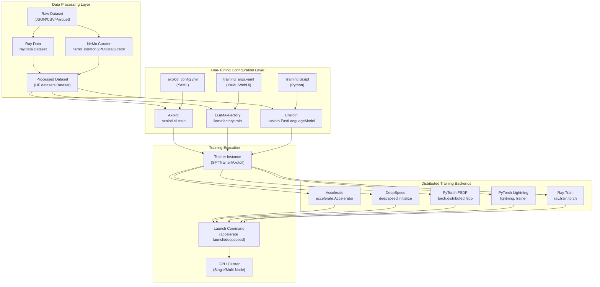
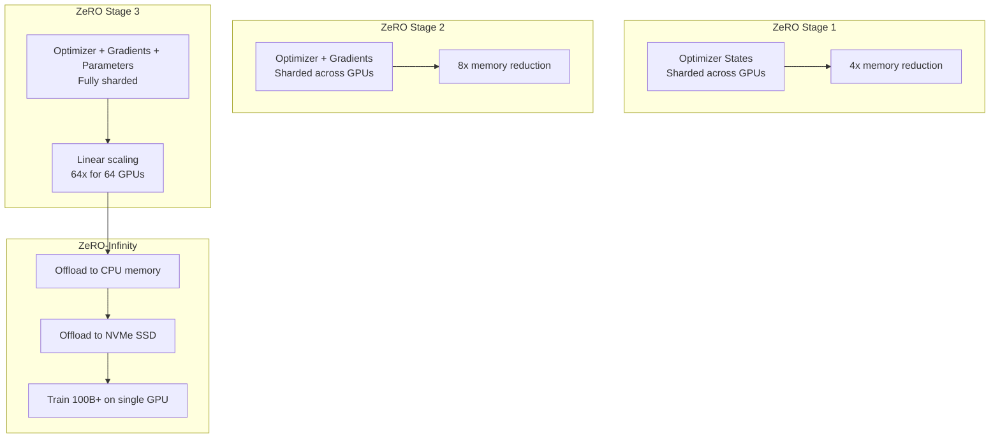
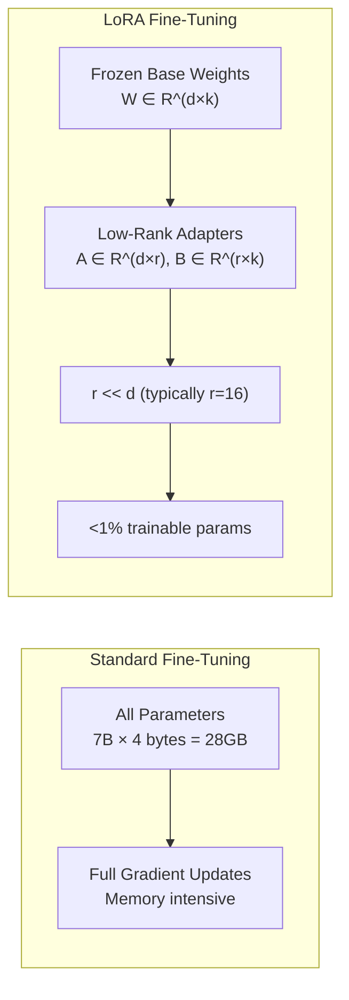
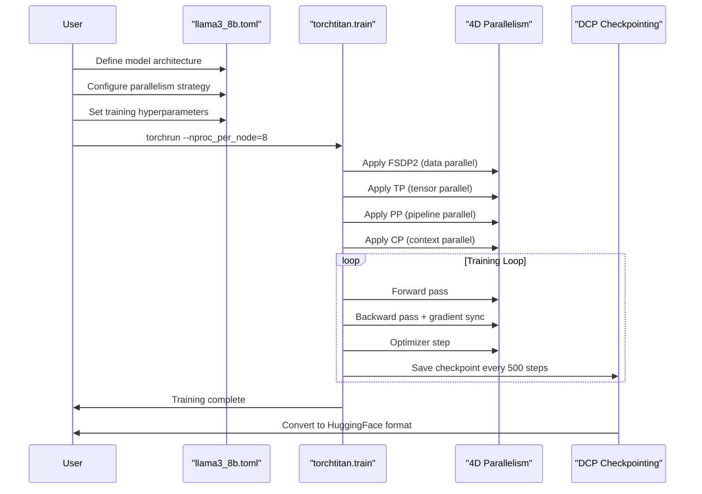
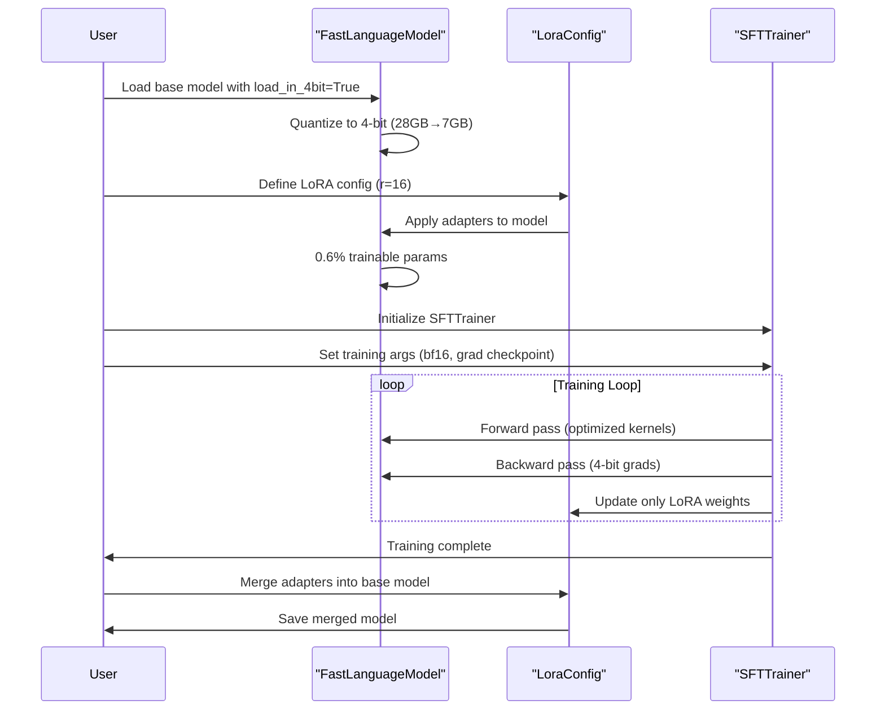
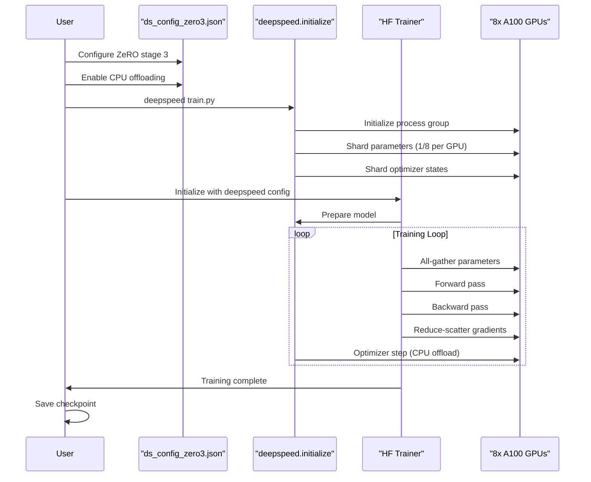
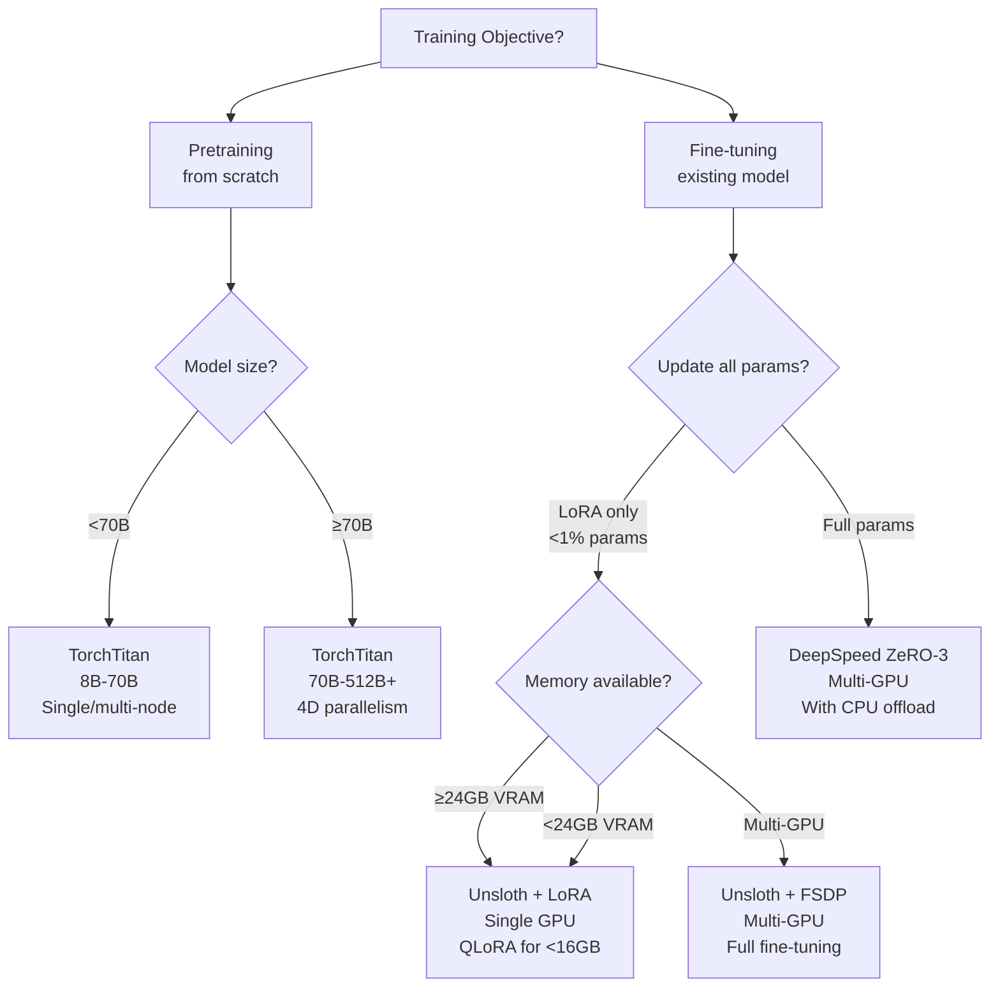
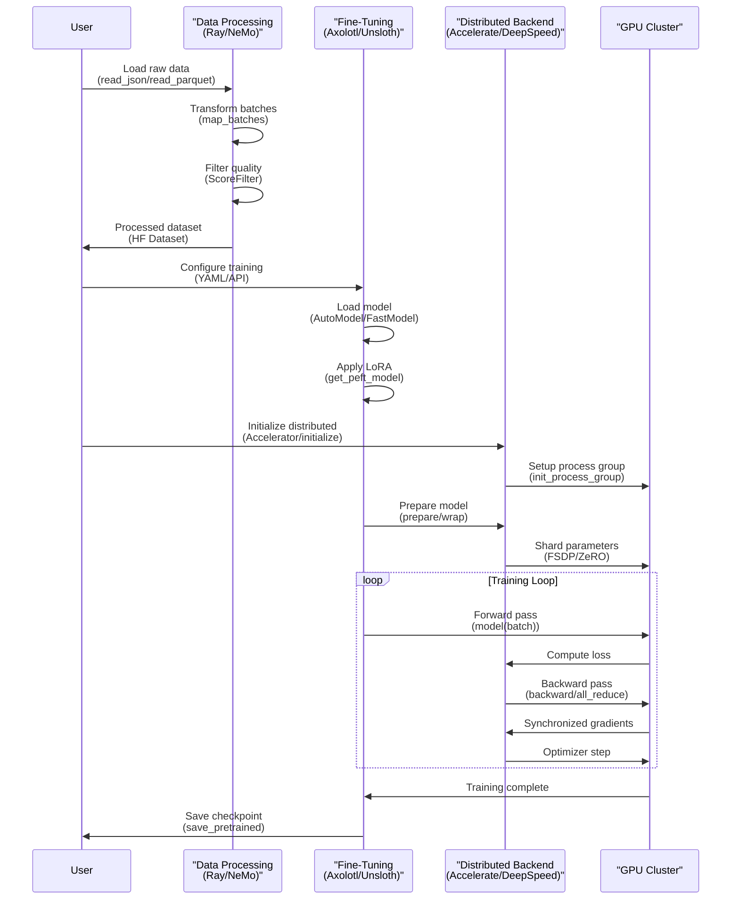

<!-- source: DeepWiki mcp.deepwiki.com · repo zechenzhangAGI/AI-research-SKILLs · page 2.3 Training & Fine-Tuning Skills · fetched 2026-10-26 -->

# Training & Fine-Tuning Skills

<details>
<summary>Relevant source files</summary>

The following files were used as context for generating this wiki page:

- [01-model-architecture/torchtitan/SKILL.md](01-model-architecture/torchtitan/SKILL.md)
- [01-model-architecture/torchtitan/references/checkpoint.md](01-model-architecture/torchtitan/references/checkpoint.md)
- [01-model-architecture/torchtitan/references/custom-models.md](01-model-architecture/torchtitan/references/custom-models.md)
- [01-model-architecture/torchtitan/references/float8.md](01-model-architecture/torchtitan/references/float8.md)
- [01-model-architecture/torchtitan/references/fsdp.md](01-model-architecture/torchtitan/references/fsdp.md)
- [03-fine-tuning/unsloth/SKILL.md](03-fine-tuning/unsloth/SKILL.md)
- [05-data-processing/nemo-curator/SKILL.md](05-data-processing/nemo-curator/SKILL.md)
- [05-data-processing/ray-data/SKILL.md](05-data-processing/ray-data/SKILL.md)
- [06-post-training/grpo-rl-training/SKILL.md](06-post-training/grpo-rl-training/SKILL.md)
- [08-distributed-training/deepspeed/SKILL.md](08-distributed-training/deepspeed/SKILL.md)

</details>


## Purpose and Scope

This document covers **training and fine-tuning skills** that enable both large-scale pretraining and efficient model adaptation. These skills address the complete training lifecycle:

1. **Distributed Pretraining** - Large-scale training from scratch (TorchTitan)
2. **Efficient Fine-Tuning** - Parameter-efficient adaptation (Unsloth, PEFT)
3. **Distributed Training Backends** - Multi-GPU orchestration (DeepSpeed)
4. **Memory Optimization** - Techniques to fit larger models (ZeRO, quantization, activation checkpointing)

This category focuses on the **compute-intensive phase** of model development. For data preparation, see [Data Processing Skills (2.2)](2.2). For post-training alignment with human preferences, see [Post-Training & Alignment Skills (2.4)](2.4).

**Sources:** [01-model-architecture/torchtitan/SKILL.md:1-358](), [03-fine-tuning/unsloth/SKILL.md:1-81](), [08-distributed-training/deepspeed/SKILL.md:1-52]()

---

## Training Pipeline Architecture

The training pipeline follows a sequential data → compute → optimization flow:



**Sources:** [README.md:44-70](), [08-distributed-training/accelerate/SKILL.md:11-46]()

---

## Skill Organization by Training Stage

The 10 skills are organized into three functional categories aligned with the training workflow:

| Category | Skills | Total | Primary Use Case |
|----------|--------|-------|------------------|
| **Fine-Tuning** | Axolotl, LLaMA-Factory, Unsloth | 3 | Parameter-efficient adaptation (LoRA/QLoRA) |
| **Data Processing** | Ray Data, NeMo Curator | 2 | Distributed preprocessing and quality filtering |
| **Distributed Training** | Accelerate, DeepSpeed, FSDP, Lightning, Ray Train | 5 | Multi-GPU orchestration and memory optimization |

**Fine-tuning skills** provide high-level APIs for common training workflows. **Data processing skills** handle dataset preparation at scale. **Distributed training skills** enable execution across multiple devices.

**Sources:** [README.md:44-70](), [ROADMAP.md:38-79]()

---

## TorchTitan: Large-Scale Pretraining

TorchTitan is PyTorch's official framework for pretraining LLMs at scale (8B-512B+ parameters) with composable 4D parallelism.

### Core Architecture

**Entry point:** `torchtitan.train` module launched via `torchrun`

**Key components:**
- [torchtitan/train.py]() - Main training loop
- [torchtitan/parallelisms/]() - FSDP2, TP, PP, CP implementations
- [torchtitan/models/]() - Model definitions (Llama 3.1, DeepSeek V3)
- [torchtitan/checkpoint.py]() - Distributed checkpoint (DCP) integration

**Configuration:** TOML files defining model architecture, parallelism strategy, and training hyperparameters

### 4D Parallelism Strategy

TorchTitan composes four parallelism techniques:

```mermaid
graph TB
    subgraph "FSDP2 - Data Parallel"
        FSDP["fully_shard()<br/>Shard parameters across GPUs"]
        ZeRO3["ZeRO-3 equivalent<br/>Parameter + gradient sharding"]
    end
    
    subgraph "TP - Tensor Parallel"
        TPAttn["parallelize_module()<br/>Shard attention weights"]
        TPMLP["Shard MLP layers<br/>Column/row parallel"]
    end
    
    subgraph "PP - Pipeline Parallel"
        PPStages["Pipeline stages<br/>Split layers across nodes"]
        PPSchedule["1F1B schedule<br/>Overlap compute/communication"]
    end
    
    subgraph "CP - Context Parallel"
        CPSeq["Sequence sharding<br/>Split long sequences"]
        CPRingAttn["Ring attention<br/>Distributed attention"]
    end
    
    FSDP --> ZeRO3
    TPAttn --> TPMLP
    PPStages --> PPSchedule
    CPSeq --> CPRingAttn
```



**Parallelism equivalents:**
- FSDP2 = DeepSpeed ZeRO-3
- TP = Megatron-LM tensor parallelism
- PP = GPipe/PipeDream pipeline parallelism
- CP = Ring attention (unique to TorchTitan)

**Sources:** [01-model-architecture/torchtitan/SKILL.md:11-47](), [01-model-architecture/torchtitan/references/fsdp.md:1-127]()

### Training Configuration

**TOML config structure:**

```toml
[model]
name = "llama3"
flavor = "8B"  # 8B, 70B, 405B

[parallelism]
data_parallel_shard_degree = 32  # FSDP sharding
tensor_parallel_degree = 8       # TP within node
pipeline_parallel_degree = 1     # PP across nodes
context_parallel_degree = 1      # CP for long sequences

[training]
local_batch_size = 2
seq_len = 8192
max_norm = 1.0  # Gradient clipping
steps = 1000

[optimizer]
name = "AdamW"
lr = 3e-4

[checkpoint]
enable = true
interval = 500
folder = "checkpoint"
```

**Sources:** [01-model-architecture/torchtitan/SKILL.md:62-103]()

### Launch Commands

**Single node (8 GPUs):**
```bash
CONFIG_FILE="./llama3_8b.toml" ./run_train.sh
```

**Multi-node (256 GPUs via SLURM):**
```bash
srun torchrun \
  --nnodes=32 \
  --nproc_per_node=8 \
  -m torchtitan.train \
  --job.config_file ./llama3_70b.toml
```

**Sources:** [01-model-architecture/torchtitan/SKILL.md:104-170]()

### Float8 Training on H100

Float8 provides 30-50% speedup on H100 GPUs:

```toml
[model]
converters = ["quantize.linear.float8"]

[quantize.linear.float8]
enable_fsdp_float8_all_gather = true
precompute_float8_dynamic_scale_for_fsdp = true
filter_fqns = ["output"]  # Exclude output layer

[compile]
enable = true
components = ["model", "loss"]
```

Launch with: `--model.converters="quantize.linear.float8" --compile.enable`

**Sources:** [01-model-architecture/torchtitan/SKILL.md:173-213](), [01-model-architecture/torchtitan/references/float8.md:1-134]()

### When to Use TorchTitan

**Use TorchTitan for:**
- Pretraining models from scratch (8B-512B+ parameters)
- PyTorch-native solution without third-party dependencies
- H100 GPUs with Float8 support
- Need interoperable checkpoints (HuggingFace, torchtune)

**Use alternatives for:**
- Fine-tuning existing models (use Unsloth)
- <8B models on single GPU (use Unsloth + LoRA)
- Maximum performance on NVIDIA-only (use Megatron-LM)
- Inference optimization (use vLLM, see page 2.8)

**Sources:** [01-model-architecture/torchtitan/SKILL.md:259-273]()

## Unsloth: Fast Fine-Tuning

Unsloth accelerates fine-tuning through optimized CUDA kernels and memory-efficient LoRA implementations.

### Core API

**Entry point:** `unsloth.FastLanguageModel` class

**Key methods:**
- `FastLanguageModel.from_pretrained()` - Load model with optimizations
- `FastLanguageModel.get_peft_model()` - Apply LoRA adapters
- Custom kernels for attention, RoPE, and cross-entropy

**Integration:** Works with HuggingFace Transformers, TRL, and standard PyTorch training loops

### Usage Pattern

```python
from unsloth import FastLanguageModel
from trl import SFTTrainer

# Load model with 4-bit quantization (QLoRA)
model, tokenizer = FastLanguageModel.from_pretrained(
    model_name="meta-llama/Llama-3.1-8B",
    max_seq_length=2048,
    load_in_4bit=True,        # QLoRA quantization
    fast_inference=True        # Optimized inference kernels
)

# Apply LoRA adapters
model = FastLanguageModel.get_peft_model(
    model,
    r=16,                      # LoRA rank
    lora_alpha=32,             # Scaling factor (2*r typical)
    target_modules=[
        "q_proj", "k_proj", "v_proj", "o_proj",
        "gate_proj", "up_proj", "down_proj"
    ],
    lora_dropout=0.05,
    use_gradient_checkpointing="unsloth"  # Memory optimization
)

# Train with SFTTrainer
trainer = SFTTrainer(
    model=model,
    tokenizer=tokenizer,
    train_dataset=dataset,
    max_seq_length=2048,
)
trainer.train()
```

**Sources:** [03-fine-tuning/unsloth/SKILL.md:1-81](), [06-post-training/grpo-rl-training/SKILL.md:267-342]()

### Performance Optimizations

Unsloth achieves 2-5x speedup through:

1. **Fused kernels:** Combine multiple operations (attention + RoPE + layer norm)
2. **Memory layout:** Optimized tensor layouts for cache efficiency
3. **Gradient checkpointing:** Unsloth-specific implementation saves 50% memory
4. **Fast cross-entropy:** Custom backward pass for language modeling loss

**Benchmark (Llama-7B on A100 80GB):**

| Configuration | Tokens/sec | Memory | vs Baseline |
|---------------|------------|--------|-------------|
| Standard LoRA | 3,000 | 18GB | 1.0x |
| Unsloth LoRA | 6,000 | 14GB | 2.0x |
| Unsloth + QLoRA | 5,500 | 9GB | 1.8x (50% VRAM) |

**Sources:** [03-fine-tuning/unsloth/SKILL.md:1-81]()

### When to Use Unsloth

**Use Unsloth for:**
- Fine-tuning models <13B parameters
- Single-GPU or small multi-GPU setups (1-8 GPUs)
- Memory-constrained environments (need QLoRA)
- Custom training loops with PyTorch

**Use TorchTitan instead for:**
- Pretraining from scratch
- Models >13B parameters requiring multi-node
- Need 4D parallelism (FSDP2+TP+PP+CP)

**Sources:** [03-fine-tuning/unsloth/SKILL.md:1-81]()

---

## DeepSpeed: ZeRO Optimization

DeepSpeed enables training large models through memory-efficient ZeRO (Zero Redundancy Optimizer) stages and offloading.

### ZeRO Optimization Stages

DeepSpeed partitions model states across GPUs to reduce memory footprint:



**ZeRO stages compared:**

| Stage | Shards | Memory Reduction | Communication Overhead | Use Case |
|-------|--------|------------------|----------------------|----------|
| **ZeRO-1** | Optimizer states | 4x | Low | Large batch training |
| **ZeRO-2** | + Gradients | 8x | Medium | Most fine-tuning |
| **ZeRO-3** | + Parameters | Linear (N GPUs) | High | Largest models (70B+) |
| **ZeRO-Infinity** | + CPU/NVMe offload | Unlimited | Highest | Single-GPU large models |

**Sources:** [08-distributed-training/deepspeed/SKILL.md:1-52]()

### Configuration Files

DeepSpeed uses JSON configuration for training parameters:

**ds_config_zero2.json:**
```json
{
  "train_batch_size": 32,
  "gradient_accumulation_steps": 4,
  "fp16": {
    "enabled": true,
    "loss_scale": 0,
    "initial_scale_power": 16
  },
  "zero_optimization": {
    "stage": 2,
    "allgather_partitions": true,
    "allgather_bucket_size": 5e8,
    "reduce_scatter": true,
    "reduce_bucket_size": 5e8,
    "overlap_comm": true,
    "contiguous_gradients": true
  }
}
```

**ds_config_zero3_offload.json:**
```json
{
  "train_batch_size": 32,
  "gradient_accumulation_steps": 4,
  "fp16": {"enabled": true},
  "zero_optimization": {
    "stage": 3,
    "offload_optimizer": {
      "device": "cpu",
      "pin_memory": true
    },
    "offload_param": {
      "device": "cpu",
      "pin_memory": true
    },
    "overlap_comm": true,
    "contiguous_gradients": true,
    "sub_group_size": 1e9,
    "stage3_max_live_parameters": 1e9,
    "stage3_max_reuse_distance": 1e9
  }
}
```

**Sources:** [08-distributed-training/deepspeed/SKILL.md:34-52]()

### Integration with Training

**With DeepSpeed launcher:**
```bash
deepspeed train.py \
  --deepspeed_config ds_config_zero3.json \
  --model_name meta-llama/Llama-2-70b-hf
```

**With HuggingFace Trainer:**
```python
from transformers import Trainer, TrainingArguments

training_args = TrainingArguments(
    output_dir="./output",
    deepspeed="ds_config_zero3.json",
    per_device_train_batch_size=1,
    gradient_accumulation_steps=4,
    fp16=True,
)

trainer = Trainer(
    model=model,
    args=training_args,
    train_dataset=dataset,
)
trainer.train()
```

**Sources:** [08-distributed-training/deepspeed/SKILL.md:1-52]()

### When to Use DeepSpeed

**Use DeepSpeed for:**
- Training models >13B parameters
- CPU/NVMe offloading for memory-constrained setups
- Need maximum memory efficiency over speed
- Existing HuggingFace training scripts

**Use TorchTitan instead for:**
- Pretraining requiring 4D parallelism
- PyTorch-native solution preferred
- H100 with Float8 optimization

**Sources:** [08-distributed-training/deepspeed/SKILL.md:1-52](), [01-model-architecture/torchtitan/SKILL.md:259-273]()

---

## Memory Optimization Techniques

Training large models requires aggressive memory optimization strategies:

### Optimization Hierarchy


**Sources:** [01-model-architecture/torchtitan/SKILL.md:275-293](), [08-distributed-training/deepspeed/SKILL.md:34-52]()

### Technique Comparison

| Technique | Memory Reduction | Speed Impact | Implementation |
|-----------|------------------|--------------|----------------|
| **Activation Checkpointing** | 50% | -20% | `use_gradient_checkpointing="unsloth"` |
| **Gradient Accumulation** | 0% (larger batch) | 0% | `gradient_accumulation_steps=4` |
| **Mixed Precision (BF16)** | 50% | +2-3x | `bf16=True` |
| **QLoRA (4-bit)** | 75% | -10% | `load_in_4bit=True` |
| **ZeRO-3** | Linear (N GPUs) | -30% | `"zero_optimization": {"stage": 3}` |
| **CPU Offload** | Unlimited | -5x | `"offload_optimizer": {"device": "cpu"}` |

**Sources:** [03-fine-tuning/unsloth/SKILL.md:1-81](), [08-distributed-training/deepspeed/SKILL.md:34-52]()

### Configuration Examples

**TorchTitan (Activation Checkpointing):**
```toml
[activation_checkpoint]
mode = "selective"  # or "full" for max memory savings
selective_ac_option = "op"
```

**Unsloth (Gradient Checkpointing + QLoRA):**
```python
model, tokenizer = FastLanguageModel.from_pretrained(
    model_name="meta-llama/Llama-3.1-8B",
    load_in_4bit=True,  # QLoRA quantization
)
model = FastLanguageModel.get_peft_model(
    model,
    use_gradient_checkpointing="unsloth"  # Optimized checkpointing
)
```

**DeepSpeed (ZeRO-3 + CPU Offload):**
```json
{
  "zero_optimization": {
    "stage": 3,
    "offload_optimizer": {"device": "cpu"},
    "offload_param": {"device": "cpu"}
  }
}
```

**Sources:** [01-model-architecture/torchtitan/SKILL.md:275-293](), [03-fine-tuning/unsloth/SKILL.md:1-81](), [08-distributed-training/deepspeed/SKILL.md:34-52]()

## PEFT: Parameter-Efficient Fine-Tuning

PEFT library provides standardized implementations of parameter-efficient adaptation methods.

### LoRA (Low-Rank Adaptation)

LoRA adds trainable low-rank matrices to frozen model weights:



**Mathematical formulation:**
```
Standard:     y = Wx
LoRA:         y = Wx + ΔWx = Wx + BAx
```
Where `r` (rank) is typically 8-64, much smaller than model dimension `d` (4096-8192).

**Sources:** [03-fine-tuning/unsloth/SKILL.md:1-81](), [06-post-training/grpo-rl-training/SKILL.md:283-309]()

### PEFT Configuration

**LoraConfig parameters:**

```python
from peft import LoraConfig, get_peft_model

peft_config = LoraConfig(
    r=16,                      # Rank (higher = more capacity)
    lora_alpha=32,             # Scaling factor (typically 2*r)
    target_modules=[           # Which layers to adapt
        "q_proj", "k_proj", "v_proj", "o_proj",  # Attention
        "gate_proj", "up_proj", "down_proj"      # MLP
    ],
    lora_dropout=0.05,         # Regularization
    bias="none",               # Don't train bias
    task_type="CAUSAL_LM"      # Task type
)

model = get_peft_model(base_model, peft_config)
model.print_trainable_parameters()
# Output: trainable params: 41M || all params: 7B || trainable%: 0.59%
```

**Sources:** [06-post-training/grpo-rl-training/SKILL.md:283-309]()

### QLoRA: 4-bit Quantized LoRA

QLoRA quantizes the base model to 4-bit while keeping LoRA adapters in 16-bit:

```python
from transformers import AutoModelForCausalLM, BitsAndBytesConfig

# 4-bit quantization config
bnb_config = BitsAndBytesConfig(
    load_in_4bit=True,
    bnb_4bit_quant_type="nf4",        # Normal Float 4-bit
    bnb_4bit_compute_dtype=torch.bfloat16,
    bnb_4bit_use_double_quant=True    # Nested quantization
)

# Load quantized model
model = AutoModelForCausalLM.from_pretrained(
    "meta-llama/Llama-3.1-8B",
    quantization_config=bnb_config,
    device_map="auto"
)

# Apply LoRA to quantized model
model = get_peft_model(model, peft_config)
```

**Memory savings:** 7B model: 28GB → 7GB (75% reduction)

**Sources:** [03-fine-tuning/unsloth/SKILL.md:1-81](), [06-post-training/grpo-rl-training/SKILL.md:283-309]()

### Merging LoRA Adapters

After training, merge adapters back into base model:

```python
# Option 1: Merge and save
merged_model = model.merge_and_unload()
merged_model.save_pretrained("./merged_model")

# Option 2: Save adapters separately (smaller)
model.save_pretrained("./lora_adapters")
# Load later: model = PeftModel.from_pretrained(base_model, "./lora_adapters")
```

**Sources:** [06-post-training/grpo-rl-training/SKILL.md:449-456]()

---

## Training Workflows

End-to-end workflows combining training skills:

### Workflow 1: Pretraining with TorchTitan

Complete pretraining pipeline from data to model:



**Launch command:**
```bash
# Single node (8 GPUs)
CONFIG_FILE="./llama3_8b.toml" ./run_train.sh

# Multi-node (256 GPUs)
srun torchrun --nnodes=32 --nproc_per_node=8 \
  -m torchtitan.train --job.config_file ./llama3_70b.toml
```

**Sources:** [01-model-architecture/torchtitan/SKILL.md:104-170]()

### Workflow 2: Fine-Tuning with Unsloth + QLoRA

Memory-efficient fine-tuning on single GPU:



**Code example:**
```python
# Load with QLoRA
model, tokenizer = FastLanguageModel.from_pretrained(
    "meta-llama/Llama-3.1-8B",
    load_in_4bit=True,
)

# Apply LoRA
model = FastLanguageModel.get_peft_model(model, r=16, lora_alpha=32)

# Train
trainer = SFTTrainer(model=model, train_dataset=dataset)
trainer.train()

# Merge and save
merged_model = model.merge_and_unload()
merged_model.save_pretrained("./fine_tuned_model")
```

**Sources:** [03-fine-tuning/unsloth/SKILL.md:1-81](), [06-post-training/grpo-rl-training/SKILL.md:267-342]()

### Workflow 3: Large Model Fine-Tuning with DeepSpeed ZeRO-3

Multi-GPU fine-tuning of 70B+ models:



**Launch command:**
```bash
deepspeed train.py \
  --deepspeed ds_config_zero3_offload.json \
  --model_name meta-llama/Llama-2-70b-hf \
  --per_device_train_batch_size 1 \
  --gradient_accumulation_steps 16
```

**Sources:** [08-distributed-training/deepspeed/SKILL.md:1-52]()

---

## Training Method Selection

Decision tree for choosing the right training approach:



**Sources:** [01-model-architecture/torchtitan/SKILL.md:259-273](), [03-fine-tuning/unsloth/SKILL.md:1-81](), [08-distributed-training/deepspeed/SKILL.md:1-52]()

---

## Repository Organization

Training and fine-tuning skills are organized by function:

```
AI-research-SKILLs/
├── 01-model-architecture/
│   └── torchtitan/
│       ├── SKILL.md                    # 4D parallelism, Float8 training
│       └── references/
│           ├── fsdp.md                 # FSDP2 vs FSDP1, ZeRO equivalents
│           ├── float8.md               # H100 optimization, tensorwise/rowwise
│           ├── checkpoint.md           # DCP, HuggingFace conversion
│           └── custom-models.md        # Adding new model architectures
│
├── 03-fine-tuning/
│   └── unsloth/
│       ├── SKILL.md                    # FastLanguageModel API, 2-5x speedup
│       └── references/
│           └── llms-txt.md             # Performance benchmarks
│
└── 08-distributed-training/
    └── deepspeed/
        ├── SKILL.md                    # ZeRO stages, MoE training
        └── references/
            ├── zero-optimization.md    # ZeRO-1/2/3/Infinity details
            ├── moe-training.md         # Mixture of Experts
            └── deepnvme.md             # NVMe offloading
```

**Key files:**
- [01-model-architecture/torchtitan/SKILL.md:1-358]() - Pretraining workflows
- [01-model-architecture/torchtitan/references/fsdp.md:1-127]() - FSDP2 technical details
- [01-model-architecture/torchtitan/references/float8.md:1-134]() - Float8 training guide
- [03-fine-tuning/unsloth/SKILL.md:1-81]() - Fast fine-tuning API
- [08-distributed-training/deepspeed/SKILL.md:1-52]() - ZeRO optimization stages

**Sources:** [01-model-architecture/torchtitan/SKILL.md:1-358](), [03-fine-tuning/unsloth/SKILL.md:1-81](), [08-distributed-training/deepspeed/SKILL.md:1-52]()

---

## Key Classes and Entry Points

### Training Entry Points

| Framework | Entry Point | Launch Method | Config Format |
|-----------|-------------|---------------|---------------|
| **TorchTitan** | `torchtitan.train` | `torchrun -m torchtitan.train` | `*.toml` |
| **Unsloth** | `unsloth.FastLanguageModel` | `python train.py` | Python API |
| **DeepSpeed** | `deepspeed.initialize()` | `deepspeed train.py` | `ds_config.json` |

**Sources:** [01-model-architecture/torchtitan/SKILL.md:11-47](), [03-fine-tuning/unsloth/SKILL.md:1-81](), [08-distributed-training/deepspeed/SKILL.md:1-52]()

### Core Class Mapping

**TorchTitan:**
- [torchtitan.train:main()]() - Training loop
- [torchtitan.parallelisms.parallelize_llama:parallelize_llama()]() - Apply 4D parallelism
- [torchtitan.models.llama.model:Transformer()]() - Model definition
- [torch.distributed._composable.fsdp.fully_shard()]() - FSDP2 API

**Unsloth:**
- [unsloth.FastLanguageModel.from_pretrained()]() - Load with optimizations
- [unsloth.FastLanguageModel.get_peft_model()]() - Apply LoRA
- [unsloth.models.llama.LlamaForCausalLM]() - Optimized model class

**DeepSpeed:**
- [deepspeed.initialize()]() - Model/optimizer initialization
- [deepspeed.DeepSpeedEngine]() - Training engine
- [deepspeed.runtime.zero.stage3.DeepSpeedZeroOptimizer]() - ZeRO-3 optimizer

**PEFT:**
- [peft.LoraConfig]() - LoRA configuration
- [peft.get_peft_model()]() - Apply adapters
- [peft.PeftModel.merge_and_unload()]() - Merge adapters

**Sources:** [01-model-architecture/torchtitan/SKILL.md:11-47](), [03-fine-tuning/unsloth/SKILL.md:1-81](), [08-distributed-training/deepspeed/SKILL.md:1-52]()

---

## Hardware Requirements

Training requirements by model size and method:

| Model Size | Training Method | GPUs | VRAM/GPU | Training Time (1B tokens) |
|------------|----------------|------|----------|---------------------------|
| **7B-8B** | Pretraining (TorchTitan) | 8 | 80GB | ~24 hours |
| **7B-8B** | LoRA (Unsloth) | 1 | 24GB | ~4 hours |
| **7B-8B** | QLoRA (Unsloth) | 1 | 16GB | ~5 hours |
| **70B** | Pretraining (TorchTitan) | 256 | 80GB | ~1 week |
| **70B** | LoRA + ZeRO-3 (DeepSpeed) | 8 | 80GB | ~1 day |
| **70B** | QLoRA + offload (DeepSpeed) | 1 | 40GB + CPU | ~3 days |
| **405B** | Pretraining (TorchTitan) | 512 | 80GB | ~2 weeks |

**Memory optimization impact:**

| Technique | Memory Savings | Speed Impact |
|-----------|---------------|--------------|
| Gradient Accumulation | 0% (enables larger batch) | 0% |
| Activation Checkpointing | 50% | -20% |
| Mixed Precision (BF16) | 50% | +2-3x |
| QLoRA (4-bit) | 75% | -10% |
| ZeRO-3 | Linear (N GPUs) | -30% |
| CPU Offload | Unlimited | -5x |

**Sources:** [01-model-architecture/torchtitan/SKILL.md:333-341](), [03-fine-tuning/unsloth/SKILL.md:1-81](), [08-distributed-training/deepspeed/SKILL.md:34-52]()

---

## Common Integration Anti-Patterns

### Anti-Pattern 1: Mixing Incompatible Backends

**Don't:**
```python
# WRONG: Double-wrapping with Accelerate + DeepSpeed manually
accelerator = Accelerator()
model = deepspeed.initialize(model)  # Conflict!
model = accelerator.prepare(model)
```

**Do:**
```python
# CORRECT: Use Accelerate's DeepSpeed plugin
accelerator = Accelerator(deepspeed_plugin=ds_config)
model = accelerator.prepare(model)  # Handles DeepSpeed internally
```

**Sources:** [08-distributed-training/accelerate/SKILL.md:145-185]()

### Anti-Pattern 2: Redundant Data Processing

**Don't:**
```python
# WRONG: Processing same data with multiple tools
ray_ds = ray.data.read_json("data.json").map_batches(clean)
curator_ds = curator.process(ray_ds)  # Double processing
```

**Do:**
```python
# CORRECT: Single pipeline with appropriate tool
if dataset_size > 1_000_000_000_000:  # >1TB
    ds = ray.data.read_json("data.json").map_batches(clean)
else:
    ds = curator.process("data.json")  # Use one tool
```

### Anti-Pattern 3: Manual Device Management with Accelerate

**Don't:**
```python
# WRONG: Manual .to() calls override Accelerate
model, dataloader = accelerator.prepare(model, dataloader)
batch = batch.to('cuda')  # Breaks distributed training!
```

**Do:**
```python
# CORRECT: Let Accelerate handle device placement
model, dataloader = accelerator.prepare(model, dataloader)
for batch in dataloader:  # Already on correct device
    loss = model(batch)
```

**Sources:** [08-distributed-training/accelerate/SKILL.md:257-266]()

---

## Training Pipeline Execution Flow

The complete execution flow from raw data to trained model:



**Sources:** [08-distributed-training/accelerate/SKILL.md:50-91](), [06-post-training/trl-fine-tuning/SKILL.md:49-98]()

---

## Practical Usage Examples

### Example 1: Unsloth + Accelerate Multi-GPU Training

```python
# File: train_lora.py
from unsloth import FastLanguageModel
from accelerate import Accelerator
from trl import SFTTrainer

# Initialize distributed
accelerator = Accelerator()

# Load model with Unsloth optimizations
model, tokenizer = FastLanguageModel.from_pretrained(
    "meta-llama/Llama-2-7b-hf",
    max_seq_length=2048,
    load_in_4bit=True
)

# Apply LoRA
model = FastLanguageModel.get_peft_model(
    model, r=16, lora_alpha=32
)

# Prepare with Accelerate
model = accelerator.prepare(model)

# Train
trainer = SFTTrainer(model=model, ...)
trainer.train()
```

Launch: `accelerate launch --multi_gpu --num_processes 8 train_lora.py`

**Sources:** [03-fine-tuning/unsloth/SKILL.md:1-81](), [08-distributed-training/accelerate/SKILL.md:70-91]()

### Example 2: Ray Data + Axolotl Pipeline

```python
# Step 1: Process data with Ray
import ray

ds = ray.data.read_json("raw/*.json")
ds = ds.map_batches(lambda batch: {
    "text": [clean_text(t) for t in batch["text"]]
})
ds.write_parquet("processed/train.parquet")
```

```yaml
# Step 2: axolotl_config.yml
base_model: mistralai/Mistral-7B-v0.1
datasets:
  - path: processed/train.parquet
    type: completion
adapter: lora
lora_r: 16
```

```bash
# Step 3: Launch with DeepSpeed
accelerate launch -m axolotl.cli.train axolotl_config.yml --deepspeed deepspeed_z2.json
```

**Sources:** [README.md:45](), [README.md:50]()

---

## Performance Benchmarks

Approximate training speeds for 7B parameter models (measured on A100 80GB):

| Configuration | Tokens/Second | Memory Usage | Notes |
|--------------|---------------|--------------|-------|
| Single GPU, Full FP32 | 1,200 | 56GB | Baseline |
| Single GPU, FP16 | 2,400 | 32GB | 2x faster |
| Single GPU, LoRA FP16 | 3,000 | 18GB | Trainable params reduced |
| **Unsloth LoRA** | 6,000 | 14GB | **Custom kernels** |
| 8x GPU, DDP FP16 | 19,200 | 32GB/GPU | Linear scaling |
| 8x GPU, FSDP BF16 | 18,500 | 24GB/GPU | Memory sharding |
| 8x GPU, DeepSpeed ZeRO-3 | 16,000 | 16GB/GPU | Max memory efficiency |

**Speedup sources:**
- Unsloth: Custom CUDA kernels for attention/matmul
- Flash Attention: Fused attention operations
- BF16: Faster than FP16 on A100/H100
- Gradient checkpointing: 2x memory, 20% slower

**Sources:** [03-fine-tuning/unsloth/SKILL.md:1-81](), [README.md:47]()

---

## Relationship to Other Skill Categories

Training pipeline skills interact with other skill categories in the repository:

- **Foundation Skills** ([#3.1](#3.1)): Provide base architectures (LitGPT, Mamba) that fine-tuning skills adapt
- **Post-Training Skills** ([#3.3](#3.3)): Use same distributed backends but add reward models and RLHF
- **Optimization Skills** ([#3.4](#3.4)): Flash Attention and quantization integrate with all fine-tuning tools
- **Inference Skills** ([#3.5](#3.5)): Consume fine-tuned models for deployment (vLLM, TensorRT-LLM)

**Sources:** [README.md:29-118]()

---

