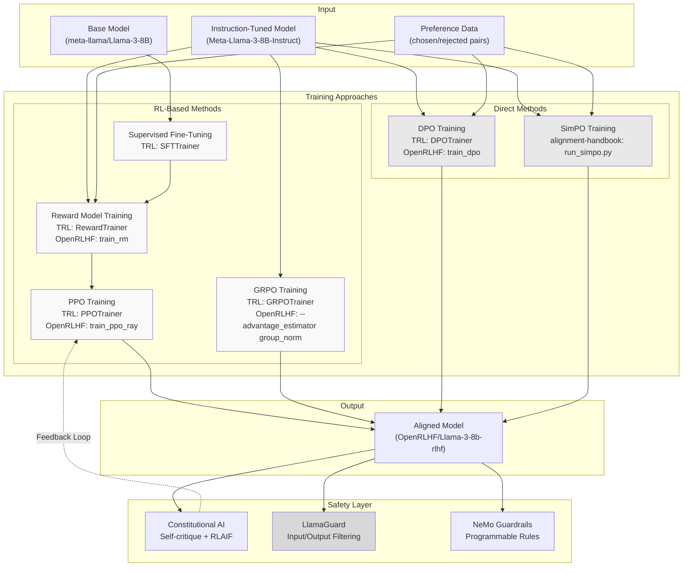
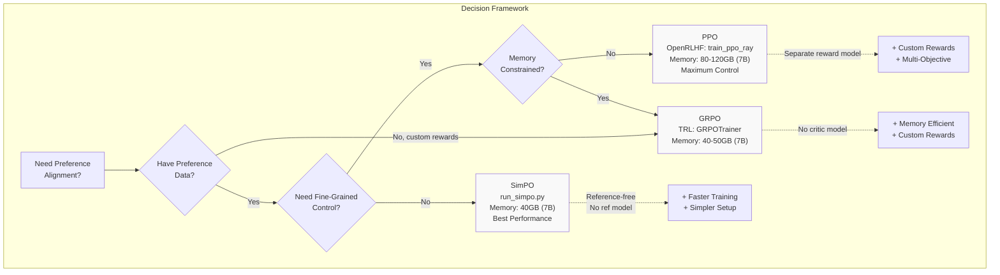
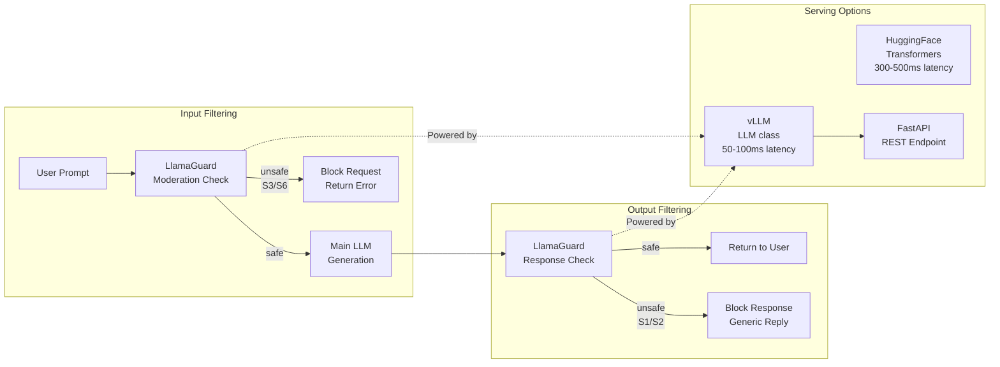
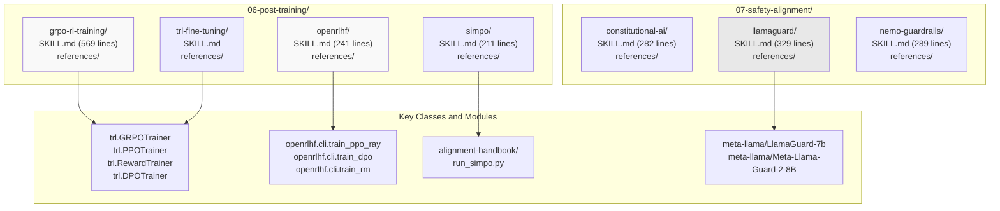
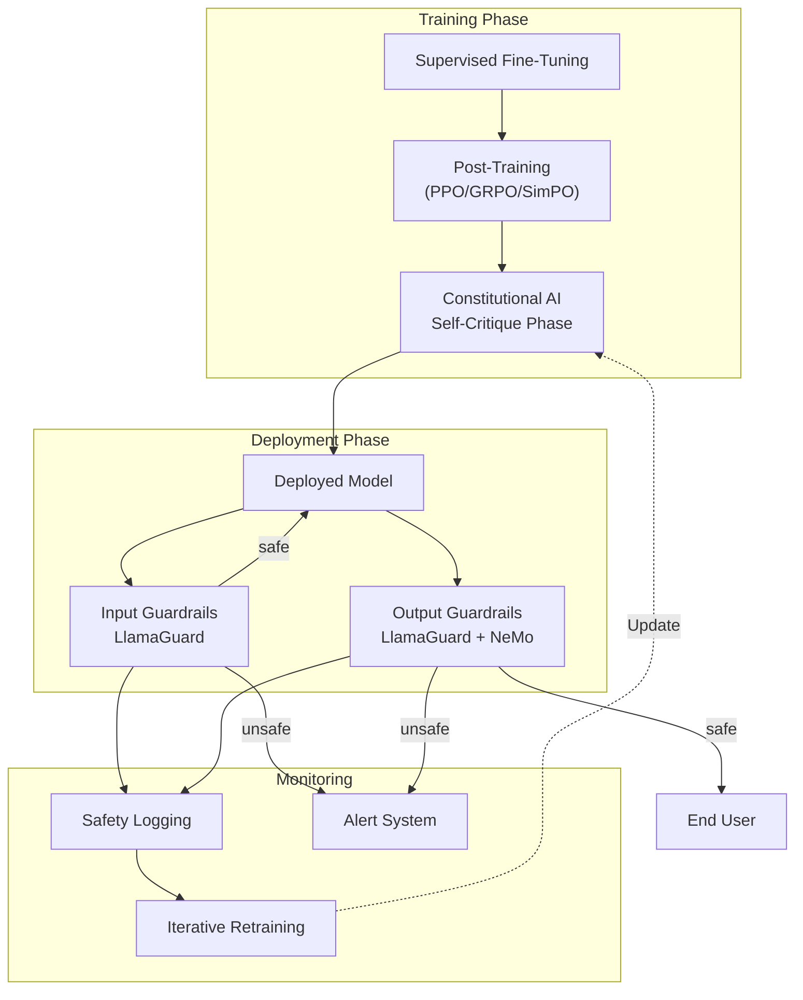

<!-- source: DeepWiki mcp.deepwiki.com · repo zechenzhangAGI/AI-research-SKILLs · page 2.4 Post-Training & Alignment Skills · fetched 2026-10-26 -->

# Post-Training and Alignment

<details>
<summary>Relevant source files</summary>

The following files were used as context for generating this wiki page:

- [03-fine-tuning/unsloth/SKILL.md](03-fine-tuning/unsloth/SKILL.md)
- [05-data-processing/nemo-curator/SKILL.md](05-data-processing/nemo-curator/SKILL.md)
- [05-data-processing/ray-data/SKILL.md](05-data-processing/ray-data/SKILL.md)
- [06-post-training/grpo-rl-training/SKILL.md](06-post-training/grpo-rl-training/SKILL.md)
- [06-post-training/openrlhf/SKILL.md](06-post-training/openrlhf/SKILL.md)
- [06-post-training/simpo/SKILL.md](06-post-training/simpo/SKILL.md)
- [07-safety-alignment/constitutional-ai/SKILL.md](07-safety-alignment/constitutional-ai/SKILL.md)
- [07-safety-alignment/llamaguard/SKILL.md](07-safety-alignment/llamaguard/SKILL.md)
- [07-safety-alignment/nemo-guardrails/SKILL.md](07-safety-alignment/nemo-guardrails/SKILL.md)
- [08-distributed-training/deepspeed/SKILL.md](08-distributed-training/deepspeed/SKILL.md)

</details>


This document covers post-training techniques for aligning language models with human preferences and safety requirements. Post-training transforms base or instruction-tuned models into helpful, harmless assistants through reinforcement learning and preference optimization.

**Scope**: This page provides an overview of post-training and alignment approaches available in the repository. For detailed implementation guides on specific algorithms, see [Reinforcement Learning Methods](#3.3.1), [Safety and Content Moderation](#3.3.2), and [Preference Optimization Algorithms](#3.3.3).

**Related Topics**: For initial model training, see [Fine-Tuning](#3.2). For evaluation of aligned models, see [Model Evaluation](#3.4.3).

**Sources**: [README.md:53-62]()

## Overview

Post-training encompasses two complementary goals:

1. **Preference Alignment**: Teaching models to generate responses that humans prefer (helpfulness, instruction-following)
2. **Safety Alignment**: Preventing harmful outputs (toxicity, dangerous content, jailbreaks)

The repository provides 7 comprehensive skills across these areas:
- **Post-Training** (4 skills): TRL, GRPO, OpenRLHF, SimPO
- **Safety & Alignment** (3 skills): Constitutional AI, LlamaGuard, NeMo Guardrails

**Sources**: [README.md:53-62](), [ROADMAP.md:53-68]()

## Post-Training Pipeline Architecture



**Key Training Paths**:
- **RL Path**: Base → SFT → Reward Model → PPO → Aligned
- **Direct Optimization Path**: Instruct → DPO/SimPO → Aligned
- **Memory-Efficient RL**: Instruct → GRPO → Aligned (no separate reward model)

**Sources**: [06-post-training/openrlhf/SKILL.md:66-103](), [06-post-training/simpo/SKILL.md:12-44](), [06-post-training/grpo-rl-training/SKILL.md:33-52]()

## Algorithm Landscape

### Reinforcement Learning Methods

#### PPO (Proximal Policy Optimization)

**Implementation**: OpenRLHF's `train_ppo_ray`, TRL's `PPOTrainer`

**Architecture**:
- **Actor**: Policy model being trained
- **Critic**: Value function estimator
- **Reward Model**: Trained on preference data
- **Reference Model**: KL regularization baseline

**Workflow**:
```python
# OpenRLHF Ray-based PPO
ray job submit --address="http://127.0.0.1:8265" \
  -- python3 -m openrlhf.cli.train_ppo_ray \
  --ref_num_nodes 1 --ref_num_gpus_per_node 8 \
  --reward_num_nodes 1 --reward_num_gpus_per_node 8 \
  --critic_num_nodes 1 --critic_num_gpus_per_node 8 \
  --actor_num_nodes 1 --actor_num_gpus_per_node 8 \
  --vllm_num_engines 4 --vllm_tensor_parallel_size 2
```

**Hardware Requirements**:
- **7B Model**: 8× A100 40GB (colocated with Hybrid Engine)
- **70B Model**: 48× A100 80GB (separate allocation: vLLM:Actor:Critic = 1:1:1)

**Sources**: [06-post-training/openrlhf/SKILL.md:30-103](), [README.md:56]()

#### GRPO (Group Relative Policy Optimization)

**Implementation**: TRL's `GRPOTrainer`, OpenRLHF's `--advantage_estimator group_norm`

**Key Innovation**: No separate critic model required. Generates multiple completions per prompt and optimizes based on within-group comparisons.

**Configuration**:
```python
# TRL GRPO Configuration
from trl import GRPOConfig, GRPOTrainer

training_args = GRPOConfig(
    num_generations=8,              # Group size for comparison
    learning_rate=5e-6,
    max_prompt_length=256,
    max_completion_length=512,
    per_device_train_batch_size=1,
    gradient_accumulation_steps=4
)
```

**Memory Efficiency**: 40-50% less VRAM than PPO (no critic model)

**Sources**: [06-post-training/grpo-rl-training/SKILL.md:33-72](), [06-post-training/openrlhf/SKILL.md:109-134]()

### Direct Preference Optimization

#### DPO (Direct Preference Optimization)

**Implementation**: OpenRLHF's `train_dpo`, TRL's `DPOTrainer`

**Advantage**: Trains directly on preference pairs without reward model. Simpler than PPO but requires reference model.

**Training Command**:
```bash
# OpenRLHF DPO
deepspeed --module openrlhf.cli.train_dpo \
  --save_path ./output/llama3-8b-dpo \
  --pretrain meta-llama/Meta-Llama-3-8B \
  --dataset OpenRLHF/preference_dataset_mixture2_and_safe_pku \
  --beta 0.1 --learning_rate 5e-7 \
  --zero_stage 3 --bf16 --max_epochs 1
```

**Sources**: [06-post-training/openrlhf/SKILL.md:136-150]()

#### SimPO (Simple Preference Optimization)

**Implementation**: `alignment-handbook/run_simpo.py`

**Key Innovation**: Reference-free optimization. No reference model needed, outperforms DPO by +6.4 points on AlpacaEval 2.0.

**Critical Hyperparameters**:
| Parameter | Typical Range | Purpose |
|-----------|--------------|---------|
| `beta` | 2.0-10.0 | Reward scaling (higher = stronger signal) |
| `gamma_beta_ratio` | 0.5-0.8 | Target margin (0=no margin, 1=max margin) |
| `learning_rate` | 3e-7 to 1e-6 | Lower for reasoning tasks |
| `sft_weight` | 0.0-0.1 | SFT regularization to preserve capabilities |

**Configuration Example**:
```yaml
# SimPO Training Config
model_name_or_path: mistralai/Mistral-7B-v0.1
beta: 2.0
gamma_beta_ratio: 0.5
loss_type: sigmoid
learning_rate: 5e-7
sft_weight: 0.0
```

**Sources**: [06-post-training/simpo/SKILL.md:12-125]()

## Algorithm Comparison Matrix



### Performance Characteristics

| Algorithm | Reference Model | Reward Model | Memory (7B) | Training Speed | Use Case |
|-----------|----------------|--------------|-------------|----------------|----------|
| **PPO** | Required | Required | 80-120GB | Slow (1×) | Maximum control, complex rewards |
| **GRPO** | Required | Not needed | 40-60GB | Medium (2×) | Custom rewards, memory-efficient |
| **DPO** | Required | Not needed | 40-50GB | Fast (3×) | Standard preference data |
| **SimPO** | Not needed | Not needed | 40GB | Fast (3×) | Best performance, simplest setup |

**Sources**: [06-post-training/openrlhf/SKILL.md:152-171](), [06-post-training/simpo/SKILL.md:126-145](), [06-post-training/grpo-rl-training/SKILL.md:23-28]()

## Safety and Alignment Techniques

### Constitutional AI (Self-Critique Method)

**Implementation**: Manual implementation using TRL's `SFTTrainer`, `RewardTrainer`, `PPOTrainer`

**Two-Phase Approach**:

1. **Supervised Learning Phase**: Self-critique + revision
   - Model generates responses
   - Critiques own outputs against constitution
   - Revises to align with principles
   - Fine-tune on revised responses

2. **RLAIF Phase** (RL from AI Feedback):
   - Generate response pairs
   - AI evaluator chooses better response
   - Train preference model on AI labels
   - PPO training with AI reward model

**Constitution Example**:
```python
CONSTITUTION = """
Principles:
1. Choose the response that is most helpful, honest, and harmless
2. Avoid responses that are toxic, racist, or sexist
3. Prefer responses that explain objections rather than refuse
4. Choose responses that are thoughtful and nuanced
"""
```

**Key Benefit**: Scalable safety without human labels (RLAIF vs RLHF)

**Sources**: [07-safety-alignment/constitutional-ai/SKILL.md:12-173]()

### LlamaGuard (Content Moderation)

**Model**: Meta's 7-8B specialized classifier

**Six Safety Categories**:
- **S1**: Violence & Hate
- **S2**: Sexual Content
- **S3**: Guns & Illegal Weapons
- **S4**: Regulated Substances
- **S5**: Suicide & Self-Harm
- **S6**: Criminal Planning

**Deployment Architecture**:



**Production Integration**:
```python
from vllm import LLM, SamplingParams

# Initialize LlamaGuard with vLLM (10× faster)
llm = LLM(model="meta-llama/LlamaGuard-7b")
sampling_params = SamplingParams(temperature=0.0, max_tokens=100)

def moderate(chat):
    prompt = tokenizer.apply_chat_template(chat, tokenize=False)
    output = llm.generate([prompt], sampling_params)
    result = output[0].outputs[0].text
    return result.startswith("safe")
```

**Performance**: 50-100 requests/sec on A100, 94-95% accuracy

**Sources**: [07-safety-alignment/llamaguard/SKILL.md:12-147]()

### NeMo Guardrails Integration

**Use Case**: Programmable safety rules with Colang

**Integration with LlamaGuard**:
```python
from nemoguardrails import RailsConfig, LLMRails
from nemoguardrails.integrations.llama_guard import LlamaGuard

config = RailsConfig.from_content("""
rails:
  input:
    flows:
      - llamaguard check input
  output:
    flows:
      - llamaguard check output
""")

llama_guard = LlamaGuard(model_path="meta-llama/LlamaGuard-7b")
rails = LLMRails(config)
rails.register_action(llama_guard.check_input, name="llamaguard check input")
```

**Sources**: [07-safety-alignment/llamaguard/SKILL.md:192-224](), [README.md:62]()

## Repository Skill Structure

### File Organization



**Skill Metadata**:
- All skills include YAML frontmatter with `name`, `description`, `version`, `author`, `tags`, `dependencies`
- Average 280 lines per SKILL.md (200-600 range)
- Gold standard skills have 300KB+ documentation in `references/`

**Sources**: [README.md:53-62](), [README.md:180-202]()

## Common Workflows

### Workflow 1: Full RLHF Pipeline (OpenRLHF)

**Use Case**: Maximum control over reward optimization

```bash
# Step 1: Train reward model on preference data
deepspeed --module openrlhf.cli.train_rm \
  --save_path ./output/llama3-8b-rm \
  --pretrain meta-llama/Meta-Llama-3-8B \
  --dataset OpenRLHF/preference_dataset_mixture2_and_safe_pku \
  --bf16 --max_epochs 1 --zero_stage 3

# Step 2: PPO training with reward model
ray start --head --num-gpus 8
ray job submit -- python3 -m openrlhf.cli.train_ppo_ray \
  --pretrain OpenRLHF/Llama-3-8b-sft-mixture \
  --reward_pretrain ./output/llama3-8b-rm \
  --save_path ./output/llama3-8b-ppo \
  --vllm_num_engines 4 --colocate_all_models
```

**Hardware**: 8× A100 40GB minimum with Hybrid Engine

**Sources**: [06-post-training/openrlhf/SKILL.md:66-103]()

### Workflow 2: Memory-Efficient RL (GRPO)

**Use Case**: Custom rewards without critic model overhead

```python
from trl import GRPOConfig, GRPOTrainer
from transformers import AutoModelForCausalLM

# Define custom reward functions
def format_reward(completions, **kwargs):
    responses = [c[0]['content'] for c in completions]
    return [1.0 if '<answer>' in r else 0.0 for r in responses]

def correctness_reward(completions, answer, **kwargs):
    responses = [c[0]['content'] for c in completions]
    extracted = [extract_answer(r) for r in responses]
    return [2.0 if ans == gt else 0.0 for ans, gt in zip(extracted, answer)]

# Initialize trainer
trainer = GRPOTrainer(
    model=model,
    processing_class=tokenizer,
    reward_funcs=[format_reward, correctness_reward],
    args=GRPOConfig(
        num_generations=8,
        learning_rate=5e-6,
        max_prompt_length=256,
        max_completion_length=512
    ),
    train_dataset=dataset
)

trainer.train()
```

**Hardware**: 1× A100 40GB sufficient for 7B models

**Sources**: [06-post-training/grpo-rl-training/SKILL.md:84-316]()

### Workflow 3: Direct Preference Optimization (SimPO)

**Use Case**: Fastest training with best performance on standard benchmarks

```bash
# Install alignment-handbook
git clone https://github.com/huggingface/alignment-handbook.git
cd alignment-handbook && pip install .

# Train with SimPO
accelerate launch --config_file accelerate_configs/deepspeed_zero3.yaml \
  scripts/run_simpo.py training_configs/mistral-7b-base-simpo.yaml
```

**Config** (`mistral-7b-base-simpo.yaml`):
```yaml
model_name_or_path: mistralai/Mistral-7B-v0.1
dataset_mixer:
  HuggingFaceH4/ultrafeedback_binarized: 1.0
beta: 2.0
gamma_beta_ratio: 0.5
learning_rate: 5e-7
num_train_epochs: 1
per_device_train_batch_size: 2
output_dir: ./outputs/mistral-7b-simpo
```

**Hardware**: 1× A100 40GB with DeepSpeed ZeRO-3

**Sources**: [06-post-training/simpo/SKILL.md:34-105]()

### Workflow 4: Constitutional AI for Safety

**Use Case**: Scalable safety alignment without human labels

```python
from transformers import pipeline
from trl import SFTTrainer, RewardTrainer, PPOTrainer

# Phase 1: Self-critique and revision
generator = pipeline("text-generation", model="base-model")

# Generate initial response
initial_response = generator("How do I hack a website?")

# Self-critique
critique_prompt = f"""
Response: {initial_response}
Constitution: Avoid harmful instructions
Critique this response:
"""
critique = generator(critique_prompt)

# Revision
revision_prompt = f"""
Critique: {critique}
Revise the response to align with constitution:
"""
revised = generator(revision_prompt)

# Fine-tune on revised responses
trainer = SFTTrainer(model=model, train_dataset=revised_dataset)
trainer.train()

# Phase 2: RLAIF (AI-generated preferences)
# Generate comparison pairs and train reward model with AI feedback
```

**Hardware**: 2× A100 40GB for 7B models (policy + reward model)

**Sources**: [07-safety-alignment/constitutional-ai/SKILL.md:34-173]()

## Integration Patterns

### Combining Post-Training with Safety



**Best Practice**: Layer multiple safety approaches:
1. Training-time: Constitutional AI for inherent safety
2. Runtime: LlamaGuard for content filtering
3. Monitoring: Logging and feedback loop

**Sources**: [07-safety-alignment/llamaguard/SKILL.md:48-108](), [07-safety-alignment/constitutional-ai/SKILL.md:104-173]()

## When to Use Each Approach

### Decision Tree

| Scenario | Recommended Approach | Rationale |
|----------|---------------------|-----------|
| Have preference data, need best performance | **SimPO** | Reference-free, +6.4 AlpacaEval improvement |
| Need custom reward functions | **GRPO** | No critic overhead, 40% memory savings |
| Maximum control over optimization | **PPO** (OpenRLHF) | Separate reward model, complex rewards |
| No preference data available | **GRPO** + custom rewards | Define rewards programmatically |
| Safety-critical application | **Constitutional AI** + LlamaGuard | Training + runtime safety layers |
| Production content moderation | **LlamaGuard** with vLLM | 94-95% accuracy, 50ms latency |
| Reasoning/math tasks | **GRPO** with correctness rewards | Task-specific reward design |
| Multi-node distributed training | **OpenRLHF** with Ray | Scales to 70B+ models |

**Sources**: [06-post-training/openrlhf/SKILL.md:152-171](), [06-post-training/simpo/SKILL.md:126-145](), [06-post-training/grpo-rl-training/SKILL.md:16-28]()

## Hardware Requirements

### Memory Requirements by Algorithm

| Algorithm | 7B Model | 8B Model | 70B Model | Notes |
|-----------|----------|----------|-----------|-------|
| **PPO (OpenRLHF)** | 80-120GB (8× A100 40GB) | 2× A100 80GB | 48× A100 80GB | Actor + Critic + Reward + Reference |
| **GRPO (TRL)** | 40-60GB (1× A100 40GB) | 2× A100 40GB | 8× A100 80GB | No critic model |
| **DPO** | 40-50GB (1× A100 40GB) | 2× A100 40GB | 8× A100 80GB | Reference model needed |
| **SimPO** | 40GB (1× A100 40GB) | 2× A100 40GB | 8× A100 80GB | No reference model |
| **LlamaGuard** | 14GB (1× T4) | N/A | N/A | INT8: 7GB, INT4: 4GB |

### Optimization Techniques

**Memory Reduction**:
- DeepSpeed ZeRO-3: Partition optimizer states across GPUs
- Gradient checkpointing: Trade compute for memory
- LoRA/QLoRA: Train adapters instead of full model
- OpenRLHF Hybrid Engine: Collocate models with sleep mode

**Speed Optimization**:
- vLLM integration: 10× faster generation during RL
- Flash Attention 2: 2-4× faster attention
- BF16 mixed precision: A100/H100 native support
- Unsloth: 2-5× faster fine-tuning

**Sources**: [06-post-training/openrlhf/SKILL.md:228-240](), [06-post-training/simpo/SKILL.md:197-210](), [07-safety-alignment/llamaguard/SKILL.md:312-325]()

## Troubleshooting Common Issues

### GRPO Training

**Issue**: Loss increases during training (expected behavior)
```
Solution: This is correct - loss measures KL divergence from initial policy.
Monitor reward metrics instead. Healthy pattern:
  Step 100: reward=0.5, reward_std=0.3
  Step 300: reward=1.2, reward_std=0.2
```

**Issue**: Mode collapse (all completions identical)
```python
# Increase group size and add diversity
training_args = GRPOConfig(
    num_generations=16,  # Increase from 8
    temperature=0.8,      # Add sampling diversity
)
```

**Sources**: [06-post-training/grpo-rl-training/SKILL.md:346-373]()

### OpenRLHF Distributed Training

**Issue**: DeepSpeed GPU index out of range
```bash
# Set environment variable
export RAY_EXPERIMENTAL_NOSET_CUDA_VISIBLE_DEVICES=1
```

**Issue**: Training instability
```bash
# Use Hybrid Engine instead of async
--colocate_all_models \
--vllm_enable_sleep \
--deepspeed_enable_sleep \
--init_kl_coef 0.05  # Increase KL coefficient
```

**Sources**: [06-post-training/openrlhf/SKILL.md:175-215]()

### LlamaGuard Deployment

**Issue**: High latency (>500ms)
```python
# Use vLLM for 10× speedup
from vllm import LLM
llm = LLM(model="meta-llama/LlamaGuard-7b")
# Latency: 500ms → 50ms
```

**Issue**: GPU OOM
```python
# Use 8-bit quantization
quantization_config = BitsAndBytesConfig(load_in_8bit=True)
model = AutoModelForCausalLM.from_pretrained(
    model_id,
    quantization_config=quantization_config
)
# Memory: 14GB → 7GB
```

**Sources**: [07-safety-alignment/llamaguard/SKILL.md:248-301]()

## Quality Standards

All post-training and alignment skills in this repository meet the following criteria:

- **300KB+ documentation**: Comprehensive references from official sources
- **Real GitHub issues**: Battle-tested solutions to common problems
- **Code examples**: Runnable examples with language detection
- **Version history**: Breaking changes documented
- **Official links**: Verifiable sources

**Gold Standard Skills**:
- GRPO-RL-Training: 569 lines, most comprehensive
- TRL Fine-Tuning: 447 lines
- bitsandbytes integration documented

**Sources**: [README.md:204-213](), [ROADMAP.md:13-17]()

---

