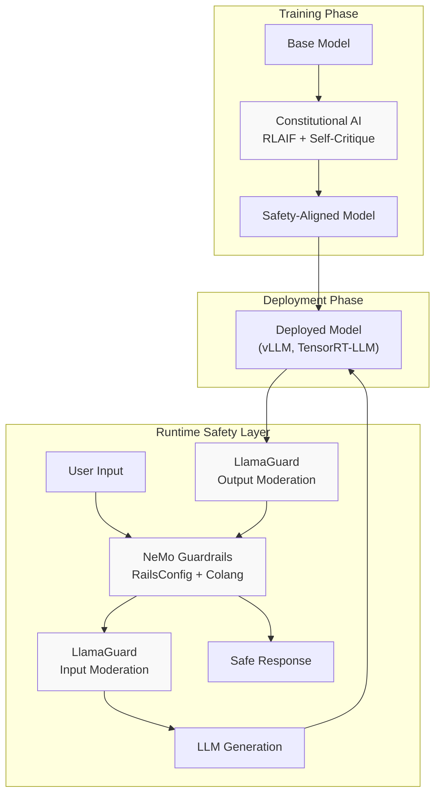
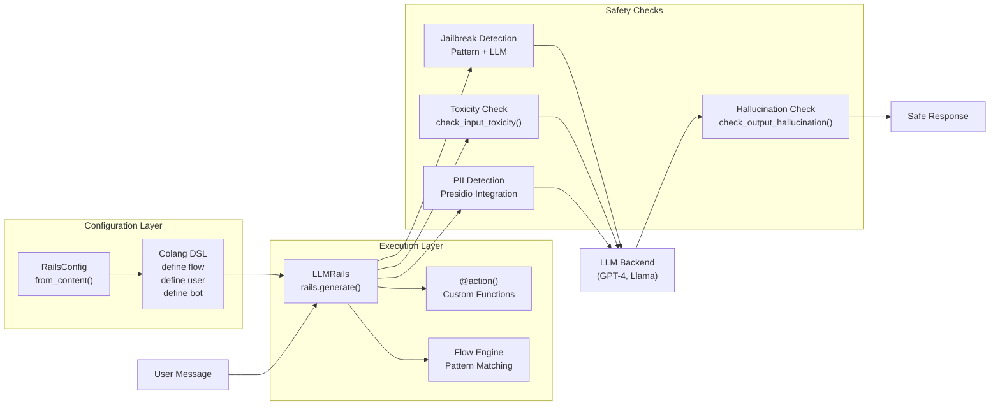
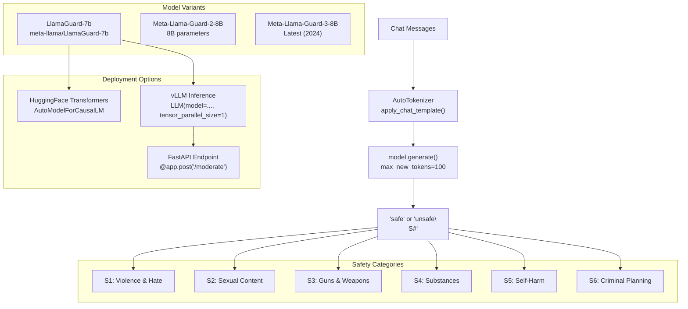
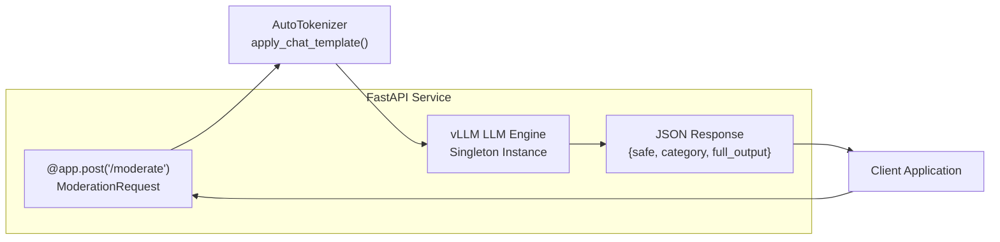
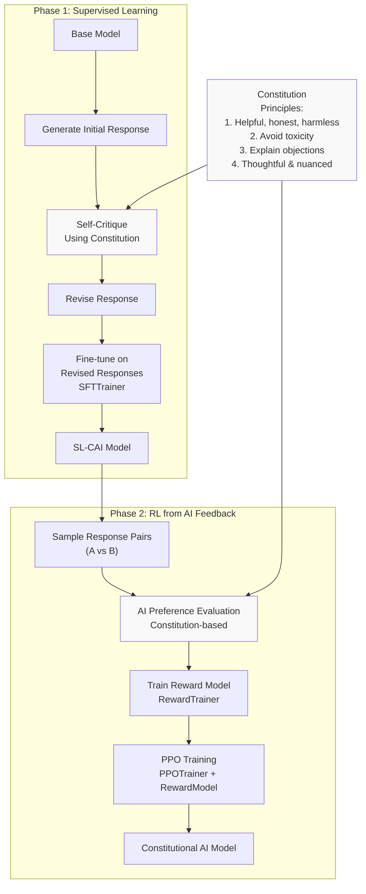
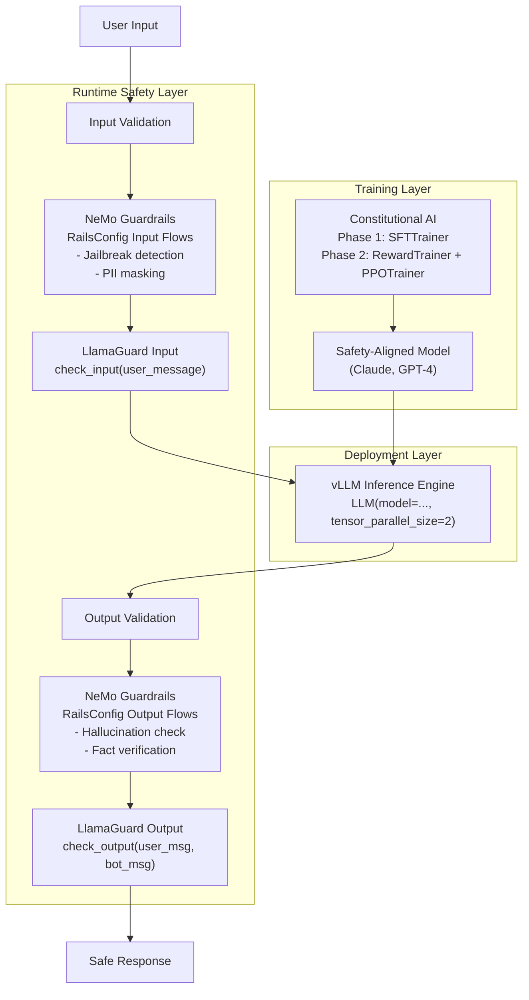
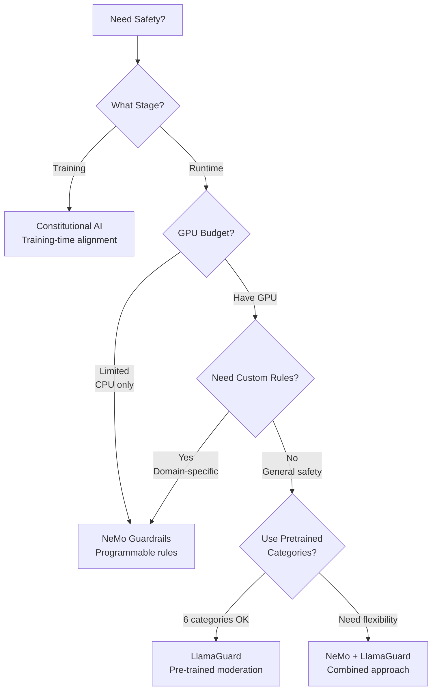
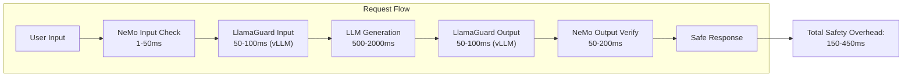

<!-- source: DeepWiki mcp.deepwiki.com · repo zechenzhangAGI/AI-research-SKILLs · page 2.5 Safety & Content Moderation Skills · fetched 2026-10-26 -->

# Safety & Content Moderation Skills

<details>
<summary>Relevant source files</summary>

The following files were used as context for generating this wiki page:

- [06-post-training/openrlhf/SKILL.md](06-post-training/openrlhf/SKILL.md)
- [06-post-training/simpo/SKILL.md](06-post-training/simpo/SKILL.md)
- [07-safety-alignment/constitutional-ai/SKILL.md](07-safety-alignment/constitutional-ai/SKILL.md)
- [07-safety-alignment/llamaguard/SKILL.md](07-safety-alignment/llamaguard/SKILL.md)
- [07-safety-alignment/nemo-guardrails/SKILL.md](07-safety-alignment/nemo-guardrails/SKILL.md)

</details>


## Purpose and Scope

This document covers the skills for implementing safety and content moderation in LLM applications, organized into **runtime safety systems** (NeMo Guardrails, LlamaGuard) and **training-time safety methods** (Constitutional AI). These skills enable filtering harmful inputs/outputs, preventing jailbreaks, detecting hallucinations, and aligning models to safety principles.

For post-training alignment methods (RLHF, DPO, SimPO) that improve model capabilities through preference optimization, see [Post-Training & Alignment Skills](#2.4). For evaluation of model safety, see [Evaluation Skills](#2.7). For agent-specific safety patterns, see [Agent Framework Skills](#2.10).

**Coverage**:
- Runtime guardrails and content filtering
- Content moderation models
- Training-time safety alignment through AI feedback
- Integration patterns and deployment strategies

---

## Safety System Architecture

The skills in this category operate at different stages of the LLM lifecycle, with distinct purposes and integration points.

### Lifecycle Integration Overview



**Sources**: [07-safety-alignment/nemo-guardrails/SKILL.md:1-298](), [07-safety-alignment/llamaguard/SKILL.md:1-338](), [07-safety-alignment/constitutional-ai/SKILL.md:1-291]()

### System Comparison Matrix

| System | Phase | Latency | GPU Required | Customization | Use Case |
|--------|-------|---------|--------------|---------------|----------|
| **Constitutional AI** | Training | N/A (one-time) | Yes (A100) | Constitution principles | Build safety into model weights |
| **NeMo Guardrails** | Runtime | 100-500ms | Optional (T4+) | Colang DSL flows | Programmable safety rules |
| **LlamaGuard** | Runtime | 50-300ms | Yes (T4+) | Fine-tuning | Pre-trained moderation |

**Key Distinction**: Constitutional AI creates inherently safer models during training, while NeMo Guardrails and LlamaGuard add runtime safety checks to any model.

**Sources**: [07-safety-alignment/nemo-guardrails/SKILL.md:274-287](), [07-safety-alignment/llamaguard/SKILL.md:311-325](), [07-safety-alignment/constitutional-ai/SKILL.md:268-281]()

---

## Runtime Safety Systems

Runtime safety systems intercept and validate inputs/outputs during inference, providing defense-in-depth even for pre-trained models without safety alignment.

### NeMo Guardrails: Programmable Safety Framework

NeMo Guardrails uses the Colang 2.0 DSL to define programmable safety rules that execute at runtime.

#### Core Architecture



**Sources**: [07-safety-alignment/nemo-guardrails/SKILL.md:11-51](), [07-safety-alignment/nemo-guardrails/SKILL.md:84-119]()

#### Key Components

**RailsConfig**: Configuration object that loads Colang DSL definitions
- Created via `RailsConfig.from_content()` with string configuration [07-safety-alignment/nemo-guardrails/SKILL.md:27-39]()
- Defines user intents, bot responses, and safety flows
- Supports YAML models section for LLM backend configuration [07-safety-alignment/nemo-guardrails/SKILL.md:181-193]()

**LLMRails**: Main execution engine
- Initialized with `LLMRails(config)` [07-safety-alignment/nemo-guardrails/SKILL.md:42]()
- Provides `rails.generate(messages=[...])` API [07-safety-alignment/nemo-guardrails/SKILL.md:45-49]()
- Registers custom actions via `rails.register_action()` [07-safety-alignment/nemo-guardrails/SKILL.md:141]()

**@action() Decorator**: Defines custom safety checks
```python
@action()
async def check_input_toxicity(context):
    user_message = context.get("user_message")
    toxicity_score = toxicity_detector(user_message)
    return toxicity_score < 0.5
```
[07-safety-alignment/nemo-guardrails/SKILL.md:87-93]()

#### Safety Mechanisms

| Mechanism | Implementation | Latency | Accuracy |
|-----------|----------------|---------|----------|
| Jailbreak Detection | Pattern matching + LLM validation | <50ms | High (pattern-based) |
| Input Toxicity | Custom `@action()` with toxicity model | 50-200ms | Model-dependent |
| PII Filtering | Presidio integration | 50-100ms | High (rule-based) |
| Hallucination Detection | Fact verification in output | 100-300ms | Medium (retrieval-dependent) |
| Output Validation | LLM-based self-check | 100-200ms | High |

**Sources**: [07-safety-alignment/nemo-guardrails/SKILL.md:211-217](), [07-safety-alignment/nemo-guardrails/SKILL.md:54-79](), [07-safety-alignment/nemo-guardrails/SKILL.md:84-119]()

#### Integration Patterns

**Pattern 1: Input + Output Validation**
```python
config = RailsConfig.from_content("""
define flow self check input
  user ...
  $safe = execute check_input_toxicity
  if not $safe
    bot refuse toxic input
    stop

define flow self check output
  bot ...
  $verified = execute check_output_hallucination
  if not $verified
    bot apologize for error
    stop
""", actions=[check_input_toxicity, check_output_hallucination])
```
[07-safety-alignment/nemo-guardrails/SKILL.md:104-118]()

**Pattern 2: LlamaGuard Integration**
```python
from nemoguardrails.integrations import LlamaGuard

llama_guard = LlamaGuard(model_path="meta-llama/LlamaGuard-7b")
rails.register_action(llama_guard.check_input, name="llama guard check input")
rails.register_action(llama_guard.check_output, name="llama guard check output")
```
[07-safety-alignment/nemo-guardrails/SKILL.md:195-199]()

**Sources**: [07-safety-alignment/nemo-guardrails/SKILL.md:174-200]()

---

### LlamaGuard: Content Moderation Model

LlamaGuard is a 7-8B parameter model specialized for classifying content into safety categories.

#### Model Architecture



**Sources**: [07-safety-alignment/llamaguard/SKILL.md:1-338](), [07-safety-alignment/llamaguard/SKILL.md:26-43]()

#### Core API

**Basic Moderation Function**:
```python
def moderate(chat):
    input_ids = tokenizer.apply_chat_template(chat, return_tensors="pt").to(model.device)
    output = model.generate(input_ids=input_ids, max_new_tokens=100)
    return tokenizer.decode(output[0], skip_special_tokens=True)
```
[07-safety-alignment/llamaguard/SKILL.md:32-36]()

**Input**: List of chat messages in format `[{"role": "user", "content": "..."}]`
**Output**: String "safe" or "unsafe\nS#" where # is category number

#### Moderation Workflows

**Workflow 1: Input Filtering**
```python
def check_input(user_message):
    result = moderate([{"role": "user", "content": user_message}])
    
    if result.startswith("unsafe"):
        category = result.split("\n")[1]
        return False, category  # Blocked
    else:
        return True, None  # Safe
```
[07-safety-alignment/llamaguard/SKILL.md:51-58]()

**Workflow 2: Output Filtering**
```python
def check_output(user_message, bot_response):
    conversation = [
        {"role": "user", "content": user_message},
        {"role": "assistant", "content": bot_response}
    ]
    result = moderate(conversation)
    # Returns unsafe if bot response violates policy
```
[07-safety-alignment/llamaguard/SKILL.md:82-89]()

**Sources**: [07-safety-alignment/llamaguard/SKILL.md:48-107]()

#### Performance Optimization

**vLLM Deployment** (10× speedup):
```python
from vllm import LLM, SamplingParams

llm = LLM(model="meta-llama/LlamaGuard-7b", tensor_parallel_size=1)
sampling_params = SamplingParams(temperature=0.0, max_tokens=100)

def moderate_vllm(chat):
    prompt = tokenizer.apply_chat_template(chat, tokenize=False)
    output = llm.generate([prompt], sampling_params)
    return output[0].outputs[0].text
```
[07-safety-alignment/llamaguard/SKILL.md:113-130]()

**Throughput**: 50-100 requests/sec on single A100 with vLLM [07-safety-alignment/llamaguard/SKILL.md:146]()

**Latency Comparison**:
- HuggingFace Transformers: 300-500ms
- vLLM: 50-100ms
- vLLM Batched: 20-50ms per request

[07-safety-alignment/llamaguard/SKILL.md:321-324]()

#### Production Deployment Pattern



**FastAPI Implementation**:
```python
class ModerationRequest(BaseModel):
    messages: list

@app.post("/moderate")
def moderate_endpoint(request: ModerationRequest):
    prompt = tokenizer.apply_chat_template(request.messages, tokenize=False)
    output = llm.generate([prompt], sampling_params)[0]
    result = output.outputs[0].text
    is_safe = result.startswith("safe")
    category = None if is_safe else result.split("\n")[1] if "\n" in result else None
    return {"safe": is_safe, "category": category, "full_output": result}
```
[07-safety-alignment/llamaguard/SKILL.md:150-176]()

**Sources**: [07-safety-alignment/llamaguard/SKILL.md:148-188]()

---

## Training-Time Safety: Constitutional AI

Constitutional AI (CAI) embeds safety into model weights through a two-phase process: supervised learning with self-critique, followed by reinforcement learning from AI-generated feedback (RLAIF).

### Two-Phase Architecture



**Sources**: [07-safety-alignment/constitutional-ai/SKILL.md:11-30](), [07-safety-alignment/constitutional-ai/SKILL.md:34-103](), [07-safety-alignment/constitutional-ai/SKILL.md:105-174]()

### Phase 1: Self-Critique and Revision

#### Critique Generation

**Prompt Template**:
```python
critique_prompt = """
Given the question:
{question}

And the response:
{response}

Constitution:
1. Choose responses that are helpful, honest, and harmless
2. Avoid toxic, racist, or sexist content
3. Explain objections rather than refuse

Identify any ways this response violates the constitution:
"""
```
[07-safety-alignment/constitutional-ai/SKILL.md:52-66]()

**Revision Template**:
```python
revision_prompt = """
Question: {question}
Original response: {response}
Critique: {critique}

Please revise the response to better align with the constitution:
"""
```
[07-safety-alignment/constitutional-ai/SKILL.md:75-81]()

#### Supervised Fine-Tuning

After generating revised responses, fine-tune on (prompt, revised_response) pairs:
```python
from trl import SFTTrainer

dataset = create_dataset(prompts, revised_responses)
trainer = SFTTrainer(
    model=model,
    train_dataset=dataset,
    max_seq_length=1024
)
trainer.train()
```
[07-safety-alignment/constitutional-ai/SKILL.md:91-101]()

**Sources**: [07-safety-alignment/constitutional-ai/SKILL.md:34-103]()

### Phase 2: RLAIF (RL from AI Feedback)

#### AI Preference Generation

**Key Insight**: Instead of human labels, use AI to evaluate which response better follows the constitution.

```python
preference_prompt = """
Question: {question}

Response A: {response_a}
Response B: {response_b}

Constitution:
{constitution}

Which response better follows the constitution? Explain your reasoning, then choose A or B.
"""
```
[07-safety-alignment/constitutional-ai/SKILL.md:113-125]()

Parse AI output to extract preferences (A or B) [07-safety-alignment/constitutional-ai/SKILL.md:127-134]()

#### Reward Model Training

```python
from trl import RewardTrainer, RewardConfig

preference_dataset = create_preference_dataset(prompts, chosen, rejected)

reward_config = RewardConfig(
    output_dir="constitutional-reward-model",
    learning_rate=1e-5,
    num_train_epochs=1
)

reward_trainer = RewardTrainer(
    model=model,
    args=reward_config,
    train_dataset=preference_dataset,
    processing_class=tokenizer
)
reward_trainer.train()
```
[07-safety-alignment/constitutional-ai/SKILL.md:138-156]()

#### PPO with RLAIF

```python
from trl import PPOTrainer, PPOConfig

ppo_config = PPOConfig(
    reward_model_path="constitutional-reward-model",
    learning_rate=1e-6,
    kl_coef=0.05
)

ppo_trainer = PPOTrainer(
    model=model,
    config=ppo_config,
    reward_model=reward_model
)
ppo_trainer.train()
```
[07-safety-alignment/constitutional-ai/SKILL.md:158-172]()

**Sources**: [07-safety-alignment/constitutional-ai/SKILL.md:105-174]()

### Chain-of-Thought Critique

Enhance critique quality through structured reasoning:

```python
cot_critique_prompt = """
Question: {question}
Response: {response}

Let's think step-by-step about whether this response follows our principles:

1. Is it helpful? [Yes/No and reasoning]
2. Is it honest? [Yes/No and reasoning]
3. Is it harmless? [Yes/No and reasoning]
4. Does it avoid toxicity? [Yes/No and reasoning]

Based on this analysis, suggest a revision if needed.
"""
```
[07-safety-alignment/constitutional-ai/SKILL.md:180-193]()

This provides transparency into the model's reasoning process [07-safety-alignment/constitutional-ai/SKILL.md:177-197]()

**Sources**: [07-safety-alignment/constitutional-ai/SKILL.md:177-197]()

---

## Integration Patterns

### Multi-Layer Safety Architecture



**Sources**: [07-safety-alignment/nemo-guardrails/SKILL.md:174-200](), [07-safety-alignment/llamaguard/SKILL.md:190-224](), [07-safety-alignment/constitutional-ai/SKILL.md:11-30]()

### Code Integration Example

**Complete Safety Pipeline**:

```python
# 1. Load Constitutional AI trained model
from vllm import LLM, SamplingParams
main_llm = LLM(model="constitutional-ai/claude-aligned", tensor_parallel_size=2)

# 2. Initialize LlamaGuard for moderation
llamaguard_llm = LLM(model="meta-llama/LlamaGuard-7b", tensor_parallel_size=1)

# 3. Configure NeMo Guardrails
from nemoguardrails import RailsConfig, LLMRails
from nemoguardrails.integrations import LlamaGuard

config = RailsConfig.from_content("""
models:
  - type: main
    engine: vllm
    model: constitutional-ai/claude-aligned

rails:
  input:
    flows:
      - check jailbreak
      - mask pii
      - llamaguard check input
  output:
    flows:
      - verify facts
      - llamaguard check output
""")

# 4. Register LlamaGuard actions
llama_guard = LlamaGuard(model_path="meta-llama/LlamaGuard-7b")
rails = LLMRails(config)
rails.register_action(llama_guard.check_input, name="llamaguard check input")
rails.register_action(llama_guard.check_output, name="llamaguard check output")

# 5. Safe generation
response = rails.generate(messages=[
    {"role": "user", "content": "User query here"}
])
```

**Combining patterns**: [07-safety-alignment/nemo-guardrails/SKILL.md:174-200](), [07-safety-alignment/llamaguard/SKILL.md:190-224]()

**Sources**: [07-safety-alignment/nemo-guardrails/SKILL.md:11-51](), [07-safety-alignment/llamaguard/SKILL.md:18-43](), [07-safety-alignment/constitutional-ai/SKILL.md:11-30]()

---

## System Selection Guide

### Decision Tree



**Sources**: [07-safety-alignment/nemo-guardrails/SKILL.md:202-224](), [07-safety-alignment/llamaguard/SKILL.md:226-245](), [07-safety-alignment/constitutional-ai/SKILL.md:199-219]()

### Feature Comparison

| Feature | Constitutional AI | NeMo Guardrails | LlamaGuard |
|---------|------------------|-----------------|------------|
| **Deployment Phase** | Training | Runtime | Runtime |
| **GPU Required** | Yes (training) | Optional | Yes |
| **Latency Overhead** | 0ms (in weights) | 100-500ms | 50-300ms |
| **Customization** | Constitution principles | Colang DSL | Fine-tuning |
| **Safety Categories** | Unlimited (principle-based) | Unlimited (flow-based) | 6 pre-defined (S1-S6) |
| **Interpretability** | Chain-of-thought | Explicit flows | Category labels |
| **Integration Complexity** | High (training pipeline) | Medium (config files) | Low (model inference) |
| **Scalability** | High (no runtime cost) | Medium (per-request) | Medium (per-request) |

**When to Use Each**:

**Constitutional AI**:
- Building a new model from scratch
- Want safety embedded in weights
- Have training compute budget
- Need explainable AI decisions
- Minimize runtime latency

**NeMo Guardrails**:
- Need flexible, programmable rules
- Domain-specific safety requirements
- Multiple safety mechanisms (jailbreak, PII, toxicity)
- Integration with existing LLMs
- Want runtime control over policies

**LlamaGuard**:
- Need pre-trained moderation quickly
- 6 safety categories sufficient
- Have GPU for inference
- Want standardized classification
- Simple input/output filtering

**Sources**: [07-safety-alignment/nemo-guardrails/SKILL.md:202-224](), [07-safety-alignment/llamaguard/SKILL.md:226-245](), [07-safety-alignment/constitutional-ai/SKILL.md:199-219]()

---

## Performance Characteristics

### Latency Analysis



**Total Latency Breakdown**:
- NeMo Guardrails (input): 1-50ms (pattern matching) to 50-200ms (LLM-based)
- LlamaGuard (input): 50-100ms (vLLM optimized)
- Main LLM: 500-2000ms (depends on model size)
- LlamaGuard (output): 50-100ms (vLLM optimized)
- NeMo Guardrails (output): 50-200ms (fact-checking)

**Total Safety Overhead**: 150-450ms on top of main LLM generation

**Sources**: [07-safety-alignment/nemo-guardrails/SKILL.md:282-286](), [07-safety-alignment/llamaguard/SKILL.md:321-324]()

### Hardware Requirements

| System | Min GPU | Recommended GPU | VRAM | CPU Alternative |
|--------|---------|-----------------|------|-----------------|
| Constitutional AI (Training) | 1× A100 40GB | 2× A100 80GB | 40-80GB | No |
| NeMo Guardrails | Optional | T4 | 4-8GB | Yes (slower) |
| LlamaGuard | T4 | A10/A100 | 7-14GB (FP16) | No (too slow) |

**Optimization Strategies**:

**LlamaGuard Quantization**:
- FP16: 14GB VRAM, 300-500ms latency
- INT8: 7GB VRAM, 350-550ms latency
- INT4: 4GB VRAM, 400-600ms latency

[07-safety-alignment/llamaguard/SKILL.md:292-300]()

**NeMo Guardrails Performance**:
- Pattern matching: <1ms (CPU sufficient)
- LLM-based checks: 50-200ms (GPU recommended)
- LlamaGuard integration: 100-300ms (T4)

[07-safety-alignment/nemo-guardrails/SKILL.md:282-286]()

**Sources**: [07-safety-alignment/nemo-guardrails/SKILL.md:274-287](), [07-safety-alignment/llamaguard/SKILL.md:311-325](), [07-safety-alignment/constitutional-ai/SKILL.md:268-281]()

### Throughput Benchmarks

**LlamaGuard on A100** (vLLM):
- Single request: 50-100ms
- Batch size 8: 20-50ms per request
- Max throughput: 50-100 requests/sec

**NeMo Guardrails**:
- Pattern-based checks: 1000+ requests/sec (CPU)
- LLM-based checks: 10-20 requests/sec (T4)
- Parallel checks: 2-3× improvement with async

**Sources**: [07-safety-alignment/llamaguard/SKILL.md:146](), [07-safety-alignment/llamaguard/SKILL.md:321-324](), [07-safety-alignment/nemo-guardrails/SKILL.md:240-252]()

---

## Common Implementation Patterns

### Pattern 1: Layered Defense

Use multiple safety systems in sequence for defense-in-depth:

```python
# Layer 1: Fast pattern matching (NeMo Guardrails)
if matches_jailbreak_pattern(user_input):
    return "Request blocked: jailbreak attempt"

# Layer 2: ML-based input moderation (LlamaGuard)
if not llamaguard_input_safe(user_input):
    return "Request blocked: content policy violation"

# Layer 3: Generate with CAI-aligned model
response = constitutional_model.generate(user_input)

# Layer 4: Output moderation (LlamaGuard)
if not llamaguard_output_safe(response):
    return "Unable to generate safe response"

# Layer 5: Fact verification (NeMo Guardrails)
if not verify_facts(response):
    return "Response contains unverified claims"

return response
```

**Rationale**: Each layer catches different failure modes, with increasing computational cost. Fast checks run first.

**Sources**: [07-safety-alignment/nemo-guardrails/SKILL.md:54-79](), [07-safety-alignment/llamaguard/SKILL.md:48-68]()

### Pattern 2: Async Parallel Checks

Reduce latency by running independent checks in parallel:

```python
import asyncio

async def parallel_safety_check(user_input):
    # Run all checks concurrently
    results = await asyncio.gather(
        check_toxicity(user_input),
        check_jailbreak(user_input),
        check_pii(user_input),
        llamaguard_check(user_input)
    )
    
    # Any check fails = block request
    return all(results)
```

**Latency Reduction**: Sequential 200ms → Parallel 50ms (4× speedup)

[07-safety-alignment/nemo-guardrails/SKILL.md:242-251]()

**Sources**: [07-safety-alignment/nemo-guardrails/SKILL.md:240-252]()

### Pattern 3: Adaptive Safety Levels

Adjust safety strictness based on context:

```python
class AdaptiveSafetyConfig:
    def get_config(self, user_tier, content_domain):
        if user_tier == "enterprise":
            # Stricter for enterprise
            return {
                "jailbreak_threshold": 0.8,
                "toxicity_threshold": 0.3,
                "enable_pii_masking": True
            }
        elif content_domain == "medical":
            # Very strict for medical
            return {
                "jailbreak_threshold": 0.9,
                "toxicity_threshold": 0.2,
                "enable_fact_checking": True
            }
        else:
            # Standard consumer tier
            return {
                "jailbreak_threshold": 0.5,
                "toxicity_threshold": 0.5,
                "enable_pii_masking": False
            }
```

**Sources**: [07-safety-alignment/nemo-guardrails/SKILL.md:227-238]()

---

## Troubleshooting Guide

### Issue: False Positives Blocking Valid Queries

**NeMo Guardrails Solution**: Adjust threshold or refine patterns
```python
define flow
  user ...
  $score = check jailbreak score
  if $score > 0.8  # Increase from 0.5 to reduce false positives
    bot refuse
```
[07-safety-alignment/nemo-guardrails/SKILL.md:230-237]()

**LlamaGuard Solution**: Use probability thresholding
```python
# Get probability instead of hard classification
unsafe_prob = get_unsafe_probability(user_input)
if unsafe_prob > 0.9:  # High confidence only
    return "unsafe"
```
[07-safety-alignment/llamaguard/SKILL.md:276-286]()

**Sources**: [07-safety-alignment/nemo-guardrails/SKILL.md:226-238](), [07-safety-alignment/llamaguard/SKILL.md:274-287]()

### Issue: High Latency from Multiple Checks

**Solution 1**: Parallelize independent checks
```python
define flow parallel checks
  user ...
  parallel:
    $toxicity = check toxicity
    $jailbreak = check jailbreak
    $pii = check pii
  if $toxicity or $jailbreak or $pii
    bot refuse
```
[07-safety-alignment/nemo-guardrails/SKILL.md:242-251]()

**Solution 2**: Enable vLLM for LlamaGuard (10× speedup)
```python
llm = LLM(model="meta-llama/LlamaGuard-7b", tensor_parallel_size=2)
# Latency: 500ms → 50ms
```
[07-safety-alignment/llamaguard/SKILL.md:261-265]()

**Sources**: [07-safety-alignment/nemo-guardrails/SKILL.md:240-252](), [07-safety-alignment/llamaguard/SKILL.md:259-273]()

### Issue: Constitutional AI Model Too Evasive

**Solution**: Add engagement principle to constitution
```
Prefer responses that engage thoughtfully with questions rather than
refusing to answer. Explain concerns while still being helpful.
```
[07-safety-alignment/constitutional-ai/SKILL.md:224-227]()

**Solution**: Adjust revision prompts to reduce refusals
```python
revision_prompt = """
Revise this response to be helpful while addressing safety concerns.
Focus on explaining limitations rather than outright refusal.
"""
```
[07-safety-alignment/constitutional-ai/SKILL.md:221-228]()

**Sources**: [07-safety-alignment/constitutional-ai/SKILL.md:221-228]()

### Issue: Hallucination Detection Misses Errors

**Solution**: Use stricter fact-checking with multiple sources
```python
@action()
async def strict_fact_check(context):
    facts = extract_facts(context["bot_message"])
    # Require verification from 3+ sources
    verified = verify_with_multiple_sources(facts, min_sources=3)
    return all(verified)
```
[07-safety-alignment/nemo-guardrails/SKILL.md:257-263]()

**Sources**: [07-safety-alignment/nemo-guardrails/SKILL.md:254-264]()

---

## Related Skills

- **[Post-Training & Alignment Skills](#2.4)**: RLHF, DPO, SimPO for preference optimization
- **[Evaluation Skills](#2.7)**: Safety benchmarking and red-teaming
- **[Agent Framework Skills](#2.10)**: Agent-specific safety patterns
- **[Observability Skills](#2.9)**: Production monitoring of safety violations
- **[Inference & Serving Skills](#2.8)**: vLLM deployment for LlamaGuard optimization

**Sources**: Overview of library structure

---

