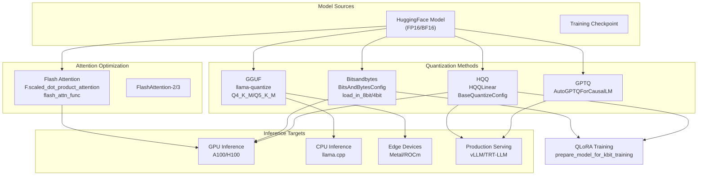
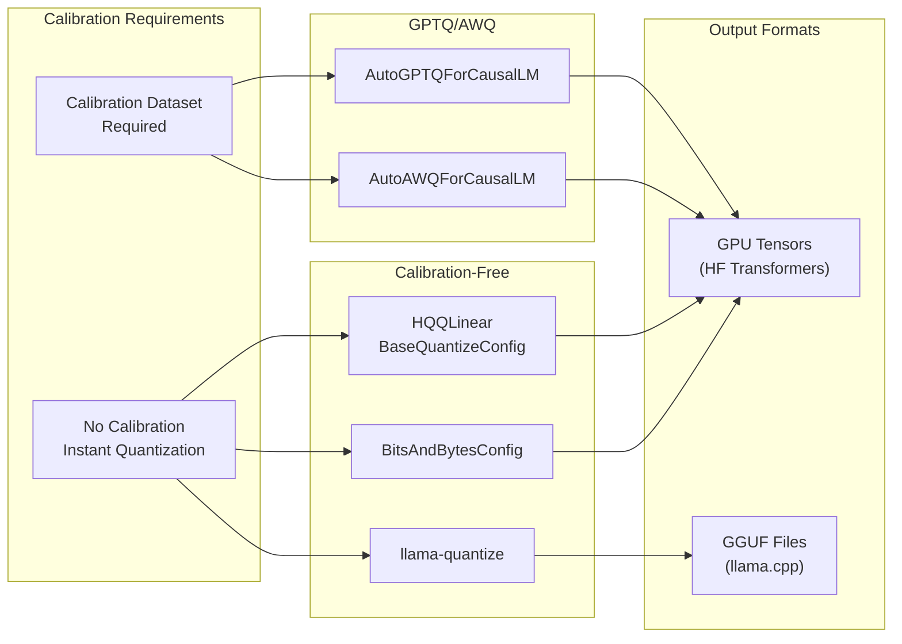
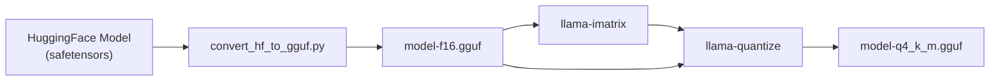
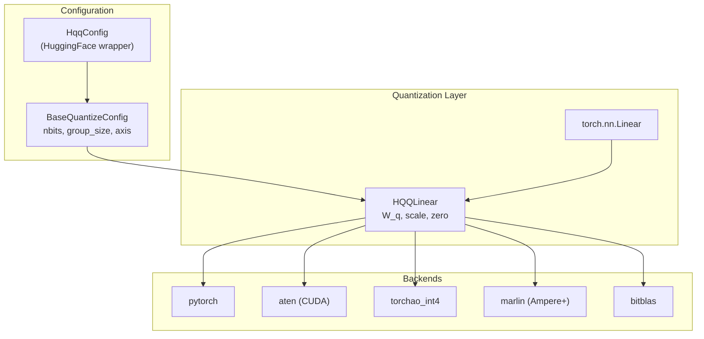
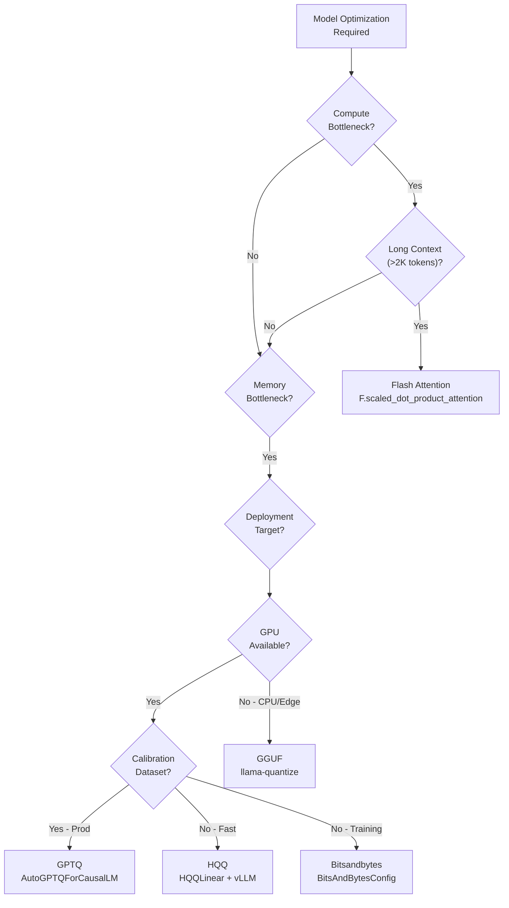

<!-- source: DeepWiki mcp.deepwiki.com · repo zechenzhangAGI/AI-research-SKILLs · page 2.6 Optimization Skills · fetched 2026-10-26 -->

# Optimization Skills

<details>
<summary>Relevant source files</summary>

The following files were used as context for generating this wiki page:

- [10-optimization/bitsandbytes/SKILL.md](10-optimization/bitsandbytes/SKILL.md)
- [10-optimization/flash-attention/SKILL.md](10-optimization/flash-attention/SKILL.md)
- [10-optimization/flash-attention/references/benchmarks.md](10-optimization/flash-attention/references/benchmarks.md)
- [10-optimization/flash-attention/references/transformers-integration.md](10-optimization/flash-attention/references/transformers-integration.md)
- [10-optimization/gguf/SKILL.md](10-optimization/gguf/SKILL.md)
- [10-optimization/gguf/references/advanced-usage.md](10-optimization/gguf/references/advanced-usage.md)
- [10-optimization/gguf/references/troubleshooting.md](10-optimization/gguf/references/troubleshooting.md)
- [10-optimization/hqq/SKILL.md](10-optimization/hqq/SKILL.md)
- [10-optimization/hqq/references/advanced-usage.md](10-optimization/hqq/references/advanced-usage.md)
- [10-optimization/hqq/references/troubleshooting.md](10-optimization/hqq/references/troubleshooting.md)
- [14-agents/autogpt/SKILL.md](14-agents/autogpt/SKILL.md)
- [14-agents/autogpt/references/advanced-usage.md](14-agents/autogpt/references/advanced-usage.md)
- [14-agents/autogpt/references/troubleshooting.md](14-agents/autogpt/references/troubleshooting.md)
- [17-observability/phoenix/SKILL.md](17-observability/phoenix/SKILL.md)
- [17-observability/phoenix/references/advanced-usage.md](17-observability/phoenix/references/advanced-usage.md)

</details>


This page covers optimization techniques for reducing LLM memory footprint, accelerating inference, and enabling deployment on resource-constrained hardware. The optimization skills in this category include attention acceleration (Flash Attention) and model quantization methods (Bitsandbytes, GGUF, HQQ, GPTQ). For training optimization and distributed systems, see [Training & Fine-Tuning Skills](#2.3). For inference serving infrastructure, see [Inference & Serving Skills](#2.8).

## Overview

Optimization skills address two primary bottlenecks in LLM deployment:

1. **Compute bottleneck**: Attention operations scale quadratically with sequence length
2. **Memory bottleneck**: Model weights consume 2 bytes per parameter (FP16) or more

The skills in this category provide production-ready implementations:

| Skill | Optimization Target | Memory Reduction | Speed Improvement | Use Case |
|-------|-------------------|------------------|-------------------|----------|
| Flash Attention | Attention computation | 10-20× (attention matrix) | 2-4× | Long context, training |
| Bitsandbytes | Weight storage | 50-75% | Moderate | GPU inference, QLoRA training |
| GGUF/llama.cpp | Weight storage | 50-87% (2-8 bit) | Varies | CPU/Apple Silicon/edge |
| HQQ | Weight storage | 50-87% | Fast with backends | No calibration data |
| GPTQ | Weight storage | 50-75% | Fast (CUDA kernels) | Production serving |

Sources: [10-optimization/flash-attention/SKILL.md:1-15](), [10-optimization/bitsandbytes/SKILL.md:1-15](), [10-optimization/gguf/SKILL.md:1-36](), [10-optimization/hqq/SKILL.md:1-36]()

## Optimization Techniques Ecosystem



**Diagram: Optimization techniques and their deployment targets**

This diagram shows how different optimization methods map to inference targets. Flash Attention optimizes computation without reducing model precision, while quantization methods reduce memory by lowering weight precision.

Sources: [10-optimization/flash-attention/SKILL.md:13-28](), [10-optimization/bitsandbytes/SKILL.md:13-49](), [10-optimization/gguf/SKILL.md:38-73](), [10-optimization/hqq/SKILL.md:38-90]()

## Flash Attention: Attention Optimization

Flash Attention eliminates the attention matrix memory bottleneck through IO-aware tiling and online softmax computation. The implementation uses two primary interfaces:

### PyTorch Native Interface

```python
import torch.nn.functional as F

# Automatically uses Flash Attention if available
out = F.scaled_dot_product_attention(q, k, v)
```

The native PyTorch interface ([10-optimization/flash-attention/SKILL.md:17-28]()) automatically selects Flash Attention when available (PyTorch 2.2+). This requires no code changes beyond calling `F.scaled_dot_product_attention` instead of manual attention computation.

### flash-attn Library

```python
from flash_attn import flash_attn_func

# Explicit Flash Attention with advanced features
out = flash_attn_func(q, k, v, dropout_p=0.0, causal=True)
```

The `flash-attn` library ([10-optimization/flash-attention/SKILL.md:30-40]()) provides additional features:
- Multi-query attention (shared K/V heads)
- Sliding window attention
- FP8 support on H100 (FlashAttention-3)

### Performance Characteristics

Flash Attention provides increasing speedup with sequence length:

| Sequence Length | Standard Attention | Flash Attention 2 | Speedup | Memory |
|----------------|-------------------|-------------------|---------|---------|
| 512 tokens | 1.2ms | 0.9ms | 1.3× | Minimal benefit |
| 2048 tokens | 14.2ms | 4.8ms | 3.0× | 50% reduction |
| 8192 tokens | 218.5ms | 66.2ms | 3.3× | 80% reduction |

Sources: [10-optimization/flash-attention/references/benchmarks.md:10-23]()

### HuggingFace Integration

```python
from transformers import AutoModel

model = AutoModel.from_pretrained(
    "meta-llama/Llama-2-7b-hf",
    attn_implementation="flash_attention_2",
    torch_dtype=torch.float16,
    device_map="auto"
)
```

The `attn_implementation` parameter ([10-optimization/flash-attention/references/transformers-integration.md:14-24]()) enables Flash Attention for supported architectures (Llama, Mistral, Falcon, GPT-NeoX, etc.).

Sources: [10-optimization/flash-attention/SKILL.md:1-365](), [10-optimization/flash-attention/references/transformers-integration.md:1-294]()

## Quantization Methods



**Diagram: Quantization method categories by calibration requirements**

Quantization methods differ primarily in whether they require calibration data. Calibration-based methods (GPTQ, AWQ) typically achieve higher accuracy but require representative datasets and longer quantization time. Calibration-free methods (HQQ, Bitsandbytes, GGUF) quantize instantly but may have slightly lower accuracy at very low bit-widths.

Sources: [10-optimization/bitsandbytes/SKILL.md:1-10](), [10-optimization/gguf/SKILL.md:1-30](), [10-optimization/hqq/SKILL.md:1-36]()

## Bitsandbytes: 8-bit and 4-bit Quantization

Bitsandbytes provides INT8 and NF4 (4-bit NormalFloat) quantization with native HuggingFace integration. The implementation uses two primary classes:

### BitsAndBytesConfig

```python
from transformers import AutoModelForCausalLM, BitsAndBytesConfig
import torch

# 8-bit configuration (50% memory reduction)
config_8bit = BitsAndBytesConfig(load_in_8bit=True)

# 4-bit configuration (75% memory reduction)
config_4bit = BitsAndBytesConfig(
    load_in_4bit=True,
    bnb_4bit_compute_dtype=torch.float16,
    bnb_4bit_quant_type="nf4",
    bnb_4bit_use_double_quant=True
)

model = AutoModelForCausalLM.from_pretrained(
    "meta-llama/Llama-2-7b-hf",
    quantization_config=config_4bit,
    device_map="auto"
)
```

The `BitsAndBytesConfig` class ([10-optimization/bitsandbytes/SKILL.md:22-49]()) configures quantization parameters:
- `load_in_8bit` / `load_in_4bit`: Target precision
- `bnb_4bit_quant_type`: `"nf4"` (NormalFloat4) or `"fp4"` (Float4)
- `bnb_4bit_use_double_quant`: Quantizes quantization constants for additional compression

### QLoRA Training

```python
from peft import LoraConfig, get_peft_model, prepare_model_for_kbit_training

# Prepare quantized model for training
model = prepare_model_for_kbit_training(model)

# Add LoRA adapters
lora_config = LoraConfig(
    r=16,
    lora_alpha=32,
    target_modules=["q_proj", "k_proj", "v_proj", "o_proj"],
    lora_dropout=0.05,
    bias="none",
    task_type="CAUSAL_LM"
)

model = get_peft_model(model, lora_config)
```

The `prepare_model_for_kbit_training` function ([10-optimization/bitsandbytes/SKILL.md:183]()) enables gradient computation for quantized models, allowing fine-tuning via LoRA adapters. This reduces memory by 4× compared to full precision fine-tuning.

### 8-bit Optimizers

```python
import bitsandbytes as bnb

optimizer = bnb.optim.AdamW8bit(
    model.parameters(),
    lr=1e-4,
    betas=(0.9, 0.999)
)
```

The `AdamW8bit` optimizer ([10-optimization/bitsandbytes/SKILL.md:268-276]()) reduces optimizer state memory by 75% (8 bytes → 2 bytes per parameter).

Sources: [10-optimization/bitsandbytes/SKILL.md:1-410]()

## GGUF: CPU and Edge Deployment

GGUF (GPT-Generated Unified Format) is the file format for llama.cpp, enabling CPU, Apple Silicon (Metal), and AMD ROCm inference. The workflow involves model conversion and quantization:

### Conversion Pipeline



**Diagram: GGUF conversion and quantization pipeline**

The conversion process ([10-optimization/gguf/SKILL.md:59-139]()) involves:
1. `convert_hf_to_gguf.py`: Converts HuggingFace models to FP16 GGUF
2. `llama-imatrix`: Generates importance matrix for better quantization quality (optional)
3. `llama-quantize`: Quantizes to target precision (Q4_K_M, Q5_K_M, etc.)

### Quantization Types

```python
# K-quant methods (recommended)
QUANT_TYPES = {
    "Q2_K": {"bits": 2.5, "size_7b": "2.8 GB", "quality": "Low"},
    "Q3_K_M": {"bits": 3.3, "size_7b": "3.3 GB", "quality": "Medium"},
    "Q4_K_M": {"bits": 4.5, "size_7b": "4.1 GB", "quality": "High"},  # Recommended
    "Q5_K_M": {"bits": 5.5, "size_7b": "4.8 GB", "quality": "Very High"},
    "Q6_K": {"bits": 6.0, "size_7b": "5.5 GB", "quality": "Excellent"},
    "Q8_0": {"bits": 8.0, "size_7b": "7.2 GB", "quality": "Best"},
}
```

K-quant methods ([10-optimization/gguf/SKILL.md:101-123]()) use mixed precision within each quantization group for better quality. The "K" suffix indicates the improved quantization scheme.

### llama-cpp-python Interface

```python
from llama_cpp import Llama

llm = Llama(
    model_path="./model-q4_k_m.gguf",
    n_ctx=4096,          # Context window
    n_gpu_layers=35,     # GPU offload (0 for CPU only)
    n_threads=8          # CPU threads
)

output = llm(
    "What is machine learning?",
    max_tokens=256,
    temperature=0.7
)
```

The `Llama` class ([10-optimization/gguf/SKILL.md:196-214]()) provides the Python interface to llama.cpp, with parameters:
- `n_gpu_layers`: Number of layers to offload to GPU (CUDA/Metal)
- `n_threads`: CPU threads for computation
- `n_batch`: Batch size for prompt processing

### Hardware-Specific Builds

```bash
# NVIDIA CUDA
make clean && make GGML_CUDA=1

# Apple Metal
make clean && make GGML_METAL=1

# AMD ROCm
make clean && make GGML_HIPBLAS=1
```

The build system ([10-optimization/gguf/SKILL.md:42-56]()) compiles optimized kernels for each hardware backend.

Sources: [10-optimization/gguf/SKILL.md:1-428](), [10-optimization/gguf/references/advanced-usage.md:1-505]()

## HQQ: Calibration-Free Quantization

HQQ (Half-Quadratic Quantization) quantizes models without calibration data, supporting 8/4/3/2/1-bit precision with multiple inference backends.

### Core Quantization Classes



**Diagram: HQQ quantization architecture**

The `BaseQuantizeConfig` class ([10-optimization/hqq/SKILL.md:54-66]()) defines quantization parameters:
- `nbits`: Target precision (1-8 bits)
- `group_size`: Weights per quantization group (typically 64)
- `axis`: Quantization dimension (0=input, 1=output)

The `HQQLinear` class ([10-optimization/hqq/SKILL.md:130-147]()) replaces `nn.Linear` with quantized weights stored as:
- `W_q`: Quantized weights (int4/int3/int2)
- `scale`: Scaling factors per group
- `zero`: Zero points per group (optional)

### Backend Selection

```python
from hqq.core.quantize import HQQLinear

# Set backend globally
HQQLinear.set_backend("torchao_int4")  # TorchAO int4 matmul
HQQLinear.set_backend("marlin")        # Marlin 4-bit (Ampere+)
HQQLinear.set_backend("aten")          # Custom CUDA kernels
```

Backend selection ([10-optimization/hqq/SKILL.md:150-183]()) affects inference speed:
- `pytorch`: Pure PyTorch (compatibility)
- `aten`: CUDA kernels (good balance)
- `torchao_int4`: TorchAO int4 matmul
- `marlin`: Maximum 4-bit speed on Ampere+ GPUs
- `bitblas`: Flexible bit-widths

### HuggingFace Integration

```python
from transformers import AutoModelForCausalLM, HqqConfig

config = HqqConfig(nbits=4, group_size=64)
model = AutoModelForCausalLM.from_pretrained(
    "meta-llama/Llama-3.1-8B",
    quantization_config=config,
    device_map="auto"
)
```

The `HqqConfig` class ([10-optimization/hqq/SKILL.md:75-90]()) wraps `BaseQuantizeConfig` for HuggingFace Transformers integration.

### vLLM Integration

```python
from vllm import LLM

llm = LLM(
    model="mobiuslabsgmbh/Llama-3.1-8B-HQQ-4bit",
    quantization="hqq"
)
```

vLLM integration ([10-optimization/hqq/SKILL.md:245-258]()) enables high-throughput serving of HQQ-quantized models using PagedAttention.

Sources: [10-optimization/hqq/SKILL.md:1-446](), [10-optimization/hqq/references/advanced-usage.md:1-529]()

## Selection Guide



**Diagram: Decision tree for selecting optimization techniques**

### Use Case Matrix

| Scenario | Recommended Approach | Rationale |
|----------|---------------------|-----------|
| Training long-context models | Flash Attention + 8-bit optimizer | Memory and compute bottleneck |
| Fine-tuning on single GPU | Bitsandbytes (4-bit) + QLoRA | Enables 70B models on 24GB GPU |
| Production GPU serving | GPTQ or HQQ + vLLM | Maximum throughput with calibration |
| CPU/laptop deployment | GGUF (Q4_K_M) + llama.cpp | Universal hardware support |
| Apple Silicon deployment | GGUF + Metal acceleration | Optimized for M1/M2/M3 chips |
| Rapid prototyping | HQQ (no calibration needed) | Instant quantization |
| Edge devices | GGUF (Q3_K_M or Q2_K) | Extreme compression |

Sources: [10-optimization/flash-attention/SKILL.md:278-291](), [10-optimization/bitsandbytes/SKILL.md:313-327](), [10-optimization/gguf/SKILL.md:16-36](), [10-optimization/hqq/SKILL.md:17-36]()

## Integration Patterns

### Combined Optimization Stack

```python
from transformers import AutoModelForCausalLM, BitsAndBytesConfig
import torch
import torch.nn.functional as F

# Load 4-bit quantized model
quant_config = BitsAndBytesConfig(
    load_in_4bit=True,
    bnb_4bit_compute_dtype=torch.float16,
    bnb_4bit_quant_type="nf4"
)

model = AutoModelForCausalLM.from_pretrained(
    "meta-llama/Llama-2-7b-hf",
    quantization_config=quant_config,
    attn_implementation="flash_attention_2",  # Flash Attention
    device_map="auto"
)
```

This configuration ([10-optimization/bitsandbytes/SKILL.md:22-34](), [10-optimization/flash-attention/references/transformers-integration.md:14-24]()) combines:
1. 4-bit weight quantization (75% memory reduction)
2. Flash Attention 2 (2-4× attention speedup)

### Monitoring and Observability

For production deployments, integration with observability tools tracks optimization impact:

```python
from phoenix.otel import register
from openinference.instrumentation.openai import OpenAIInstrumentor

# Configure tracing
tracer_provider = register(project_name="optimized-model")
OpenAIInstrumentor().instrument(tracer_provider=tracer_provider)
```

The Phoenix observability platform ([17-observability/phoenix/SKILL.md:79-98]()) traces model latency, token throughput, and memory usage for optimized deployments.

Sources: [10-optimization/flash-attention/references/transformers-integration.md:109-137](), [10-optimization/bitsandbytes/SKILL.md:159-228](), [17-observability/phoenix/SKILL.md:1-476]()

## Memory Footprint Comparison

For Llama 2 7B (7 billion parameters):

| Method | Precision | Memory | Memory Reduction | Quality Loss |
|--------|-----------|--------|------------------|--------------|
| FP16 baseline | 16-bit | 14 GB | - | - |
| Flash Attention (training) | 16-bit | 12.4 GB | 11% | None (compute only) |
| Bitsandbytes INT8 | 8-bit | 7 GB | 50% | <0.5% |
| Bitsandbytes NF4 | 4-bit | 3.5 GB | 75% | 1-2% |
| HQQ (4-bit, group=64) | 4-bit | 3.5 GB | 75% | 1-2% |
| GGUF Q4_K_M | 4-bit | 4.1 GB | 71% | 1-2% |
| GGUF Q2_K | 2-bit | 2.8 GB | 80% | 3-5% |

Flash Attention reduces activation memory during training but does not reduce model weight storage. Quantization methods reduce weight storage but introduce small accuracy degradation.

Sources: [10-optimization/flash-attention/references/benchmarks.md:76-92](), [10-optimization/bitsandbytes/SKILL.md:67-77](), [10-optimization/gguf/SKILL.md:101-113](), [10-optimization/hqq/SKILL.md:1-10]()

---

