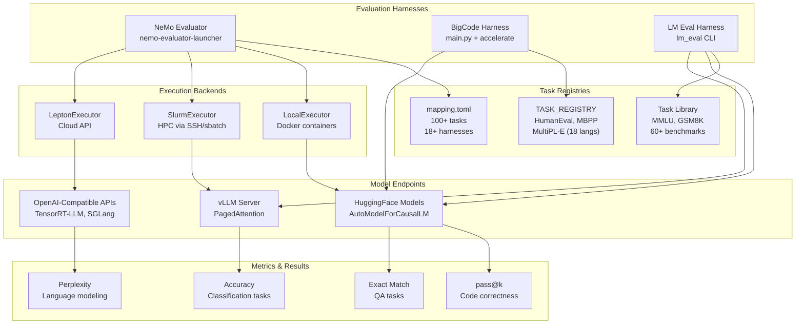
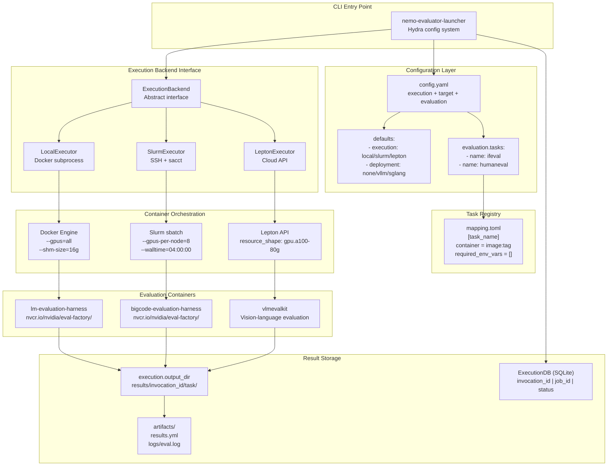
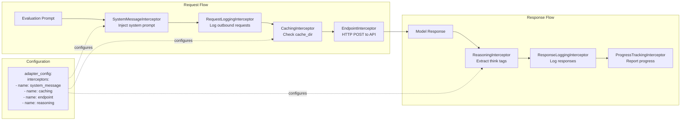
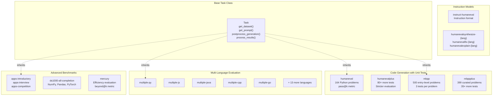
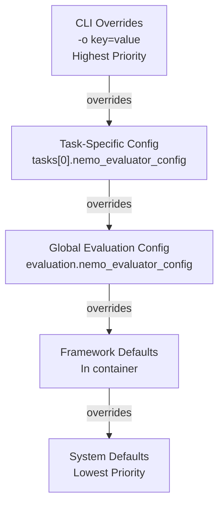
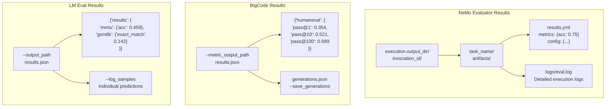
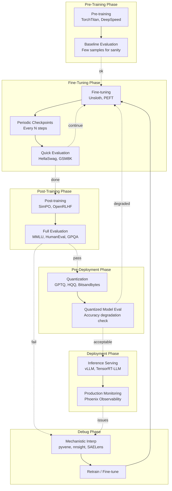

<!-- source: DeepWiki mcp.deepwiki.com · repo zechenzhangAGI/AI-research-SKILLs · page 2.7 Evaluation Skills · fetched 2026-10-26 -->

# Evaluation Skills

<details>
<summary>Relevant source files</summary>

The following files were used as context for generating this wiki page:

- [10-optimization/gptq/SKILL.md](10-optimization/gptq/SKILL.md)
- [11-evaluation/bigcode-evaluation-harness/SKILL.md](11-evaluation/bigcode-evaluation-harness/SKILL.md)
- [11-evaluation/bigcode-evaluation-harness/references/benchmarks.md](11-evaluation/bigcode-evaluation-harness/references/benchmarks.md)
- [11-evaluation/bigcode-evaluation-harness/references/custom-tasks.md](11-evaluation/bigcode-evaluation-harness/references/custom-tasks.md)
- [11-evaluation/bigcode-evaluation-harness/references/issues.md](11-evaluation/bigcode-evaluation-harness/references/issues.md)
- [11-evaluation/lm-evaluation-harness/SKILL.md](11-evaluation/lm-evaluation-harness/SKILL.md)
- [11-evaluation/nemo-evaluator/SKILL.md](11-evaluation/nemo-evaluator/SKILL.md)
- [11-evaluation/nemo-evaluator/references/adapter-system.md](11-evaluation/nemo-evaluator/references/adapter-system.md)
- [11-evaluation/nemo-evaluator/references/configuration.md](11-evaluation/nemo-evaluator/references/configuration.md)
- [11-evaluation/nemo-evaluator/references/custom-benchmarks.md](11-evaluation/nemo-evaluator/references/custom-benchmarks.md)
- [11-evaluation/nemo-evaluator/references/execution-backends.md](11-evaluation/nemo-evaluator/references/execution-backends.md)
- [12-inference-serving/llama-cpp/SKILL.md](12-inference-serving/llama-cpp/SKILL.md)
- [12-inference-serving/sglang/SKILL.md](12-inference-serving/sglang/SKILL.md)
- [12-inference-serving/tensorrt-llm/SKILL.md](12-inference-serving/tensorrt-llm/SKILL.md)

</details>


## Purpose and Scope

This document covers the evaluation skills in the AI Research SKILLs library, which provide comprehensive LLM benchmarking capabilities across academic benchmarks, code generation tasks, and custom evaluation frameworks. The evaluation layer assesses model quality before deployment and monitors production performance.

The library includes three primary evaluation systems:
- **NeMo Evaluator**: Enterprise-grade evaluation with 100+ benchmarks from 18+ harnesses, supporting multi-backend execution (local Docker, Slurm HPC, Lepton cloud)
- **BigCode Evaluation Harness**: Specialized for code generation models with pass@k metrics across 18 programming languages
- **LM Evaluation Harness**: General-purpose LLM benchmarking across 60+ academic benchmarks with standardized prompts

For training systems that generate models to evaluate, see [Training & Fine-Tuning Skills](#2.3). For post-deployment observability and monitoring, see [Observability Skills](#2.9). For mechanistic interpretability when debugging model behavior, see Deep Dive section 3.7.

## Evaluation Ecosystem Architecture

### System Overview



**Sources**: [11-evaluation/nemo-evaluator/SKILL.md:1-495](), [11-evaluation/bigcode-evaluation-harness/SKILL.md:1-406](), [11-evaluation/lm-evaluation-harness/SKILL.md:1-490]()

### Harness Selection Matrix

| Evaluation Goal | Recommended Harness | Key Features | Example Tasks |
|----------------|-------------------|--------------|---------------|
| General LLM quality | LM Eval Harness | 60+ benchmarks, standardized prompts | `mmlu`, `gsm8k`, `hellaswag` |
| Code generation | BigCode Harness | pass@k metrics, 18 languages | `humaneval`, `mbpp`, `multiple-py` |
| Enterprise/scalable | NeMo Evaluator | Multi-backend, containerized, 100+ tasks | `ifeval`, `gpqa_diamond`, `humaneval` |
| Custom benchmarks | NeMo Evaluator | FDF (Framework Definition Files) | User-defined tasks |
| Multi-turn chat | LM Eval Harness | Conversation evaluation | `mt_bench` |
| Math reasoning | LM Eval Harness or BigCode | GSM8K, MATH, code-based | `gsm8k`, `pal-gsm8k-greedy` |

**Sources**: [11-evaluation/nemo-evaluator/SKILL.md:322-336](), [11-evaluation/bigcode-evaluation-harness/SKILL.md:278-293](), [11-evaluation/lm-evaluation-harness/SKILL.md:375-388]()

## NeMo Evaluator Architecture

### Multi-Backend Execution System



**Sources**: [11-evaluation/nemo-evaluator/references/execution-backends.md:1-362](), [11-evaluation/nemo-evaluator/references/configuration.md:1-448]()

### Adapter and Interceptor Pipeline

The NeMo Evaluator uses an adapter system to process requests and responses between the evaluation engine and model endpoints.



**Sources**: [11-evaluation/nemo-evaluator/references/adapter-system.md:1-341]()

Key interceptor implementations:

- **SystemMessageInterceptor**: Injects system prompts configured at [11-evaluation/nemo-evaluator/references/adapter-system.md:55-65]()
- **CachingInterceptor**: Caches responses to avoid repeated API calls, configured at [11-evaluation/nemo-evaluator/references/adapter-system.md:77-90]()
- **ReasoningInterceptor**: Extracts reasoning tokens (e.g., `<think>` tags), configured at [11-evaluation/nemo-evaluator/references/adapter-system.md:100-112]()
- **EndpointInterceptor**: Performs HTTP communication at [11-evaluation/nemo-evaluator/references/adapter-system.md:92-98]()

## Task Catalogs and Benchmark Types

### NeMo Evaluator Task Categories

The NeMo Evaluator aggregates 100+ benchmarks from 18+ evaluation harnesses through containerized task definitions in `mapping.toml`.

| Harness | Task Count | Representative Tasks | Endpoint Type |
|---------|-----------|---------------------|---------------|
| `lm-evaluation-harness` | 60+ | `mmlu`, `gsm8k`, `hellaswag`, `arc_challenge` | chat/completions |
| `simple-evals` | 20+ | `gpqa_diamond`, `math_test_500`, `aime_2024` | chat |
| `bigcode-evaluation-harness` | 25+ | `humaneval`, `mbpp`, `multiple-py/js/java` | completions |
| `safety-harness` | 3 | `aegis`, `wildguard` | chat |
| `garak` | 1 | Security probing | chat |
| `vlmevalkit` | 6+ | `ocrbench`, `chartqa`, `mmmu` | vlm |
| `bfcl` | 6 | Function calling v2/v3 | chat |
| `mtbench` | 2 | Multi-turn conversation | chat |
| `livecodebench` | 10+ | Live coding evaluation | completions |
| `helm` | 15 | Medical domain benchmarks | chat |
| `nemo-skills` | 8 | Math, science, agentic reasoning | chat |

**Sources**: [11-evaluation/nemo-evaluator/SKILL.md:337-352]()

### BigCode Task Registry

The BigCode harness defines tasks through the `TASK_REGISTRY` dictionary in `bigcode_eval/tasks/__init__.py`.



**Sources**: [11-evaluation/bigcode-evaluation-harness/SKILL.md:296-307](), [11-evaluation/bigcode-evaluation-harness/references/benchmarks.md:1-394]()

### LM Eval Harness Task Library

The LM Eval Harness provides 60+ standardized academic benchmarks through a task configuration system.

| Category | Tasks | Metrics | Fewshot |
|----------|-------|---------|---------|
| Reasoning | `mmlu` (57 subjects), `arc_challenge`, `arc_easy` | `acc` | 5-shot |
| Math | `gsm8k`, `math`, `minerva_math` | `exact_match` | 8-shot |
| Common Sense | `hellaswag`, `winogrande`, `piqa`, `siqa` | `acc_norm` | 0-shot |
| Truthfulness | `truthfulqa_mc1`, `truthfulqa_mc2` | `acc` | 0-shot |
| Code | `humaneval`, `mbpp` | `pass@k` | 0-shot |
| QA | `triviaqa`, `naturalquestions`, `squad` | `exact_match`, `f1` | Varies |

**Sources**: [11-evaluation/lm-evaluation-harness/SKILL.md:54-68]()

## Configuration and Execution Workflows

### NeMo Evaluator Configuration Structure

NeMo Evaluator uses Hydra for hierarchical configuration with three main sections: `defaults`, `execution`, `target`, and `evaluation`.

```yaml
# config.yaml structure
defaults:
  - execution: local      # local/slurm/lepton
  - deployment: none      # none/vllm/sglang/nim
  - _self_

execution:
  output_dir: ./results
  # Backend-specific settings

target:
  api_endpoint:
    model_id: meta/llama-3.1-8b-instruct
    url: https://integrate.api.nvidia.com/v1/chat/completions
    api_key_name: NGC_API_KEY
    adapter_config:
      interceptors: []

evaluation:
  nemo_evaluator_config:
    config:
      params:
        temperature: 0.0
        max_new_tokens: 512
        parallelism: 4
  tasks:
    - name: ifeval
    - name: humaneval
```

**Sources**: [11-evaluation/nemo-evaluator/references/configuration.md:1-84](), [11-evaluation/nemo-evaluator/SKILL.md:72-89]()

### Configuration Override Precedence



**Sources**: [11-evaluation/nemo-evaluator/references/configuration.md:165-220]()

### Execution Backend Selection

The three execution backends serve different deployment scenarios:

**LocalExecutor** (Docker-based):
- Uses `docker run` subprocess calls at [11-evaluation/nemo-evaluator/references/execution-backends.md:27-79]()
- Stage files: `stage.pre-start`, `stage.running`, `stage.exit` track status
- Mounts: `output_dir`, datasets, model checkpoints

**SlurmExecutor** (HPC clusters):
- SSH to cluster head node, submits via `sbatch` at [11-evaluation/nemo-evaluator/references/execution-backends.md:91-203]()
- Queries job status with `sacct`
- Supports model deployment (vLLM, SGLang, NIM) on compute nodes

**LeptonExecutor** (Cloud API):
- Submits jobs via Lepton AI API at [11-evaluation/nemo-evaluator/references/execution-backends.md:226-274]()
- Manages resource shapes: `gpu.a100-80g`, `gpu.h100`
- Auto-provisions endpoints

**Sources**: [11-evaluation/nemo-evaluator/references/execution-backends.md:1-362]()

## Common Evaluation Workflows

### Workflow 1: Standard Benchmark Evaluation (NeMo Evaluator)

```bash
# Create configuration
cat > config.yaml << 'EOF'
defaults:
  - execution: local
  - deployment: none
  - _self_

execution:
  output_dir: ./results

target:
  api_endpoint:
    model_id: meta/llama-3.1-8b-instruct
    url: https://integrate.api.nvidia.com/v1/chat/completions
    api_key_name: NGC_API_KEY

evaluation:
  tasks:
    - name: ifeval
    - name: gpqa_diamond
      env_vars:
        HF_TOKEN: HF_TOKEN
    - name: gsm8k_cot_instruct
EOF

# Run evaluation
nemo-evaluator-launcher run --config-dir . --config-name config

# Check status
nemo-evaluator-launcher status <invocation_id>

# View results
cat results/<invocation_id>/ifeval/artifacts/results.yml
```

**Sources**: [11-evaluation/nemo-evaluator/SKILL.md:58-145]()

### Workflow 2: Slurm HPC Evaluation with Model Deployment

```yaml
# slurm_config.yaml
defaults:
  - execution: slurm
  - deployment: vllm
  - _self_

execution:
  hostname: cluster.example.com
  account: my_slurm_account
  partition: gpu
  nodes: 1
  gpus_per_node: 8
  walltime: "04:00:00"
  output_dir: /shared/results

deployment:
  checkpoint_path: /shared/models/llama-3.1-70b
  tensor_parallel_size: 4
  data_parallel_size: 2
  max_model_len: 8192

evaluation:
  nemo_evaluator_config:
    config:
      params:
        parallelism: 16
        temperature: 0.0
  tasks:
    - name: mmlu_pro
    - name: humaneval
```

The SlurmExecutor performs this workflow:
1. SSH to cluster head node
2. Submit deployment job via `sbatch` (launches vLLM on compute nodes)
3. Wait for deployment to start serving
4. Submit evaluation jobs that target deployed endpoint
5. Poll `sacct` for job status
6. Collect results from shared filesystem

**Sources**: [11-evaluation/nemo-evaluator/SKILL.md:147-213](), [11-evaluation/nemo-evaluator/references/execution-backends.md:91-203]()

### Workflow 3: Code Evaluation with BigCode Harness

```bash
# Standard evaluation
accelerate launch main.py \
  --model bigcode/starcoder2-7b \
  --tasks humaneval \
  --max_length_generation 512 \
  --temperature 0.2 \
  --n_samples 200 \
  --batch_size 50 \
  --allow_code_execution \
  --save_generations

# Multi-language evaluation (Docker isolation)
# Step 1: Generate on host
accelerate launch main.py \
  --model bigcode/starcoder2-7b \
  --tasks multiple-py,multiple-js,multiple-java \
  --generation_only \
  --save_generations \
  --save_generations_path generations.json

# Step 2: Evaluate in Docker
docker pull ghcr.io/bigcode-project/evaluation-harness-multiple
docker run -v $(pwd)/generations.json:/app/generations.json:ro \
  -it evaluation-harness-multiple python3 main.py \
  --tasks multiple-py,multiple-js,multiple-java \
  --load_generations_path /app/generations.json \
  --allow_code_execution
```

The `accelerate` launcher handles:
- Distributed inference across GPUs
- Batch processing with dynamic batching
- Generation with `do_sample=True` for pass@k
- Code execution via `code_eval` metric from `evaluate` library

**Sources**: [11-evaluation/bigcode-evaluation-harness/SKILL.md:45-179]()

### Workflow 4: Training Progress Tracking with LM Eval Harness

```bash
# Quick evaluation during training
lm_eval --model hf \
  --model_args pretrained=/path/to/checkpoint-1000 \
  --tasks gsm8k,hellaswag \
  --num_fewshot 0 \
  --batch_size 16 \
  --output_path results/step-1000.json

# Use vLLM backend for 5-10× speedup
lm_eval --model vllm \
  --model_args pretrained=meta-llama/Llama-2-7b-hf,tensor_parallel_size=2 \
  --tasks mmlu \
  --batch_size auto
```

**Sources**: [11-evaluation/lm-evaluation-harness/SKILL.md:148-242](), [11-evaluation/lm-evaluation-harness/SKILL.md:331-373]()

## Custom Task Creation

### NeMo Evaluator Custom Benchmarks (FDF)

Framework Definition Files (FDFs) define custom evaluation tasks for NeMo Evaluator.

```yaml
# framework_def.yaml
framework:
  name: my-custom-framework
  package_name: my_custom_eval

defaults:
  command: "python -m my_custom_eval.run --model-id {model_id} --task {task} --output-dir {output_dir}"

evaluations:
  - name: custom_task_1
    defaults:
      temperature: 0.0
      max_new_tokens: 512
      extra:
        custom_param: value

  - name: custom_task_2
    defaults:
      temperature: 0.7
      max_new_tokens: 1024
```

Output parser function:

```python
# my_custom_eval/parser.py
def parse_output(output_dir: str) -> dict:
    results_file = Path(output_dir) / "results.json"
    with open(results_file) as f:
        raw_results = json.load(f)
    
    return {
        "metrics": {
            "accuracy": raw_results["score"],
            "total_samples": raw_results["num_samples"]
        }
    }
```

Register in `mapping.toml`:

```toml
[my-custom-framework]
container = "my-registry/custom-eval:1.0"

[my-custom-framework.tasks.chat.custom_task_1]
required_env_vars = []

[my-custom-framework.tasks.chat.custom_task_2]
required_env_vars = ["CUSTOM_API_KEY"]
```

**Sources**: [11-evaluation/nemo-evaluator/references/custom-benchmarks.md:1-131]()

### BigCode Harness Custom Tasks

Custom tasks in BigCode inherit from the `Task` base class at [11-evaluation/bigcode-evaluation-harness/references/custom-tasks.md:7-31]().

```python
from bigcode_eval.base import Task

class MyCustomTask(Task):
    DATASET_PATH = "username/dataset-name"
    DATASET_NAME = None
    
    def __init__(self):
        super().__init__(
            stop_words=["\nclass", "\ndef", "\n#"],
            requires_execution=True  # Enable code execution
        )
    
    def get_dataset(self):
        from datasets import load_dataset
        return load_dataset(self.DATASET_PATH, split="test")
    
    def get_prompt(self, doc):
        return doc["prompt"]
    
    def get_reference(self, doc):
        return doc["test"]
    
    def postprocess_generation(self, generation, idx):
        # Remove text after stop words
        for stop_word in self.stop_words:
            if stop_word in generation:
                generation = generation[:generation.index(stop_word)]
        return generation
    
    def process_results(self, generations, references):
        from evaluate import load
        code_metric = load("code_eval")
        results, _ = code_metric.compute(
            references=references,
            predictions=generations,
            k=[1, 10, 100]
        )
        return results
```

Register in `bigcode_eval/tasks/__init__.py`:

```python
from bigcode_eval.tasks import my_custom_task

TASK_REGISTRY = {
    "my-custom-task": my_custom_task.MyCustomTask,
}
```

**Sources**: [11-evaluation/bigcode-evaluation-harness/references/custom-tasks.md:32-99]()

## Evaluation Results and Metrics

### Result Storage Patterns



**Sources**: [11-evaluation/nemo-evaluator/SKILL.md:137-145](), [11-evaluation/bigcode-evaluation-harness/SKILL.md:117-135](), [11-evaluation/lm-evaluation-harness/SKILL.md:118-144]()

### Metric Types by Evaluation Category

| Category | Metric | Calculation | Use Case |
|----------|--------|-------------|----------|
| Code Correctness | `pass@k` | `E[1 - C(n-c, k) / C(n, k)]` | HumanEval, MBPP |
| Classification | `acc` | Correct / Total | MMLU, HellaSwag |
| Normalized Accuracy | `acc_norm` | Length-normalized logprobs | Multiple choice |
| Exact Match | `exact_match` | String match (case-insensitive) | GSM8K, QA tasks |
| F1 Score | `f1` | Precision × Recall | SQuAD, QA tasks |
| Perplexity | `perplexity` | `exp(cross_entropy_loss)` | Language modeling |
| BLEU | `bleu` | n-gram overlap | Code translation |

For pass@k estimation, BigCode uses n=200 samples with temperature=0.8 to compute pass@1, pass@10, pass@100. The metric is computed by the `code_eval` library at [11-evaluation/bigcode-evaluation-harness/references/benchmarks.md:376-394]().

**Sources**: [11-evaluation/bigcode-evaluation-harness/references/benchmarks.md:376-394](), [11-evaluation/lm-evaluation-harness/SKILL.md:118-144]()

## Integration with Training and Deployment

### Evaluation in the AI Research Lifecycle



**Sources**: High-level diagrams (Diagram 4, Diagram 6) from system context

## Advanced Topics

### Dataset Mounting and Environment Variables

NeMo Evaluator supports dataset mounting for proprietary data at [11-evaluation/nemo-evaluator/references/custom-benchmarks.md:132-173]():

```yaml
evaluation:
  tasks:
    - name: custom_task_1
      dataset_dir: /path/to/local/data
      dataset_mount_path: /data  # Mount point in container
      env_vars:
        CUSTOM_API_KEY: MY_CUSTOM_KEY
        DATA_PATH: /data/custom.jsonl
```

The launcher mounts the dataset directory into the container and sets `NEMO_EVALUATOR_DATASET_DIR`.

### Parameter Override Strategies

Global vs task-specific overrides at [11-evaluation/nemo-evaluator/references/custom-benchmarks.md:174-218]():

```yaml
evaluation:
  nemo_evaluator_config:
    config:
      params:
        temperature: 0.0      # Global default
        parallelism: 4
  
  tasks:
    - name: humaneval
      nemo_evaluator_config:  # Task-specific override
        config:
          params:
            temperature: 0.8
            n_samples: 200    # Multiple samples for pass@k
```

### Caching for Long-Running Evaluations

The CachingInterceptor enables resumable evaluations at [11-evaluation/nemo-evaluator/references/adapter-system.md:77-90]():

```yaml
target:
  api_endpoint:
    adapter_config:
      interceptors:
        - name: caching
          config:
            cache_dir: "/shared/cache"
            reuse_cached_responses: true
            save_requests: true
            save_responses: true
```

If an evaluation is interrupted, rerunning with the same configuration will reuse cached API responses.

## Common Issues and Troubleshooting

### NeMo Evaluator Issues

**Issue**: Container pull fails
```bash
# Solution: Configure NGC credentials
docker login nvcr.io -u '$oauthtoken' -p $NGC_API_KEY
```

**Issue**: Task requires environment variable
```yaml
# Solution: Map env vars in task config
evaluation:
  tasks:
    - name: gpqa_diamond
      env_vars:
        HF_TOKEN: HF_TOKEN  # Maps to $HF_TOKEN
```

**Issue**: Slurm job not starting
```bash
# Solution: Check account and partition
nemo-evaluator-launcher run ... \
  -o execution.account=correct_account \
  -o execution.partition=gpu
```

**Sources**: [11-evaluation/nemo-evaluator/SKILL.md:353-402]()

### BigCode Harness Issues

**Issue**: CUDA out of memory
```bash
# Solution: Use quantization or reduce batch size
accelerate launch main.py \
  --model model-name \
  --load_in_4bit \
  --batch_size 1 \
  --max_memory_per_gpu "20GiB"
```

**Issue**: Code execution hangs
```bash
# Solution: Use Docker isolation
# Generate on host (safe)
--generation_only --save_generations

# Evaluate in Docker
docker run ... --allow_code_execution --load_generations_path ...
```

**Issue**: Different results than papers
```bash
# Solution: Check n_samples, temperature, task name
--n_samples 200 \
--temperature 0.8 \
--tasks humaneval  # Exact name
```

**Sources**: [11-evaluation/bigcode-evaluation-harness/SKILL.md:310-363](), [11-evaluation/bigcode-evaluation-harness/references/issues.md:1-395]()

### LM Eval Harness Issues

**Issue**: Evaluation too slow
```bash
# Solution: Use vLLM backend
lm_eval --model vllm \
  --model_args pretrained=model-name,tensor_parallel_size=2

# Or reduce fewshot examples
--num_fewshot 0
```

**Issue**: Out of memory
```bash
# Solution: Use quantization or CPU offloading
--model_args pretrained=model-name,load_in_8bit=True,device_map=auto
```

**Sources**: [11-evaluation/lm-evaluation-harness/SKILL.md:391-458]()

## Resources

### NeMo Evaluator
- **GitHub**: https://github.com/NVIDIA-NeMo/Evaluator
- **NGC Containers**: nvcr.io/nvidia/eval-factory/
- **NVIDIA Build**: https://build.nvidia.com (free hosted models)

### BigCode Evaluation Harness
- **GitHub**: https://github.com/bigcode-project/bigcode-evaluation-harness
- **BigCode Leaderboard**: https://huggingface.co/spaces/bigcode/bigcode-models-leaderboard
- **HumanEval Dataset**: https://huggingface.co/datasets/openai/openai_humaneval

### LM Evaluation Harness
- **GitHub**: https://github.com/EleutherAI/lm-evaluation-harness
- **Open LLM Leaderboard**: https://huggingface.co/spaces/HuggingFaceH4/open_llm_leaderboard

**Sources**: [11-evaluation/nemo-evaluator/SKILL.md:489-495](), [11-evaluation/bigcode-evaluation-harness/SKILL.md:399-406](), [11-evaluation/lm-evaluation-harness/SKILL.md:483-488]()

---

