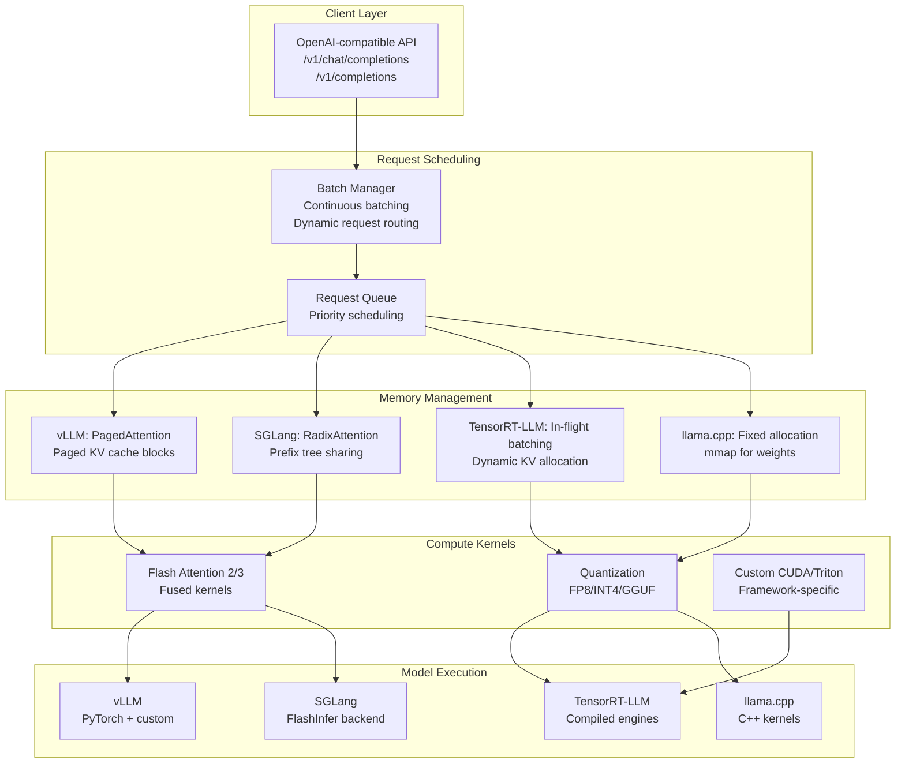
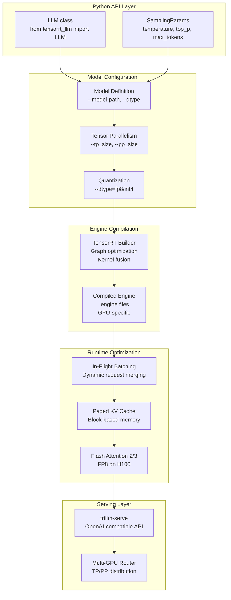
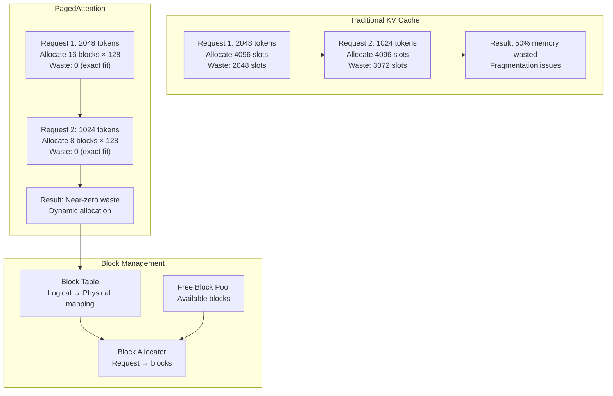
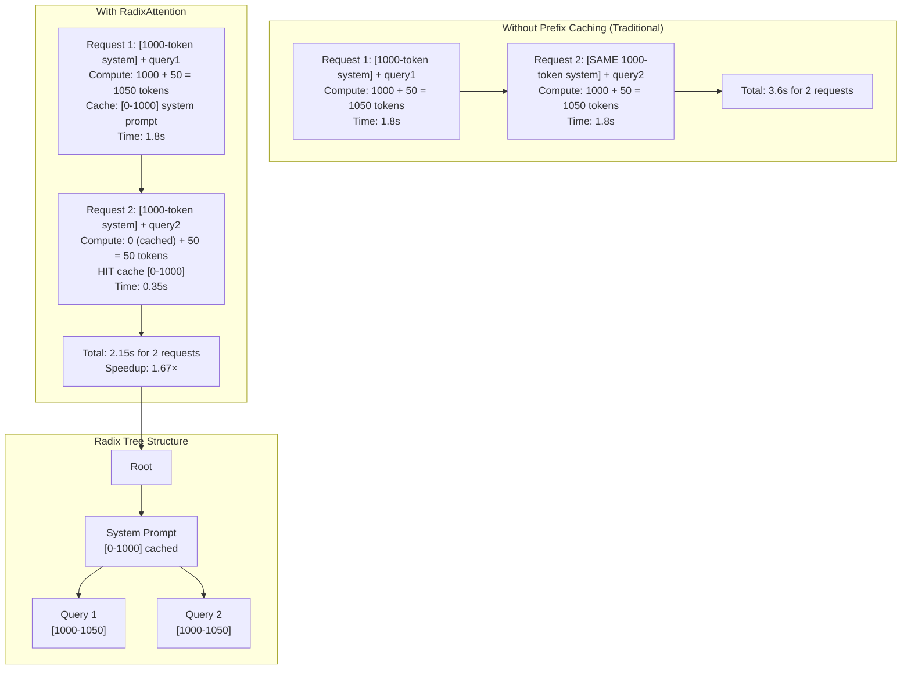
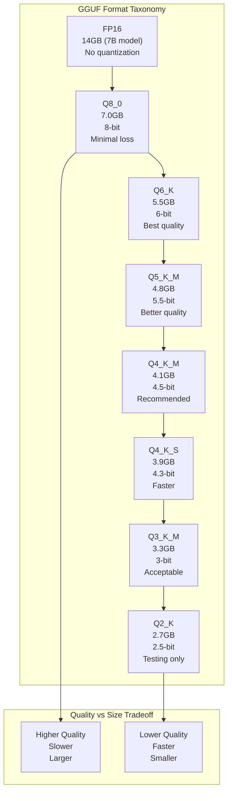
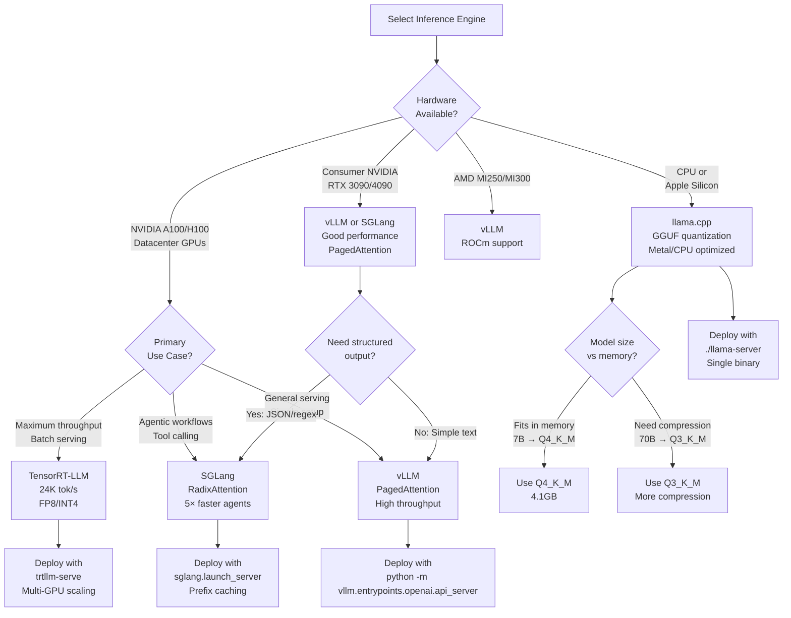
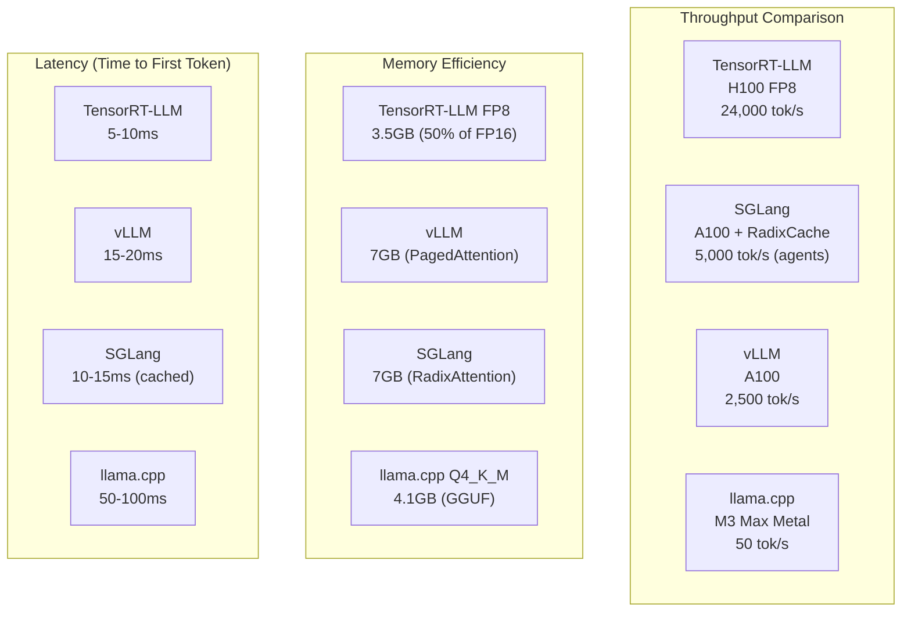
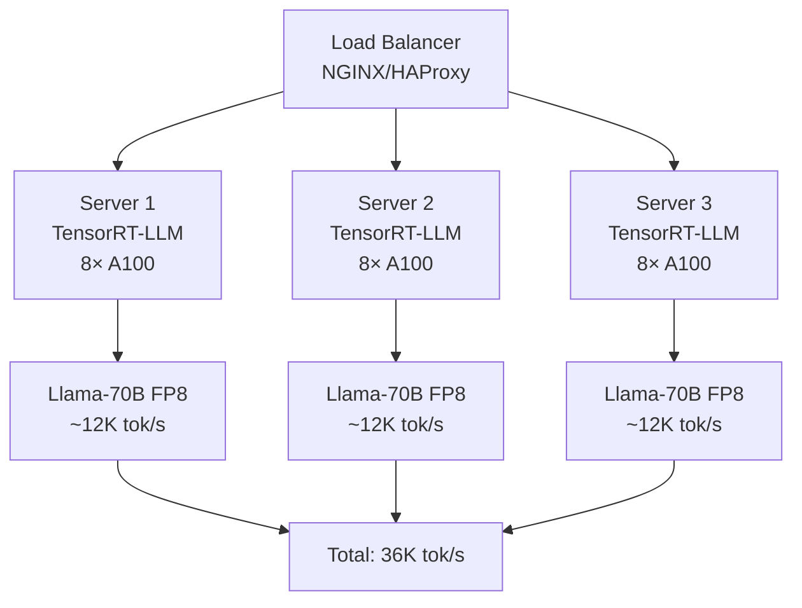

<!-- source: DeepWiki mcp.deepwiki.com · repo zechenzhangAGI/AI-research-SKILLs · page 2.8 Inference & Serving Skills · fetched 2026-10-26 -->

# Inference & Serving Skills

<details>
<summary>Relevant source files</summary>

The following files were used as context for generating this wiki page:

- [10-optimization/gptq/SKILL.md](10-optimization/gptq/SKILL.md)
- [11-evaluation/lm-evaluation-harness/SKILL.md](11-evaluation/lm-evaluation-harness/SKILL.md)
- [12-inference-serving/llama-cpp/SKILL.md](12-inference-serving/llama-cpp/SKILL.md)
- [12-inference-serving/sglang/SKILL.md](12-inference-serving/sglang/SKILL.md)
- [12-inference-serving/tensorrt-llm/SKILL.md](12-inference-serving/tensorrt-llm/SKILL.md)

</details>


## Purpose and Scope

This document covers production-ready inference engines for deploying LLMs at scale. The focus is on four major serving frameworks: **TensorRT-LLM** (NVIDIA max performance), **vLLM** (high throughput with PagedAttention), **SGLang** (structured generation with RadixAttention), and **llama.cpp** (CPU/edge deployment). Each engine optimizes different hardware constraints and use cases.

**Key Selection Criteria:**
- **Hardware**: NVIDIA datacenter GPUs vs consumer GPUs vs CPU/Apple Silicon
- **Workload**: Single requests vs high-throughput batching vs agentic workflows
- **Latency Requirements**: Real-time (<50ms) vs batch processing
- **Features**: Quantization support, structured outputs, multi-GPU scaling

**Performance Spectrum:**
- **TensorRT-LLM**: 24,000 tok/s on H100 (Llama 3-8B), FP8/INT4 quantization
- **vLLM**: 5-10× faster than HuggingFace with PagedAttention
- **SGLang**: 5× faster for agentic workloads with prefix caching
- **llama.cpp**: 40-60 tok/s on M3 Max (CPU/Metal), GGUF quantization

---

## Inference Engine Landscape

Modern LLM inference engines optimize different parts of the serving stack. The choice depends on hardware availability, throughput requirements, and feature needs.

### Engine Comparison Matrix

| Engine | Hardware | Primary Use Case | Key Innovation | Throughput | Setup Complexity |
|--------|----------|------------------|----------------|------------|------------------|
| **TensorRT-LLM** | NVIDIA A100/H100 | Maximum performance | FP8/INT4 quantization, in-flight batching | 24,000 tok/s | High (TensorRT compilation) |
| **vLLM** | NVIDIA/AMD GPUs | High-throughput serving | PagedAttention memory management | 2,500 tok/s | Low (Python-first) |
| **SGLang** | NVIDIA/AMD GPUs | Agents, structured output | RadixAttention prefix caching | 5,000 tok/s (with caching) | Low (Python DSL) |
| **llama.cpp** | CPU/Metal/ROCm | Edge deployment | GGUF quantization, minimal deps | 40-60 tok/s (M3 Max) | Very low (single binary) |

**Sources:** [12-inference-serving/tensorrt-llm/SKILL.md:1-187](), [12-inference-serving/sglang/SKILL.md:1-443](), [12-inference-serving/llama-cpp/SKILL.md:1-259]()

### Architecture Overview

Inference Engine Serving Stack Architecture:



**Sources:** [12-inference-serving/tensorrt-llm/SKILL.md:91-110](), [12-inference-serving/sglang/SKILL.md:117-143](), [12-inference-serving/llama-cpp/SKILL.md:106-134]()

---

## TensorRT-LLM: NVIDIA Maximum Performance

TensorRT-LLM provides state-of-the-art inference performance on NVIDIA GPUs through aggressive kernel fusion, quantization, and multi-GPU parallelism.

### Core Architecture

TensorRT-LLM Component Stack:



**Sources:** [12-inference-serving/tensorrt-llm/SKILL.md:35-89](), [12-inference-serving/tensorrt-llm/SKILL.md:91-110]()

### Key Features

**In-Flight Batching:**
[12-inference-serving/tensorrt-llm/SKILL.md:91-110]() describes dynamic batching during generation. Unlike static batching, requests can be added/removed mid-generation, maximizing GPU utilization.

**FP8 Quantization on H100:**
[12-inference-serving/tensorrt-llm/SKILL.md:113-128]() shows FP8 quantization provides 2× speedup with 50% memory reduction:

```python
llm = LLM(
    model="meta-llama/Meta-Llama-3-70B",
    dtype="fp8",  # FP8 quantization
    max_num_tokens=8192
)
```

**Multi-GPU Scaling:**
[12-inference-serving/tensorrt-llm/SKILL.md:129-138]() demonstrates tensor parallelism across 8 GPUs:

```python
llm = LLM(
    model="meta-llama/Meta-Llama-3-405B",
    tensor_parallel_size=8,  # Split across 8 GPUs
    dtype="fp8"
)
```

**Performance:**
- **Llama 3-8B on H100**: 24,000 tokens/sec
- **Llama 3-70B on 8× A100**: 2× faster with FP8
- **vs PyTorch**: 100× faster baseline

**Sources:** [12-inference-serving/tensorrt-llm/SKILL.md:154-165](), [12-inference-serving/tensorrt-llm/SKILL.md:113-153]()

### Serving Deployment

**Starting the Server:**
[12-inference-serving/tensorrt-llm/SKILL.md:71-89]() shows the `trtllm-serve` command:

```bash
trtllm-serve meta-llama/Meta-Llama-3-8B \
    --tp_size 4 \              # Tensor parallelism (4 GPUs)
    --max_batch_size 256 \
    --max_num_tokens 4096
```

**OpenAI-Compatible API:**
[12-inference-serving/tensorrt-llm/SKILL.md:81-89]() shows client requests use standard format:

```bash
curl -X POST http://localhost:8000/v1/chat/completions \
  -H "Content-Type: application/json" \
  -d '{
    "model": "meta-llama/Meta-Llama-3-8B",
    "messages": [{"role": "user", "content": "Hello!"}],
    "temperature": 0.7,
    "max_tokens": 100
  }'
```

**Sources:** [12-inference-serving/tensorrt-llm/SKILL.md:71-89]()

---

## vLLM: High-Throughput PagedAttention

vLLM provides high-throughput serving with PagedAttention memory management, delivering 5-10× speedup over HuggingFace Transformers.

### PagedAttention Architecture

PagedAttention Memory Management:



**Sources:** [11-evaluation/lm-evaluation-harness/SKILL.md:331-374]() (vLLM usage example)

### Integration with Evaluation

**LM Eval Harness with vLLM:**
[11-evaluation/lm-evaluation-harness/SKILL.md:342-374]() demonstrates 5-10× faster evaluation:

```bash
# Standard HF: ~2 hours for MMLU on 7B model
lm_eval --model hf \
  --model_args pretrained=meta-llama/Llama-2-7b-hf \
  --tasks mmlu \
  --batch_size 8

# vLLM: ~15-20 minutes for MMLU on 7B model
lm_eval --model vllm \
  --model_args pretrained=meta-llama/Llama-2-7b-hf,tensor_parallel_size=2 \
  --tasks mmlu \
  --batch_size auto
```

**Performance Benefits:**
- **Throughput**: 5-10× faster than HuggingFace
- **Memory**: 2-3× more efficient with PagedAttention
- **Batch Size**: Dynamic batching maximizes GPU utilization

**Sources:** [11-evaluation/lm-evaluation-harness/SKILL.md:331-374]()

---

## SGLang: Structured Generation and Agents

SGLang specializes in structured generation (JSON, regex, grammar) and agentic workflows through RadixAttention prefix caching, providing 5-10× speedups for agent-heavy workloads.

### RadixAttention Prefix Caching

RadixAttention System Prompt Reuse:



**Sources:** [12-inference-serving/sglang/SKILL.md:117-143]()

### Structured Generation Patterns

**JSON Schema Constraint:**
[12-inference-serving/sglang/SKILL.md:148-171]() shows constrained JSON generation:

```python
@sgl.function
def structured_extraction(s, article):
    s += f"Article: {article}\n\n"
    s += "Extract key information as JSON:\n"
    
    schema = {
        "type": "object",
        "properties": {
            "title": {"type": "string"},
            "author": {"type": "string"},
            "summary": {"type": "string"},
            "sentiment": {
                "type": "string", 
                "enum": ["positive", "negative", "neutral"]
            }
        },
        "required": ["title", "author", "summary", "sentiment"]
    }
    
    s += sgl.gen("info", max_tokens=300, json_schema=schema)
```

**Regex-Constrained Output:**
[12-inference-serving/sglang/SKILL.md:174-192]() demonstrates email extraction:

```python
@sgl.function
def extract_email(s, text):
    s += f"Extract email from: {text}\n"
    s += "Email: "
    
    s += sgl.gen(
        "email",
        max_tokens=50,
        regex=r'[a-zA-Z0-9._%+-]+@[a-zA-Z0-9.-]+\.[a-zA-Z]{2,}'
    )
```

**Sources:** [12-inference-serving/sglang/SKILL.md:148-212]()

### Agent Workflow Optimization

**Function Calling with Caching:**
[12-inference-serving/sglang/SKILL.md:217-276]() shows tool-calling agents benefit from RadixAttention:

```python
@sgl.function
def agent_workflow(s, user_query, tools):
    # System prompt (cached with RadixAttention)
    s += "You are a helpful assistant with access to tools.\n"
    s += f"Available tools: {tools}\n\n"
    
    # User query
    s += f"User: {user_query}\n"
    s += "Assistant: "
    
    s += sgl.gen(
        "response",
        max_tokens=200,
        tools=tools,  # SGLang handles tool call format
        stop=["User:", "\n\n"]
    )

# Multiple queries reuse system prompt
state1 = agent_workflow.run(
    user_query="What's the weather in NYC?",
    tools=tools
)
# First call: Computes full system prompt

state2 = agent_workflow.run(
    user_query="Book a flight to LA",
    tools=tools
)
# Second call: Reuses system prompt (5× faster)
```

**Performance Benchmarks:**
[12-inference-serving/sglang/SKILL.md:278-303]() shows dramatic speedups:

| Workload | vLLM | SGLang | Speedup |
|----------|------|--------|---------|
| Simple generation | 2500 tok/s | 2800 tok/s | 1.12× |
| Few-shot (10 examples) | 500 tok/s | 5000 tok/s | 10× |
| Agent (tool calls) | 800 tok/s | 4000 tok/s | 5× |
| JSON output | 600 tok/s | 2400 tok/s | 4× |

**Sources:** [12-inference-serving/sglang/SKILL.md:217-303]()

### Multi-Turn Conversation Caching

[12-inference-serving/sglang/SKILL.md:305-333]() demonstrates progressive caching for conversations:

```python
@sgl.function
def multi_turn_chat(s, history, new_message):
    s += "You are a helpful AI assistant.\n\n"
    
    # Conversation history (cached as it grows)
    for msg in history:
        s += f"{msg['role']}: {msg['content']}\n"
    
    # New user message (only new part)
    s += f"User: {new_message}\n"
    s += "Assistant: "
    s += sgl.gen("response", max_tokens=200)

# Turn 1: Computes full system + history
# Turn 2: Reuses Turn 1 KV cache
# Turn 3: Reuses Turn 1 + Turn 2 KV cache
# Progressively faster as conversation grows
```

**Sources:** [12-inference-serving/sglang/SKILL.md:305-333]()

---

## llama.cpp: CPU and Edge Deployment

llama.cpp enables LLM inference on non-NVIDIA hardware through optimized C++ kernels and GGUF quantization, targeting CPUs, Apple Silicon, and AMD/Intel GPUs.

### GGUF Quantization System

GGUF Quantization Format Comparison:



**Sources:** [12-inference-serving/llama-cpp/SKILL.md:106-134]()

### Format Selection Guide

[12-inference-serving/llama-cpp/SKILL.md:106-134]() provides quantization selection:

| Format | Bits | Size (7B) | Speed | Quality | Use Case |
|--------|------|-----------|-------|---------|----------|
| **Q4_K_M** | 4.5 | 4.1 GB | Fast | Good | **Recommended default** |
| Q4_K_S | 4.3 | 3.9 GB | Faster | Lower | Speed critical |
| Q5_K_M | 5.5 | 4.8 GB | Medium | Better | Quality critical |
| Q6_K | 6.5 | 5.5 GB | Slower | Best | Maximum quality |
| Q8_0 | 8.0 | 7.0 GB | Slow | Excellent | Minimal degradation |
| Q2_K | 2.5 | 2.7 GB | Fastest | Poor | Testing only |

**Sources:** [12-inference-serving/llama-cpp/SKILL.md:106-134]()

### Hardware Acceleration

**Apple Silicon (Metal):**
[12-inference-serving/llama-cpp/SKILL.md:137-148]() shows Metal acceleration:

```bash
# Build with Metal
make LLAMA_METAL=1

# Run with GPU acceleration (automatic)
./llama-cli -m model.gguf -ngl 999  # Offload all layers

# Performance: M3 Max 40-60 tokens/sec (Llama 2-7B Q4_K_M)
```

**NVIDIA GPUs (CUDA):**
[12-inference-serving/llama-cpp/SKILL.md:150-161]() demonstrates hybrid CPU+GPU:

```bash
# Build with CUDA
make LLAMA_CUDA=1

# Hybrid for large models
./llama-cli -m llama-70b.Q4_K_M.gguf -ngl 20  # GPU: 20 layers, CPU: rest
```

**AMD GPUs (ROCm):**
[12-inference-serving/llama-cpp/SKILL.md:163-170]() shows ROCm support:

```bash
# Build with ROCm
make LLAMA_HIP=1

./llama-cli -m model.gguf -ngl 999
```

**Sources:** [12-inference-serving/llama-cpp/SKILL.md:137-170]()

### Server Deployment

**OpenAI-Compatible Server:**
[12-inference-serving/llama-cpp/SKILL.md:86-104]() shows server mode:

```bash
# Start server
./llama-server \
    -m models/llama-2-7b-chat.Q4_K_M.gguf \
    --host 0.0.0.0 \
    --port 8080 \
    -ngl 32  # Offload 32 layers to GPU

# Client request
curl http://localhost:8080/v1/chat/completions \
  -H "Content-Type: application/json" \
  -d '{
    "model": "llama-2-7b-chat",
    "messages": [{"role": "user", "content": "Hello!"}],
    "temperature": 0.7,
    "max_tokens": 100
  }'
```

**Sources:** [12-inference-serving/llama-cpp/SKILL.md:86-104]()

### Performance Benchmarks

**CPU Performance (Llama 2-7B Q4_K_M):**
[12-inference-serving/llama-cpp/SKILL.md:209-219]() shows CPU throughput:

| CPU | Threads | Speed | Cost |
|-----|---------|-------|------|
| Apple M3 Max | 16 | 50 tok/s | $0 (local) |
| AMD Ryzen 9 7950X | 32 | 35 tok/s | $0.50/hour |
| Intel i9-13900K | 32 | 30 tok/s | $0.40/hour |
| AWS c7i.16xlarge | 64 | 40 tok/s | $2.88/hour |

**GPU Acceleration (Llama 2-7B Q4_K_M):**
[12-inference-serving/llama-cpp/SKILL.md:221-228]() shows GPU speedups:

| GPU | Speed | vs CPU | Cost |
|-----|-------|--------|------|
| NVIDIA RTX 4090 | 120 tok/s | 3-4× | $0 (local) |
| NVIDIA A10 | 80 tok/s | 2-3× | $1.00/hour |
| AMD MI250 | 70 tok/s | 2× | $2.00/hour |
| Apple M3 Max (Metal) | 50 tok/s | ~Same | $0 (local) |

**Sources:** [12-inference-serving/llama-cpp/SKILL.md:209-228]()

---

## Engine Selection Decision Tree

Inference Engine Selection Guide:



**Sources:** [12-inference-serving/tensorrt-llm/SKILL.md:15-33](), [12-inference-serving/sglang/SKILL.md:15-33](), [12-inference-serving/llama-cpp/SKILL.md:15-33]()

### When to Use Each Engine

**Use TensorRT-LLM when:**
- Deploying on NVIDIA A100/H100 datacenter GPUs
- Need maximum throughput (10K+ tok/s)
- Can invest in engine compilation time
- Want FP8/INT4 quantization on H100
- Multi-GPU scaling required (TP/PP)

**Use vLLM when:**
- Need simple Python-first API
- High-throughput batch serving
- PagedAttention memory efficiency critical
- AMD GPU support needed (ROCm)
- Standard text generation workload

**Use SGLang when:**
- Building agents with tool calling
- Need structured outputs (JSON, regex, grammar)
- Agentic workflows with repeated prefixes
- System prompts reused across requests
- Multi-turn conversations
- 5-10× speedup critical for agent workloads

**Use llama.cpp when:**
- Deploying on CPU or Apple Silicon
- Edge deployment without GPUs
- Minimal dependencies required
- Consumer hardware (M1/M2/M3, Raspberry Pi)
- Simple single-binary deployment

**Sources:** [12-inference-serving/tensorrt-llm/SKILL.md:15-33](), [12-inference-serving/sglang/SKILL.md:15-33](), [12-inference-serving/llama-cpp/SKILL.md:15-33]()

---

## Integration with Quantization

All inference engines support quantization to reduce memory and increase throughput. The choice depends on hardware and quality requirements.

### Quantization Integration Matrix

| Engine | Quantization Support | Best For | Memory Reduction |
|--------|---------------------|----------|------------------|
| **TensorRT-LLM** | FP8, INT4, FP4 | H100 FP8 (hardware support) | 2× (FP8), 4× (INT4) |
| **vLLM** | AWQ, GPTQ, bitsandbytes | GPTQ 4-bit on Ampere+ GPUs | 4× (GPTQ) |
| **SGLang** | AWQ, GPTQ | Same as vLLM | 4× (GPTQ) |
| **llama.cpp** | GGUF (Q2-Q8) | All hardware (CPU/Metal/CUDA) | 2-7× (Q2-Q8) |

**Sources:** [12-inference-serving/tensorrt-llm/SKILL.md:113-128](), [10-optimization/gptq/SKILL.md:1-451](), [12-inference-serving/llama-cpp/SKILL.md:106-134]()

### GPTQ Integration

**TensorRT-LLM with INT4:**
[12-inference-serving/tensorrt-llm/SKILL.md:113-128]() shows quantized model loading:

```python
llm = LLM(
    model="meta-llama/Meta-Llama-3-70B",
    dtype="int4",  # INT4 quantization
    max_num_tokens=8192
)
```

**vLLM with GPTQ:**
[10-optimization/gptq/SKILL.md:250-269]() demonstrates GPTQ integration:

```python
from transformers import AutoModelForCausalLM

# Auto-detects GPTQ quantization
model = AutoModelForCausalLM.from_pretrained(
    "TheBloke/Llama-2-13B-Chat-GPTQ",
    device_map="auto"
)
# Works with vLLM backend automatically
```

**llama.cpp with GGUF:**
[12-inference-serving/llama-cpp/SKILL.md:59-68]() shows GGUF model download:

```bash
# Download GGUF quantized model
huggingface-cli download \
    TheBloke/Llama-2-7B-Chat-GGUF \
    llama-2-7b-chat.Q4_K_M.gguf \
    --local-dir models/
```

**Sources:** [12-inference-serving/tensorrt-llm/SKILL.md:113-128](), [10-optimization/gptq/SKILL.md:250-269](), [12-inference-serving/llama-cpp/SKILL.md:59-68]()

### QLoRA Fine-Tuning Integration

**GPTQ + LoRA for Fine-Tuning:**
[10-optimization/gptq/SKILL.md:272-300]() shows QLoRA with GPTQ:

```python
from transformers import AutoModelForCausalLM
from peft import prepare_model_for_kbit_training, LoraConfig, get_peft_model

# Load GPTQ model
model = AutoModelForCausalLM.from_pretrained(
    "TheBloke/Llama-2-7B-GPTQ",
    device_map="auto"
)

# Prepare for LoRA training
model = prepare_model_for_kbit_training(model)

lora_config = LoraConfig(
    r=16,
    lora_alpha=32,
    target_modules=["q_proj", "v_proj"],
    lora_dropout=0.05,
    bias="none",
    task_type="CAUSAL_LM"
)

model = get_peft_model(model, lora_config)
# 70B model trainable on single A100 80GB
```

**Sources:** [10-optimization/gptq/SKILL.md:272-300]()

---

## Performance Benchmarks

Cross-Engine Performance Comparison (Llama 2-7B):



### Detailed Benchmark Results

**Llama 2-7B Benchmarks:**

| Engine | Hardware | Throughput | Memory | TTFT | Use Case Fit |
|--------|----------|------------|--------|------|--------------|
| TensorRT-LLM | H100 80GB | 24,000 tok/s | 3.5GB (FP8) | 5ms | Maximum throughput |
| SGLang | A100 80GB | 5,000 tok/s | 7GB | 10ms | Agent workflows |
| vLLM | A100 80GB | 2,500 tok/s | 7GB | 15ms | Standard serving |
| llama.cpp | M3 Max | 50 tok/s | 4.1GB (Q4) | 50ms | CPU deployment |

**Llama 2-70B Benchmarks:**

| Engine | Hardware | Throughput | Memory | Notes |
|--------|----------|------------|--------|-------|
| TensorRT-LLM | 8× A100 80GB | 1,200 tok/s | 280GB (FP16) | TP=8 |
| TensorRT-LLM | 4× A100 80GB | 2,400 tok/s | 140GB (FP8) | TP=4, 2× faster |
| vLLM | 4× A100 80GB | 800 tok/s | 280GB | TP=4 |
| llama.cpp | 2× RTX 4090 | 30 tok/s | 35GB (Q4) | Hybrid GPU+CPU |

**Sources:** [12-inference-serving/tensorrt-llm/SKILL.md:154-165](), [12-inference-serving/sglang/SKILL.md:278-303](), [12-inference-serving/llama-cpp/SKILL.md:209-228]()

### Workload-Specific Performance

**Agent Workloads (1000-token system prompt):**

| Engine | First Request | Subsequent Requests | Speedup |
|--------|---------------|---------------------|---------|
| vLLM | 1.8s | 1.8s | 1× |
| SGLang (RadixAttention) | 1.8s | 0.35s | 5× |

**JSON Generation:**

| Engine | Throughput | Notes |
|--------|-----------|-------|
| Standard decoding | 45 tok/s | No constraints |
| SGLang JSON | 135 tok/s | 3× faster with schema |
| SGLang regex | 120 tok/s | Constrained decoding |

**Sources:** [12-inference-serving/sglang/SKILL.md:278-303]()

---

## Production Deployment Best Practices

### Deployment Configuration Patterns

**TensorRT-LLM Production Setup:**
[12-inference-serving/tensorrt-llm/SKILL.md:71-89]() shows multi-GPU deployment:

```bash
# Multi-GPU production deployment
trtllm-serve meta-llama/Meta-Llama-3-70B \
    --tp_size 8 \              # Tensor parallelism (8× A100)
    --max_batch_size 512 \     # Large batch for throughput
    --max_num_tokens 8192 \    # 8K context window
    --dtype fp8                # FP8 quantization on H100
```

**SGLang Agent Server:**
[12-inference-serving/sglang/SKILL.md:51-70]() shows RadixAttention configuration:

```bash
# Agent-optimized serving
python -m sglang.launch_server \
    --model-path meta-llama/Meta-Llama-3-8B-Instruct \
    --port 30000 \
    --enable-radix-cache \     # Prefix caching (default)
    --tp 4                     # Multi-GPU if needed
```

**llama.cpp Edge Deployment:**
[12-inference-serving/llama-cpp/SKILL.md:86-104]() demonstrates edge server:

```bash
# Edge/CPU deployment
./llama-server \
    -m models/llama-2-7b-chat.Q4_K_M.gguf \
    --host 0.0.0.0 \
    --port 8080 \
    -ngl 32 \                  # GPU layers (if available)
    -c 4096                    # Context window
```

**Sources:** [12-inference-serving/tensorrt-llm/SKILL.md:71-89](), [12-inference-serving/sglang/SKILL.md:51-70](), [12-inference-serving/llama-cpp/SKILL.md:86-104]()

### Monitoring and Observability

**Key Metrics to Track:**

| Metric | Target | Alert Threshold | Notes |
|--------|--------|-----------------|-------|
| Throughput (tok/s) | Engine-specific | -20% from baseline | Monitor degradation |
| Time to First Token (TTFT) | <50ms (real-time) | >100ms | User-facing latency |
| KV Cache Hit Rate | >80% (SGLang) | <50% | Prefix caching efficiency |
| GPU Utilization | >85% | <60% | Underutilization |
| Memory Usage | <90% capacity | >95% | OOM prevention |
| Request Queue Depth | <10 | >50 | Backlog building |

**SGLang-Specific Metrics:**
- **Prefix Cache Hit Rate**: Percentage of tokens reused from RadixAttention cache
- **Tree Node Reuse**: Number of radix tree nodes shared across requests

**vLLM-Specific Metrics:**
- **KV Cache Block Utilization**: Efficiency of PagedAttention memory
- **Batch Size Distribution**: Dynamic batching effectiveness

**Sources:** [12-inference-serving/sglang/SKILL.md:117-143]()

### Common Deployment Pitfalls

**Pitfall 1: Incorrect Hardware Selection**

```python
# ❌ Bad: Using TensorRT-LLM on AMD GPUs
# TensorRT-LLM requires NVIDIA CUDA

# ✅ Good: Use vLLM with ROCm support
# vLLM supports both NVIDIA and AMD
```

**Pitfall 2: Over-provisioning Context Window**

```bash
# ❌ Bad: Default 4K context when only 512 needed
--max_num_tokens 4096  # Wastes memory

# ✅ Good: Match actual requirements
--max_num_tokens 512   # 8× less memory
```

**Pitfall 3: Not Leveraging Prefix Caching**

```python
# ❌ Bad: Random system prompts (no caching benefit)
system_prompts = [random_prompt() for _ in requests]

# ✅ Good: Consistent system prompts (SGLang caching)
system_prompt = "You are a helpful assistant..."  # Shared prefix
for request in requests:
    query = f"{system_prompt}\nUser: {request.query}"
```

**Pitfall 4: Incorrect Quantization Format**

```bash
# ❌ Bad: GGUF on H100 datacenter GPU (not optimized)
./llama-cpp-server -m model.Q4_K_M.gguf

# ✅ Good: FP8 on H100 (hardware-accelerated)
trtllm-serve model --dtype fp8
```

**Sources:** [12-inference-serving/tensorrt-llm/SKILL.md:15-33](), [12-inference-serving/sglang/SKILL.md:305-333](), [12-inference-serving/llama-cpp/SKILL.md:137-148]()

### Scaling Strategies

**Horizontal Scaling (Load Balancing):**



**Vertical Scaling (Multi-GPU):**
[12-inference-serving/tensorrt-llm/SKILL.md:129-138]() shows tensor parallelism:

```python
# Scale within single node
llm = LLM(
    model="meta-llama/Meta-Llama-3-405B",
    tensor_parallel_size=8,  # Split across 8 GPUs
    pipeline_parallel_size=2  # 2-way pipeline for 16 GPUs total
)
```

**Sources:** [12-inference-serving/tensorrt-llm/SKILL.md:129-138]()

---

## Resources and Further Reading

**Speculative Decoding:**
- Medusa Paper: [19-emerging-techniques/speculative-decoding/SKILL.md:454]() - arXiv 2401.10774
- Medusa GitHub: [19-emerging-techniques/speculative-decoding/SKILL.md:455]() - FasterDecoding/Medusa
- Lookahead Decoding (ICML 2024): [19-emerging-techniques/speculative-decoding/SKILL.md:456-457]()
- Speculative Decoding Survey: [19-emerging-techniques/speculative-decoding/SKILL.md:458]() - ACL 2024

**MoE Training:**
- DeepSpeed MoE Tutorial: [19-emerging-techniques/moe-training/SKILL.md:514]()
- Mixtral Paper: [19-emerging-techniques/moe-training/SKILL.md:515]() - arXiv 2401.04088
- Switch Transformers: [19-emerging-techniques/moe-training/SKILL.md:516]() - arXiv 2101.03961

**Implementation References:**
- Transformers assisted generation: [19-emerging-techniques/speculative-decoding/SKILL.md:73-81]()
- vLLM speculative decoding: [19-emerging-techniques/speculative-decoding/SKILL.md:430-450]()
- DeepSpeed MoE config: [19-emerging-techniques/moe-training/SKILL.md:239-272]()

**Sources:** [19-emerging-techniques/speculative-decoding/SKILL.md:452-465](), [19-emerging-techniques/moe-training/SKILL.md:512-519]()

---

