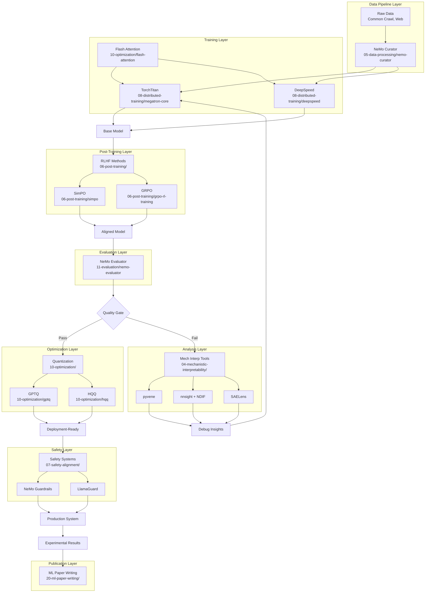
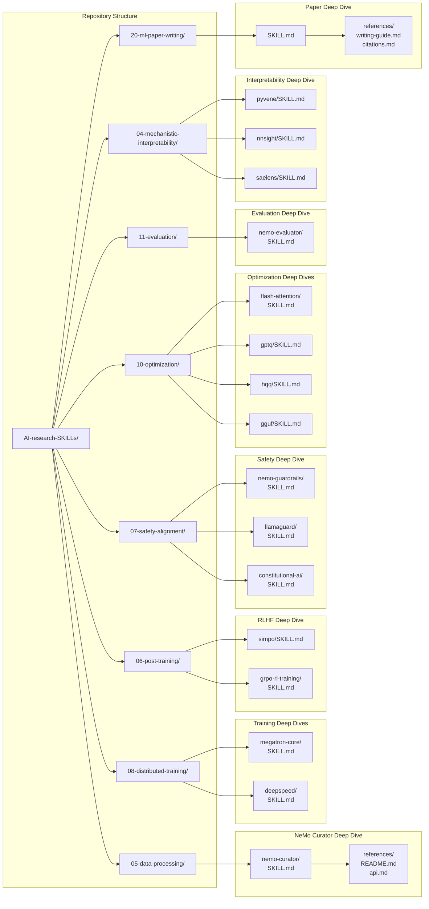
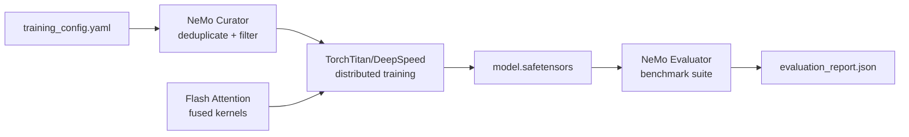
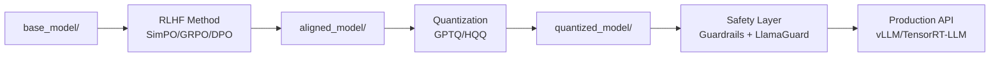
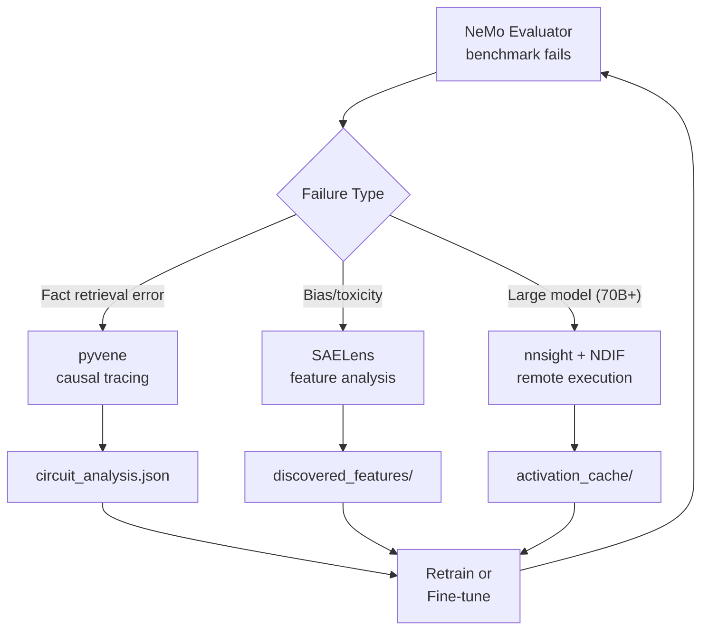

<!-- source: DeepWiki mcp.deepwiki.com · repo zechenzhangAGI/AI-research-SKILLs · page 3 Deep Dives: Critical Systems · fetched 2026-10-26 -->

# Deep Dives: Critical Systems

<details>
<summary>Relevant source files</summary>

The following files were used as context for generating this wiki page:

- [.claude-plugin/marketplace.json](.claude-plugin/marketplace.json)
- [CONTRIBUTING.md](CONTRIBUTING.md)
- [README.md](README.md)
- [demos/README.md](demos/README.md)
- [docs/ROADMAP.md](docs/ROADMAP.md)
- [docs/SKILL_CREATION_GUIDE.md](docs/SKILL_CREATION_GUIDE.md)
- [docs/SKILL_TEMPLATE.md](docs/SKILL_TEMPLATE.md)
- [docs/christmas-tree.svg](docs/christmas-tree.svg)
- [docs/tech-tree.svg](docs/tech-tree.svg)

</details>


## Purpose and Scope

This section provides in-depth technical documentation for the most critical and complex systems in the AI Research SKILLs library. These 10 deep dives cover systems that form the backbone of modern AI research workflows—from massive-scale training infrastructure to production deployment patterns. Each deep dive goes beyond the standard skill documentation to explain architectural decisions, integration patterns, performance characteristics, and real-world usage scenarios.

For high-level overviews of all 77 skills organized by category, see [Skill Categories Reference](#2). For hands-on examples and demonstrations, see [Inference & Deployment Patterns](#4).

## Selection Criteria

The systems chosen for deep dives meet at least three of the following criteria:

1. **Architectural Complexity**: Multi-component systems requiring deep understanding (e.g., TorchTitan's 4D parallelism, DeepSpeed's ZeRO stages)
2. **Critical Performance Impact**: Systems that enable 10x+ improvements in speed, memory, or cost (e.g., Flash Attention's 2-4x speedup, NeMo Curator's 16x faster deduplication)
3. **Production Deployment Necessity**: Systems required for real-world deployment at scale (e.g., quantization for memory constraints, guardrails for safety)
4. **Novel Paradigms**: Systems introducing fundamentally new approaches (e.g., Constitutional AI's self-improvement, SAELens's monosemantic features)
5. **Integration Complexity**: Systems that serve as integration hubs for multiple tools (e.g., NeMo Evaluator's 18+ harness adapters)
6. **Community Impact**: Systems with widespread adoption defining industry standards (e.g., vLLM's PagedAttention becoming the inference standard)

**Sources**: [README.md:48-65](), [ROADMAP.md:1-18]()

## System Organization by Research Phase

The 10 critical systems map to distinct phases of the AI research lifecycle:

| Research Phase | Critical Systems | Key Capability | Skill Location |
|----------------|------------------|----------------|----------------|
| **Data Preparation** | NeMo Curator | 16x faster GPU deduplication | `05-data-processing/nemo-curator/` |
| **Training Infrastructure** | TorchTitan, DeepSpeed | 512B params, 4D parallelism | `08-distributed-training/` |
| **Optimization** | Flash Attention, Quantization Ecosystem | 2-4x speedup, 4x memory reduction | `10-optimization/` |
| **Evaluation** | NeMo Evaluator | 100+ benchmarks, multi-backend | `11-evaluation/nemo-evaluator/` |
| **Post-Training** | RLHF Methods (SimPO, GRPO) | Reference-free alignment | `06-post-training/` |
| **Safety** | Safety Systems (Guardrails, LlamaGuard) | Runtime constraint enforcement | `07-safety-alignment/` |
| **Interpretability** | Mech Interp Tools (pyvene, nnsight, SAELens) | Causal tracing, remote execution | `04-mechanistic-interpretability/` |
| **Publication** | ML Paper Writing | Citation verification, LaTeX templates | `20-ml-paper-writing/` |

**Sources**: [README.md:86-109](), [marketplace.json:11-249]()

## Critical System Dependencies and Data Flow



**Diagram: End-to-End Research Workflow with Critical Systems**

This diagram shows the complete data flow from raw data through production deployment. Each node represents a critical system with its file path in the repository. The workflow demonstrates:

1. **Data preprocessing** using NeMo Curator's GPU-accelerated pipeline
2. **Distributed training** with TorchTitan (massive scale) or DeepSpeed (flexible optimization)
3. **Attention optimization** via Flash Attention integration at training time
4. **Alignment** using RLHF methods (SimPO for reference-free, GRPO for group normalization)
5. **Quality gates** enforced by NeMo Evaluator across 100+ benchmarks
6. **Debugging loops** using mechanistic interpretability when quality fails
7. **Deployment optimization** through quantization (GPTQ or HQQ based on calibration availability)
8. **Safety wrapping** with guardrails and content moderation
9. **Publication workflow** using ML Paper Writing skill for reproducible research

**Sources**: [README.md:147-226](), [.claude-plugin/marketplace.json:58-248]()

## Skill Directory to Critical System Mapping



**Diagram: File System Navigation for Critical Systems**

This diagram maps each deep dive topic to its specific file locations in the repository. Use these paths to locate the detailed skill documentation (`SKILL.md`) and supporting references. Each skill follows the standardized structure defined in [SKILL_TEMPLATE.md]() and [SKILL_CREATION_GUIDE.md]().

**Sources**: [README.md:341-369](), [CONTRIBUTING.md:256-282]()

## Deep Dive Coverage Matrix

The following table summarizes what each deep dive covers and which related systems are discussed:

| Deep Dive Topic | Primary Systems | Related Skills | Key Metrics/Capabilities |
|-----------------|-----------------|----------------|-------------------------|
| [TorchTitan](#3.1) | TorchTitan (Megatron-Core) | FSDP2, Pipeline Parallel, Context Parallel | 8B-512B params, 47% MFU on H100 |
| [DeepSpeed](#3.2) | DeepSpeed, ZeRO | Megatron-LM, MoE architectures | ZeRO-1/2/3, ZeRO-Infinity, DeepNVMe |
| [NeMo Curator](#3.3) | NeMo Curator | Ray Data | 16x faster dedup, GPU acceleration |
| [NeMo Evaluator](#3.4) | NeMo Evaluator | lm-eval-harness, BigCode | 100+ benchmarks, 18+ harnesses |
| [Flash Attention](#3.5) | Flash Attention 2/3 | PyTorch, Transformers | 2-4x speedup, FP8 on H100 |
| [Quantization](#3.6) | GPTQ, HQQ, Bitsandbytes, GGUF | llama.cpp, vLLM | 4-8 bit, 4x memory reduction |
| [Mech Interp](#3.7) | pyvene, nnsight, SAELens | TransformerLens | Causal interventions, NDIF remote execution |
| [Safety Systems](#3.8) | NeMo Guardrails, LlamaGuard, Constitutional AI | TRL, OpenRLHF | Runtime constraints, Colang DSL |
| [RLHF Methods](#3.9) | PPO, DPO, SimPO, GRPO, RLOO | TRL, OpenRLHF | Reference-free, group normalized |
| [ML Paper Writing](#3.10) | LaTeX templates, citation tools | - | 6 conferences, anti-hallucination |

**Sources**: [README.md:110-226](), [docs/ROADMAP.md:10-18]()

## Integration Patterns

### Pattern 1: Training Pipeline Integration

The most common integration pattern connects data preparation → training → evaluation:



**Diagram: Standard Training Pipeline**

Code references:
- Training config: User-defined YAML with dataset paths, model architecture, optimization settings
- NeMo Curator output: Parquet files with metadata (document ID, quality scores, dedup signatures)
- TorchTitan/DeepSpeed input: Expects data in HuggingFace Dataset format or raw text files
- Model output: Typically saved as `model.safetensors` or PyTorch checkpoint `.pth`
- Evaluation: NeMo Evaluator config points to model path and benchmark list

**Sources**: [README.md:131-154](), [demos/README.md:11-42]()

### Pattern 2: Post-Training + Safety Pipeline

Alignment and safety systems are typically applied sequentially:



**Diagram: Post-Training to Production Pipeline**

This pattern shows how post-training alignment is followed by quantization for deployment efficiency, with safety systems applied as runtime wrappers. The safety layer intercepts requests/responses before they reach the inference engine.

**Sources**: [README.md:136-146](), [.claude-plugin/marketplace.json:69-90]()

### Pattern 3: Debug Loop with Interpretability

When evaluation fails, interpretability tools provide debugging workflows:



**Diagram: Interpretability-Driven Debug Loop**

This feedback loop uses different interpretability tools based on failure mode:
- `pyvene` for causal tracing when models retrieve wrong facts
- `SAELens` for feature analysis when addressing bias or toxicity
- `nnsight` + NDIF for remote execution on large models requiring distributed compute

**Sources**: [README.md:126-131](), [.claude-plugin/marketplace.json:46-57]()

## Performance Characteristics Comparison

The following table compares key performance metrics across critical systems:

| System | Throughput Gain | Memory Reduction | Hardware Target | Calibration Required |
|--------|----------------|------------------|----------------|---------------------|
| **TorchTitan** | Baseline (47% MFU) | N/A | 8+ H100 GPUs | N/A |
| **DeepSpeed ZeRO-3** | Similar to baseline | 10-15x vs DDP | Any GPU | N/A |
| **Flash Attention 2** | 2-4x vs standard | ~2x | Ampere/Hopper | No |
| **NeMo Curator** | 16x vs CPU | Offload to GPU | Any GPU | No |
| **GPTQ** | <5% overhead | 4x (4-bit) | GPU inference | Yes (128 samples) |
| **HQQ** | <5% overhead | 4x (4-bit) | Multi-backend | No |
| **SimPO** | Same as DPO | No ref model = 2x | GPU training | No |
| **NeMo Guardrails** | <50ms latency | Minimal | Any | No |

Notes:
- MFU = Model FLOPs Utilization (percentage of theoretical hardware peak)
- DDP = PyTorch Distributed Data Parallel (baseline memory usage)
- Calibration = Whether the system requires sample data for optimization

**Sources**: [README.md:147-162](), [README.md:174-178]()

## Navigation to Individual Deep Dives

Each deep dive page provides:
- Architectural diagrams with component interactions
- Configuration templates and code examples
- Performance tuning guidelines
- Common failure modes and solutions
- Integration examples with other critical systems

**Training Infrastructure:**
- [TorchTitan: Large-Scale Distributed Training](#3.1) - 4D parallelism for 8B-512B parameter models
- [DeepSpeed: ZeRO Optimization & MoE Training](#3.2) - Memory-efficient training with ZeRO stages

**Data & Evaluation:**
- [NeMo Curator: GPU-Accelerated Data Preparation](#3.3) - 16x faster data curation
- [NeMo Evaluator: Enterprise LLM Evaluation](#3.4) - 100+ benchmarks with multi-backend execution

**Optimization:**
- [Flash Attention: IO-Aware Attention Optimization](#3.5) - 2-4x speedup with memory efficiency
- [Quantization Ecosystem](#3.6) - Comprehensive guide to GPTQ, HQQ, Bitsandbytes, GGUF

**Analysis & Safety:**
- [Mechanistic Interpretability Tools](#3.7) - pyvene, nnsight, SAELens for model analysis
- [Safety Systems: Guardrails & Alignment](#3.8) - Runtime safety with NeMo Guardrails and LlamaGuard

**Alignment & Publishing:**
- [RLHF & Preference Optimization Methods](#3.9) - PPO, DPO, SimPO, GRPO comparison
- [ML Paper Writing Skill](#3.10) - Citation verification and LaTeX templates

**Sources**: [README.md:36-46](), [CONTRIBUTING.md:1-18]()

## Skill Metadata and Discovery

All critical systems are registered in [.claude-plugin/marketplace.json:11-249]() with structured metadata:

```yaml
name: skill-name-kebab-case
description: Third-person description including what and when to use
version: 1.0.0
author: Orchestra Research
license: MIT
tags: [Title Case Tags, UPPERCASE Acronyms]
dependencies: [package>=version]
```

The marketplace structure enables:
- Category-based installation via Claude Code CLI: `/plugin install category@ai-research-skills`
- Skill discovery through tag search
- Automatic synchronization to Orchestra platform via GitHub Actions

For skill creation standards and contribution workflows, see [Contributing to the Library](#5).

**Sources**: [CONTRIBUTING.md:126-196](), [docs/SKILL_CREATION_GUIDE.md:122-226]()

---

