<!-- source: DeepWiki mcp.deepwiki.com · repo zechenzhangAGI/AI-research-SKILLs · page 3.1 TorchTitan: Large-Scale Distributed Training · fetched 2026-10-26 -->

# TorchTitan: Large-Scale Distributed Training

<details>
<summary>Relevant source files</summary>

The following files were used as context for generating this wiki page:

- [01-model-architecture/torchtitan/SKILL.md](01-model-architecture/torchtitan/SKILL.md)
- [01-model-architecture/torchtitan/references/checkpoint.md](01-model-architecture/torchtitan/references/checkpoint.md)
- [01-model-architecture/torchtitan/references/custom-models.md](01-model-architecture/torchtitan/references/custom-models.md)
- [01-model-architecture/torchtitan/references/float8.md](01-model-architecture/torchtitan/references/float8.md)
- [01-model-architecture/torchtitan/references/fsdp.md](01-model-architecture/torchtitan/references/fsdp.md)

</details>


## Purpose & Scope

This page provides a detailed technical guide to TorchTitan, PyTorch's official platform for large-scale LLM pretraining. TorchTitan implements composable 4D parallelism (FSDP2, Tensor Parallel, Pipeline Parallel, Context Parallel) for training models from 8B to 512B+ parameters across 8-512 GPUs. This page covers the internal architecture, parallelism strategies, Float8 training integration, and distributed checkpointing protocol.

For fine-tuning workflows, see [Training & Fine-Tuning Skills](#2.3). For alternative distributed training systems, see [DeepSpeed: ZeRO Optimization & MoE Training](#3.2). For production inference deployment, see [Inference Engine Selection Guide](#4.1).

**Sources:** [01-model-architecture/torchtitan/SKILL.md:1-15]()

---

## System Overview

TorchTitan is a PyTorch-native distributed pretraining framework designed for training LLMs at scale without third-party dependencies. It achieves 65%+ speedups over baseline FSDP through composable parallelism strategies and Float8 training on H100 GPUs.

### Key Capabilities

| Capability | Description |
|------------|-------------|
| **Model Scale** | 8B to 512B+ parameters |
| **GPU Scale** | Single node (8 GPUs) to 64+ nodes (512 GPUs) |
| **Parallelism** | 4D composable: FSDP2 + TP + PP + CP |
| **Precision** | BF16, FP32, Float8 (H100), MXFP8 (Blackwell) |
| **Checkpointing** | Distributed Checkpoint Protocol (DCP) with resharding |
| **Interoperability** | HuggingFace, TorchTune checkpoint conversion |

### Supported Models

TorchTitan currently supports:
- **Llama 3.1**: 8B, 70B, 405B (production)
- **Llama 4**: Various sizes (experimental)
- **DeepSeek V3**: 16B, 236B, 671B MoE (experimental)
- **GPT-OSS**: 20B, 120B MoE (experimental)
- **Qwen 3**: Various sizes (experimental)
- **Flux**: Diffusion models (experimental)

**Sources:** [01-model-architecture/torchtitan/SKILL.md:11-15, 322-332]()

---

## Core Components Architecture

```mermaid
graph TB
    subgraph "Entry Point"
        RUN["run_train.sh"]
        MAIN["torchtitan.train<br/>main()"]
    end
    
    subgraph "Configuration Layer"
        TOML["*.toml<br/>Config Files"]
        JOBCONFIG["JobConfig<br/>Dataclass"]
    end
    
    subgraph "Protocol Layer"
        TRAINSPEC["TrainSpec<br/>Protocol"]
        MODELPROTOCOL["ModelProtocol<br/>Interface"]
        BASEMODELARGS["BaseModelArgs<br/>Interface"]
        STATEDICADAPTER["BaseStateDictAdapter<br/>Interface"]
    end
    
    subgraph "Model Registry"
        REGISTRY["MODEL_REGISTRY<br/>Dict[str, TrainSpec]"]
        LLAMA["llama3/<br/>get_train_spec()"]
        DEEPSEEK["deepseek/<br/>get_train_spec()"]
        CUSTOM["your_model/<br/>get_train_spec()"]
    end
    
    subgraph "Model Implementation"
        MODELARGS["YourModelArgs<br/>:BaseModelArgs"]
        MODELCLS["YourModel<br/>:ModelProtocol"]
        PARALLELIZE["parallelize_your_model()<br/>Function"]
        PIPELINE["pipeline_fn()<br/>Optional"]
    end
    
    subgraph "Parallelism Modules"
        FSDP["torch.distributed._composable.fsdp<br/>fully_shard()"]
        TP["torch.distributed.tensor.parallel<br/>parallelize_module()"]
        PP["torch.distributed.pipelining<br/>PipelineStage"]
        CP["context_parallel<br/>Custom Implementation"]
    end
    
    subgraph "Optimization"
        FLOAT8["torchao.float8<br/>Float8Linear"]
        COMPILE["torch.compile<br/>Fusion"]
        AC["activation_checkpoint<br/>Memory Saving"]
    end
    
    subgraph "Checkpoint System"
        DCP["torch.distributed.checkpoint<br/>save/load"]
        RESHARDING["format_utils<br/>dcp_to_torch"]
        HFCONVERT["convert_to_hf.py<br/>convert_from_hf.py"]
    end
    
    RUN --> MAIN
    TOML --> JOBCONFIG
    JOBCONFIG --> MAIN
    
    MAIN --> TRAINSPEC
    TRAINSPEC --> REGISTRY
    
    REGISTRY --> LLAMA
    REGISTRY --> DEEPSEEK
    REGISTRY --> CUSTOM
    
    LLAMA --> TRAINSPEC
    DEEPSEEK --> TRAINSPEC
    CUSTOM --> TRAINSPEC
    
    TRAINSPEC --> MODELARGS
    TRAINSPEC --> MODELCLS
    TRAINSPEC --> PARALLELIZE
    TRAINSPEC --> PIPELINE
    
    PARALLELIZE --> TP
    PARALLELIZE --> AC
    PARALLELIZE --> COMPILE
    PARALLELIZE --> FSDP
    
    PIPELINE --> PP
    
    PARALLELIZE --> FLOAT8
    
    MODELCLS --> STATEDICADAPTER
    
    TRAINSPEC --> DCP
    DCP --> RESHARDING
    DCP --> HFCONVERT
    
    style TRAINSPEC fill:#FFB6C1
    style PARALLELIZE fill:#FFD700
    style DCP fill:#90EE90
```

**Core Protocol System Architecture**

The architecture follows a protocol-based design where models implement standard interfaces (`ModelProtocol`, `BaseModelArgs`) and register `TrainSpec` instances that define their complete training configuration including parallelization and checkpointing strategies.

**Sources:** [01-model-architecture/torchtitan/SKILL.md:64-102](), [references/custom-models.md:22-159]()

---

## 4D Parallelism Architecture

TorchTitan's 4D parallelism enables composable scaling across four orthogonal dimensions: Data (FSDP2), Tensor (TP), Pipeline (PP), and Context (CP).

### Parallelism Composition Order

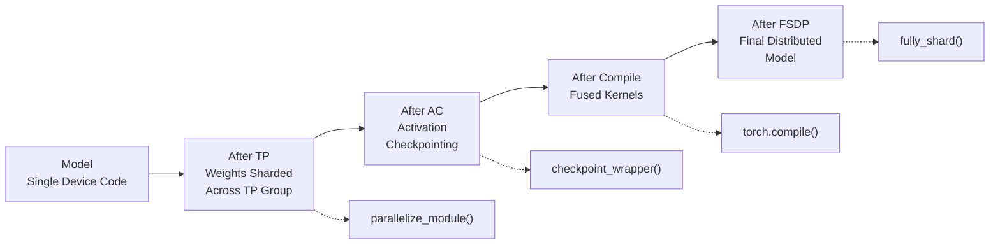

**Parallelism Application Order**

TorchTitan applies parallelism in a specific order: TP → AC → Compile → FSDP. This order ensures proper composability and maximum performance.

**Sources:** [references/custom-models.md:96-128]()

### 4D Parallelism Configuration

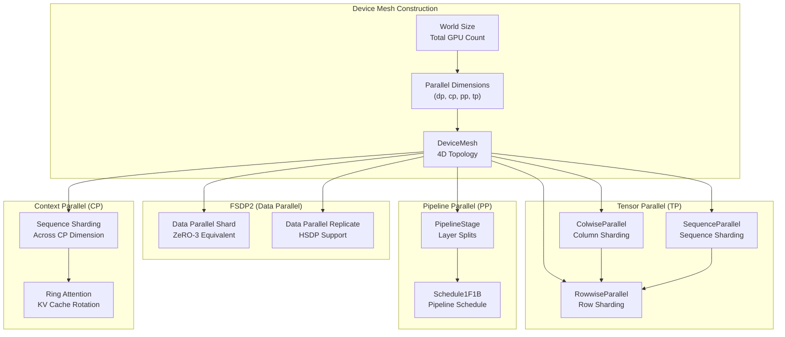

**4D Device Mesh Topology**

The device mesh construction partitions GPUs across four dimensions, enabling independent control of each parallelism strategy. For example, on 512 GPUs: `dp=8, cp=1, pp=8, tp=8` creates 8-way FSDP, 8-way PP, and 8-way TP.

**Sources:** [01-model-architecture/torchtitan/SKILL.md:134-143, 238-250]()

### FSDP2 (Fully Sharded Data Parallel)

FSDP2 is a rewrite of FSDP1 using DTensor-based sharding, removing the `FlatParameter` abstraction for better composability.

#### Key Improvements

| Feature | FSDP1 | FSDP2 |
|---------|-------|-------|
| **Sharding** | FlatParameter | DTensor (dim-0 shard) |
| **State Dict** | Full (communication) | Sharded (no communication) |
| **Memory** | Uses recordStream | Deterministic, -7% peak |
| **Composability** | Limited | Excellent |

#### ZeRO Equivalents

| FSDP2 Configuration | FSDP1 | DeepSpeed |
|---------------------|-------|-----------|
| `reshard_after_forward=True` | FULL_SHARD | ZeRO-3 |
| `reshard_after_forward=False` | SHARD_GRAD_OP | ZeRO-2 |
| 2D mesh + reshard=True | HYBRID_SHARD | MiCS |
| `reshard_after_forward=8` (int) | - | ZeRO++ hpZ |

#### FSDP2 API

The core API uses the `fully_shard()` function from `torch.distributed._composable.fsdp`:

```python
from torch.distributed._composable.fsdp import fully_shard

fully_shard(
    module: nn.Module,
    mesh: Optional[DeviceMesh] = None,
    reshard_after_forward: Union[bool, int] = True,
    mp_policy: MixedPrecisionPolicy = MixedPrecisionPolicy(),
)
```

**Configuration in TorchTitan:**

```toml
[parallelism]
# -1 = use all available GPUs for FSDP
data_parallel_shard_degree = -1

# 1 = pure FSDP, >1 = HSDP (hybrid sharding)
data_parallel_replicate_degree = 1
```

**Sources:** [references/fsdp.md:1-115]()

### Tensor Parallel (TP)

Tensor parallelism shards individual layers across the TP dimension, typically used within a single node (8 GPUs).

#### TP Sharding Patterns

```mermaid
graph TB
    subgraph "Column-wise Parallel"
        INPUT_COL["Input<br/>Replicated"]
        WEIGHT_COL["Weight<br/>Column Sharded"]
        OUTPUT_COL["Output<br/>Sharded"]
        INPUT_COL --> WEIGHT_COL
        WEIGHT_COL --> OUTPUT_COL
    end
    
    subgraph "Row-wise Parallel"
        INPUT_ROW["Input<br/>Sharded"]
        WEIGHT_ROW["Weight<br/>Row Sharded"]
        OUTPUT_ROW["Output<br/>All-Reduce"]
        INPUT_ROW --> WEIGHT_ROW
        WEIGHT_ROW --> OUTPUT_ROW
    end
    
    subgraph "MLP Pattern"
        MLP_IN["Input"]
        MLP_W1["w1: ColwiseParallel"]
        MLP_ACT["Activation"]
        MLP_W2["w2: RowwiseParallel"]
        MLP_OUT["Output"]
        
        MLP_IN --> MLP_W1
        MLP_W1 --> MLP_ACT
        MLP_ACT --> MLP_W2
        MLP_W2 --> MLP_OUT
    end
    
    subgraph "Attention Pattern"
        ATT_IN["Input"]
        ATT_QKV["qkv_proj: ColwiseParallel"]
        ATT_ATTN["Attention"]
        ATT_O["o_proj: RowwiseParallel"]
        ATT_OUT["Output"]
        
        ATT_IN --> ATT_QKV
        ATT_QKV --> ATT_ATTN
        ATT_ATTN --> ATT_O
        ATT_O --> ATT_OUT
    end
```

**Tensor Parallel Sharding Patterns**

TP uses column-wise sharding for the first linear layer (replicates input, shards output) and row-wise sharding for the second layer (shards input, all-reduces output). This pattern minimizes communication.

**Configuration:**

```toml
[parallelism]
# Typically 1 (single node) or 8 (within node)
tensor_parallel_degree = 8
```

**Memory Issue with Async Collectives:**

TP can cause high memory with async collectives. Set environment variable:
```bash
export TORCH_NCCL_AVOID_RECORD_STREAMS=1
```

**Sources:** [01-model-architecture/torchtitan/SKILL.md:134-143, 294-300]()

### Pipeline Parallel (PP)

Pipeline parallelism splits the model vertically across layers, assigning layer ranges to different GPU groups. Requires seed checkpoint for consistent initialization.

#### Pipeline Initialization Flow

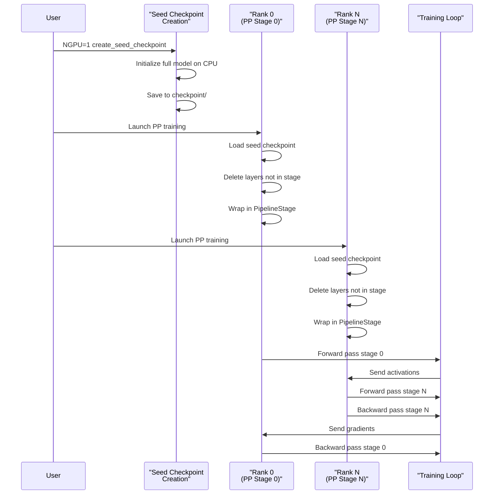

**Pipeline Parallel Initialization Flow**

PP requires a seed checkpoint created on a single device to ensure all stages initialize with identical weights. During training, each stage loads the seed checkpoint then deletes layers not assigned to that stage.

**Seed Checkpoint Creation:**

```bash
NGPU=1 CONFIG_FILE=./llama3_405b.toml ./run_train.sh \
  --checkpoint.enable \
  --checkpoint.create_seed_checkpoint \
  --parallelism.data_parallel_shard_degree 1 \
  --parallelism.tensor_parallel_degree 1 \
  --parallelism.pipeline_parallel_degree 1
```

**Configuration:**

```toml
[parallelism]
# Number of pipeline stages (typically 8 for 405B)
pipeline_parallel_degree = 8
```

**Sources:** [01-model-architecture/torchtitan/SKILL.md:216-235](), [references/checkpoint.md:40-57]()

### Context Parallel (CP)

Context parallelism shards the sequence dimension across the CP dimension, enabling longer sequences than fit on a single GPU. Uses ring attention for KV cache rotation.

**Configuration:**

```toml
[parallelism]
# Increase for sequences longer than single GPU memory
context_parallel_degree = 1
```

**Sources:** [01-model-architecture/torchtitan/SKILL.md:238-250]()

### Example 4D Configuration (405B on 512 GPUs)

```toml
[parallelism]
data_parallel_shard_degree = 8   # FSDP across 8 groups
tensor_parallel_degree = 8       # TP within 8 GPUs
pipeline_parallel_degree = 8     # PP across 8 stages
context_parallel_degree = 1      # No CP

# Calculation: 8 * 8 * 8 * 1 = 512 GPUs
```

**Sources:** [01-model-architecture/torchtitan/SKILL.md:238-250]()

---

## Float8 Training Integration

Float8 training provides 30-50% speedup on H100 GPUs by using FP8 Tensor Cores for large GEMMs. Integration with FSDP2 and TP enables float8 communication and computation.

### Float8 Architecture

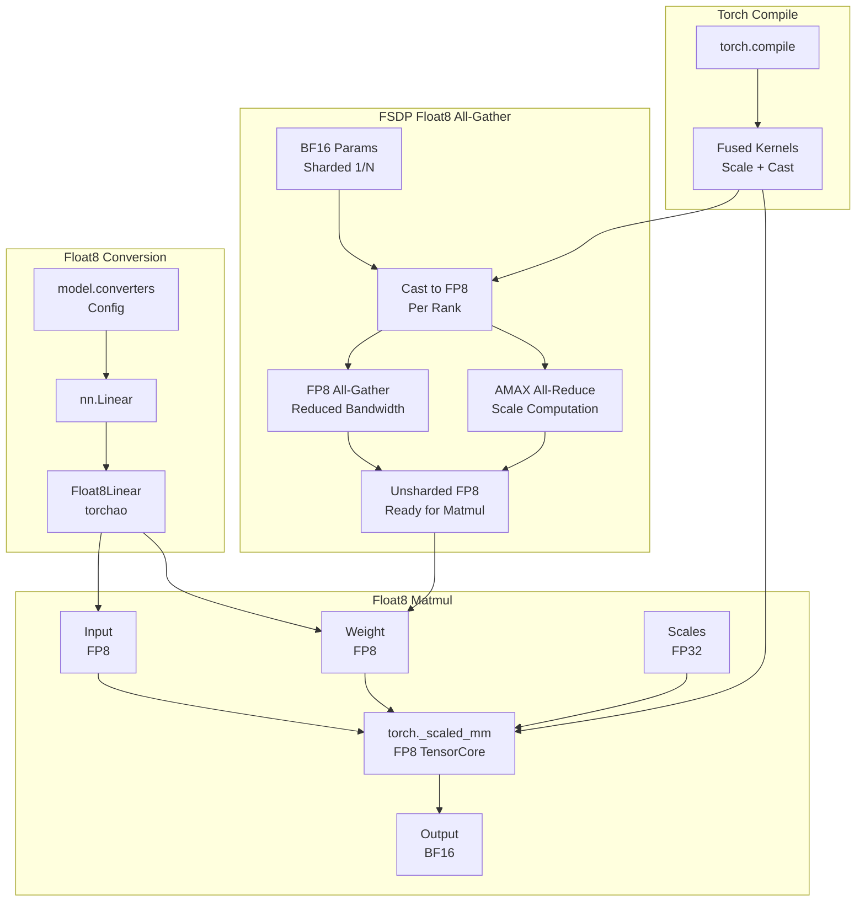

**Float8 Training Architecture**

Float8 training replaces `nn.Linear` with `Float8Linear` modules that cast inputs and weights to FP8. FSDP integration enables FP8 all-gather (reduced bandwidth). Torch compile fuses scaling and casting kernels for maximum efficiency.

**Sources:** [references/float8.md:1-101]()

### Float8 Configuration

#### Tensorwise Scaling (Standard)

```toml
[model]
converters = ["quantize.linear.float8"]

[quantize.linear.float8]
enable_fsdp_float8_all_gather = true
precompute_float8_dynamic_scale_for_fsdp = true
filter_fqns = ["output", "auto_filter_small_kn"]

[compile]
enable = true
components = ["model", "loss"]
```

**Key Arguments:**

| Argument | Description |
|----------|-------------|
| `enable_fsdp_float8_all_gather` | Communicate in FP8 to save bandwidth |
| `precompute_float8_dynamic_scale_for_fsdp` | Single all-reduce for all AMAX/scales |
| `filter_fqns` | Exclude layers that don't benefit from FP8 |

#### Rowwise Scaling (Higher Accuracy)

```toml
[quantize.linear.float8]
recipe_name = "rowwise"
```

Rowwise scaling computes a separate scale per row, providing higher accuracy than tensorwise scaling at the cost of slightly more overhead.

**Sources:** [references/float8.md:15-76]()

### Float8 Performance

Performance on Llama 8B with 8x H100:

| Configuration | TPS/GPU | Speedup |
|---------------|---------|---------|
| FSDP only | 5,762 | Baseline |
| FSDP + compile | 6,667 | +16% |
| FSDP + compile + Float8 | 8,532 | +48% |

**When Float8 Benefits:**

Float8 only benefits when GEMMs are large enough that FP8 TensorCore speedup outweighs dynamic quantization overhead. Rule of thumb: K, N > 4096.

**Layer Filtering:**

Not all layers benefit from Float8. Auto-filter small layers:

```toml
[quantize.linear.float8]
filter_fqns = ["auto_filter_small_kn"]
```

This automatically skips layers based on H100 microbenchmark thresholds.

**Sources:** [references/float8.md:116-134](), [01-model-architecture/torchtitan/SKILL.md:335-341]()

---

## Distributed Checkpoint Protocol (DCP)

TorchTitan uses PyTorch Distributed Checkpoint (DCP) for fault-tolerant, interoperable checkpointing with automatic resharding support.

### DCP Architecture

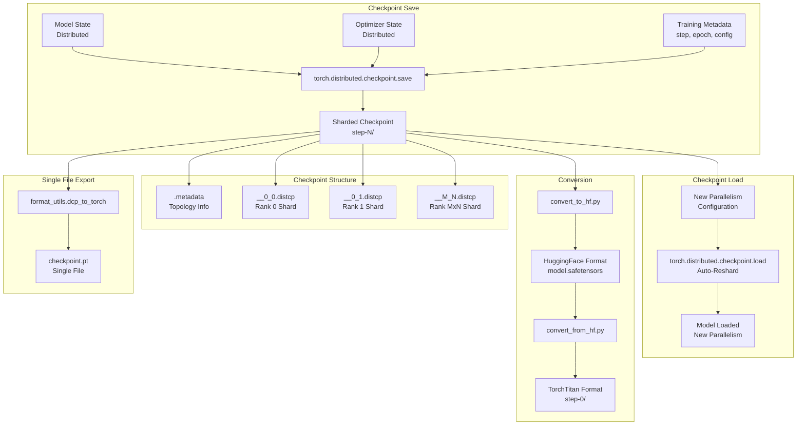

**Distributed Checkpoint Architecture**

DCP saves sharded checkpoints that can be loaded with different parallelism configurations through automatic resharding. Conversion utilities enable interoperability with HuggingFace and single-file formats.

**Sources:** [references/checkpoint.md:1-182]()

### DCP Configuration

```toml
[checkpoint]
enable = true
folder = "checkpoint"
interval = 500
load_step = -1  # -1 = latest, or specific step

# Model-only saves (smaller, for fine-tuning export)
last_save_model_only = true
export_dtype = "bfloat16"

# Async checkpointing (reduce overhead)
async_mode = "async"

# Exclude from loading (for config changes)
exclude_from_loading = ["data_loader", "lr_scheduler"]
```

### Checkpoint Resharding Example

DCP automatically reshards checkpoints when loading with different parallelism:

**Save with 256 GPUs (TP=8, FSDP=32):**
```bash
srun -N 32 --gpus-per-node=8 torchrun ... \
  --parallelism.tensor_parallel_degree 8 \
  --parallelism.data_parallel_shard_degree 32
```

**Load with 128 GPUs (TP=8, FSDP=16):**
```bash
srun -N 16 --gpus-per-node=8 torchrun ... \
  --parallelism.tensor_parallel_degree 8 \
  --parallelism.data_parallel_shard_degree 16
```

DCP automatically reshards the checkpoint from 32-way FSDP to 16-way FSDP without manual intervention.

**Sources:** [references/checkpoint.md:131-153]()

### HuggingFace Interoperability

**During Training:**

```toml
[checkpoint]
# Save in HF format
last_save_in_hf = true
last_save_model_only = true

# Load from HF
initial_load_in_hf = true

[model]
hf_assets_path = "./path/to/hf/checkpoint"
```

**Offline Conversion:**

```bash
# HuggingFace → TorchTitan
python scripts/checkpoint_conversion/convert_from_hf.py \
  <input_dir> <output_dir> \
  --model_name llama3 \
  --model_flavor 8B

# TorchTitan → HuggingFace
python scripts/checkpoint_conversion/convert_to_hf.py \
  <input_dir> <output_dir> \
  --hf_assets_path ./assets/hf/Llama3.1-8B \
  --model_name llama3 \
  --model_flavor 8B
```

**Sources:** [references/checkpoint.md:68-118]()

---

## Training Pipeline & Protocols

TorchTitan uses a protocol-based design to enable pluggable models, parallelization strategies, and training components.

### TrainSpec Protocol

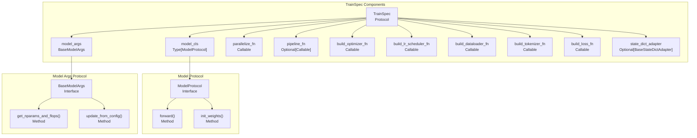

**TrainSpec Protocol Structure**

`TrainSpec` is a protocol that bundles all training components: model class, model arguments, parallelization function, and builder functions for optimizer, scheduler, dataloader, tokenizer, and loss. This enables modular composition.

**Sources:** [references/custom-models.md:130-159]()

### Model Registration Flow

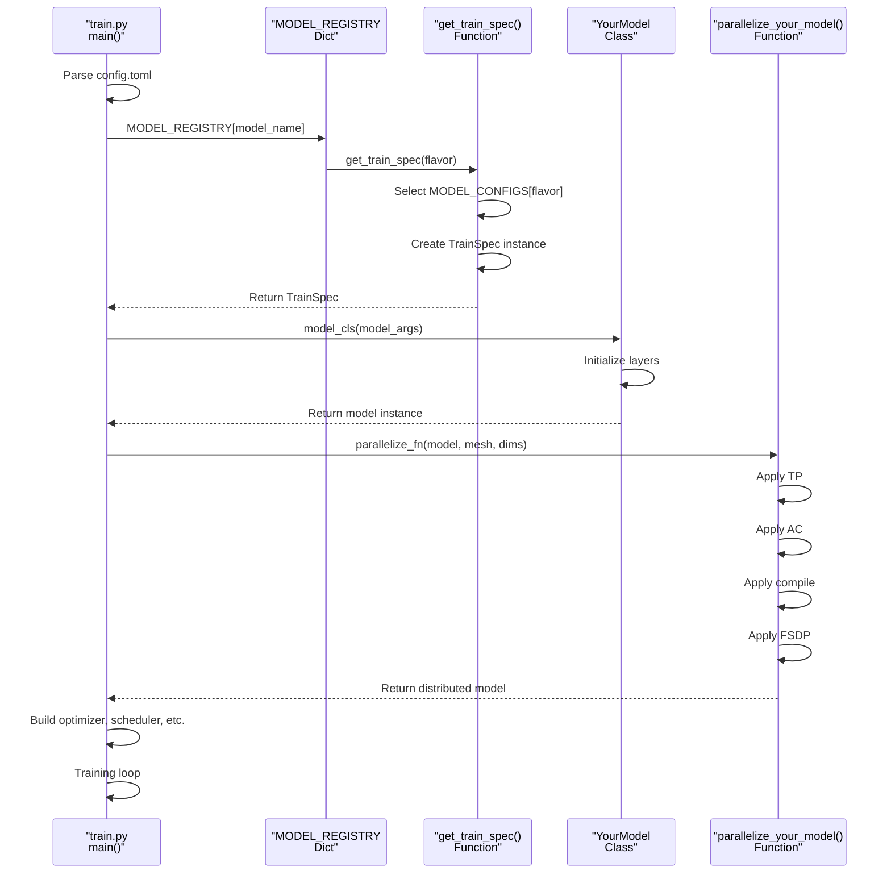

**Model Registration and Initialization Flow**

The training script loads the appropriate `TrainSpec` from the registry, instantiates the model, applies parallelization strategies, and builds training components before entering the training loop.

**Sources:** [references/custom-models.md:130-159]()

### Meta-Device Initialization

FSDP2 supports materializing tensors onto GPU after sharding, reducing peak memory during initialization:

```python
# 1. Initialize on meta device (no memory)
with torch.device("meta"):
    model = Transformer()

# 2. Apply FSDP2 sharding (still on meta)
for module in model.modules():
    if isinstance(module, TransformerBlock):
        fully_shard(module)
fully_shard(model)

# 3. Allocate sharded parameters on GPU
model.to_empty(device="cuda")

# 4. Initialize weights
model.init_weights()
```

This pattern enables initializing models larger than single-GPU memory by only allocating each rank's shard.

**Sources:** [references/fsdp.md:42-66]()

---

## Configuration System

TorchTitan uses TOML files for declarative configuration with CLI override support.

### Configuration Structure

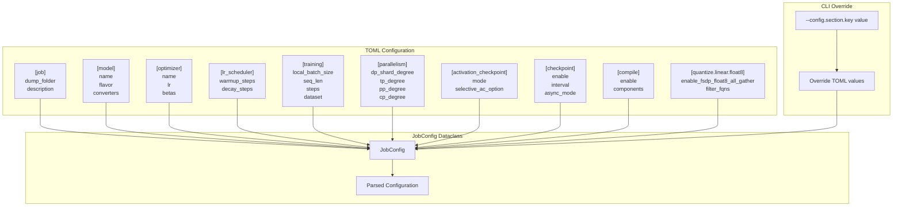

**Configuration System Architecture**

TOML files provide base configuration with sections for each component. CLI arguments can override any TOML value. Everything is parsed into a `JobConfig` dataclass.

**Sources:** [01-model-architecture/torchtitan/SKILL.md:64-102]()

### Example Configuration (Llama 8B)

```toml
[job]
dump_folder = "./outputs"
description = "Llama 3.1 8B training"

[model]
name = "llama3"
flavor = "8B"
hf_assets_path = "./assets/hf/Llama-3.1-8B"

[optimizer]
name = "AdamW"
lr = 3e-4

[lr_scheduler]
warmup_steps = 200

[training]
local_batch_size = 2
seq_len = 8192
max_norm = 1.0
steps = 1000
dataset = "c4"

[parallelism]
data_parallel_shard_degree = -1  # Use all GPUs
tensor_parallel_degree = 1
pipeline_parallel_degree = 1
context_parallel_degree = 1

[activation_checkpoint]
mode = "selective"
selective_ac_option = "op"

[checkpoint]
enable = true
folder = "checkpoint"
interval = 500

[compile]
enable = false
```

**Sources:** [01-model-architecture/torchtitan/SKILL.md:64-102]()

### CLI Override Example

```bash
CONFIG_FILE="./llama3_8b.toml" ./run_train.sh \
  --training.local_batch_size 4 \
  --parallelism.tensor_parallel_degree 8 \
  --compile.enable
```

CLI arguments override TOML values, enabling quick experimentation without editing config files.

**Sources:** [01-model-architecture/torchtitan/SKILL.md:104-114, 206-213]()

---

## Performance Characteristics

### Throughput Benchmarks (H100)

| Model | GPUs | Parallelism | TPS/GPU | Techniques |
|-------|------|-------------|---------|------------|
| Llama 8B | 8 | FSDP | 5,762 | Baseline |
| Llama 8B | 8 | FSDP+compile+FP8 | 8,532 | +48% |
| Llama 70B | 256 | FSDP+TP+AsyncTP | 876 | 2D parallel |
| Llama 405B | 512 | FSDP+TP+PP | 128 | 3D parallel |

**TPS = Tokens Per Second**

**Sources:** [01-model-architecture/torchtitan/SKILL.md:335-341]()

### Memory Optimization Hierarchy

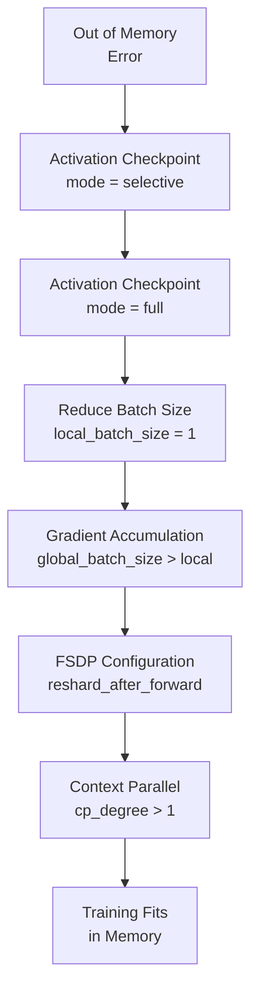

**Memory Optimization Decision Tree**

When encountering OOM, apply optimizations in this order: selective AC → full AC → reduce batch size → gradient accumulation → FSDP config tuning → context parallel.

**Sources:** [01-model-architecture/torchtitan/SKILL.md:274-293]()

### When to Use TorchTitan vs Alternatives

**Use TorchTitan when:**
- Pretraining LLMs from scratch (8B to 512B+)
- Need PyTorch-native solution without third-party dependencies
- Require composable 4D parallelism (FSDP2, TP, PP, CP)
- Training on H100s with Float8 support
- Want interoperable checkpoints with TorchTune/HuggingFace

**Use alternatives instead:**

| Alternative | Use Case |
|-------------|----------|
| **Megatron-LM** | Maximum performance for NVIDIA-only deployments |
| **DeepSpeed** | Broader ZeRO ecosystem, inference support, ZeRO-Infinity |
| **Axolotl/TRL** | Fine-tuning rather than pretraining |
| **LitGPT** | Educational, smaller-scale training |
| **Unsloth** | Fast LoRA fine-tuning (2-5x speedup) |

**Sources:** [01-model-architecture/torchtitan/SKILL.md:259-273]()

---

## Common Workflows

### Single Node Pretraining (8 GPUs)

```bash
# 1. Download tokenizer
python scripts/download_hf_assets.py \
  --repo_id meta-llama/Llama-3.1-8B \
  --assets tokenizer \
  --hf_token=YOUR_HF_TOKEN

# 2. Create config (llama3_8b_custom.toml)
# See Configuration System section for example

# 3. Launch training
CONFIG_FILE="./llama3_8b_custom.toml" ./run_train.sh

# 4. Monitor with TensorBoard
tensorboard --logdir ./outputs/tb
```

**Sources:** [01-model-architecture/torchtitan/SKILL.md:41-122]()

### Multi-Node Training with SLURM

```bash
#!/bin/bash
#SBATCH --job-name=llama70b
#SBATCH --nodes=32
#SBATCH --ntasks-per-node=8
#SBATCH --gpus-per-node=8

srun torchrun \
  --nnodes=32 \
  --nproc_per_node=8 \
  --rdzv_backend=c10d \
  --rdzv_endpoint=$MASTER_ADDR:$MASTER_PORT \
  -m torchtitan.train \
  --job.config_file ./llama3_70b.toml
```

**Sources:** [01-model-architecture/torchtitan/SKILL.md:123-171]()

### Enabling Float8 Training

```bash
# Tensorwise scaling (standard)
CONFIG_FILE="./llama3_8b.toml" ./run_train.sh \
  --model.converters="quantize.linear.float8" \
  --quantize.linear.float8.enable_fsdp_float8_all_gather \
  --quantize.linear.float8.precompute_float8_dynamic_scale_for_fsdp \
  --quantize.linear.float8.filter_fqns="output,auto_filter_small_kn" \
  --compile.enable

# Rowwise scaling (higher accuracy)
CONFIG_FILE="./llama3_8b.toml" ./run_train.sh \
  --model.converters="quantize.linear.float8" \
  --quantize.linear.float8.recipe_name=rowwise \
  --compile.enable
```

**Sources:** [01-model-architecture/torchtitan/SKILL.md:172-213]()

### 4D Parallelism for 405B Models

```bash
# 1. Create seed checkpoint
NGPU=1 CONFIG_FILE=./llama3_405b.toml ./run_train.sh \
  --checkpoint.enable \
  --checkpoint.create_seed_checkpoint \
  --parallelism.data_parallel_shard_degree 1 \
  --parallelism.tensor_parallel_degree 1 \
  --parallelism.pipeline_parallel_degree 1

# 2. Configure 4D parallelism (llama3_405b.toml)
# [parallelism]
# data_parallel_shard_degree = 8
# tensor_parallel_degree = 8
# pipeline_parallel_degree = 8
# context_parallel_degree = 1

# 3. Launch on 512 GPUs (64 nodes x 8 GPUs)
srun torchrun --nnodes=64 --nproc_per_node=8 \
  -m torchtitan.train \
  --job.config_file ./llama3_405b.toml
```

**Sources:** [01-model-architecture/torchtitan/SKILL.md:214-257]()

---

## Common Issues & Solutions

### Issue: Out of Memory on Large Models

**Solution:** Enable activation checkpointing and reduce batch size:

```toml
[activation_checkpoint]
mode = "full"  # Instead of "selective"

[training]
local_batch_size = 1
```

Or use gradient accumulation:

```toml
[training]
local_batch_size = 1
global_batch_size = 32  # Accumulates gradients
```

**Sources:** [01-model-architecture/torchtitan/SKILL.md:276-293]()

### Issue: TP Causes High Memory with Async Collectives

**Solution:** Set environment variable:

```bash
export TORCH_NCCL_AVOID_RECORD_STREAMS=1
```

**Sources:** [01-model-architecture/torchtitan/SKILL.md:294-300]()

### Issue: Float8 Training Not Faster

**Problem:** Float8 only benefits large GEMMs. Small layers add overhead.

**Solution:** Filter small layers:

```toml
[quantize.linear.float8]
filter_fqns = ["attention.wk", "attention.wv", "output", "auto_filter_small_kn"]
```

**Sources:** [01-model-architecture/torchtitan/SKILL.md:301-308]()

### Issue: Checkpoint Loading Fails After Parallelism Change

**Solution:** Use DCP's resharding capability or convert to single file:

```bash
# Convert sharded checkpoint to single file
python -m torch.distributed.checkpoint.format_utils \
  dcp_to_torch checkpoint/step-1000 checkpoint.pt
```

**Sources:** [01-model-architecture/torchtitan/SKILL.md:309-317]()

### Issue: Pipeline Parallelism Initialization Fails

**Problem:** PP requires consistent initialization across stages.

**Solution:** Create seed checkpoint first:

```bash
NGPU=1 CONFIG_FILE=<config> ./run_train.sh \
  --checkpoint.enable \
  --checkpoint.create_seed_checkpoint \
  --parallelism.data_parallel_shard_degree 1 \
  --parallelism.tensor_parallel_degree 1 \
  --parallelism.pipeline_parallel_degree 1
```

**Sources:** [01-model-architecture/torchtitan/SKILL.md:318-321](), [references/checkpoint.md:40-57]()

---

## Summary

TorchTitan provides a PyTorch-native platform for large-scale LLM pretraining through:

1. **Composable 4D Parallelism**: FSDP2 (data), TP (tensor), PP (pipeline), CP (context) that compose cleanly
2. **Float8 Acceleration**: 30-50% speedup on H100 through FP8 Tensor Cores with FSDP/TP integration
3. **Distributed Checkpointing**: Fault-tolerant DCP with automatic resharding and HF interoperability
4. **Protocol-Based Design**: Pluggable models via `TrainSpec`, `ModelProtocol`, and `BaseModelArgs`
5. **Production-Ready**: Tested on 8B-405B models across 8-512 GPUs

For adding custom models, see [references/custom-models.md:1-259](). For detailed FSDP2 configuration, see [references/fsdp.md:1-127](). For Float8 recipes, see [references/float8.md:1-134](). For checkpoint management, see [references/checkpoint.md:1-182]().

**Sources:** [01-model-architecture/torchtitan/SKILL.md:1-358](), [references/fsdp.md:1-127](), [references/custom-models.md:1-259](), [references/checkpoint.md:1-182](), [references/float8.md:1-134]()

---

