<!-- source: DeepWiki mcp.deepwiki.com · repo zechenzhangAGI/AI-research-SKILLs · page 3.10 ML Paper Writing Skill · fetched 2026-10-26 -->

# ML Paper Writing Skill

<details>
<summary>Relevant source files</summary>

The following files were used as context for generating this wiki page:

- [20-ml-paper-writing/SKILL.md](20-ml-paper-writing/SKILL.md)
- [20-ml-paper-writing/references/checklists.md](20-ml-paper-writing/references/checklists.md)
- [20-ml-paper-writing/references/citation-workflow.md](20-ml-paper-writing/references/citation-workflow.md)
- [20-ml-paper-writing/references/reviewer-guidelines.md](20-ml-paper-writing/references/reviewer-guidelines.md)
- [20-ml-paper-writing/references/sources.md](20-ml-paper-writing/references/sources.md)
- [20-ml-paper-writing/references/writing-guide.md](20-ml-paper-writing/references/writing-guide.md)
- [20-ml-paper-writing/templates/README.md](20-ml-paper-writing/templates/README.md)
- [20-ml-paper-writing/templates/aaai2026/README.md](20-ml-paper-writing/templates/aaai2026/README.md)
- [20-ml-paper-writing/templates/aaai2026/aaai2026-unified-supp.tex](20-ml-paper-writing/templates/aaai2026/aaai2026-unified-supp.tex)
- [20-ml-paper-writing/templates/aaai2026/aaai2026-unified-template.tex](20-ml-paper-writing/templates/aaai2026/aaai2026-unified-template.tex)

</details>


## Purpose and Scope

This skill provides a complete workflow for writing publication-ready machine learning and AI papers targeting top conferences (NeurIPS, ICML, ICLR, ACL, AAAI, COLM). The skill emphasizes **citation hallucination prevention** through programmatic verification, combines writing philosophy from leading researchers (Nanda, Farquhar, Karpathy, Lipton, Steinhardt), and includes LaTeX templates with conference-specific requirements.

This page documents the skill's architecture, workflows, and technical implementation details. For general research methodology and idea generation, see other research skills. For model training and evaluation covered in papers, see sections [2.3](#2.3) (Training & Fine-Tuning) and [2.7](#2.7) (Evaluation).

---

## Skill Architecture

The ML Paper Writing skill is organized around four core components: the main skill guide, reference documentation, LaTeX templates, and citation verification workflows.

### Directory Structure

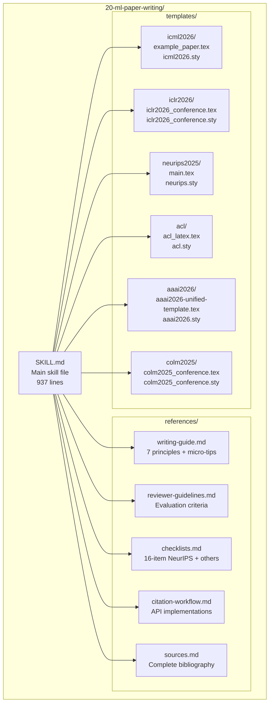

**Core Principle**: The skill file ([20-ml-paper-writing/SKILL.md:1-937]()) serves as the entry point, with progressive disclosure to detailed references and templates based on specific needs.

Sources: [20-ml-paper-writing/SKILL.md:1-937]()

---

## Core Workflows

The skill defines five primary workflows that map directly to sections in the main skill file.

### Workflow Mapping to File Sections

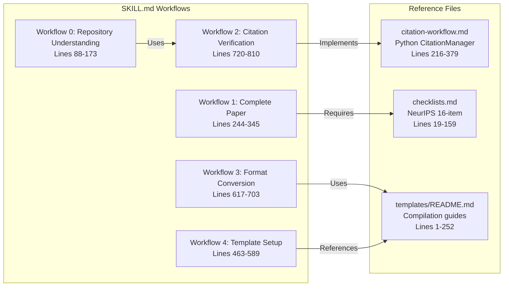

Sources: [20-ml-paper-writing/SKILL.md:88-173](), [20-ml-paper-writing/SKILL.md:244-345](), [20-ml-paper-writing/SKILL.md:720-810](), [20-ml-paper-writing/SKILL.md:617-703](), [20-ml-paper-writing/SKILL.md:463-589]()

---

## Citation Verification System

The most critical component of this skill is the citation hallucination prevention system. AI-generated citations have a ~40% error rate, making programmatic verification mandatory.

### The Golden Rule Implementation

The skill enforces citation verification through a strict workflow defined in [20-ml-paper-writing/SKILL.md:31-86]():

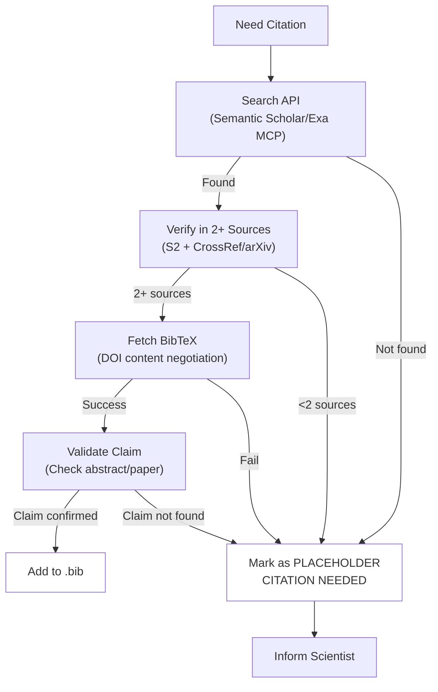

### API Integration Points

The citation workflow integrates with multiple APIs as documented in [20-ml-paper-writing/references/citation-workflow.md:46-68]():

| API | Coverage | Rate Limits | Primary Use |
|-----|----------|-------------|-------------|
| **Semantic Scholar** | 214M papers | 1 RPS (free) | ML/AI paper search |
| **CrossRef** | 140M+ DOIs | Polite pool | BibTeX retrieval |
| **arXiv** | Preprints | 3s delays | Preprint access |
| **Exa MCP** | Real-time | Via MCP | Recommended search |

Sources: [20-ml-paper-writing/SKILL.md:31-86](), [20-ml-paper-writing/references/citation-workflow.md:46-68]()

### Citation Manager Implementation

The complete Python implementation is provided in [20-ml-paper-writing/references/citation-workflow.md:216-379]():

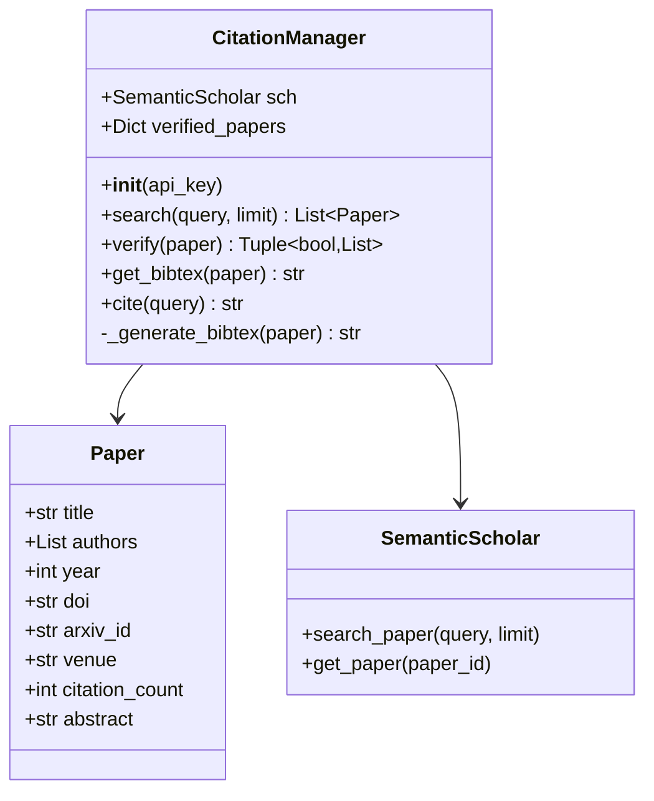

**Key Methods**:
- `CitationManager.search()` - Query Semantic Scholar API ([citation-workflow.md:252-273]())
- `CitationManager.verify()` - Multi-source verification ([citation-workflow.md:275-306]())
- `CitationManager.get_bibtex()` - DOI content negotiation ([citation-workflow.md:308-324]())
- `CitationManager.cite()` - Complete workflow ([citation-workflow.md:346-368]())

Sources: [20-ml-paper-writing/references/citation-workflow.md:216-379]()

### Placeholder Syntax

When verification fails, the skill mandates explicit placeholder syntax ([SKILL.md:49-56]()):

```latex
% EXPLICIT PLACEHOLDER - requires human verification
\cite{PLACEHOLDER_author2024_verify_this}  % TODO: Verify this citation exists
```

This ensures hallucinated citations are flagged rather than silently included.

Sources: [20-ml-paper-writing/SKILL.md:49-56]()

---

## Writing Philosophy Framework

The skill synthesizes writing advice from six prominent researchers into a cohesive framework documented in [20-ml-paper-writing/SKILL.md:348-437]() and [20-ml-paper-writing/references/writing-guide.md:1-477]().

### The Narrative Principle

Central to the framework is Neel Nanda's "Narrative Principle" ([SKILL.md:224-239]()), requiring three pillars:

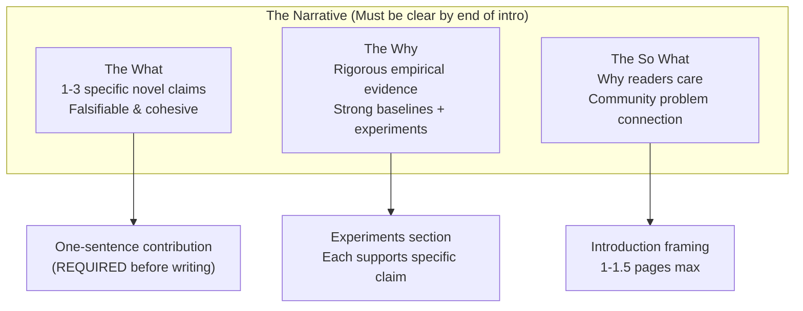

### Source Attribution

The writing philosophy integrates advice from multiple researchers as documented in [20-ml-paper-writing/SKILL.md:354-366]():

| Researcher | Key Contribution | Implementation |
|------------|------------------|----------------|
| **Neel Nanda** (DeepMind) | Narrative framework, time allocation | [writing-guide.md:21-43]() |
| **Sebastian Farquhar** (DeepMind) | 5-sentence abstract formula | [writing-guide.md:69-105]() |
| **Gopen & Swan** | 7 principles of reader expectations | [writing-guide.md:159-225]() |
| **Zachary Lipton** (CMU) | Word choice, hedging elimination | [writing-guide.md:293-333]() |
| **Jacob Steinhardt** (Berkeley) | Precision, consistent terminology | [writing-guide.md:308-325]() |
| **Ethan Perez** (Anthropic) | Micro-level clarity tips | [writing-guide.md:230-291]() |

Sources: [20-ml-paper-writing/SKILL.md:348-437](), [20-ml-paper-writing/references/writing-guide.md:1-477]()

### The 7 Principles of Reader Expectations

Gopen & Swan's principles are detailed in [20-ml-paper-writing/references/writing-guide.md:165-225]():

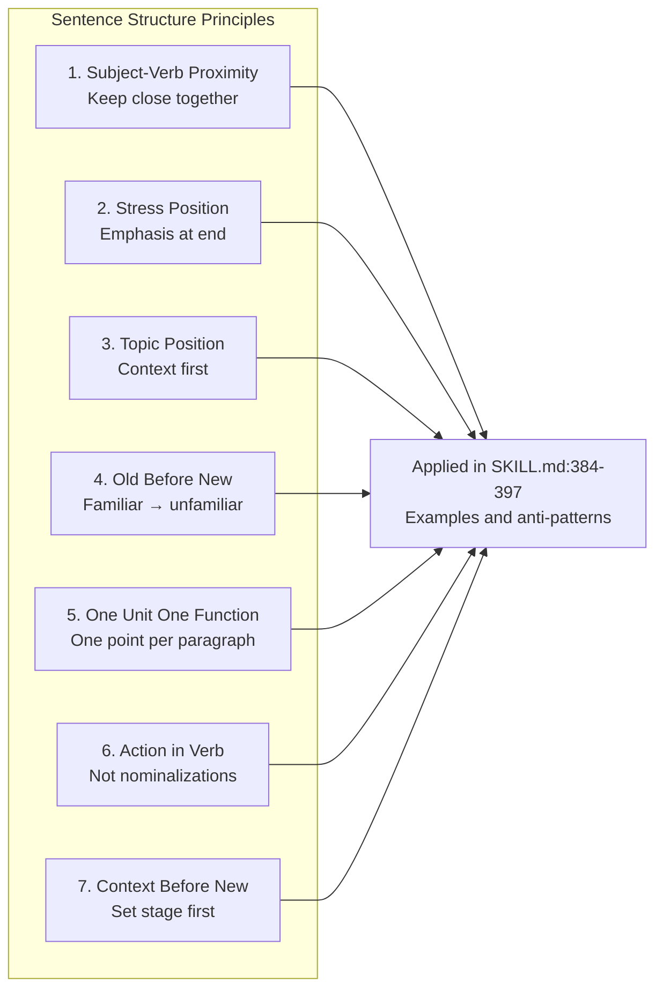

Each principle includes violation examples and corrections in [20-ml-paper-writing/references/writing-guide.md:168-213]().

Sources: [20-ml-paper-writing/references/writing-guide.md:165-225](), [20-ml-paper-writing/SKILL.md:384-397]()

---

## Conference-Specific Requirements

The skill provides complete specifications for six major conferences with strict requirement tracking.

### Conference Metadata

Defined in [20-ml-paper-writing/SKILL.md:440-457]():

| Conference | Page Limit | Camera-Ready | Key Requirement | Template Path |
|------------|------------|--------------|-----------------|---------------|
| **NeurIPS 2025** | 9 pages | +0 | 16-item checklist mandatory | `templates/neurips2025/` |
| **ICML 2026** | 8 pages | +1 | Broader Impact required | `templates/icml2026/` |
| **ICLR 2026** | 9 pages | +1 | LLM disclosure required | `templates/iclr2026/` |
| **ACL 2025** | 8 pages | varies | Limitations mandatory | `templates/acl/` |
| **AAAI 2026** | 7 pages | +1 | Strict style adherence | `templates/aaai2026/` |
| **COLM 2025** | 9 pages | +1 | Language model focus | `templates/colm2025/` |

### Checklist System

NeurIPS requires a 16-item paper checklist documented in [20-ml-paper-writing/references/checklists.md:19-159]():

```mermaid
graph TB
    subgraph "NeurIPS Mandatory Checklist (Lines 19-159)"
        C1["1. Claims Alignment"]
        C2["2. Limitations Discussion"]
        C3["3. Theory & Proofs"]
        C4["4. Reproducibility"]
        C5["5. Data & Code Access"]
        C6["6. Experimental Details"]
        C7["7. Statistical Significance"]
        C8["8. Compute Resources"]
        C9["9. Ethics Code Compliance"]
        C10["10. Broader Impacts"]
        C11["11. Safeguards"]
        C12["12. License Respect"]
        C13["13. Asset Documentation"]
        C14["14. Human Subjects"]
        C15["15. IRB Approvals"]
        C16["16. LLM Declaration"]
    end
    
    C1 --> RESPONSE["Response: yes/no/N/A<br/>+ 1-2 sentence justification"]
    C2 --> RESPONSE
    C4 --> RESPONSE
    C7 --> RESPONSE
    C10 --> RESPONSE
    C16 --> RESPONSE
```

Each checklist item includes specific validation criteria detailed in [20-ml-paper-writing/references/checklists.md:25-159]().

Sources: [20-ml-paper-writing/SKILL.md:440-457](), [20-ml-paper-writing/references/checklists.md:19-159]()

---

## LaTeX Template System

The skill includes six conference templates with unified structure and version switching mechanisms.

### Template Architecture

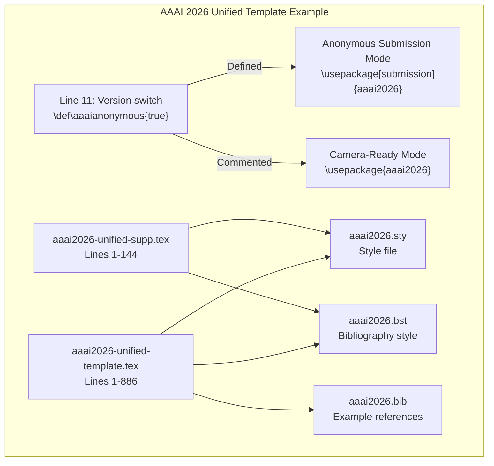

The AAAI template demonstrates the unified approach detailed in [20-ml-paper-writing/templates/aaai2026/README.md:1-534]().

Sources: [20-ml-paper-writing/templates/aaai2026/aaai2026-unified-template.tex:1-886](), [20-ml-paper-writing/templates/aaai2026/README.md:1-534]()

### Template File Dependencies

Each template requires specific files for compilation:

| Conference | Main File | Style File | Bibliography Style | Required Packages |
|------------|-----------|------------|-------------------|-------------------|
| ICML 2026 | `example_paper.tex` | `icml2026.sty` | `icml2026.bst` | algorithm, algorithmic |
| ICLR 2026 | `iclr2026_conference.tex` | `iclr2026_conference.sty` | `iclr2026_conference.bst` | math_commands.tex |
| AAAI 2026 | `aaai2026-unified-template.tex` | `aaai2026.sty` | `aaai2026.bst` | algorithm, listings |

**Critical Template Rule** ([aaai2026/README.md:244-249]()):

```
⚠️ NEVER add \bibliographystyle{aaai2026} in document
The .sty file automatically sets this
Otherwise: "Illegal, another \bibstyle command" error
```

Sources: [20-ml-paper-writing/templates/aaai2026/README.md:244-249]()

### Version Switching Mechanism

The AAAI template implements conditional compilation ([aaai2026-unified-template.tex:17-22](), [aaai2026-unified-template.tex:110-115]()):

```latex
% Conditional package loading
\ifdefined\aaaianonymous
    \usepackage[submission]{aaai2026}  % Anonymous submission
\else
    \usepackage{aaai2026}              % Camera-ready
\fi

% Conditional title
\ifdefined\aaaianonymous
    \title{AAAI Press Anonymous Submission\\Instructions...}
\else
    \title{AAAI Press Formatting Instructions...}
\fi
```

This pattern is replicated across all templates with venue-specific variations.

Sources: [20-ml-paper-writing/templates/aaai2026/aaai2026-unified-template.tex:17-22](), [20-ml-paper-writing/templates/aaai2026/aaai2026-unified-template.tex:110-115]()

---

## Reviewer Evaluation System

Understanding reviewer behavior helps optimize paper structure. The skill documents evaluation criteria from multiple conferences.

### Universal Evaluation Dimensions

Documented in [20-ml-paper-writing/references/reviewer-guidelines.md:20-75]():

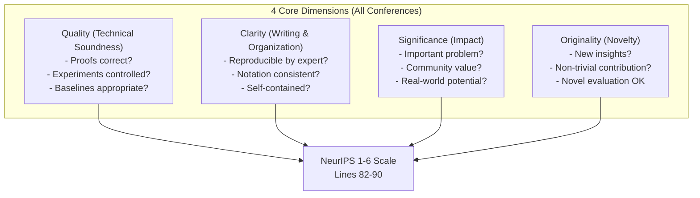

### NeurIPS Scoring System

The 6-point scale is defined in [20-ml-paper-writing/references/reviewer-guidelines.md:82-90]():

| Score | Label | Description | Percentage |
|-------|-------|-------------|------------|
| **6** | Strong Accept | Groundbreaking, flawless | Top 2-3% |
| **5** | Accept | Technically solid, high impact | ~25% |
| **4** | Borderline Accept | Solid work, limited eval | ~15% |
| **3** | Borderline Reject | Weaknesses outweigh | ~20% |
| **2** | Reject | Technical flaws | ~30% |
| **1** | Strong Reject | Ethical issues, known results | ~10% |

### Reviewer Reading Patterns

Understanding what reviewers actually read ([writing-guide.md:426-436]()):

| Paper Section | % Reviewers Who Read | Implication |
|---------------|---------------------|-------------|
| Abstract | 100% | Must be perfect |
| Introduction | 90%+ (skimmed) | Front-load contribution |
| Figures | Examined before methods | Figure 1 is critical |
| Methods | Only if interested | Don't bury the lede |
| Appendix | Rarely | Supplementary only |

**Critical Insight**: Time allocation should reflect this: equal time on (1) abstract, (2) introduction, (3) figures, (4) everything else combined ([SKILL.md:372-379]()).

Sources: [20-ml-paper-writing/references/reviewer-guidelines.md:20-90](), [20-ml-paper-writing/references/writing-guide.md:426-436](), [20-ml-paper-writing/SKILL.md:372-379]()

---

## Workflow Integration with Repository Understanding

The skill emphasizes starting from existing research repositories, documented in [20-ml-paper-writing/SKILL.md:88-173]().

### Repository Exploration Workflow

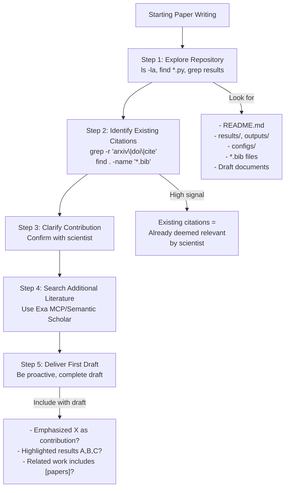

### Proactivity Decision Matrix

Defined in [20-ml-paper-writing/SKILL.md:193-221]():

| Confidence Level | Action | Example |
|-----------------|--------|---------|
| **High** (clear repo, obvious contribution) | Write full draft → deliver → iterate | Clear results, single main claim |
| **Medium** (some ambiguity) | Write draft with flagged uncertainties → continue | Multiple possible framings |
| **Low** (major unknowns) | Ask 1-2 targeted questions → draft | Incomplete results, unclear scope |

**Only Block For**:
- Target venue unclear (affects page limits)
- Multiple contradictory framings equally valid
- Results incomplete or inconsistent
- Explicit request for review before continuing

**Don't Block For**:
- Word choice decisions
- Section ordering
- Which specific results to show
- Citation completeness

Sources: [20-ml-paper-writing/SKILL.md:88-221]()

---

## Complete Paper Writing Workflow

The iterative workflow is documented in [20-ml-paper-writing/SKILL.md:244-345]().

### Step-by-Step Progression

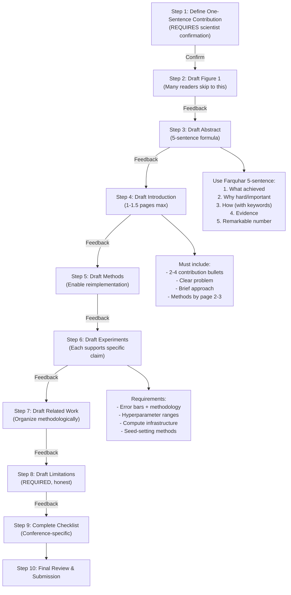

### Abstract 5-Sentence Formula

From [20-ml-paper-writing/SKILL.md:281-291]() and [writing-guide.md:71-93]():

```
Sentence 1: What you achieved ("We introduce...", "We prove...")
Sentence 2: Why this is hard and important
Sentence 3: How you do it (include specialist keywords for discoverability)
Sentence 4: What evidence you have
Sentence 5: Your most remarkable number/result
```

**Delete Generic Openings**: Any sentence that could be prepended to any ML paper (e.g., "Large language models have achieved remarkable success...").

Sources: [20-ml-paper-writing/SKILL.md:244-345](), [20-ml-paper-writing/references/writing-guide.md:69-105]()

---

## Conference Resubmission & Format Conversion

When resubmitting to different venues, format conversion is required ([SKILL.md:613-703]()).

### Conversion Workflow

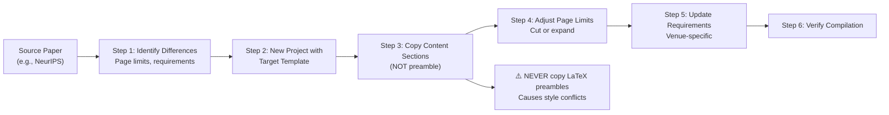

### Common Conversion Scenarios

From [20-ml-paper-writing/SKILL.md:630-638]():

| From → To | Page Change | Key Adjustments |
|-----------|-------------|-----------------|
| NeurIPS → ICML | 9 → 8 pages | Cut 1 page, add Broader Impact if missing |
| ICML → ICLR | 8 → 9 pages | Expand experiments, add LLM disclosure |
| NeurIPS → ACL | 9 → 8 pages | Restructure for NLP, add Limitations |
| ICLR → AAAI | 9 → 7 pages | Significant cuts, strict style |
| Any → COLM | varies → 9 | Reframe for language models |

### Venue-Specific Required Additions

From [20-ml-paper-writing/SKILL.md:673-679]():

| Target Venue | Required Additions |
|--------------|-------------------|
| **ICML** | Broader Impact Statement (after conclusion) |
| **ICLR** | LLM usage disclosure, reciprocal reviewing agreement |
| **ACL/EMNLP** | Limitations section (mandatory), Ethics Statement |
| **AAAI** | Strict adherence to style file (no modifications) |
| **NeurIPS** | Paper checklist (appendix), lay summary if accepted |

Sources: [20-ml-paper-writing/SKILL.md:613-703]()

---

## Template Usage Workflow

The skill provides detailed template setup instructions in [20-ml-paper-writing/SKILL.md:463-589]().

### Template Setup Process

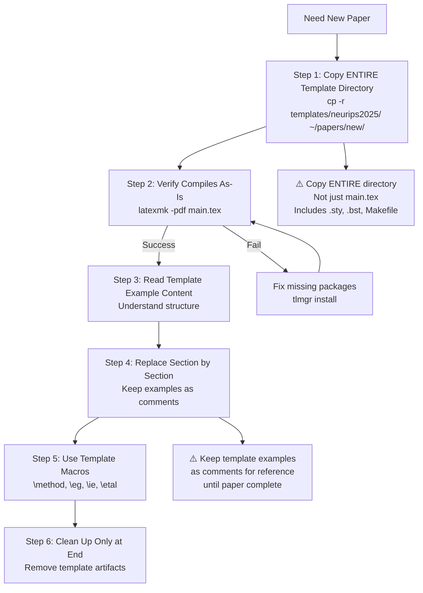

### Common Template Pitfalls

Documented in [20-ml-paper-writing/SKILL.md:591-599]():

| Pitfall | Problem | Solution |
|---------|---------|----------|
| Copying only `main.tex` | Missing `.sty`, won't compile | Copy entire directory |
| Modifying `.sty` files | Breaks conference formatting | Never edit style files |
| Adding random packages | Conflicts, breaks template | Only add if necessary |
| Deleting template content too early | Lose formatting reference | Keep as comments until done |
| Not compiling frequently | Errors accumulate | Compile after each section |

Sources: [20-ml-paper-writing/SKILL.md:463-599]()

---

## Compilation Systems

The templates support multiple compilation workflows documented in [20-ml-paper-writing/templates/README.md:1-252]().

### Compilation Options

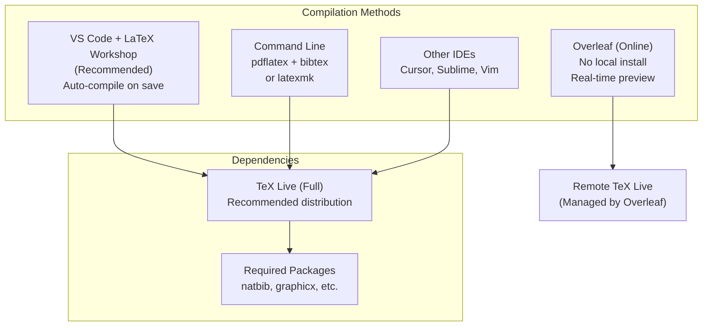

### VS Code Setup

From [20-ml-paper-writing/templates/README.md:9-39]():

```json
{
  "latex-workshop.latex.autoBuild.run": "onSave",
  "latex-workshop.view.pdf.viewer": "tab",
  "latex-workshop.latex.recipes": [
    {
      "name": "pdflatex → bibtex → pdflatex × 2",
      "tools": ["pdflatex", "bibtex", "pdflatex", "pdflatex"]
    }
  ]
}
```

### Command Line Compilation

Standard LaTeX workflow from [templates/README.md:42-58]():

```bash
# Basic compilation
pdflatex main.tex

# With bibliography (full workflow)
pdflatex main.tex
bibtex main
pdflatex main.tex
pdflatex main.tex

# Using latexmk (automatic dependencies)
latexmk -pdf main.tex

# Continuous compilation
latexmk -pdf -pvc main.tex
```

Sources: [20-ml-paper-writing/templates/README.md:1-252]()

---

## Skill Dependencies and External Integrations

The skill integrates with multiple external systems documented in [20-ml-paper-writing/SKILL.md:8]().

### Python Package Dependencies

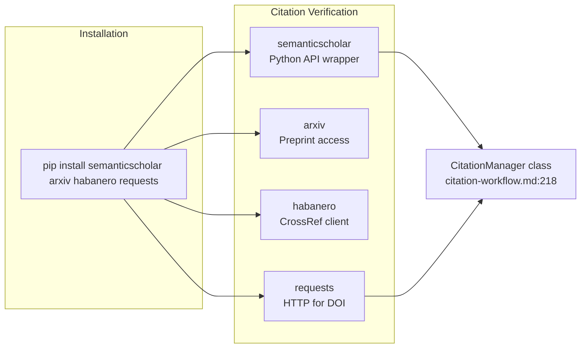

### Exa MCP Integration

Recommended for enhanced paper search ([SKILL.md:58-84]()):

```bash
# Claude Code
claude mcp add exa -- npx -y mcp-remote "https://mcp.exa.ai/mcp"

# Cursor / VS Code (MCP settings)
{
  "mcpServers": {
    "exa": {
      "type": "http",
      "url": "https://mcp.exa.ai/mcp"
    }
  }
}
```

Enables queries like:
- "Find papers on RLHF for language models published after 2023"
- "Search for transformer architecture papers by Vaswani"
- "Get recent work on sparse autoencoders for interpretability"

Sources: [20-ml-paper-writing/SKILL.md:8](), [20-ml-paper-writing/SKILL.md:58-84]()

---

## Progressive Disclosure Architecture

The skill follows the library's Progressive Disclosure principle (see [1.1](#1.1)) with content organized by depth:

### Content Layers

| Layer | Location | Lines | Purpose |
|-------|----------|-------|---------|
| **L0: Quick Start** | SKILL.md:1-87 | 87 | Core philosophy, critical citation rule |
| **L1: Workflows** | SKILL.md:88-810 | 722 | 5 complete workflows with checklists |
| **L2: Philosophy** | writing-guide.md | 477 | Deep dive into 7 principles + micro-tips |
| **L3: Requirements** | checklists.md | 362 | Conference-specific mandatory items |
| **L4: Implementation** | citation-workflow.md | 563 | Complete Python code for citations |
| **L5: Templates** | templates/ | ~2000 | LaTeX files for 6 conferences |

### Reference Document Structure

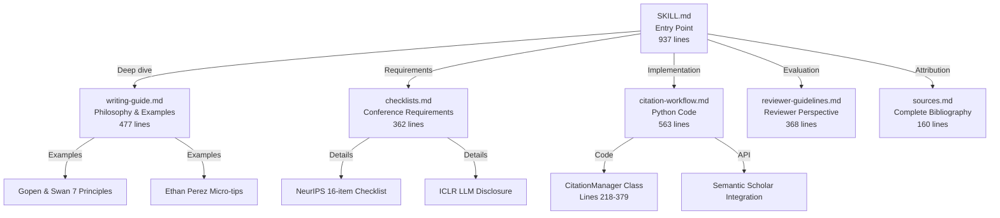

Users start at `SKILL.md` and progressively access deeper references only when needed.

Sources: All reference files in [20-ml-paper-writing/references/]()

---

## Quality Validation Mechanisms

The skill enforces quality through multiple validation checkpoints.

### Citation Verification Checkpoints

From [20-ml-paper-writing/SKILL.md:39-56]() and [citation-workflow.md:533-544]():

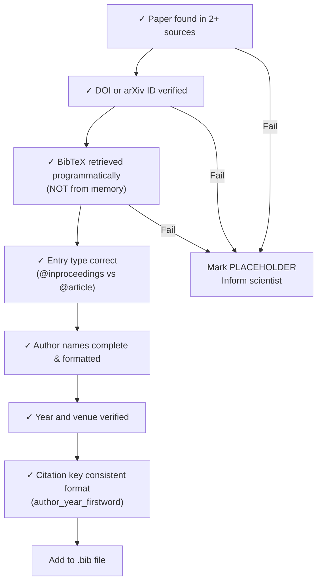

### Pre-Submission Universal Checklist

From [20-ml-paper-writing/references/checklists.md:285-333]():

**Paper Content**:
- [ ] Abstract ≤ word limit (250-300 words)
- [ ] Main content within page limit
- [ ] References complete and verified
- [ ] Limitations section included
- [ ] All figures/tables have captions
- [ ] Captions self-contained

**Technical**:
- [ ] All claims supported by evidence
- [ ] Error bars included
- [ ] Baselines appropriate
- [ ] Hyperparameters documented
- [ ] Compute resources stated

**Reproducibility**:
- [ ] Code available (or justification)
- [ ] Data available (or justification)
- [ ] Environment documented
- [ ] Commands to reproduce provided

**Ethics**:
- [ ] Broader impacts considered
- [ ] Limitations honestly stated
- [ ] Licenses respected
- [ ] IRB obtained if needed

**Final**:
- [ ] PDF compiles without errors
- [ ] All citations resolve
- [ ] Conference checklist completed

Sources: [20-ml-paper-writing/references/checklists.md:285-333](), [20-ml-paper-writing/SKILL.md:39-56]()

---

## Integration with AI Research Workflow

The ML Paper Writing skill integrates with the broader AI research lifecycle documented in the library.

### Cross-Skill Integration Points

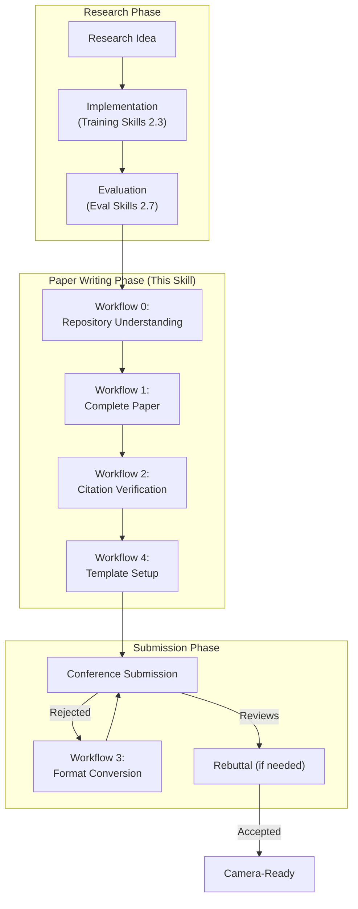

### Skills Referenced

This skill assumes familiarity with:
- **Training & Fine-Tuning ([2.3](#2.3))**: For methods sections describing model training
- **Evaluation ([2.7](#2.7))**: For experiments sections with benchmark results
- **Optimization ([2.6](#2.6))**: For describing quantization, acceleration techniques
- **Safety & Alignment ([2.4](#2.4))**: For post-training methods in papers

The skill provides the publication layer for research conducted using other skills in the library.

Sources: [20-ml-paper-writing/SKILL.md:1-937]()

---

## Skill Metadata and Versioning

From [20-ml-paper-writing/SKILL.md:1-9]():

```yaml
name: ml-paper-writing
description: Write publication-ready ML/AI papers for NeurIPS, ICML, ICLR, ACL, AAAI, COLM
version: 1.0.0
author: Orchestra Research
license: MIT
tags: [Academic Writing, NeurIPS, ICML, ICLR, ACL, AAAI, COLM, LaTeX, Paper Writing, Citations, Research]
dependencies: [semanticscholar, arxiv, habanero, requests]
```

**Install Dependencies**:
```bash
pip install semanticscholar arxiv habanero requests
```

**Access via Claude Code CLI**:
```bash
claude mcp install ml-paper-writing
```

The skill is distributed through the Orchestra marketplace as documented in [6](#6) (Orchestra Marketplace Integration).

Sources: [20-ml-paper-writing/SKILL.md:1-9]()

---

