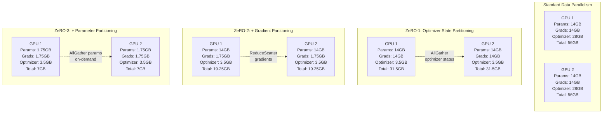
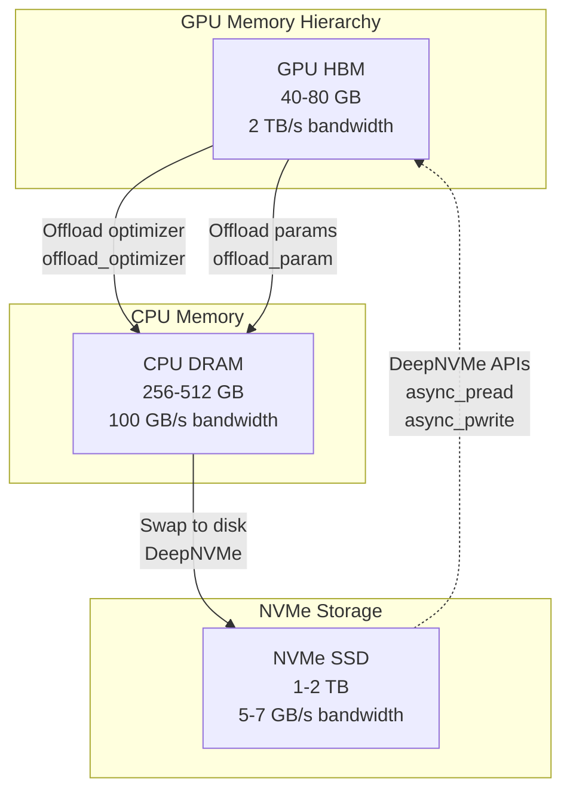
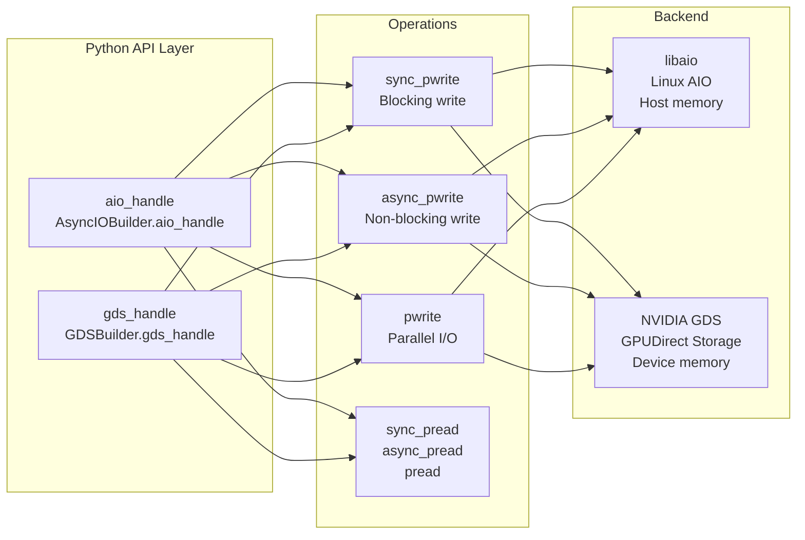
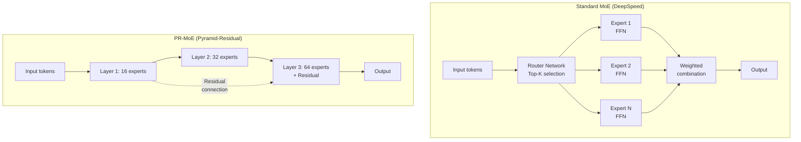
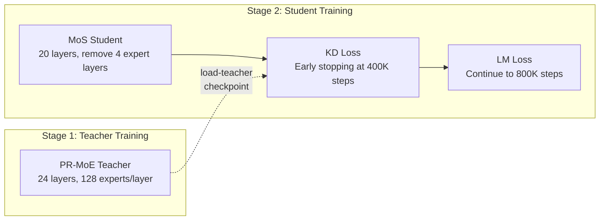
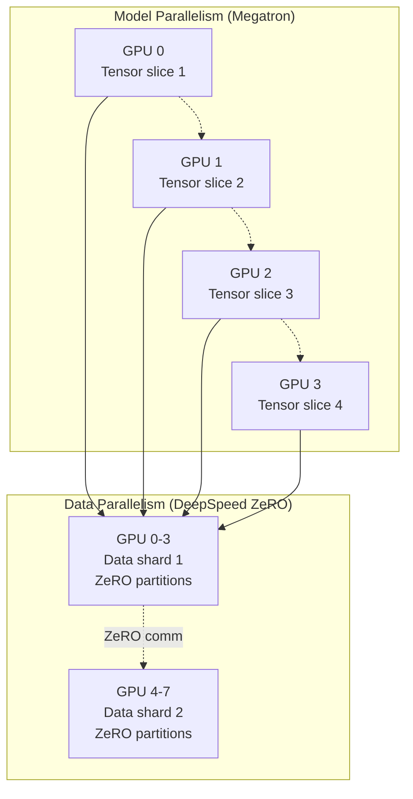

<!-- source: DeepWiki mcp.deepwiki.com · repo zechenzhangAGI/AI-research-SKILLs · page 3.2 DeepSpeed: ZeRO Optimization & MoE Training · fetched 2026-10-26 -->

# DeepSpeed: ZeRO Optimization & MoE Training

<details>
<summary>Relevant source files</summary>

The following files were used as context for generating this wiki page:

- [03-fine-tuning/unsloth/SKILL.md](03-fine-tuning/unsloth/SKILL.md)
- [05-data-processing/nemo-curator/SKILL.md](05-data-processing/nemo-curator/SKILL.md)
- [05-data-processing/ray-data/SKILL.md](05-data-processing/ray-data/SKILL.md)
- [06-post-training/grpo-rl-training/SKILL.md](06-post-training/grpo-rl-training/SKILL.md)
- [08-distributed-training/deepspeed/SKILL.md](08-distributed-training/deepspeed/SKILL.md)

</details>


## Purpose and Scope

This document provides in-depth technical coverage of Microsoft DeepSpeed's memory optimization and Mixture-of-Experts (MoE) training capabilities. DeepSpeed enables training models from 1B to 1T+ parameters through **ZeRO (Zero Redundancy Optimizer)** memory reduction techniques and efficient **MoE architectures** that increase model capacity without proportional compute costs.

**Coverage:**
- ZeRO stages 1-3 for optimizer state, gradient, and parameter partitioning
- ZeRO-Infinity and ZeRO-Offload for CPU/NVMe memory extension
- Standard MoE, PR-MoE (Pyramid-Residual), and MoS (Mixture-of-Students) training
- DeepNVMe for high-performance tensor I/O operations
- Configuration patterns and integration with Megatron-LM

**Related pages:**
- For 4D parallelism and Float8 training, see [TorchTitan](#3.1)
- For fast LoRA fine-tuning without ZeRO, see [Unsloth](#2.3)
- For data preparation before training, see [NeMo Curator](#3.3)
- For post-training alignment, see [RLHF & Preference Optimization](#3.9)

---

## ZeRO Optimization Architecture

### Memory Efficiency Overview

DeepSpeed ZeRO achieves **8-16× memory reduction** compared to standard data parallelism by eliminating memory redundancy across data-parallel processes. Instead of replicating model states (parameters, gradients, optimizer states), ZeRO partitions them.

**Memory breakdown in standard data parallelism (per GPU):**

| Component | Memory (7B model, FP16) | Redundancy |
|-----------|------------------------|------------|
| Parameters | 14 GB | Replicated |
| Gradients | 14 GB | Replicated |
| Optimizer states (Adam) | 28 GB (4× params) | Replicated |
| Activations | 8-16 GB | Unique |
| **Total** | **64-72 GB** | **78% redundant** |

**With ZeRO-3 partitioning (per GPU, 8-way parallelism):**

| Component | Memory per GPU | Reduction |
|-----------|----------------|-----------|
| Parameters | 1.75 GB (14/8) | 8× |
| Gradients | 1.75 GB (14/8) | 8× |
| Optimizer states | 3.5 GB (28/8) | 8× |
| Activations | 8-16 GB | No change |
| **Total** | **15-23 GB** | **3-4× total reduction** |

### ZeRO Stage Comparison



**Sources:** [08-distributed-training/deepspeed/SKILL.md:52-147]()

### ZeRO Stage Details

#### ZeRO-1: Optimizer State Partitioning

Partitions optimizer states (momentum, variance) across data-parallel ranks. Each GPU stores only `1/N` of optimizer states.

**Configuration:**
```json
{
  "zero_optimization": {
    "stage": 1
  }
}
```

**Memory reduction:** 4× (for Adam optimizer)  
**Communication overhead:** Minimal (AllGather only during optimizer step)  
**Use case:** Models up to 3B parameters with standard hardware

#### ZeRO-2: + Gradient Partitioning

Extends ZeRO-1 by also partitioning gradients. Each GPU computes full gradients during backward pass, then performs `ReduceScatter` to partition them.

**Configuration:**
```json
{
  "zero_optimization": {
    "stage": 2,
    "contiguous_gradients": true,
    "overlap_comm": true
  }
}
```

**Memory reduction:** 8× (parameters 1×, gradients 8×, optimizer 8×)  
**Communication overhead:** `ReduceScatter` during backward pass (overlapped with computation)  
**Use case:** Models 3-13B parameters, production recommendation

**Sources:** [08-distributed-training/deepspeed/SKILL.md:52-147]()

#### ZeRO-3: + Parameter Partitioning

Most aggressive partitioning. Each GPU stores only `1/N` of all model states. Parameters are gathered via `AllGather` before each forward/backward layer computation.

**Configuration:**
```json
{
  "zero_optimization": {
    "stage": 3,
    "stage3_prefetch_bucket_size": 5e8,
    "stage3_param_persistence_threshold": 1e6,
    "stage3_max_live_parameters": 1e9,
    "stage3_max_reuse_distance": 1e9,
    "stage3_gather_16bit_weights_on_model_save": true
  }
}
```

**Memory reduction:** 64× theoretical (all states partitioned by N)  
**Communication overhead:** `AllGather` before each layer, increased latency  
**Use case:** Models 13B-200B+ parameters, maximum memory efficiency

**Critical parameters:**
- `stage3_prefetch_bucket_size`: Size of parameter buckets to prefetch (larger = better throughput, more memory)
- `stage3_param_persistence_threshold`: Keep params under this size unpartitioned (reduces comm)
- `stage3_max_live_parameters`: Maximum params to keep in GPU memory simultaneously

**Sources:** [08-distributed-training/deepspeed/SKILL.md:52-147]()

### ZeRO-Infinity: CPU and NVMe Offloading



**ZeRO-Infinity enables:**
- Training 13B models on **single GPU** (vs 1.4B limit without offloading)
- Training 200B+ models on 8× A100 40GB
- 30+ teraflops throughput maintained with CPU offload

**Configuration:**
```json
{
  "zero_optimization": {
    "stage": 3,
    "offload_optimizer": {
      "device": "cpu",
      "pin_memory": true
    },
    "offload_param": {
      "device": "cpu",
      "pin_memory": true
    }
  }
}
```

**Sources:** [08-distributed-training/deepspeed/SKILL.md:52-147]()

### ZeRO-Offload: CPU-Only Optimization

Simplified offload strategy targeting single-GPU training. Keeps parameters and gradients on GPU, offloads optimizer states to CPU.

**Configuration:**
```json
{
  "zero_optimization": {
    "stage": 2,
    "offload_optimizer": {
      "device": "cpu",
      "pin_memory": true
    }
  }
}
```

**Performance characteristics:**
- 10× larger models than baseline (13B on single V100)
- 30+ teraflops maintained (vs 40 teraflops without offload)
- Overlaps CPU optimizer step with GPU forward/backward

**Use case:** Researchers with limited GPU resources, experimentation at scale

**Sources:** [08-distributed-training/deepspeed/SKILL.md:52-147]()

---

## DeepNVMe: High-Performance Tensor I/O

DeepSpeed's custom I/O library for fast parameter/optimizer swapping between GPU/CPU and NVMe storage.

### Architecture and APIs



### Handle Creation and Configuration

**`aio_handle` creation (CPU tensors):**
```python
from deepspeed.ops.op_builder import AsyncIOBuilder

h = AsyncIOBuilder().load().aio_handle(
    block_size=1048576,           # 1MB I/O blocks
    queue_depth=128,              # Async operation queue
    single_submit=False,          # Batch submissions
    overlap_events=True,          # Overlap I/O with compute
    intra_op_parallelism=8        # 8-way parallel I/O
)
```

**`gds_handle` creation (GPU tensors, requires NVIDIA GDS):**
```python
from deepspeed.ops.op_builder import GDSBuilder

h = GDSBuilder().load().gds_handle(
    block_size=1048576,
    queue_depth=32,
    intra_op_parallelism=4
)
```

**Sources:** [08-distributed-training/deepspeed/SKILL.md:28-32]()

### Performance Tuning with `ds_nvme_tune`

DeepSpeed provides automated performance tuning utility:

```bash
ds_nvme_tune --nvme_dir /local_nvme --gpu
```

**Output example:**
```
Best performance (GB/sec): read = 3.69, write = 3.18
{
  "aio": {
    "single_submit": "false",
    "overlap_events": "true",
    "intra_op_parallelism": 8,
    "queue_depth": 32,
    "block_size": 1048576
  }
}
```

**Typical performance (Lambda workstation, CS3040 NVMe):**
- **Read**: 3.69 GB/s (66% of hardware peak 5.6 GB/s)
- **Write**: 3.18 GB/s (74% of hardware peak 4.3 GB/s)

**Sources:** [08-distributed-training/deepspeed/SKILL.md:28-32]()

### I/O Operation Patterns

**Blocking write:**
```python
import torch

t = torch.empty(1024**3, dtype=torch.uint8).cuda()  # 1GB tensor
h.sync_pwrite(t, '/local_nvme/checkpoint.pt')
```

**Non-blocking write with wait:**
```python
h.async_pwrite(t, '/local_nvme/checkpoint.pt')
# ... do other work ...
h.wait()  # Synchronize before reusing tensor
```

**Parallel I/O (4-way):**
```python
h = AsyncIOBuilder().load().aio_handle(intra_op_parallelism=4)
h.async_pwrite(t, '/local_nvme/checkpoint.pt')
h.wait()
```

**Critical safety rule:** Must call `h.wait()` before:
- Modifying source tensor of pending write
- Reading destination tensor of pending read
- Otherwise causes data races and corruption

**Sources:** [08-distributed-training/deepspeed/SKILL.md:28-32]()

---

## Mixture of Experts (MoE) Training

DeepSpeed pioneered efficient MoE training for NLG models, achieving **5× training speedup** and **3× model size reduction** through PR-MoE architecture.

### MoE Architecture Comparison



**Sources:** [08-distributed-training/deepspeed/SKILL.md:34-39]()

### Standard MoE Configuration

**Hyperparameters:**

| Parameter | Value | Purpose |
|-----------|-------|---------|
| `--num-experts` | 128 | Total experts per MoE layer |
| `--moe-expert-parallel-size` | 8 | Expert parallelism degree (16 experts/GPU) |
| `--moe-loss-coeff` | 0.01 | Weight for load balancing loss |
| `--moe-train-capacity-factor` | 1.25 | Token routing capacity per expert (train) |
| `--moe-eval-capacity-factor` | 2.0 | Token routing capacity per expert (eval) |
| `--moe-min-capacity` | 4 | Minimum tokens per expert |
| `--disable-moe-token-dropping` | - | Disable capacity limits (inference only) |

**Example training script:**
```bash
deepspeed --num_gpus=8 pretrain_gpt.py \
  --model-parallel-size 1 \
  --num-layers 24 \
  --hidden-size 1024 \
  --num-attention-heads 16 \
  --num-experts 128 \
  --moe-expert-parallel-size 8 \
  --moe-loss-coeff 0.01 \
  --moe-train-capacity-factor 1.25 \
  --deepspeed_config config.json
```

**Model location:** Changes required in `megatron/model/` to add MoE layers into GPT architecture.

**Sources:** [08-distributed-training/deepspeed/SKILL.md:34-39]()

### PR-MoE (Pyramid-Residual MoE)

**Key innovations:**
1. **Pyramid structure**: Varying expert counts per layer (e.g., [16, 32, 64, 128])
2. **Residual connections**: Skip connections between MoE layers
3. **3× parameter efficiency** vs standard MoE

**Configuration:**
```bash
deepspeed pretrain_gpt.py \
  --num-experts 16,32,64,128 \  # Pyramid: list instead of single value
  --mlp-type residual \          # Enable residual connections
  --learning-rate 1.5e-4 \       # Lower LR recommended
  --lr-decay-style cosine \
  --lr-decay-iters 300000
```

**Design philosophy:**
- **Early layers**: Fewer experts (16-32), broad feature extraction
- **Late layers**: More experts (64-128), specialized refinement
- **Residual paths**: Prevent information bottlenecks, improve gradient flow

**Performance (350M base + MoE-128):**
- **Zero-shot LAMBADA**: 0.6365 (vs 0.6270 standard MoE, 0.5203 dense)
- **Model size**: 1/3 of standard MoE for equivalent quality
- **Training cost**: 5× faster than dense model with same quality

**Sources:** [08-distributed-training/deepspeed/SKILL.md:34-39]()

### MoS (Mixture-of-Students) Distillation

Staged knowledge distillation for compressing large MoE models.



**Configuration:**
```bash
deepspeed pretrain_gpt.py \
  --mos \                                      # Enable MoS
  --load-teacher /path/to/teacher/checkpoint \
  --num-layers 20 \                            # Student: 20 layers
  --num-layers-teacher 24 \                    # Teacher: 24 layers
  --num-experts 16,32,64 \                     # Remove one expert layer
  --num-experts-teacher 16,32,64,128 \
  --hidden-size 1024 \
  --hidden-size-teacher 1024
```

**Staged distillation schedule:**
1. **Steps 0-400K**: Optimize `LM_loss + KD_loss`
2. **Steps 400K-800K**: Optimize `LM_loss` only (stop distillation)

**Rationale:** Full-training distillation can harm student performance. Early stopping allows student to develop independent capacity.

**Performance gains:**
- **12.5% model size reduction** (20 vs 24 layers)
- **3.7× total reduction** when combined with PR-MoE
- Maintains 98%+ of teacher quality

**Sources:** [08-distributed-training/deepspeed/SKILL.md:40-44]()

### MoE Data Requirements

**Public datasets validated:**
- **The Pile** (pile.eleuther.ai): 800GB diverse web data
- Compatible with any Megatron-LM pretraining data

**Zero-shot evaluation results (The Pile dataset):**

| Model | LAMBADA | PIQA | BoolQ | RACE-h | TriviaQA |
|-------|---------|------|-------|--------|----------|
| Dense 350M | 0.5106 | 0.6589 | 0.5933 | 0.3196 | 0.0257 |
| Standard MoE 350M+128 | 0.6128 | 0.7323 | 0.6040 | 0.3349 | 0.1111 |
| PR-MoE 350M+128 | 0.6365 | 0.7399 | 0.5988 | 0.3569 | 0.1630 |

**Sources:** [08-distributed-training/deepspeed/SKILL.md:34-39]()

---

## DeepSpeed Configuration Patterns

### Minimal ZeRO-2 Configuration

```json
{
  "train_batch_size": 64,
  "gradient_accumulation_steps": 4,
  "fp16": {
    "enabled": true,
    "loss_scale": 0,
    "loss_scale_window": 1000
  },
  "zero_optimization": {
    "stage": 2,
    "contiguous_gradients": true,
    "overlap_comm": true
  }
}
```

### Production ZeRO-3 Configuration

```json
{
  "train_batch_size": 128,
  "gradient_accumulation_steps": 8,
  "bf16": {
    "enabled": true
  },
  "zero_optimization": {
    "stage": 3,
    "stage3_prefetch_bucket_size": 5e8,
    "stage3_param_persistence_threshold": 1e6,
    "stage3_max_live_parameters": 1e9,
    "stage3_max_reuse_distance": 1e9,
    "stage3_gather_16bit_weights_on_model_save": true,
    "contiguous_gradients": true,
    "overlap_comm": true,
    "reduce_bucket_size": 5e8,
    "allgather_bucket_size": 5e8
  },
  "optimizer": {
    "type": "AdamW",
    "params": {
      "lr": 3e-4,
      "betas": [0.9, 0.999],
      "eps": 1e-8,
      "weight_decay": 0.01
    }
  },
  "scheduler": {
    "type": "WarmupDecayLR",
    "params": {
      "warmup_min_lr": 0,
      "warmup_max_lr": 3e-4,
      "warmup_num_steps": 2000,
      "total_num_steps": 100000
    }
  }
}
```

### ZeRO-Infinity with CPU/NVMe Offload

```json
{
  "train_batch_size": 32,
  "gradient_accumulation_steps": 16,
  "fp16": {
    "enabled": true
  },
  "zero_optimization": {
    "stage": 3,
    "offload_optimizer": {
      "device": "cpu",
      "pin_memory": true
    },
    "offload_param": {
      "device": "cpu",
      "pin_memory": true
    },
    "nvme_swap_dir": "/local_nvme/deepspeed_swap",
    "offload_optimizer": {
      "device": "nvme",
      "nvme_path": "/local_nvme/deepspeed_swap",
      "pin_memory": true,
      "buffer_count": 4,
      "fast_init": false
    }
  },
  "aio": {
    "block_size": 1048576,
    "queue_depth": 32,
    "thread_count": 8,
    "single_submit": false,
    "overlap_events": true
  }
}
```

**Sources:** [08-distributed-training/deepspeed/SKILL.md:52-147]()

---

## Integration with Megatron-LM

DeepSpeed provides seamless integration with NVIDIA's Megatron-LM for combining ZeRO with tensor/pipeline parallelism.

### Integration Architecture



### Required MPU Interface

DeepSpeed requires model parallelism unit (MPU) implementing:

```python
# Required bookkeeping functions
mpu.get_model_parallel_rank()
mpu.get_model_parallel_group()
mpu.get_model_parallel_world_size()
mpu.get_data_parallel_rank()
mpu.get_data_parallel_group()
mpu.get_data_parallel_world_size()
```

### Megatron-DeepSpeed Launch

```bash
deepspeed --num_nodes=4 --num_gpus=8 pretrain_gpt.py \
  --model-parallel-size 4 \      # Tensor parallelism across 4 GPUs
  --num-layers 48 \
  --hidden-size 6144 \
  --num-attention-heads 48 \
  --seq-length 2048 \
  --max-position-embeddings 2048 \
  --train-samples 300000000 \
  --lr-decay-samples 260000000 \
  --lr 1.5e-4 \
  --deepspeed \
  --deepspeed_config config_zero2.json
```

**Parallelism hierarchy:**
- **Tensor parallelism (MP)**: 4-way (Megatron)
- **Data parallelism (DP)**: 8-way (DeepSpeed ZeRO)
- **Effective GPUs**: 32 (4 nodes × 8 GPUs)

**Performance comparison (GPT-2 1.5B):**
- **Megatron-LM alone**: Baseline throughput
- **Megatron-LM + DeepSpeed ZeRO**: 1.5-2× higher throughput
- **Reason**: Higher batch size (less model parallelism needed), better memory efficiency

**Sources:** [08-distributed-training/deepspeed/SKILL.md:52-147]()

---

## Performance Analysis and Benchmarks

### Memory Efficiency by ZeRO Stage

**Test configuration:** 7B parameter model (Llama-2-7B size), FP16 training, Adam optimizer

| Configuration | Params/GPU | Grads/GPU | Optim/GPU | Total/GPU | Max Model Size |
|---------------|------------|-----------|-----------|-----------|----------------|
| No ZeRO (DP) | 14 GB | 14 GB | 28 GB | 56 GB | 1.4B (A100 80GB) |
| ZeRO-1 (8-way) | 14 GB | 14 GB | 3.5 GB | 31.5 GB | 3B |
| ZeRO-2 (8-way) | 14 GB | 1.75 GB | 3.5 GB | 19.25 GB | 7B |
| ZeRO-3 (8-way) | 1.75 GB | 1.75 GB | 3.5 GB | 7 GB | 13B |
| ZeRO-3 + Offload | 1.75 GB GPU + CPU | 1.75 GB GPU + CPU | CPU only | 3.5 GB GPU | 30B+ |

### Throughput Comparison

**GPT-2 1.5B training on 64 V100 GPUs:**

| Configuration | Throughput | Speedup |
|---------------|------------|---------|
| PyTorch DDP | 5.2 samples/sec | 1.0× |
| Megatron-LM (MP=4) | 8.7 samples/sec | 1.67× |
| DeepSpeed ZeRO-1 | 11.3 samples/sec | 2.17× |
| DeepSpeed ZeRO-2 | 13.1 samples/sec | 2.52× |
| Megatron-LM + ZeRO-2 | 15.8 samples/sec | 3.04× |

### BERT-Large Training Time

**Target: BERT-Large to parity on SQuAD 2.0**

| Hardware | Configuration | Time to Parity |
|----------|--------------|----------------|
| 16 V100 GPUs | DeepSpeed ZeRO-1 | 33.22 hours |
| 64 V100 GPUs | DeepSpeed ZeRO-1 | 8.68 hours |
| 256 V100 GPUs | DeepSpeed ZeRO-1 | 2.4 hours |
| 1024 V100 GPUs | DeepSpeed ZeRO-1 | 44 minutes |

**Sources:** [08-distributed-training/deepspeed/SKILL.md:52-147]()

---

## Python Integration Patterns

### Basic DeepSpeed Initialization

```python
import torch
import deepspeed

# Define model
model = MyTransformer()

# Initialize DeepSpeed
model_engine, optimizer, _, _ = deepspeed.initialize(
    args=args,
    model=model,
    model_parameters=model.parameters(),
    config='config.json'
)

# Training loop
for batch in dataloader:
    loss = model_engine(batch)
    model_engine.backward(loss)
    model_engine.step()
```

### Transformers Integration

```python
from transformers import AutoModelForCausalLM, TrainingArguments
from transformers import Trainer

model = AutoModelForCausalLM.from_pretrained("gpt2")

training_args = TrainingArguments(
    output_dir="output",
    deepspeed="config_zero2.json",  # DeepSpeed config path
    per_device_train_batch_size=4,
    gradient_accumulation_steps=4,
    num_train_epochs=3
)

trainer = Trainer(
    model=model,
    args=training_args,
    train_dataset=train_dataset
)

trainer.train()
```

### ZeRO-3 Model Loading Pattern

```python
import deepspeed
from deepspeed.runtime.zero.stage3 import estimate_zero3_model_states_mem_needs_all_live

# Estimate memory before loading
estimate_zero3_model_states_mem_needs_all_live(
    model=model,
    num_gpus_per_node=8,
    num_nodes=1
)

# Load with ZeRO-3
with deepspeed.zero.Init(config_dict_or_path=config):
    model = MyLargeModel()
```

### Checkpoint Saving/Loading

```python
# Save checkpoint (includes model, optimizer, scheduler)
model_engine.save_checkpoint(
    save_dir='checkpoints',
    tag='iter-10000'
)

# Load checkpoint
_, client_sd = model_engine.load_checkpoint(
    load_dir='checkpoints',
    tag='iter-10000'
)
```

**ZeRO-3 checkpoint consolidation:**
```python
# Convert ZeRO-3 sharded checkpoint to single file
python deepspeed.checkpoint.zero_to_fp32.py \
    checkpoints/iter-10000 \
    output/pytorch_model.bin
```

**Sources:** [08-distributed-training/deepspeed/SKILL.md:52-147]()

---

## Advanced Features

### 1-bit Adam Optimizer

Communication-efficient optimizer reducing gradient communication by **up to 26×**.

**Configuration:**
```json
{
  "optimizer": {
    "type": "OneBitAdam",
    "params": {
      "lr": 1e-3,
      "weight_decay": 0.01,
      "freeze_step": 400,
      "cuda_aware": true,
      "comm_backend_name": "nccl"
    }
  }
}
```

**Performance gains:**
- **Bandwidth-limited clusters**: 2.7× faster SQuAD fine-tuning
- **BERT-Large pretraining**: 6.6× higher throughput
- **Convergence**: Equivalent to full-precision Adam

### Sparse Attention Support

DeepSpeed integrates sparse attention kernels for handling long sequences.

**Configuration:**
```json
{
  "sparse_attention": {
    "mode": "fixed",
    "block": 16,
    "different_layout_per_head": true
  }
}
```

**Benefits:**
- **6× faster execution** vs dense attention
- **10× longer sequences** (e.g., 16K tokens vs 1.5K)
- Flexible sparse structures (fixed, block-sparse, BigBird)

### Activation Checkpointing

Reduce activation memory by recomputing during backward pass.

**Configuration:**
```json
{
  "activation_checkpointing": {
    "partition_activations": true,
    "cpu_checkpointing": true,
    "contiguous_memory_optimization": true,
    "number_checkpoints": 4,
    "synchronize_checkpoint_boundary": true,
    "profile": false
  }
}
```

**Memory tradeoff:**
- **Savings**: 2-4× activation memory reduction
- **Cost**: 20-30% slower training (recomputation overhead)

**Sources:** [08-distributed-training/deepspeed/SKILL.md:52-147]()

---

## Troubleshooting and Debugging

### Common Issues

**OOM with ZeRO-3:**
```bash
# Symptom: Out of memory during model initialization
# Solution: Reduce stage3_max_live_parameters
{
  "stage3_max_live_parameters": 5e8  # Reduce from 1e9
}
```

**Slow ZeRO-3 throughput:**
```bash
# Symptom: Training 2-3× slower than expected
# Solution: Tune prefetch and bucket sizes
{
  "stage3_prefetch_bucket_size": 1e9,  # Increase for better overlap
  "reduce_bucket_size": 1e9,
  "allgather_bucket_size": 1e9
}
```

**DeepNVMe not available:**
```bash
# Symptom: [WARNING] async_io requires the dev libaio
# Solution: Install libaio
apt install libaio-dev  # Ubuntu/Debian
yum install libaio-devel  # CentOS/RHEL
```

**MoE load imbalance:**
```bash
# Symptom: Some GPUs idle, poor throughput
# Solution: Increase capacity factors
--moe-train-capacity-factor 2.0  # Increase from 1.25
--moe-eval-capacity-factor 4.0
```

### Debugging Commands

**Check operator availability:**
```bash
ds_report
# Look for [OKAY] status on async_io and gds operators
```

**Estimate ZeRO-3 memory:**
```python
from deepspeed.runtime.zero.stage3 import estimate_zero3_model_states_mem_needs_all_live

estimate_zero3_model_states_mem_needs_all_live(
    model=model,
    num_gpus_per_node=8,
    num_nodes=1
)
```

**Tune DeepNVMe performance:**
```bash
ds_nvme_tune --nvme_dir /path/to/nvme --gpu --loops 10
```

**Sources:** [08-distributed-training/deepspeed/SKILL.md:28-32](), [08-distributed-training/deepspeed/SKILL.md:52-147]()

---

## Summary: When to Use Each Feature

| Feature | Memory Reduction | Complexity | Use Case |
|---------|------------------|------------|----------|
| **ZeRO-1** | 4× | Low | Models 1-3B, minimal code changes |
| **ZeRO-2** | 8× | Low | **Recommended default** (3-13B) |
| **ZeRO-3** | 16-64× | Medium | Large models (13B-200B+) |
| **ZeRO-Infinity** | Unlimited | High | Single GPU training, limited hardware |
| **Standard MoE** | - | Medium | 5× faster training vs dense |
| **PR-MoE** | 3× vs MoE | High | Research, maximum efficiency |
| **MoS** | 1.12× vs PR-MoE | High | Compress trained MoE models |
| **DeepNVMe** | Offload to disk | Medium | ZeRO-Infinity, fast checkpointing |
| **1-bit Adam** | 26× comm reduction | Low | Bandwidth-limited clusters |

**Recommended starting configuration:**
- **8-16 GPUs**: ZeRO-2 with `overlap_comm=true`
- **32+ GPUs**: ZeRO-2 or ZeRO-3 depending on model size
- **Single GPU**: ZeRO-3 + CPU offload
- **MoE training**: Start with standard MoE, progress to PR-MoE for production

**Sources:** [08-distributed-training/deepspeed/SKILL.md:52-147]()

---

