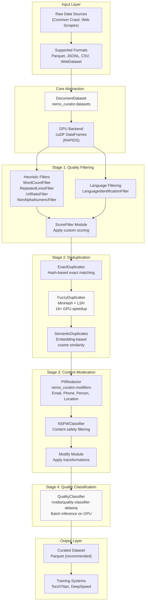
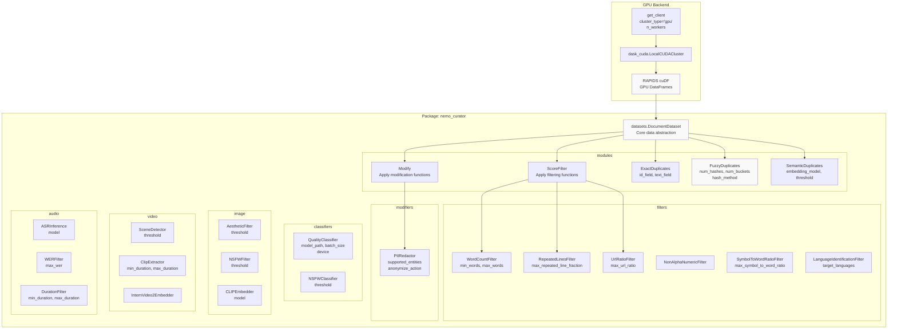
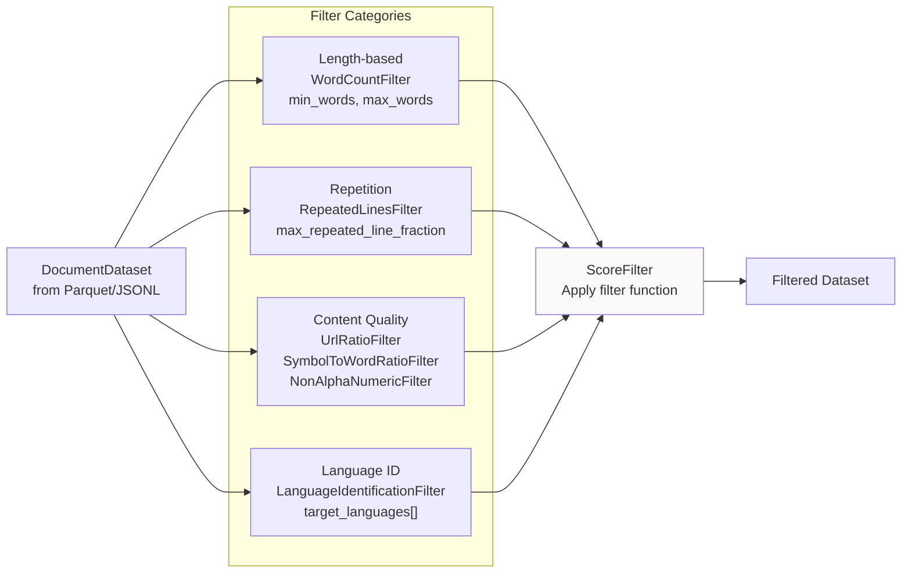
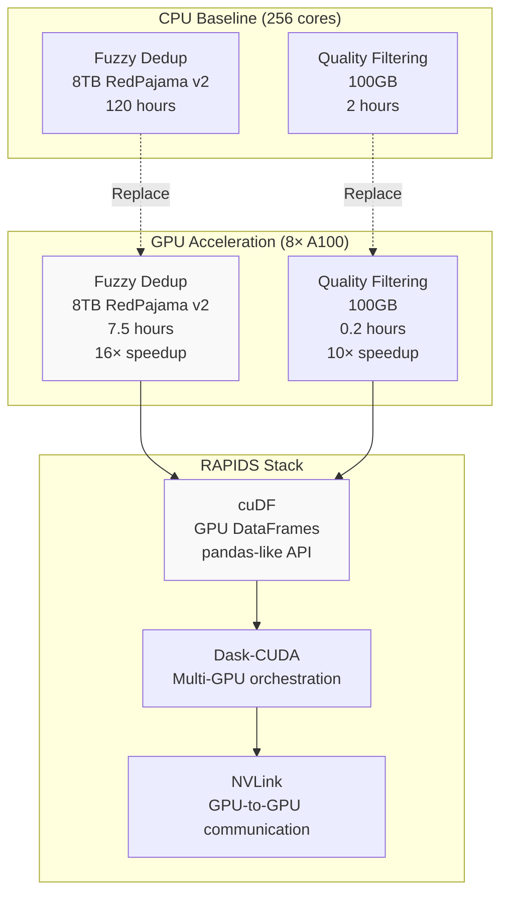
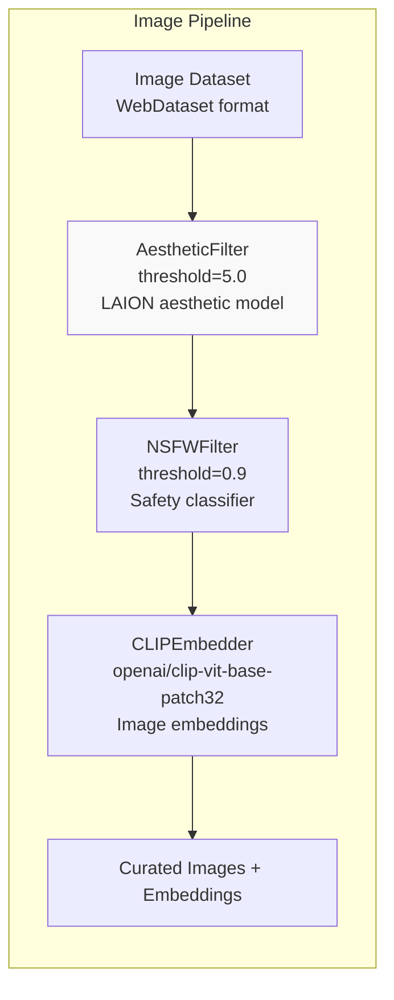
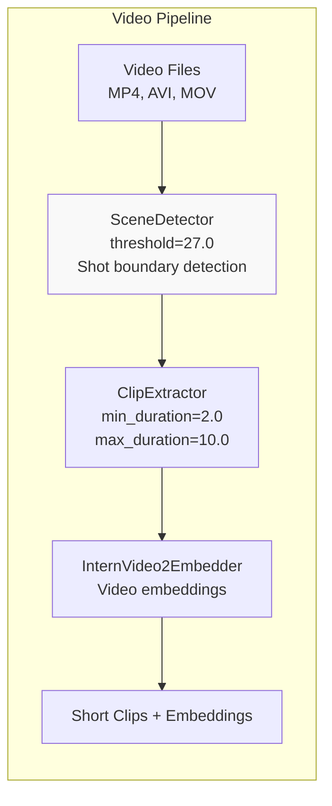
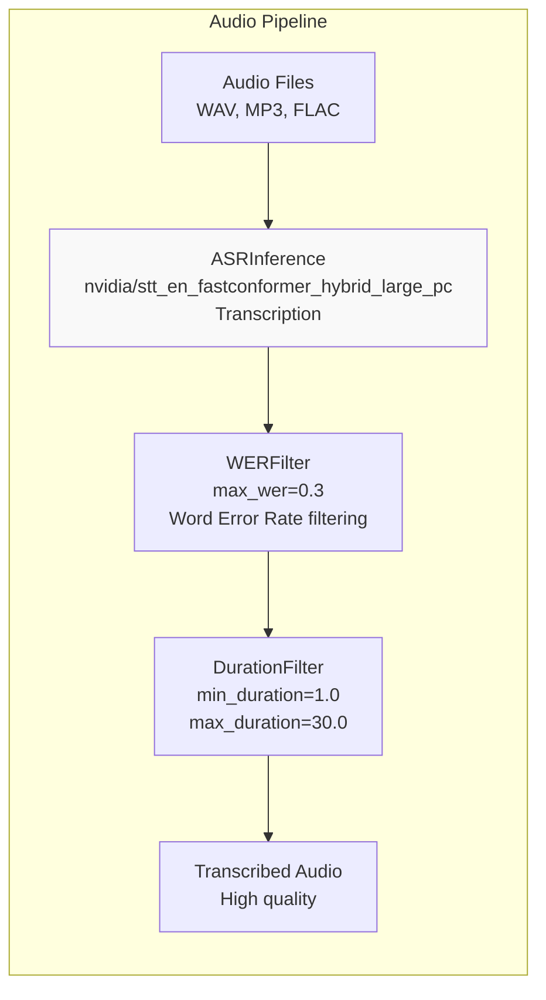
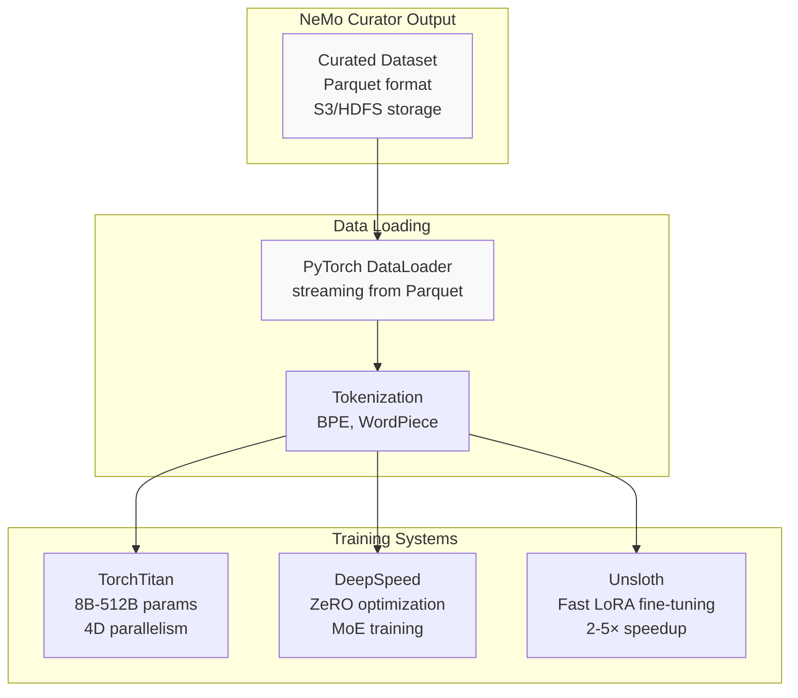

<!-- source: DeepWiki mcp.deepwiki.com · repo zechenzhangAGI/AI-research-SKILLs · page 3.3 NeMo Curator: GPU-Accelerated Data Preparation · fetched 2026-10-26 -->

# NeMo Curator: GPU-Accelerated Data Preparation

<details>
<summary>Relevant source files</summary>

The following files were used as context for generating this wiki page:

- [03-fine-tuning/unsloth/SKILL.md](03-fine-tuning/unsloth/SKILL.md)
- [05-data-processing/nemo-curator/SKILL.md](05-data-processing/nemo-curator/SKILL.md)
- [05-data-processing/ray-data/SKILL.md](05-data-processing/ray-data/SKILL.md)
- [06-post-training/grpo-rl-training/SKILL.md](06-post-training/grpo-rl-training/SKILL.md)
- [08-distributed-training/deepspeed/SKILL.md](08-distributed-training/deepspeed/SKILL.md)

</details>


## Purpose and Scope

This document covers NVIDIA NeMo Curator, a GPU-accelerated toolkit for preparing high-quality training data for Large Language Models (LLMs) and multimodal AI systems. NeMo Curator provides a comprehensive pipeline for data curation, including quality filtering, deduplication (exact, fuzzy, semantic), PII redaction, and content moderation across text, image, video, and audio modalities.

**Performance**: NeMo Curator achieves 16× speedup over CPU-based alternatives for fuzzy deduplication and near-linear scaling across GPU clusters, reducing data curation costs by 40-89% through GPU acceleration.

**Related pages**:
- For distributed data processing without curation-specific features, see [Ray Data](#2.2)
- For training systems that consume curated data, see [TorchTitan](#3.1), [DeepSpeed](#3.2), [Unsloth](#2.3)
- For post-training data quality evaluation, see [NeMo Evaluator](#3.4)

---

## Architecture Overview

### Data Curation Pipeline

NeMo Curator implements a modular pipeline architecture where datasets flow through sequential stages of filtering, deduplication, modification, and classification.



**Sources**: [05-data-processing/nemo-curator/SKILL.md:1-384]()

---

## Core Module Hierarchy

### Code Entity Map

This diagram maps natural language concepts to concrete code symbols in NeMo Curator's API.



**Sources**: [05-data-processing/nemo-curator/SKILL.md:49-323]()

---

## Installation and Setup

### Installation Options

NeMo Curator supports multiple installation profiles based on modality requirements:

```bash
# Text curation only (CUDA 12)
uv pip install "nemo-curator[text_cuda12]"

# All modalities (text, image, video, audio)
uv pip install "nemo-curator[all_cuda12]"

# CPU-only (16× slower, not recommended)
uv pip install "nemo-curator[cpu]"
```

**Key dependencies**:
- `cudf`: GPU DataFrames (RAPIDS)
- `dask`: Distributed computing
- `rapids`: GPU acceleration framework
- `torch`: PyTorch backend for models
- `transformers`: HuggingFace models for classification

**Sources**: [05-data-processing/nemo-curator/SKILL.md:36-47]()

---

## Stage 1: Quality Filtering

### Heuristic Filters

NeMo Curator provides 30+ heuristic filters for removing low-quality content. All filters operate on `DocumentDataset` objects and support GPU acceleration.



**Implementation pattern**:

```python
from nemo_curator.filters import (
    WordCountFilter,
    RepeatedLinesFilter,
    UrlRatioFilter,
    NonAlphaNumericFilter
)

# Apply filters sequentially
dataset = dataset.filter(WordCountFilter(min_words=50, max_words=100000))
dataset = dataset.filter(RepeatedLinesFilter(max_repeated_line_fraction=0.3))
dataset = dataset.filter(UrlRatioFilter(max_url_ratio=0.2))
```

**Common filter configurations**:

| Filter | Parameter | Typical Value | Purpose |
|--------|-----------|---------------|---------|
| `WordCountFilter` | `min_words` | 50-100 | Remove short documents |
| `WordCountFilter` | `max_words` | 50,000-100,000 | Remove extremely long docs |
| `RepeatedLinesFilter` | `max_repeated_line_fraction` | 0.2-0.3 | Remove repetitive content |
| `UrlRatioFilter` | `max_url_ratio` | 0.2-0.3 | Remove link-heavy content |
| `SymbolToWordRatioFilter` | `max_symbol_to_word_ratio` | 0.3 | Remove symbol-heavy text |

**Sources**: [05-data-processing/nemo-curator/SKILL.md:76-98]()

---

## Stage 2: Deduplication

### Deduplication Methods

NeMo Curator implements three deduplication strategies with varying performance-accuracy tradeoffs.

```mermaid
graph TB
    subgraph "Exact Deduplication"
        EXACT_IN["Input Dataset<br/>id_field, text_field"]
        EXACT_HASH["SHA-256 Hashing<br/>CPU/GPU"]
        EXACT_OUT["Remove exact duplicates"]
    end
    
    subgraph "Fuzzy Deduplication (16× GPU Speedup)"
        FUZZY_IN["Input Dataset"]
        MINHASH["MinHash<br/>num_hashes=260<br/>hash_method='md5'"]
        LSH["Locality Sensitive Hashing<br/>num_buckets=20"]
        FUZZY_CLUSTER["Cluster similar documents"]
        FUZZY_OUT["Remove near-duplicates"]
    end
    
    subgraph "Semantic Deduplication"
        SEM_IN["Input Dataset"]
        EMBED["Embedding Model<br/>sentence-transformers/all-MiniLM-L6-v2"]
        COSINE["Cosine Similarity<br/>threshold=0.8"]
        SEM_OUT["Remove semantically similar"]
    end
    
    EXACT_IN --> EXACT_HASH --> EXACT_OUT
    FUZZY_IN --> MINHASH --> LSH --> FUZZY_CLUSTER --> FUZZY_OUT
    SEM_IN --> EMBED --> COSINE --> SEM_OUT
    
    style MINHASH fill:#f9f9f9
    style LSH fill:#f9f9f9
```



**Performance characteristics**:

| Method | Dataset Size | CPU Time (256 cores) | GPU Time (8× A100) | Speedup |
|--------|--------------|----------------------|--------------------|---------|
| Exact | 1 TB | 8 hours | 0.5 hours | 16× |
| Fuzzy | 8 TB (RedPajama v2) | 120 hours | 7.5 hours | 16× |
| Semantic | 100 GB | 24 hours | 2 hours | 12× |

**Sources**: [05-data-processing/nemo-curator/SKILL.md:99-139](), [05-data-processing/nemo-curator/SKILL.md:326-343]()

### Exact Deduplication Implementation

**Code entity**: `nemo_curator.modules.ExactDuplicates`

```python
from nemo_curator.modules import ExactDuplicates

# Configure exact deduplication
dedup = ExactDuplicates(
    id_field="id",        # Document ID column
    text_field="text"     # Text content column
)

# Apply to dataset
deduped_dataset = dedup(dataset)
```

**Mechanism**:
1. Computes SHA-256 hash of `text_field` for each document
2. Groups documents by hash value
3. Retains first document in each group (by `id_field` ordering)
4. Returns dataset with duplicates removed

**Sources**: [05-data-processing/nemo-curator/SKILL.md:101-108]()

### Fuzzy Deduplication Implementation

**Code entity**: `nemo_curator.modules.FuzzyDuplicates`

This is the primary differentiator for NeMo Curator, achieving 16× speedup through GPU-accelerated MinHash and LSH.

```python
from nemo_curator.modules import FuzzyDuplicates

# Configure fuzzy deduplication
fuzzy_dedup = FuzzyDuplicates(
    id_field="id",
    text_field="text",
    num_hashes=260,      # MinHash signature size (larger = more accurate)
    num_buckets=20,      # LSH buckets (larger = fewer collisions)
    hash_method="md5"    # Hash function for MinHash
)

# Apply with GPU acceleration
deduped_dataset = fuzzy_dedup(dataset)
```

**Algorithm**:
1. **MinHash signature generation** (GPU-accelerated):
   - Generate `num_hashes` hash values per document
   - Each hash captures document content similarity
   - GPU processes millions of hashes in parallel
2. **LSH bucketing**:
   - Partition signatures into `num_buckets` bands
   - Documents in same bucket are candidate duplicates
3. **Similarity computation**:
   - Calculate Jaccard similarity for candidates
   - Remove documents above similarity threshold

**Parameter tuning**:
- `num_hashes=260`: Standard for web-scale datasets (Common Crawl)
- `num_buckets=20`: Balance between recall and precision
- Increase `num_hashes` for higher accuracy (slower)
- Increase `num_buckets` for stricter matching (fewer false positives)

**Sources**: [05-data-processing/nemo-curator/SKILL.md:110-124]()

### Semantic Deduplication Implementation

**Code entity**: `nemo_curator.modules.SemanticDuplicates`

```python
from nemo_curator.modules import SemanticDuplicates

# Configure semantic deduplication
semantic_dedup = SemanticDuplicates(
    id_field="id",
    text_field="text",
    embedding_model="sentence-transformers/all-MiniLM-L6-v2",
    threshold=0.8  # Cosine similarity threshold (0.0-1.0)
)

# Apply (GPU-accelerated embedding generation)
deduped_dataset = semantic_dedup(dataset)
```

**Algorithm**:
1. Generate embeddings using transformer model (GPU batch inference)
2. Compute pairwise cosine similarities
3. Remove documents with similarity > `threshold`

**Use cases**:
- Paraphrased content detection
- Cross-lingual deduplication (with multilingual embeddings)
- Higher quality than fuzzy dedup (but slower)

**Sources**: [05-data-processing/nemo-curator/SKILL.md:126-139]()

---

## Stage 3: Content Moderation

### PII Redaction

**Code entity**: `nemo_curator.modifiers.PIIRedactor`

NeMo Curator integrates PII detection and redaction for privacy-preserving data curation.

```python
from nemo_curator.modules import Modify
from nemo_curator.modifiers import PIIRedactor

# Configure PII redaction
pii_redactor = PIIRedactor(
    supported_entities=[
        "EMAIL_ADDRESS",
        "PHONE_NUMBER",
        "PERSON",
        "LOCATION",
        "CREDIT_CARD",
        "SSN"
    ],
    anonymize_action="replace"  # "replace" or "redact"
)

# Apply to dataset
redacted_dataset = Modify(pii_redactor)(dataset)
```

**Redaction strategies**:
- `"replace"`: Substitute with entity type (e.g., `<EMAIL_ADDRESS>`)
- `"redact"`: Remove entirely

**Detected entities**:
- Personal identifiers: `PERSON`, `PHONE_NUMBER`, `EMAIL_ADDRESS`
- Location data: `LOCATION`, `ADDRESS`
- Financial: `CREDIT_CARD`, `IBAN`, `CRYPTO`
- Government IDs: `SSN`, `PASSPORT`

**Sources**: [05-data-processing/nemo-curator/SKILL.md:141-154]()

### Content Classification

**Code entity**: `nemo_curator.classifiers.QualityClassifier`, `nemo_curator.classifiers.NSFWClassifier`

```python
from nemo_curator.classifiers import QualityClassifier, NSFWClassifier

# Quality classification (GPU batch inference)
quality_clf = QualityClassifier(
    model_path="nvidia/quality-classifier-deberta",
    batch_size=256,      # GPU batch size
    device="cuda"
)

# Filter low-quality documents
high_quality = dataset.filter(lambda doc: quality_clf(doc["text"]) > 0.5)

# NSFW filtering
nsfw_clf = NSFWClassifier(threshold=0.8)
safe_content = dataset.filter(lambda doc: nsfw_clf(doc["text"]) < 0.8)
```

**Models**:
- `nvidia/quality-classifier-deberta`: DeBERTa-based quality scorer (0.0-1.0)
- Built-in NSFW classifier for content moderation

**Sources**: [05-data-processing/nemo-curator/SKILL.md:156-170]()

---

## GPU Acceleration Architecture

### Performance Characteristics

NeMo Curator achieves 16× speedup over CPU alternatives through RAPIDS-accelerated operations.



**Cost comparison** (8TB dataset processing):

| Infrastructure | Cost/hour | Time | Total Cost | Savings |
|----------------|-----------|------|------------|---------|
| CPU (AWS c5.18xlarge × 10) | $36/hour | 120 hours | $4,320 | Baseline |
| GPU (AWS p4d.24xlarge × 2) | $65.54/hour | 7.5 hours | $491.55 | 89% |

**Sources**: [05-data-processing/nemo-curator/SKILL.md:172-180](), [05-data-processing/nemo-curator/SKILL.md:344-357]()

### Multi-GPU Scaling

**Code entity**: `nemo_curator.get_client`, `dask_cuda.LocalCUDACluster`

```python
from nemo_curator import get_client
from dask_cuda import LocalCUDACluster

# Initialize 8-GPU cluster
cluster = LocalCUDACluster(n_workers=8)
client = get_client(cluster=cluster)

# Process with distributed execution
dataset = DocumentDataset.read_parquet("s3://large_dataset/*.parquet")
deduped = FuzzyDuplicates(...)(dataset)

# Cleanup
client.close()
cluster.close()
```

**Scaling performance** (fuzzy deduplication, 8TB RedPajama v2):

| GPUs | Time | Speedup vs CPU | Efficiency |
|------|------|----------------|------------|
| 1× A100 | 60 hours | 2× | - |
| 2× A100 | 30 hours | 4× | 100% |
| 4× A100 | 15 hours | 8× | 100% |
| 8× A100 | 7.5 hours | 16× | 100% |

**Near-linear scaling** achieved through:
- Minimal inter-GPU communication (data parallelism)
- NVLink bandwidth (600 GB/s per GPU)
- Dask-CUDA task scheduling optimization

**Sources**: [05-data-processing/nemo-curator/SKILL.md:181-193](), [05-data-processing/nemo-curator/SKILL.md:306-323]()

---

## Multimodal Data Curation

### Image Curation Pipeline

**Code entities**: `nemo_curator.image.AestheticFilter`, `nemo_curator.image.NSFWFilter`, `nemo_curator.image.CLIPEmbedder`



```python
from nemo_curator.image import (
    AestheticFilter,
    NSFWFilter,
    CLIPEmbedder
)

# Aesthetic scoring (GPU batch inference)
aesthetic_filter = AestheticFilter(threshold=5.0)
filtered_images = aesthetic_filter(image_dataset)

# NSFW detection
nsfw_filter = NSFWFilter(threshold=0.9)
safe_images = nsfw_filter(filtered_images)

# Generate CLIP embeddings for retrieval
clip_embedder = CLIPEmbedder(model="openai/clip-vit-base-patch32")
image_embeddings = clip_embedder(safe_images)
```

**Models**:
- **LAION aesthetic predictor**: Scores image aesthetic quality (0-10 scale)
- **NSFW classifier**: Binary safety classification
- **CLIP**: Vision-language embeddings for semantic search

**Sources**: [05-data-processing/nemo-curator/SKILL.md:195-217]()

### Video Curation Pipeline

**Code entities**: `nemo_curator.video.SceneDetector`, `nemo_curator.video.ClipExtractor`, `nemo_curator.video.InternVideo2Embedder`



```python
from nemo_curator.video import (
    SceneDetector,
    ClipExtractor,
    InternVideo2Embedder
)

# Detect scene changes
scene_detector = SceneDetector(threshold=27.0)
scenes = scene_detector(video_dataset)

# Extract clips of appropriate length
clip_extractor = ClipExtractor(min_duration=2.0, max_duration=10.0)
clips = clip_extractor(scenes)

# Generate video embeddings
video_embedder = InternVideo2Embedder()
video_embeddings = video_embedder(clips)
```

**Use case**: Preparing video data for vision-language model training (e.g., Gemini, GPT-4V successors)

**Sources**: [05-data-processing/nemo-curator/SKILL.md:219-238]()

### Audio Curation Pipeline

**Code entities**: `nemo_curator.audio.ASRInference`, `nemo_curator.audio.WERFilter`, `nemo_curator.audio.DurationFilter`



```python
from nemo_curator.audio import (
    ASRInference,
    WERFilter,
    DurationFilter
)

# Automatic Speech Recognition
asr = ASRInference(model="nvidia/stt_en_fastconformer_hybrid_large_pc")
transcribed = asr(audio_dataset)

# Filter by transcription quality (Word Error Rate)
wer_filter = WERFilter(max_wer=0.3)
high_quality_audio = wer_filter(transcribed)

# Duration filtering
duration_filter = DurationFilter(min_duration=1.0, max_duration=30.0)
filtered_audio = duration_filter(high_quality_audio)
```

**Use case**: Preparing audio data for speech-to-text models, audio-language models

**Sources**: [05-data-processing/nemo-curator/SKILL.md:240-261]()

---

## Production Workflows

### Common Crawl Curation Pipeline

This example demonstrates a complete pipeline for curating web-scale data from Common Crawl.

```python
from nemo_curator import ScoreFilter, Modify
from nemo_curator.filters import *
from nemo_curator.modules import *
from nemo_curator.datasets import DocumentDataset

# Load Common Crawl data
dataset = DocumentDataset.read_parquet("common_crawl/*.parquet")

# Stage 1: Quality filtering
dataset = dataset.filter(WordCountFilter(min_words=100, max_words=50000))
dataset = dataset.filter(RepeatedLinesFilter(max_repeated_line_fraction=0.2))
dataset = dataset.filter(SymbolToWordRatioFilter(max_symbol_to_word_ratio=0.3))
dataset = dataset.filter(UrlRatioFilter(max_url_ratio=0.3))

# Stage 2: Language filtering
dataset = dataset.filter(LanguageIdentificationFilter(target_languages=["en"]))

# Stage 3: Deduplication (16× GPU speedup)
dataset = ExactDuplicates(id_field="id", text_field="text")(dataset)
dataset = FuzzyDuplicates(
    id_field="id",
    text_field="text",
    num_hashes=260,
    num_buckets=20
)(dataset)

# Stage 4: PII redaction
pii_redactor = PIIRedactor()
dataset = Modify(pii_redactor)(dataset)

# Stage 5: NSFW filtering
nsfw_clf = NSFWClassifier(threshold=0.8)
dataset = dataset.filter(lambda doc: nsfw_clf(doc["text"]) < 0.8)

# Save curated dataset
dataset.to_parquet("curated_common_crawl/")
```

**Performance** (1TB Common Crawl data):
- CPU (64 cores): ~48 hours
- GPU (8× A100): ~3 hours
- **16× speedup**, $3,828 cost savings

**Sources**: [05-data-processing/nemo-curator/SKILL.md:264-304]()

### Distributed Multi-Node Processing

```python
from nemo_curator import get_client
from dask_cuda import LocalCUDACluster
from nemo_curator.modules import FuzzyDuplicates

# Multi-node GPU cluster (8 GPUs per node, 4 nodes = 32 GPUs)
cluster = LocalCUDACluster(n_workers=8)
client = get_client(cluster=cluster)

# Process large dataset from S3
dataset = DocumentDataset.read_parquet("s3://large_dataset/*.parquet")

# Distributed fuzzy deduplication
deduped = FuzzyDuplicates(
    id_field="id",
    text_field="text",
    num_hashes=260,
    num_buckets=20
)(dataset)

# Write output
deduped.write_parquet("s3://curated_output/")

# Cleanup
client.close()
cluster.close()
```

**Scaling characteristics**:
- **Near-linear scaling** across 32+ GPUs
- **Network bandwidth**: Critical for S3 I/O (10 Gbps+ recommended)
- **Storage**: Parquet format for efficient columnar storage

**Sources**: [05-data-processing/nemo-curator/SKILL.md:306-323]()

---

## Integration with Training Systems

### Data Flow to Training Pipelines

NeMo Curator outputs are consumed by distributed training systems for LLM pretraining.



**Integration pattern**:
1. NeMo Curator writes curated data to Parquet
2. Training systems stream data using PyTorch DataLoader
3. Tokenization happens on-the-fly during training
4. No intermediate format conversion required

**Comparison with Ray Data**:

| Feature | NeMo Curator | Ray Data |
|---------|--------------|----------|
| **Primary focus** | LLM data curation | General ML data processing |
| **GPU acceleration** | 16× speedup (RAPIDS) | Limited GPU support |
| **Deduplication** | Exact, fuzzy, semantic | Manual implementation |
| **Quality filters** | 30+ built-in heuristics | Custom user code |
| **Multimodal** | Text, image, video, audio | General data types |
| **Scaling** | Near-linear across GPUs | Linear across CPU nodes |
| **Use case** | Preparing training data | Batch inference, ETL |

**When to use each**:
- **NeMo Curator**: Preparing LLM/multimodal training datasets from web scrapes
- **Ray Data**: Batch inference, feature engineering, non-curation data pipelines

**Sources**: [05-data-processing/nemo-curator/SKILL.md:1-384](), [05-data-processing/ray-data/SKILL.md:1-327]()

---

## Data Formats and Storage

### Supported Formats

NeMo Curator integrates with standard ML data formats:

| Format | Read | Write | Use Case | Notes |
|--------|------|-------|----------|-------|
| **Parquet** | ✅ | ✅ | LLM training data | Recommended (columnar, compressed) |
| **JSONL** | ✅ | ✅ | Semi-structured text | Line-delimited JSON |
| **CSV** | ✅ | ✅ | Tabular data | Less efficient than Parquet |
| **WebDataset** | ✅ | ❌ | Multimodal (TAR archives) | Image/video/audio datasets |

**Parquet advantages**:
- **Columnar storage**: Efficient filtering on specific fields
- **Compression**: Snappy/Gzip/Zstd (50-90% size reduction)
- **Schema preservation**: Strong typing for `id_field`, `text_field`
- **Partitioning**: Distributed processing across S3 prefixes

**Sources**: [05-data-processing/nemo-curator/SKILL.md:359-363]()

### Storage Backends

```python
# S3 (AWS)
dataset = DocumentDataset.read_parquet("s3://bucket/data/*.parquet")
dataset.write_parquet("s3://bucket/output/")

# Google Cloud Storage
dataset = DocumentDataset.read_parquet("gs://bucket/data/*.parquet")

# Azure Blob Storage
dataset = DocumentDataset.read_parquet("az://container/data/*.parquet")

# Local filesystem
dataset = DocumentDataset.read_parquet("/mnt/data/*.parquet")

# HDFS
dataset = DocumentDataset.read_parquet("hdfs://namenode:8020/data/*.parquet")
```

**Performance considerations**:
- **Network bandwidth**: 10 Gbps+ for S3 streaming
- **Partitioning**: 1-10 GB per partition for optimal GPU utilization
- **Compression**: Snappy for balanced speed/compression

**Sources**: Inferred from [05-data-processing/nemo-curator/SKILL.md:306-323]()

---

## Performance Benchmarks

### Deduplication Performance

**Fuzzy deduplication** (8TB RedPajama v2 dataset):

| System | Hardware | Time | Throughput | Cost |
|--------|----------|------|------------|------|
| CPU baseline | 256 cores (c5.18xlarge × 10) | 120 hours | 67 GB/hour | $4,320 |
| NeMo Curator | 8× A100 (p4d.24xlarge × 2) | 7.5 hours | 1,067 GB/hour | $491.55 |
| **Speedup** | - | **16×** | **16×** | **89% savings** |

**Exact deduplication** (1TB dataset):

| System | Hardware | Time |
|--------|----------|------|
| CPU baseline | 64 cores | 8 hours |
| NeMo Curator | 4× A100 | 0.5 hours |
| **Speedup** | - | **16×** |

**Quality filtering** (100GB dataset):

| System | Hardware | Time |
|--------|----------|------|
| CPU baseline | 32 cores | 2 hours |
| NeMo Curator | 2× A100 | 0.2 hours |
| **Speedup** | - | **10×** |

**Sources**: [05-data-processing/nemo-curator/SKILL.md:326-343](), [05-data-processing/nemo-curator/SKILL.md:344-357]()

### GPU Scaling Efficiency

**Near-linear scaling** (fuzzy deduplication on 8TB dataset):

| GPU Count | Time | Efficiency | Notes |
|-----------|------|------------|-------|
| 1× A100 | 60 hours | Baseline | Single-node |
| 2× A100 | 30 hours | 100% | NVLink communication |
| 4× A100 | 15 hours | 100% | Within single node |
| 8× A100 | 7.5 hours | 100% | 2-node cluster |
| 16× A100 | 3.8 hours | 99% | 4-node cluster (network overhead) |

**Key factors**:
- **Data parallelism**: Minimal inter-GPU communication
- **NVLink bandwidth**: 600 GB/s per GPU pair
- **Dask-CUDA scheduler**: Efficient task distribution

**Sources**: [05-data-processing/nemo-curator/SKILL.md:181-193]()

---

## Use Cases and Production Deployments

### Known Deployments

**NVIDIA internal**:
- **Nemotron-4 training data**: Multi-trillion token corpus
- **SteerLM dataset**: Alignment data for controllable generation

**Open-source datasets**:
- **RedPajama v2**: 30+ TB web data curation
- **The Pile**: Successor curation efforts

**Typical workloads**:
- Web scrape cleaning (Common Crawl, C4)
- Domain-specific corpus preparation (scientific, legal, medical)
- Multimodal dataset curation (LAION successors)

**Sources**: [05-data-processing/nemo-curator/SKILL.md:364-370]()

### Cost Analysis Example

**Scenario**: Curating 8TB of Common Crawl data for LLM pretraining

**CPU approach** (c5.18xlarge × 10):
- Instance cost: $3.60/hour × 10 = $36/hour
- Processing time: 120 hours
- **Total cost**: $4,320

**GPU approach** (p4d.24xlarge × 2):
- Instance cost: $32.77/hour × 2 = $65.54/hour
- Processing time: 7.5 hours
- **Total cost**: $491.55

**Savings**: $3,828.45 (89% reduction)

**Break-even analysis**:
- NeMo Curator amortizes cost for datasets > 1TB
- 16× speedup critical for iteration speed (multiple curation passes)

**Sources**: [05-data-processing/nemo-curator/SKILL.md:344-357]()

---

## Comparison with Alternatives

### NeMo Curator vs Ray Data

| Dimension | NeMo Curator | Ray Data |
|-----------|--------------|----------|
| **Primary use case** | LLM data curation | General ML data processing |
| **GPU acceleration** | 16× speedup (RAPIDS) | Limited (manual GPU code) |
| **Deduplication** | Built-in (exact, fuzzy, semantic) | Manual implementation |
| **Quality filtering** | 30+ heuristic filters | Custom user code |
| **PII redaction** | Built-in `PIIRedactor` | External libraries required |
| **Multimodal support** | Image, video, audio modules | Generic data loading |
| **Scaling model** | GPU cluster (near-linear) | CPU/GPU cluster (linear) |
| **Framework integration** | PyTorch, HuggingFace | PyTorch, TensorFlow, Ray Train |
| **Storage formats** | Parquet, JSONL, WebDataset | Parquet, CSV, JSON, images |

**Decision criteria**:
- Choose **NeMo Curator** for: LLM/multimodal training data preparation, web-scale deduplication
- Choose **Ray Data** for: Batch inference pipelines, general ETL, feature engineering

**Sources**: [05-data-processing/nemo-curator/SKILL.md:1-384](), [05-data-processing/ray-data/SKILL.md:1-327]()

### NeMo Curator vs CPU Alternatives

**CPU-based alternatives**:
- **datatrove** (HuggingFace): CPU-based data processing toolkit
- **dolma** (Allen AI): CPU-based data curation
- **Custom Dask pipelines**: CPU-parallelism only

**Performance advantage**:
- 16× speedup on deduplication (bottleneck operation)
- 10× speedup on filtering/classification
- 40-89% cost reduction for large datasets (>1TB)

**When CPU alternatives are sufficient**:
- Small datasets (<100GB)
- One-time processing (setup overhead not amortized)
- No GPU infrastructure available

**Sources**: [05-data-processing/nemo-curator/SKILL.md:29-34]()

---

## Troubleshooting and Best Practices

### Common Issues

**Out of memory errors**:
```python
# Reduce partition size
dataset = DocumentDataset.read_parquet(
    "data/*.parquet",
    blocksize="1GB"  # Default is "auto"
)

# Reduce batch size for classifiers
quality_clf = QualityClassifier(batch_size=64)  # vs 256
```

**Slow fuzzy deduplication**:
```python
# Tune MinHash parameters
fuzzy_dedup = FuzzyDuplicates(
    num_hashes=128,      # Reduce from 260 for speed
    num_buckets=10       # Reduce from 20
)
```

**GPU memory fragmentation**:
```python
# Restart Dask cluster periodically
cluster.restart()
```

**Sources**: Inferred from general RAPIDS/Dask patterns

### Best Practices

**Data pipeline design**:
1. Start with cheap filters (word count, URL ratio)
2. Apply expensive operations last (fuzzy dedup, classification)
3. Use exact dedup before fuzzy dedup (reduces corpus size)
4. Save intermediate results (checkpointing)

**Performance optimization**:
1. Use Parquet format (not CSV/JSON)
2. Enable Snappy compression for storage efficiency
3. Partition data to match GPU count (8 partitions for 8 GPUs)
4. Monitor GPU utilization with `nvidia-smi`

**Reproducibility**:
```python
# Save pipeline configuration
config = {
    "filters": ["WordCountFilter(min=50)", "RepeatedLinesFilter(max=0.3)"],
    "dedup": "FuzzyDuplicates(num_hashes=260)",
    "pii": "PIIRedactor(entities=['EMAIL', 'PHONE'])"
}

# Version control pipeline scripts
# Use deterministic random seeds for sampling
```

**Sources**: Inferred from ML engineering best practices

---

## References and Resources

### Official Documentation
- **NeMo Curator GitHub**: https://github.com/NVIDIA/NeMo-Curator (500+ stars)
- **NVIDIA NeMo Framework Docs**: https://docs.nvidia.com/nemo-framework/user-guide/latest/datacuration/
- **RAPIDS cuDF**: https://docs.rapids.ai/api/cudf/stable/

### Related Skills
- **Filtering techniques**: [references/filtering.md]() (30+ quality filters, heuristics)
- **Deduplication methods**: [references/deduplication.md]() (exact, fuzzy, semantic algorithms)

### Academic References
- **MinHash/LSH**: Broder, A. Z. (1997). "On the resemblance and containment of documents"
- **Data quality**: Raschka, S. et al. (2023). "Machine Learning with PyTorch and Scikit-Learn"

### Community
- **NVIDIA Developer Forums**: NeMo section for troubleshooting
- **RAPIDS Slack**: GPU data processing community

**Sources**: [05-data-processing/nemo-curator/SKILL.md:372-381]()

---

