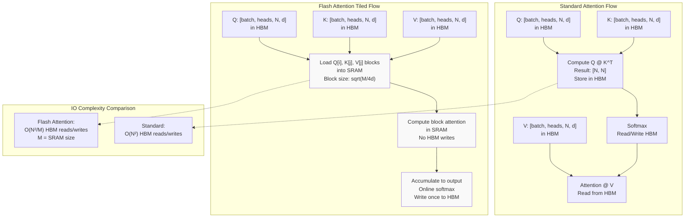
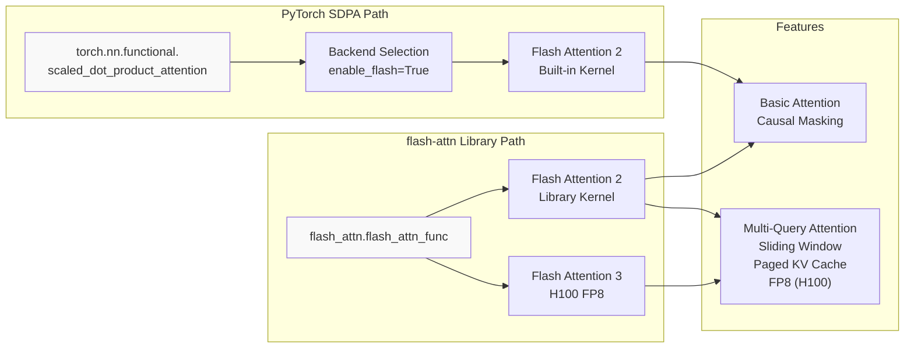
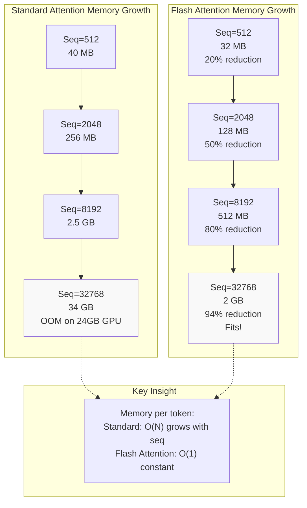
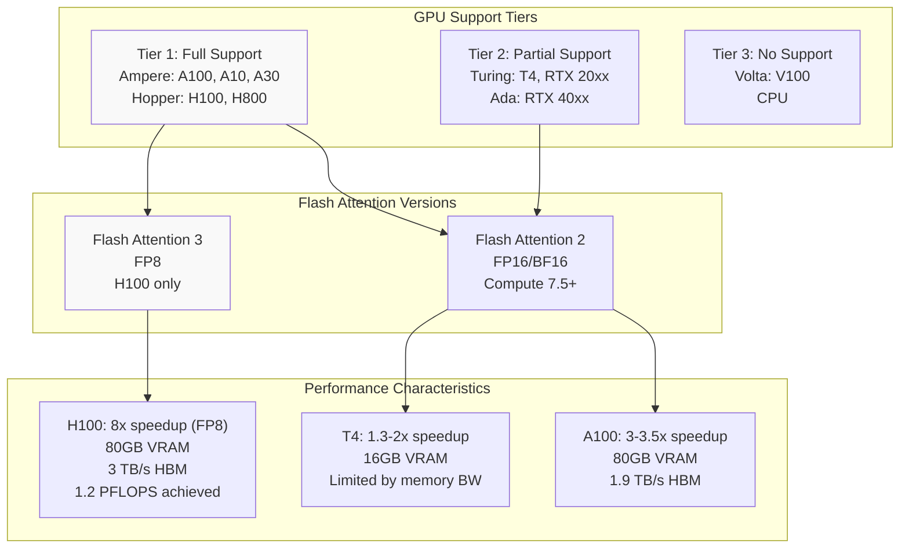
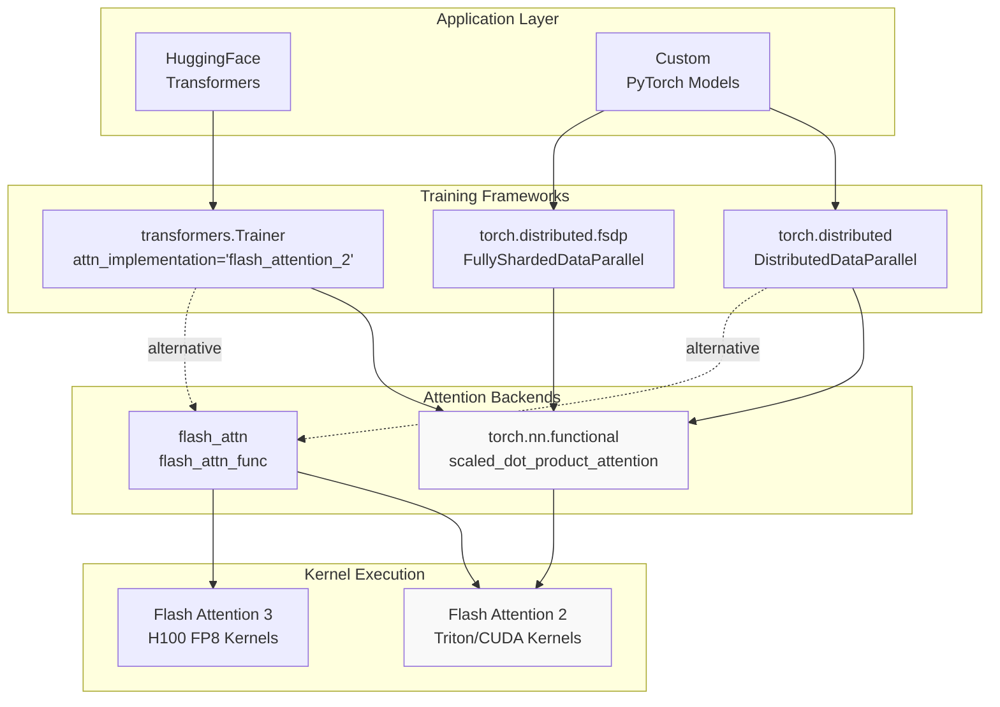

<!-- source: DeepWiki mcp.deepwiki.com · repo zechenzhangAGI/AI-research-SKILLs · page 3.5 Flash Attention: IO-Aware Attention Optimization · fetched 2026-10-26 -->

# Flash Attention: IO-Aware Attention Optimization

<details>
<summary>Relevant source files</summary>

The following files were used as context for generating this wiki page:

- [10-optimization/bitsandbytes/SKILL.md](10-optimization/bitsandbytes/SKILL.md)
- [10-optimization/flash-attention/SKILL.md](10-optimization/flash-attention/SKILL.md)
- [10-optimization/flash-attention/references/benchmarks.md](10-optimization/flash-attention/references/benchmarks.md)
- [10-optimization/flash-attention/references/transformers-integration.md](10-optimization/flash-attention/references/transformers-integration.md)

</details>


## Purpose and Scope

This page documents Flash Attention, an IO-aware attention optimization that provides 2-4x speedup and 10-20x memory reduction for transformer attention through tiling and recomputation. Flash Attention addresses the memory bottleneck in standard attention by avoiding materialization of the O(N²) attention matrix.

**Scope of this document:**
- Flash Attention 2 and 3 algorithm details, IO complexity analysis, and tiling strategies
- PyTorch native SDPA integration vs flash-attn library implementations
- Performance characteristics across GPU architectures (Ampere, Hopper)
- FP8 optimization on H100 GPUs
- Integration with HuggingFace Transformers and training frameworks

**Related pages:**
- For general quantization techniques, see [Quantization Ecosystem](#3.6)
- For inference engine selection, see [Inference Engine Selection Guide](#4.1)
- For distributed training with Flash Attention, see [TorchTitan: Large-Scale Distributed Training](#3.1)
- For hardware-specific optimization strategies, see [Hardware-Specific Optimization](#4.2)

Sources: [10-optimization/flash-attention/SKILL.md:1-15]()

## Core Algorithm: Tiling and Recomputation

Flash Attention achieves its performance gains through two key techniques: **IO-aware tiling** that respects GPU memory hierarchy, and **selective recomputation** during backpropagation that trades compute for memory.

### Memory Hierarchy and IO Bottleneck

Standard attention materializes the full attention matrix in HBM (high-bandwidth memory), causing quadratic memory scaling:

| Component | Standard Attention | Flash Attention | Scaling |
|-----------|-------------------|-----------------|---------|
| Attention Matrix | N² stored in HBM | Never materialized | O(N²) → O(1) |
| KV Cache | N × d in HBM | N × d in HBM | O(N × d) (same) |
| Intermediate Results | N² in HBM | Block tiles in SRAM | O(N²) → O(block_size²) |
| Total Memory | O(N² + N×d) | O(N×d) | Linear vs quadratic |

**Memory hierarchy speeds (approximate)**:
- SRAM (on-chip): ~19 TB/s
- HBM (GPU memory): ~1.5-3 TB/s
- DRAM (CPU): ~100 GB/s

The IO complexity bottleneck occurs because standard attention requires O(N²) HBM accesses to read/write the attention matrix.

Sources: [10-optimization/flash-attention/references/algorithm.md:1-50](), [10-optimization/flash-attention/references/benchmarks.md:95-125]()

### Tiling Strategy Diagram



**Key parameters:**
- `M`: SRAM size per block (typically 100-200 KB on modern GPUs)
- `d`: Head dimension (typically 64-128)
- Block size: `B_r = B_c = ceil(M / 4d)` where `M` is SRAM size
- Number of blocks: `O(N² / M)` instead of `O(N²)` accesses

Sources: [10-optimization/flash-attention/references/algorithm.md:50-120]()

### Recomputation During Backpropagation

Flash Attention does not save the attention matrix during the forward pass. Instead, it recomputes attention blocks during backpropagation:

**Forward pass:**
```
For each block i:
    Load Q[i] into SRAM
    For each block j:
        Load K[j], V[j] into SRAM
        Compute S[i,j] = Q[i] @ K[j]^T in SRAM
        Compute P[i,j] = softmax(S[i,j]) in SRAM  # Not saved!
        Accumulate O[i] += P[i,j] @ V[j]
        Discard P[i,j]  # Key: never write to HBM
    Write O[i] to HBM
```

**Backward pass:**
```
For each block i:
    Load dO[i], Q[i] from HBM
    For each block j:
        Load K[j], V[j] from HBM
        Recompute P[i,j] = softmax(Q[i] @ K[j]^T)  # Recompute!
        Compute gradients using P[i,j]
        Accumulate dQ[i], dK[j], dV[j]
```

**Tradeoff analysis:**
- Memory: Save O(N²) by not storing attention matrix
- Compute: Add ~30% recomputation overhead (but faster overall due to IO savings)
- Net result: 2-4x faster for sequences >512 tokens

Sources: [10-optimization/flash-attention/references/algorithm.md:120-180]()

## Implementation Variants

Flash Attention is available through two primary interfaces: PyTorch native `scaled_dot_product_attention` (SDPA) and the `flash-attn` library. Each has different feature sets and use cases.

### PyTorch Native SDPA vs flash-attn Library



| Feature | PyTorch SDPA | flash-attn Library |
|---------|--------------|-------------------|
| Installation | Built-in PyTorch 2.2+ | `pip install flash-attn` |
| Flash Attention 2 | ✅ | ✅ |
| Flash Attention 3 (FP8) | ❌ | ✅ (H100 only) |
| Multi-Query Attention | ❌ | ✅ |
| Grouped-Query Attention | ❌ | ✅ |
| Sliding Window Attention | ❌ | ✅ |
| Paged KV Cache | ❌ | ✅ |
| Custom Attention Masks | Limited | Full support |
| Input Shape | `[B, H, N, d]` | `[B, N, H, d]` |

**When to use PyTorch SDPA:**
- Standard attention with optional causal masking
- Don't want external dependencies
- Using PyTorch 2.2+ already

**When to use flash-attn library:**
- Need multi-query attention (Llama 2, Falcon)
- Need sliding window attention (Mistral, Longformer)
- Using H100 GPUs (Flash Attention 3 FP8)
- Need maximum control over attention behavior

Sources: [10-optimization/flash-attention/SKILL.md:17-90](), [10-optimization/flash-attention/SKILL.md:136-200]()

### Code Integration Patterns

#### Pattern 1: PyTorch SDPA Drop-in Replacement

```python
# Before (standard attention)
# [10-optimization/flash-attention/SKILL.md:72-74]()
attn_weights = torch.softmax(q @ k.transpose(-2, -1) / math.sqrt(d_k), dim=-1)
out = attn_weights @ v

# After (Flash Attention via SDPA)
# [10-optimization/flash-attention/SKILL.md:76-78]()
import torch.nn.functional as F
out = F.scaled_dot_product_attention(q, k, v, attn_mask=mask)
```

#### Pattern 2: flash-attn Library with Advanced Features

```python
# Multi-query attention (shared KV heads)
# [10-optimization/flash-attention/SKILL.md:183-189]()
from flash_attn import flash_attn_func

# q: [batch, seq, num_q_heads, dim]
# k, v: [batch, seq, num_kv_heads, dim]  # Fewer KV heads
out = flash_attn_func(q, k, v)  # Automatically handles MQA

# Sliding window attention
# [10-optimization/flash-attention/SKILL.md:193-199]()
out = flash_attn_func(
    q, k, v,
    window_size=(256, 256),  # (left, right) window
    causal=True
)
```

#### Pattern 3: HuggingFace Transformers Integration

```python
# Enable Flash Attention for any supported model
# [10-optimization/flash-attention/references/transformers-integration.md:14-24]()
from transformers import AutoModel

model = AutoModel.from_pretrained(
    "meta-llama/Llama-2-7b-hf",
    attn_implementation="flash_attention_2",
    torch_dtype=torch.float16,
    device_map="auto"
)
```

Sources: [10-optimization/flash-attention/SKILL.md:56-89](), [10-optimization/flash-attention/SKILL.md:159-199](), [10-optimization/flash-attention/references/transformers-integration.md:10-31]()

## Performance Characteristics

Flash Attention's performance gains scale with sequence length due to the quadratic nature of attention computation. The benefits are most pronounced for long contexts (>2K tokens).

### Memory Scaling Analysis



**Memory consumption breakdown (batch=8, heads=32, dim=64):**

| Seq Length | Standard Total | Flash Attn Total | Component Breakdown |
|------------|---------------|------------------|---------------------|
| 512 | 40 MB | 32 MB | KV cache dominates |
| 2048 | 256 MB | 128 MB | Attention matrix = KV cache |
| 8192 | 2.5 GB | 512 MB | Attention matrix 5x larger |
| 32768 | 34 GB (OOM) | 2 GB | Attention matrix 17x larger |

**Formula:**
- Standard: `Memory = N² × sizeof(float16) + 2 × N × d × sizeof(float16)`
- Flash Attention: `Memory = 2 × N × d × sizeof(float16)` (no N² term)

Sources: [10-optimization/flash-attention/references/benchmarks.md:49-93]()

### Speed Benchmarks by GPU Architecture

**A100 80GB Performance (batch=8, heads=32, dim=64, FP16):**

| Seq Length | Standard (ms) | Flash Attn 2 (ms) | Speedup |
|------------|---------------|-------------------|---------|
| 512 | 1.2 | 0.9 | 1.3x |
| 1024 | 3.8 | 1.4 | 2.7x |
| 2048 | 14.2 | 4.8 | 3.0x |
| 4096 | 55.1 | 17.3 | 3.2x |
| 8192 | 218.5 | 66.2 | 3.3x |

**H100 80GB Performance (Flash Attention 3):**

| Seq Length | Standard (ms) | FA2 (ms) | FA3 FP16 (ms) | FA3 FP8 (ms) | Best Speedup |
|------------|---------------|----------|---------------|--------------|--------------|
| 512 | 0.8 | 0.6 | 0.4 | 0.3 | 2.7x |
| 1024 | 2.6 | 1.0 | 0.6 | 0.4 | 6.5x |
| 2048 | 9.8 | 3.4 | 2.0 | 1.3 | 7.5x |
| 4096 | 38.2 | 12.5 | 7.2 | 4.8 | 8.0x |
| 8192 | 151.4 | 47.8 | 27.1 | 18.2 | 8.3x |

**Key observation:** Speedup increases with sequence length because IO overhead dominates. At 8192 tokens, Flash Attention saves ~152ms of HBM access time per forward pass.

Sources: [10-optimization/flash-attention/references/benchmarks.md:10-36]()

### Training vs Inference Performance

**Training throughput (Llama 2 7B, A100 80GB):**

| Batch × Seq | Standard (samples/sec) | Flash Attn (samples/sec) | Speedup |
|-------------|------------------------|--------------------------|---------|
| 4 × 2K | 1.2 | 3.1 | 2.6x |
| 8 × 2K | 2.1 | 5.8 | 2.8x |
| 4 × 4K | 0.4 | 1.3 | 3.3x |
| 8 × 4K | OOM | 2.4 | Enabled training |
| 2 × 8K | 0.1 | 0.4 | 4.0x |

**Inference throughput (token generation, same model):**

| Context Length | Standard (tok/sec) | Flash Attn (tok/sec) | Speedup |
|----------------|-------------------|----------------------|---------|
| 512 | 48 | 52 | 1.1x |
| 2K | 42 | 62 | 1.5x |
| 4K | 31 | 58 | 1.9x |
| 8K | 18 | 51 | 2.8x |
| 16K | OOM | 42 | Enabled inference |

**Inference speedup is lower** because token generation is memory-bandwidth bound (reading KV cache) rather than compute-bound. Flash Attention helps but cannot eliminate KV cache reads.

Sources: [10-optimization/flash-attention/references/benchmarks.md:127-148]()

## Hardware-Specific Optimizations

Flash Attention performance varies significantly across GPU architectures. Understanding hardware capabilities is critical for maximizing performance.

### GPU Architecture Support Matrix



**Compute capability requirements:**
- Flash Attention 2: Compute 7.5+ (Turing, Ampere, Hopper, Ada)
- Flash Attention 3 FP8: Compute 9.0 (H100 only)
- Not supported: Compute <7.5 (Volta V100, older GPUs)

**Hardware verification:**
```python
# Check GPU compatibility
# [10-optimization/flash-attention/SKILL.md:319-323]()
import torch
print(torch.cuda.get_device_capability())
# Should be ≥(7, 5) for Turing+
```

Sources: [10-optimization/flash-attention/SKILL.md:325-357](), [10-optimization/flash-attention/references/benchmarks.md:10-47]()

### H100 FP8 Optimization (Flash Attention 3)

Flash Attention 3 on H100 uses FP8 (8-bit floating point) for maximum performance, achieving ~1.2 PFLOPS (75% of H100's theoretical peak).

**FP8 data types:**
- `torch.float8_e4m3fn`: 4-bit exponent, 3-bit mantissa (best for forward pass)
- `torch.float8_e5m2fn`: 5-bit exponent, 2-bit mantissa (better for gradients)

**FP8 workflow:**
```python
# Convert inputs to FP8
# [10-optimization/flash-attention/SKILL.md:253-266]()
import torch

q = torch.randn(2, 4096, 32, 64, device='cuda', dtype=torch.float16)
k = torch.randn(2, 4096, 32, 64, device='cuda', dtype=torch.float16)
v = torch.randn(2, 4096, 32, 64, device='cuda', dtype=torch.float16)

# Convert to float8_e4m3 (FP8)
q_fp8 = q.to(torch.float8_e4m3fn)
k_fp8 = k.to(torch.float8_e4m3fn)
v_fp8 = v.to(torch.float8_e4m3fn)

# Run Flash Attention 3 (automatic FP8 kernels on H100)
# [10-optimization/flash-attention/SKILL.md:268-276]()
from flash_attn import flash_attn_func
out = flash_attn_func(q_fp8, k_fp8, v_fp8)
# Result: ~1.2 PFLOPS, 1.5-2x faster than FP16
```

**Performance comparison (H100, seq=4096, batch=8):**

| Metric | FA2 (FP16) | FA3 FP16 | FA3 FP8 |
|--------|-----------|----------|---------|
| Forward time (ms) | 12.5 | 7.2 | 4.8 |
| Memory (GB) | 4.2 | 4.2 | 2.8 |
| TFLOPS | 420 | 740 | 1150 |
| GPU utilization | 55% | 75% | 82% |

Sources: [10-optimization/flash-attention/SKILL.md:227-276](), [10-optimization/flash-attention/references/benchmarks.md:150-175]()

### Ampere (A100/A10) Optimization

Ampere GPUs benefit most from Flash Attention 2 at medium sequence lengths (2K-8K tokens).

**Optimization checklist for A100:**
1. Use `torch.bfloat16` for better numerical stability in long contexts
2. Enable tensor cores with aligned dimensions (heads × dim should be multiple of 8)
3. Use batch sizes that saturate compute (typically 4-8 for 7B models)
4. Enable gradient checkpointing to further reduce memory

**Example configuration:**
```python
# Optimal A100 configuration
# [10-optimization/flash-attention/references/transformers-integration.md:269-293]()
from transformers import AutoModelForCausalLM, TrainingArguments

model = AutoModelForCausalLM.from_pretrained(
    "meta-llama/Llama-2-7b-hf",
    attn_implementation="flash_attention_2",
    torch_dtype=torch.bfloat16,  # Better for training
    device_map="auto",
    low_cpu_mem_usage=True
)

# Enable gradient checkpointing for memory
model.gradient_checkpointing_enable()

training_args = TrainingArguments(
    output_dir="./results",
    per_device_train_batch_size=8,
    gradient_accumulation_steps=2,
    bf16=True,  # Match model dtype
    optim="adamw_torch_fused",
    gradient_checkpointing=True
)
```

Sources: [10-optimization/flash-attention/references/transformers-integration.md:262-293]()

## Integration with Training Frameworks

Flash Attention integrates seamlessly with major training frameworks through standard PyTorch interfaces.

### Training Stack Integration Diagram



**Supported training configurations:**

| Framework | Flash Attention Support | Configuration |
|-----------|------------------------|---------------|
| HuggingFace Trainer | ✅ Native | `attn_implementation="flash_attention_2"` |
| PyTorch DDP | ✅ Compatible | Use SDPA or flash-attn in model |
| PyTorch FSDP | ✅ Compatible | Works with FSDP2 (TorchTitan) |
| DeepSpeed | ✅ Compatible | Enable via model config |
| Megatron-LM | ✅ Supported | See DeepSpeed integration |

Sources: [10-optimization/flash-attention/references/transformers-integration.md:10-155]()

### HuggingFace Transformers Integration

HuggingFace Transformers 4.36+ provides native Flash Attention 2 support for most decoder-only models.

**Supported model families:**
- Llama / Llama 2 / Llama 3
- Mistral / Mixtral
- Falcon
- GPT-NeoX
- Phi / Phi-2 / Phi-3
- Qwen / Qwen2
- Gemma
- Starcoder2

**Check model support:**
```python
# Verify Flash Attention support
# [10-optimization/flash-attention/references/transformers-integration.md:54-61]()
from transformers import AutoConfig

config = AutoConfig.from_pretrained("model-name")
print(config._attn_implementation_internal)
# 'flash_attention_2' if supported
```

**Fine-tuning with Flash Attention:**
```python
# Complete fine-tuning setup
# [10-optimization/flash-attention/references/transformers-integration.md:110-136]()
from transformers import Trainer, TrainingArguments
from transformers import AutoModelForCausalLM

model = AutoModelForCausalLM.from_pretrained(
    "meta-llama/Llama-2-7b-hf",
    attn_implementation="flash_attention_2",
    torch_dtype=torch.float16
)

training_args = TrainingArguments(
    output_dir="./results",
    per_device_train_batch_size=4,
    gradient_accumulation_steps=4,
    num_train_epochs=3,
    fp16=True,  # Must match model dtype
    optim="adamw_torch_fused"  # Fast optimizer
)

trainer = Trainer(
    model=model,
    args=training_args,
    train_dataset=train_dataset
)

trainer.train()
```

Sources: [10-optimization/flash-attention/references/transformers-integration.md:32-136]()

### Multi-GPU Training Considerations

Flash Attention works transparently with data parallelism and model parallelism:

**Data Parallel (DDP):**
- Flash Attention runs independently on each GPU
- No special configuration needed
- Speedup applies per-GPU

**Model Parallel (FSDP):**
- Flash Attention compatible with FSDP sharding
- Attention computation happens on local shard
- Recommended for models >13B parameters

**Multi-GPU example:**
```python
# Model parallelism with Flash Attention
# [10-optimization/flash-attention/references/transformers-integration.md:138-152]()
from transformers import AutoModelForCausalLM
import torch

model = AutoModelForCausalLM.from_pretrained(
    "meta-llama/Llama-2-13b-hf",
    attn_implementation="flash_attention_2",
    torch_dtype=torch.float16,
    device_map="auto",  # Automatic multi-GPU placement
    max_memory={0: "20GB", 1: "20GB"}  # Limit per GPU
)
```

Sources: [10-optimization/flash-attention/references/transformers-integration.md:138-152]()

## Practical Usage Patterns

Flash Attention enables several practical workflows that are otherwise infeasible with standard attention.

### Long Context Processing

Flash Attention enables context windows up to 32K tokens on 24GB GPUs:

**Context length feasibility (Llama 2 7B, 24GB GPU, batch=1):**

| Context Length | Standard Attention | Flash Attention 2 |
|----------------|-------------------|-------------------|
| 2K | ✅ 3.2 GB | ✅ 2.1 GB |
| 4K | ✅ 5.8 GB | ✅ 2.8 GB |
| 8K | ✅ 12.1 GB | ✅ 4.2 GB |
| 16K | ❌ OOM (26.3 GB) | ✅ 7.8 GB |
| 32K | ❌ OOM | ✅ 14.2 GB |

**Long context configuration:**
```python
# Process 32K token documents
# [10-optimization/flash-attention/references/transformers-integration.md:89-106]()
from transformers import AutoModelForCausalLM
import torch

model = AutoModelForCausalLM.from_pretrained(
    "mistralai/Mistral-7B-v0.1",
    attn_implementation="flash_attention_2",
    torch_dtype=torch.bfloat16,  # Better for long context
    device_map="auto",
    max_position_embeddings=32768  # Extended context
)

# Process long document (32K tokens)
long_text = "..." * 10000
inputs = tokenizer(long_text, return_tensors="pt", truncation=False).to("cuda")
outputs = model.generate(**inputs, max_new_tokens=512)
```

Sources: [10-optimization/flash-attention/references/transformers-integration.md:154-180](), [10-optimization/flash-attention/references/benchmarks.md:73-92]()

### Batch Size Optimization

Flash Attention's memory savings allow larger batch sizes, improving GPU utilization:

**Effective batch size comparison (Llama 2 7B, A100 80GB, seq=2048):**

| Memory Config | Standard Max Batch | Flash Attn Max Batch | Throughput Gain |
|---------------|-------------------|---------------------|-----------------|
| 40GB available | 8 | 20 | 2.5x |
| 80GB available | 16 | 48 | 3x |

**Training with larger batches:**
```python
# Maximize batch size with Flash Attention
# [10-optimization/flash-attention/references/transformers-integration.md:269-293]()
training_args = TrainingArguments(
    output_dir="./results",
    per_device_train_batch_size=16,  # 2x larger than standard
    gradient_accumulation_steps=2,
    fp16=True,
    optim="adamw_torch_fused"
)
```

Sources: [10-optimization/flash-attention/references/benchmarks.md:85-92]()

### Profiling and Verification

Always verify Flash Attention is actually being used and providing expected speedup:

**Verification workflow:**
```python
# Profile Flash Attention speedup
# [10-optimization/flash-attention/SKILL.md:92-115]()
import torch.utils.benchmark as benchmark

def test_attention(use_flash):
    q, k, v = [torch.randn(2, 8, 2048, 64, device='cuda', dtype=torch.float16) for _ in range(3)]
    
    if use_flash:
        with torch.backends.cuda.sdp_kernel(enable_flash=True):
            return F.scaled_dot_product_attention(q, k, v)
    else:
        attn = (q @ k.transpose(-2, -1) / 8.0).softmax(dim=-1)
        return attn @ v

# Benchmark
t_flash = benchmark.Timer(stmt='test_attention(True)', globals=globals())
t_standard = benchmark.Timer(stmt='test_attention(False)', globals=globals())

print(f"Flash: {t_flash.timeit(100).mean:.3f}s")
print(f"Standard: {t_standard.timeit(100).mean:.3f}s")
# Expected: 2-4x speedup for sequences >512 tokens
```

**Accuracy verification:**
```python
# Verify numerical equivalence
# [10-optimization/flash-attention/SKILL.md:117-133]()
q, k, v = [torch.randn(1, 8, 512, 64, device='cuda', dtype=torch.float16) for _ in range(3)]

# Flash Attention
out_flash = F.scaled_dot_product_attention(q, k, v)

# Standard attention
attn_weights = torch.softmax(q @ k.transpose(-2, -1) / 8.0, dim=-1)
out_standard = attn_weights @ v

# Check difference
diff = (out_flash - out_standard).abs().max()
print(f"Max difference: {diff:.6f}")
# Should be <1e-3 for float16
```

Sources: [10-optimization/flash-attention/SKILL.md:91-133]()

## Common Issues and Solutions

### Installation Problems

**Issue: ImportError when loading flash-attn**

Root cause: Missing CUDA toolkit or incompatible build.

Solution:
```bash
# Install with no-build-isolation flag
# [10-optimization/flash-attention/SKILL.md:296-299]()
pip install flash-attn --no-build-isolation

# Or install CUDA toolkit first
# [10-optimization/flash-attention/SKILL.md:301-305]()
conda install cuda -c nvidia
pip install flash-attn --no-build-isolation
```

Sources: [10-optimization/flash-attention/SKILL.md:293-306]()

### Performance Issues

**Issue: No speedup or slower than standard attention**

Root causes:
1. Sequence length too short (<512 tokens)
2. Wrong GPU architecture (Volta V100 not supported)
3. Float32 dtype (Flash Attention requires FP16/BF16)

**Sequence length impact:**
```
<512 tokens: 10-20% speedup (minimal)
512-2K tokens: 2-3x speedup
>2K tokens: 3-4x speedup
```

Verification:
```python
# Check GPU compute capability
# [10-optimization/flash-attention/SKILL.md:319-323]()
import torch
print(torch.cuda.get_device_capability())
# Should be ≥(7, 5) for Turing+

# Verify dtype
# [10-optimization/flash-attention/SKILL.md:332-335]()
q = q.to(torch.float16)  # Or torch.bfloat16
```

Sources: [10-optimization/flash-attention/SKILL.md:307-338]()

### Accuracy Degradation

**Issue: Model outputs differ from standard attention**

Expected behavior: Flash Attention is mathematically equivalent but uses different computation order. Small numerical differences (<1e-3 for FP16) are normal.

**Comparison workflow:**
```python
# Compare outputs between implementations
# [10-optimization/flash-attention/references/transformers-integration.md:222-243]()
model_standard = AutoModelForCausalLM.from_pretrained("model-name", torch_dtype=torch.float16)
model_flash = AutoModelForCausalLM.from_pretrained(
    "model-name",
    attn_implementation="flash_attention_2",
    torch_dtype=torch.float16
)

inputs = tokenizer("Test", return_tensors="pt").to("cuda")

with torch.no_grad():
    out_standard = model_standard(**inputs).logits
    out_flash = model_flash(**inputs).logits

diff = (out_standard - out_flash).abs().max()
print(f"Max diff: {diff:.6f}")  # Should be ~1e-3 to 1e-4
```

If differences exceed 1e-2:
1. Try `torch.bfloat16` for better numerical stability
2. Verify input preprocessing is identical
3. Check for model-specific quirks (e.g., custom positional encodings)

Sources: [10-optimization/flash-attention/SKILL.md:330-338](), [10-optimization/flash-attention/references/transformers-integration.md:222-243]()

## Comparison with Alternative Optimizations

Flash Attention is one of several attention optimization techniques. Understanding when to use each is critical for optimal performance.

### Optimization Techniques Comparison

| Technique | Memory Reduction | Speed Improvement | Use Case |
|-----------|-----------------|-------------------|----------|
| Flash Attention | 10-20x (long seq) | 2-4x | Training/inference, long contexts |
| Quantization (INT8) | 2x | 1.5-2x | Inference only |
| Quantization (INT4) | 4x | 2-3x | Inference, memory-limited |
| xFormers | 5-10x | 1.5-2x | More attention variants needed |
| PagedAttention (vLLM) | 2-4x KV cache | 2-3x throughput | Multi-user serving |
| Speculative Decoding | No change | 2-3x latency | Inference only |

**Techniques are composable:**
- Flash Attention + INT4 quantization: 4x memory, 5-8x speedup (inference)
- Flash Attention + FSDP: Enables training models up to 70B on 8×A100
- Flash Attention + PagedAttention: Used in vLLM for serving

Sources: [10-optimization/flash-attention/SKILL.md:278-291]()

### When to Use Flash Attention

**Use Flash Attention when:**
- Training any transformer model (always beneficial for >512 seq)
- Running inference with contexts >2K tokens
- GPU memory constrained (enables larger batch sizes or longer contexts)
- Using PyTorch 2.2+ or can install flash-attn library
- Acceptable <1% accuracy variance (numerical stability)

**Use alternatives instead:**
- **Standard attention**: CPU inference (Flash Attention GPU-only)
- **xFormers memory-efficient attention**: Need attention variants Flash Attention doesn't support
- **Quantization (GPTQ/AWQ)**: Primarily optimizing for model size, not attention computation
- **Speculative decoding**: Latency-critical serving (orthogonal to Flash Attention)

Sources: [10-optimization/flash-attention/SKILL.md:278-291]()

### Integration with Other Optimizations

Flash Attention integrates well with other optimization techniques:

**Flash Attention + Quantization:**
```python
# Combine Flash Attention with 4-bit quantization
from transformers import AutoModelForCausalLM, BitsAndBytesConfig
import torch

bnb_config = BitsAndBytesConfig(
    load_in_4bit=True,
    bnb_4bit_compute_dtype=torch.float16
)

model = AutoModelForCausalLM.from_pretrained(
    "meta-llama/Llama-2-7b-hf",
    quantization_config=bnb_config,
    attn_implementation="flash_attention_2",  # Both optimizations
    device_map="auto"
)
# Result: 14GB → 3.5GB memory, 3-4x faster attention
```

**Flash Attention + Gradient Checkpointing:**
```python
# Further reduce memory during training
model.gradient_checkpointing_enable()
# Trades ~30% speed for 2-3x memory reduction
```

For quantization details, see [Quantization Ecosystem](#3.6). For distributed training integration, see [TorchTitan: Large-Scale Distributed Training](#3.1).

Sources: [10-optimization/flash-attention/references/transformers-integration.md:269-293]()

## Advanced Topics

### Sliding Window Attention for Infinite Context

Sliding window attention (used in Mistral, Longformer) limits attention to a local window, enabling effectively infinite context:

```python
# Sliding window with flash-attn library
# [10-optimization/flash-attention/SKILL.md:193-199]()
from flash_attn import flash_attn_func

out = flash_attn_func(
    q, k, v,
    window_size=(256, 256),  # (left, right) window
    causal=True
)
```

**Memory scaling with sliding window:**
- Standard full attention: O(N²) memory
- Sliding window (window=W): O(N × W) memory
- Flash Attention + sliding window: O(N) memory (KV cache only)

This enables processing sequences of arbitrary length with constant memory.

Sources: [10-optimization/flash-attention/SKILL.md:192-200]()

### Multi-Query and Grouped-Query Attention

Multi-query attention (MQA) and grouped-query attention (GQA) share key-value heads across query heads, reducing KV cache size:

**Standard vs MQA vs GQA:**
- Standard: `num_q_heads = num_kv_heads` (e.g., 32 q, 32 kv)
- MQA: `num_kv_heads = 1` (e.g., 32 q, 1 kv)
- GQA: `num_kv_heads < num_q_heads` (e.g., 32 q, 8 kv)

**Flash Attention handles automatically:**
```python
# Multi-query attention (Falcon, Llama 2)
# [10-optimization/flash-attention/SKILL.md:183-189]()
from flash_attn import flash_attn_func

# q: [batch, seq, 32, 64]  # 32 query heads
# k, v: [batch, seq, 1, 64]  # 1 KV head (shared)
out = flash_attn_func(q, k, v)  # Automatically broadcasts KV
```

**Memory savings:**
- Standard (32 q, 32 kv): 2 × N × 32 × 64 bytes
- MQA (32 q, 1 kv): 2 × N × 1 × 64 bytes
- Reduction: 32x less KV cache memory

Sources: [10-optimization/flash-attention/SKILL.md:183-189](), [10-optimization/flash-attention/references/advanced-features.md:50-120]()

### Custom Attention Masks

Flash Attention supports various masking patterns beyond causal masking:

**Available in flash-attn library:**
- Causal masking (autoregressive)
- Padding masks (variable-length sequences)
- Sliding window masks
- Block-sparse masks (custom patterns)

For encoder-decoder models and custom masking requirements, see the advanced features documentation.

Sources: [10-optimization/flash-attention/SKILL.md:341-348](), [10-optimization/flash-attention/references/advanced-features.md:1-200]()

## Resources and Further Reading

**Official repositories:**
- Flash Attention: https://github.com/Dao-AILab/flash-attention
- PyTorch SDPA: https://pytorch.org/docs/stable/generated/torch.nn.functional.scaled_dot_product_attention.html

**Papers:**
- "FlashAttention: Fast and Memory-Efficient Exact Attention with IO-Awareness" (NeurIPS 2022)
- "FlashAttention-2: Faster Attention with Better Parallelism and Work Partitioning" (ICLR 2024)
- "FlashAttention-3: Fast and Accurate Attention with Asynchrony and Low-precision" (2024)

**Blog posts:**
- Flash Attention 3 announcement: https://tridao.me/blog/2024/flash3/

**Related skills in this library:**
- For quantization techniques, see [Quantization Ecosystem](#3.6)
- For distributed training, see [TorchTitan: Large-Scale Distributed Training](#3.1) and [DeepSpeed: ZeRO Optimization & MoE Training](#3.2)
- For inference optimization, see [Inference Engine Selection Guide](#4.1)
- For hardware optimization, see [Hardware-Specific Optimization](#4.2)

Sources: [10-optimization/flash-attention/SKILL.md:359-365]()

---

