<!-- source: DeepWiki mcp.deepwiki.com · repo zechenzhangAGI/AI-research-SKILLs · page 3.6 Quantization Ecosystem · fetched 2026-10-26 -->

# Quantization Ecosystem

<details>
<summary>Relevant source files</summary>

The following files were used as context for generating this wiki page:

- [10-optimization/bitsandbytes/SKILL.md](10-optimization/bitsandbytes/SKILL.md)
- [10-optimization/flash-attention/SKILL.md](10-optimization/flash-attention/SKILL.md)
- [10-optimization/flash-attention/references/benchmarks.md](10-optimization/flash-attention/references/benchmarks.md)
- [10-optimization/flash-attention/references/transformers-integration.md](10-optimization/flash-attention/references/transformers-integration.md)
- [10-optimization/gguf/SKILL.md](10-optimization/gguf/SKILL.md)
- [10-optimization/gguf/references/advanced-usage.md](10-optimization/gguf/references/advanced-usage.md)
- [10-optimization/gguf/references/troubleshooting.md](10-optimization/gguf/references/troubleshooting.md)
- [10-optimization/gptq/SKILL.md](10-optimization/gptq/SKILL.md)
- [10-optimization/hqq/SKILL.md](10-optimization/hqq/SKILL.md)
- [10-optimization/hqq/references/advanced-usage.md](10-optimization/hqq/references/advanced-usage.md)
- [10-optimization/hqq/references/troubleshooting.md](10-optimization/hqq/references/troubleshooting.md)
- [11-evaluation/lm-evaluation-harness/SKILL.md](11-evaluation/lm-evaluation-harness/SKILL.md)
- [12-inference-serving/llama-cpp/SKILL.md](12-inference-serving/llama-cpp/SKILL.md)
- [12-inference-serving/sglang/SKILL.md](12-inference-serving/sglang/SKILL.md)
- [12-inference-serving/tensorrt-llm/SKILL.md](12-inference-serving/tensorrt-llm/SKILL.md)
- [14-agents/autogpt/SKILL.md](14-agents/autogpt/SKILL.md)
- [14-agents/autogpt/references/advanced-usage.md](14-agents/autogpt/references/advanced-usage.md)
- [14-agents/autogpt/references/troubleshooting.md](14-agents/autogpt/references/troubleshooting.md)
- [17-observability/phoenix/SKILL.md](17-observability/phoenix/SKILL.md)
- [17-observability/phoenix/references/advanced-usage.md](17-observability/phoenix/references/advanced-usage.md)

</details>


This document provides a comprehensive guide to LLM quantization methods in the AI Research SKILLs library: GPTQ, HQQ (Half-Quadratic Quantization), Bitsandbytes, and GGUF. It covers their architectures, tradeoffs, integration patterns, and selection criteria for production deployment.

For attention optimization (complementary to quantization), see [Flash Attention](#3.5). For inference serving with quantized models, see [Inference Engine Selection Guide](#4.1).

## Ecosystem Overview

The quantization ecosystem comprises four primary methods, each optimized for different deployment scenarios:

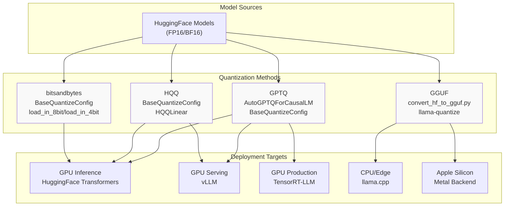

**Quantization Ecosystem Architecture**

Sources: [10-optimization/bitsandbytes/SKILL.md:1-410](), [10-optimization/hqq/SKILL.md:1-400](), [10-optimization/gptq/SKILL.md:1-350](), [10-optimization/gguf/SKILL.md:1-428]()

### Method Classification

| Method | Calibration | Bits | Backends | Primary Use Case |
|--------|-------------|------|----------|------------------|
| **bitsandbytes** | None | 8, 4 (NF4/FP4) | CUDA | Fast integration, QLoRA training |
| **HQQ** | None | 8/4/3/2/1 | PyTorch, ATEN, Marlin, TorchAO, BitBlas | Calibration-free, flexible backends |
| **GPTQ** | Required | 4/3/2 | Triton, CUDA, Marlin | Production accuracy, pre-quantized models |
| **GGUF** | Optional (imatrix) | 8/6/5/4/3/2 (K-quants) | CPU, CUDA, Metal, ROCm | CPU/edge deployment, universal hardware |

Sources: [10-optimization/bitsandbytes/SKILL.md:313-327](), [10-optimization/hqq/SKILL.md:17-36](), [10-optimization/gptq/SKILL.md:17-33](), [10-optimization/gguf/SKILL.md:17-36]()

## Bitsandbytes Architecture

### Core Components

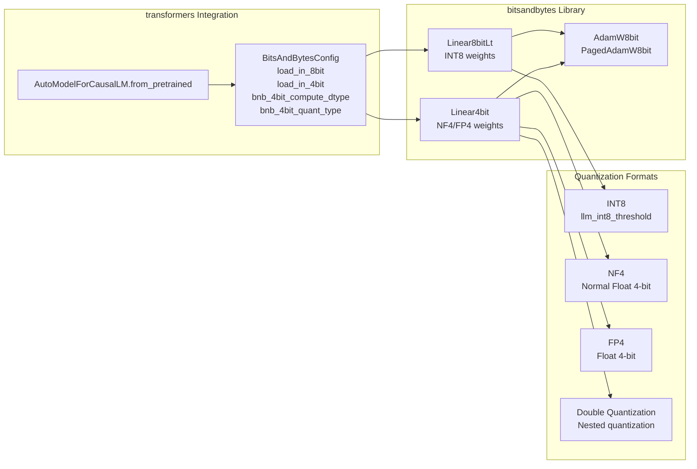

**Bitsandbytes Configuration Flow**

Sources: [10-optimization/bitsandbytes/SKILL.md:23-49](), [10-optimization/bitsandbytes/SKILL.md:89-111]()

### Memory Reduction Patterns

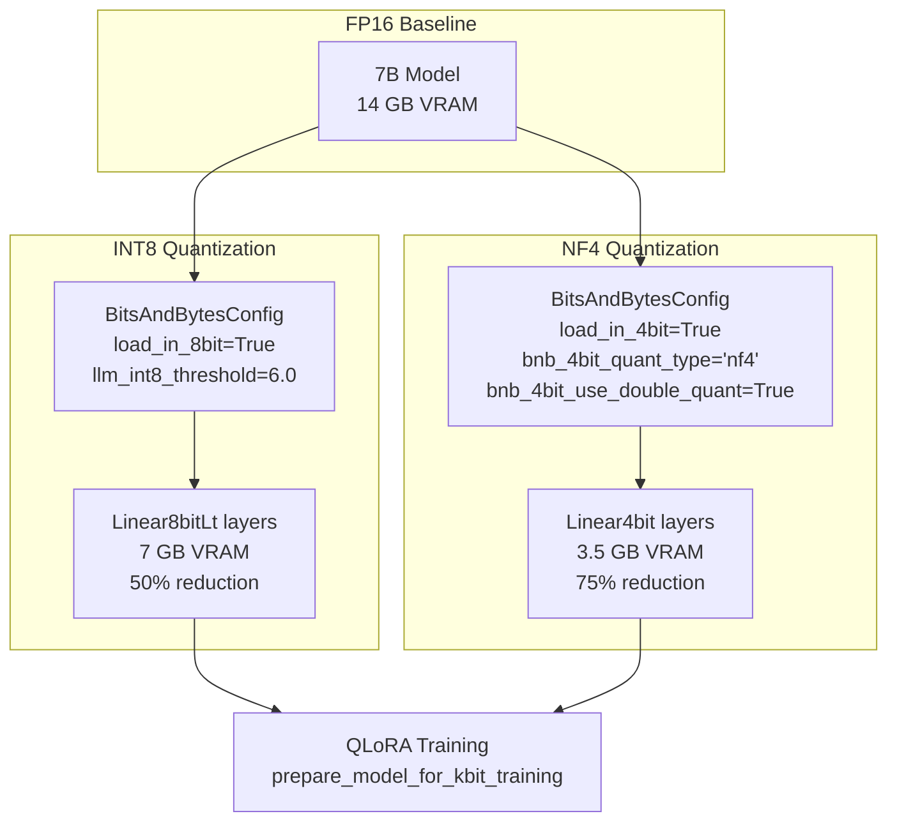

**Bitsandbytes Memory Optimization Pipeline**

Sources: [10-optimization/bitsandbytes/SKILL.md:56-77](), [10-optimization/bitsandbytes/SKILL.md:104-111](), [10-optimization/bitsandbytes/SKILL.md:159-199]()

### Key Configuration Classes

The `BitsAndBytesConfig` class ([10-optimization/bitsandbytes/SKILL.md:26-31]()) provides the primary interface:

```python
# 8-bit configuration
config_8bit = BitsAndBytesConfig(
    load_in_8bit=True,
    llm_int8_threshold=6.0,  # Outlier threshold
    llm_int8_has_fp16_weight=False
)

# 4-bit NF4 with double quantization
config_4bit = BitsAndBytesConfig(
    load_in_4bit=True,
    bnb_4bit_compute_dtype=torch.float16,
    bnb_4bit_quant_type="nf4",  # NormalFloat4
    bnb_4bit_use_double_quant=True  # Quantize quantization constants
)
```

Sources: [10-optimization/bitsandbytes/SKILL.md:92-111](), [10-optimization/bitsandbytes/SKILL.md:356-368]()

## HQQ (Half-Quadratic Quantization) Architecture

### Core Quantization Pipeline

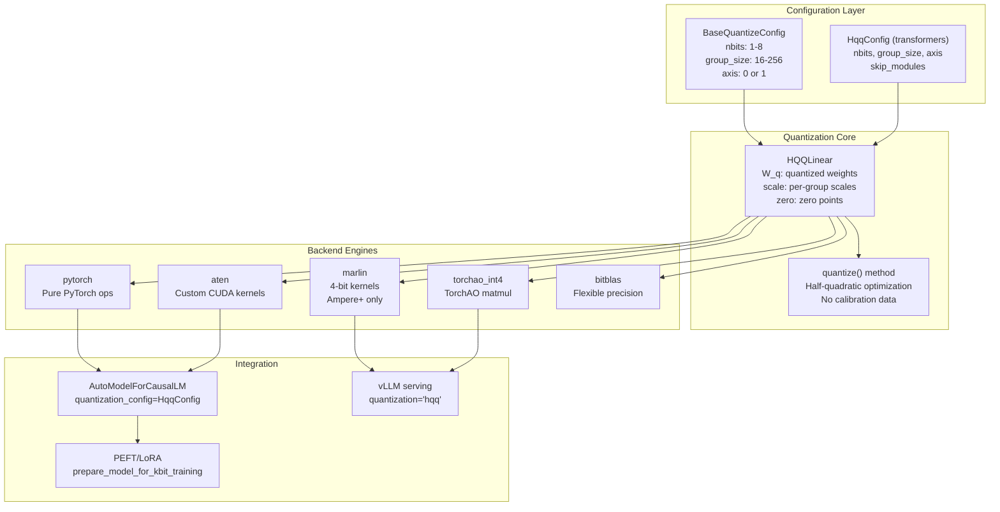

**HQQ Architecture and Backend Selection**

Sources: [10-optimization/hqq/SKILL.md:54-69](), [10-optimization/hqq/SKILL.md:98-126](), [10-optimization/hqq/SKILL.md:149-183]()

### Backend Performance Comparison

The `HQQLinear.set_backend()` method ([10-optimization/hqq/SKILL.md:155-165]()) enables runtime backend switching:

| Backend | Hardware Requirement | 4-bit Speedup | Memory Overhead | Best For |
|---------|---------------------|---------------|-----------------|----------|
| `pytorch` | Any GPU | 1.0× (baseline) | Minimal | Compatibility testing |
| `pytorch_compile` | torch>=2.0 | 1.5× | Minimal | General use |
| `aten` | CUDA GPU | 2.0× | Low | Balanced performance |
| `torchao_int4` | CUDA GPU, torchao | 2.5× | Low | 4-bit inference |
| `marlin` | Ampere+ (sm_80+) | 3.5× | Medium | Maximum 4-bit speed |
| `bitblas` | CUDA GPU, bitblas | 2.8× | Medium | Flexible bit-widths |

Sources: [10-optimization/hqq/SKILL.md:174-183](), [10-optimization/hqq/references/troubleshooting.md:146-169]()

### Mixed Precision Configuration

HQQ supports per-layer quantization precision ([10-optimization/hqq/SKILL.md:117-125]()):

```python
layer_configs = {
    # Embeddings: Skip quantization
    "embed_tokens": None,
    "lm_head": None,
    
    # Attention: 4-bit, larger groups
    "self_attn.q_proj": BaseQuantizeConfig(nbits=4, group_size=128),
    "self_attn.k_proj": BaseQuantizeConfig(nbits=4, group_size=128),
    "self_attn.v_proj": BaseQuantizeConfig(nbits=4, group_size=128),
    "self_attn.o_proj": BaseQuantizeConfig(nbits=4, group_size=128),
    
    # MLP: Aggressive 2-bit
    "mlp.gate_proj": BaseQuantizeConfig(nbits=2, group_size=32),
    "mlp.up_proj": BaseQuantizeConfig(nbits=2, group_size=32),
    "mlp.down_proj": BaseQuantizeConfig(nbits=3, group_size=64),
}
```

Sources: [10-optimization/hqq/SKILL.md:117-125](), [10-optimization/hqq/references/advanced-usage.md:65-103]()

## GPTQ Architecture

### Quantization with Calibration

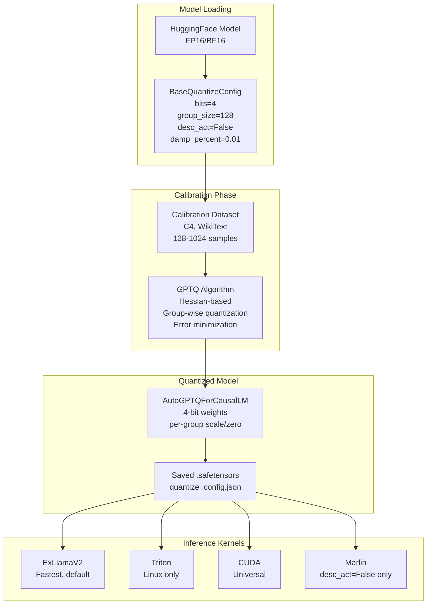

**GPTQ Calibration and Quantization Pipeline**

Sources: [10-optimization/gptq/SKILL.md:76-116](), [10-optimization/gptq/SKILL.md:199-227]()

### Group-Wise Quantization

GPTQ's `BaseQuantizeConfig` ([10-optimization/gptq/SKILL.md:86-92]()) defines group-based quantization:

```python
# Standard 4-bit configuration
config = BaseQuantizeConfig(
    bits=4,              # 4-bit quantization
    group_size=128,      # 128 weights per quantization group
    desc_act=False,      # Activation order (False for CUDA kernel)
    damp_percent=0.01    # Dampening factor for Hessian
)
```

Group size impact ([10-optimization/gptq/SKILL.md:127-144]()):

| Group Size | Model Size (7B) | Perplexity Impact | Inference Speed | Recommendation |
|------------|-----------------|-------------------|-----------------|----------------|
| -1 (per-column) | ~3.0 GB | +0.5% | Slowest | Research only |
| 32 | ~3.2 GB | +0.8% | Slow | High accuracy needed |
| **128** | **~3.8 GB** | **+1.5%** | **Fast** | **Default** |
| 256 | ~4.2 GB | +2.2% | Faster | Speed critical |
| 1024 | ~4.8 GB | +3.5% | Fastest | Not recommended |

Sources: [10-optimization/gptq/SKILL.md:119-144](), [10-optimization/gptq/SKILL.md:146-197]()

### Kernel Backend Selection

The `AutoGPTQForCausalLM.from_quantized()` method ([10-optimization/gptq/SKILL.md:56-66]()) supports multiple backends:

```python
# ExLlamaV2 (default, fastest)
model = AutoGPTQForCausalLM.from_quantized(
    model_name,
    device="cuda:0",
    use_triton=False,
    use_exllama=True,
    exllama_config={"version": 2}
)

# Triton (Linux only, 2-3× slower than ExLlamaV2)
model = AutoGPTQForCausalLM.from_quantized(
    model_name,
    device="cuda:0",
    use_triton=True
)

# Marlin (fastest for desc_act=False, Ampere+)
model = AutoGPTQForCausalLM.from_quantized(
    model_name,
    device="cuda:0",
    use_marlin=True  # Requires desc_act=False
)
```

Sources: [10-optimization/gptq/SKILL.md:199-227](), [10-optimization/gptq/SKILL.md:229-256]()

## GGUF Architecture

### Conversion and Quantization Pipeline

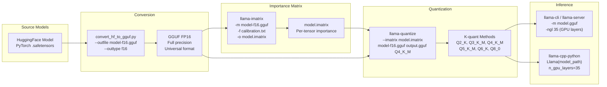

**GGUF Conversion, Quantization, and Inference Flow**

Sources: [10-optimization/gguf/SKILL.md:59-83](), [10-optimization/gguf/SKILL.md:129-189](), [10-optimization/gguf/SKILL.md:194-214]()

### K-Quant Methods

GGUF uses sophisticated K-quant methods ([10-optimization/gguf/SKILL.md:98-123]()):

| Type | Bits | Size (7B) | Quality | Use Case |
|------|------|-----------|---------|----------|
| `Q2_K` | 2.5 | ~2.8 GB | Low | Extreme compression |
| `Q3_K_S` | 3.0 | ~3.0 GB | Low-Med | Memory constrained |
| `Q3_K_M` | 3.3 | ~3.3 GB | Medium | Balance |
| `Q4_K_S` | 4.0 | ~3.8 GB | Med-High | Good balance |
| **`Q4_K_M`** | **4.5** | **~4.1 GB** | **High** | **Recommended default** |
| `Q5_K_S` | 5.0 | ~4.6 GB | High | Quality focused |
| `Q5_K_M` | 5.5 | ~4.8 GB | Very High | High quality |
| `Q6_K` | 6.0 | ~5.5 GB | Excellent | Near-original |
| `Q8_0` | 8.0 | ~7.2 GB | Best | Maximum quality |

The `llama-quantize` tool ([10-optimization/gguf/SKILL.md:74-83]()) implements these methods:

```bash
# Standard Q4_K_M quantization
./llama-quantize model-f16.gguf model-q4_k_m.gguf Q4_K_M

# With importance matrix for better quality at low bits
./llama-imatrix -m model-f16.gguf -f calibration.txt -o model.imatrix
./llama-quantize --imatrix model.imatrix model-f16.gguf model-q4_k_m.gguf Q4_K_M
```

Sources: [10-optimization/gguf/SKILL.md:98-123](), [10-optimization/gguf/SKILL.md:146-170]()

### Hardware-Specific Optimization

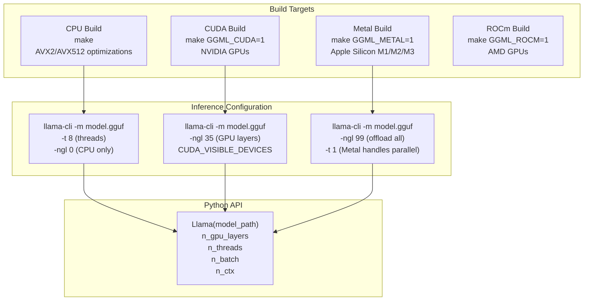

**GGUF Hardware-Specific Deployment**

Sources: [10-optimization/gguf/SKILL.md:296-344](), [10-optimization/gguf/SKILL.md:194-238]()

## Method Selection Decision Tree

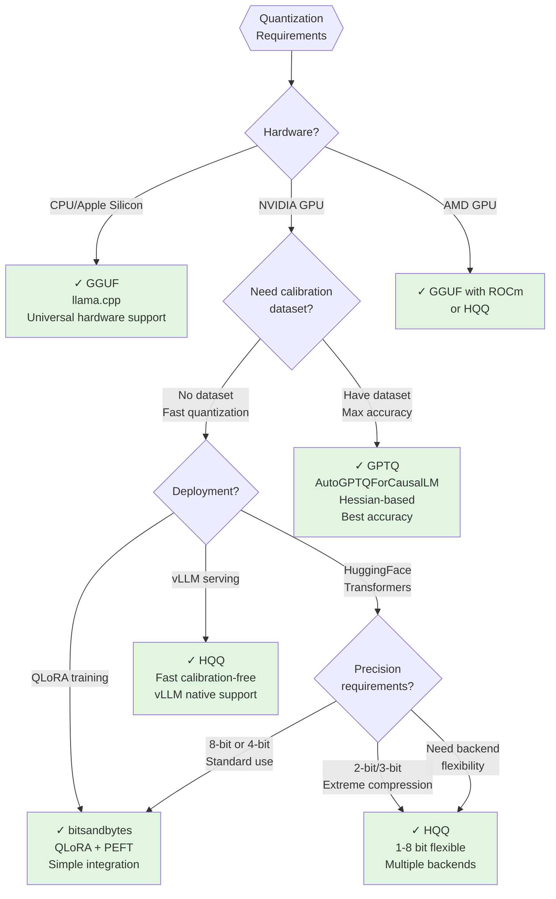

**Quantization Method Selection Decision Tree**

Sources: [10-optimization/bitsandbytes/SKILL.md:313-327](), [10-optimization/hqq/SKILL.md:17-36](), [10-optimization/gptq/SKILL.md:17-33](), [10-optimization/gguf/SKILL.md:17-36]()

## Performance and Memory Comparison

### Llama 2 7B Model Benchmarks

| Method | Config | Size | Memory | Tokens/sec (A100) | Perplexity Δ | Setup Time |
|--------|--------|------|--------|-------------------|--------------|------------|
| **FP16 Baseline** | - | 14 GB | 14 GB | 42 | 0% | - |
| **bitsandbytes INT8** | `load_in_8bit=True` | 7 GB | 7 GB | 52 | +0.3% | Instant |
| **bitsandbytes NF4** | `load_in_4bit=True, nf4` | 3.5 GB | 3.5 GB | 58 | +1.2% | Instant |
| **HQQ 4-bit** | `nbits=4, group_size=64` | 3.5 GB | 3.5 GB | 62 (marlin) | +1.5% | 2 min |
| **HQQ 2-bit** | `nbits=2, group_size=32` | 2.0 GB | 2.0 GB | 85 (marlin) | +3.8% | 2 min |
| **GPTQ 4-bit** | `bits=4, group_size=128` | 3.8 GB | 3.8 GB | 68 (exllamav2) | +1.2% | 30 min |
| **GGUF Q4_K_M** | CPU-optimized | 4.1 GB | 4.1 GB (CPU) | 15 (CPU-8 core) | +1.8% | 5 min |
| **GGUF Q4_K_M** | GPU-offload | 4.1 GB | 4.1 GB | 55 (35 layers) | +1.8% | 5 min |

Sources: [10-optimization/bitsandbytes/SKILL.md:67-77](), [10-optimization/hqq/SKILL.md:260-280](), [10-optimization/gptq/SKILL.md:146-165](), [10-optimization/gguf/SKILL.md:102-113]()

### Accuracy vs Memory Trade-off

Different group sizes and precision levels provide accuracy-memory trade-offs:

**GPTQ Group Size Impact** ([10-optimization/gptq/SKILL.md:127-144]()):
- Group size 32: +0.8% perplexity, ~3.2 GB
- Group size 128: +1.5% perplexity, ~3.8 GB (recommended)
- Group size 256: +2.2% perplexity, ~4.2 GB

**HQQ Precision Flexibility** ([10-optimization/hqq/SKILL.md:118-120]()):
- 8-bit: +0.2% perplexity, ~7 GB
- 4-bit: +1.5% perplexity, ~3.5 GB
- 3-bit: +2.8% perplexity, ~2.6 GB
- 2-bit: +3.8% perplexity, ~2.0 GB
- 1-bit: +8.5% perplexity, ~1.0 GB (experimental)

**GGUF K-Quant Quality** ([10-optimization/gguf/SKILL.md:102-113]()):
- Q8_0: +0.1% perplexity, ~7.2 GB
- Q6_K: +0.3% perplexity, ~5.5 GB
- Q5_K_M: +0.8% perplexity, ~4.8 GB
- Q4_K_M: +1.8% perplexity, ~4.1 GB (recommended)
- Q3_K_M: +3.2% perplexity, ~3.3 GB
- Q2_K: +5.5% perplexity, ~2.8 GB

## Integration Patterns

### HuggingFace Transformers Integration

All methods integrate with `transformers.AutoModelForCausalLM`:

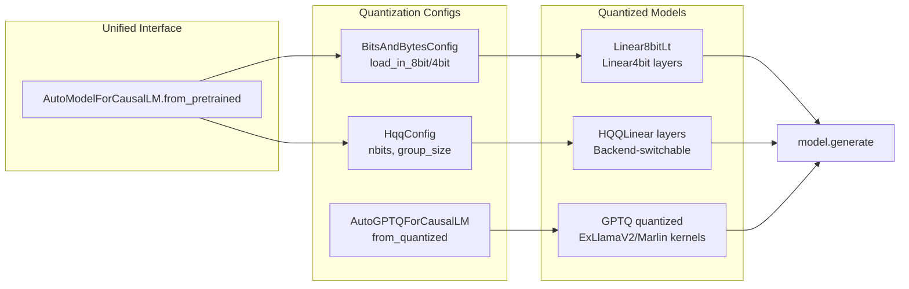

**Unified HuggingFace Transformers Integration**

Sources: [10-optimization/bitsandbytes/SKILL.md:23-34](), [10-optimization/hqq/SKILL.md:73-90](), [10-optimization/gptq/SKILL.md:52-73]()

### vLLM Integration

HQQ and GPTQ support vLLM serving ([10-optimization/hqq/SKILL.md:299-320]()):

```python
from vllm import LLM

# HQQ quantization
llm = LLM(
    model="mobiuslabsgmbh/Llama-3.1-8B-HQQ-4bit",
    quantization="hqq"
)

# GPTQ quantization
llm = LLM(
    model="TheBloke/Llama-2-7B-Chat-GPTQ",
    quantization="gptq"
)
```

Sources: [10-optimization/hqq/SKILL.md:299-320](), [10-optimization/gptq/SKILL.md:258-280]()

### QLoRA Training Integration

bitsandbytes and HQQ support LoRA fine-tuning on quantized models:

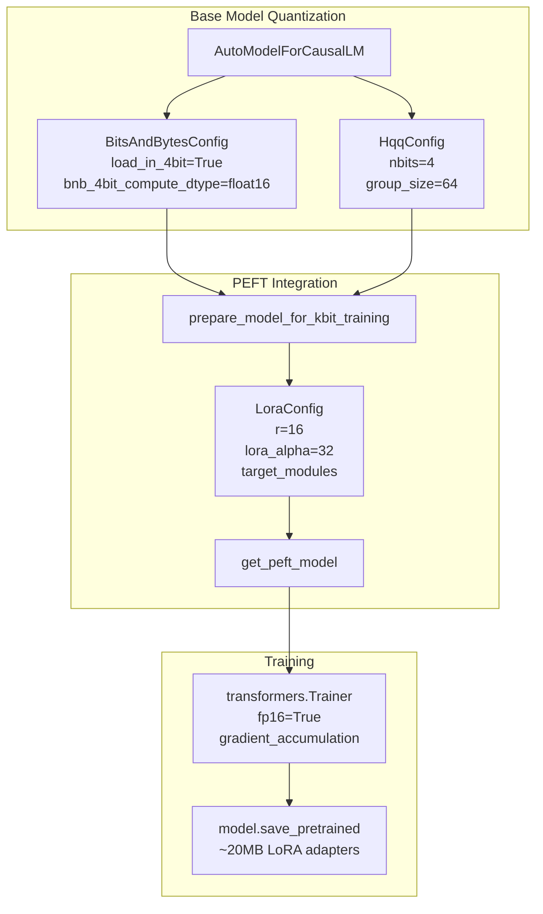

**QLoRA Training Pipeline with Quantized Models**

Sources: [10-optimization/bitsandbytes/SKILL.md:140-228](), [10-optimization/hqq/SKILL.md:322-360]()

## Backend Kernel Performance

### CUDA Kernel Comparison

Different quantization methods use specialized CUDA kernels:

| Method | Kernel | Hardware Requirement | 4-bit Matmul Speedup | Notes |
|--------|--------|---------------------|----------------------|-------|
| **bitsandbytes** | Custom CUDA | Turing+ | 1.5× | Simple integration |
| **HQQ marlin** | Marlin | Ampere+ (sm_80) | 3.5× | Requires `desc_act=False` equivalent |
| **HQQ torchao_int4** | TorchAO | Any CUDA | 2.5× | General purpose |
| **HQQ aten** | Custom CUDA | Any CUDA | 2.0× | Balanced |
| **GPTQ ExLlamaV2** | ExLlama | Any CUDA | 3.0× | Default, fastest |
| **GPTQ Marlin** | Marlin | Ampere+ | 3.5× | Fastest, requires `desc_act=False` |
| **GPTQ Triton** | Triton | Linux only | 2.0× | Portable |
| **GGUF CUDA** | ggml CUDA | Any CUDA | 2.0× | Universal |

Sources: [10-optimization/hqq/SKILL.md:174-183](), [10-optimization/hqq/references/troubleshooting.md:146-169](), [10-optimization/gptq/SKILL.md:199-256]()

### Backend Selection Algorithm

```python
# HQQ automatic backend selection
def select_optimal_backend():
    """Select best HQQ backend based on hardware."""
    device = torch.cuda.get_device_properties(0)
    compute_cap = device.major * 10 + device.minor
    
    if compute_cap >= 80:  # Ampere+ (A100, H100)
        return "marlin"
    elif compute_cap >= 70:  # Volta/Turing (V100, T4)
        return "aten"
    else:
        return "pytorch_compile"
```

Sources: [10-optimization/hqq/references/advanced-usage.md:7-26]()

## Production Deployment Patterns

### Model Selection Matrix

| Scenario | Method | Configuration | Rationale |
|----------|--------|---------------|-----------|
| **Research/Development** | bitsandbytes | `load_in_8bit=True` | Instant setup, no calibration |
| **QLoRA Fine-tuning** | bitsandbytes | `load_in_4bit=True, nf4, double_quant` | Best QLoRA support, PEFT integration |
| **Production Serving (NVIDIA)** | GPTQ | `bits=4, group_size=128, desc_act=False` | Best accuracy with calibration, ExLlamaV2 kernel |
| **Multi-GPU Serving** | HQQ | `nbits=4, group_size=64` + vLLM | Fast quantization, vLLM native support |
| **CPU/Edge Deployment** | GGUF | `Q4_K_M` with imatrix | Universal hardware, CPU-optimized |
| **Apple Silicon** | GGUF | `Q4_K_M` with Metal | Native Metal acceleration |
| **Extreme Compression** | HQQ | `nbits=2, group_size=32` | Sub-2GB models, flexible backends |

Sources: [10-optimization/bitsandbytes/SKILL.md:313-327](), [10-optimization/hqq/SKILL.md:17-36](), [10-optimization/gptq/SKILL.md:17-33](), [10-optimization/gguf/SKILL.md:17-36]()

### Pre-Quantized Model Repositories

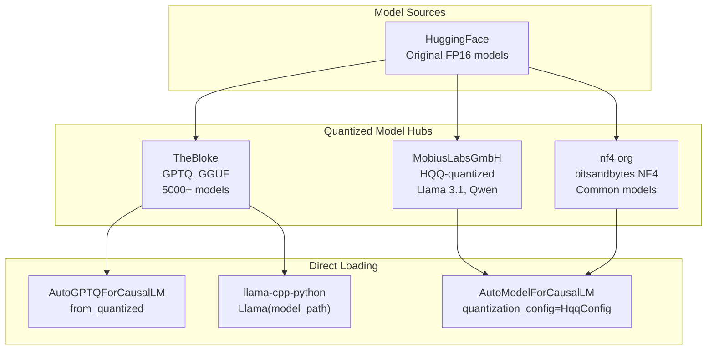

**Pre-Quantized Model Repository Ecosystem**

Example model identifiers:
- GPTQ: `TheBloke/Llama-2-7B-Chat-GPTQ`
- HQQ: `mobiuslabsgmbh/Llama-3.1-8B-HQQ-4bit`
- GGUF: `TheBloke/Llama-2-7B-Chat-GGUF`
- bitsandbytes: Load any FP16 model with `BitsAndBytesConfig`

Sources: [10-optimization/gptq/SKILL.md:52-73](), [10-optimization/hqq/SKILL.md:186-197](), [10-optimization/gguf/SKILL.md:420-428]()

## Common Troubleshooting

### CUDA Out of Memory

```python
# bitsandbytes: Enable CPU offloading
model = AutoModelForCausalLM.from_pretrained(
    "model-name",
    quantization_config=config,
    device_map="auto",
    max_memory={0: "20GB", "cpu": "30GB"}
)

# HQQ: Reduce group size
config = BaseQuantizeConfig(
    nbits=4,
    group_size=32  # Smaller = less memory during quantization
)

# GGUF: Reduce GPU layers
llm = Llama(
    model_path="model.gguf",
    n_gpu_layers=20  # Reduce from 35
)
```

Sources: [10-optimization/bitsandbytes/SKILL.md:344-351](), [10-optimization/hqq/references/troubleshooting.md:56-90](), [10-optimization/gguf/references/troubleshooting.md:204-238]()

### Quality Degradation

For low-bit quantization quality issues:

**GPTQ**: Use smaller group sizes ([10-optimization/gptq/SKILL.md:182-197]()):
```python
config = BaseQuantizeConfig(
    bits=4,
    group_size=32,  # Smaller groups = better accuracy
    desc_act=True   # Activation reordering
)
```

**HQQ**: Skip sensitive layers ([10-optimization/hqq/SKILL.md:306-314]()):
```python
config = HqqConfig(
    nbits=4,
    group_size=64,
    skip_modules=["embed_tokens", "lm_head"]
)
```

**GGUF**: Always use importance matrix for Q4 and below ([10-optimization/gguf/SKILL.md:146-170]()):
```bash
./llama-imatrix -m model-f16.gguf -f calibration.txt -o model.imatrix
./llama-quantize --imatrix model.imatrix model-f16.gguf model-q4_k_m.gguf Q4_K_M
```

Sources: [10-optimization/gptq/SKILL.md:182-197](), [10-optimization/hqq/SKILL.md:306-330](), [10-optimization/gguf/SKILL.md:407-414]()

### Backend Incompatibility

**HQQ Marlin Requirements** ([10-optimization/hqq/references/troubleshooting.md:146-169]()):
- Ampere or newer GPU (compute capability >= 8.0)
- 4-bit quantization only
- Group size must be 128

**GPTQ Marlin Requirements** ([10-optimization/gptq/SKILL.md:242-256]()):
- `desc_act=False` in `BaseQuantizeConfig`
- Ampere or newer GPU
- 4-bit quantization only

If requirements not met, both automatically fall back to compatible kernels.

Sources: [10-optimization/hqq/references/troubleshooting.md:146-169](), [10-optimization/gptq/SKILL.md:242-256]()

---

