<!-- source: DeepWiki mcp.deepwiki.com · repo zechenzhangAGI/AI-research-SKILLs · page 3.7 Mechanistic Interpretability Tools · fetched 2026-10-26 -->

# Mechanistic Interpretability Tools

<details>
<summary>Relevant source files</summary>

The following files were used as context for generating this wiki page:

- [04-mechanistic-interpretability/nnsight/SKILL.md](04-mechanistic-interpretability/nnsight/SKILL.md)
- [04-mechanistic-interpretability/nnsight/references/README.md](04-mechanistic-interpretability/nnsight/references/README.md)
- [04-mechanistic-interpretability/nnsight/references/api.md](04-mechanistic-interpretability/nnsight/references/api.md)
- [04-mechanistic-interpretability/nnsight/references/tutorials.md](04-mechanistic-interpretability/nnsight/references/tutorials.md)
- [04-mechanistic-interpretability/pyvene/SKILL.md](04-mechanistic-interpretability/pyvene/SKILL.md)
- [04-mechanistic-interpretability/pyvene/references/README.md](04-mechanistic-interpretability/pyvene/references/README.md)
- [04-mechanistic-interpretability/pyvene/references/api.md](04-mechanistic-interpretability/pyvene/references/api.md)
- [04-mechanistic-interpretability/pyvene/references/tutorials.md](04-mechanistic-interpretability/pyvene/references/tutorials.md)
- [04-mechanistic-interpretability/saelens/SKILL.md](04-mechanistic-interpretability/saelens/SKILL.md)
- [04-mechanistic-interpretability/saelens/references/README.md](04-mechanistic-interpretability/saelens/references/README.md)
- [04-mechanistic-interpretability/saelens/references/api.md](04-mechanistic-interpretability/saelens/references/api.md)

</details>


## Purpose and Scope

This document covers the three primary libraries for mechanistic interpretability in the AI Research SKILLs collection: **pyvene** (declarative causal interventions), **nnsight** (transparent model access with remote execution), and **SAELens** (sparse autoencoder training for feature discovery). These tools enable researchers to understand and manipulate neural network internals through activation analysis, causal tracing, and feature decomposition.

For training systems that produce these models, see [Training & Fine-Tuning Skills](#2.3). For evaluation frameworks that consume interpretability insights, see [Evaluation Skills](#2.7). For safety systems that leverage interpretability for alignment, see [Safety & Content Moderation Skills](#2.5).

## Overview

Mechanistic interpretability tools provide programmatic access to neural network internals for three primary research workflows:

1. **Causal interventions** - Testing which components are necessary/sufficient for behaviors
2. **Activation analysis** - Understanding what representations models compute
3. **Feature discovery** - Decomposing polysemantic neurons into interpretable features

The three tools in this category address complementary needs:

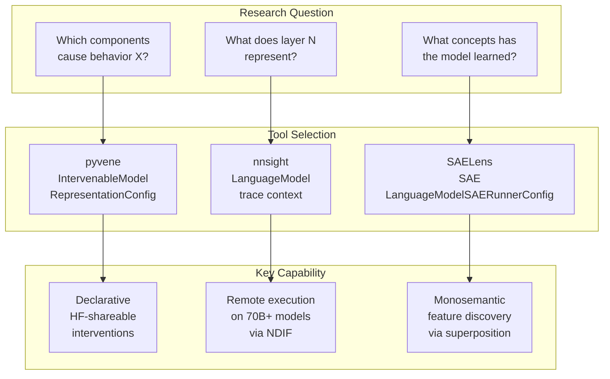

**Sources:** [04-mechanistic-interpretability/pyvene/SKILL.md:11-46](), [04-mechanistic-interpretability/nnsight/SKILL.md:11-45](), [04-mechanistic-interpretability/saelens/SKILL.md:11-36]()

## Tool Selection Decision Matrix

| Research Goal | Primary Tool | Secondary Tool | Key Classes |
|--------------|--------------|----------------|-------------|
| Causal tracing (ROME-style) | pyvene | nnsight | `IntervenableConfig`, `VanillaIntervention` |
| Activation patching sweeps | pyvene | nnsight | `RepresentationConfig`, `IntervenableModel` |
| Remote execution (70B+) | nnsight | - | `LanguageModel`, `remote=True` |
| Gradient-based analysis | nnsight | TransformerLens | `trace()`, `.retain_grad()` |
| Model steering | pyvene | nnsight | `AdditionIntervention`, `RotatedSpaceIntervention` |
| Feature discovery | SAELens | - | `SAE`, `LanguageModelSAERunnerConfig` |
| Trainable interventions (IIT/DAS) | pyvene | - | `LowRankRotatedSpaceIntervention` |
| Multi-prompt activation sharing | nnsight | - | `tracer.invoke()` |
| Monosemantic feature analysis | SAELens | - | `SAE.encode()`, `SAE.decode()` |

**Key Decision Factors:**

- **Model size**: >70B parameters → nnsight with NDIF
- **Reproducibility needs**: Shareable configs → pyvene (HuggingFace integration)
- **Architecture flexibility**: Any PyTorch model → nnsight or pyvene
- **Sparsity/interpretability**: Polysemantic neurons → SAELens
- **Consistent API needs**: Transformer-only → TransformerLens (not covered here)

**Sources:** [04-mechanistic-interpretability/pyvene/SKILL.md:18-33](), [04-mechanistic-interpretability/nnsight/SKILL.md:34-45](), [04-mechanistic-interpretability/saelens/SKILL.md:24-35]()

## pyvene: Declarative Causal Interventions

### Architecture

pyvene provides a declarative framework for intervention experiments through configuration objects that can be saved, loaded, and shared via HuggingFace.

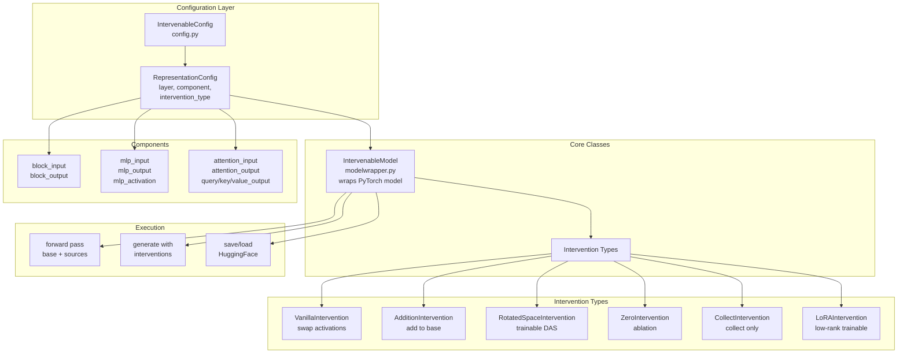

**Sources:** [04-mechanistic-interpretability/pyvene/SKILL.md:45-103](), [04-mechanistic-interpretability/pyvene/references/api.md:1-91]()

### Core Classes and Methods

#### IntervenableModel

Primary wrapper class that adds intervention capabilities to any PyTorch model.

**Location:** Internal to `pyvene` package (imported as `pv.IntervenableModel`)

**Key Methods:**
```python
# Forward with intervention
__call__(base, sources, unit_locations=None, output_original_output=False)
# Returns: (original_output, intervened_output)

# Generation with intervention
generate(base, sources, max_new_tokens, **kwargs)

# Persistence
save(path)
save_intervention(hf_repo_id)  # To HuggingFace
load(path, model)  # Class method

# Training
get_trainable_parameters()  # For trainable interventions
```

**Sources:** [04-mechanistic-interpretability/pyvene/SKILL.md:47-72](), [04-mechanistic-interpretability/pyvene/references/api.md:3-90]()

#### IntervenableConfig and RepresentationConfig

Configuration classes defining intervention structure.

```python
# IntervenableConfig - container for multiple interventions
pv.IntervenableConfig(
    representations=[RepresentationConfig(...), ...]
)

# RepresentationConfig - single intervention specification
pv.RepresentationConfig(
    layer=int,                    # Layer index
    component=str,                # Target component (see table below)
    intervention_type=type,       # Intervention class
    unit="pos",                   # Optional: position-specific
    max_number_of_units=int,      # Max positions to intervene
    low_rank_dimension=int,       # For trainable interventions
    subspace_partition=list,      # Dimension ranges
)
```

**Component Targets:**

| Component String | Description | Location in Transformer |
|-----------------|-------------|-------------------------|
| `block_input` | Input to transformer block | Pre-attention and MLP |
| `block_output` | Output of transformer block | Post-residual connection |
| `mlp_input` | Input to MLP | Post-attention |
| `mlp_output` | Output of MLP | Pre-residual add |
| `mlp_activation` | MLP hidden state | Post-activation function |
| `attention_input` | Input to attention | Pre-QKV projection |
| `attention_output` | Output of attention | Post-attention projection |
| `attention_value_output` | Attention value vectors | Post-value projection |
| `query_output` | Query vectors | Post-query projection |
| `key_output` | Key vectors | Post-key projection |
| `value_output` | Value vectors | Post-value projection |
| `head_attention_value_output` | Per-head attention values | Individual attention heads |

**Sources:** [04-mechanistic-interpretability/pyvene/SKILL.md:85-103](), [04-mechanistic-interpretability/pyvene/references/api.md:119-182]()

### Intervention Type Classes

| Class | Operation | Use Case | Trainable |
|-------|-----------|----------|-----------|
| `VanillaIntervention` | `base[:] = source` | Activation patching | No |
| `AdditionIntervention` | `base += source` | Steering vectors | No |
| `SubtractionIntervention` | `base -= source` | Ablation studies | No |
| `ZeroIntervention` | `base[:] = 0` | Component knockout | No |
| `CollectIntervention` | No modification | Activation collection | No |
| `RotatedSpaceIntervention` | `R @ base` where R is learned | DAS full-rank | Yes |
| `LowRankRotatedSpaceIntervention` | Low-rank rotation | DAS causal discovery | Yes |
| `SigmoidMaskIntervention` | Learnable binary mask | Feature selection | Yes |
| `LoRAIntervention` | Low-rank adaptation | Fine-grained steering | Yes |

**Sources:** [04-mechanistic-interpretability/pyvene/SKILL.md:74-84](), [04-mechanistic-interpretability/pyvene/references/api.md:185-289]()

### Causal Tracing Workflow

ROME-style causal tracing locates where factual associations are stored by corrupting inputs and restoring activations at different layers.

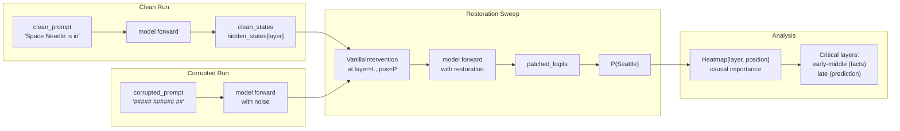

**Implementation Pattern:**
```python
# 1. Define intervention config
config = pv.IntervenableConfig(
    representations=[
        pv.RepresentationConfig(
            layer=layer,
            component="block_output",
            intervention_type=pv.VanillaIntervention,
            unit="pos",
            max_number_of_units=1,
        )
    ]
)

# 2. Create intervenable model
intervenable = pv.IntervenableModel(config, model)

# 3. Run with intervention
_, patched_outputs = intervenable(
    base=corrupted_tokens,
    sources=[clean_tokens],
    unit_locations={"sources->base": ([[[position]]], [[[position]]])},
)
```

**Sources:** [04-mechanistic-interpretability/pyvene/SKILL.md:105-172](), [04-mechanistic-interpretability/pyvene/references/tutorials.md:58-126]()

### Interchange Intervention Training (IIT/DAS)

Trainable interventions discover causal structure by learning low-rank rotations that achieve counterfactual behaviors.

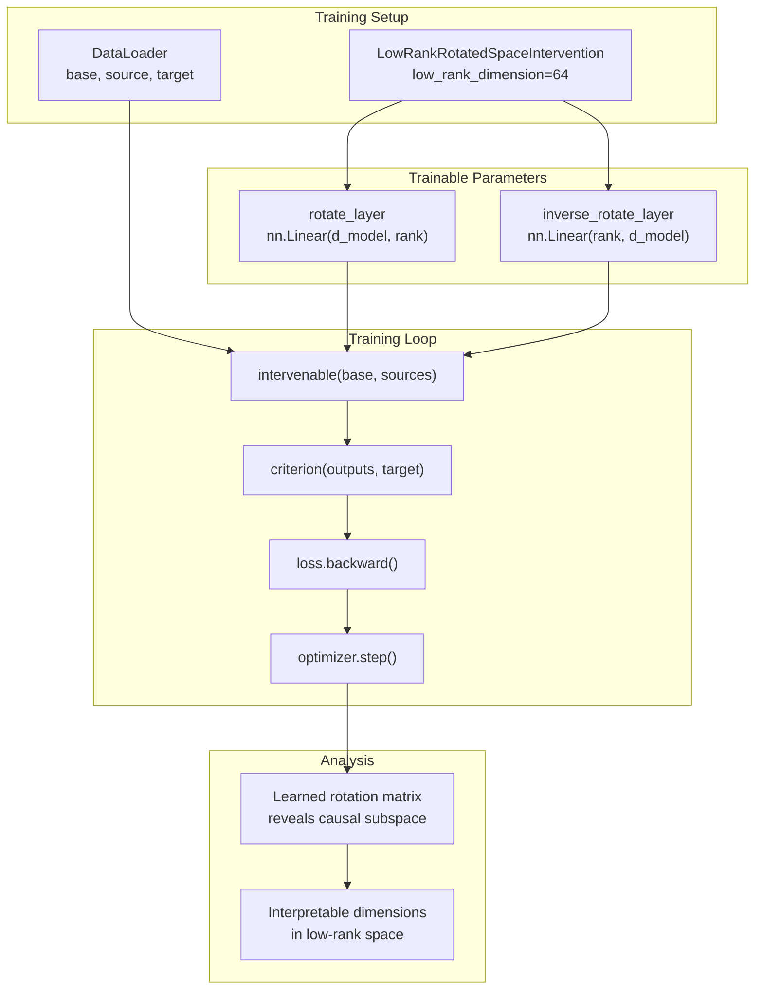

**Key Method:**
```python
intervenable.get_trainable_parameters()
# Returns parameters of RotatedSpaceIntervention layers
```

**Sources:** [04-mechanistic-interpretability/pyvene/SKILL.md:238-303](), [04-mechanistic-interpretability/pyvene/references/tutorials.md:130-195]()

### HuggingFace Integration

pyvene interventions are shareable artifacts:

```python
# Save locally
intervenable.save("./my_intervention")

# Share on HuggingFace
intervenable.save_intervention("username/my-intervention")

# Load from HuggingFace
intervenable = pv.IntervenableModel.load(
    "username/my-intervention",
    model=model,
)
```

**Example Shared Intervention:**
- `zhengxuanzenwu/intervenable_honest_llama2_chat_7B` - Honest LLaMA steering

**Sources:** [04-mechanistic-interpretability/pyvene/SKILL.md:336-356]()

## nnsight: Transparent Model Access

### Architecture

nnsight wraps PyTorch models to enable deferred execution of interventions through proxy objects, with unique support for remote execution on massive models via NDIF.

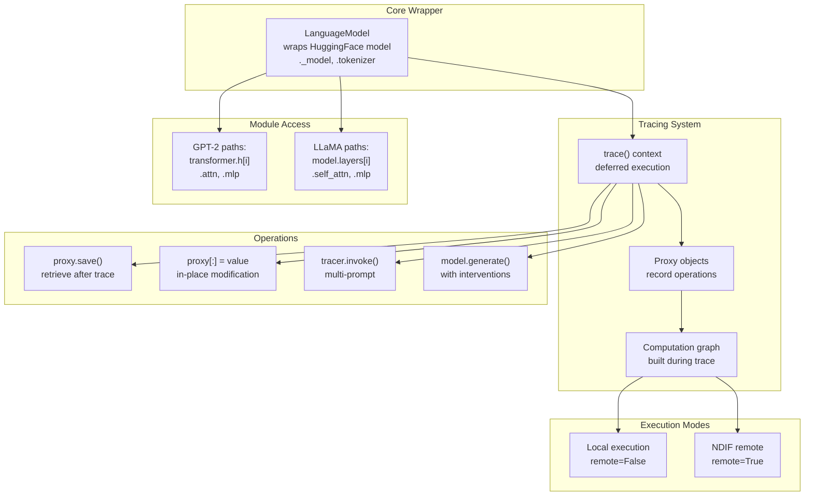

**Sources:** [04-mechanistic-interpretability/nnsight/SKILL.md:59-110](), [04-mechanistic-interpretability/nnsight/references/api.md:1-45]()

### LanguageModel Class

Primary wrapper for loading and tracing models.

**Constructor:**
```python
from nnsight import LanguageModel

model = LanguageModel(
    model_name,           # HuggingFace model ID
    device_map="auto",    # Device placement
    torch_dtype=None,     # Optional dtype
)
```

**Key Attributes:**
- `._model` - Underlying HuggingFace model (e.g., `GPT2LMHeadModel`)
- `.tokenizer` - Associated tokenizer
- `._model.config` - Model configuration

**Sources:** [04-mechanistic-interpretability/nnsight/SKILL.md:61-71](), [04-mechanistic-interpretability/nnsight/references/api.md:3-37]()

### Tracing Context and Proxy Objects

The `trace()` context manager enables deferred execution through proxy objects.

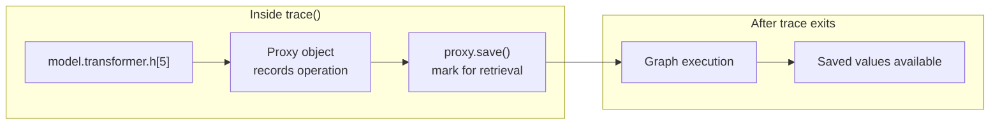

**Key Methods:**

```python
# Context creation
with model.trace(prompt, remote=False, validate=True) as tracer:
    # All operations deferred
    
# Proxy operations
proxy = model.transformer.h[5].output[0]
proxy.save()              # Mark for retrieval
proxy[:]                  # Indexing/slicing
proxy.mean(dim=-1)        # PyTorch operations
proxy[:] = value          # In-place modification (intervention)

# Multi-prompt
with model.trace() as tracer:
    with tracer.invoke("Prompt 1"):
        hidden1 = model.transformer.h[5].output[0].save()
    with tracer.invoke("Prompt 2"):
        model.transformer.h[5].output[0][:] = hidden1  # Cross-prompt intervention
```

**Sources:** [04-mechanistic-interpretability/nnsight/SKILL.md:73-110](), [04-mechanistic-interpretability/nnsight/references/api.md:41-140]()

### Module Access Patterns

Different model architectures have different module paths:

| Model Family | Embeddings | Layer i Output | Attention | MLP |
|--------------|------------|----------------|-----------|-----|
| GPT-2 | `transformer.wte` | `transformer.h[i].output[0]` | `transformer.h[i].attn.output` | `transformer.h[i].mlp.output` |
| LLaMA | `model.embed_tokens` | `model.layers[i].output[0]` | `model.layers[i].self_attn.output` | `model.layers[i].mlp.output` |
| Mistral | `model.embed_tokens` | `model.layers[i].output[0]` | `model.layers[i].self_attn.output` | `model.layers[i].mlp.output` |

**Finding module paths:**
```python
# Print model structure
print(model._model)

# Iterate modules
for name, module in model._model.named_modules():
    print(name)
```

**Sources:** [04-mechanistic-interpretability/nnsight/references/api.md:142-195](), [04-mechanistic-interpretability/nnsight/SKILL.md:323-334]()

### Remote Execution with NDIF

nnsight's killer feature: run the same code on 70B+ parameter models without local GPUs.

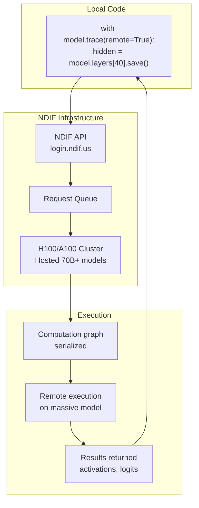

**Setup:**
```python
import os
os.environ["NDIF_API_KEY"] = "your_key"

# Or configure directly
from nnsight import CONFIG
CONFIG.API_KEY = "your_key"
```

**Usage - identical to local:**
```python
model = LanguageModel("meta-llama/Llama-3.1-70B")

# Just add remote=True
with model.trace("Hello", remote=True) as tracer:
    hidden = model.model.layers[40].output[0].save()
    logits = model.output.save()

# Results available after context
print(hidden.shape)  # Executed remotely!
```

**Available Models on NDIF:**
- Llama-3.1-8B, 70B, 405B
- DeepSeek-R1 models
- Check [ndif.us](https://ndif.us) for current list

**Batching Multiple Requests:**
```python
with model.session(remote=True) as session:
    with model.trace("First prompt"):
        h1 = model.model.layers[20].output[0].save()
    with model.trace("Second prompt"):
        h2 = model.model.layers[20].output[0].save()
# Both execute in single NDIF request
```

**Sources:** [04-mechanistic-interpretability/nnsight/SKILL.md:217-266](), [04-mechanistic-interpretability/nnsight/references/api.md:269-307]()

### Cross-Prompt Activation Sharing

Share activations between different inputs within a single trace:

```python
with model.trace() as tracer:
    # First prompt
    with tracer.invoke("The cat sat on the"):
        cat_hidden = model.transformer.h[6].output[0].save()
    
    # Second prompt - inject cat's activations
    with tracer.invoke("The dog ran through the"):
        model.transformer.h[6].output[0][:] = cat_hidden
        dog_with_cat = model.output.save()
```

**Sources:** [04-mechanistic-interpretability/nnsight/SKILL.md:268-288](), [04-mechanistic-interpretability/nnsight/references/api.md:198-227]()

### Gradient Access

Access gradients during backward pass (local execution only):

```python
with model.trace("The quick brown fox") as tracer:
    hidden = model.transformer.h[5].output[0].save()
    hidden.retain_grad()
    
    logits = model.output
    target_token = model.tokenizer.encode(" jumps")[0]
    loss = -logits[0, -1, target_token]
    loss.backward()

# Access gradient
grad = hidden.grad
```

**Limitation:** Not supported with vLLM or remote execution.

**Sources:** [04-mechanistic-interpretability/nnsight/SKILL.md:290-320](), [04-mechanistic-interpretability/nnsight/references/api.md:245-266]()

## SAELens: Sparse Autoencoder Training

### Architecture

SAELens trains Sparse Autoencoders to decompose polysemantic activations into sparse, interpretable features through a reconstruction + sparsity loss.

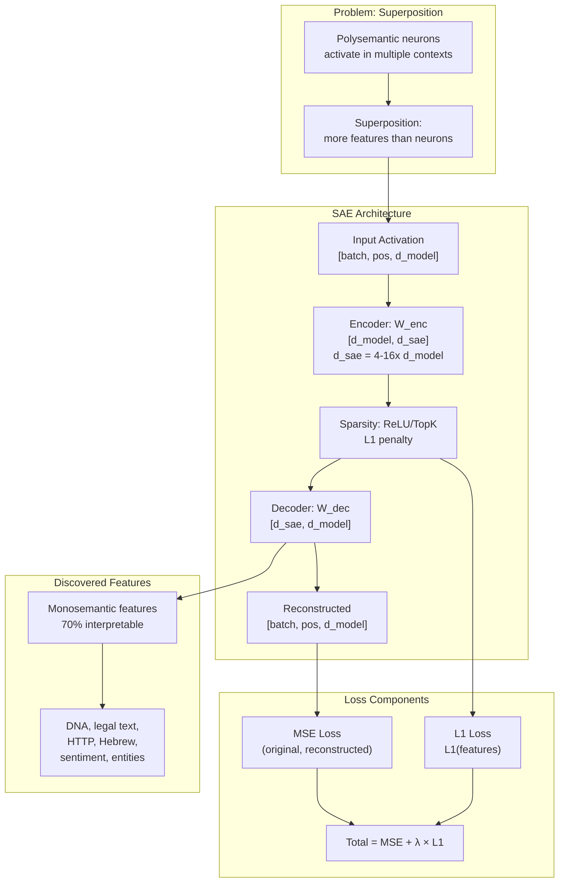

**Sources:** [04-mechanistic-interpretability/saelens/SKILL.md:17-66](), [04-mechanistic-interpretability/saelens/references/README.md:48-63]()

### Core Classes

#### SAE Class

Represents a trained Sparse Autoencoder.

**Key Attributes:**
- `W_enc` - Encoder weights `[d_in, d_sae]`
- `W_dec` - Decoder weights `[d_sae, d_in]`
- `b_enc` - Encoder bias `[d_sae]`
- `b_dec` - Decoder bias `[d_in]`
- `cfg` - SAEConfig object

**Key Methods:**
```python
# Loading
sae, cfg_dict, sparsity = SAE.from_pretrained(
    release="gpt2-small-res-jb",
    sae_id="blocks.8.hook_resid_pre",
    device="cuda"
)

# Forward pass
features = sae.encode(activations)         # [batch, pos, d_sae]
reconstructed = sae.decode(features)       # [batch, pos, d_in]
reconstructed = sae(activations)           # Encode + decode

# Persistence
sae.save_model("/path/to/save")
sae = SAE.load_from_disk("/path", device="cuda")
```

**Sources:** [04-mechanistic-interpretability/saelens/SKILL.md:68-101](), [04-mechanistic-interpretability/saelens/references/api.md:1-73]()

#### LanguageModelSAERunnerConfig

Comprehensive training configuration.

**Key Parameters:**

| Category | Parameters | Typical Values |
|----------|-----------|----------------|
| **Model** | `model_name`, `hook_name`, `hook_layer`, `d_in` | `"gpt2-small"`, `"blocks.8.hook_resid_pre"`, `8`, `768` |
| **Architecture** | `architecture`, `d_sae`, `activation_fn` | `"standard"`, `768*8`, `"relu"` |
| **Sparsity** | `l1_coefficient`, `l1_warm_up_steps` | `8e-5`, `1000` |
| **Training** | `lr`, `train_batch_size_tokens`, `training_tokens` | `4e-4`, `4096`, `100_000_000` |
| **Data** | `dataset_path`, `context_size` | `"monology/pile-uncopyrighted"`, `128` |

**Architecture Options:**

| Architecture | Description | Configuration |
|--------------|-------------|---------------|
| `standard` | ReLU + L1 penalty | `activation_fn="relu"` |
| `gated` | Learned gating | `architecture="gated"` |
| `topk` | Exactly K active features | `activation_fn="topk"`, `activation_fn_kwargs={"k": 50}` |
| `jumprelu` | State-of-the-art | `architecture="jumprelu"` |

**Sources:** [04-mechanistic-interpretability/saelens/SKILL.md:119-194](), [04-mechanistic-interpretability/saelens/references/api.md:104-311]()

#### SAETrainingRunner

Manages training loop execution.

```python
from sae_lens import SAETrainingRunner, LanguageModelSAERunnerConfig

cfg = LanguageModelSAERunnerConfig(...)
runner = SAETrainingRunner(cfg)
sae = runner.run()
```

**Sources:** [04-mechanistic-interpretability/saelens/references/api.md:199-224]()

### Training Workflow

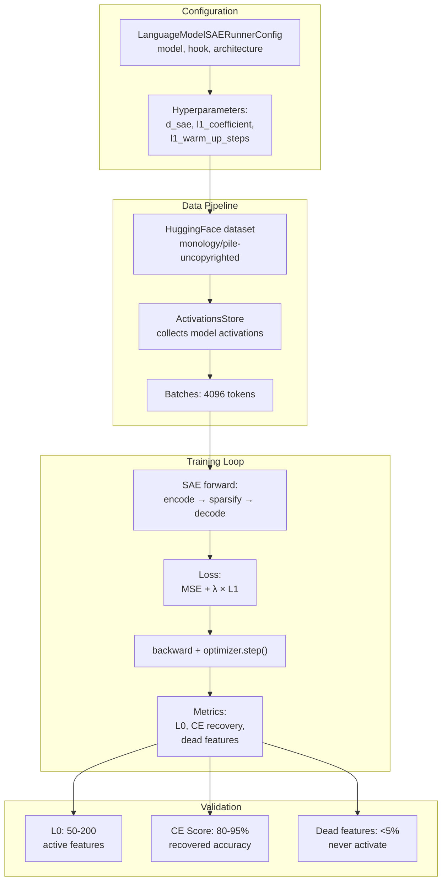

**Key Validation Metrics:**

| Metric | Target Range | Interpretation |
|--------|-------------|----------------|
| **L0** | 50-200 | Average number of active features per token |
| **CE Loss Score** | 80-95% | Cross-entropy recovered vs original model |
| **Dead Features** | <5% | Percentage of features that never activate |
| **Explained Variance** | >90% | Reconstruction quality |

**Hyperparameter Effects:**

| Parameter | Increase → | Decrease → |
|-----------|-----------|-----------|
| `d_sae` | More capacity, higher memory | Less capacity |
| `l1_coefficient` | Sparser, more interpretable | Better reconstruction |
| `l1_warm_up_steps` | Prevents dead features | Faster training |

**Sources:** [04-mechanistic-interpretability/saelens/SKILL.md:119-194](), [04-mechanistic-interpretability/saelens/references/api.md:104-311]()

### Feature Analysis Workflow

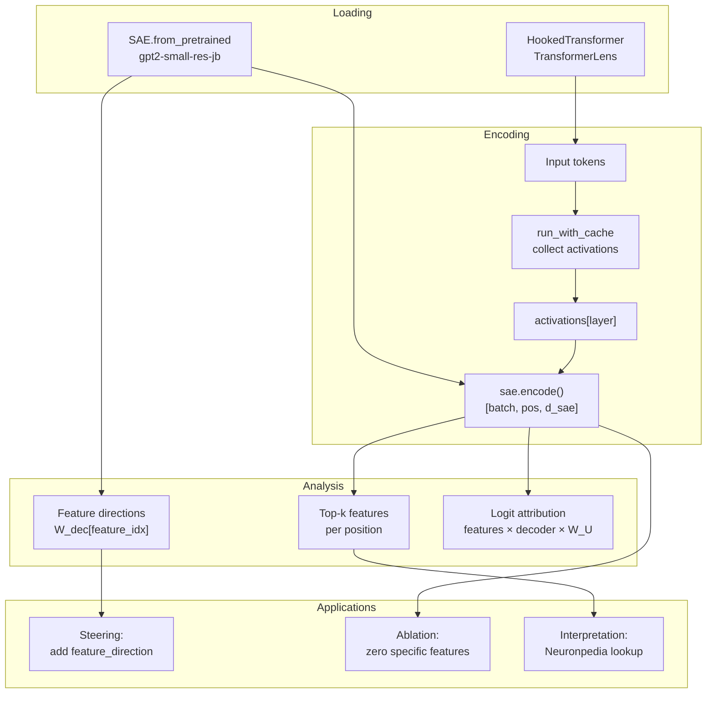

**Feature Steering Example:**
```python
# Get feature direction from decoder
feature_direction = sae.W_dec[feature_idx]  # [d_model]

def steering_hook(activation, hook):
    # Add scaled feature direction
    activation += strength * feature_direction
    return activation

# Generate with steering
output = model.generate(
    tokens,
    max_new_tokens=50,
    fwd_hooks=[("blocks.8.hook_resid_pre", steering_hook)]
)
```

**Feature Attribution:**
```python
# Which features contribute to prediction?
features = sae.encode(cache["resid_pre", 8])[0, -1]  # [d_sae]
W_dec = sae.W_dec  # [d_sae, d_model]
W_U = model.W_U    # [d_model, vocab]

# Contribution to target token
target_token = model.to_single_token(" Paris")
feature_contributions = features * (W_dec @ W_U[:, target_token])

top_features = feature_contributions.topk(10)
```

**Sources:** [04-mechanistic-interpretability/saelens/SKILL.md:195-274](), [04-mechanistic-interpretability/saelens/references/README.md:48-63]()

### Neuronpedia Integration

Pre-trained SAE features are browsable at [neuronpedia.org](https://neuronpedia.org).

**URL Format:**
```
neuronpedia.org/{model}/{layer}-{sae_type}/{feature_id}
```

**Example:**
- GPT-2 Small Layer 8, Feature 1234: `neuronpedia.org/gpt2-small/8-res-jb/1234`

**Available Pre-trained SAEs:**

| Release | Model | Coverage |
|---------|-------|----------|
| `gpt2-small-res-jb` | GPT-2 Small | Multiple residual stream layers |
| `gemma-2b-res` | Gemma 2B | Residual streams |
| HuggingFace (tag: `saelens`) | Various | Community-trained SAEs |

**Sources:** [04-mechanistic-interpretability/saelens/SKILL.md:325-334](), [04-mechanistic-interpretability/saelens/references/README.md:64-70]()

## Integration Patterns

### Cross-Tool Workflows

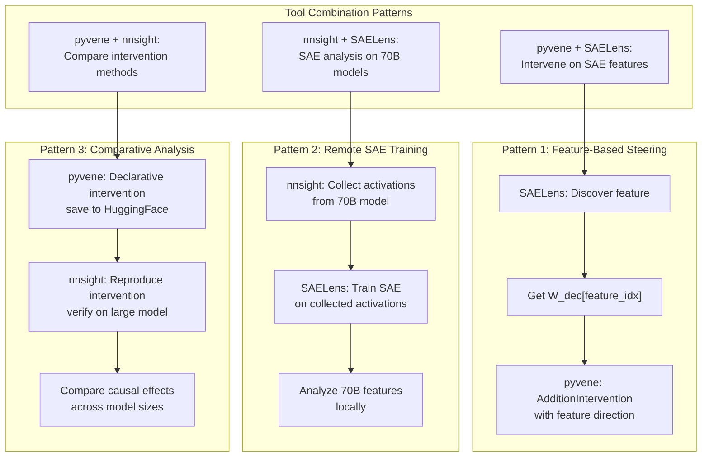

**Sources:** Derived from capabilities across [04-mechanistic-interpretability/pyvene/SKILL.md](), [04-mechanistic-interpretability/nnsight/SKILL.md](), [04-mechanistic-interpretability/saelens/SKILL.md]()

### TransformerLens Integration

All three tools integrate with TransformerLens for consistent model loading:

```python
from transformer_lens import HookedTransformer

# TransformerLens model
model = HookedTransformer.from_pretrained("gpt2-small")

# SAELens uses TransformerLens directly
from sae_lens import SAE
sae, _, _ = SAE.from_pretrained(
    release="gpt2-small-res-jb",
    sae_id="blocks.8.hook_resid_pre",
)
_, cache = model.run_with_cache(tokens)
features = sae.encode(cache["resid_pre", 8])

# pyvene wraps any model (including TransformerLens models)
import pyvene as pv
config = pv.IntervenableConfig(...)
intervenable = pv.IntervenableModel(config, model)

# nnsight uses HuggingFace models directly
from nnsight import LanguageModel
nnsight_model = LanguageModel("gpt2-small")
```

**Sources:** [04-mechanistic-interpretability/saelens/SKILL.md:72-74](), [04-mechanistic-interpretability/pyvene/SKILL.md:54-57]()

## Technical Comparison Matrix

| Feature | pyvene | nnsight | SAELens |
|---------|--------|---------|---------|
| **Primary Use Case** | Causal interventions | Activation analysis | Feature discovery |
| **Architecture Support** | Any PyTorch | Any PyTorch | TransformerLens models |
| **Remote Execution** | No | Yes (NDIF) | No |
| **Declarative Config** | Yes | No | Yes |
| **HF Shareable** | Yes (interventions) | No | Yes (SAEs) |
| **Trainable Components** | Yes (DAS, LoRA) | No | Yes (SAE training) |
| **Gradient Access** | Yes | Yes (local only) | Yes |
| **Multi-Prompt** | Manual | Native (`invoke`) | Via TransformerLens |
| **Generation Support** | Native | Native | Via TransformerLens hooks |
| **Consistency Across Models** | Manual module paths | Manual module paths | TransformerLens hooks |
| **Memory Efficiency** | Configurable | Saved values only | Depends on d_sae |
| **Installation** | `pip install pyvene` | `pip install nnsight` | `pip install sae-lens` |
| **Primary Dependencies** | `torch>=2.0.0`, `transformers>=4.30.0` | `torch>=2.0.0` | `transformer-lens>=2.0.0` |

**Sources:** [04-mechanistic-interpretability/pyvene/SKILL.md:465-474](), [04-mechanistic-interpretability/nnsight/SKILL.md:393-401](), [04-mechanistic-interpretability/saelens/SKILL.md:8-9]()

## Common Debugging Patterns

### Module Path Issues

Different models have different internal structures:

```python
# GPT-2 structure
model.transformer.h[i].output[0]
model.transformer.h[i].attn.output
model.transformer.h[i].mlp.output

# LLaMA structure  
model.model.layers[i].output[0]
model.model.layers[i].self_attn.output
model.model.layers[i].mlp.output

# Solution: Print structure
print(model._model)  # nnsight
for name, module in model._model.named_modules():
    print(name)
```

**Sources:** [04-mechanistic-interpretability/nnsight/SKILL.md:323-334](), [04-mechanistic-interpretability/nnsight/references/api.md:186-195]()

### Memory Management

```python
# pyvene: Use gradient checkpointing
model.gradient_checkpointing_enable()

# nnsight: Save selectively
with model.trace("prompt"):
    # Don't save all layers
    key_layers = [0, 5, 11]
    for i in key_layers:
        model.transformer.h[i].output[0].save()

# SAELens: Reduce batch sizes
cfg = LanguageModelSAERunnerConfig(
    train_batch_size_tokens=2048,
    store_batch_size_prompts=4,
    n_batches_in_buffer=8,
)
```

**Sources:** [04-mechanistic-interpretability/pyvene/SKILL.md:390-404](), [04-mechanistic-interpretability/nnsight/SKILL.md:358-370](), [04-mechanistic-interpretability/saelens/SKILL.md:315-323]()

### Dead Features in SAEs

```python
# Problem: Features die during training
# Solution: Enable L1 warm-up and ghost gradients
cfg = LanguageModelSAERunnerConfig(
    l1_coefficient=8e-5,
    l1_warm_up_steps=1000,      # Gradually increase penalty
    use_ghost_grads=True,       # Revive dead features
    feature_sampling_window=1000,
    dead_feature_window=5000,
    dead_feature_threshold=1e-8,
)
```

**Sources:** [04-mechanistic-interpretability/saelens/SKILL.md:277-293]()

## Reference Documentation Structure

Each tool has comprehensive reference materials in its `references/` folder:

```
04-mechanistic-interpretability/
├── pyvene/
│   ├── SKILL.md                    # Main skill documentation
│   └── references/
│       ├── README.md               # Quick start
│       ├── api.md                  # IntervenableModel, configs, interventions
│       └── tutorials.md            # Step-by-step workflows
├── nnsight/
│   ├── SKILL.md                    # Main skill documentation
│   └── references/
│       ├── README.md               # Quick start
│       ├── api.md                  # LanguageModel, tracing, NDIF
│       └── tutorials.md            # Local and remote examples
└── saelens/
    ├── SKILL.md                    # Main skill documentation
    └── references/
        ├── README.md               # Quick start
        ├── api.md                  # SAE, configs, architectures
        ├── tutorials.md            # Training and analysis
        └── papers.md               # Research papers on SAEs
```

**Sources:** [04-mechanistic-interpretability/pyvene/SKILL.md:439-447](), [04-mechanistic-interpretability/nnsight/SKILL.md:404-411](), [04-mechanistic-interpretability/saelens/SKILL.md:346-354]()

---

