<!-- source: DeepWiki mcp.deepwiki.com · repo zechenzhangAGI/AI-research-SKILLs · page 3.9 RLHF & Preference Optimization Methods · fetched 2026-10-26 -->

# RLHF & Preference Optimization Methods

<details>
<summary>Relevant source files</summary>

The following files were used as context for generating this wiki page:

- [03-fine-tuning/unsloth/SKILL.md](03-fine-tuning/unsloth/SKILL.md)
- [05-data-processing/nemo-curator/SKILL.md](05-data-processing/nemo-curator/SKILL.md)
- [05-data-processing/ray-data/SKILL.md](05-data-processing/ray-data/SKILL.md)
- [06-post-training/grpo-rl-training/SKILL.md](06-post-training/grpo-rl-training/SKILL.md)
- [06-post-training/openrlhf/SKILL.md](06-post-training/openrlhf/SKILL.md)
- [06-post-training/simpo/SKILL.md](06-post-training/simpo/SKILL.md)
- [07-safety-alignment/constitutional-ai/SKILL.md](07-safety-alignment/constitutional-ai/SKILL.md)
- [07-safety-alignment/llamaguard/SKILL.md](07-safety-alignment/llamaguard/SKILL.md)
- [07-safety-alignment/nemo-guardrails/SKILL.md](07-safety-alignment/nemo-guardrails/SKILL.md)
- [08-distributed-training/deepspeed/SKILL.md](08-distributed-training/deepspeed/SKILL.md)

</details>


## Purpose and Scope

This document provides a comprehensive technical reference for Reinforcement Learning from Human Feedback (RLHF) and preference optimization methods used in post-training alignment of large language models. It covers algorithm design, implementation details, framework selection, and deployment considerations for PPO, DPO, SimPO, GRPO, RLOO, and Constitutional AI (RLAIF).

For supervised fine-tuning methods, see [Fine-Tuning Skills](#2.3). For safety enforcement at runtime, see [Safety Systems](#3.8). For model architecture fundamentals, see [Foundation Skills](#2.1).

---

## RLHF & Preference Optimization Landscape

### Algorithm Taxonomy

The post-training alignment field has evolved from expensive human-in-the-loop RL (PPO) to efficient preference-based methods (DPO) and reference-free approaches (SimPO). The primary distinction is between **reward model-based RL** (PPO, GRPO, RLOO) and **direct preference optimization** (DPO, SimPO).

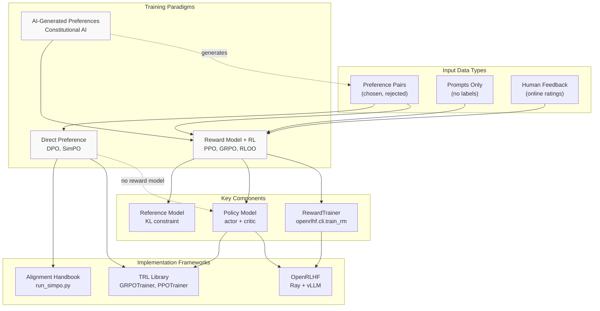

**Algorithm Comparison Matrix**

Sources: [06-post-training/simpo/SKILL.md](), [06-post-training/openrlhf/SKILL.md](), [06-post-training/grpo-rl-training/SKILL.md](), [07-safety-alignment/constitutional-ai/SKILL.md]()

---

## Method-by-Method Analysis

### PPO (Proximal Policy Optimization)

**Architecture**: Classic RLHF with four models: actor (policy), critic (value function), reference (KL anchor), and reward model.

#### Training Pipeline

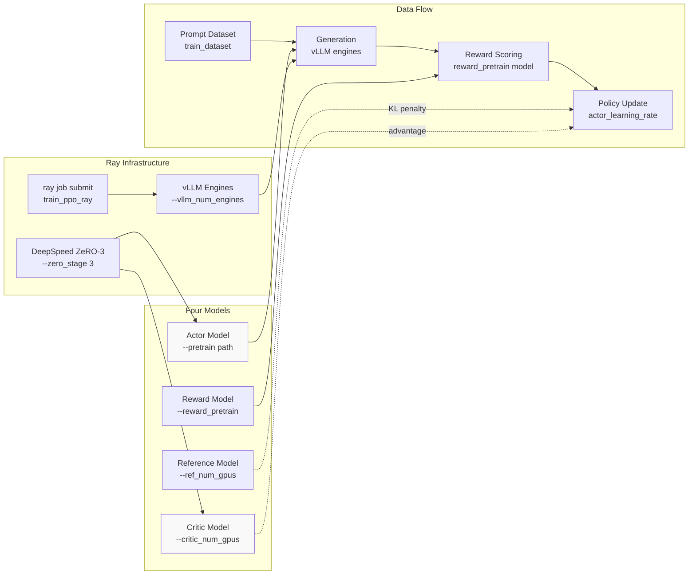

**Code Implementation**: OpenRLHF provides the most mature PPO implementation with vLLM acceleration.

**Key Configuration Parameters**:
- `--actor_num_nodes`, `--actor_num_gpus_per_node`: Actor model parallelism
- `--critic_num_nodes`, `--critic_num_gpus_per_node`: Critic model parallelism
- `--reward_num_nodes`, `--reward_num_gpus_per_node`: Reward model parallelism
- `--ref_num_nodes`, `--ref_num_gpus_per_node`: Reference model parallelism
- `--vllm_num_engines`, `--vllm_tensor_parallel_size`: vLLM inference config
- `--colocate_all_models`: Enable GPU sharing (Hybrid Engine)
- `--init_kl_coef`: KL divergence coefficient (typically 0.01-0.05)
- `--actor_learning_rate`, `--critic_learning_rate`: Separate LR for each model
- `--micro_train_batch_size`, `--train_batch_size`: Batch configuration
- `--micro_rollout_batch_size`, `--rollout_batch_size`: Rollout batch sizes

**Example Training Command**:

[06-post-training/openrlhf/SKILL.md:30-55]()

```bash
ray job submit --address="http://127.0.0.1:8265" \
  -- python3 -m openrlhf.cli.train_ppo_ray \
  --ref_num_nodes 1 --ref_num_gpus_per_node 8 \
  --reward_num_nodes 1 --reward_num_gpus_per_node 8 \
  --critic_num_nodes 1 --critic_num_gpus_per_node 8 \
  --actor_num_nodes 1 --actor_num_gpus_per_node 8 \
  --vllm_num_engines 4 --vllm_tensor_parallel_size 2 \
  --colocate_all_models \
  --pretrain OpenRLHF/Llama-3-8b-sft-mixture \
  --reward_pretrain OpenRLHF/Llama-3-8b-rm-700k \
  --init_kl_coef 0.01 --normalize_reward
```

**Hardware Requirements**:
- 7B model: 8× A100 40GB (Hybrid Engine with `--colocate_all_models`)
- 70B model: 48× A100 80GB (vLLM:Actor:Critic = 1:1:1 ratio)

**Performance**: 2× faster than DeepSpeedChat due to vLLM inference acceleration.

**When to Use**: Maximum control over RL process, complex reward functions, sufficient GPU resources available.

Sources: [06-post-training/openrlhf/SKILL.md:12-103]()

---

### GRPO (Group Relative Policy Optimization)

**Architecture**: Memory-efficient RL variant that eliminates the critic model by using group-normalized advantages.

#### GRPO vs PPO Architecture Comparison

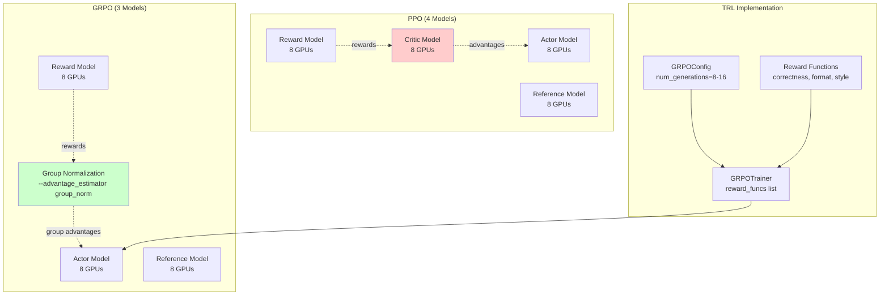

**Key Innovation**: Generates multiple completions per prompt (group size 4-16) and computes advantages by normalizing within each group, eliminating the need for a trained critic model.

**Configuration Parameters** (OpenRLHF implementation):
- `--advantage_estimator group_norm`: Enables GRPO
- `--use_kl_loss`: KL loss from GRPO paper
- `--kl_estimator k3`: Loss function variant (k2 ≈ k1)
- `--no_advantage_std_norm`: Disables standard deviation normalization

**Configuration Parameters** (TRL implementation):
- `num_generations`: Group size for comparison (8-16 recommended)
- `learning_rate`: 5e-6 to 1e-5
- `max_prompt_length`, `max_completion_length`: Sequence length limits
- `gradient_accumulation_steps`: For memory-constrained GPUs

**Example Training** (OpenRLHF):

[06-post-training/openrlhf/SKILL.md:109-127]()

```bash
ray job submit --address="http://127.0.0.1:8265" \
  -- python3 -m openrlhf.cli.train_ppo_ray \
  --advantage_estimator group_norm \
  --actor_num_nodes 1 --actor_num_gpus_per_node 8 \
  --reward_num_nodes 1 --reward_num_gpus_per_node 8 \
  --use_kl_loss --kl_estimator k3 \
  --normalize_reward --no_advantage_std_norm
```

**Example Training** (TRL):

[06-post-training/grpo-rl-training/SKILL.md:199-235]()

```python
from trl import GRPOConfig, GRPOTrainer

training_args = GRPOConfig(
    output_dir="outputs/grpo-model",
    learning_rate=5e-6,
    per_device_train_batch_size=1,
    gradient_accumulation_steps=4,
    num_generations=8,  # Group size
    max_prompt_length=256,
    max_completion_length=512,
    num_train_epochs=1,
    bf16=True,
    optim="adamw_8bit"
)

trainer = GRPOTrainer(
    model=model,
    processing_class=tokenizer,
    reward_funcs=[format_reward, correctness_reward],
    args=training_args,
    train_dataset=dataset
)
trainer.train()
```

**Reward Function Design**: GRPO excels with custom reward functions for format enforcement, correctness checking, and style guidance.

[06-post-training/grpo-rl-training/SKILL.md:120-191]()

```python
def correctness_reward(prompts, completions, answer, **kwargs):
    """Binary reward for correct answers."""
    responses = [comp[0]['content'] for comp in completions]
    extracted = [extract_final_answer(r) for r in responses]
    return [2.0 if ans == gt else 0.0 
            for ans, gt in zip(extracted, answer)]

def incremental_format_reward(completions, **kwargs):
    """Partial credit for format compliance."""
    responses = [comp[0]['content'] for comp in completions]
    rewards = []
    for r in responses:
        score = 0.0
        if '<reasoning>' in r: score += 0.25
        if '</reasoning>' in r: score += 0.25
        if '<answer>' in r: score += 0.25
        if '</answer>' in r: score += 0.25
        rewards.append(score)
    return rewards
```

**Hardware Requirements**:
- 7B model: 1× A100 40GB (with gradient checkpointing)
- Uses ~33% less memory than PPO (no critic model)

**When to Use**: Memory constraints, simpler setup than PPO, custom reward functions, reasoning tasks.

Sources: [06-post-training/openrlhf/SKILL.md:105-133](), [06-post-training/grpo-rl-training/SKILL.md:1-569]()

---

### DPO (Direct Preference Optimization)

**Architecture**: Directly optimizes policy from preference pairs without training a separate reward model. Uses a reference model for KL constraint.

#### DPO Training Flow

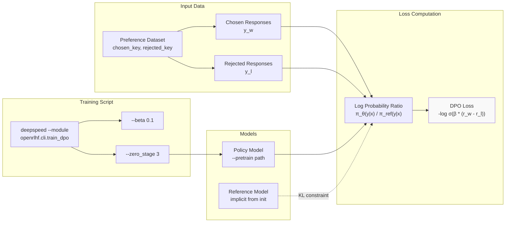

**Key Configuration Parameters**:
- `--beta`: Temperature parameter (typically 0.1, higher = more conservative)
- `--learning_rate`: 5e-7 (lower than SFT)
- `--dataset`: Preference dataset with `chosen_key` and `rejected_key`
- `--apply_chat_template`: Format conversations
- `--max_len`: Maximum sequence length

**Example Training**:

[06-post-training/openrlhf/SKILL.md:136-150]()

```bash
deepspeed --module openrlhf.cli.train_dpo \
  --save_path ./output/llama3-8b-dpo \
  --train_batch_size 256 \
  --micro_train_batch_size 2 \
  --pretrain meta-llama/Meta-Llama-3-8B \
  --beta 0.1 \
  --learning_rate 5e-7 \
  --dataset OpenRLHF/preference_dataset_mixture2_and_safe_pku \
  --apply_chat_template --chosen_key chosen --rejected_key rejected
```

**Hardware Requirements**:
- 7B model: 1× A100 40GB (DeepSpeed ZeRO-3)
- 70B model: 8× A100 80GB

**When to Use**: Have preference pairs, want simpler setup than PPO, established baseline method.

Sources: [06-post-training/openrlhf/SKILL.md:136-150]()

---

### SimPO (Simple Preference Optimization)

**Architecture**: Reference-free preference optimization that improves upon DPO by using length-normalized rewards and removing the reference model requirement.

#### SimPO vs DPO Architecture

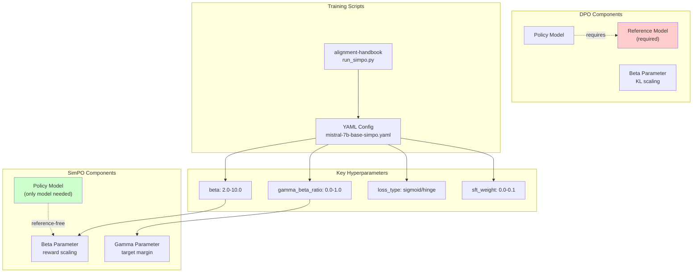

**Key Configuration Parameters**:

[06-post-training/simpo/SKILL.md:46-73]()

```yaml
# Model
model_name_or_path: mistralai/Mistral-7B-v0.1

# Dataset
dataset_mixer:
  HuggingFaceH4/ultrafeedback_binarized: 1.0

# SimPO hyperparameters
beta: 2.0                  # Reward scaling (2.0-10.0)
gamma_beta_ratio: 0.5      # Target margin (0-1)
loss_type: sigmoid         # sigmoid or hinge
sft_weight: 0.0            # SFT regularization

# Training
learning_rate: 5e-7        # Critical: 3e-7 to 1e-6
num_train_epochs: 1
per_device_train_batch_size: 1
gradient_accumulation_steps: 8
```

**Loss Functions**:
- **Sigmoid loss**: Standard choice, smooth gradients
- **Hinge loss**: Stops optimizing once margin achieved

**Hyperparameter Selection Guide**:

| Task Type | Beta | Gamma Ratio | Learning Rate | SFT Weight |
|-----------|------|-------------|---------------|------------|
| General chat | 2.0-2.5 | 0.5 | 5e-7 | 0.0 |
| Reasoning (math/code) | 5.0 | 0.7 | 3e-7 | 0.0 |
| Instruct model fine-tune | 2.5 | 0.5 | 5e-7 | 0.1 |

**Example Training**:

[06-post-training/simpo/SKILL.md:34-40]()

```bash
ACCELERATE_LOG_LEVEL=info accelerate launch \
  --config_file accelerate_configs/deepspeed_zero3.yaml \
  scripts/run_simpo.py \
  training_configs/mistral-7b-base-simpo.yaml
```

**Performance**: +6.4 points on AlpacaEval 2.0 vs DPO baseline, no reference model overhead.

**Hardware Requirements**:
- 7B model: 1× A100 40GB (DeepSpeed ZeRO-3)
- 8B model: 2× A100 40GB
- Single-node training sufficient

**When to Use**: Want simpler setup than DPO, limited compute, best performance on preference tasks.

Sources: [06-post-training/simpo/SKILL.md:1-220]()

---

### RLOO (Reinforce Leave-One-Out)

**Architecture**: PPO variant with per-token KL penalty and leave-one-out baseline for advantage estimation.

**Key Differences from PPO**:
- Per-token KL divergence instead of per-sequence
- Leave-one-out baseline reduces variance
- More stable training than standard PPO

**When to Use**: Need more stability than PPO, per-token control important.

Sources: [06-post-training/openrlhf/SKILL.md:163-166]()

---

### Constitutional AI (RLAIF)

**Architecture**: Two-phase training using AI-generated feedback instead of human labels. Phase 1: supervised self-critique and revision. Phase 2: RL from AI preferences.

#### Constitutional AI Pipeline

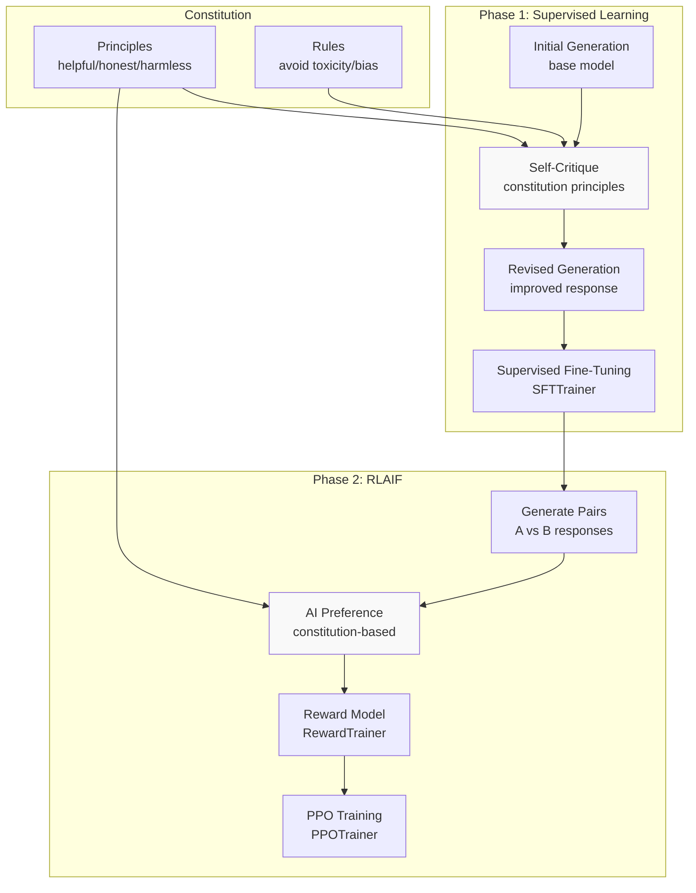

**Phase 1: Self-Critique and Revision**

[07-safety-alignment/constitutional-ai/SKILL.md:46-102]()

```python
# Generate initial response
initial_responses = generator(prompts, max_length=200)

# Self-critique with constitution
critique_prompt = """
Given the question: {question}
And the response: {response}

Constitution:
1. Choose responses that are helpful, honest, and harmless
2. Avoid toxic, racist, or sexist content

Identify any ways this response violates the constitution:
"""
critiques = generator([critique_prompt.format(q=q, r=r) 
                       for q, r in zip(prompts, initial_responses)])

# Revision based on critique
revision_prompt = """
Question: {question}
Original response: {response}
Critique: {critique}
Please revise the response to better align with the constitution:
"""
revised_responses = generator([revision_prompt.format(q=q, r=r, c=c)
                               for q, r, c in zip(prompts, responses, critiques)])

# Fine-tune on revised responses
trainer = SFTTrainer(model=model, train_dataset=revised_dataset)
trainer.train()
```

**Phase 2: RL from AI Feedback**

[07-safety-alignment/constitutional-ai/SKILL.md:104-174]()

```python
# Generate comparison pairs
responses_a = generator(prompts, do_sample=True, temperature=0.8)
responses_b = generator(prompts, do_sample=True, temperature=0.8)

# AI preference evaluation (no human labels!)
preference_prompt = """
Response A: {response_a}
Response B: {response_b}

Constitution: {constitution}

Which response better follows the constitution? Choose A or B.
"""
preferences = generator([preference_prompt.format(...)])
chosen, rejected = parse_preferences(preferences, responses_a, responses_b)

# Train preference model
reward_trainer = RewardTrainer(
    model=model,
    train_dataset=preference_dataset
)
reward_trainer.train()

# RL training with RLAIF
ppo_trainer = PPOTrainer(
    model=model,
    reward_model=reward_model,
    config=ppo_config
)
ppo_trainer.train()
```

**Hardware Requirements**:
- SL phase (7B): 1× A100 40GB
- RL phase (7B): 2× A100 40GB (policy + reward model)

**When to Use**: Want safety alignment without human labels, need explainable AI decisions, scalable safety training.

Sources: [07-safety-alignment/constitutional-ai/SKILL.md:1-291]()

---

## Algorithm Comparison Table

| Method | Reference Model | Reward Model | Critic Model | Memory (7B) | Training Speed | Performance | Complexity |
|--------|----------------|--------------|--------------|-------------|----------------|-------------|------------|
| **PPO** | ✅ Required | ✅ Required | ✅ Required | 8× A100 40GB | Baseline (1.0×) | Very Good | High |
| **GRPO** | ✅ Required | ✅ Required | ❌ None | 5× A100 40GB | 1.2× faster | Very Good | Medium |
| **RLOO** | ✅ Required | ✅ Required | ❌ None | 5× A100 40GB | 1.1× faster | Very Good | Medium |
| **DPO** | ✅ Required | ❌ None | ❌ None | 1× A100 40GB | 3× faster | Good | Low |
| **SimPO** | ❌ None | ❌ None | ❌ None | 1× A100 40GB | 3× faster | Very Good | Low |
| **RLAIF** | ✅ Required | ✅ (AI-trained) | ✅ Required | 8× A100 40GB | 0.9× (slower) | Very Good | High |

Sources: [06-post-training/simpo/SKILL.md](), [06-post-training/openrlhf/SKILL.md](), [06-post-training/grpo-rl-training/SKILL.md](), [07-safety-alignment/constitutional-ai/SKILL.md]()

---

## Implementation Framework Selection

### OpenRLHF (Ray + vLLM)

**Best For**: Large-scale multi-node RL training (PPO, GRPO, RLOO, DPO)

**Key Features**:
- Ray-based distributed architecture
- vLLM inference acceleration (2× faster than DeepSpeedChat)
- Hybrid Engine with GPU sharing (`--colocate_all_models`)
- Multi-node scaling with fault tolerance

**Code Architecture**:

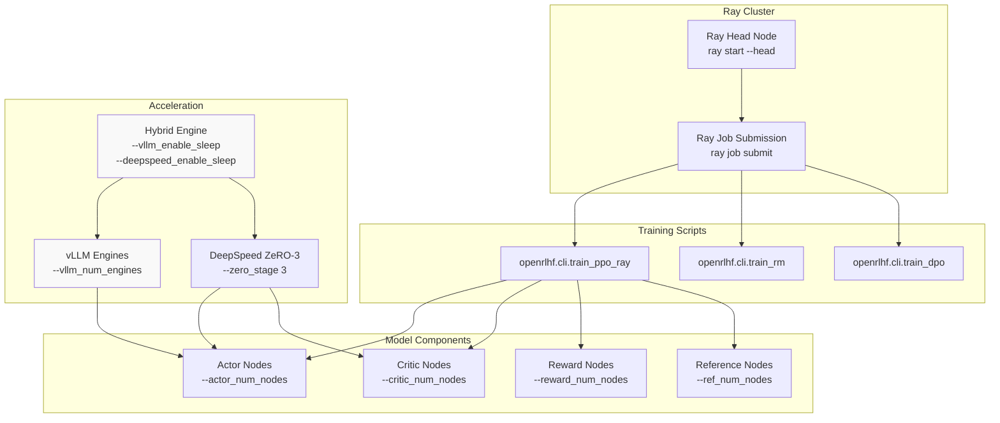

**Installation**:

[06-post-training/openrlhf/SKILL.md:17-28]()

```bash
docker run --runtime=nvidia -it --rm --shm-size="10g" \
  -v $PWD:/openrlhf nvcr.io/nvidia/pytorch:25.02-py3 bash
pip install openrlhf[vllm]
```

**When to Use**: Multi-node GPU cluster, need vLLM acceleration, 70B+ models.

Sources: [06-post-training/openrlhf/SKILL.md:12-247]()

---

### TRL (Transformers Reinforcement Learning)

**Best For**: Single-node training, research experimentation, custom reward functions

**Key Features**:
- `GRPOTrainer`, `PPOTrainer`, `RewardTrainer` classes
- Custom reward function support
- Unsloth integration for 2-3× speedup
- Simple API for quick prototyping

**Code Architecture**:

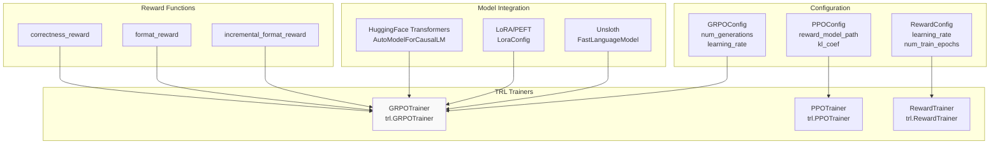

**Example GRPO Setup**:

[06-post-training/grpo-rl-training/SKILL.md:267-318]()

```python
from transformers import AutoModelForCausalLM, AutoTokenizer
from peft import LoraConfig
from trl import GRPOTrainer, GRPOConfig

# Load model
model = AutoModelForCausalLM.from_pretrained(
    "Qwen/Qwen2.5-1.5B-Instruct",
    torch_dtype=torch.bfloat16,
    attn_implementation="flash_attention_2"
)

# LoRA config
peft_config = LoraConfig(
    r=16, lora_alpha=32,
    target_modules=["q_proj", "k_proj", "v_proj", "o_proj"]
)

# Training config
training_args = GRPOConfig(
    output_dir="outputs/grpo",
    learning_rate=5e-6,
    num_generations=8,
    bf16=True
)

# Initialize trainer
trainer = GRPOTrainer(
    model=model,
    processing_class=tokenizer,
    reward_funcs=[format_reward, correctness_reward],
    args=training_args,
    train_dataset=dataset,
    peft_config=peft_config
)

trainer.train()
```

**When to Use**: Single-node training, custom reward functions, rapid prototyping, research.

Sources: [06-post-training/grpo-rl-training/SKILL.md:1-569]()

---

### Alignment Handbook (SimPO)

**Best For**: Preference optimization (SimPO, DPO) with production-ready recipes

**Key Features**:
- YAML-based configuration
- Pre-tuned recipes for different model sizes
- DeepSpeed ZeRO-3 integration
- Accelerate multi-GPU support

**Code Architecture**:

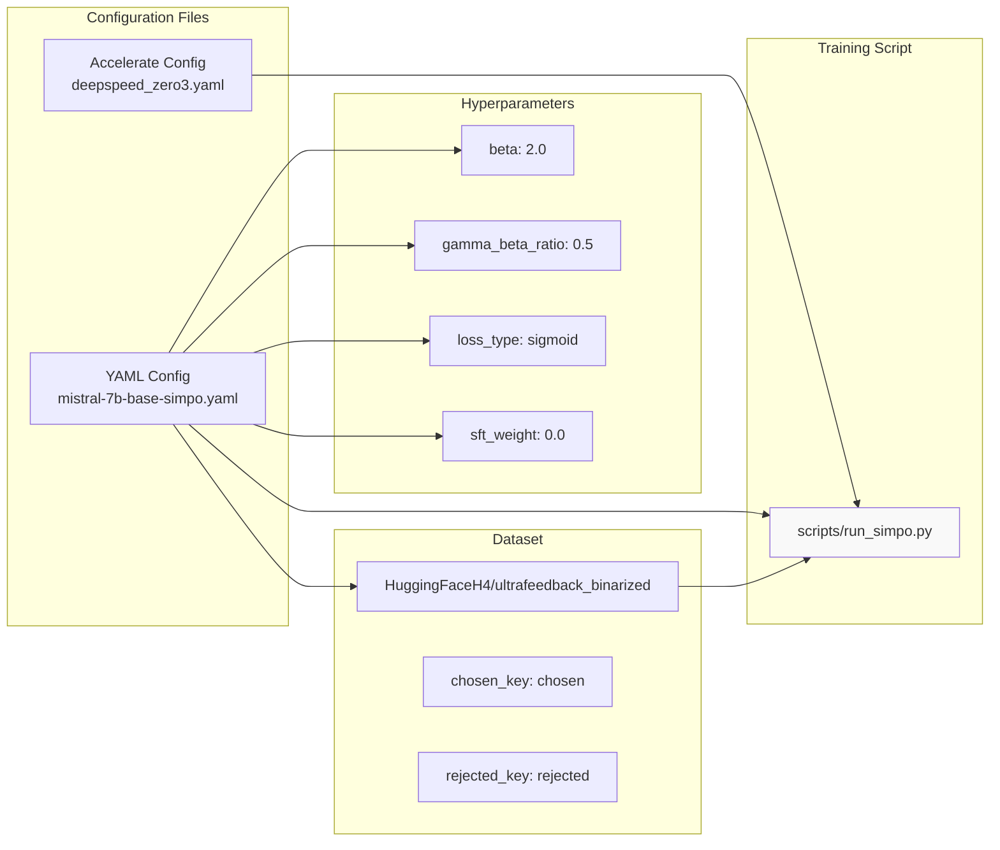

**Example Configuration**:

[06-post-training/simpo/SKILL.md:46-73]()

```yaml
model_name_or_path: mistralai/Mistral-7B-v0.1
torch_dtype: bfloat16

dataset_mixer:
  HuggingFaceH4/ultrafeedback_binarized: 1.0

beta: 2.0
gamma_beta_ratio: 0.5
loss_type: sigmoid
sft_weight: 0.0

learning_rate: 5e-7
num_train_epochs: 1
per_device_train_batch_size: 1
gradient_accumulation_steps: 8
```

**When to Use**: SimPO/DPO training, production-ready recipes, established baselines.

Sources: [06-post-training/simpo/SKILL.md:17-105]()

---

## Reward Function Design Patterns

### Compositional Reward Architecture

Multiple reward functions can be combined to create complex behaviors. Each function targets a specific aspect: format, correctness, length, style.

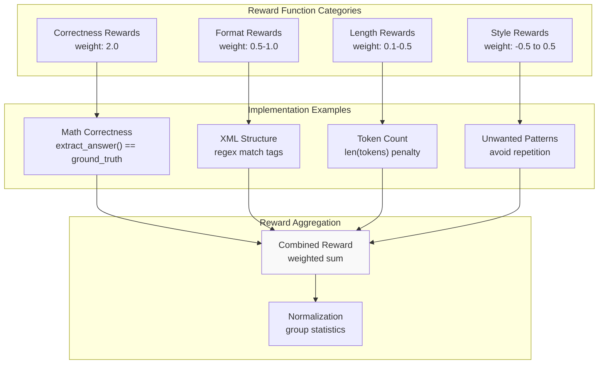

**Template Structure**:

[06-post-training/grpo-rl-training/SKILL.md:120-142]()

```python
def reward_function_name(
    prompts,        # List[List[Dict]]: Original prompts
    completions,    # List[List[Dict]]: Model generations
    answer=None,    # Optional: Ground truth from dataset
    **kwargs        # Additional dataset columns
) -> list[float]:
    """Evaluate completions and return rewards."""
    responses = [comp[0]['content'] for comp in completions]
    rewards = []
    for response in responses:
        score = compute_score(response)
        rewards.append(score)
    return rewards
```

**Correctness Reward** (binary, high weight):

[06-post-training/grpo-rl-training/SKILL.md:144-153]()

```python
def correctness_reward(prompts, completions, answer, **kwargs):
    """Reward correct answers with high score."""
    responses = [comp[0]['content'] for comp in completions]
    extracted = [extract_final_answer(r) for r in responses]
    return [2.0 if ans == gt else 0.0
            for ans, gt in zip(extracted, answer)]
```

**Incremental Format Reward** (partial credit):

[06-post-thinking/grpo-rl-training/SKILL.md:167-191]()

```python
def incremental_format_reward(completions, **kwargs):
    """Award partial credit for format compliance."""
    responses = [comp[0]['content'] for comp in completions]
    rewards = []
    for r in responses:
        score = 0.0
        if '<reasoning>' in r: score += 0.25
        if '</reasoning>' in r: score += 0.25
        if '<answer>' in r: score += 0.25
        if '</answer>' in r: score += 0.25
        # Penalize extra text after closing tag
        if r.count('</answer>') == 1:
            extra_text = r.split('</answer>')[-1].strip()
            score -= len(extra_text) * 0.001
        rewards.append(score)
    return rewards
```

**Reward Weight Recommendations**:

| Reward Type | Weight Range | Priority | Example |
|-------------|--------------|----------|---------|
| Correctness | 1.5 - 2.0 | Highest | Math answer accuracy |
| Format (strict) | 0.8 - 1.0 | High | XML tag structure |
| Format (incremental) | 0.5 - 0.8 | Medium | Partial tag compliance |
| Length | 0.1 - 0.3 | Low | Penalize verbosity |
| Style | -0.5 - 0.5 | Variable | Avoid repetition |

Sources: [06-post-training/grpo-rl-training/SKILL.md:120-195]()

---

## Training Metrics and Debugging

### Expected Metric Behavior

**CRITICAL**: GRPO/PPO loss increases during training. This is correct behavior.

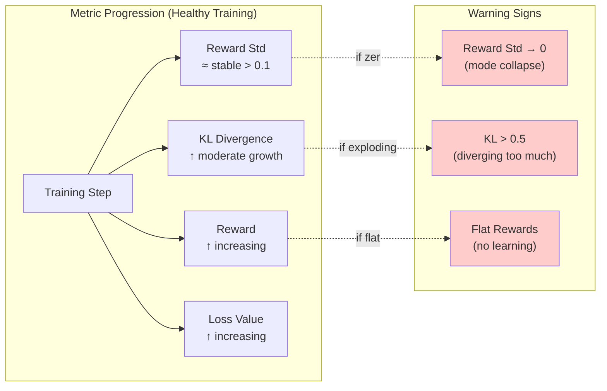

**Healthy Training Pattern**:

[06-post-training/grpo-rl-training/SKILL.md:360-374]()

```
Step   Reward    Reward_Std   KL
100    0.5       0.3          0.02
200    0.8       0.25         0.05
300    1.2       0.2          0.08  ← Good progression
400    1.5       0.15         0.12
```

**Key Insights**:
- Loss measures KL divergence from initial policy (expected to increase)
- Monitor reward progression, not loss
- Reward standard deviation should stay > 0.1
- KL divergence should grow moderately (< 0.5)

Sources: [06-post-training/grpo-rl-training/SKILL.md:345-374]()

---

### Common Training Issues

| Problem | Symptom | Solution |
|---------|---------|----------|
| **Mode collapse** | All completions identical, reward_std → 0 | Increase `num_generations`, add diversity penalty |
| **No learning** | Flat rewards across steps | Check reward function logic, increase learning rate |
| **OOM errors** | GPU memory exceeded | Reduce `num_generations`, enable gradient checkpointing |
| **Slow training** | < 1 iteration/second | Enable `use_vllm=True`, use Unsloth, reduce sequence length |
| **Format ignored** | Model doesn't follow structure | Increase format reward weight, add incremental rewards |
| **Training instability** | Reward oscillations, KL spikes | Reduce learning rate, adjust `init_kl_coef` |
| **DeepSpeed GPU index error** | Ray + DeepSpeed conflict | `export RAY_EXPERIMENTAL_NOSET_CUDA_VISIBLE_DEVICES=1` |

Sources: [06-post-training/grpo-rl-training/SKILL.md:376-382](), [06-post-training/openrlhf/SKILL.md:175-206]()

---

## Hardware Requirements and Performance

### Memory Requirements by Model Size

| Model Size | Method | Configuration | VRAM Required |
|------------|--------|---------------|---------------|
| 7B | PPO | 4 models (actor, critic, ref, reward) | 8× A100 40GB |
| 7B | PPO | Hybrid Engine (`--colocate_all_models`) | 8× A100 40GB |
| 7B | GRPO | 3 models (actor, ref, reward) | 5× A100 40GB |
| 7B | DPO | 2 models (policy, reference) | 1× A100 40GB |
| 7B | SimPO | 1 model (policy only) | 1× A100 40GB |
| 70B | PPO | Hybrid Engine with vLLM | 48× A100 80GB |
| 70B | DPO | DeepSpeed ZeRO-3 | 8× A100 80GB |

Sources: [06-post-training/openrlhf/SKILL.md:229-240](), [06-post-training/simpo/SKILL.md:197-205](), [06-post-training/grpo-rl-training/SKILL.md]()

---

### Training Speed Comparison

**Relative Speed** (normalized to PPO baseline):

| Method | Speed | Reason |
|--------|-------|--------|
| PPO | 1.0× | Baseline (4 models, critic overhead) |
| GRPO | 1.2× | No critic model, simpler gradient flow |
| RLOO | 1.1× | Similar to GRPO, per-token KL overhead |
| DPO | 3.0× | No reward model, direct optimization |
| SimPO | 3.0× | No reference model, minimal overhead |
| RLAIF | 0.9× | AI evaluation overhead for preferences |

**OpenRLHF Performance**: 2× faster than DeepSpeedChat due to vLLM inference acceleration.

Sources: [06-post-training/openrlhf/SKILL.md:237-240]()

---

### vLLM Integration for Faster Generation

OpenRLHF's key performance advantage comes from vLLM-accelerated generation during rollouts.

**Configuration**:

[06-post-training/openrlhf/SKILL.md:208-215]()

```bash
--vllm_num_engines 4 \              # Number of vLLM instances
--vllm_tensor_parallel_size 2 \     # TP for each engine
--vllm_gpu_memory_utilization 0.5   # Memory fraction
```

**Hybrid Engine** (GPU sharing between vLLM and DeepSpeed):

[06-post-training/openrlhf/SKILL.md:195-201]()

```bash
--colocate_all_models \             # Enable GPU sharing
--vllm_enable_sleep \               # vLLM sleeps when not generating
--deepspeed_enable_sleep            # DeepSpeed sleeps during generation
```

This minimizes GPU idle time by alternating between generation (vLLM) and training (DeepSpeed).

Sources: [06-post-training/openrlhf/SKILL.md:195-215]()

---

## Dataset Preparation

### Preference Dataset Format

**DPO/SimPO Requirements**:
- `chosen` column: Preferred response
- `rejected` column: Dis-preferred response
- Chat format: List of dicts with `role` and `content`

[06-post-training/openrlhf/SKILL.md:140-149]()

```python
{
  "prompt": [
    {"role": "system", "content": "You are a helpful assistant."},
    {"role": "user", "content": "What is 2+2?"}
  ],
  "chosen": "2+2 equals 4.",
  "rejected": "I don't know."
}
```

**Common Datasets**:
- `HuggingFaceH4/ultrafeedback_binarized`: General instructions
- `argilla/ultrafeedback-binarized-preferences-cleaned`: Cleaned version
- `OpenRLHF/preference_dataset_mixture2_and_safe_pku`: Multi-domain mix

Sources: [06-post-training/openrlhf/SKILL.md:69-78](), [06-post-training/simpo/SKILL.md:52-57]()

---

### GRPO Dataset Format

**Requirements**:
- `prompt` column: Chat-formatted prompt (List[Dict])
- Optional: Ground truth columns for reward functions (e.g., `answer`)

[06-post-training/grpo-rl-training/SKILL.md:83-111]()

```python
SYSTEM_PROMPT = """
Respond in the following format:
<reasoning>
[Your step-by-step thinking]
</reasoning>
<answer>
[Final answer]
</answer>
"""

dataset = raw_data.map(lambda x: {
    'prompt': [
        {'role': 'system', 'content': SYSTEM_PROMPT},
        {'role': 'user', 'content': x['question']}
    ],
    'answer': extract_answer(x['raw_answer'])
})
```

**Dataset Validation**:
- Validate format before training
- Check `max_prompt_length` from data statistics
- Ensure ground truth columns exist for reward functions

Sources: [06-post-training/grpo-rl-training/SKILL.md:75-117]()

---

## Production Deployment Considerations

### Model Saving and Merging

**LoRA Adapter Merging**:

[06-post-training/grpo-rl-training/SKILL.md:450-456]()

```python
# Merge LoRA adapters into base model
if hasattr(trainer.model, 'merge_and_unload'):
    merged_model = trainer.model.merge_and_unload()
    merged_model.save_pretrained("production_model")
    tokenizer.save_pretrained("production_model")
```

**Inference Setup**:

[06-post-training/grpo-rl-training/SKILL.md:458-479]()

```python
from transformers import pipeline

generator = pipeline(
    "text-generation",
    model="production_model",
    tokenizer=tokenizer
)

result = generator(
    [
        {'role': 'system', 'content': SYSTEM_PROMPT},
        {'role': 'user', 'content': "What is 15 + 27?"}
    ],
    max_new_tokens=256,
    temperature=0.7
)
```

Sources: [06-post-training/grpo-rl-training/SKILL.md:447-479]()

---

### Multi-Node Scaling (OpenRLHF)

**Ray Cluster Setup**:

```bash
# Head node
ray start --head --node-ip-address 0.0.0.0 --num-gpus 8

# Worker nodes
ray start --address=<head-node-ip>:6379 --num-gpus 8

# Submit training job
ray job submit --address="http://<head-node-ip>:8265" \
  -- python3 -m openrlhf.cli.train_ppo_ray ...
```

**Node Allocation Strategy** (70B model):
- vLLM engines: 1/3 of total GPUs
- Actor model: 1/3 of total GPUs
- Critic model: 1/3 of total GPUs

Sources: [06-post-training/openrlhf/SKILL.md:30-55]()

---

## Best Practices Summary

### Algorithm Selection Decision Tree

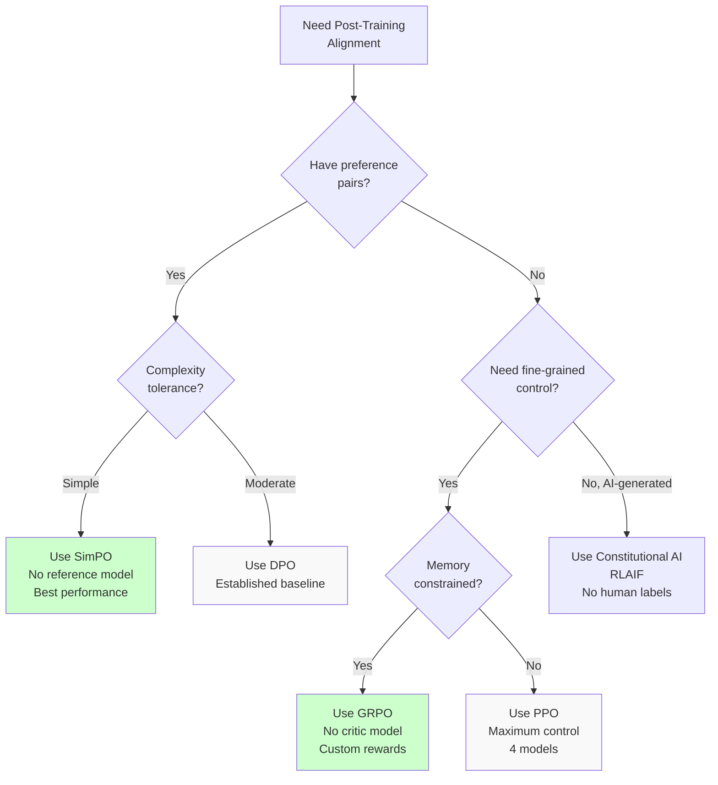

Sources: [06-post-training/simpo/SKILL.md:127-145](), [06-post-training/openrlhf/SKILL.md:152-173](), [06-post-training/grpo-rl-training/SKILL.md](), [07-safety-alignment/constitutional-ai/SKILL.md:199-219]()

---

### Pre-Training Checklist

- [ ] Validate dataset format (chat template, required columns)
- [ ] Test reward functions on sample data (GRPO/PPO)
- [ ] Calculate `max_prompt_length` from data statistics
- [ ] Choose `num_generations` based on GPU memory
- [ ] Set up logging infrastructure (wandb, tensorboard)
- [ ] Verify GPU availability and Ray cluster (OpenRLHF)
- [ ] Enable Flash Attention 2 for 2-3× speedup
- [ ] Configure gradient checkpointing if memory-constrained

Sources: [06-post-training/grpo-rl-training/SKILL.md:485-491]()

---

### During Training Checklist

- [ ] Monitor reward progression (should increase)
- [ ] Check `reward_std` (should stay > 0.1, avoid mode collapse)
- [ ] Watch KL divergence (should grow moderately, < 0.5)
- [ ] Sample generations every 50-100 steps
- [ ] Validate format compliance on holdout set
- [ ] Check for OOM errors (reduce batch size if needed)
- [ ] Verify vLLM engines are active (OpenRLHF)

Sources: [06-post-training/grpo-rl-training/SKILL.md:492-498]()

---

### Post-Training Checklist

- [ ] Merge LoRA weights if using PEFT
- [ ] Test on diverse prompts (in-distribution and OOD)
- [ ] Compare to baseline model (reward metrics)
- [ ] Benchmark inference latency
- [ ] Document hyperparameters and reward weights
- [ ] Save reproducibility config (YAML, command line args)
- [ ] Create deployment artifacts (merged model, tokenizer)

Sources: [06-post-training/grpo-rl-training/SKILL.md:499-505]()

---

## Advanced Topics

### Multi-Stage Training

For complex tasks requiring both format compliance and correctness, train in stages with different reward functions.

[06-post-training/grpo-rl-training/SKILL.md:388-408]()

```python
# Stage 1: Format compliance (epochs=1)
trainer_stage1 = GRPOTrainer(
    model=model,
    reward_funcs=[incremental_format_reward, format_reward],
    args=GRPOConfig(num_train_epochs=1, ...)
)
trainer_stage1.train()

# Stage 2: Correctness (epochs=1)
trainer_stage2 = GRPOTrainer(
    model=model,
    reward_funcs=[format_reward, correctness_reward],
    args=GRPOConfig(num_train_epochs=1, ...)
)
trainer_stage2.train()
```

Sources: [06-post-training/grpo-rl-training/SKILL.md:388-408]()

---

### Chain-of-Thought Critique (Constitutional AI)

Enable reasoning transparency in AI-generated critiques.

[07-safety-alignment/constitutional-ai/SKILL.md:176-197]()

```python
cot_critique_prompt = """
Question: {question}
Response: {response}

Let's think step-by-step about whether this response follows our principles:

1. Is it helpful? [Yes/No and reasoning]
2. Is it honest? [Yes/No and reasoning]
3. Is it harmless? [Yes/No and reasoning]
4. Does it avoid toxicity? [Yes/No and reasoning]

Based on this analysis, suggest a revision if needed.
"""

cot_critiques = generator(
    [cot_critique_prompt.format(q=q, r=r) for q, r in zip(prompts, responses)]
)
```

Sources: [07-safety-alignment/constitutional-ai/SKILL.md:176-197]()

---

## References and Resources

### Framework Documentation

- **OpenRLHF**: https://github.com/OpenRLHF/OpenRLHF
  - Paper: https://arxiv.org/abs/2405.11143
  - Discord: Community support

- **TRL**: https://huggingface.co/docs/trl/
  - GRPO Trainer: https://huggingface.co/docs/trl/grpo_trainer
  - Examples: https://github.com/huggingface/trl/tree/main/examples

- **Alignment Handbook**: https://github.com/huggingface/alignment-handbook
  - SimPO recipes: Pre-configured training setups

### Research Papers

- **SimPO**: https://arxiv.org/abs/2405.14734 (NeurIPS 2024)
- **Constitutional AI**: https://arxiv.org/abs/2212.08073 (Anthropic, Dec 2022)
- **DPO**: Direct Preference Optimization paper
- **GRPO**: Group Relative Policy Optimization
- **DeepSeek R1**: https://arxiv.org/abs/2501.12948 (GRPO application)

### Model Collections

- **OpenRLHF Models**: https://huggingface.co/OpenRLHF
  - Llama-3-8b-sft-mixture
  - Llama-3-8b-rm-700k

- **SimPO Models**: https://huggingface.co/princeton-nlp
  - AlpacaEval 2.0 leaderboard submissions

### Related Skills

- For supervised fine-tuning, see [Fine-Tuning Skills](#2.3)
- For runtime safety, see [Safety Systems](#3.8)
- For distributed training infrastructure, see [DeepSpeed](#3.2)
- For evaluation, see [Evaluation Skills](#2.7)

Sources: [06-post-training/openrlhf/SKILL.md:242-247](), [06-post-training/simpo/SKILL.md:212-217](), [06-post-training/grpo-rl-training/SKILL.md:533-548](), [07-safety-alignment/constitutional-ai/SKILL.md:283-288]()

---

