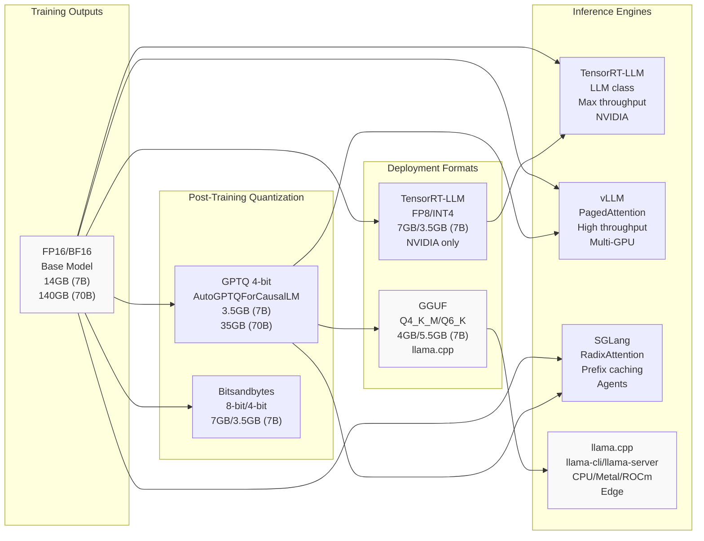
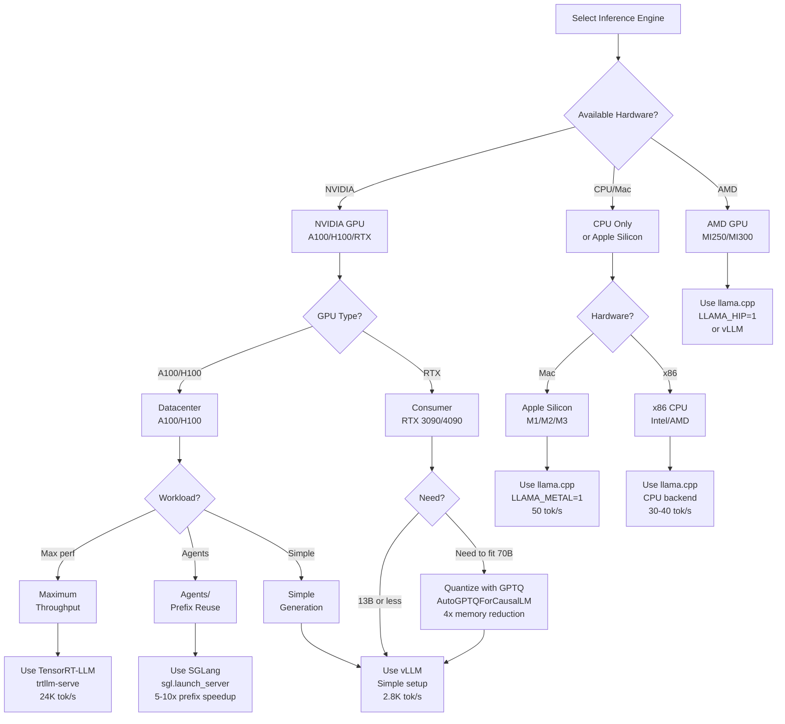
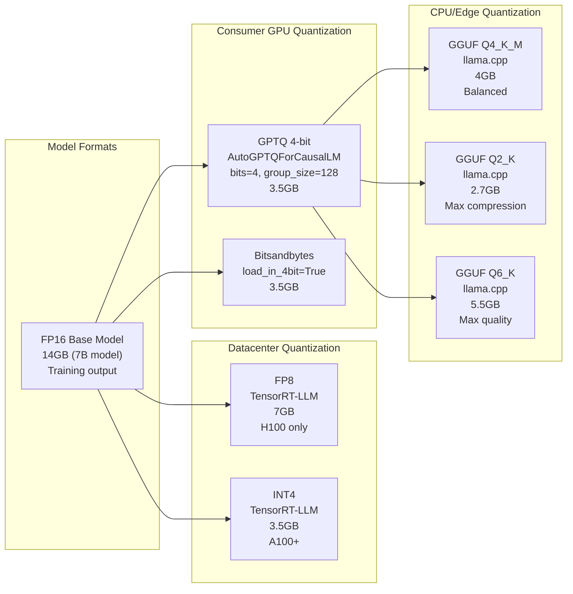
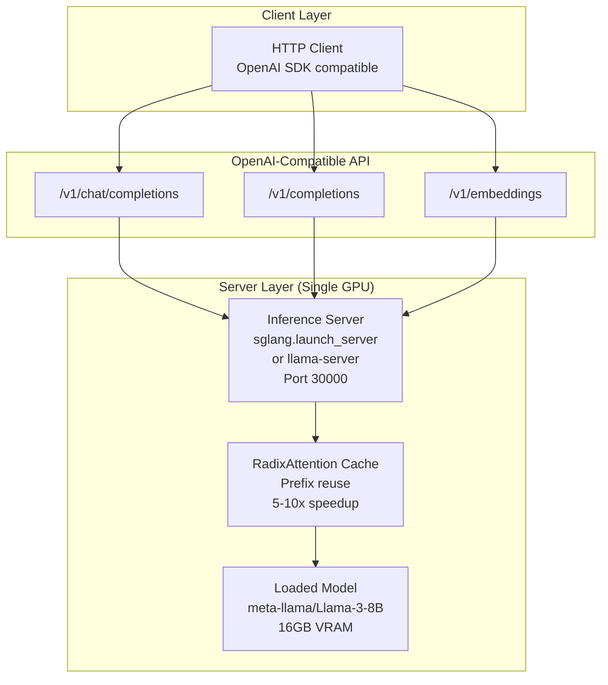
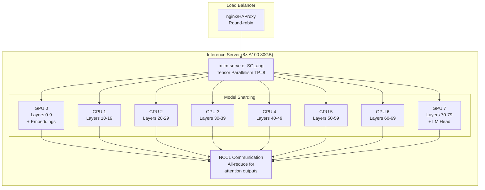
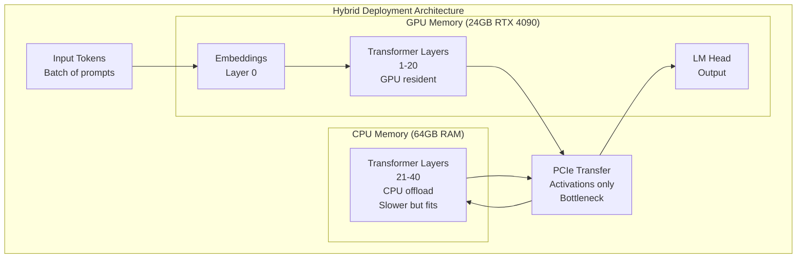
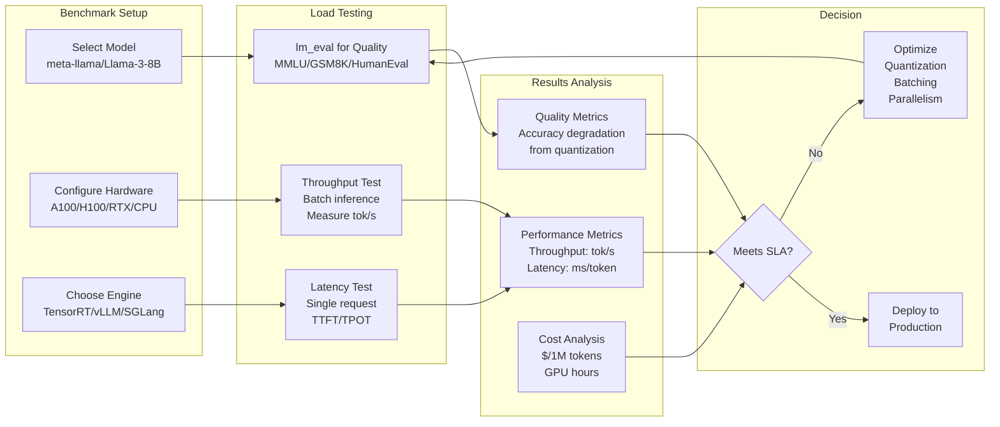
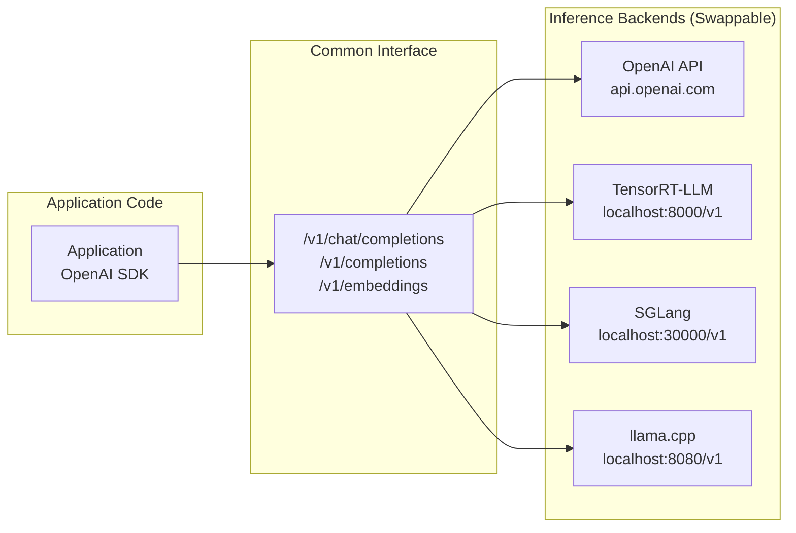
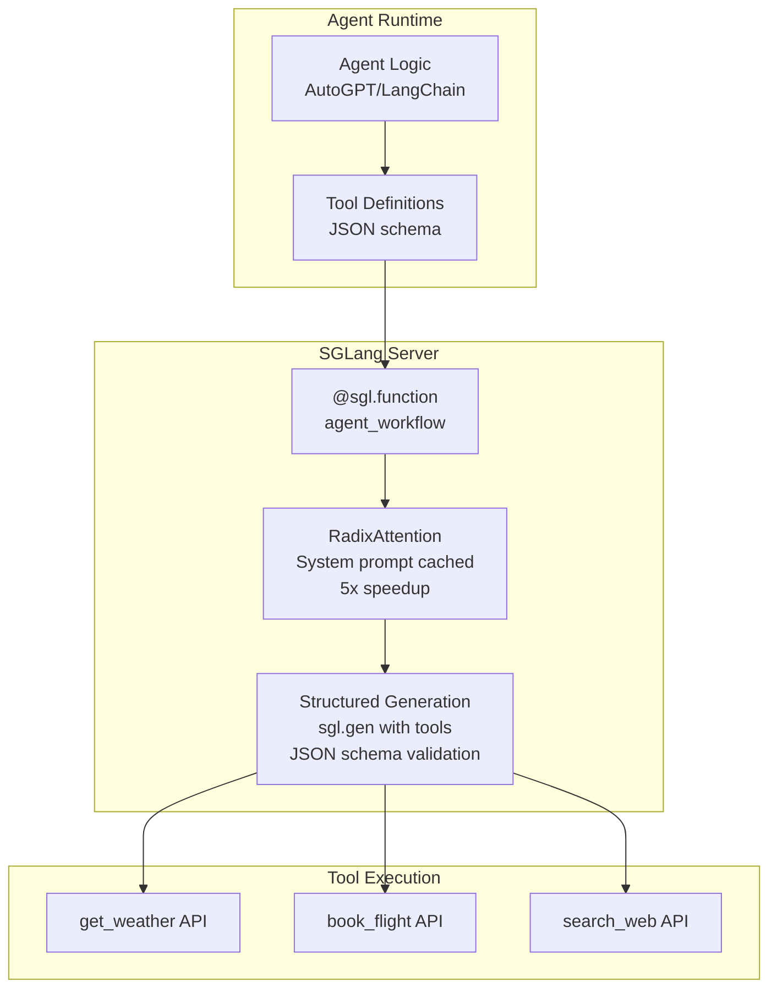

<!-- source: DeepWiki mcp.deepwiki.com · repo zechenzhangAGI/AI-research-SKILLs · page 4 Inference & Deployment Patterns · fetched 2026-10-26 -->

# Inference & Deployment Patterns

<details>
<summary>Relevant source files</summary>

The following files were used as context for generating this wiki page:

- [10-optimization/gptq/SKILL.md](10-optimization/gptq/SKILL.md)
- [11-evaluation/lm-evaluation-harness/SKILL.md](11-evaluation/lm-evaluation-harness/SKILL.md)
- [12-inference-serving/llama-cpp/SKILL.md](12-inference-serving/llama-cpp/SKILL.md)
- [12-inference-serving/sglang/SKILL.md](12-inference-serving/sglang/SKILL.md)
- [12-inference-serving/tensorrt-llm/SKILL.md](12-inference-serving/tensorrt-llm/SKILL.md)

</details>


This document covers best practices for deploying LLMs in production across different hardware configurations and performance requirements. It provides decision frameworks for selecting inference engines, quantization strategies, and deployment architectures based on your constraints (latency, throughput, hardware, cost).

**Scope**: This page focuses on inference-time deployment patterns. For training and optimization, see [Training & Fine-Tuning Skills](#2.3) and [Optimization Skills](#2.6). For specific inference engine implementations, see [Inference & Serving Skills](#2.8). For production monitoring, see [Production Observability with Phoenix](#4.3).

## Model Format Transformation Pipeline

LLM deployment begins with model format conversion. The format you choose determines which inference engines you can use and what hardware you can target.



**Key Format Decision Points**:

| Starting Point | Target Hardware | Recommended Path | Inference Engine |
|---------------|-----------------|------------------|------------------|
| FP16 Base Model | NVIDIA A100/H100 | FP16 → TensorRT-LLM FP8 | TensorRT-LLM |
| FP16 Base Model | Multi-GPU NVIDIA | FP16 → vLLM | vLLM |
| FP16 Base Model | Agents/Prefix Reuse | FP16 → SGLang | SGLang |
| FP16 Base Model | CPU/Apple Silicon | FP16 → GPTQ → GGUF | llama.cpp |
| FP16 Base Model | Consumer GPU (RTX) | FP16 → GPTQ | vLLM or llama.cpp |

**Sources**: [12-inference-serving/tensorrt-llm/SKILL.md:1-187](), [12-inference-serving/sglang/SKILL.md:1-443](), [12-inference-serving/llama-cpp/SKILL.md:1-259](), [10-optimization/gptq/SKILL.md:1-451]()

## Inference Engine Architecture Comparison

Each inference engine optimizes for different bottlenecks. Understanding their architectural differences is critical for deployment decisions.


**Architectural Differentiators**:

**TensorRT-LLM** [`tensorrt_llm.LLM`]:
- **Optimization**: Compiled CUDA kernels, FP8 on H100
- **Batching**: In-flight batching (continuous)
- **Strength**: Absolute maximum throughput on NVIDIA
- **Limitation**: NVIDIA GPUs only, complex setup

**vLLM** [PagedAttention]:
- **Optimization**: PagedAttention (non-contiguous KV blocks)
- **Batching**: Continuous batching
- **Strength**: Simple Python API, stable production
- **Limitation**: Lower throughput than TensorRT-LLM

**SGLang** [`sgl.function`, `sgl.gen`, RadixAttention]:
- **Optimization**: RadixAttention (automatic prefix caching)
- **Batching**: Continuous with prefix reuse
- **Strength**: 5-10× faster for agents/few-shot
- **Limitation**: Newer system, less battle-tested

**llama.cpp** [`llama-cli`, `llama-server`]:
- **Optimization**: GGUF quantization, CPU/Metal kernels
- **Batching**: Simple batching
- **Strength**: Runs anywhere (CPU/Metal/ROCm)
- **Limitation**: Slower than GPU solutions

**Sources**: [12-inference-serving/tensorrt-llm/SKILL.md:92-110](), [12-inference-serving/sglang/SKILL.md:117-143](), [12-inference-serving/llama-cpp/SKILL.md:34-104]()

## Hardware-to-Engine Decision Matrix

The optimal inference engine depends on your available hardware. This matrix provides concrete recommendations.



**Decision Table**:

| Hardware | Model Size | Workload | Recommended Engine | Command |
|----------|-----------|----------|-------------------|---------|
| H100 GPU | Any | Max throughput | TensorRT-LLM | `trtllm-serve model --tp_size 4` |
| A100 GPU (8×) | 70B+ | General | vLLM | `python -m vllm.entrypoints.openai.api_server` |
| A100 GPU | 7-70B | Agents/Tools | SGLang | `python -m sglang.launch_server --enable-radix-cache` |
| RTX 4090 | 70B | Need to fit | GPTQ + vLLM | `AutoGPTQForCausalLM.from_quantized()` |
| RTX 3090/4090 | 7-13B | General | vLLM | `python -m vllm.entrypoints.openai.api_server` |
| M3 Max | 7-13B | Local/Edge | llama.cpp | `make LLAMA_METAL=1; ./llama-server -ngl 999` |
| Intel/AMD CPU | 7B | Edge/Server | llama.cpp | `./llama-server --threads 32` |
| AMD MI300 | Any | General | llama.cpp (ROCm) | `make LLAMA_HIP=1` |

**Sources**: [12-inference-serving/tensorrt-llm/SKILL.md:16-33](), [12-inference-serving/sglang/SKILL.md:16-33](), [12-inference-serving/llama-cpp/SKILL.md:16-33](), [10-optimization/gptq/SKILL.md:16-32]()

## Quantization Strategy by Deployment Target

Quantization reduces model size and increases speed, but introduces quality degradation. The optimal quantization depends on your deployment constraints.

### Quantization Format Mapping



### Quantization Decision Table

| Deployment Target | Model Size | Quantization | Format | Quality Loss | Speed Gain | Code Reference |
|------------------|-----------|--------------|---------|-------------|-----------|----------------|
| H100 datacenter | 7-70B | FP8 | TensorRT-LLM | <1% | 2× | `dtype="fp8"` in `LLM()` |
| A100 datacenter | 70B+ | INT4 | TensorRT-LLM | 1-2% | 4× | `dtype="int4"` |
| RTX 4090 | 70B | GPTQ 4-bit | group_size=128 | 1.5% | 3-4× | `BaseQuantizeConfig(bits=4, group_size=128)` |
| RTX 3090 | 13B | GPTQ 4-bit | group_size=128 | 1.5% | 3-4× | Same as above |
| M3 Max | 7-13B | GGUF Q4_K_M | llama.cpp | 2% | 4-10× vs FP16 | `Q4_K_M.gguf` |
| Raspberry Pi | 7B | GGUF Q2_K | llama.cpp | 5-8% | 10× | `Q2_K.gguf` |
| CPU server (quality) | 7B | GGUF Q6_K | llama.cpp | <1% | 2× | `Q6_K.gguf` |

**Quantization Code Patterns**:

**GPTQ Quantization** [10-optimization/gptq/SKILL.md:76-116]():
```python
from auto_gptq import AutoGPTQForCausalLM, BaseQuantizeConfig

# Quantize for consumer GPU deployment
config = BaseQuantizeConfig(
    bits=4,              # 4-bit quantization
    group_size=128,      # Recommended default
    desc_act=False,      # Faster CUDA kernel
    damp_percent=0.01
)

model = AutoGPTQForCausalLM.from_pretrained(
    "meta-llama/Llama-2-7b-chat-hf",
    quantize_config=config
)

# Calibration data
from datasets import load_dataset
dataset = load_dataset("c4", split="train", streaming=True)
calibration_data = [
    tokenizer(example["text"])["input_ids"][:512]
    for example in dataset.take(128)
]

model.quantize(calibration_data)
model.save_quantized("llama-2-7b-gptq")
```

**GGUF Conversion for Edge Deployment** [12-inference-serving/llama-cpp/SKILL.md:59-68]():
```bash
# Convert GPTQ to GGUF for CPU/Metal deployment
python convert_hf_to_gguf.py models/llama-2-7b-gptq/

# Result: Multiple quantization levels
# Q2_K: 2.7GB (fastest, lower quality)
# Q4_K_M: 4GB (recommended default)
# Q6_K: 5.5GB (best quality)
```

**Sources**: [10-optimization/gptq/SKILL.md:86-116](), [12-inference-serving/llama-cpp/SKILL.md:108-134](), [12-inference-serving/tensorrt-llm/SKILL.md:114-128]()

## Production Deployment Architectures

### Single-GPU Deployment Pattern

For models that fit on a single GPU (7B-13B), the deployment is straightforward.



**Implementation Example** [12-inference-serving/sglang/SKILL.md:52-70]():
```bash
# Launch SGLang server (single GPU)
python -m sglang.launch_server \
    --model-path meta-llama/Meta-Llama-3-8B-Instruct \
    --port 30000 \
    --enable-radix-cache  # Automatic prefix caching

# Or llama.cpp server for CPU/Metal
./llama-server \
    -m models/llama-3-8b.Q4_K_M.gguf \
    --host 0.0.0.0 \
    --port 8080 \
    -ngl 999  # Offload all layers to GPU/Metal
```

**Client Usage** [12-inference-serving/sglang/SKILL.md:377-404]():
```python
from openai import OpenAI

# Works with any OpenAI-compatible server
client = OpenAI(
    base_url="http://localhost:30000/v1",
    api_key="EMPTY"
)

response = client.chat.completions.create(
    model="default",
    messages=[
        {"role": "system", "content": "You are a helpful assistant"},
        {"role": "user", "content": "Explain quantum computing"}
    ],
    temperature=0.7,
    max_tokens=200
)

print(response.choices[0].message.content)
```

**Sources**: [12-inference-serving/sglang/SKILL.md:52-104](), [12-inference-serving/llama-cpp/SKILL.md:86-104]()

### Multi-GPU Deployment Pattern

For large models (70B+), tensor parallelism splits the model across GPUs.



**Implementation Example** [12-inference-serving/tensorrt-llm/SKILL.md:129-138]():
```bash
# TensorRT-LLM with 8-way tensor parallelism
trtllm-serve meta-llama/Meta-Llama-3-70B \
    --tp_size 8 \              # Split across 8 GPUs
    --max_batch_size 256 \
    --max_num_tokens 8192

# Or SGLang
python -m sglang.launch_server \
    --model-path meta-llama/Meta-Llama-3-70B-Instruct \
    --tp 8 \                   # Tensor parallelism
    --port 30000
```

**Multi-GPU with GPTQ** [10-optimization/gptq/SKILL.md:341-362]():
```python
from auto_gptq import AutoGPTQForCausalLM

# Automatic device mapping across GPUs
model = AutoGPTQForCausalLM.from_quantized(
    "TheBloke/Llama-2-70B-GPTQ",
    device_map="auto",  # Automatically split across GPUs
    max_memory={
        0: "40GB",  # GPU 0
        1: "40GB"   # GPU 1
    }
)

# Or manual layer mapping
device_map = {
    "model.embed_tokens": 0,
    "model.layers.0-39": 0,   # First 40 layers on GPU 0
    "model.layers.40-79": 1,  # Last 40 layers on GPU 1
    "model.norm": 1,
    "lm_head": 1
}

model = AutoGPTQForCausalLM.from_quantized(
    model_name,
    device_map=device_map
)
```

**Sources**: [12-inference-serving/tensorrt-llm/SKILL.md:129-138](), [12-inference-serving/sglang/SKILL.md:64-70](), [10-optimization/gptq/SKILL.md:341-362]()

### Hybrid CPU+GPU Deployment

For very large models on limited GPU memory, offload layers to CPU.



**Implementation** [12-inference-serving/llama-cpp/SKILL.md:154-160]():
```bash
# llama.cpp hybrid deployment
./llama-cli \
    -m llama-70b.Q4_K_M.gguf \
    -ngl 20  # Offload only 20 layers to GPU
             # Remaining 60 layers run on CPU
             # Slower but allows 70B on single RTX 4090

# GPTQ with CPU offloading
```

**GPTQ CPU Offloading** [10-optimization/gptq/SKILL.md:366-378]():
```python
model = AutoGPTQForCausalLM.from_quantized(
    "TheBloke/Llama-2-405B-GPTQ",
    device_map="auto",
    max_memory={
        0: "80GB",      # GPU 0
        1: "80GB",      # GPU 1
        2: "80GB",      # GPU 2
        "cpu": "200GB"  # Offload overflow to CPU
    }
)
```

**Performance Impact**:
- GPU layers: ~50-100 tok/s
- CPU layers: ~5-10 tok/s
- Bottleneck: PCIe bandwidth (16 GB/s)
- Use case: Inference when throughput > latency priority

**Sources**: [12-inference-serving/llama-cpp/SKILL.md:154-160](), [10-optimization/gptq/SKILL.md:366-378]()

## Performance Benchmarking Workflow

Before deploying to production, benchmark your specific configuration.



**Quality Benchmarking** [11-evaluation/lm-evaluation-harness/SKILL.md:99-116]():
```bash
# Benchmark quantized model quality
lm_eval --model hf \
  --model_args pretrained=TheBloke/Llama-2-7B-GPTQ,load_in_4bit=True \
  --tasks mmlu,gsm8k,hellaswag,truthfulqa,arc_challenge \
  --num_fewshot 5 \
  --batch_size 8 \
  --output_path results/gptq-eval.json

# Compare against FP16 baseline
lm_eval --model hf \
  --model_args pretrained=meta-llama/Llama-2-7b-hf \
  --tasks mmlu,gsm8k,hellaswag,truthfulqa,arc_challenge \
  --num_fewshot 5 \
  --output_path results/fp16-baseline.json
```

**Throughput Benchmarking** [12-inference-serving/sglang/SKILL.md:144-153]():
```python
import sglang as sgl
import time

# Batch throughput test
prompts = [f"Question {i}: Explain concept" for i in range(100)]

start = time.time()
outputs = llm.generate(
    prompts,
    sampling_params=SamplingParams(max_tokens=200)
)
end = time.time()

total_tokens = sum(len(o.text.split()) for o in outputs)
throughput = total_tokens / (end - start)
print(f"Throughput: {throughput:.0f} tokens/sec")
```

**Expected Results by Configuration**:

| Engine | Hardware | Model | Throughput | Latency (TTFT) | Use Case |
|--------|----------|-------|-----------|----------------|----------|
| TensorRT-LLM | H100 | Llama 3-8B | 24,000 tok/s | ~10ms | Max throughput |
| SGLang | A100 | Llama 3-8B | 5,000 tok/s (agents) | ~15ms | Prefix reuse |
| vLLM | A100 | Llama 3-8B | 2,800 tok/s | ~20ms | General purpose |
| llama.cpp | M3 Max | Llama 3-8B Q4 | 50 tok/s | ~50ms | Local/edge |

**Sources**: [11-evaluation/lm-evaluation-harness/SKILL.md:99-116](), [12-inference-serving/tensorrt-llm/SKILL.md:154-164](), [12-inference-serving/sglang/SKILL.md:277-302]()

## Common Deployment Anti-Patterns

**Anti-Pattern 1: Using TensorRT-LLM on AMD GPUs**
- TensorRT-LLM requires NVIDIA CUDA
- Solution: Use llama.cpp with `LLAMA_HIP=1` for ROCm, or vLLM

**Anti-Pattern 2: Quantizing Already-Quantized Models**
- GPTQ → GGUF is valid (format conversion)
- GPTQ → GPTQ again degrades quality significantly
- Solution: Always quantize from FP16 baseline

**Anti-Pattern 3: Not Measuring Actual Workload Performance**
- Synthetic benchmarks don't match real workload
- Solution: Benchmark with representative prompts (length, structure)

**Anti-Pattern 4: Over-Provisioning GPUs for Small Models**
- 7B model doesn't need 8× H100s
- Solution: Use cost-effective GPU (single A10, L4, or even CPU)

**Anti-Pattern 5: Ignoring Batch Size Impact**
- Single-request latency ≠ throughput
- Solution: Tune batch size for your latency SLA

**Sources**: [12-inference-serving/tensorrt-llm/SKILL.md:24-33](), [10-optimization/gptq/SKILL.md:16-32]()

## Integration Patterns

### OpenAI-Compatible API Pattern

All major inference engines expose OpenAI-compatible APIs, enabling drop-in replacement.



**Implementation** [12-inference-serving/sglang/SKILL.md:397-404]():
```python
from openai import OpenAI

# Point to local inference server (swap base_url)
client = OpenAI(
    base_url="http://localhost:30000/v1",  # SGLang
    # base_url="http://localhost:8080/v1",  # llama.cpp
    # base_url="http://localhost:8000/v1",  # TensorRT-LLM
    api_key="EMPTY"
)

# Same code works with all backends
response = client.chat.completions.create(
    model="default",
    messages=[{"role": "user", "content": "Hello"}]
)
```

**Sources**: [12-inference-serving/sglang/SKILL.md:377-404](), [12-inference-serving/llama-cpp/SKILL.md:86-104]()

### Agent Function Calling Pattern

For agentic workflows, structured generation with tool definitions.



**Implementation** [12-inference-serving/sglang/SKILL.md:214-276]():
```python
import sglang as sgl

# Define tools (cached system prompt)
tools = [
    {
        "name": "get_weather",
        "description": "Get weather for a location",
        "parameters": {
            "type": "object",
            "properties": {
                "location": {"type": "string"}
            }
        }
    }
]

@sgl.function
def agent_workflow(s, user_query, tools):
    # System prompt (cached with RadixAttention)
    s += "You are a helpful assistant with access to tools.\n"
    s += f"Available tools: {tools}\n\n"
    
    # User query (new each time)
    s += f"User: {user_query}\n"
    s += "Assistant: "
    
    # Generate with function calling
    s += sgl.gen(
        "response",
        max_tokens=200,
        tools=tools,  # SGLang handles tool format
        stop=["User:", "\n\n"]
    )

# First call: computes system prompt
state1 = agent_workflow.run(
    user_query="What's the weather in NYC?",
    tools=tools
)

# Second call: reuses system prompt (5× faster)
state2 = agent_workflow.run(
    user_query="Book a flight to LA",
    tools=tools
)
```

**Sources**: [12-inference-serving/sglang/SKILL.md:214-276]()

## Summary: Decision Framework

**Step 1: Identify Hardware Constraints**
- NVIDIA datacenter (A100/H100) → TensorRT-LLM or SGLang
- NVIDIA consumer (RTX) → vLLM or GPTQ + vLLM
- Apple Silicon → llama.cpp with Metal
- CPU only → llama.cpp
- AMD GPU → llama.cpp with ROCm

**Step 2: Identify Workload Type**
- Maximum throughput → TensorRT-LLM
- Agents with tool calls → SGLang (RadixAttention)
- Simple generation → vLLM
- Edge deployment → llama.cpp

**Step 3: Select Quantization**
- H100: FP8 (2× speed, <1% loss)
- A100/RTX: GPTQ 4-bit (4× compression, ~1.5% loss)
- CPU/Edge: GGUF Q4_K_M (4× compression, ~2% loss)
- Quality critical: GGUF Q6_K or no quantization

**Step 4: Benchmark Before Production**
- Quality: `lm_eval --tasks mmlu,gsm8k,hellaswag`
- Throughput: Batch inference test
- Latency: Single request TTFT/TPOT

**Step 5: Monitor in Production**
- See [Production Observability with Phoenix](#4.3)

**Sources**: All files in [12-inference-serving/]() and [10-optimization/gptq/]()

---

