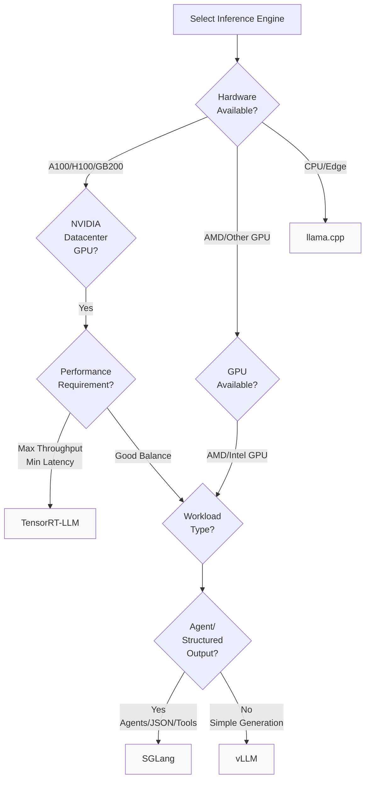
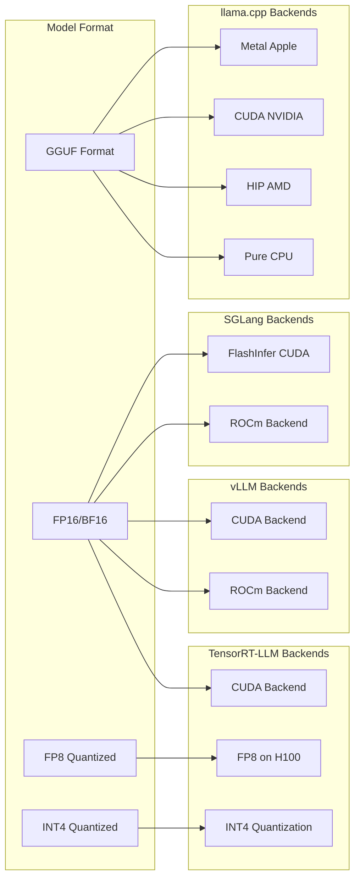
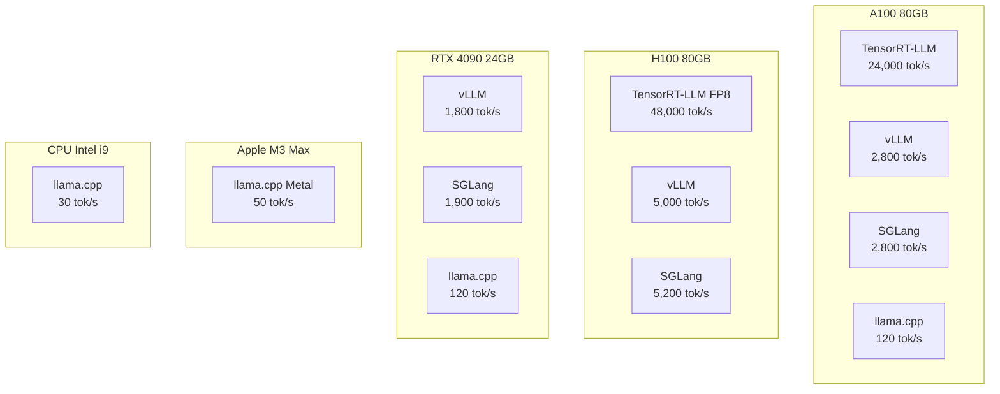
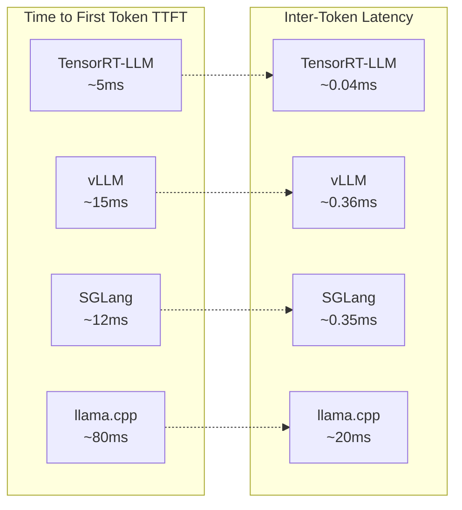
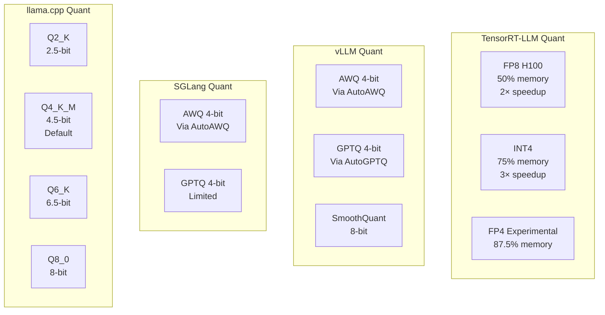
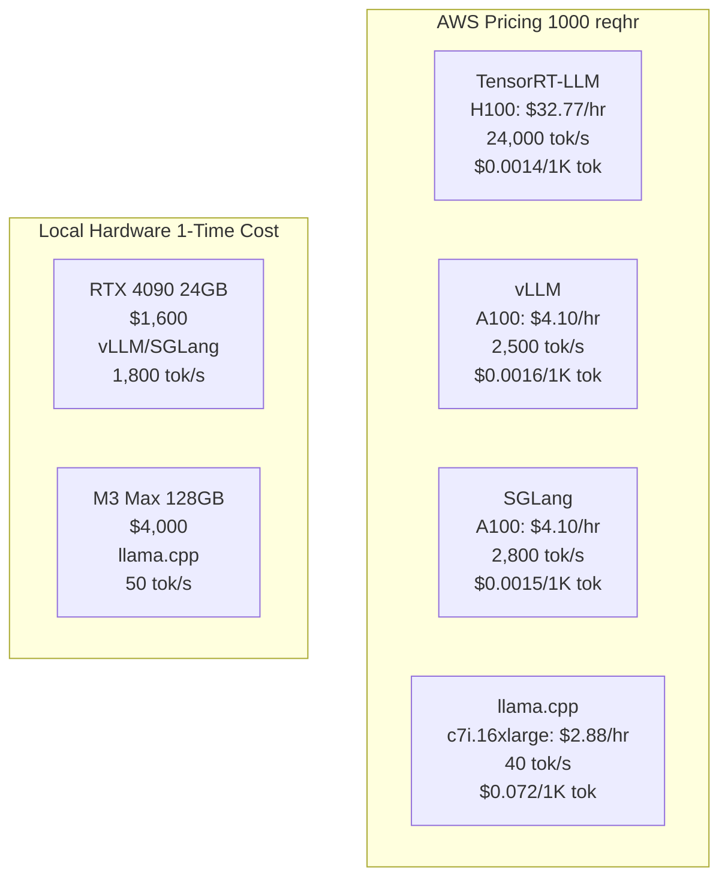
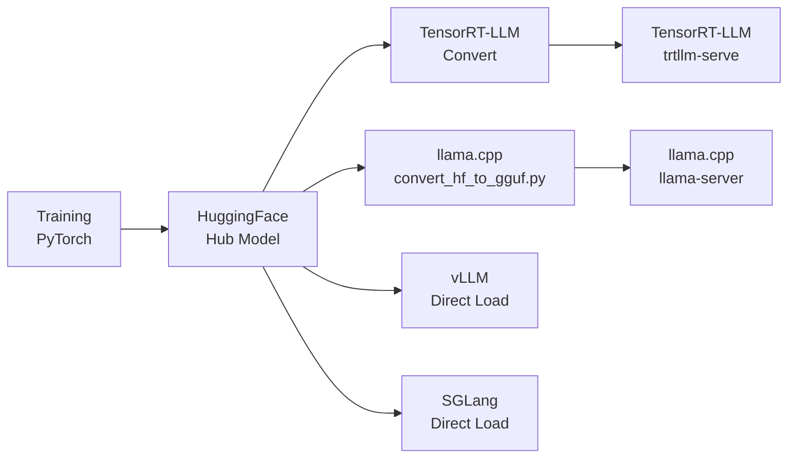

<!-- source: DeepWiki mcp.deepwiki.com · repo zechenzhangAGI/AI-research-SKILLs · page 4.1 Inference Engine Selection Guide · fetched 2026-10-26 -->

# Inference Engine Selection Guide

<details>
<summary>Relevant source files</summary>

The following files were used as context for generating this wiki page:

- [10-optimization/gptq/SKILL.md](10-optimization/gptq/SKILL.md)
- [11-evaluation/lm-evaluation-harness/SKILL.md](11-evaluation/lm-evaluation-harness/SKILL.md)
- [12-inference-serving/llama-cpp/SKILL.md](12-inference-serving/llama-cpp/SKILL.md)
- [12-inference-serving/sglang/SKILL.md](12-inference-serving/sglang/SKILL.md)
- [12-inference-serving/tensorrt-llm/SKILL.md](12-inference-serving/tensorrt-llm/SKILL.md)

</details>


## Purpose and Scope

This guide provides a systematic approach to selecting the optimal LLM inference engine for your deployment scenario. It covers the four primary inference engines in the library: **TensorRT-LLM** (NVIDIA datacenter), **vLLM** (high-throughput serving), **SGLang** (structured generation and agents), and **llama.cpp** (CPU/edge deployment).

This guide focuses on **production inference serving**. For related topics, see:
- Model quantization before deployment: [3.6](#3.6)
- Hardware-specific optimization strategies: [4.2](#4.2)
- Production observability: [4.3](#4.3)
- Training performance optimization: [3.2](#3.2)

## Engine Overview

### Engine Characteristics

| Engine | Primary Optimization | Target Hardware | Key Innovation | Typical Use Case |
|--------|---------------------|-----------------|----------------|------------------|
| **TensorRT-LLM** | Maximum throughput + lowest latency | NVIDIA datacenter GPUs (A100/H100) | FP8/INT4 quantization, CUDA graphs | High-volume production serving |
| **vLLM** | High throughput via PagedAttention | NVIDIA/AMD GPUs | PagedAttention memory management | General-purpose GPU serving |
| **SGLang** | Prefix caching for agents | NVIDIA/AMD GPUs | RadixAttention prefix sharing | Agentic workflows, structured outputs |
| **llama.cpp** | CPU/edge efficiency | CPU, Apple Silicon, non-NVIDIA | GGUF quantization, minimal dependencies | Edge deployment, local inference |

Sources: [12-inference-serving/tensorrt-llm/SKILL.md:1-50](), [12-inference-serving/sglang/SKILL.md:1-50](), [12-inference-serving/llama-cpp/SKILL.md:1-50]()

### Architecture Comparison

```mermaid
graph TB
    subgraph TensorRT["TensorRT-LLM Architecture"]
        TRT_MODEL["Model"]
        TRT_QUANT["FP8/INT4<br/>Quantization"]
        TRT_BATCH["In-Flight<br/>Batching"]
        TRT_CACHE["Paged KV<br/>Cache"]
        TRT_CUDA["CUDA<br/>Graphs"]
        TRT_FLASH["Flash<br/>Attention"]
        
        TRT_MODEL --> TRT_QUANT
        TRT_QUANT --> TRT_BATCH
        TRT_BATCH --> TRT_CACHE
        TRT_CACHE --> TRT_FLASH
        TRT_FLASH --> TRT_CUDA
    end
    
    subgraph vLLM["vLLM Architecture"]
        VLLM_MODEL["Model"]
        VLLM_PAGE["PagedAttention<br/>Memory Mgmt"]
        VLLM_BATCH["Continuous<br/>Batching"]
        VLLM_QUANT["Optional<br/>Quantization"]
        
        VLLM_MODEL --> VLLM_PAGE
        VLLM_PAGE --> VLLM_BATCH
        VLLM_BATCH --> VLLM_QUANT
    end
    
    subgraph SGLang["SGLang Architecture"]
        SGL_MODEL["Model"]
        SGL_RADIX["RadixAttention<br/>Prefix Cache"]
        SGL_STRUCT["Structured<br/>Generation"]
        SGL_BATCH["Continuous<br/>Batching"]
        
        SGL_MODEL --> SGL_RADIX
        SGL_RADIX --> SGL_STRUCT
        SGL_STRUCT --> SGL_BATCH
    end
    
    subgraph LlamaCpp["llama.cpp Architecture"]
        LLAMA_GGUF["GGUF<br/>Quantized Model"]
        LLAMA_METAL["Metal/CUDA/<br/>ROCm Backend"]
        LLAMA_CPU["CPU<br/>Fallback"]
        LLAMA_HYBRID["Hybrid<br/>CPU+GPU"]
        
        LLAMA_GGUF --> LLAMA_METAL
        LLAMA_GGUF --> LLAMA_CPU
        LLAMA_METAL --> LLAMA_HYBRID
        LLAMA_CPU --> LLAMA_HYBRID
    end
```



Sources: [12-inference-serving/tensorrt-llm/SKILL.md:91-105](), [12-inference-serving/sglang/SKILL.md:117-143](), [12-inference-serving/llama-cpp/SKILL.md:108-134]()

## Selection Decision Tree



Sources: [12-inference-serving/tensorrt-llm/SKILL.md:15-33](), [12-inference-serving/sglang/SKILL.md:15-33](), [12-inference-serving/llama-cpp/SKILL.md:15-33]()

## Hardware-Engine Compatibility Matrix

### GPU Compatibility

| Hardware | TensorRT-LLM | vLLM | SGLang | llama.cpp |
|----------|--------------|------|--------|-----------|
| **NVIDIA A100** | ✅ Optimal (FP8) | ✅ Excellent | ✅ Excellent | ✅ Supported |
| **NVIDIA H100** | ✅ Optimal (FP8) | ✅ Excellent | ✅ Excellent | ✅ Supported |
| **NVIDIA RTX 40xx** | ✅ Good | ✅ Good | ✅ Good | ✅ Excellent |
| **NVIDIA RTX 30xx** | ⚠️ Limited | ✅ Good | ✅ Good | ✅ Excellent |
| **AMD MI250/MI300** | ❌ Not supported | ✅ Via ROCm | ✅ Via ROCm | ✅ Via ROCm |
| **Apple M1/M2/M3** | ❌ Not supported | ❌ Not supported | ⚠️ Experimental | ✅ Optimal (Metal) |
| **Intel GPUs** | ❌ Not supported | ❌ Not supported | ❌ Not supported | ⚠️ Coming soon |
| **CPU-only** | ❌ Not supported | ❌ Not supported | ❌ Not supported | ✅ Optimal |

Sources: [12-inference-serving/tensorrt-llm/SKILL.md:45-46](), [12-inference-serving/sglang/SKILL.md:422-427](), [12-inference-serving/llama-cpp/SKILL.md:137-170]()

### Hardware-Specific Code Paths



Sources: [12-inference-serving/tensorrt-llm/SKILL.md:114-138](), [12-inference-serving/llama-cpp/SKILL.md:137-170]()

## Performance Characteristics

### Throughput Comparison (Llama 3-8B, Single GPU)



Sources: [12-inference-serving/tensorrt-llm/SKILL.md:154-165](), [12-inference-serving/sglang/SKILL.md:277-302](), [12-inference-serving/llama-cpp/SKILL.md:210-227]()

### Throughput by Workload Type

| Workload | TensorRT-LLM | vLLM | SGLang | llama.cpp (M3 Max) |
|----------|--------------|------|--------|--------------------|
| **Simple generation** | 24,000 tok/s | 2,500 tok/s | 2,800 tok/s | 50 tok/s |
| **Batch inference** | 24,000 tok/s | 2,800 tok/s | 2,800 tok/s | 50 tok/s |
| **Few-shot (10 examples)** | ~20,000 tok/s | 500 tok/s | 5,000 tok/s (10× faster) | 45 tok/s |
| **Agent workflows** | ~18,000 tok/s | 800 tok/s | 4,000 tok/s (5× faster) | 40 tok/s |
| **JSON/structured output** | ~15,000 tok/s | 600 tok/s | 2,400 tok/s (4× faster) | 35 tok/s |
| **Multi-turn chat** | ~20,000 tok/s | 1,200 tok/s | 3,500 tok/s (prefix cache) | 45 tok/s |

**Key Insights**:
- **TensorRT-LLM**: Dominant for raw throughput on NVIDIA datacenter GPUs
- **SGLang**: Wins for agentic workloads due to RadixAttention (5-10× speedup over vLLM)
- **vLLM**: Solid general-purpose performance, but no prefix caching
- **llama.cpp**: CPU/edge deployment, 50-100× slower than GPU solutions

Sources: [12-inference-serving/tensorrt-llm/SKILL.md:154-165](), [12-inference-serving/sglang/SKILL.md:277-302]()

### Latency Characteristics



Sources: [12-inference-serving/tensorrt-llm/SKILL.md:158-159]()

## Feature Comparison

### Core Features Matrix

| Feature | TensorRT-LLM | vLLM | SGLang | llama.cpp |
|---------|--------------|------|--------|-----------|
| **In-flight batching** | ✅ Yes | ✅ Yes (continuous) | ✅ Yes (continuous) | ⚠️ Basic |
| **PagedAttention** | ✅ Yes | ✅ Yes (original) | ❌ No | ❌ No |
| **Prefix caching** | ⚠️ Basic | ❌ No | ✅ RadixAttention | ❌ No |
| **FP8 quantization** | ✅ Native H100 | ⚠️ Limited | ⚠️ Limited | ❌ No |
| **INT4 quantization** | ✅ Yes | ⚠️ Via AWQ | ⚠️ Via AWQ | ✅ GGUF Q4 |
| **Structured output** | ❌ No | ⚠️ Via Outlines | ✅ Native JSON/regex | ✅ Grammar |
| **Speculative decoding** | ✅ Yes | ✅ Yes | ✅ Yes | ❌ No |
| **Multi-GPU (TP)** | ✅ Yes | ✅ Yes | ✅ Yes | ⚠️ Limited |
| **Multi-node** | ✅ Yes | ✅ Yes | ⚠️ Limited | ❌ No |
| **LoRA adapters** | ✅ Multi-adapter | ✅ Multi-adapter | ⚠️ Basic | ❌ No |
| **OpenAI API** | ✅ Yes | ✅ Yes | ✅ Yes | ✅ Yes |

Sources: [12-inference-serving/tensorrt-llm/SKILL.md:91-110](), [12-inference-serving/sglang/SKILL.md:117-143](), [12-inference-serving/llama-cpp/SKILL.md:86-104]()

### Quantization Support



Sources: [12-inference-serving/tensorrt-llm/SKILL.md:114-127](), [12-inference-serving/llama-cpp/SKILL.md:108-134](), [10-optimization/gptq/SKILL.md:249-270]()

## Use Case Recommendations

### Production Serving on NVIDIA Datacenter GPUs

**Scenario**: High-volume API serving, need 10K+ requests/sec

**Recommendation**: TensorRT-LLM

**Rationale**:
- 10-100× faster than PyTorch baseline
- Native FP8 on H100 (2× speedup, 50% memory)
- Lowest latency for real-time applications
- Battle-tested at scale

**Implementation**:
```bash
# Launch TensorRT-LLM server
trtllm-serve meta-llama/Meta-Llama-3-70B \
    --tp_size 8 \
    --dtype fp8 \
    --max_batch_size 512
```

Sources: [12-inference-serving/tensorrt-llm/SKILL.md:72-89]()

### Agent Workflows with Repeated System Prompts

**Scenario**: Building agents with tool calls, system prompts reused across requests

**Recommendation**: SGLang

**Rationale**:
- RadixAttention automatically caches common prefixes
- 5-10× faster than vLLM for agentic workloads
- Native structured output support (JSON, regex)
- Zero configuration for prefix caching

**Implementation**:
```python
# SGLang with RadixAttention
import sglang as sgl

@sgl.function
def agent_workflow(s, user_query, tools):
    # System prompt cached automatically
    s += "You are a helpful assistant with tools.\n"
    s += f"Tools: {tools}\n\n"
    s += f"User: {user_query}\n"
    s += sgl.gen("response", max_tokens=200, tools=tools)

# First call: computes full prompt
# Subsequent calls: reuse cached system prompt (5× faster)
```

Sources: [12-inference-serving/sglang/SKILL.md:215-275]()

### General-Purpose GPU Serving

**Scenario**: Standard text generation, no special requirements

**Recommendation**: vLLM

**Rationale**:
- Mature, widely-tested production system
- PagedAttention for efficient memory management
- Simple Python-first API
- Works on NVIDIA and AMD GPUs

**Implementation**:
```bash
# Launch vLLM server
python -m vllm.entrypoints.openai.api_server \
    --model meta-llama/Meta-Llama-3-8B-Instruct \
    --tensor-parallel-size 1
```

Sources: [11-evaluation/lm-evaluation-harness/SKILL.md:331-374]()

### Edge Deployment / Apple Silicon

**Scenario**: Local inference on MacBook M1/M2/M3, no cloud dependencies

**Recommendation**: llama.cpp

**Rationale**:
- Native Metal acceleration for Apple Silicon
- GGUF quantization optimized for CPU/Metal
- 50-60 tok/s on M3 Max (Llama 2-7B)
- Zero dependencies, simple deployment

**Implementation**:
```bash
# Build with Metal
make LLAMA_METAL=1

# Run inference (automatic GPU offload)
./llama-cli -m llama-2-7b.Q4_K_M.gguf -ngl 999
```

Sources: [12-inference-serving/llama-cpp/SKILL.md:137-147]()

### CPU-Only Servers

**Scenario**: Inference on cloud VMs without GPUs, cost optimization

**Recommendation**: llama.cpp

**Rationale**:
- Only viable option for CPU-only deployment
- 4-10× faster than PyTorch on CPU
- Efficient GGUF quantization (Q4_K_M recommended)
- Can hybrid CPU+GPU if GPU becomes available

**Implementation**:
```bash
# CPU inference with optimized quantization
./llama-cli \
    -m llama-2-7b.Q4_K_M.gguf \
    -t 32 \  # Use 32 threads
    -c 4096  # 4K context
```

Sources: [12-inference-serving/llama-cpp/SKILL.md:210-219]()

### Structured JSON/Regex Outputs

**Scenario**: Extract structured data, enforce output format

**Recommendation**: SGLang

**Rationale**:
- Native JSON schema validation
- Regex-constrained generation
- 3× faster JSON decoding vs standard
- Grammar-based generation support

**Implementation**:
```python
@sgl.function
def extract_person(s, text):
    s += f"Extract from: {text}\n"
    s += sgl.gen(
        "json_output",
        regex=r'\{"name": "[^"]+", "age": \d+\}'
    )
```

Sources: [12-inference-serving/sglang/SKILL.md:94-115]()

### Evaluation Workloads

**Scenario**: Benchmarking models on academic datasets (MMLU, GSM8K)

**Recommendation**: vLLM (via lm-eval harness)

**Rationale**:
- 5-10× faster evaluation than HuggingFace
- Direct integration with lm-evaluation-harness
- PagedAttention for batch efficiency
- Widely used for reproducible benchmarks

**Implementation**:
```bash
# Evaluate with vLLM backend
lm_eval --model vllm \
    --model_args pretrained=meta-llama/Llama-2-7b-hf \
    --tasks mmlu,gsm8k,hellaswag \
    --batch_size auto
```

Sources: [11-evaluation/lm-evaluation-harness/SKILL.md:331-374]()

## Multi-GPU Deployment Patterns

### Tensor Parallelism (TP) Comparison

```mermaid
graph TB
    subgraph "TensorRT-LLM TP"
        TRT_M["Model Weights"]
        TRT_G1["GPU 0"]
        TRT_G2["GPU 1"]
        TRT_G3["GPU 2"]
        TRT_G4["GPU 3"]
        
        TRT_M --> TRT_G1
        TRT_M --> TRT_G2
        TRT_M --> TRT_G3
        TRT_M --> TRT_G4
        
        TRT_G1 -.AllReduce.-> TRT_G2
        TRT_G2 -.AllReduce.-> TRT_G3
        TRT_G3 -.AllReduce.-> TRT_G4
    end
    
    subgraph "vLLM TP"
        VLLM_M["Model Weights"]
        VLLM_G1["GPU 0"]
        VLLM_G2["GPU 1"]
        
        VLLM_M --> VLLM_G1
        VLLM_M --> VLLM_G2
        
        VLLM_G1 -.AllReduce.-> VLLM_G2
    end
    
    subgraph "SGLang TP"
        SGL_M["Model Weights"]
        SGL_G1["GPU 0"]
        SGL_G2["GPU 1"]
        SGL_G3["GPU 2"]
        
        SGL_M --> SGL_G1
        SGL_M --> SGL_G2
        SGL_M --> SGL_G3
    end
    
    subgraph "llama.cpp Hybrid"
        LLAMA_M["GGUF Model"]
        LLAMA_GPU["GPU Layers 0-20"]
        LLAMA_CPU["CPU Layers 21-40"]
        
        LLAMA_M --> LLAMA_GPU
        LLAMA_M --> LLAMA_CPU
        
        LLAMA_GPU -.Transfer.-> LLAMA_CPU
    end
```



Sources: [12-inference-serving/tensorrt-llm/SKILL.md:129-138](), [12-inference-serving/llama-cpp/SKILL.md:150-160]()

### Multi-GPU Configuration Examples

**TensorRT-LLM (8× GPU for Llama 3-405B)**:
```python
from tensorrt_llm import LLM

llm = LLM(
    model="meta-llama/Meta-Llama-3-405B",
    tensor_parallel_size=8,
    dtype="fp8"
)
```
Sources: [12-inference-serving/tensorrt-llm/SKILL.md:129-138]()

**SGLang (4× GPU for Llama 3-70B)**:
```bash
python -m sglang.launch_server \
    --model-path meta-llama/Meta-Llama-3-70B-Instruct \
    --tp 4 \
    --port 30000
```
Sources: [12-inference-serving/sglang/SKILL.md:65-70]()

**llama.cpp (Hybrid CPU+GPU for large models)**:
```bash
# Offload 20 layers to GPU, rest on CPU
./llama-cli -m llama-70b.Q4_K_M.gguf -ngl 20
```
Sources: [12-inference-serving/llama-cpp/SKILL.md:150-160]()

## Memory Requirements

### Model Size vs GPU Memory (Llama Models)

| Model | FP16 | TensorRT-LLM FP8 | vLLM (no quant) | SGLang (no quant) | llama.cpp Q4_K_M | Minimum GPU |
|-------|------|------------------|-----------------|-------------------|------------------|-------------|
| **Llama 2-7B** | 14 GB | 7 GB | 14 GB | 14 GB | 3.5 GB | RTX 3090 24GB |
| **Llama 2-13B** | 26 GB | 13 GB | 26 GB | 26 GB | 6.5 GB | A100 40GB |
| **Llama 2-70B** | 140 GB | 70 GB | 140 GB | 140 GB | 35 GB | 2× A100 80GB |
| **Llama 3-8B** | 16 GB | 8 GB | 16 GB | 16 GB | 4.1 GB | RTX 4090 24GB |
| **Llama 3-70B** | 140 GB | 70 GB | 140 GB | 140 GB | 35 GB | 2× A100 80GB |
| **Llama 3-405B** | 810 GB | 405 GB | 810 GB | 810 GB | 203 GB | 11× A100 80GB |

**Key Insights**:
- TensorRT-LLM FP8: 50% memory reduction on H100
- GGUF Q4_K_M: 75% memory reduction, works on consumer GPUs
- Multi-GPU required for 70B+ models without quantization

Sources: [12-inference-serving/tensorrt-llm/SKILL.md:162-165](), [10-optimization/gptq/SKILL.md:303-318](), [12-inference-serving/llama-cpp/SKILL.md:110-134]()

## Integration Patterns

### OpenAI-Compatible API Usage

All four engines expose OpenAI-compatible endpoints. Example client code:

```python
from openai import OpenAI

# Works with all engines (just change base_url)
client = OpenAI(
    base_url="http://localhost:8000/v1",  # TensorRT-LLM / vLLM / SGLang
    # base_url="http://localhost:8080/v1",  # llama.cpp
    api_key="EMPTY"
)

response = client.chat.completions.create(
    model="default",
    messages=[{"role": "user", "content": "Hello"}],
    temperature=0.7,
    max_tokens=100
)
```

Sources: [12-inference-serving/tensorrt-llm/SKILL.md:80-89](), [12-inference-serving/sglang/SKILL.md:377-404](), [12-inference-serving/llama-cpp/SKILL.md:86-104]()

### Server Launch Commands Comparison

```bash
# TensorRT-LLM
trtllm-serve meta-llama/Meta-Llama-3-8B \
    --tp_size 4 \
    --max_batch_size 256

# vLLM (via lm-eval harness workflow)
python -m vllm.entrypoints.openai.api_server \
    --model meta-llama/Meta-Llama-3-8B-Instruct \
    --tensor-parallel-size 1

# SGLang
python -m sglang.launch_server \
    --model-path meta-llama/Meta-Llama-3-8B-Instruct \
    --port 30000 \
    --enable-radix-cache

# llama.cpp
./llama-server \
    -m llama-3-8b.Q4_K_M.gguf \
    --host 0.0.0.0 \
    --port 8080 \
    -ngl 32
```

Sources: [12-inference-serving/tensorrt-llm/SKILL.md:72-89](), [12-inference-serving/sglang/SKILL.md:52-70](), [12-inference-serving/llama-cpp/SKILL.md:86-104]()

## Cost-Performance Analysis

### Cloud Deployment Cost Comparison (Llama 3-8B, 1000 req/hr)



**Analysis**:
- **TensorRT-LLM**: Most expensive GPU, but lowest per-token cost due to throughput
- **vLLM/SGLang**: Best balance of cost and performance on A100
- **llama.cpp**: High per-token cost on cloud CPU, but free on local hardware

Sources: [12-inference-serving/llama-cpp/SKILL.md:210-227]()

## Common Migration Paths

### From PyTorch to Production



**Migration Patterns**:

1. **NVIDIA Datacenter**: HuggingFace → TensorRT-LLM (automatic conversion)
2. **General GPU**: HuggingFace → vLLM/SGLang (direct load, no conversion)
3. **CPU/Edge**: HuggingFace → GGUF → llama.cpp (manual conversion required)

Sources: [12-inference-serving/tensorrt-llm/SKILL.md:48-69](), [12-inference-serving/llama-cpp/SKILL.md:59-68]()

### Quantization Before Deployment

```bash
# Option 1: GPTQ quantization for GPU engines
# See GPTQ skill [3.6] for full workflow
auto-gptq quantize --model meta-llama/Llama-2-7b-hf --bits 4

# Load in TensorRT-LLM, vLLM, or SGLang
# All support GPTQ models

# Option 2: GGUF quantization for llama.cpp
python convert_hf_to_gguf.py models/llama-2-7b/
./llama-quantize models/llama-2-7b.gguf models/llama-2-7b.Q4_K_M.gguf Q4_K_M
```

Sources: [10-optimization/gptq/SKILL.md:77-116](), [12-inference-serving/llama-cpp/SKILL.md:59-68]()

## Troubleshooting Common Issues

### Out of Memory (OOM) Errors

**TensorRT-LLM**:
```bash
# Reduce max batch size
trtllm-serve model --max_batch_size 64  # Instead of 256

# Enable CPU offloading (not recommended for production)
trtllm-serve model --offload_dir /tmp/offload
```

**vLLM**:
```bash
# Reduce GPU memory utilization
python -m vllm.entrypoints.openai.api_server \
    --model model-name \
    --gpu-memory-utilization 0.7  # Default: 0.9
```

**llama.cpp**:
```bash
# Offload fewer layers to GPU
./llama-cli -m model.gguf -ngl 20  # Instead of -ngl 999

# Use smaller quantization
# Q2_K instead of Q4_K_M (more degradation, less memory)
```

Sources: [12-inference-serving/llama-cpp/SKILL.md:150-160]()

### Slow Throughput

**Check GPU utilization**:
```bash
nvidia-smi -l 1  # Monitor every 1 second

# If GPU util < 80%, increase batch size or enable continuous batching
```

**SGLang-specific (prefix caching not working)**:
```bash
# Verify RadixAttention is enabled (default)
python -m sglang.launch_server \
    --model-path model-name \
    --enable-radix-cache  # Should be default

# Check cache hit rate in logs
# High hit rate = prefix caching working
```

Sources: [12-inference-serving/sglang/SKILL.md:52-70]()

### Model Compatibility Issues

**TensorRT-LLM**: Supports 100+ models, but requires conversion for some architectures
**vLLM**: Widest model support, direct HuggingFace loading
**SGLang**: Good support for popular models, some new architectures may lag
**llama.cpp**: Requires GGUF format, not all models have pre-converted versions

Check supported models lists in respective skills ([2.8](#2.8)).

## Summary Decision Matrix

| Criterion | TensorRT-LLM | vLLM | SGLang | llama.cpp |
|-----------|--------------|------|--------|-----------|
| **Best For** | Max performance NVIDIA | General GPU serving | Agents, structured output | CPU, Apple Silicon, edge |
| **Hardware** | NVIDIA datacenter only | NVIDIA/AMD GPUs | NVIDIA/AMD GPUs | CPU, all GPUs |
| **Setup Complexity** | High (compilation) | Low (pip install) | Low (pip install) | Very low (binary) |
| **Throughput (GPU)** | ⭐⭐⭐⭐⭐ | ⭐⭐⭐⭐ | ⭐⭐⭐⭐ | ⭐⭐ |
| **Throughput (CPU)** | N/A | N/A | N/A | ⭐⭐⭐ |
| **Prefix Caching** | ⭐⭐ | ❌ | ⭐⭐⭐⭐⭐ | ❌ |
| **Structured Output** | ❌ | ⭐⭐ | ⭐⭐⭐⭐⭐ | ⭐⭐⭐⭐ |
| **Quantization** | FP8, INT4 | AWQ, GPTQ | AWQ, GPTQ | GGUF (Q2-Q8) |
| **Production Ready** | ⭐⭐⭐⭐⭐ | ⭐⭐⭐⭐⭐ | ⭐⭐⭐⭐ | ⭐⭐⭐⭐ |
| **Cost (Cloud)** | High GPU cost, low per-token | Medium GPU cost, medium per-token | Medium GPU cost, low per-token (agents) | Low compute cost, high per-token |
| **Cost (Local)** | Requires expensive GPU | Requires GPU | Requires GPU | Free (any hardware) |

**Quick Recommendations**:
- **High-volume production on NVIDIA GPUs**: TensorRT-LLM
- **General-purpose GPU serving**: vLLM
- **Agents, tool calls, repeated prefixes**: SGLang
- **CPU, Apple Silicon, edge, local development**: llama.cpp

Sources: All skill files referenced throughout this document.

---

