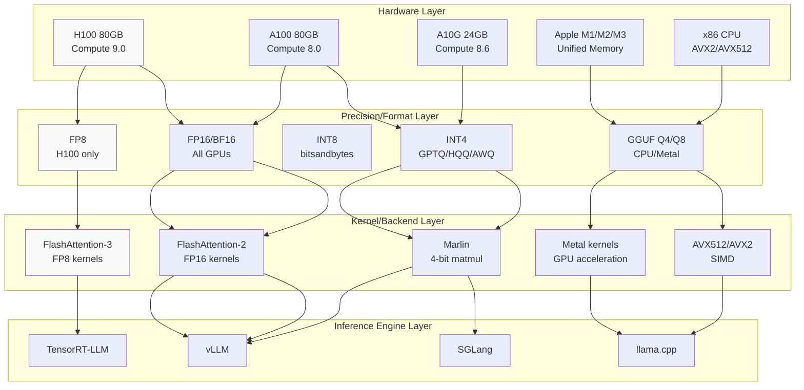
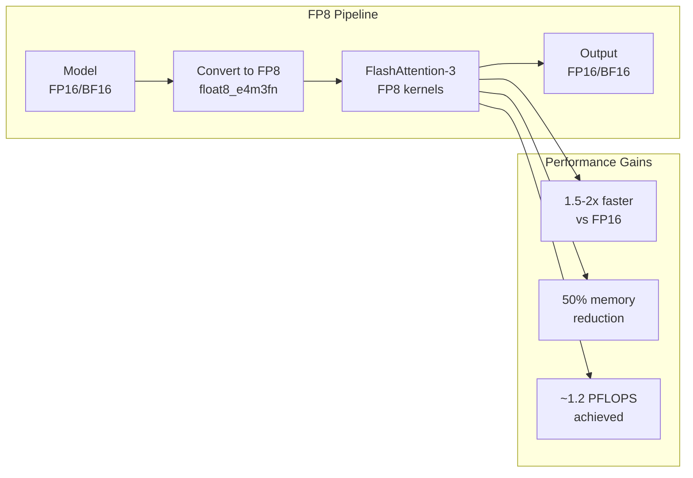
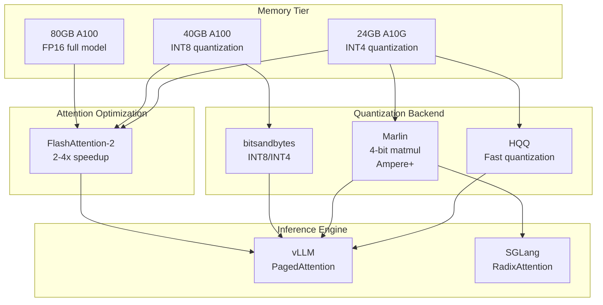
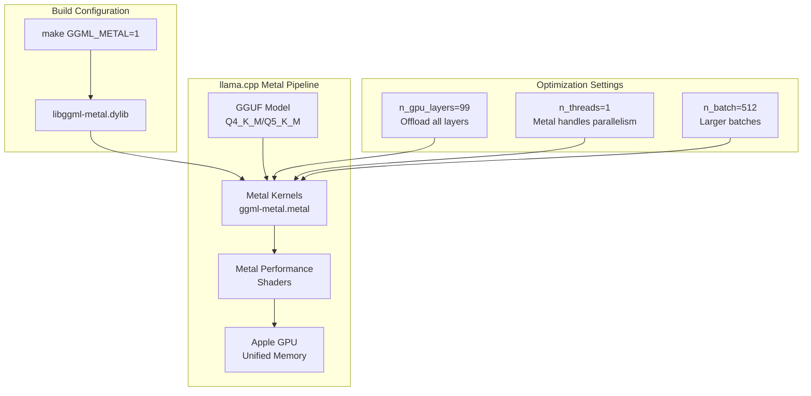
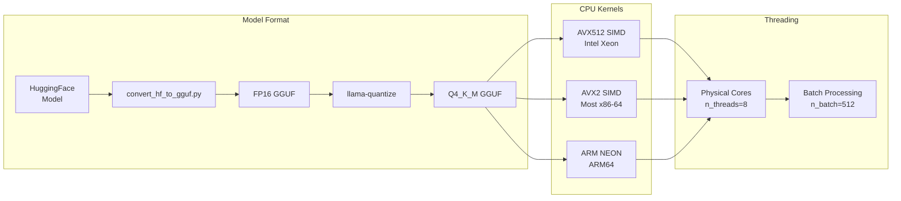
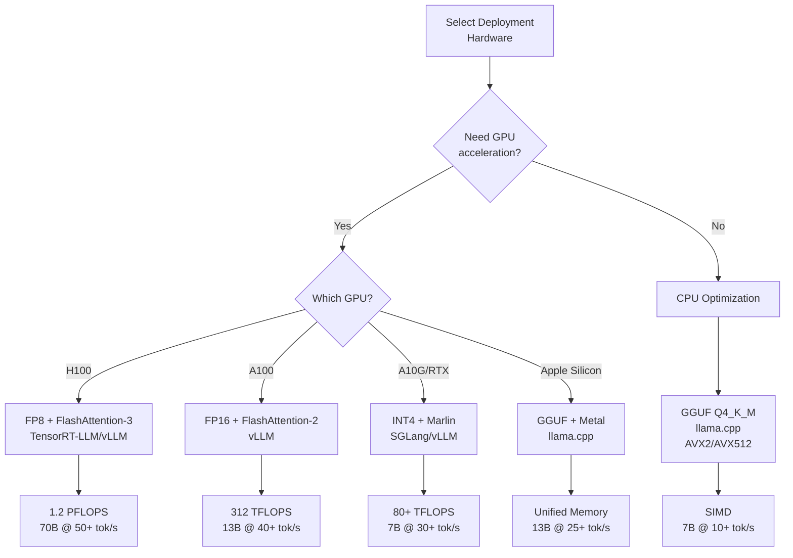

<!-- source: DeepWiki mcp.deepwiki.com · repo zechenzhangAGI/AI-research-SKILLs · page 4.2 Hardware-Specific Optimization · fetched 2026-10-26 -->

# Hardware-Specific Optimization

<details>
<summary>Relevant source files</summary>

The following files were used as context for generating this wiki page:

- [10-optimization/bitsandbytes/SKILL.md](10-optimization/bitsandbytes/SKILL.md)
- [10-optimization/flash-attention/SKILL.md](10-optimization/flash-attention/SKILL.md)
- [10-optimization/flash-attention/references/benchmarks.md](10-optimization/flash-attention/references/benchmarks.md)
- [10-optimization/flash-attention/references/transformers-integration.md](10-optimization/flash-attention/references/transformers-integration.md)
- [10-optimization/gguf/SKILL.md](10-optimization/gguf/SKILL.md)
- [10-optimization/gguf/references/advanced-usage.md](10-optimization/gguf/references/advanced-usage.md)
- [10-optimization/gguf/references/troubleshooting.md](10-optimization/gguf/references/troubleshooting.md)
- [10-optimization/hqq/SKILL.md](10-optimization/hqq/SKILL.md)
- [10-optimization/hqq/references/advanced-usage.md](10-optimization/hqq/references/advanced-usage.md)
- [10-optimization/hqq/references/troubleshooting.md](10-optimization/hqq/references/troubleshooting.md)
- [14-agents/autogpt/SKILL.md](14-agents/autogpt/SKILL.md)
- [14-agents/autogpt/references/advanced-usage.md](14-agents/autogpt/references/advanced-usage.md)
- [14-agents/autogpt/references/troubleshooting.md](14-agents/autogpt/references/troubleshooting.md)
- [17-observability/phoenix/SKILL.md](17-observability/phoenix/SKILL.md)
- [17-observability/phoenix/references/advanced-usage.md](17-observability/phoenix/references/advanced-usage.md)

</details>


## Purpose and Scope

This document covers optimization strategies for deploying LLM inference across different hardware platforms. It focuses on practical configuration and tuning techniques to maximize throughput and minimize latency on NVIDIA GPUs (A100/H100, Ampere), Apple Silicon, and CPU-only deployments.

**Related pages:**
- For inference engine selection (TensorRT-LLM, vLLM, SGLang, llama.cpp), see [Inference Engine Selection Guide](#4.1)
- For Flash Attention algorithm details, see [Flash Attention: IO-Aware Attention Optimization](#3.5)
- For quantization method comparison, see [Quantization Ecosystem](#3.6)

---

## Hardware Optimization Stack



**Optimization Stack by Hardware**

This diagram shows how hardware capabilities map to optimal precision formats, kernel implementations, and inference engines. Higher tiers represent newer/more capable hardware.

Sources: [10-optimization/flash-attention/SKILL.md:1-368](), [10-optimization/gguf/SKILL.md:1-428](), [10-optimization/hqq/SKILL.md:1-446]()

---

## NVIDIA H100 Optimization (FP8)

### Hardware Characteristics

- **Compute Capability**: 9.0 (Hopper architecture)
- **Peak Performance**: 1.98 PFLOPS FP8, 989 TFLOPS FP16
- **Memory**: 80GB HBM3, 3 TB/s bandwidth
- **Key Feature**: Native FP8 Tensor Cores

### FP8 Training and Inference



**FP8 Execution Flow on H100**

Sources: [10-optimization/flash-attention/SKILL.md:227-277](), [10-optimization/flash-attention/references/benchmarks.md:24-36]()

### Configuration Example

FlashAttention-3 with FP8 automatically activates on H100 when using appropriate dtypes:

```python
# Verify H100 availability
import torch
device_props = torch.cuda.get_device_properties(0)
assert device_props.major >= 9, "H100 required for FP8"

# Convert tensors to FP8
q = torch.randn(2, 4096, 32, 64, device='cuda', dtype=torch.float16)
k = torch.randn(2, 4096, 32, 64, device='cuda', dtype=torch.float16)
v = torch.randn(2, 4096, 32, 64, device='cuda', dtype=torch.float16)

# Auto-conversion to FP8 for computation
q_fp8 = q.to(torch.float8_e4m3fn)
k_fp8 = k.to(torch.float8_e4m3fn)
v_fp8 = v.to(torch.float8_e4m3fn)

# FlashAttention-3 uses FP8 kernels automatically
from flash_attn import flash_attn_func
output = flash_attn_func(q_fp8, k_fp8, v_fp8)
# Result: ~1.2 PFLOPS, 1.5-2x faster than FP16
```

Sources: [10-optimization/flash-attention/SKILL.md:253-276]()

### Performance Benchmarks

| Sequence Length | FP16 Time (ms) | FP8 Time (ms) | Speedup |
|-----------------|----------------|---------------|---------|
| 512             | 0.6            | 0.3           | 2.0x    |
| 1024            | 1.0            | 0.4           | 2.5x    |
| 2048            | 3.4            | 1.3           | 2.6x    |
| 4096            | 12.5           | 4.8           | 2.6x    |
| 8192            | 47.8           | 18.2          | 2.6x    |

*H100 80GB, batch=8, heads=32, dim=64*

Sources: [10-optimization/flash-attention/references/benchmarks.md:24-36]()

### Memory Efficiency

FP8 reduces memory footprint by 50% compared to FP16:

```python
# Memory calculation for Llama 2 70B
# FP16: 70B params × 2 bytes = 140 GB
# FP8:  70B params × 1 byte = 70 GB
# Savings: 70 GB (50%)

# Example: Fit larger batches with FP8
import torch
from transformers import AutoModelForCausalLM

model = AutoModelForCausalLM.from_pretrained(
    "meta-llama/Llama-2-70b-hf",
    torch_dtype=torch.float8_e4m3fn,  # FP8 mode
    device_map="auto",
    attn_implementation="flash_attention_2"
)

# FP16 batch size: 4
# FP8 batch size: 8 (2x increase possible)
```

Sources: [10-optimization/flash-attention/references/benchmarks.md:73-84]()

### Best Practices for H100

1. **Always use FP8**: Enable for 2x speedup with minimal accuracy loss
2. **Use FlashAttention-3**: Automatically leverages FP8 Tensor Cores
3. **Increase batch size**: 50% memory savings allows 2x batch increase
4. **Monitor precision**: Validate output quality with FP8 conversion

---

## NVIDIA Ampere Optimization (A100, A10G)

### Hardware Characteristics

- **Compute Capability**: 8.0 (A100), 8.6 (A10G)
- **Peak Performance**: 312 TFLOPS FP16 (A100)
- **Memory**: 40/80GB (A100), 24GB (A10G)
- **Key Feature**: FlashAttention-2 support, Marlin 4-bit kernels

### Optimization Strategy Stack



**Ampere GPU Optimization Paths**

Sources: [10-optimization/flash-attention/SKILL.md:1-368](), [10-optimization/bitsandbytes/SKILL.md:1-412](), [10-optimization/hqq/SKILL.md:1-446]()

### FlashAttention-2 Configuration

Enable FlashAttention-2 for 2-4x speedup on all Ampere GPUs:

```python
from transformers import AutoModelForCausalLM
import torch

model = AutoModelForCausalLM.from_pretrained(
    "meta-llama/Llama-2-13b-hf",
    attn_implementation="flash_attention_2",
    torch_dtype=torch.float16,
    device_map="auto"
)

# Verify Flash Attention is active
config = model.config
assert config._attn_implementation == "flash_attention_2"
```

Sources: [10-optimization/flash-attention/SKILL.md:56-89](), [10-optimization/flash-attention/references/transformers-integration.md:10-31]()

### Memory Scaling Comparison

| Model Size | GPU VRAM | Standard Attention | Flash Attention 2 | Fits? |
|------------|----------|-------------------|-------------------|-------|
| 7B         | 24GB     | 18.2 GB           | 12.4 GB           | Both: Yes |
| 13B        | 24GB     | 34.8 GB (OOM)     | 16.8 GB           | Only Flash: Yes |
| 70B        | 80GB     | OOM (>80GB)       | 26.2 GB           | Only Flash: Yes |

*Training memory (batch=4, context=2K)*

Sources: [10-optimization/flash-attention/references/benchmarks.md:86-92]()

### Quantization for Limited VRAM

#### INT8 Quantization (A100 40GB)

Use `bitsandbytes` for 50% memory reduction:

```python
from transformers import AutoModelForCausalLM, BitsAndBytesConfig

config = BitsAndBytesConfig(
    load_in_8bit=True,
    llm_int8_threshold=6.0
)

model = AutoModelForCausalLM.from_pretrained(
    "meta-llama/Llama-2-70b-hf",
    quantization_config=config,
    device_map="auto"
)

# Memory: 140GB → 70GB
# Accuracy loss: <0.5%
```

Sources: [10-optimization/bitsandbytes/SKILL.md:22-34](), [10-optimization/bitsandbytes/SKILL.md:92-101]()

#### INT4 Quantization with Marlin (A10G 24GB)

Marlin backend provides 2-3x speedup for 4-bit inference on Ampere+:

```python
from transformers import AutoModelForCausalLM, HqqConfig
from hqq.core.quantize import HQQLinear

# Verify Marlin support (requires compute capability >= 8.0)
import torch
device = torch.cuda.get_device_properties(0)
assert device.major >= 8, "Ampere+ required for Marlin"

# Quantize with HQQ
config = HqqConfig(nbits=4, group_size=128)  # group_size=128 for Marlin
model = AutoModelForCausalLM.from_pretrained(
    "meta-llama/Llama-3.1-8B",
    quantization_config=config,
    device_map="auto"
)

# Enable Marlin backend
HQQLinear.set_backend("marlin")

# Memory: 16GB → 4GB
# Speed: 2-3x faster than standard INT4
```

Sources: [10-optimization/hqq/SKILL.md:149-172](), [10-optimization/hqq/references/troubleshooting.md:146-168]()

### Performance Tuning

#### Batch Size Optimization

```python
def find_optimal_batch_size(model, tokenizer, max_memory_gb=24):
    """Find maximum batch size for given VRAM."""
    import torch
    
    prompt = "What is AI?"
    inputs = tokenizer([prompt], return_tensors="pt", padding=True).to("cuda")
    
    for batch_size in [1, 2, 4, 8, 16, 32, 64]:
        try:
            batch_inputs = {k: v.repeat(batch_size, 1) for k, v in inputs.items()}
            
            torch.cuda.reset_peak_memory_stats()
            with torch.no_grad():
                outputs = model.generate(**batch_inputs, max_new_tokens=100)
            
            memory_used_gb = torch.cuda.max_memory_allocated() / 1024**3
            print(f"Batch {batch_size}: {memory_used_gb:.1f} GB")
            
            if memory_used_gb > max_memory_gb * 0.9:
                return batch_size // 2  # Safety margin
                
        except torch.cuda.OutOfMemoryError:
            return max(1, batch_size // 2)
    
    return 64

optimal_batch = find_optimal_batch_size(model, tokenizer, max_memory_gb=24)
```

Sources: [10-optimization/hqq/references/advanced-usage.md:302-344]()

#### Context Length Optimization

| Context Length | A100 80GB (FP16) | A100 80GB (INT4) | A10G 24GB (INT4) |
|----------------|------------------|------------------|------------------|
| 2K             | ✅ Batch=8       | ✅ Batch=16      | ✅ Batch=4       |
| 4K             | ✅ Batch=4       | ✅ Batch=8       | ✅ Batch=2       |
| 8K             | ✅ Batch=2       | ✅ Batch=4       | ✅ Batch=1       |
| 16K            | ✅ Batch=1       | ✅ Batch=2       | ⚠️ OOM risk      |
| 32K            | ⚠️ With Flash    | ✅ Batch=1       | ❌ Not feasible  |

*Llama 2 13B model*

Sources: [10-optimization/flash-attention/references/benchmarks.md:77-84]()

---

## Apple Silicon Optimization (Metal)

### Hardware Characteristics

- **Architecture**: Unified Memory (16-128GB)
- **Compute Units**: GPU cores with Metal acceleration
- **Memory**: Shared between CPU and GPU (no PCIe bottleneck)
- **Key Feature**: Metal Performance Shaders (MPS)

### Metal Acceleration Stack



**llama.cpp Metal Acceleration on Apple Silicon**

Sources: [10-optimization/gguf/SKILL.md:296-312](), [10-optimization/gguf/references/advanced-usage.md:1-505]()

### Building with Metal Support

```bash
# Clone llama.cpp
git clone https://github.com/ggml-org/llama.cpp
cd llama.cpp

# Build with Metal acceleration
make clean
make GGML_METAL=1

# Verify Metal library is built
ls -lh ggml-metal.metal
ls -lh libggml-metal.dylib
```

Sources: [10-optimization/gguf/SKILL.md:40-54]()

### Optimal Configuration

```python
from llama_cpp import Llama

# Optimal settings for M1/M2/M3
llm = Llama(
    model_path="./llama-3.1-8b-q4_k_m.gguf",
    n_gpu_layers=99,     # Offload all layers to Metal
    n_threads=1,         # Metal handles threading internally
    n_batch=512,         # Larger batches for better GPU utilization
    n_ctx=4096,          # Context window
    use_mmap=True,       # Memory mapping for fast loading
    use_mlock=False,     # Don't lock in RAM (unified memory)
    verbose=False
)

# Generate with Metal acceleration
output = llm(
    "Explain quantum computing:",
    max_tokens=256,
    temperature=0.7
)
```

Sources: [10-optimization/gguf/SKILL.md:296-312]()

### Quantization Recommendations

| Mac Model | RAM | Recommended Quantization | Max Model Size |
|-----------|-----|--------------------------|----------------|
| M1 (8GB)  | 8GB | Q4_K_M | 3B params |
| M1 (16GB) | 16GB | Q4_K_M | 7B params |
| M2 Pro (32GB) | 32GB | Q5_K_M | 13B params |
| M2 Max (64GB) | 64GB | Q5_K_M | 30B params |
| M2 Ultra (128GB) | 128GB | Q6_K | 70B params |

Sources: [10-optimization/gguf/SKILL.md:99-113]()

### Performance Benchmarks

```python
# Benchmark script for Apple Silicon
import time
from llama_cpp import Llama

def benchmark_metal(model_path, quantization):
    llm = Llama(
        model_path=model_path,
        n_gpu_layers=99,
        n_threads=1,
        verbose=False
    )
    
    prompt = "Write a story about AI:"
    
    # Warmup
    llm(prompt, max_tokens=10)
    
    # Benchmark
    start = time.time()
    for _ in range(5):
        output = llm(prompt, max_tokens=100)
    elapsed = time.time() - start
    
    tokens_per_sec = (5 * 100) / elapsed
    print(f"{quantization}: {tokens_per_sec:.1f} tokens/sec")
    
    del llm

# Compare quantizations
for quant in ["q4_k_m", "q5_k_m", "q8_0"]:
    benchmark_metal(f"model-{quant}.gguf", quant)
```

Sources: [10-optimization/gguf/references/advanced-usage.md:369-406]()

**Expected Results (M2 Max, 13B model):**

| Quantization | Tokens/sec | Memory | Quality |
|--------------|------------|--------|---------|
| Q4_K_M       | 28-32      | 8 GB   | Good    |
| Q5_K_M       | 24-28      | 10 GB  | Better  |
| Q8_0         | 18-22      | 14 GB  | Best    |

Sources: [10-optimization/gguf/SKILL.md:99-113]()

### Memory Management

```python
from llama_cpp import Llama
import subprocess

def get_available_memory_gb():
    """Get available system memory on macOS."""
    result = subprocess.run(
        ['sysctl', 'hw.memsize'],
        capture_output=True,
        text=True
    )
    total_bytes = int(result.stdout.split()[1])
    return total_bytes / 1024**3

def select_model_for_memory(available_gb):
    """Select appropriate model and quantization."""
    if available_gb < 12:
        return "3B", "Q4_K_M"
    elif available_gb < 20:
        return "7B", "Q4_K_M"
    elif available_gb < 36:
        return "13B", "Q5_K_M"
    elif available_gb < 68:
        return "30B", "Q5_K_M"
    else:
        return "70B", "Q6_K"

available = get_available_memory_gb()
model_size, quant = select_model_for_memory(available)
print(f"Recommended: {model_size} params with {quant} quantization")
```

Sources: [10-optimization/gguf/references/advanced-usage.md:159-179]()

---

## CPU-Only Optimization

### Hardware Characteristics

- **Processors**: x86-64 with AVX2/AVX512, ARM64
- **Memory**: DDR4/DDR5 system RAM
- **Key Feature**: SIMD instructions (AVX, NEON)
- **Use Case**: Edge deployment, development, no GPU required

### GGUF CPU Inference Pipeline



**CPU Inference Optimization Flow**

Sources: [10-optimization/gguf/SKILL.md:1-428](), [10-optimization/gguf/SKILL.md:327-343]()

### Build Configuration

```bash
# Build llama.cpp for CPU with all optimizations
cd llama.cpp
make clean

# Standard build (auto-detects AVX2/AVX512)
make

# Verify SIMD support
./llama-cli --version | grep -i avx

# With OpenBLAS for better BLAS performance
LLAMA_OPENBLAS=1 make

# Verify build
./llama-cli -m model-q4_k_m.gguf -p "Test" -n 10
```

Sources: [10-optimization/gguf/SKILL.md:40-46](), [10-optimization/gguf/references/advanced-usage.md:483-505]()

### Thread Configuration

```python
import os
import psutil
from llama_cpp import Llama

def get_optimal_threads():
    """Get optimal thread count (physical cores)."""
    # Use physical cores, not logical (avoid hyperthreading)
    physical_cores = psutil.cpu_count(logical=False)
    return physical_cores

def optimize_for_cpu():
    """Optimal llama.cpp configuration for CPU."""
    llm = Llama(
        model_path="./model-q4_k_m.gguf",
        n_gpu_layers=0,              # CPU only
        n_threads=get_optimal_threads(),  # Match physical cores
        n_batch=512,                 # Larger batch for prompt processing
        n_ctx=2048,                  # Reasonable context
        use_mmap=True,               # Fast model loading
        use_mlock=False,             # Don't lock entire model in RAM
        verbose=False
    )
    return llm

llm = optimize_for_cpu()
```

Sources: [10-optimization/gguf/SKILL.md:327-343]()

### Quantization Selection

| CPU Type | Model Size | Recommended Quant | Tokens/sec (estimate) |
|----------|------------|-------------------|------------------------|
| Modern x86 (AVX512) | 7B | Q5_K_M | 8-12 |
| Modern x86 (AVX512) | 7B | Q4_K_M | 10-15 |
| Standard x86 (AVX2) | 7B | Q4_K_M | 6-10 |
| Standard x86 (AVX2) | 7B | Q3_K_M | 8-12 |
| ARM64 (NEON) | 7B | Q4_K_M | 5-8 |
| ARM64 (NEON) | 3B | Q4_K_M | 12-18 |

*16GB RAM, 8 physical cores*

Sources: [10-optimization/gguf/SKILL.md:99-113]()

### Memory-Mapped Loading

```python
from llama_cpp import Llama

# Fast loading with memory mapping
llm = Llama(
    model_path="./large-model-q4_k_m.gguf",
    use_mmap=True,       # Map file to virtual memory
    use_mlock=False,     # Don't lock in physical RAM (allows OS paging)
    n_threads=8,
    n_batch=512
)

# Model loads instantly via mmap
# OS manages which parts stay in RAM
```

Sources: [10-optimization/gguf/references/advanced-usage.md:145-156]()

### Batch Size Tuning

```python
def find_optimal_batch_size_cpu():
    """Test different batch sizes for CPU inference."""
    import time
    from llama_cpp import Llama
    
    results = {}
    for n_batch in [128, 256, 512, 1024]:
        llm = Llama(
            model_path="./model-q4_k_m.gguf",
            n_gpu_layers=0,
            n_threads=8,
            n_batch=n_batch,
            verbose=False
        )
        
        prompt = "Explain machine learning in simple terms:"
        
        # Warmup
        llm(prompt, max_tokens=10)
        
        # Benchmark prompt processing
        start = time.time()
        llm(prompt * 4, max_tokens=50)  # Long prompt
        elapsed = time.time() - start
        
        results[n_batch] = elapsed
        print(f"n_batch={n_batch}: {elapsed:.2f}s")
        
        del llm
    
    return min(results, key=results.get)

optimal_batch = find_optimal_batch_size_cpu()
print(f"Optimal batch size: {optimal_batch}")
# Expected: 512 or 1024 for most CPUs
```

Sources: [10-optimization/gguf/references/troubleshooting.md:175-197]()

### KV Cache Quantization

Reduce memory usage during inference by quantizing the KV cache:

```python
from llama_cpp import Llama

llm = Llama(
    model_path="./model-q4_k_m.gguf",
    n_gpu_layers=0,
    n_threads=8,
    n_ctx=4096,          # Large context
    type_k=2,            # Q4_0 for K cache (0=f16, 1=q8_0, 2=q4_0)
    type_v=2,            # Q4_0 for V cache
)

# Memory savings: ~50% for KV cache
# Quality impact: minimal (<1% perplexity increase)
```

Sources: [10-optimization/gguf/references/advanced-usage.md:181-195]()

---

## Hardware Selection Guide



**Hardware Selection Decision Tree**

Sources: [10-optimization/flash-attention/SKILL.md:1-368](), [10-optimization/gguf/SKILL.md:1-428](), [10-optimization/hqq/SKILL.md:1-446]()

### Decision Matrix

| Requirement | Recommended Hardware | Configuration | Expected Performance |
|-------------|---------------------|---------------|---------------------|
| Maximum throughput | H100 80GB | FP8 + Flash Attn 3 | 70B @ 50+ tok/s |
| Production serving | A100 80GB | FP16 + Flash Attn 2 | 13B @ 40+ tok/s |
| Cost-effective serving | A10G 24GB | INT4 + Marlin | 7B @ 30+ tok/s |
| Development/testing | Apple Silicon | GGUF Q4_K_M + Metal | 7B @ 25+ tok/s |
| Edge deployment | CPU (AVX512) | GGUF Q4_K_M | 7B @ 10+ tok/s |
| Low-latency inference | H100 | FP8 batch=1 | <50ms TTFT |
| High-throughput batch | A100 | FP16 batch=32 | 1000+ tok/s aggregate |

Sources: [10-optimization/flash-attention/references/benchmarks.md:1-216]()

---

## Performance Monitoring and Profiling

### GPU Utilization Tracking

```python
import torch
import time
from contextlib import contextmanager

@contextmanager
def profile_gpu_inference():
    """Profile GPU memory and compute utilization."""
    if torch.cuda.is_available():
        torch.cuda.reset_peak_memory_stats()
        torch.cuda.synchronize()
        
    start = time.time()
    
    yield
    
    if torch.cuda.is_available():
        torch.cuda.synchronize()
        
    elapsed = time.time() - start
    
    if torch.cuda.is_available():
        peak_memory_mb = torch.cuda.max_memory_allocated() / 1024**2
        print(f"Time: {elapsed:.3f}s")
        print(f"Peak Memory: {peak_memory_mb:.1f} MB")
        print(f"GPU Utilization: {torch.cuda.utilization()}%")

# Usage
with profile_gpu_inference():
    outputs = model.generate(**inputs, max_new_tokens=100)
```

Sources: [10-optimization/hqq/references/troubleshooting.md:470-487]()

### Throughput Benchmarking

```python
def benchmark_throughput(model, tokenizer, num_iterations=10):
    """Measure tokens per second."""
    import torch
    import time
    
    prompt = "Explain quantum computing:"
    inputs = tokenizer([prompt], return_tensors="pt", padding=True).to("cuda")
    
    # Warmup
    for _ in range(3):
        model.generate(**inputs, max_new_tokens=100)
    
    # Benchmark
    torch.cuda.synchronize()
    start = time.time()
    
    total_tokens = 0
    for _ in range(num_iterations):
        outputs = model.generate(**inputs, max_new_tokens=100)
        total_tokens += outputs.shape[1]
    
    torch.cuda.synchronize()
    elapsed = time.time() - start
    
    throughput = total_tokens / elapsed
    print(f"Throughput: {throughput:.1f} tokens/sec")
    print(f"Avg latency: {elapsed/num_iterations:.3f}s per generation")
    
    return throughput

throughput = benchmark_throughput(model, tokenizer)
```

Sources: [10-optimization/hqq/references/advanced-usage.md:373-426]()

### Phoenix Integration for Production Monitoring

```python
from phoenix.otel import register
from openinference.instrumentation.openai import OpenAIInstrumentor

# Setup Phoenix tracing
tracer_provider = register(
    project_name="llm-inference-production",
    endpoint="http://localhost:6006/v1/traces"
)

# Instrument inference calls
OpenAIInstrumentor().instrument(tracer_provider=tracer_provider)

# All generations now traced with:
# - Latency metrics
# - Token counts
# - Memory usage
# - Error rates
```

Sources: [17-observability/phoenix/SKILL.md:76-98]()

### Custom Metrics Collection

```python
from dataclasses import dataclass
from typing import List
import time

@dataclass
class InferenceMetrics:
    """Store inference performance metrics."""
    latency_ms: float
    throughput_tokens_per_sec: float
    memory_mb: float
    batch_size: int
    context_length: int

def collect_metrics(model, tokenizer, prompts: List[str]) -> InferenceMetrics:
    """Collect comprehensive inference metrics."""
    import torch
    
    inputs = tokenizer(prompts, return_tensors="pt", padding=True).to(model.device)
    batch_size = inputs["input_ids"].shape[0]
    context_length = inputs["input_ids"].shape[1]
    
    torch.cuda.reset_peak_memory_stats()
    torch.cuda.synchronize()
    start = time.time()
    
    outputs = model.generate(**inputs, max_new_tokens=100)
    
    torch.cuda.synchronize()
    elapsed = time.time() - start
    
    total_tokens = outputs.shape[0] * outputs.shape[1]
    throughput = total_tokens / elapsed
    memory_mb = torch.cuda.max_memory_allocated() / 1024**2
    
    return InferenceMetrics(
        latency_ms=elapsed * 1000,
        throughput_tokens_per_sec=throughput,
        memory_mb=memory_mb,
        batch_size=batch_size,
        context_length=context_length
    )

# Use for continuous monitoring
metrics = collect_metrics(model, tokenizer, test_prompts)
print(f"Latency: {metrics.latency_ms:.1f}ms")
print(f"Throughput: {metrics.throughput_tokens_per_sec:.1f} tok/s")
```

Sources: [10-optimization/hqq/references/advanced-usage.md:373-426]()

---

## Summary

This page covered hardware-specific optimization strategies across five deployment targets:

1. **H100 GPUs**: FP8 quantization with FlashAttention-3 for 2x speedup and 50% memory reduction
2. **Ampere GPUs (A100/A10G)**: FlashAttention-2 with INT8/INT4 quantization using Marlin kernels
3. **Apple Silicon**: Metal-accelerated GGUF inference with unified memory management
4. **CPU**: SIMD-optimized (AVX2/AVX512) GGUF inference with memory mapping
5. **Monitoring**: Performance profiling and production observability with Phoenix

Key takeaways:
- Match precision format to hardware capabilities (FP8 for H100, INT4 for Ampere)
- Use FlashAttention on all NVIDIA GPUs for 2-4x speedup
- Quantize aggressively for memory-constrained deployments
- Profile thoroughly to validate optimization effectiveness

Sources: [10-optimization/flash-attention/SKILL.md:1-368](), [10-optimization/bitsandbytes/SKILL.md:1-412](), [10-optimization/gguf/SKILL.md:1-428](), [10-optimization/hqq/SKILL.md:1-446](), [17-observability/phoenix/SKILL.md:1-476]()

---

