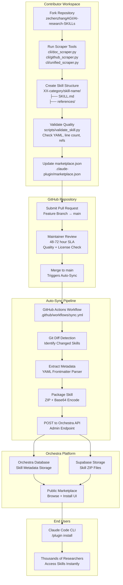
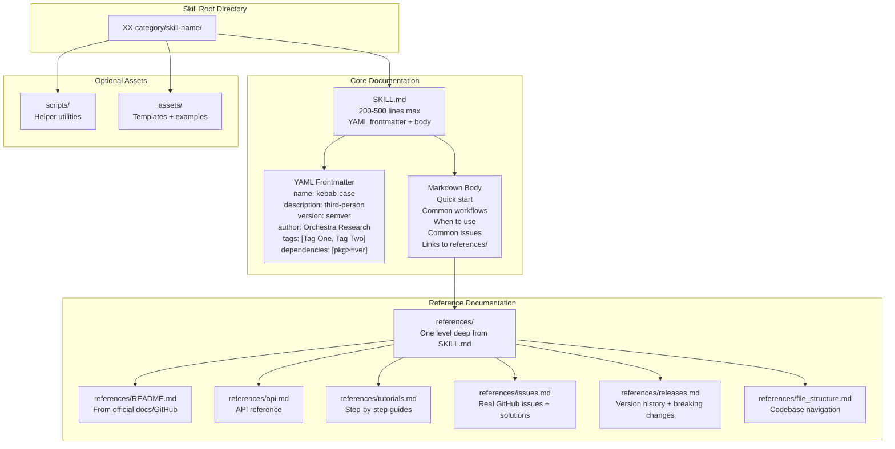
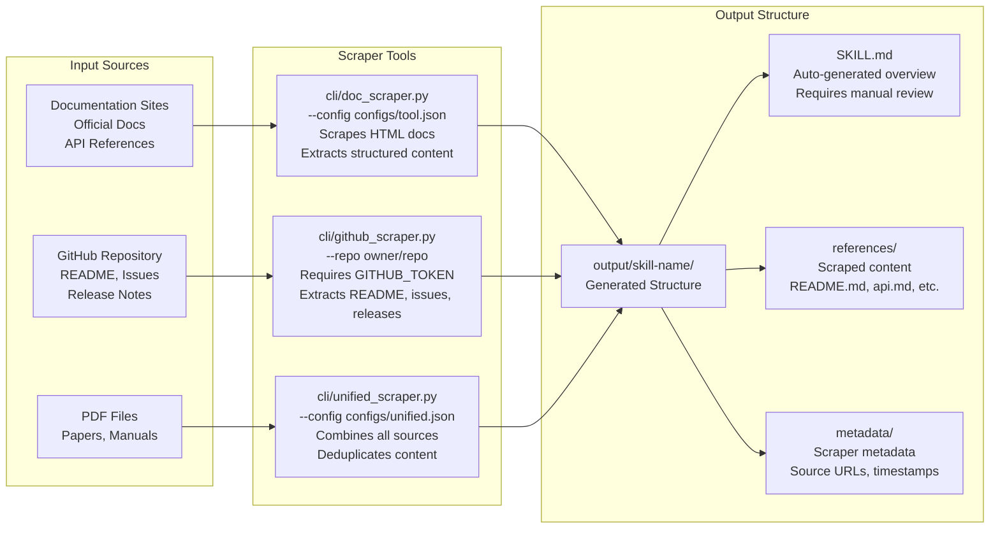
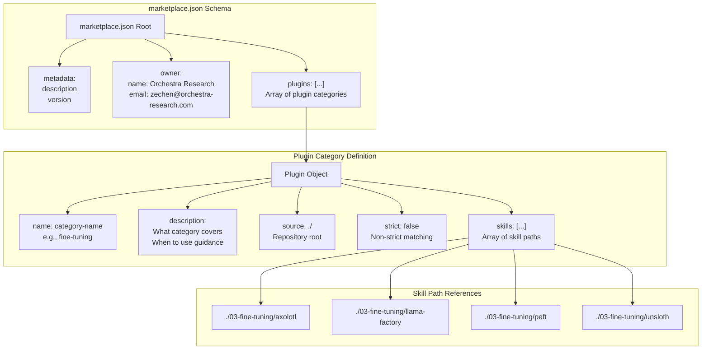
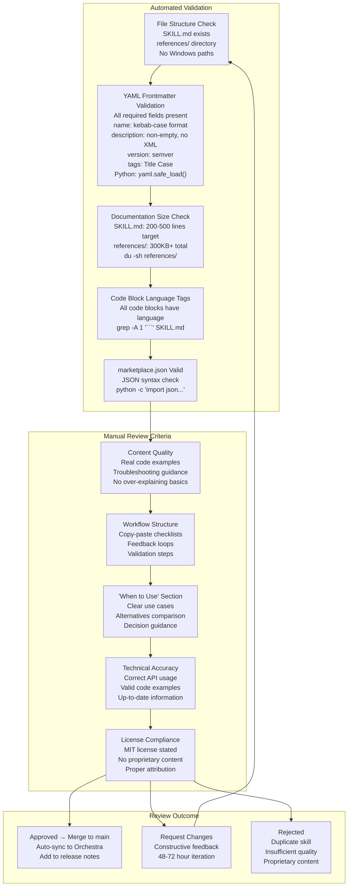

<!-- source: DeepWiki mcp.deepwiki.com · repo zechenzhangAGI/AI-research-SKILLs · page 5 Contributing to the Library · fetched 2026-10-26 -->

# Contributing to the Library

<details>
<summary>Relevant source files</summary>

The following files were used as context for generating this wiki page:

- [.claude-plugin/marketplace.json](.claude-plugin/marketplace.json)
- [CONTRIBUTING.md](CONTRIBUTING.md)
- [README.md](README.md)
- [demos/README.md](demos/README.md)
- [docs/ROADMAP.md](docs/ROADMAP.md)
- [docs/SKILL_CREATION_GUIDE.md](docs/SKILL_CREATION_GUIDE.md)
- [docs/SKILL_TEMPLATE.md](docs/SKILL_TEMPLATE.md)
- [docs/christmas-tree.svg](docs/christmas-tree.svg)
- [docs/skills.png](docs/skills.png)
- [docs/tech-tree.svg](docs/tech-tree.svg)

</details>


This document provides a complete guide for contributing new skills to the AI Research SKILLs library. It covers the contribution workflow from initial research through marketplace publication, including the scraper tools, validation requirements, and automated sync pipeline.

**Scope**: This page covers the high-level contribution process and architecture. For detailed information on specific aspects:
- Skill structure and documentation standards → See [5.1](#5.1)
- Using the scraper tools → See [5.2](#5.2)
- Quality validation and review process → See [5.3](#5.3)
- Step-by-step contribution workflow → See [5.4](#5.4)

## Contribution Overview

The AI Research SKILLs library accepts contributions from the AI research community to expand coverage of AI/ML tools and frameworks. Each skill provides expert-level documentation that enables AI agents to autonomously implement research experiments.

**What You Can Contribute**:
- **New skills** - Add documentation for frameworks not yet covered
- **Skill improvements** - Update existing skills with new features, examples, or fixes
- **Documentation fixes** - Correct errors, broken links, or outdated information
- **Scraper enhancements** - Improve the automated documentation scrapers

**Current Coverage**: 77 skills across 20 categories spanning model architecture through deployment (see [2](#2) for full category reference).

Sources: [README.md:407-416](), [CONTRIBUTING.md:19-27]()

## Contribution Architecture

The library uses a hub-and-spoke architecture where GitHub serves as the single source of truth, with automated sync to the Orchestra marketplace for distribution.

### End-to-End Contribution Flow



**Key Integration Points**:

1. **`.claude-plugin/marketplace.json`** - Plugin manifest consumed by Claude Code CLI
2. **GitHub Actions Auto-Sync** - Zero-friction publishing (merge → production in minutes)
3. **Orchestra Admin API** - RESTful endpoint accepting skill metadata + ZIP payload
4. **Supabase Storage** - Cloud storage for versioned skill packages

Sources: [README.md:243-244](), [CONTRIBUTING.md:257-263](), [.claude-plugin/marketplace.json:1-250]()

## Skill File Structure

Each skill follows a standardized structure with progressive disclosure: a concise `SKILL.md` overview pointing to detailed reference files.

### Canonical Skill Directory Structure



**Critical Requirements**:

- `SKILL.md` must include valid YAML frontmatter (lines 1-9 typically)
- `name` field uses gerund form: `serving-llms`, `processing-data` (not `llm-server`, `data-processor`)
- `description` must be third-person and include **what** it does AND **when** to use it
- `tags` use Title Case, acronyms UPPERCASE: `[Inference, Serving, vLLM, PagedAttention]`
- `references/` must total 300KB+ documentation
- Reference files are **one level deep** (no nested references)

Sources: [CONTRIBUTING.md:286-309](), [docs/SKILL_TEMPLATE.md:1-107](), [docs/SKILL_CREATION_GUIDE.md:128-188]()

## Scraper Tool Ecosystem

The library provides three scraper tools that automate documentation gathering from official sources. These tools bootstrap high-quality skill documentation by extracting content from websites, GitHub repositories, and PDF files.

### Scraper Architecture and Data Flow



**Scraper Usage Patterns**:

1. **Documentation-heavy frameworks** (e.g., HuggingFace libraries):
   ```bash
   python3 cli/doc_scraper.py --config configs/transformers.json
   ```
   Best for: Official docs with API references, tutorials, guides

2. **GitHub-first projects** (e.g., research implementations):
   ```bash
   export GITHUB_TOKEN=$(gh auth token)
   python3 cli/github_scraper.py --repo vllm-project/vllm \
     --name vllm --description "High-throughput LLM inference"
   ```
   Best for: README-driven projects, issue-based troubleshooting

3. **Comprehensive skills** (e.g., enterprise frameworks):
   ```bash
   python3 cli/unified_scraper.py --config configs/nemo_unified.json
   ```
   Best for: Combining docs + GitHub + whitepapers for complete coverage

**Post-Scraping Manual Review Required**:
- Scrapers generate initial structure, but SKILL.md requires editing
- Remove over-explanations (assume Claude knows basics)
- Add workflows with copy-paste checklists
- Include "when to use vs alternatives" section
- Add common issues + solutions

Sources: [CONTRIBUTING.md:44-68](), [README.md:398-400]()

## Marketplace Integration

Skills are registered in `.claude-plugin/marketplace.json`, which serves as the plugin manifest for Claude Code CLI and the data source for Orchestra marketplace sync.

### marketplace.json Structure



**Adding a Skill to marketplace.json**:

When contributing a new skill, you must add an entry to the appropriate plugin category in [.claude-plugin/marketplace.json:11-249]():

```json
{
  "name": "category-name",
  "description": "Category purpose and when to use (from SKILL.md frontmatter)",
  "source": "./",
  "strict": false,
  "skills": [
    "./XX-category/existing-skill",
    "./XX-category/your-new-skill"
  ]
}
```

**Validation**:
```bash
# Verify JSON is valid after editing
python3 -c "import json; json.load(open('.claude-plugin/marketplace.json'))"
```

**Category Organization**:
- Categories match directory prefixes: `01-model-architecture` → `"name": "model-architecture"`
- Skills are ordered by category number (01 through 20)
- Each category has dedicated `description` explaining its scope

Sources: [.claude-plugin/marketplace.json:1-250](), [CONTRIBUTING.md:197-226]()

## Automated Sync Pipeline

When a pull request is merged to `main`, GitHub Actions automatically syncs changed skills to the Orchestra platform, making them instantly available to users.

### Sync Workflow Architecture

```mermaid
graph TB
    subgraph "Trigger Event"
        PUSH["git push → main<br/>Merged PR"]
    end
    
    subgraph "GitHub Actions Workflow"
        WORKFLOW[".github/workflows/sync.yml<br/>on: push: branches: [main]"]
        CHECKOUT["actions/checkout@v3<br/>Fetch full repository"]
        DIFF["git diff HEAD^ HEAD<br/>Detect changed files<br/>Filter: */SKILL.md paths"]
    end
    
    subgraph "Skill Processing"
        LOOP["For each changed skill:<br/>XX-category/skill-name/"]
        PARSE["Parse YAML Frontmatter<br/>Extract: name, description<br/>version, author, tags"]
        ZIP["Package Skill Directory<br/>ZIP entire folder<br/>Base64 encode"]
        BADGE["Determine Badge<br/>author=Orchestra Research → orchestra<br/>else → community"]
    end
    
    subgraph "Orchestra Admin API"
        POST["POST /api/admin/skills<br/>Authorization: Bearer TOKEN"]
        PAYLOAD["Request Body:<br/>{<br/>  name: skill-name,<br/>  description: ...,<br/>  category: category-name,<br/>  badge: orchestra|community,<br/>  zipData: base64-string<br/>}"]
    end
    
    subgraph "Orchestra Platform"
        UPSERT["Upsert Skill Record<br/>PostgreSQL skills table"]
        UPLOAD["Upload ZIP to Storage<br/>Supabase Storage bucket<br/>Path: skills/skill-name.zip"]
        INDEX["Update Search Index<br/>Tags, description, category"]
    end
    
    subgraph "Public Availability"
        API_RESP["200 OK Response<br/>Skill published"]
        USERS["Users see skill in<br/>Claude Code CLI<br/>Orchestra marketplace UI"]
    end
    
    PUSH --> WORKFLOW
    WORKFLOW --> CHECKOUT
    CHECKOUT --> DIFF
    
    DIFF --> LOOP
    LOOP --> PARSE
    PARSE --> ZIP
    ZIP --> BADGE
    
    BADGE --> POST
    POST --> PAYLOAD
    PAYLOAD --> UPSERT
    UPSERT --> UPLOAD
    UPLOAD --> INDEX
    
    INDEX --> API_RESP
    API_RESP --> USERS
```



**Badge Classification Logic**:
- `author: "Orchestra Research"` in YAML frontmatter → `badge: "orchestra"` (official)
- Any other author value → `badge: "community"` (community-contributed)

**Storage Path Structure**:
```
supabase-storage/
└── skills/
    ├── axolotl.zip
    ├── vllm.zip
    ├── grpo-rl-training.zip
    └── ...
```

**API Authentication**:
- Workflow uses `ORCHESTRA_ADMIN_TOKEN` secret stored in GitHub repository settings
- Token grants write access to Orchestra admin API endpoints
- Failed API calls prevent workflow completion (PR stays in "checks failed" state)

Sources: [README.md:243-244](), [CONTRIBUTING.md:257-263]()

## Quality Gates

Contributions must pass both automated validation and manual review before merge. This ensures consistent quality across all 77 skills.

### Validation and Review Process



**YAML Frontmatter Validation Script**:
```bash
# Extract and validate YAML from SKILL.md
python -c "
import yaml
content = open('SKILL.md').read()
yaml_content = content.split('---')[1]
metadata = yaml.safe_load(yaml_content)
assert 'name' in metadata
assert 'description' in metadata
assert 'version' in metadata
print('✅ YAML valid')
"
```

**Common Rejection Reasons**:
1. SKILL.md exceeds 500 lines (should split into reference files)
2. Missing workflows with copy-paste checklists
3. First-person descriptions ("I can help you...")
4. No "when to use vs alternatives" guidance
5. Code blocks without language tags
6. Over-explanation of basics Claude already knows
7. Nested references (must be one level deep)
8. Less than 300KB in references/ directory

Sources: [CONTRIBUTING.md:80-123](), [docs/SKILL_CREATION_GUIDE.md:515-547]()

## Contributor Recognition

All contributors are acknowledged in the project's recognition systems, with special status for top contributors.

### Recognition Tiers

| Contribution Level | Recognition | Status |
|-------------------|-------------|---------|
| 1 skill | Listed in [CONTRIBUTORS.md]() | Contributor |
| 3-4 skills | Mentioned in release notes | Active Contributor |
| 5+ skills | Featured on project homepage + Maintainer status | Core Contributor |

**Maintainer Privileges**:
- Direct commit access to non-main branches
- Priority review of community PRs
- Voting rights on roadmap decisions
- Recognition in skill metadata (`author` field)

**Skill Attribution**:
Each skill's YAML frontmatter includes contributor attribution:
```yaml
---
name: vllm-inference
description: ...
version: 1.0.0
author: Orchestra Research  # Core team skills
# OR
author: Community - @github-username  # Community contributions
---
```

**Public Visibility**:
- All skills auto-sync to [orchestra-research.com/research-skills](https://www.orchestra-research.com/research-skills)
- Community badges distinguish official vs. community-contributed skills
- Thousands of researchers access your expertise via Claude Code CLI

Sources: [CONTRIBUTING.md:420-428](), [README.md:269-273]()

## Contribution Workflow Summary

The complete end-to-end workflow for contributing a skill:

```mermaid
graph LR
    subgraph "Preparation"
        IDEA["Identify Skill Need<br/>Check ROADMAP.md<br/>Ensure no duplicates"]
        FORK["Fork Repository<br/>git clone your-fork"]
        BRANCH["Create Feature Branch<br/>git checkout -b add-skill"]
    end
    
    subgraph "Creation"
        SCRAPE["Run Scraper<br/>doc_scraper.py OR<br/>github_scraper.py OR<br/>unified_scraper.py"]
        REVIEW["Manual Review<br/>Edit SKILL.md<br/>Add workflows<br/>Remove over-explanations"]
        MOVE["Move to Category<br/>mv output/skill-name/<br/>XX-category/skill-name/"]
    end
    
    subgraph "Validation"
        VALIDATE["Run Validation<br/>Check YAML<br/>Check line count<br/>Check code tags<br/>Check references/ size"]
        UPDATE["Update marketplace.json<br/>Add skill to category<br/>Validate JSON"]
        TEST["Test Locally<br/>Load in Claude Code<br/>Verify workflows"]
    end
    
    subgraph "Submission"
        COMMIT["Git Commit<br/>Descriptive message<br/>Include doc stats"]
        PUSH["Git Push<br/>push origin add-skill"]
        PR["Create Pull Request<br/>Complete PR template<br/>Link to ROADMAP item"]
    end
    
    subgraph "Review and Merge"
        REVIEW_PR["Maintainer Review<br/>48-72 hour SLA<br/>Quality + License"]
        ITERATE["Address Feedback<br/>Update PR<br/>Re-validate"]
        MERGE_PR["Merge to main<br/>Auto-sync triggers<br/>Skill goes live"]
    end
    
    IDEA --> FORK
    FORK --> BRANCH
    BRANCH --> SCRAPE
    SCRAPE --> REVIEW
    REVIEW --> MOVE
    
    MOVE --> VALIDATE
    VALIDATE --> UPDATE
    UPDATE --> TEST
    
    TEST --> COMMIT
    COMMIT --> PUSH
    PUSH --> PR
    
    PR --> REVIEW_PR
    REVIEW_PR --> ITERATE
    ITERATE --> REVIEW_PR
    REVIEW_PR --> MERGE_PR
```



**Time Estimates**:
- Scraping documentation: 10-30 minutes (automated)
- Manual review and editing: 2-4 hours (depends on complexity)
- Validation and testing: 30 minutes
- Review iteration: 1-3 days (depends on feedback)
- **Total time to merge**: 1-5 days from initial scrape to production

**Next Steps**:
- For detailed skill structure requirements → See [5.1](#5.1)
- For scraper tool documentation → See [5.2](#5.2)
- For validation checklist → See [5.3](#5.3)
- For step-by-step workflow → See [5.4](#5.4)

Sources: [CONTRIBUTING.md:227-255](), [CONTRIBUTING.md:440-463]()

---

