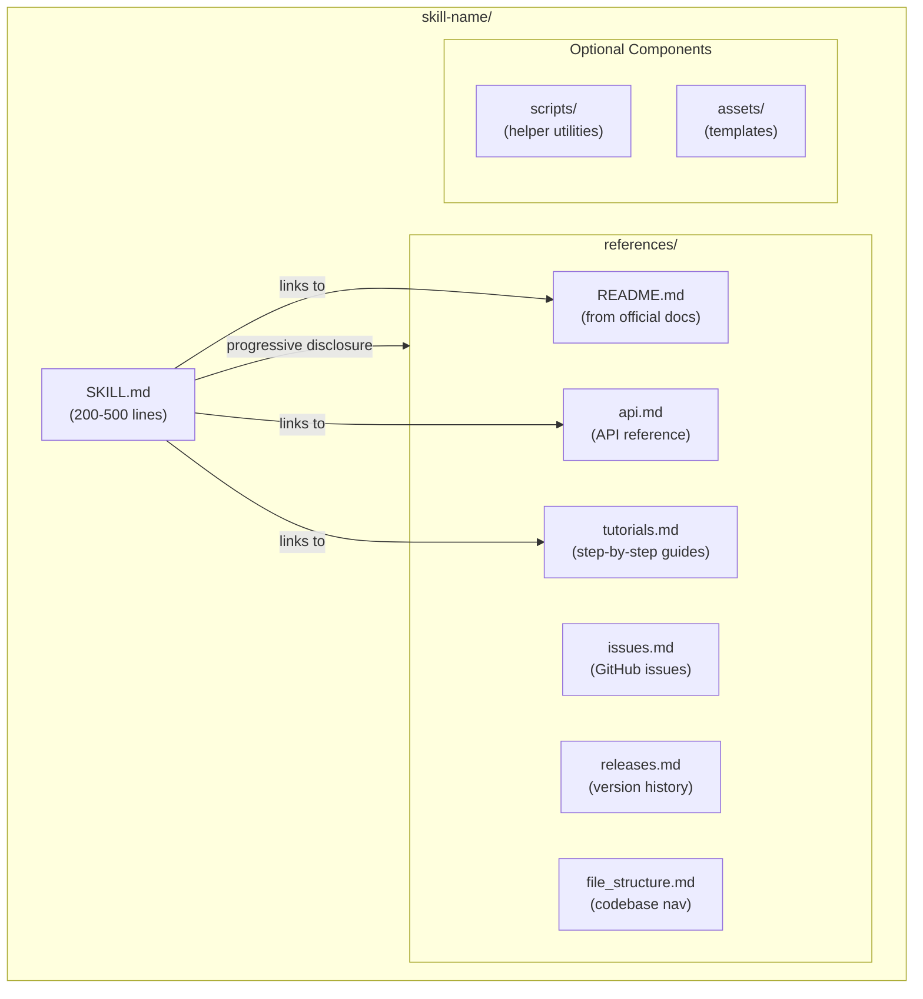
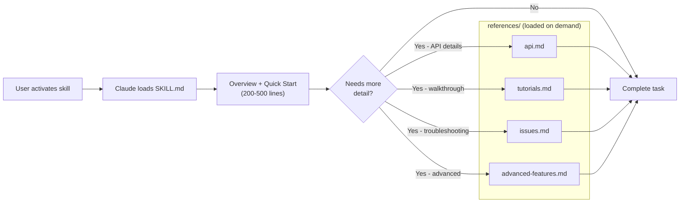
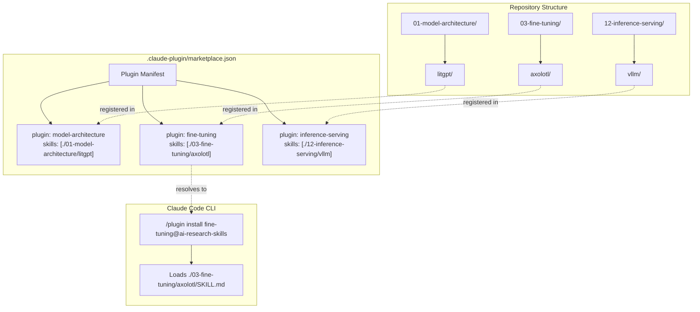
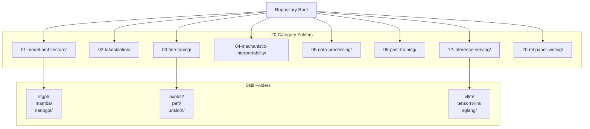

<!-- source: DeepWiki mcp.deepwiki.com · repo zechenzhangAGI/AI-research-SKILLs · page 5.1 Skill Structure & Documentation Standards · fetched 2026-10-26 -->

# Skill Structure & Documentation Standards

<details>
<summary>Relevant source files</summary>

The following files were used as context for generating this wiki page:

- [.claude-plugin/marketplace.json](.claude-plugin/marketplace.json)
- [CONTRIBUTING.md](CONTRIBUTING.md)
- [README.md](README.md)
- [demos/README.md](demos/README.md)
- [docs/ROADMAP.md](docs/ROADMAP.md)
- [docs/SKILL_CREATION_GUIDE.md](docs/SKILL_CREATION_GUIDE.md)
- [docs/SKILL_TEMPLATE.md](docs/SKILL_TEMPLATE.md)
- [docs/christmas-tree.svg](docs/christmas-tree.svg)
- [docs/skills.png](docs/skills.png)
- [docs/tech-tree.svg](docs/tech-tree.svg)

</details>


## Purpose and Scope

This document defines the technical structure and documentation requirements for all skills in the AI Research SKILLs library. It specifies the exact directory layout, YAML frontmatter format, file organization patterns, and size constraints that skills must follow.

For information about using automated scrapers to generate skill content, see [Using Skill Scrapers](#5.2). For quality validation and review processes, see [Quality Validation & Review Process](#5.3). For the complete contribution workflow from fork to merge, see [Contribution Workflow](#5.4).

Sources: [README.md:280-313](), [CONTRIBUTING.md:1-470](), [docs/SKILL_CREATION_GUIDE.md:1-646]()

---

## Directory Layout Specification

Every skill follows a standardized directory structure with two required components: `SKILL.md` (the main entry point) and an optional `references/` directory for detailed documentation.



**Actual file paths in repository:**
- Category folder: `XX-category-name/` (e.g., `03-fine-tuning/`, `12-inference-serving/`)
- Skill folder: `XX-category-name/skill-name/` (e.g., `03-fine-tuning/axolotl/`)
- Main file: `XX-category-name/skill-name/SKILL.md`
- References: `XX-category-name/skill-name/references/*.md`

Sources: [README.md:284-302](), [CONTRIBUTING.md:286-309](), [docs/SKILL_CREATION_GUIDE.md:230-263]()

---

## YAML Frontmatter Specification

Every `SKILL.md` file **must** begin with YAML frontmatter enclosed in `---` delimiters. This frontmatter is parsed by the marketplace system and Claude Code CLI.

### Frontmatter Format

```yaml
---
name: skill-name-here
description: Clear description of when to use this skill
version: 1.0.0
author: Orchestra Research
license: MIT
tags: [Tag One, Tag Two, Tag Three]
dependencies: [package1>=1.0.0, package2>=2.0.0]
---
```

### Field Requirements Table

| Field | Required | Format | Validation Rules | Example |
|-------|----------|--------|------------------|---------|
| `name` | ✅ Yes | `kebab-case` | Max 64 chars, lowercase + hyphens only, no quotes, gerund form preferred | `serving-llms`, `processing-data` |
| `description` | ✅ Yes | Plain text | Max 1024 chars, third person, includes what AND when, no quotes | `Serves LLMs with high throughput using vLLM's PagedAttention...` |
| `version` | ✅ Yes | Semantic version | `MAJOR.MINOR.PATCH` format | `1.0.0`, `2.1.3` |
| `author` | ✅ Yes | Plain text | Use "Orchestra Research" for library skills | `Orchestra Research` |
| `license` | ✅ Yes | License ID | Typically `MIT` | `MIT` |
| `tags` | ✅ Yes | Array | Title Case, 5-10 tags, acronyms UPPERCASE, no quotes | `[GRPO, TRL, RLHF]` |
| `dependencies` | ⚠️ Optional | Array | Include version constraints with `>=`, no quotes | `[transformers>=4.47.0]` |

Sources: [CONTRIBUTING.md:126-196](), [docs/SKILL_CREATION_GUIDE.md:122-227]()

### Naming Conventions

**`name` field rules:**
- Must use **gerund form** (verb + -ing): `serving-llms` not `llm-server`
- Lowercase letters, numbers, hyphens only
- No XML tags, no reserved words (`anthropic`, `claude`)
- Maximum 64 characters

**`description` field rules:**
- **Must be third person**: "Serves LLMs..." not "I can help you serve..."
- Include **what it does AND when to use it**
- Include key terms for discovery
- No XML tags, no quotes around the text

**`tags` field conventions:**
- Use **Title Case** for all tags (capitalize first letter)
- Keep acronyms **UPPERCASE**: `GRPO`, `TRL`, `RLHF`, `DPO`, `MLOps`, `RAG`
- 5-10 descriptive, searchable terms

Sources: [CONTRIBUTING.md:143-175](), [docs/SKILL_CREATION_GUIDE.md:151-178]()

### Valid vs Invalid Examples

**✅ Valid Frontmatter:**
```yaml
---
name: grpo-rl-training
description: Expert guidance for GRPO/RL fine-tuning with TRL for reasoning and task-specific model training
version: 1.0.0
author: Orchestra Research
license: MIT
tags: [Reinforcement Learning, GRPO, TRL, Post-Training, RLHF, Reward Modeling]
dependencies: [transformers>=4.47.0, trl>=0.14.0, datasets>=3.2.0, peft>=0.14.0]
---
```

**❌ Invalid Frontmatter (quotes and missing fields):**
```yaml
---
name: "skill-name"
description: "I can help you process files"
---
```

**❌ Invalid Frontmatter (first person, vague):**
```yaml
---
name: docs-helper
description: Helps with documents
version: 1.0.0
author: Orchestra Research
license: MIT
tags: [documents]
---
```

Sources: [CONTRIBUTING.md:176-227](), [docs/SKILL_CREATION_GUIDE.md:180-226]()

---

## Progressive Disclosure Architecture

Skills follow the **Progressive Disclosure** principle from Anthropic's best practices: `SKILL.md` serves as a concise overview that points to detailed reference files as needed.



### Size Constraints

| Component | Minimum | Target | Maximum | Rationale |
|-----------|---------|--------|---------|-----------|
| `SKILL.md` body | 50 lines | 200-300 lines | 500 lines | Optimize context window usage |
| `references/` total | 100 KB | 300 KB | No limit | Comprehensive documentation |
| Individual reference file | N/A | N/A | No limit | Use table of contents for >100 lines |

**Critical rule:** Keep references **ONE LEVEL DEEP** from `SKILL.md`. No nested references (e.g., `SKILL.md` → `advanced.md` → `details.md` is forbidden).

Sources: [README.md:286-291](), [CONTRIBUTING.md:82-112](), [docs/SKILL_CREATION_GUIDE.md:39-71]()

### Reference File Linking Pattern

**✅ Correct (one level deep):**
```markdown
# SKILL.md

## Advanced topics

**Server deployment**: See [server-deployment.md](server-deployment.md)
**Offline inference**: See [offline-inference.md](offline-inference.md)
**API reference**: See [api-reference.md](api-reference.md)
```

**❌ Incorrect (nested references):**
```markdown
# SKILL.md
See [advanced.md](advanced.md)...

# advanced.md
See [details.md](details.md)...

# details.md
Here's the actual information...
```

Sources: [docs/SKILL_CREATION_GUIDE.md:265-287]()

---

## File Organization Patterns

Skills can use different organizational patterns based on complexity.

### Simple Skill Pattern

For straightforward tools with minimal documentation:

```
skill-name/
└── SKILL.md
```

Example: Basic tokenization skill with self-contained documentation under 200 lines.

### Standard Skill Pattern

Most skills follow this structure:

```
skill-name/
├── SKILL.md
└── references/
    ├── README.md          # Official docs/GitHub README
    ├── api.md             # API reference
    ├── tutorials.md       # Step-by-step guides
    ├── issues.md          # Real GitHub issues with solutions
    ├── releases.md        # Version history and breaking changes
    └── file_structure.md  # Codebase navigation
```

Example: [03-fine-tuning/axolotl/](), [12-inference-serving/vllm/]()

### Complex Skill with Scripts Pattern

For skills requiring helper utilities:

```
skill-name/
├── SKILL.md
├── references/
│   ├── README.md
│   ├── api.md
│   └── troubleshooting.md
├── scripts/
│   ├── validate.py        # Validation utility
│   ├── setup.sh           # Setup script
│   └── helper.py          # Helper functions
└── assets/
    ├── config_template.yaml
    └── example.json
```

Example: Skills with complex configuration or setup requirements.

### Domain-Specific Organization Pattern

For skills covering multiple specialized domains:

```
bigquery-skill/
├── SKILL.md
└── reference/
    ├── finance.md         # Revenue, billing metrics
    ├── sales.md           # Opportunities, pipeline
    ├── product.md         # API usage, features
    └── marketing.md       # Campaigns, attribution
```

This pattern groups related functionality into domain-specific reference files.

Sources: [docs/SKILL_CREATION_GUIDE.md:230-263]()

---

## Marketplace Integration

Skills are registered in the Claude Code marketplace through `.claude-plugin/marketplace.json`. This file defines plugin categories and maps them to skill directories.



### Marketplace Entry Format

Each plugin in [.claude-plugin/marketplace.json:11-249]() follows this structure:

```json
{
  "name": "plugin-name",
  "description": "Plugin description matching category purpose",
  "source": "./",
  "strict": false,
  "skills": [
    "./XX-category/skill-name-1",
    "./XX-category/skill-name-2"
  ]
}
```

**Example from actual codebase:**

```json
{
  "name": "fine-tuning",
  "description": "LLM fine-tuning frameworks including Axolotl, LLaMA-Factory, PEFT, and Unsloth. Use when fine-tuning models with LoRA, QLoRA, or full fine-tuning.",
  "source": "./",
  "strict": false,
  "skills": [
    "./03-fine-tuning/axolotl",
    "./03-fine-tuning/llama-factory",
    "./03-fine-tuning/peft",
    "./03-fine-tuning/unsloth"
  ]
}
```

Sources: [.claude-plugin/marketplace.json:34-45](), [CONTRIBUTING.md:197-226]()

---

## Content Quality Standards

All skills must meet these documentation quality thresholds:

### Documentation Size Requirements

| Metric | Minimum | Target | Gold Standard |
|--------|---------|--------|---------------|
| Total documentation | 100 KB | 300 KB | 500 KB+ |
| `SKILL.md` length | 50 lines | 200-300 lines | 200-300 lines (optimal) |
| Number of reference files | 1 | 4-6 | 6+ with issues/releases |
| Code examples | 3+ | 5-10 | 10+ with explanations |

### Required Content Elements

**In `SKILL.md`:**
- ✅ YAML frontmatter with all required fields
- ✅ Quick start section with minimal working example
- ✅ 2-3 common workflows with copy-paste checklists
- ✅ "When to use vs alternatives" section
- ✅ Common issues section with solutions
- ✅ Links to reference files for advanced topics
- ✅ Code examples with language detection (```python, ```bash, etc.)

**In `references/`:**
- ✅ `README.md` from official documentation or GitHub
- ✅ `api.md` with API reference (if applicable)
- ✅ `tutorials.md` with step-by-step guides
- ✅ `issues.md` with real GitHub issues and solutions (if available)
- ✅ `releases.md` with version history and breaking changes (if available)

### Quality Validation Checklist

Before submission, verify:

```
Task Progress:
- [ ] YAML frontmatter includes all required fields (name, description, version, author, license, tags)
- [ ] Description is third person and includes what AND when to use it
- [ ] SKILL.md body is 200-500 lines (under 500 maximum)
- [ ] Code examples have language tags (```python, not ```)
- [ ] References are one level deep from SKILL.md
- [ ] Total references/ directory is 300KB+ for gold standard
- [ ] At least 2 workflows with copy-paste checklists
- [ ] "When to use vs alternatives" section present
- [ ] Common issues section with concrete solutions
- [ ] No Windows-style paths (use forward slashes)
- [ ] No time-sensitive information (use "old patterns" section instead)
- [ ] Marketplace.json updated with new skill entry
```

Sources: [CONTRIBUTING.md:80-123](), [docs/SKILL_CREATION_GUIDE.md:515-548]()

---

## Validation and Testing

### Manual Validation Steps

From the repository root, run these checks before submitting:

```bash
# 1. Verify SKILL.md has valid YAML frontmatter
python -c "import yaml; yaml.safe_load(open('XX-category/skill-name/SKILL.md').read().split('---')[1])"

# 2. Check line count (should be 200-500)
wc -l XX-category/skill-name/SKILL.md

# 3. Verify reference files exist
ls -lh XX-category/skill-name/references/

# 4. Check total documentation size (target: 300KB+)
du -sh XX-category/skill-name/references/

# 5. Validate marketplace.json is valid JSON
python3 -c "import json; json.load(open('.claude-plugin/marketplace.json'))"

# 6. Check for code blocks without language tags
grep -A 1 '```' XX-category/skill-name/SKILL.md | grep -v '```[a-z]'
```

### Common Validation Errors

| Error | Cause | Fix |
|-------|-------|-----|
| YAML parsing fails | Missing quotes, invalid format | Follow [CONTRIBUTING.md:126-196]() format exactly |
| SKILL.md too long | Over 500 lines | Split into reference files using Progressive Disclosure |
| References too small | Less than 100KB | Run scrapers or add more comprehensive docs |
| Nested references | `SKILL.md` → `ref1.md` → `ref2.md` | Flatten to one level deep |
| Code blocks untagged | Missing language in \`\`\` | Add language: \`\`\`python, \`\`\`bash |

Sources: [CONTRIBUTING.md:360-383](), [docs/SKILL_CREATION_GUIDE.md:515-548]()

---

## Example Skill Structures from Codebase

### Example 1: Fine-Tuning Skill (Standard Pattern)

Actual structure from [03-fine-tuning/axolotl/]():

```
03-fine-tuning/axolotl/
├── SKILL.md                    # 156 lines
└── references/
    ├── README.md               # Official documentation
    ├── api-reference.md        # API details
    ├── tutorials.md            # Training guides
    └── config-examples.md      # Configuration examples
```

### Example 2: Post-Training Skill (Gold Standard)

Actual structure from [06-post-training/grpo-rl-training/]():

```
06-post-training/grpo-rl-training/
├── SKILL.md                    # 569 lines (comprehensive workflows)
└── references/
    ├── README.md               # TRL documentation
    ├── api.md                  # API reference
    ├── examples.md             # Code examples
    └── troubleshooting.md      # Common issues
```

This is the "gold standard" skill with comprehensive workflows, 10+ code examples, and detailed troubleshooting.

### Example 3: Inference Skill (Production-Ready)

Actual structure from [12-inference-serving/vllm/]():

```
12-inference-serving/vllm/
├── SKILL.md                    # 356 lines
└── references/
    ├── README.md               # vLLM official docs
    ├── api-server.md           # OpenAI-compatible API
    ├── optimization.md         # Performance tuning
    └── deployment.md           # Production deployment
```

Sources: [README.md:110-226](), [CONTRIBUTING.md:387-407]()

---

## Anti-Patterns to Avoid

### ❌ Invalid Structures

**Wrong: Nested references**
```
skill-name/
├── SKILL.md
└── references/
    ├── advanced.md
    └── details/
        └── deep-dive.md    # ❌ Two levels deep
```

**Wrong: Windows paths**
```markdown
See [reference\guide.md](reference\guide.md)  # ❌ Backslashes
```

**Wrong: Over-sized SKILL.md**
```markdown
# SKILL.md  # ❌ 800 lines - should split into references/
```

**Wrong: First-person description**
```yaml
---
name: helper-skill
description: I can help you process data  # ❌ First person
---
```

**Wrong: Missing language tags**
````markdown
```  # ❌ No language specified
import transformers
model = AutoModel.from_pretrained("gpt2")
```
````

### ✅ Correct Patterns

**Correct: One-level references**
```
skill-name/
├── SKILL.md
└── references/
    ├── advanced.md       # ✅ One level deep
    └── details.md        # ✅ One level deep
```

**Correct: Unix paths**
```markdown
See [references/guide.md](references/guide.md)  # ✅ Forward slashes
```

**Correct: Concise SKILL.md**
```markdown
# SKILL.md  # ✅ 250 lines with links to references/
```

**Correct: Third-person description**
```yaml
---
name: processing-data
description: Processes large datasets using Ray Data for distributed ETL  # ✅ Third person
---
```

**Correct: Tagged code blocks**
````markdown
```python  # ✅ Language specified
import transformers
model = AutoModel.from_pretrained("gpt2")
```
````

Sources: [docs/SKILL_CREATION_GUIDE.md:472-512]()

---

## Repository Directory Structure

All skills are organized into 20 numbered category directories:



**Complete category list from [README.md:341-369]():**

| Category ID | Directory | Skill Count |
|-------------|-----------|-------------|
| 01 | `01-model-architecture/` | 5 |
| 02 | `02-tokenization/` | 2 |
| 03 | `03-fine-tuning/` | 4 |
| 04 | `04-mechanistic-interpretability/` | 4 |
| 05 | `05-data-processing/` | 2 |
| 06 | `06-post-training/` | 4 |
| 07 | `07-safety-alignment/` | 3 |
| 08 | `08-distributed-training/` | 5 |
| 09 | `09-infrastructure/` | 3 |
| 10 | `10-optimization/` | 6 |
| 11 | `11-evaluation/` | 3 |
| 12 | `12-inference-serving/` | 4 |
| 13 | `13-mlops/` | 3 |
| 14 | `14-agents/` | 4 |
| 15 | `15-rag/` | 5 |
| 16 | `16-prompt-engineering/` | 4 |
| 17 | `17-observability/` | 2 |
| 18 | `18-multimodal/` | 7 |
| 19 | `19-emerging-techniques/` | 6 |
| 20 | `20-ml-paper-writing/` | 1 |

Sources: [README.md:341-369]()

---

## Summary: Key Requirements

**Every skill must have:**

1. **YAML frontmatter** with all required fields (`name`, `description`, `version`, `author`, `license`, `tags`)
2. **SKILL.md body** between 200-500 lines (under 500 maximum)
3. **Progressive Disclosure** - overview in SKILL.md, details in one-level-deep references
4. **Code examples** with language tags (```python, ```bash, etc.)
5. **Workflows** with copy-paste checklists for multi-step tasks
6. **References directory** with 300KB+ documentation for gold standard
7. **Marketplace entry** in `.claude-plugin/marketplace.json`

**Common mistakes to avoid:**

1. ❌ First-person descriptions ("I can help...")
2. ❌ Missing language tags in code blocks
3. ❌ SKILL.md over 500 lines
4. ❌ Nested references (must be one level deep)
5. ❌ Windows-style paths (use forward slashes)
6. ❌ Vague skill names (use gerund form with specific terms)

For the next steps in creating a skill, see [Using Skill Scrapers](#5.2) to generate content, [Quality Validation & Review Process](#5.3) for validation steps, and [Contribution Workflow](#5.4) for the complete submission process.

Sources: [README.md:280-313](), [CONTRIBUTING.md:1-470](), [docs/SKILL_CREATION_GUIDE.md:1-646]()

---

