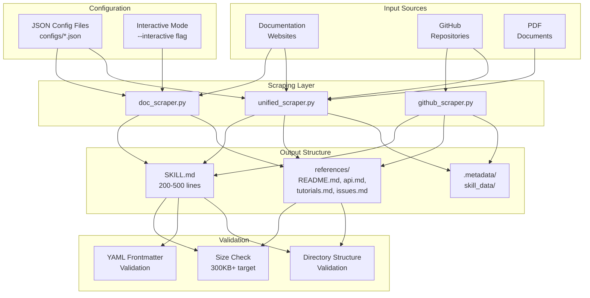
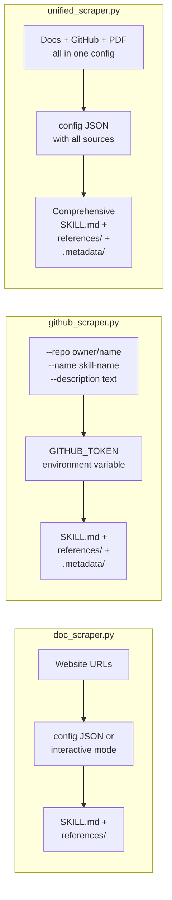
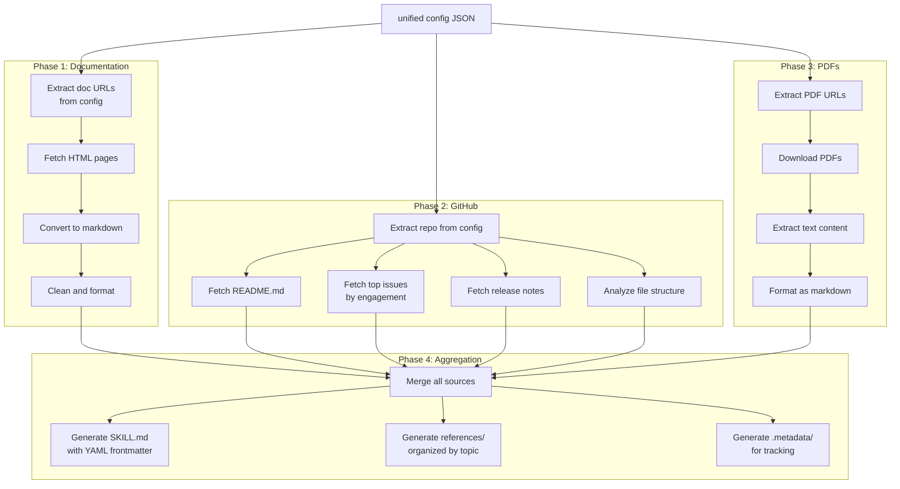
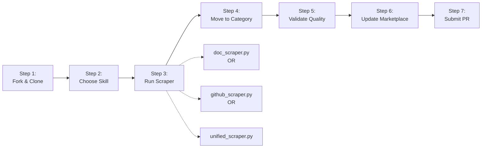

<!-- source: DeepWiki mcp.deepwiki.com · repo zechenzhangAGI/AI-research-SKILLs · page 5.2 Using Skill Scrapers · fetched 2026-10-26 -->

# Using Skill Scrapers

<details>
<summary>Relevant source files</summary>

The following files were used as context for generating this wiki page:

- [.claude-plugin/marketplace.json](.claude-plugin/marketplace.json)
- [CONTRIBUTING.md](CONTRIBUTING.md)
- [README.md](README.md)
- [demos/README.md](demos/README.md)
- [docs/ROADMAP.md](docs/ROADMAP.md)
- [docs/SKILL_CREATION_GUIDE.md](docs/SKILL_CREATION_GUIDE.md)
- [docs/SKILL_TEMPLATE.md](docs/SKILL_TEMPLATE.md)
- [docs/christmas-tree.svg](docs/christmas-tree.svg)
- [docs/skills.png](docs/skills.png)
- [docs/tech-tree.svg](docs/tech-tree.svg)

</details>


## Purpose and Scope

This page documents the three automated scraping tools used to bootstrap high-quality documentation when creating new skills for the AI Research SKILLs library. These scrapers gather comprehensive documentation from official sources (websites, GitHub repositories, PDFs) to create the foundation for SKILL.md files and reference documentation.

For information about the required structure of the output documentation, see [Skill Structure & Documentation Standards](#5.1). For the complete contribution workflow, see [Contribution Workflow](#5.4). For validation requirements, see [Quality Validation & Review Process](#5.3).

---

## Overview of Scraper Tools

The library provides three Python-based scraping utilities located in the `cli/` directory:

| Scraper | Purpose | Input Sources | Typical Output Size |
|---------|---------|---------------|---------------------|
| `doc_scraper.py` | Scrape official documentation websites | Documentation URLs | 100-300KB |
| `github_scraper.py` | Scrape GitHub repositories | Repository owner/name | 200-500KB |
| `unified_scraper.py` | Comprehensive multi-source scraping | Docs + GitHub + PDFs | 300KB+ |

All scrapers generate standardized output with a `SKILL.md` overview and `references/` directory containing detailed documentation.

Sources: [README.md:399](), [CONTRIBUTING.md:44-68]()

---

## Scraper Architecture

### High-Level Data Flow



**Diagram: Skill Scraper Data Flow** - Shows how each scraper processes different input sources and generates standardized output for validation.

Sources: [CONTRIBUTING.md:44-68](), [CONTRIBUTING.md:80-123]()

### Scraper Tool Comparison



**Diagram: Scraper Tool Inputs and Outputs** - Comparison of the three scraper tools and their configuration requirements.

Sources: [CONTRIBUTING.md:46-67]()

---

## doc_scraper.py: Documentation Scraping

The `doc_scraper.py` tool scrapes official documentation websites to create reference materials. It supports both interactive configuration and JSON config files.

### Usage Modes

**Interactive Mode**: Create configuration interactively

```bash
python3 cli/doc_scraper.py --interactive
```

This prompts for:
- Skill name
- Description
- Documentation URLs to scrape
- Output preferences

**Config File Mode**: Use pre-existing configuration

```bash
python3 cli/doc_scraper.py --config configs/vllm.json
```

### Configuration File Structure

Configuration files are stored in `configs/` and follow this JSON schema:

```json
{
  "name": "skill-name",
  "description": "Brief description of what this skill provides",
  "urls": [
    "https://docs.example.com/getting-started",
    "https://docs.example.com/api-reference",
    "https://docs.example.com/tutorials"
  ],
  "output_dir": "output/skill-name"
}
```

Example config files can be copied and modified:

```bash
# Copy existing config as template
cp configs/react.json configs/vllm.json
# Edit with your URLs and settings
```

### Output Structure

```
output/
└── skill-name/
    ├── SKILL.md              # Generated overview
    └── references/
        ├── getting-started.md
        ├── api-reference.md
        └── tutorials.md
```

Each scraped URL becomes a separate markdown file in `references/`. The scraper automatically:
- Converts HTML to clean markdown
- Preserves code blocks with language tags
- Extracts navigation structure
- Maintains links and cross-references

Sources: [CONTRIBUTING.md:46-55](), [README.md:399]()

---

## github_scraper.py: Repository Scraping

The `github_scraper.py` tool scrapes GitHub repositories to extract comprehensive documentation including README, issues, releases, and file structure.

### Prerequisites

Set GitHub authentication token:

```bash
export GITHUB_TOKEN=$(gh auth token)
```

Or manually:

```bash
export GITHUB_TOKEN=ghp_your_token_here
```

### Command Syntax

```bash
python3 cli/github_scraper.py \
  --repo owner/repository \
  --name skill-name \
  --description "Brief description for YAML frontmatter"
```

### Example: Scraping vLLM

```bash
export GITHUB_TOKEN=$(gh auth token)
python3 cli/github_scraper.py \
  --repo vllm-project/vllm \
  --name vllm \
  --description "High-performance LLM inference with PagedAttention"
```

### Scraped Content

The `github_scraper.py` extracts:

| Content Type | Output File | Purpose |
|--------------|-------------|---------|
| Repository README | `references/README.md` | Core documentation from GitHub |
| API documentation | `references/api.md` | Extracted from docs/ folder if present |
| Tutorial content | `references/tutorials.md` | Getting started guides |
| GitHub issues | `references/issues.md` | Real-world problems and solutions |
| Release notes | `references/releases.md` | Version history and breaking changes |
| File structure | `references/file_structure.md` | Codebase navigation guide |

### Output Structure

```
output/
└── vllm/
    ├── SKILL.md                      # Overview with YAML frontmatter
    └── references/
        ├── README.md                 # Repository README
        ├── api.md                    # API reference
        ├── tutorials.md              # Getting started
        ├── issues.md                 # 10-20 real GitHub issues
        ├── releases.md               # Version history
        └── file_structure.md         # Repo structure guide
.metadata/
└── vllm_data/
    ├── scrape_metadata.json          # Scraping timestamp and stats
    └── raw_responses/                # API responses for debugging
```

The `github_scraper.py` automatically:
- Fetches latest README via GitHub API
- Parses issues with high engagement (comments, reactions)
- Extracts release notes from GitHub Releases
- Maps repository directory structure
- Generates YAML frontmatter with detected tags

Sources: [CONTRIBUTING.md:57-62](), [CONTRIBUTING.md:292-308]()

---

## unified_scraper.py: Comprehensive Scraping

The `unified_scraper.py` tool combines documentation scraping, GitHub scraping, and PDF processing into a single comprehensive workflow. This is the recommended approach for creating high-quality skills.

### When to Use unified_scraper.py

Use `unified_scraper.py` when:
- The framework has both official documentation and an active GitHub repository
- You want to include research papers (PDFs) in references
- The skill requires comprehensive coverage (300KB+ documentation target)
- You need both conceptual docs and real-world troubleshooting examples

Use simpler scrapers when:
- Only documentation website exists → use `doc_scraper.py`
- Only GitHub repository exists → use `github_scraper.py`

### Configuration File Structure

```json
{
  "name": "vllm",
  "description": "High-performance LLM inference with PagedAttention and continuous batching",
  "sources": {
    "documentation": {
      "urls": [
        "https://docs.vllm.ai/en/latest/getting_started/quickstart.html",
        "https://docs.vllm.ai/en/latest/serving/openai_compatible_server.html",
        "https://docs.vllm.ai/en/latest/models/supported_models.html"
      ]
    },
    "github": {
      "repo": "vllm-project/vllm",
      "include_issues": true,
      "issue_limit": 20
    },
    "pdfs": [
      {
        "url": "https://arxiv.org/pdf/2309.06180.pdf",
        "title": "Efficient Memory Management for Large Language Model Serving with PagedAttention"
      }
    ]
  },
  "output_dir": "output/vllm"
}
```

### Running unified_scraper.py

```bash
# Set GitHub token
export GITHUB_TOKEN=$(gh auth token)

# Run comprehensive scraping
python3 cli/unified_scraper.py --config configs/vllm_unified.json
```

### Output Structure

```
output/
└── vllm/
    ├── SKILL.md                      # Comprehensive overview
    └── references/
        ├── README.md                 # From GitHub
        ├── quickstart.md             # From docs site
        ├── openai_server.md          # From docs site
        ├── supported_models.md       # From docs site
        ├── api.md                    # Generated from docs
        ├── tutorials.md              # Aggregated guides
        ├── issues.md                 # 20 GitHub issues with solutions
        ├── releases.md               # Version history
        ├── file_structure.md         # Repo navigation
        └── papers/
            └── paged_attention.md    # Extracted from PDF
.metadata/
└── vllm_data/
    ├── scrape_metadata.json          # Complete scraping stats
    ├── documentation_responses/      # Cached doc pages
    ├── github_responses/             # GitHub API responses
    └── pdf_cache/                    # Downloaded PDFs
```

### Scraper Processing Pipeline



**Diagram: unified_scraper.py Processing Pipeline** - Multi-phase scraping and aggregation workflow for comprehensive skill creation.

Sources: [CONTRIBUTING.md:64-67]()

---

## Integration with Contribution Workflow

### Position in Workflow

The scrapers fit into Step 3 of the contribution process:



**Diagram: Scraper Position in Contribution Workflow** - Step 3 uses one of the three scrapers to bootstrap documentation.

### Moving Output to Correct Directory

After scraping, move the generated skill to its category:

```bash
# Scraper outputs to output/ directory
python3 cli/unified_scraper.py --config configs/vllm_unified.json

# Determine category based on skill type
# See directory structure in CONTRIBUTING.md
mv output/vllm/ 12-inference-serving/vllm/

# Move metadata for tracking
mv .metadata/vllm_data/ .metadata/vllm_data/
```

Category mapping:

| Skill Type | Directory |
|------------|-----------|
| Model architectures | `01-model-architecture/` |
| Tokenization | `02-tokenization/` |
| Fine-tuning frameworks | `03-fine-tuning/` |
| Interpretability tools | `04-mechanistic-interpretability/` |
| Data processing | `05-data-processing/` |
| RLHF/alignment | `06-post-training/` |
| Safety systems | `07-safety-alignment/` |
| Distributed training | `08-distributed-training/` |
| Cloud infrastructure | `09-infrastructure/` |
| Optimization/quantization | `10-optimization/` |
| Evaluation frameworks | `11-evaluation/` |
| Inference engines | `12-inference-serving/` |
| Experiment tracking | `13-mlops/` |
| Agent frameworks | `14-agents/` |
| RAG/vector databases | `15-rag/` |
| Prompt engineering | `16-prompt-engineering/` |
| LLM observability | `17-observability/` |
| Multimodal models | `18-multimodal/` |
| Advanced techniques | `19-emerging-techniques/` |
| Paper writing | `20-ml-paper-writing/` |

Sources: [CONTRIBUTING.md:70-78](), [CONTRIBUTING.md:258-282]()

---

## Post-Scraping Validation

### Quality Checks

After running scrapers, validate the output:

```bash
# 1. Check SKILL.md exists and has YAML frontmatter
cat 12-inference-serving/vllm/SKILL.md | head -20

# 2. Verify reference files exist
ls -lh 12-inference-serving/vllm/references/

# 3. Check documentation size (target: 300KB+)
du -sh 12-inference-serving/vllm/references/

# 4. Verify code blocks have language tags
grep -A 1 '```' 12-inference-serving/vllm/SKILL.md | head -20
```

### Required Manual Edits

Scrapers bootstrap documentation but require manual refinement:

**SKILL.md refinement**:
1. Trim to 200-500 lines (split excess into reference files)
2. Add 2-3 workflows with copy-paste checklists
3. Add "When to use vs alternatives" section
4. Add "Common issues" section with solutions
5. Ensure YAML frontmatter is complete and accurate

**Reference file refinement**:
1. Organize by topic (combine similar content)
2. Add table of contents to files >100 lines
3. Clean up formatting and broken links
4. Verify code examples have language tags

### Validation Command

```bash
# Run validation script (if implemented)
python scripts/validate_skill.py 12-inference-serving/vllm/

# Manual checks
cd 12-inference-serving/vllm/
wc -l SKILL.md  # Should be 200-500 lines
du -sh references/  # Should be 300KB+
```

Sources: [CONTRIBUTING.md:80-123](), [CONTRIBUTING.md:364-383]()

---

## Common Scraping Patterns

### Pattern 1: Simple Documentation-Only Skill

For frameworks with good official docs but minimal GitHub activity:

```bash
# Create config
cat > configs/library.json << EOF
{
  "name": "library-name",
  "description": "Description of the library",
  "urls": [
    "https://docs.library.org/quickstart",
    "https://docs.library.org/api"
  ]
}
EOF

# Scrape
python3 cli/doc_scraper.py --config configs/library.json

# Move and refine
mv output/library-name/ 03-fine-tuning/library-name/
```

### Pattern 2: GitHub-Focused Skill

For open-source projects where GitHub is the primary documentation:

```bash
# Set token
export GITHUB_TOKEN=$(gh auth token)

# Scrape
python3 cli/github_scraper.py \
  --repo org/project \
  --name project-name \
  --description "Brief description"

# Move
mv output/project-name/ 08-distributed-training/project-name/
mv .metadata/project-name_data/ .metadata/
```

### Pattern 3: Comprehensive Academic Tool

For tools with papers, docs, and active GitHub:

```bash
# Create comprehensive config
cat > configs/tool_unified.json << EOF
{
  "name": "tool-name",
  "description": "Description with key terms",
  "sources": {
    "documentation": {
      "urls": ["https://docs.tool.org/guide"]
    },
    "github": {
      "repo": "org/tool",
      "include_issues": true,
      "issue_limit": 15
    },
    "pdfs": [
      {
        "url": "https://arxiv.org/pdf/xxxx.xxxxx.pdf",
        "title": "Paper Title"
      }
    ]
  }
}
EOF

# Scrape
export GITHUB_TOKEN=$(gh auth token)
python3 cli/unified_scraper.py --config configs/tool_unified.json

# Move
mv output/tool-name/ 04-mechanistic-interpretability/tool-name/
```

Sources: [CONTRIBUTING.md:46-67]()

---

## Troubleshooting

### Issue: GitHub API Rate Limiting

**Symptoms**: `github_scraper.py` or `unified_scraper.py` fails with 403 Forbidden

**Solution**: Ensure GitHub token is set and has sufficient rate limit

```bash
# Check token is set
echo $GITHUB_TOKEN

# Check rate limit
curl -H "Authorization: token $GITHUB_TOKEN" \
  https://api.github.com/rate_limit

# If rate limited, wait for reset time shown in response
```

### Issue: Documentation Website Blocking Scraper

**Symptoms**: `doc_scraper.py` returns empty or incomplete content

**Solutions**:
1. Check if site requires JavaScript rendering (scraper uses static HTML)
2. Add delay between requests if getting rate limited
3. Manually download pages and place in `references/` if site blocks automated access

### Issue: Generated SKILL.md Too Long

**Symptoms**: SKILL.md exceeds 500 lines after scraping

**Solution**: Split content into reference files

```bash
# Move advanced sections to reference files
# Keep in SKILL.md:
# - Quick start (20-30 lines)
# - Common workflows (80-120 lines)
# - When to use (20-30 lines)
# - Common issues (30-50 lines)
# - Links to references (10-20 lines)

# Move to references/:
# - Detailed API documentation → references/api.md
# - Advanced features → references/advanced.md
# - Troubleshooting → references/troubleshooting.md
# - Configuration reference → references/config.md
```

### Issue: Missing YAML Frontmatter

**Symptoms**: SKILL.md doesn't have valid YAML frontmatter after scraping

**Solution**: Add required frontmatter manually

```yaml
---
name: skill-name
description: Third-person description including what and when
version: 1.0.0
author: Orchestra Research
license: MIT
tags: [Tag One, Tag Two, Key Concept]
dependencies: [package1>=1.0.0, package2>=2.0.0]
---
```

Validate with:

```bash
python -c "import yaml; yaml.safe_load(open('SKILL.md').read().split('---')[1])"
```

Sources: [CONTRIBUTING.md:127-196](), [CONTRIBUTING.md:364-383]()

---

## Best Practices

### Before Scraping

1. **Research the tool thoroughly**: Identify all documentation sources
2. **Check existing skills**: Avoid duplicates by reviewing current library
3. **Choose appropriate scraper**: Match scraper to available sources
4. **Plan directory structure**: Know which category the skill belongs to

### During Scraping

1. **Use unified_scraper.py for gold standard skills**: Comprehensive documentation requires all sources
2. **Set conservative rate limits**: Respect API and website rate limits
3. **Cache responses**: Scrapers store responses in `.metadata/` for debugging
4. **Monitor output size**: Aim for 300KB+ total documentation

### After Scraping

1. **Validate immediately**: Run quality checks before further editing
2. **Refine SKILL.md**: Trim to 200-500 lines with progressive disclosure
3. **Organize references**: Group related content into topic-specific files
4. **Add workflows**: Create 2-3 copy-paste checklists for common tasks
5. **Test code examples**: Verify all code snippets are accurate and complete

### Documentation Quality

Target metrics for gold standard skills:
- **SKILL.md**: 200-500 lines (focused overview)
- **References total**: 300KB+ (comprehensive details)
- **Workflows**: 2-3 with copy-paste checklists
- **Code examples**: All have language tags (```python, ```bash, etc.)
- **Issues coverage**: 10-20 real GitHub issues with solutions
- **API documentation**: Complete reference in `references/api.md`

Sources: [CONTRIBUTING.md:80-123](), [CONTRIBUTING.md:335-349]()

---

## Resources

### Related Documentation

- [Skill Structure & Documentation Standards](#5.1) - Required output format
- [Quality Validation & Review Process](#5.3) - Validation requirements
- [Contribution Workflow](#5.4) - Complete contribution process

### External Resources

- [Skill Seeker Project](https://github.com/yusufkaraaslan/Skill_Seekers) - Original scraping framework
- [Anthropic Best Practices](anthropic_official_docs/best_practices.md) - Progressive disclosure principles

### Example Configurations

Configuration files for reference:
- `configs/react.json` - Documentation scraping example
- `configs/vllm.json` - GitHub scraping example  
- `configs/vllm_unified.json` - Comprehensive scraping example

Sources: [README.md:399](), [CONTRIBUTING.md:1-470]()

---

