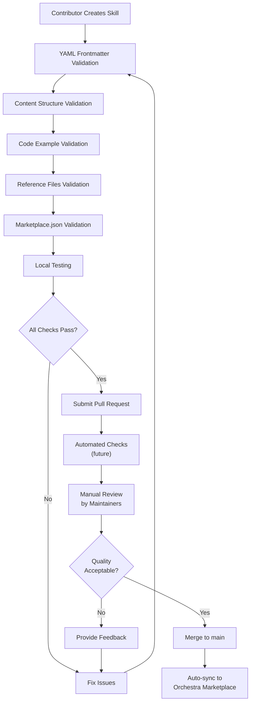
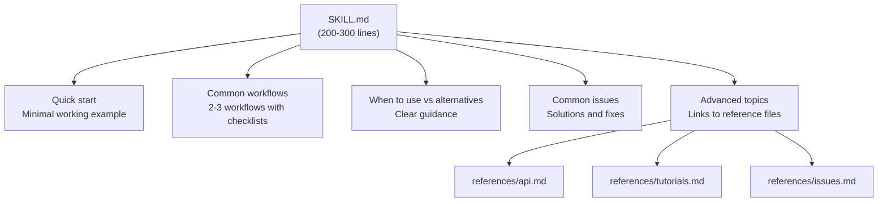
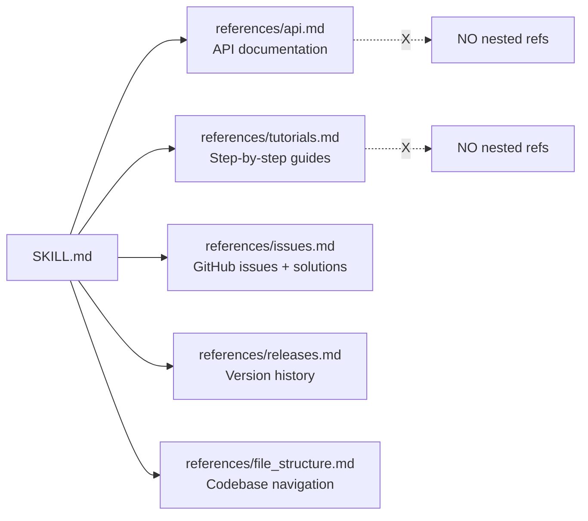
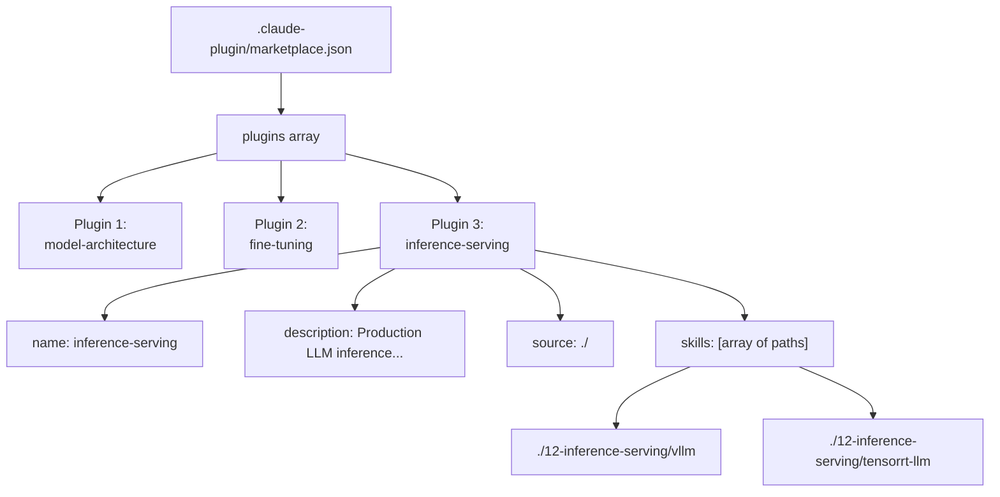
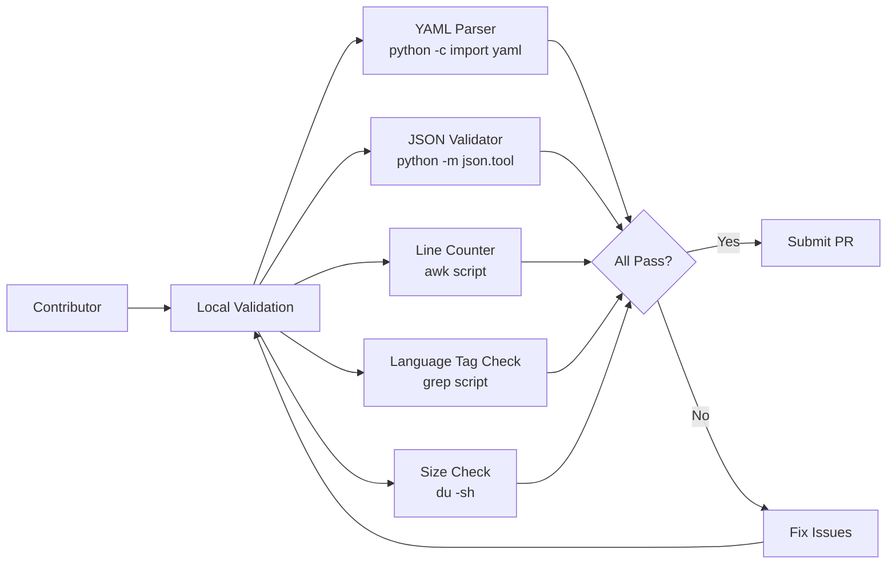
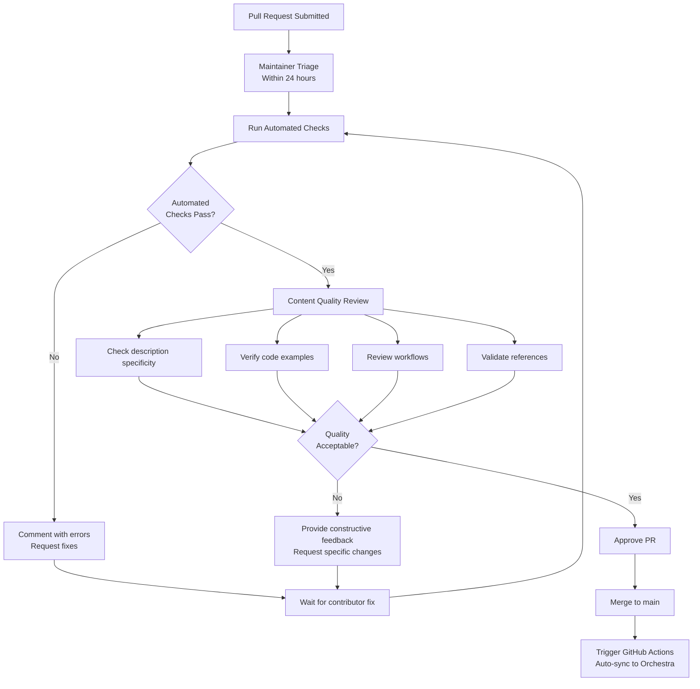
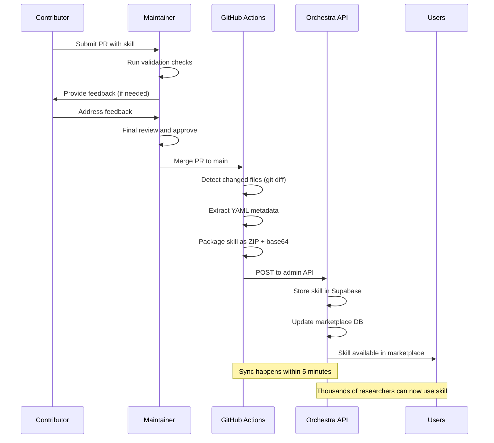

<!-- source: DeepWiki mcp.deepwiki.com · repo zechenzhangAGI/AI-research-SKILLs · page 5.3 Quality Validation & Review Process · fetched 2026-10-26 -->

# Quality Validation & Review Process

<details>
<summary>Relevant source files</summary>

The following files were used as context for generating this wiki page:

- [.claude-plugin/marketplace.json](.claude-plugin/marketplace.json)
- [CONTRIBUTING.md](CONTRIBUTING.md)
- [README.md](README.md)
- [demos/README.md](demos/README.md)
- [docs/ROADMAP.md](docs/ROADMAP.md)
- [docs/SKILL_CREATION_GUIDE.md](docs/SKILL_CREATION_GUIDE.md)
- [docs/SKILL_TEMPLATE.md](docs/SKILL_TEMPLATE.md)
- [docs/christmas-tree.svg](docs/christmas-tree.svg)
- [docs/skills.png](docs/skills.png)
- [docs/tech-tree.svg](docs/tech-tree.svg)

</details>


## Purpose and Scope

This document details the validation checkpoints, quality requirements, and review workflow for skill contributions to the AI Research SKILLs library. All skills must pass multiple validation stages before merge to ensure consistent quality, usability, and integration with the Claude Code CLI marketplace.

For information about the overall contribution workflow (fork → scrape → validate → PR), see [Contribution Workflow](#5.4). For details on skill structure requirements and documentation standards, see [Skill Structure & Documentation Standards](#5.1).

## Validation Pipeline Overview

The validation process consists of pre-submission checks performed by contributors and post-submission manual review by maintainers:



**Sources:** [CONTRIBUTING.md:440-463](), [README.md:274-278]()

## Pre-Submission Validation

Contributors must validate their skills locally before submitting pull requests. The validation process checks five critical areas:

### YAML Frontmatter Validation

Every `SKILL.md` file must begin with valid YAML frontmatter containing required metadata fields. The frontmatter enables skill discovery in the Claude Code marketplace and Orchestra platform.

**Required Fields:**

| Field | Format | Validation Rules | Example |
|-------|--------|------------------|---------|
| `name` | `kebab-case` | Max 64 chars, lowercase+hyphens only, no quotes, no reserved words (`anthropic`, `claude`) | `grpo-rl-training` |
| `description` | Plain text | Max 1024 chars, third-person, includes what AND when, no quotes | `Expert guidance for GRPO/RL fine-tuning with TRL for reasoning and task-specific model training` |
| `version` | Semantic version | `MAJOR.MINOR.PATCH` format | `1.0.0` |
| `author` | Plain text | Typically `Orchestra Research` | `Orchestra Research` |
| `license` | License identifier | Typically `MIT` | `MIT` |
| `tags` | Array | Title Case, capitalize acronyms, 5-10 tags, no quotes | `[Reinforcement Learning, GRPO, TRL, Post-Training]` |
| `dependencies` | Array (optional) | Include version constraints with `>=` | `[transformers>=4.47.0, trl>=0.14.0]` |

**Validation Command:**

```bash
# Test YAML parsing
python -c "import yaml; yaml.safe_load(open('SKILL.md').read().split('---')[1])"
```

**Sources:** [CONTRIBUTING.md:126-196](), [docs/SKILL_CREATION_GUIDE.md:123-227]()

**Common Validation Failures:**

```yaml
# ❌ BAD: Quotes around values
---
name: "skill-name"
description: "I can help you..."
---

# ❌ BAD: First person, vague
---
name: helper-utils
description: Helps with stuff
---

# ✅ GOOD: Proper format
---
name: serving-llms-vllm
description: Serves LLMs with high throughput using vLLM's PagedAttention and continuous batching. Use when deploying production LLM APIs or optimizing inference latency/throughput.
version: 1.0.0
author: Orchestra Research
license: MIT
tags: [Inference, Serving, vLLM, Production Deployment]
dependencies: [vllm>=0.2.0, torch>=2.0.0]
---
```

**Sources:** [CONTRIBUTING.md:176-227](), [docs/SKILL_CREATION_GUIDE.md:180-227]()

### Content Structure Validation

Skills must follow the Progressive Disclosure principle established by Anthropic best practices, keeping `SKILL.md` concise while providing deep documentation in reference files.

**Line Count Requirements:**

| Component | Minimum | Target | Maximum | Validation |
|-----------|---------|--------|---------|------------|
| `SKILL.md` body | 50 lines | 200-300 lines | 500 lines | Count non-blank lines after frontmatter |
| Reference files | N/A | 300KB+ total | N/A | `du -sh references/` |
| Individual reference | N/A | N/A | N/A | No limit, but prefer focused files |

**Validation Commands:**

```bash
# Check SKILL.md line count (excluding frontmatter and blank lines)
awk '/^---$/,/^---$/{next} /^[[:space:]]*$/{next} {count++} END{print count}' SKILL.md

# Check total reference documentation size
du -sh skill-name/references/

# Verify reference files exist
ls -lh skill-name/references/
```

**Sources:** [CONTRIBUTING.md:82-112](), [docs/SKILL_CREATION_GUIDE.md:46-64]()

**Required Content Sections:**

All skills must include these sections in `SKILL.md`:



**Sources:** [docs/SKILL_TEMPLATE.md:11-107](), [CONTRIBUTING.md:288-309]()

**Workflow Checklist Requirement:**

Each workflow must include a copy-paste checklist for tracking progress:

```markdown
### Workflow 1: Deploy Model to Production

Copy this checklist and track progress:

```
Task Progress:
- [ ] Step 1: Configure server settings
- [ ] Step 2: Validate configuration
- [ ] Step 3: Deploy to production
- [ ] Step 4: Verify deployment
```

**Step 1: Configure server settings**

Edit `config.yaml` with production values...
```

**Sources:** [docs/SKILL_CREATION_GUIDE.md:66-102]()

### Code Example Validation

All code blocks must have explicit language detection tags. This is a **hard requirement** and missing language tags will cause rejection.

**Validation Command:**

```bash
# Check for code blocks without language tags
grep -B 1 '```$' skill-name/SKILL.md

# Should return empty if all blocks have language tags
```

**Requirements:**

```markdown
# ✅ GOOD: Language specified
```python
from transformers import AutoModel
model = AutoModel.from_pretrained("gpt2")
```

```bash
pip install transformers
```

# ❌ BAD: No language tag
```
from transformers import AutoModel
model = AutoModel.from_pretrained("gpt2")
```
```

**Accepted Language Tags:**

- `python`, `bash`, `yaml`, `json`, `toml`
- `dockerfile`, `sql`, `markdown`
- `javascript`, `typescript`, `rust`, `c++`

**Sources:** [CONTRIBUTING.md:315-334](), [docs/SKILL_CREATION_GUIDE.md:318-334]()

### Reference Files Validation

Reference files provide deep documentation beyond the overview in `SKILL.md`. They must meet size and structure requirements.

**Size Requirements:**

| Metric | Minimum | Target | Validation |
|--------|---------|--------|------------|
| Total documentation | 100KB | 300KB+ | `du -sh references/` |
| Individual files | No minimum | 10-50KB | `ls -lh references/` |

**Structure Requirements:**



**Critical Rule:** References must be **one level deep** from `SKILL.md`. No nested references allowed.

**Validation Commands:**

```bash
# Check total documentation size (should be 300KB+)
du -sh skill-name/references/

# List all reference files
find skill-name/references/ -name "*.md" -exec ls -lh {} \;

# Check for nested references (should find none)
grep -r '\[.*\](.*\.md)' skill-name/references/
```

**Sources:** [CONTRIBUTING.md:288-309](), [docs/SKILL_CREATION_GUIDE.md:230-304]()

**Recommended Reference File Types:**

| File | Purpose | Source |
|------|---------|--------|
| `README.md` | Official documentation, project overview | Scraped from GitHub/docs |
| `api.md` | API reference, function signatures | Scraped from docs |
| `tutorials.md` | Step-by-step guides, examples | Scraped from docs |
| `issues.md` | Real GitHub issues with solutions | Scraped from GitHub issues |
| `releases.md` | Version history, breaking changes | Scraped from GitHub releases |
| `file_structure.md` | Codebase navigation | Generated by scrapers |

**Sources:** [CONTRIBUTING.md:291-306]()

### Marketplace Integration Validation

Skills must be registered in `.claude-plugin/marketplace.json` to appear in the Claude Code CLI marketplace. The JSON structure must be valid and the skill path must be correct.

**Marketplace Entry Structure:**



**Entry Format:**

```json
{
  "name": "inference-serving",
  "description": "Production LLM inference including vLLM, TensorRT-LLM, llama.cpp, and SGLang. Use when deploying models for production inference.",
  "source": "./",
  "strict": false,
  "skills": [
    "./12-inference-serving/vllm",
    "./12-inference-serving/tensorrt-llm",
    "./12-inference-serving/llama-cpp",
    "./12-inference-serving/sglang"
  ]
}
```

**Validation Command:**

```bash
# Verify JSON is valid
python3 -c "import json; json.load(open('.claude-plugin/marketplace.json'))"

# Check for syntax errors
python3 -m json.tool .claude-plugin/marketplace.json > /dev/null
```

**Sources:** [.claude-plugin/marketplace.json:1-250](), [CONTRIBUTING.md:197-226]()

**Path Validation:**

Ensure the skill path in `marketplace.json` matches the actual directory structure:

```bash
# Verify all paths exist
python3 << 'EOF'
import json
with open('.claude-plugin/marketplace.json') as f:
    data = json.load(f)
    for plugin in data['plugins']:
        for skill_path in plugin['skills']:
            import os
            if not os.path.exists(skill_path):
                print(f"ERROR: Path not found: {skill_path}")
EOF
```

**Sources:** [CONTRIBUTING.md:197-226]()

## Pre-Submission Quality Checklist

Before submitting a pull request, contributors should verify all items in this comprehensive checklist:

### Core Quality Requirements

| Requirement | Validation Method | Rejection Risk |
|-------------|-------------------|----------------|
| YAML frontmatter present with all required fields | Parse with PyYAML | **HIGH** - Auto-reject |
| SKILL.md body 200-500 lines | Line count after frontmatter | **HIGH** - Will require resubmission |
| Code blocks have language tags | `grep -B 1 '```$'` returns empty | **HIGH** - Auto-reject |
| Workflows include copy-paste checklists | Manual review | **MEDIUM** - May request addition |
| Reference files ≥300KB total | `du -sh references/` | **MEDIUM** - Depends on complexity |
| No nested references | `grep` for `.md` links in references | **MEDIUM** - Must fix |
| marketplace.json valid JSON | `python -m json.tool` | **HIGH** - Auto-reject |
| Skill path exists | Path verification script | **HIGH** - Auto-reject |

**Sources:** [CONTRIBUTING.md:82-112](), [docs/SKILL_CREATION_GUIDE.md:516-546]()

### Content Quality Requirements

| Requirement | Description | Check Method |
|-------------|-------------|--------------|
| Third-person description | No "I can help..." or "This skill helps..." | Review YAML description |
| Specific skill name | Use gerund form, not vague terms | Review name field |
| When to use vs alternatives | Clear guidance on selection | Check for section in SKILL.md |
| Concise content | Assume Claude is smart, no over-explaining | Manual review |
| Common issues section | Solutions for typical problems | Check for section in SKILL.md |
| Feedback loops | Validation steps in workflows | Check workflows |
| Consistent terminology | Same terms throughout | Manual review |
| No time-sensitive info | No "before August 2025" statements | Manual review |

**Sources:** [CONTRIBUTING.md:82-112](), [docs/SKILL_CREATION_GUIDE.md:516-546]()

### Documentation Quality Requirements

| Aspect | Minimum | Target | Gold Standard |
|--------|---------|--------|---------------|
| SKILL.md lines | 50 | 200-300 | 250-400 with comprehensive workflows |
| Reference file count | 1 | 4-6 | 8+ with issues, releases |
| Total documentation | 100KB | 300KB+ | 500KB+ |
| Code examples | 3+ | 5-10 | 15+ with explanations |
| Workflows | 1 | 2-3 | 4+ covering all use cases |
| Common issues | 2+ | 5+ | 10+ with solutions |

**Sources:** [CONTRIBUTING.md:335-357](), [docs/SKILL_CREATION_GUIDE.md:335-357]()

## Automated Validation Tools

The repository includes validation scripts that contributors can run locally before submission:



**Current Validation Scripts:**

Currently, validation is manual using shell commands. A future `scripts/validate_skill.py` is planned (mentioned at [README.md:278]()).

**Manual Validation Sequence:**

```bash
# 1. YAML frontmatter validation
python -c "import yaml; yaml.safe_load(open('skill-name/SKILL.md').read().split('---')[1])"

# 2. Line count check
awk '/^---$/,/^---$/{next} /^[[:space:]]*$/{next} {count++} END{print count}' skill-name/SKILL.md

# 3. Code block language tags
grep -B 1 '```$' skill-name/SKILL.md

# 4. Reference file size
du -sh skill-name/references/

# 5. marketplace.json validation
python3 -c "import json; json.load(open('.claude-plugin/marketplace.json'))"

# 6. All paths exist check
ls -R skill-name/ | grep "SKILL.md"
```

**Sources:** [CONTRIBUTING.md:364-383](), [README.md:278]()

**Future Automated Checks (Planned):**

Based on [CONTRIBUTING.md:442-447](), the following automated checks are planned:

- File structure validation (required files present)
- Code block language detection (all blocks tagged)
- Documentation size check (meets minimum thresholds)
- marketplace.json validation (JSON syntax + path existence)
- YAML frontmatter validation (all required fields)
- Line count validation (within acceptable ranges)

## Manual Review Process

After a pull request is submitted, maintainers perform manual review following this workflow:



**Review Timeline:**

| Stage | Target Duration | Typical Duration |
|-------|----------------|------------------|
| Initial triage | 24 hours | 12-24 hours |
| Automated checks | Immediate | 5 minutes |
| Content review | 1-2 days | 24-48 hours |
| Feedback iteration | Variable | 1-3 days per round |
| Total time to merge | 48-72 hours | 2-5 days |

**Sources:** [CONTRIBUTING.md:440-463](), [README.md:274-278]()

### Content Quality Review Criteria

Maintainers evaluate skills based on these criteria:

**Critical Rejection Criteria:**

These issues will result in immediate rejection requiring resubmission:

- Missing or invalid YAML frontmatter
- Code blocks without language tags
- SKILL.md exceeds 500 lines (must split into references)
- First-person description ("I can help...")
- Vague skill name ("helper", "utils", "tools")
- No workflows with checklists for complex tasks
- Invalid marketplace.json syntax
- Duplicate skill (check existing skills first)

**Sources:** [CONTRIBUTING.md:82-112](), [CONTRIBUTING.md:410-417]()

**Improvement Requests:**

These issues will result in feedback requesting changes, but allow iteration:

- SKILL.md under 200 lines (may need more examples)
- Reference files under 300KB total (add more documentation)
- Missing "when to use vs alternatives" section
- Insufficient code examples (less than 3)
- No common issues section
- Over-explaining basics (assume Claude is smart)
- Inconsistent terminology
- Time-sensitive information (use "old patterns" section)

**Sources:** [CONTRIBUTING.md:82-112](), [docs/SKILL_CREATION_GUIDE.md:626-638]()

**Gold Standard Indicators:**

Skills meeting these criteria receive expedited approval:

- SKILL.md 250-400 lines with comprehensive workflows
- 4+ reference files totaling 500KB+
- 10+ code examples with explanations
- 3+ complete workflows with checklists
- 10+ common issues with solutions
- Real GitHub issues and solutions included
- Performance benchmarks included
- Troubleshooting guide comprehensive

**Sources:** [CONTRIBUTING.md:388-407]()

### Reviewer Workflow

Maintainers follow this checklist when reviewing pull requests:

```markdown
## Review Checklist for PR #XXX

### Automated Validation
- [ ] YAML frontmatter is valid (all required fields)
- [ ] marketplace.json is valid JSON
- [ ] Skill path exists in repository
- [ ] All code blocks have language tags
- [ ] SKILL.md line count within limits (200-500)

### Content Quality
- [ ] Description is third-person and specific
- [ ] Skill name uses gerund form
- [ ] Includes "when to use vs alternatives"
- [ ] Has 2+ workflows with checklists
- [ ] Common issues section with solutions
- [ ] Code examples are complete and correct
- [ ] Terminology is consistent
- [ ] No over-explaining basics

### Documentation Quality
- [ ] Reference files ≥300KB total
- [ ] No nested references (one level deep only)
- [ ] References link correctly from SKILL.md
- [ ] Real GitHub issues included (if applicable)
- [ ] Version history included (if applicable)

### Integration
- [ ] marketplace.json entry correct
- [ ] Skill in correct category directory
- [ ] No duplicate of existing skill

### Decision
- [ ] Approve and merge
- [ ] Request changes (list specific items)
- [ ] Reject (provide detailed explanation)
```

**Sources:** [CONTRIBUTING.md:440-463]()

## Common Validation Failures and Fixes

This section documents frequently encountered validation failures and their solutions:

### YAML Frontmatter Errors

**Error: Quotes around field values**

```yaml
# ❌ FAIL
---
name: "serving-llms"
description: "Serves LLMs with vLLM"
---

# ✅ FIX
---
name: serving-llms
description: Serves LLMs with high throughput using vLLM's PagedAttention. Use when deploying production LLM APIs.
---
```

**Error: First-person description**

```yaml
# ❌ FAIL
---
description: I can help you serve LLMs with vLLM
---

# ✅ FIX
---
description: Serves LLMs with high throughput using vLLM's PagedAttention and continuous batching. Use when deploying production LLM APIs.
---
```

**Error: Missing "when to use"**

```yaml
# ❌ FAIL
---
description: Serves LLMs with high throughput using vLLM's PagedAttention
---

# ✅ FIX
---
description: Serves LLMs with high throughput using vLLM's PagedAttention and continuous batching. Use when deploying production LLM APIs or optimizing inference latency/throughput.
---
```

**Sources:** [CONTRIBUTING.md:176-227]()

### Content Structure Errors

**Error: SKILL.md too long (>500 lines)**

```
Fix: Split detailed content into reference files

# SKILL.md (200-300 lines)
- Quick start
- Common workflows (2-3)
- When to use vs alternatives
- Common issues
- Links to references

# references/advanced-features.md
- Detailed API documentation
- Advanced configuration options

# references/optimization.md
- Performance tuning guide
- Benchmark results
```

**Error: No workflows with checklists**

```markdown
# ❌ FAIL: Just code examples
## Deploying a model

Here's how to deploy:
```python
from library import deploy
deploy(model)
```

# ✅ FIX: Workflow with checklist
## Deployment workflow

Copy this checklist and track progress:

```
Task Progress:
- [ ] Step 1: Configure server settings
- [ ] Step 2: Validate configuration
- [ ] Step 3: Deploy to production
- [ ] Step 4: Verify deployment
```

**Step 1: Configure server settings**
...
```

**Sources:** [docs/SKILL_CREATION_GUIDE.md:66-102]()

### Code Example Errors

**Error: Missing language tags**

```markdown
# ❌ FAIL
```
from transformers import AutoModel
model = AutoModel.from_pretrained("gpt2")
```

# ✅ FIX
```python
from transformers import AutoModel
model = AutoModel.from_pretrained("gpt2")
```
```

**Validation command to detect:**

```bash
grep -B 1 '```$' skill-name/SKILL.md
# Should return empty if all blocks have language tags
```

**Sources:** [CONTRIBUTING.md:315-334]()

### Reference File Errors

**Error: Nested references**

```markdown
# ❌ FAIL: SKILL.md → advanced.md → details.md
# SKILL.md
See [advanced.md](advanced.md) for more details

# advanced.md
For implementation details, see [details.md](details.md)

# ✅ FIX: All references one level from SKILL.md
# SKILL.md
- **Advanced features**: See [advanced-features.md](advanced-features.md)
- **Implementation details**: See [implementation.md](implementation.md)
```

**Sources:** [docs/SKILL_CREATION_GUIDE.md:266-288]()

### Marketplace.json Errors

**Error: Invalid JSON syntax**

```json
// ❌ FAIL: Trailing comma
{
  "name": "inference-serving",
  "skills": [
    "./12-inference-serving/vllm",
  ]
}

// ✅ FIX: No trailing comma
{
  "name": "inference-serving",
  "skills": [
    "./12-inference-serving/vllm"
  ]
}
```

**Error: Path doesn't exist**

```json
// ❌ FAIL: Path not in repository
{
  "skills": [
    "./12-inference-serving/nonexistent-skill"
  ]
}

// ✅ FIX: Verify path exists
{
  "skills": [
    "./12-inference-serving/vllm"
  ]
}
```

**Validation:**

```bash
python3 << 'EOF'
import json, os
with open('.claude-plugin/marketplace.json') as f:
    data = json.load(f)
    for plugin in data['plugins']:
        for path in plugin['skills']:
            if not os.path.exists(path):
                print(f"ERROR: {path} not found")
EOF
```

**Sources:** [CONTRIBUTING.md:197-226]()

## Approval and Merge Process

Once a skill passes all validation checks and manual review, it follows this merge process:



**Post-Merge Automatic Sync:**

The repository uses GitHub Actions to automatically sync merged skills to the Orchestra marketplace. The workflow:

1. Triggers on push to `main` branch
2. Runs `git diff` to detect changed skill directories
3. Extracts YAML frontmatter metadata
4. Packages skill as base64-encoded ZIP
5. POSTs to Orchestra admin API
6. Skill appears in marketplace within 5 minutes

**Sources:** High-level diagrams introduction section, [README.md:243]()

### Recognition and Attribution

Contributors are recognized in multiple ways:

| Recognition Type | Where | When |
|-----------------|-------|------|
| CONTRIBUTORS.md listing | Repository root | On first merged PR |
| PR merge comment | Pull request | When merged |
| Release notes | Version release | In version announcement |
| Skill metadata | SKILL.md `author` field | Always visible |
| Marketplace attribution | Orchestra platform | When skill is used |

**Top contributors** (5+ skills merged) receive maintainer status and can review other PRs.

**Sources:** [CONTRIBUTING.md:420-429]()

## Quality Standards Summary

The validation process enforces these quality tiers:

```mermaid
graph TD
    REJECT["REJECTION<br/>Critical failures"]
    REVISION["NEEDS REVISION<br/>Improvement required"]
    GOOD["GOOD<br/>Meets standards"]
    GOLD["GOLD STANDARD<br/>Exemplary quality"]
    
    REJECT --> R1["❌ Invalid YAML"]
    REJECT --> R2["❌ No language tags"]
    REJECT --> R3["❌ >500 lines SKILL.md"]
    REJECT --> R4["❌ First-person description"]
    
    REVISION --> V1["⚠️ <200 lines SKILL.md"]
    REVISION --> V2["⚠️ <300KB references"]
    REVISION --> V3["⚠️ Missing workflows"]
    REVISION --> V4["⚠️ No common issues section"]
    
    GOOD --> G1["✓ Valid YAML"]
    GOOD --> G2["✓ 200-300 lines SKILL.md"]
    GOOD --> G3["✓ 300KB+ references"]
    GOOD --> G4["✓ 2+ workflows"]
    GOOD --> G5["✓ Code examples tagged"]
    
    GOLD --> GL1["⭐ 250-400 lines SKILL.md"]
    GOLD --> GL2["⭐ 500KB+ references"]
    GOLD --> GL3["⭐ 10+ code examples"]
    GOLD --> GL4["⭐ Real GitHub issues"]
    GOLD --> GL5["⭐ 3+ workflows"]
    GOLD --> GL6["⭐ Comprehensive troubleshooting"]
```



**Gold Standard Examples:**

Reference these skills for quality benchmarks:
- [06-post-training/grpo-rl-training/SKILL.md]() - 569 lines with comprehensive workflows
- [16-prompt-engineering/instructor/SKILL.md]() - 726 lines with extensive examples

**Sources:** [CONTRIBUTING.md:388-407](), [README.md:138-139]()

## Validation Resources

Contributors can use these resources during validation:

### Documentation

- **Anthropic Best Practices**: Referenced in [CONTRIBUTING.md:82]()
- **Skill Template**: [docs/SKILL_TEMPLATE.md:1-107]()
- **Skill Creation Guide**: [docs/SKILL_CREATION_GUIDE.md:1-646]()
- **Contribution Guide**: [CONTRIBUTING.md:1-471]()

### Validation Commands Reference

```bash
# Complete validation sequence
cd your-skill-directory

# 1. YAML validation
python -c "import yaml; yaml.safe_load(open('SKILL.md').read().split('---')[1])"

# 2. Line count (should be 200-500)
awk '/^---$/,/^---$/{next} /^[[:space:]]*$/{next} {count++} END{print count}' SKILL.md

# 3. Language tags (should return nothing)
grep -B 1 '```$' SKILL.md

# 4. Reference size (should be ≥300KB)
du -sh references/

# 5. Check reference files
ls -lh references/

# 6. Verify marketplace.json
cd ../..
python3 -c "import json; json.load(open('.claude-plugin/marketplace.json'))"

# 7. Test local installation
# (requires Claude Code CLI)
/plugin install your-category@ai-research-skills
```

### Getting Help

If validation fails or requirements are unclear:

- **GitHub Issues**: [Repository issues page](https://github.com/zechenzhangAGI/AI-research-SKILLs/issues) - Report validation bugs
- **GitHub Discussions**: [Repository discussions](https://github.com/zechenzhangAGI/AI-research-SKILLs/discussions) - Ask questions
- **Question Format**: Prefix discussion titles with "Question:" for faster response

**Sources:** [CONTRIBUTING.md:432-437]()

---

