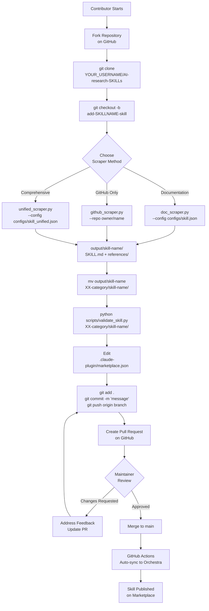
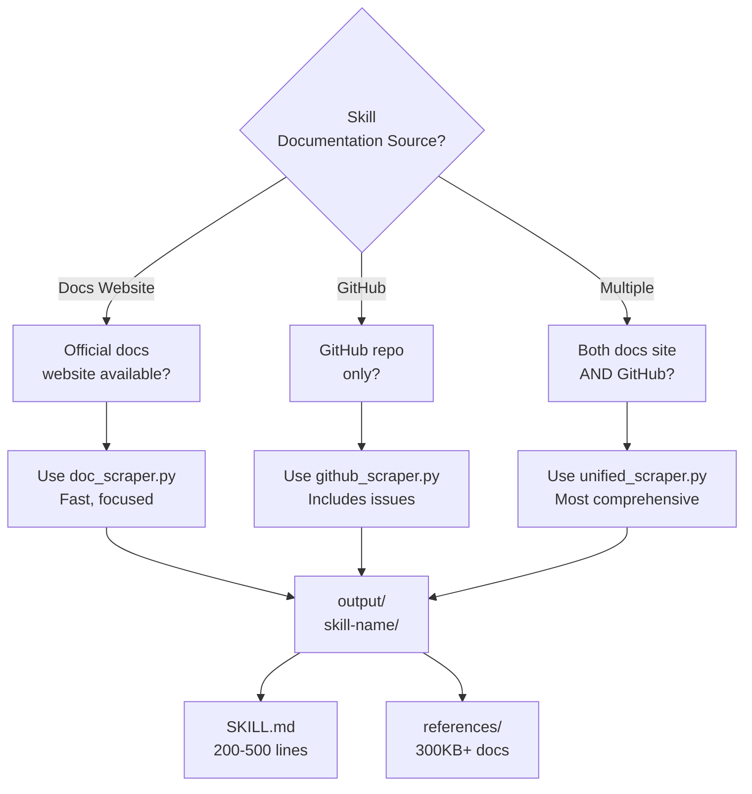
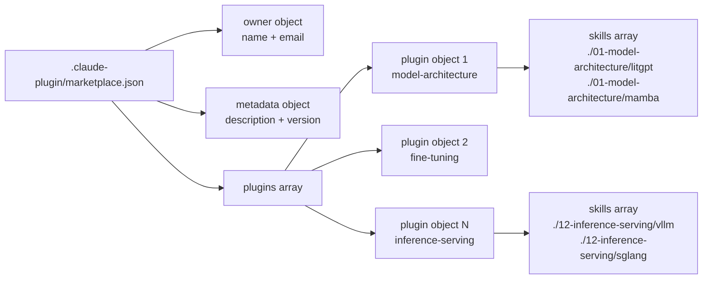
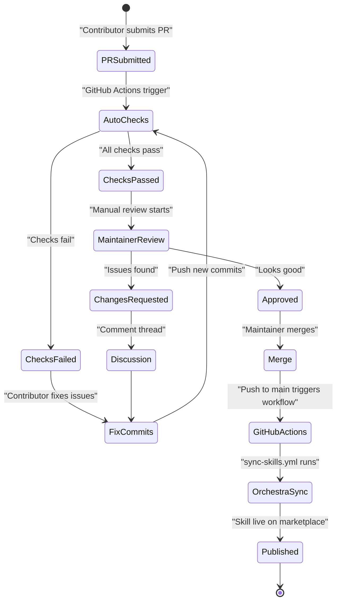
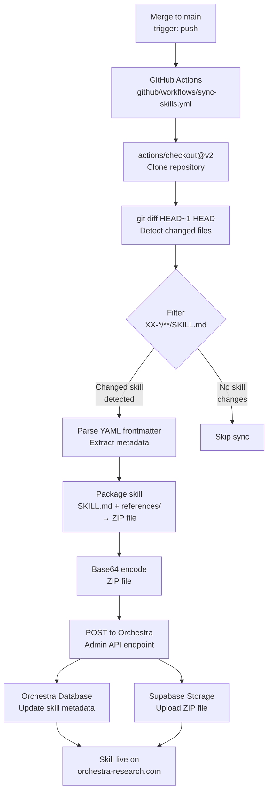

<!-- source: DeepWiki mcp.deepwiki.com · repo zechenzhangAGI/AI-research-SKILLs · page 5.4 Contribution Workflow · fetched 2026-10-26 -->

# Contribution Workflow

<details>
<summary>Relevant source files</summary>

The following files were used as context for generating this wiki page:

- [.claude-plugin/marketplace.json](.claude-plugin/marketplace.json)
- [CONTRIBUTING.md](CONTRIBUTING.md)
- [README.md](README.md)
- [demos/README.md](demos/README.md)
- [docs/ROADMAP.md](docs/ROADMAP.md)
- [docs/SKILL_CREATION_GUIDE.md](docs/SKILL_CREATION_GUIDE.md)
- [docs/SKILL_TEMPLATE.md](docs/SKILL_TEMPLATE.md)
- [docs/christmas-tree.svg](docs/christmas-tree.svg)
- [docs/tech-tree.svg](docs/tech-tree.svg)

</details>


This page describes the complete end-to-end workflow for contributing a new skill to the AI Research SKILLs library, from initial repository fork to automatic publication on the Orchestra marketplace. It covers the Git workflow, scraper usage, validation, and pull request submission process.

For information about skill structure requirements and documentation standards, see [Skill Structure & Documentation Standards](#5.1). For detailed scraper usage and configuration, see [Using Skill Scrapers](#5.2). For validation checkpoints and review criteria, see [Quality Validation & Review Process](#5.3).

---

## Workflow Overview

The contribution workflow follows a standard fork-and-pull-request model with integrated automation for content generation and marketplace synchronization:



**Sources:** [CONTRIBUTING.md:30-244](), [README.md:267-278]()

---

## Initial Repository Setup

### Forking and Cloning

Contributors must first create their own fork of the repository and clone it locally:

```bash
# 1. Fork the repository on GitHub via web interface
# Navigate to https://github.com/zechenzhangAGI/AI-research-SKILLs
# Click "Fork" button

# 2. Clone your fork
git clone https://github.com/YOUR_USERNAME/AI-research-SKILLs.git
cd AI-research-SKILLs

# 3. Add upstream remote (optional but recommended)
git remote add upstream https://github.com/zechenzhangAGI/AI-research-SKILLs.git
```

### Branch Creation

Create a descriptive feature branch following the naming convention `add-SKILLNAME-skill`:

```bash
# Create and switch to feature branch
git checkout -b add-vllm-skill

# Verify branch
git branch
# Output: * add-vllm-skill
#         main
```

**Best practices for branch naming:**
- Use lowercase with hyphens
- Prefix with `add-` for new skills
- Include the skill name clearly
- Examples: `add-vllm-skill`, `add-tensorrt-llm-skill`, `add-flash-attention-skill`

**Sources:** [CONTRIBUTING.md:35-42]()

---

## Generating Skill Content

### Scraper Selection Decision Tree



**Sources:** [CONTRIBUTING.md:45-68]()

### Using doc_scraper.py

For skills with official documentation websites:

```bash
# Option 1: Interactive mode (recommended for first-time users)
python3 cli/doc_scraper.py --interactive

# Option 2: Config file mode
# 1. Create config file (copy from existing)
cp configs/react.json configs/vllm.json

# 2. Edit config with documentation URLs
# configs/vllm.json:
# {
#   "name": "vllm",
#   "description": "High-throughput LLM inference",
#   "urls": [
#     "https://docs.vllm.ai/en/latest/"
#   ]
# }

# 3. Run scraper
python3 cli/doc_scraper.py --config configs/vllm.json
```

**Output structure:**
```
output/
├── vllm/
│   ├── SKILL.md
│   └── references/
│       ├── README.md
│       ├── api.md
│       └── tutorials.md
```

**Sources:** [CONTRIBUTING.md:47-55]()

### Using github_scraper.py

For skills based primarily on GitHub repositories:

```bash
# Set GitHub token for API access
export GITHUB_TOKEN=$(gh auth token)

# Run GitHub scraper
python3 cli/github_scraper.py \
  --repo vllm-project/vllm \
  --name vllm \
  --description "High-performance LLM inference with PagedAttention"
```

**What gets scraped:**
- `README.md` → `references/README.md`
- GitHub issues → `references/issues.md` (real problems and solutions)
- Releases → `references/releases.md` (version history, breaking changes)
- File structure → `references/file_structure.md` (codebase navigation)

**Sources:** [CONTRIBUTING.md:57-62]()

### Using unified_scraper.py

For comprehensive skills combining documentation, GitHub, and other sources:

```bash
# Create unified config
cat > configs/vllm_unified.json <<EOF
{
  "name": "vllm",
  "description": "High-throughput LLM serving",
  "doc_urls": [
    "https://docs.vllm.ai/en/latest/"
  ],
  "github_repo": "vllm-project/vllm",
  "pdf_urls": [
    "https://arxiv.org/pdf/2309.06180.pdf"
  ]
}
EOF

# Run unified scraper
python3 cli/unified_scraper.py --config configs/vllm_unified.json
```

**Sources:** [CONTRIBUTING.md:64-68]()

---

## Directory Placement and Organization

### Category Assignment

Skills must be placed in the correct category directory based on their primary function:

| Category Number | Directory Name | Purpose | Example Skills |
|----------------|----------------|---------|----------------|
| `01` | `model-architecture` | Model implementations | LitGPT, Mamba, NanoGPT |
| `02` | `tokenization` | Tokenizers | HuggingFace Tokenizers, SentencePiece |
| `03` | `fine-tuning` | Fine-tuning frameworks | Axolotl, Unsloth, PEFT |
| `04` | `mechanistic-interpretability` | Interpretability tools | TransformerLens, SAELens |
| `05` | `data-processing` | Data curation | NeMo Curator, Ray Data |
| `06` | `post-training` | RLHF/alignment | TRL, GRPO, SimPO |
| `07` | `safety-alignment` | Safety systems | LlamaGuard, NeMo Guardrails |
| `08` | `distributed-training` | Multi-GPU training | DeepSpeed, FSDP, Accelerate |
| `09` | `infrastructure` | Cloud platforms | Modal, SkyPilot, Lambda Labs |
| `10` | `optimization` | Quantization/speed | Flash Attention, GPTQ, bitsandbytes |
| `11` | `evaluation` | Benchmarking | lm-eval-harness, BigCode |
| `12` | `inference-serving` | Production serving | vLLM, TensorRT-LLM, llama.cpp |
| `13` | `mlops` | Experiment tracking | W&B, MLflow, TensorBoard |
| `14` | `agents` | Agent frameworks | LangChain, LlamaIndex, AutoGPT |
| `15` | `rag` | Vector databases | Chroma, FAISS, Pinecone |
| `16` | `prompt-engineering` | Structured output | DSPy, Instructor, Outlines |
| `17` | `observability` | Monitoring | LangSmith, Phoenix |
| `18` | `multimodal` | Vision/audio | CLIP, Whisper, LLaVA |
| `19` | `emerging-techniques` | Advanced methods | MoE, Model Merging, Long Context |
| `20` | `ml-paper-writing` | Academic writing | ML Paper Writing |

**Sources:** [CONTRIBUTING.md:257-282](), [README.md:342-369]()

### Moving Files to Target Location

```bash
# Determine category (example: vLLM is inference serving)
CATEGORY="12-inference-serving"
SKILL_NAME="vllm"

# Move skill folder
mv output/${SKILL_NAME}/ ${CATEGORY}/${SKILL_NAME}/

# Move metadata (if generated)
mv output/${SKILL_NAME}_data/ .metadata/${SKILL_NAME}_data/

# Verify structure
tree ${CATEGORY}/${SKILL_NAME}/
# Expected output:
# 12-inference-serving/vllm/
# ├── SKILL.md
# └── references/
#     ├── README.md
#     ├── api.md
#     ├── tutorials.md
#     ├── issues.md
#     └── releases.md
```

**Sources:** [CONTRIBUTING.md:70-78]()

---

## Marketplace Registration

### Understanding marketplace.json Structure

The `.claude-plugin/marketplace.json` file serves as the plugin manifest for Claude Code CLI. It defines available skill categories and their associated skill paths:



**Sources:** [.claude-plugin/marketplace.json:1-250]()

### Adding a New Skill Entry

When adding a new skill, update the appropriate plugin's `skills` array in `.claude-plugin/marketplace.json`:

```bash
# Open marketplace.json
vim .claude-plugin/marketplace.json

# Find the correct plugin category (example: inference-serving)
# Add new skill path to the "skills" array
```

**Example addition for vLLM skill:**

```json
{
  "name": "inference-serving",
  "description": "Production LLM inference including vLLM, TensorRT-LLM, llama.cpp, and SGLang. Use when deploying models for production inference.",
  "source": "./",
  "strict": false,
  "skills": [
    "./12-inference-serving/llama-cpp",
    "./12-inference-serving/sglang",
    "./12-inference-serving/tensorrt-llm",
    "./12-inference-serving/vllm"    // ← Added this line
  ]
}
```

**Important guidelines:**
- Skills are listed in alphabetical order within each category
- Path format: `./XX-category-name/skill-name`
- No trailing slash in path
- Maintain alphabetical sorting for readability
- Ensure valid JSON syntax (check trailing commas)

### Validation of marketplace.json

```bash
# Validate JSON syntax
python3 -c "import json; json.load(open('.claude-plugin/marketplace.json'))"

# If valid: no output
# If invalid: syntax error with line number
```

**Sources:** [CONTRIBUTING.md:197-226](), [.claude-plugin/marketplace.json:141-151]()

---

## Git Commit and Push Workflow

### Staging Changes

```bash
# Add the new skill directory
git add 12-inference-serving/vllm/

# Add metadata (if generated)
git add .metadata/vllm_data/

# Add marketplace.json changes
git add .claude-plugin/marketplace.json

# Verify staged changes
git status
# Output should show:
#   new file:   12-inference-serving/vllm/SKILL.md
#   new file:   12-inference-serving/vllm/references/README.md
#   ...
#   modified:   .claude-plugin/marketplace.json
```

### Writing Commit Messages

Follow the structured commit message format:

```bash
git commit -m "Add vLLM inference serving skill

- 356 lines SKILL.md with 4 comprehensive workflows
- 215 pages of documentation in references/
- 12 GitHub issues with solutions
- API reference and performance benchmarks
- Production deployment patterns included"
```

**Commit message structure:**
- **Line 1:** Brief summary in imperative mood: "Add [Skill Name] skill"
- **Line 2:** Blank line
- **Lines 3+:** Bullet points describing:
  - SKILL.md line count
  - Documentation volume (pages/KB)
  - Key features (workflows, examples, troubleshooting)
  - Unique value additions

**Sources:** [CONTRIBUTING.md:229-244]()

### Pushing to Fork

```bash
# Push feature branch to your fork
git push origin add-vllm-skill

# Output will include URL for creating pull request
# Example: https://github.com/YOUR_USERNAME/AI-research-SKILLs/pull/new/add-vllm-skill
```

---

## Pull Request Submission

### Creating the Pull Request

Navigate to the GitHub URL provided by `git push` or manually create a PR:

1. **Go to your fork on GitHub**
2. **Click "Compare & pull request"** button (appears after push)
3. **Set base repository:** `zechenzhangAGI/AI-research-SKILLs` base: `main`
4. **Set head repository:** `YOUR_USERNAME/AI-research-SKILLs` compare: `add-vllm-skill`

### Pull Request Template

**Title format:**
```
Add [Skill Name] skill
```

**Description template:**
```markdown
## Skill Summary

**Category:** 12-inference-serving
**Skill Name:** vLLM

## Content Overview

- **SKILL.md:** 356 lines
- **Documentation:** 215 pages / ~420KB
- **References:**
  - README.md (GitHub README)
  - api.md (API documentation)
  - tutorials.md (Official tutorials)
  - issues.md (12 GitHub issues with solutions)
  - releases.md (Version history)

## Key Features

- 4 comprehensive workflows with checklists
- Production deployment patterns
- Performance benchmarking guide
- Common issues and troubleshooting
- Integration examples with HuggingFace

## Scraper Used

- [x] doc_scraper.py
- [x] github_scraper.py
- [ ] unified_scraper.py

## Validation

- [x] YAML frontmatter present with all required fields
- [x] SKILL.md under 500 lines (356 lines)
- [x] References total >300KB (420KB)
- [x] All code blocks have language tags
- [x] marketplace.json updated and validated
- [x] Workflows include copy-paste checklists
```

**Sources:** [CONTRIBUTING.md:247-254]()

---

## Review Process

### Workflow State Machine



**Sources:** [CONTRIBUTING.md:440-463]()

### Automated Checks

When a PR is submitted, GitHub Actions (when implemented) will automatically validate:

| Check | Validation Script | Purpose |
|-------|------------------|---------|
| File structure | `validate_skill.py` | Ensures SKILL.md and references/ exist |
| YAML frontmatter | `validate_skill.py` | Checks required fields, format |
| Code block language tags | `validate_skill.py` | All code blocks must have language specified |
| Documentation size | `validate_skill.py` | References must be >100KB (target 300KB+) |
| marketplace.json syntax | JSON parser | Valid JSON, correct paths |
| Line count limits | `validate_skill.py` | SKILL.md should be 200-500 lines |

**Manual verification until automated:**
```bash
# Run validation locally before PR
python scripts/validate_skill.py 12-inference-serving/vllm/

# Check marketplace.json syntax
python3 -c "import json; json.load(open('.claude-plugin/marketplace.json'))"

# Verify line count
wc -l 12-inference-serving/vllm/SKILL.md

# Check documentation size
du -sh 12-inference-serving/vllm/references/
```

**Sources:** [CONTRIBUTING.md:440-449]()

### Maintainer Review Timeline

**Expected timeline:**
- **Automated checks:** < 5 minutes
- **Initial maintainer review:** 48-72 hours
- **Response to feedback:** Variable (contributor-dependent)
- **Final approval and merge:** Within 24 hours after all checks pass

**Review criteria:**
1. **Content quality:** Is the documentation comprehensive and accurate?
2. **Code examples:** Are examples valid and well-explained?
3. **Proper categorization:** Is the skill in the right directory?
4. **License compliance:** Are license attributions correct?
5. **Marketplace integration:** Is the marketplace.json entry correct?

**Sources:** [CONTRIBUTING.md:450-463]()

---

## Post-Merge Automation

### GitHub Actions Sync Workflow

After a PR is merged to `main`, the automated sync pipeline deploys the skill to Orchestra:



**Sources:** High-level diagrams (Diagram 2), [README.md:229-243]()

### Verification

Contributors can verify their skill is live:

1. **Visit Orchestra marketplace:** `https://www.orchestra-research.com/research-skills`
2. **Search for skill name**
3. **Verify metadata matches YAML frontmatter**
4. **Test installation in Claude Code CLI:**

```bash
# Add marketplace (if not already added)
/plugin marketplace add zechenzhangAGI/AI-research-SKILLs

# Install the new skill's category
/plugin install inference-serving@ai-research-skills

# Verify skill is loaded
/plugin list
```

**Sources:** [README.md:70-84]()

---

## Common Workflow Patterns

### Pattern 1: Documentation-Heavy Skill (PyTorch Library)

```bash
# 1. Fork and clone
git clone https://github.com/YOUR_USERNAME/AI-research-SKILLs.git
cd AI-research-SKILLs
git checkout -b add-pytorch-skill

# 2. Use doc scraper for official docs
python3 cli/doc_scraper.py \
  --config configs/pytorch.json

# 3. Move to correct category (model architecture)
mv output/pytorch/ 01-model-architecture/pytorch/

# 4. Update marketplace.json
# Add "./01-model-architecture/pytorch" to model-architecture plugin

# 5. Validate
python scripts/validate_skill.py 01-model-architecture/pytorch/

# 6. Commit and push
git add .
git commit -m "Add PyTorch model architecture skill

- 420 lines comprehensive SKILL.md
- 500KB documentation from official site
- Training workflows with checkpoints
- Model architecture examples"
git push origin add-pytorch-skill

# 7. Create PR on GitHub
```

**Sources:** [CONTRIBUTING.md:47-55]()

### Pattern 2: GitHub-First Skill (Small Library)

```bash
# 1. Setup
git clone https://github.com/YOUR_USERNAME/AI-research-SKILLs.git
cd AI-research-SKILLs
git checkout -b add-medusa-skill

# 2. Use GitHub scraper
export GITHUB_TOKEN=$(gh auth token)
python3 cli/github_scraper.py \
  --repo FasterDecoding/Medusa \
  --name medusa \
  --description "Speculative decoding with multiple heads"

# 3. Move to emerging techniques category
mv output/medusa/ 19-emerging-techniques/medusa/

# 4. Manually enhance SKILL.md
# Add workflows, examples, common issues

# 5. Update marketplace.json
# Add to emerging-techniques plugin

# 6. Commit and push
git add .
git commit -m "Add Medusa speculative decoding skill"
git push origin add-medusa-skill
```

**Sources:** [CONTRIBUTING.md:57-62]()

### Pattern 3: Comprehensive Skill (Major Framework)

```bash
# 1. Setup
git clone https://github.com/YOUR_USERNAME/AI-research-SKILLs.git
cd AI-research-SKILLs
git checkout -b add-deepspeed-skill

# 2. Use unified scraper for docs + GitHub + paper
cat > configs/deepspeed_unified.json <<EOF
{
  "name": "deepspeed",
  "description": "ZeRO optimization for distributed training",
  "doc_urls": ["https://www.deepspeed.ai/docs/"],
  "github_repo": "microsoft/DeepSpeed",
  "pdf_urls": ["https://arxiv.org/pdf/1910.02054.pdf"]
}
EOF

python3 cli/unified_scraper.py --config configs/deepspeed_unified.json

# 3. Move to distributed training
mv output/deepspeed/ 08-distributed-training/deepspeed/

# 4. Validate
python scripts/validate_skill.py 08-distributed-training/deepspeed/

# 5. Update marketplace.json
# Add to distributed-training plugin

# 6. Commit and push
git add .
git commit -m "Add DeepSpeed distributed training skill

- 450 lines SKILL.md with 5 workflows
- 800KB comprehensive documentation
- ZeRO-1/2/3 configuration examples
- 20+ GitHub issues with solutions
- Original research paper included"
git push origin add-deepspeed-skill
```

**Sources:** [CONTRIBUTING.md:64-68]()

---

## Troubleshooting Common Issues

### Issue: Validation Fails on YAML Frontmatter

**Problem:** `validate_skill.py` reports missing or invalid YAML frontmatter.

**Solution:**
```bash
# Check YAML syntax
head -n 10 XX-category/skill-name/SKILL.md

# Should see:
# ---
# name: skill-name
# description: Third-person description...
# version: 1.0.0
# author: Orchestra Research
# license: MIT
# tags: [Tag One, Tag Two]
# dependencies: [package>=1.0.0]
# ---

# Validate YAML parsing
python3 -c "
import yaml
with open('XX-category/skill-name/SKILL.md') as f:
    content = f.read().split('---')
    yaml.safe_load(content[1])
"
```

**Common YAML errors:**
- Missing closing `---`
- Quotes around field values (not needed except in arrays)
- Invalid characters in `name` field
- Missing required fields

**Sources:** [CONTRIBUTING.md:126-196](), [docs/SKILL_CREATION_GUIDE.md:123-227]()

### Issue: marketplace.json Invalid After Edit

**Problem:** JSON syntax error after adding new skill entry.

**Solution:**
```bash
# Validate JSON
python3 -c "import json; json.load(open('.claude-plugin/marketplace.json'))"

# If error: "Expecting ',' delimiter: line X column Y"
# Common causes:
# 1. Missing comma after previous array element
# 2. Extra comma after last array element
# 3. Mismatched quotes

# Use jq for better error messages (if available)
jq . .claude-plugin/marketplace.json

# Or use online JSON validator
# Copy-paste to jsonlint.com
```

**Sources:** [CONTRIBUTING.md:220-223]()

### Issue: Git Push Rejected (Out of Date)

**Problem:** `git push` fails with "Updates were rejected because the remote contains work that you do not have locally."

**Solution:**
```bash
# Fetch upstream changes
git fetch upstream

# Rebase your branch on latest main
git rebase upstream/main

# If conflicts occur:
# 1. Fix conflicts in marked files
# 2. git add <resolved-files>
# 3. git rebase --continue

# Force push to your fork (safe because it's your branch)
git push origin add-skill-name --force-with-lease
```

**Sources:** General Git workflow best practices

### Issue: Scraper Times Out or Fails

**Problem:** `doc_scraper.py` or `github_scraper.py` fails partway through.

**Solution:**
```bash
# For doc_scraper timeout:
# 1. Reduce number of URLs in config
# 2. Run in batches
python3 cli/doc_scraper.py --config configs/batch1.json
python3 cli/doc_scraper.py --config configs/batch2.json

# For GitHub scraper rate limiting:
# Check rate limit status
curl -H "Authorization: token $GITHUB_TOKEN" \
  https://api.github.com/rate_limit

# If rate limited:
# 1. Wait for reset (shown in response)
# 2. Or use authenticated token for higher limits
export GITHUB_TOKEN=$(gh auth token)

# For network timeouts:
# Increase timeout in scraper script
# Or run scraper with retry logic
```

**Sources:** [CONTRIBUTING.md:45-68]()

---

## Summary Checklist

Before submitting a pull request, verify all steps are complete:

```
Contribution Workflow Checklist:
- [ ] 1. Forked repository on GitHub
- [ ] 2. Cloned fork locally
- [ ] 3. Created feature branch: git checkout -b add-SKILL-skill
- [ ] 4. Ran appropriate scraper (doc/github/unified)
- [ ] 5. Moved output to correct XX-category/skill-name/
- [ ] 6. Validated SKILL.md has proper YAML frontmatter
- [ ] 7. Verified SKILL.md is 200-500 lines
- [ ] 8. Confirmed references/ totals >300KB
- [ ] 9. Updated .claude-plugin/marketplace.json
- [ ] 10. Validated marketplace.json syntax
- [ ] 11. Staged all changes: git add
- [ ] 12. Committed with descriptive message
- [ ] 13. Pushed to fork: git push origin branch
- [ ] 14. Created pull request on GitHub
- [ ] 15. Filled out PR template completely
```

**Sources:** [CONTRIBUTING.md:1-471]()

---

