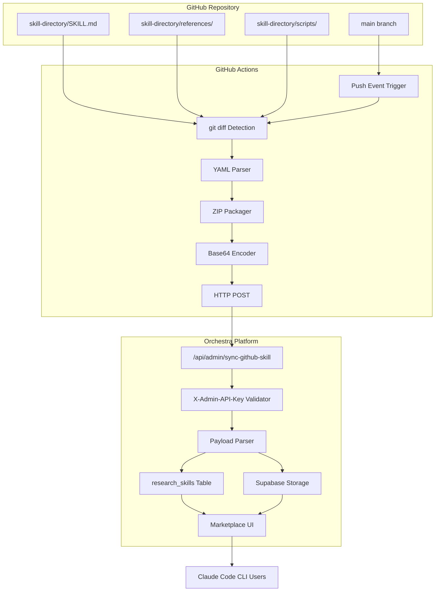
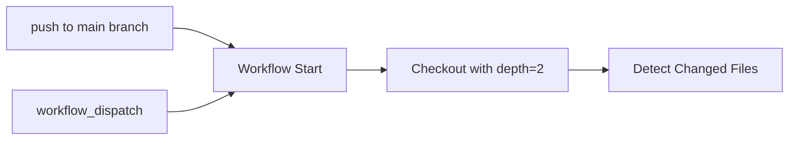
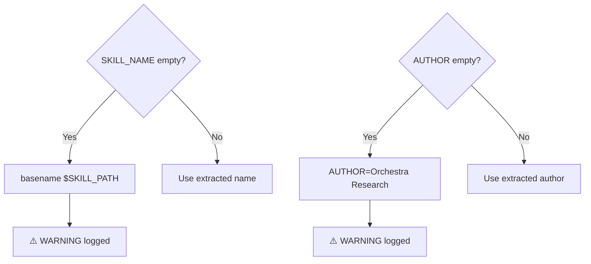
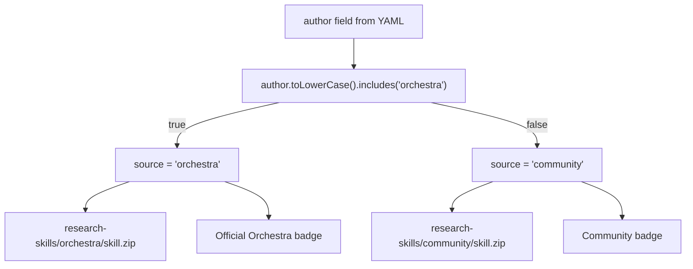
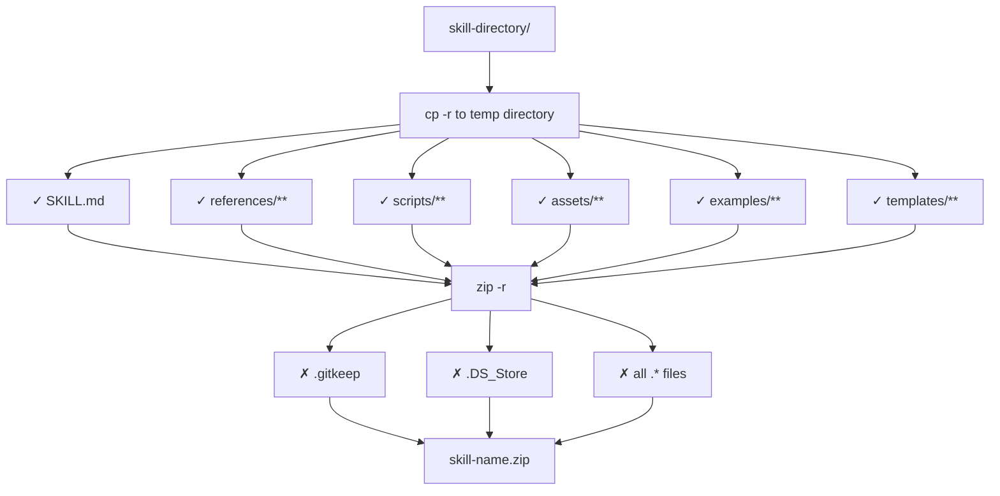
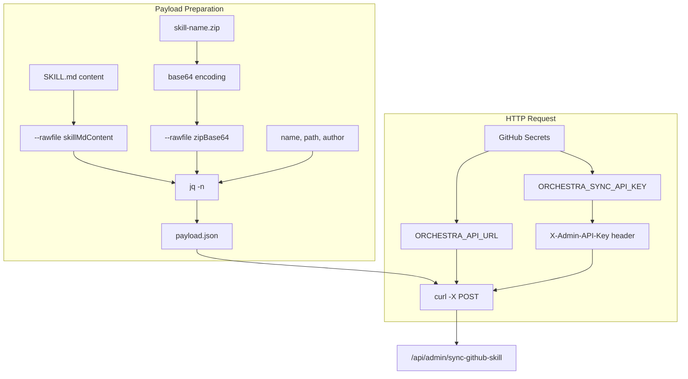
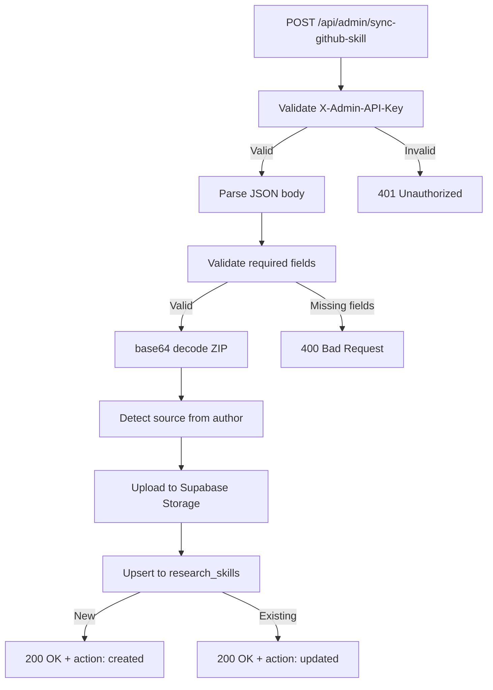
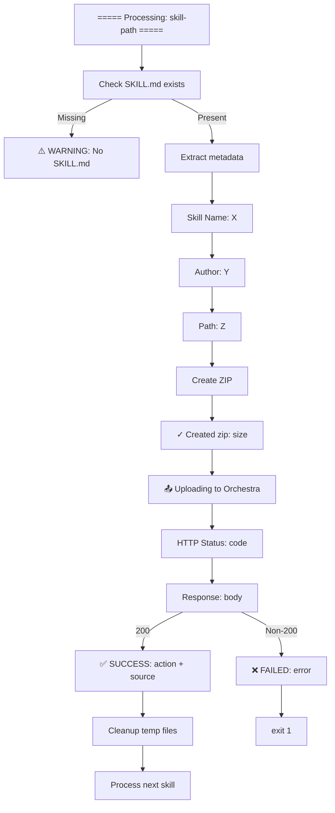
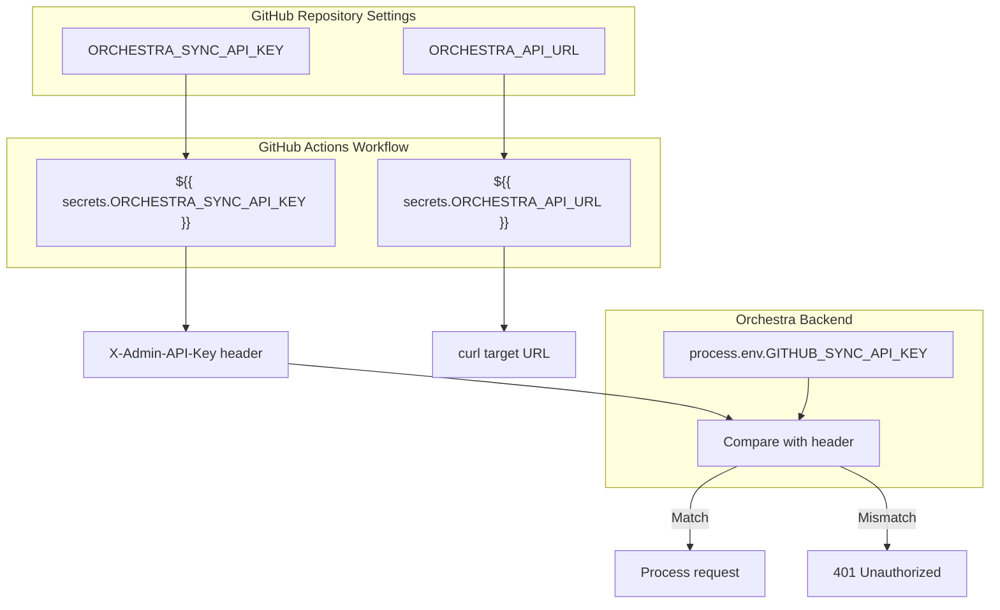

<!-- source: DeepWiki mcp.deepwiki.com · repo zechenzhangAGI/AI-research-SKILLs · page 6 Orchestra Marketplace Integration · fetched 2026-10-26 -->

# Orchestra Marketplace Integration

<details>
<summary>Relevant source files</summary>

The following files were used as context for generating this wiki page:

- [.github/workflows/sync-skills.yml](.github/workflows/sync-skills.yml)
- [01-model-architecture/litgpt/SKILL.md](01-model-architecture/litgpt/SKILL.md)
- [CLAUDE.md](CLAUDE.md)
- [dev_data/GITHUB_SKILLS_SYNC_SETUP.md](dev_data/GITHUB_SKILLS_SYNC_SETUP.md)

</details>


## Purpose and Scope

This document describes the automated synchronization system that publishes skills from the GitHub repository to the Orchestra marketplace platform. When contributors merge skills to the `main` branch, a GitHub Actions workflow automatically detects changes, packages skill directories, and uploads them to Orchestra's storage and database infrastructure.

For information about creating and validating skills before they reach this pipeline, see [Skill Structure & Documentation Standards](#5.1) and [Quality Validation & Review Process](#5.3). For details on the resulting marketplace structure consumed by Claude Code CLI, see [Marketplace.json Structure](#6.3).

---

## System Architecture Overview

The integration bridges three systems: the GitHub repository, GitHub Actions CI/CD, and the Orchestra platform infrastructure (Next.js application + Supabase backend).

### End-to-End Data Flow



**Sources:** [.github/workflows/sync-skills.yml:1-178](), [dev_data/GITHUB_SKILLS_SYNC_SETUP.md:1-445](), [CLAUDE.md:178-260]()

---

## GitHub Actions Workflow Architecture

The workflow file implements a change-detection pipeline that only processes modified skills, avoiding unnecessary API calls and storage operations.

### Workflow Trigger Configuration



The workflow uses `fetch-depth: 2` to enable git diff between the last two commits:

[.github/workflows/sync-skills.yml:14-17]()

**Sources:** [.github/workflows/sync-skills.yml:3-17]()

### Change Detection Logic

The workflow extracts unique skill directories from changed files using pattern matching:

```mermaid
flowchart TD
    GITDIFF["git diff --name-only HEAD^..HEAD"]
    GREP["grep -E '^[0-9]{2}-[^/]+/[^/]+/'"]
    SED["sed -E 's|^([0-9]{2}-[^/]+/[^/]+)/.*|\\1|'"]
    SORT["sort -u"]
    JQ["jq -R -s -c 'split(\"\\n\") | map(select(length > 0))'"]
    OUTPUT["JSON array of skill paths"]
    
    GITDIFF --> GREP
    GREP --> SED
    SED --> SORT
    SORT --> JQ
    JQ --> OUTPUT
    
    OUTPUT --> COUNT{"count > 0?"}
    COUNT -->|"Yes"| PROCESS["Process Skills"]
    COUNT -->|"No"| SKIP["Skip Sync"]
```

The regex pattern `^[0-9]{2}-[^/]+/[^/]+/` matches skill directory structure: `XX-category/skill-name/`

**Sources:** [.github/workflows/sync-skills.yml:19-41]()

### Skill Processing Pipeline

For each detected skill directory, the workflow executes:

| Step | Operation | Implementation |
|------|-----------|----------------|
| 1. Validation | Check `SKILL.md` exists | `[ ! -f "$SKILL_PATH/SKILL.md" ]` |
| 2. Metadata Extraction | Parse YAML frontmatter | `grep -A 20 "^---$"` + `sed` |
| 3. ZIP Creation | Package all files | `zip -r` excluding hidden files |
| 4. Encoding | Base64 encode ZIP | `base64 -w 0` |
| 5. Payload Assembly | Build JSON | `jq -n --rawfile` |
| 6. Upload | POST to Orchestra API | `curl -X POST` |

**Sources:** [.github/workflows/sync-skills.yml:43-171]()

---

## Metadata Extraction Process

The workflow parses YAML frontmatter from `SKILL.md` to extract skill identity and classification metadata.

### YAML Parsing Implementation

```mermaid
flowchart TD
    SKILLMD["SKILL.md File"]
    GREP_NAME["grep -A 20 '^---$' | grep '^name:'"]
    GREP_AUTHOR["grep -A 20 '^---$' | grep '^author:'"]
    SED_NAME["sed 's/name: *//;s/\"//g;s/'//g'"]
    SED_AUTHOR["sed 's/author: *//;s/\"//g;s/'//g'"]
    TR["tr -d '\\r'"]
    
    SKILLMD --> GREP_NAME
    SKILLMD --> GREP_AUTHOR
    
    GREP_NAME --> SED_NAME
    GREP_AUTHOR --> SED_AUTHOR
    
    SED_NAME --> TR
    SED_AUTHOR --> TR
    
    TR --> VALIDATE{"Both extracted?"}
    VALIDATE -->|"name missing"| DIRNAME["Use directory basename"]
    VALIDATE -->|"author missing"| DEFAULT["Default: Orchestra Research"]
    VALIDATE -->|"Both present"| CONTINUE["Continue"]
```

**Extraction Commands:**

Name field: [.github/workflows/sync-skills.yml:69]()
```bash
SKILL_NAME=$(grep -A 20 "^---$" "$SKILL_PATH/SKILL.md" | grep "^name:" | head -1 | sed 's/name: *//;s/"//g;s/'\''//g' | tr -d '\r')
```

Author field: [.github/workflows/sync-skills.yml:72]()
```bash
AUTHOR=$(grep -A 20 "^---$" "$SKILL_PATH/SKILL.md" | grep "^author:" | head -1 | sed 's/author: *//;s/"//g;s/'\''//g' | tr -d '\r')
```

**Sources:** [.github/workflows/sync-skills.yml:68-88]()

### Default Value Logic

When metadata is missing, the workflow applies fallback logic:



**Sources:** [.github/workflows/sync-skills.yml:74-84]()

---

## Skill Classification System

Skills are classified as `orchestra` (official) or `community` based on the `author` field in YAML frontmatter. This determines storage paths and marketplace badges.

### Author Detection Logic

The Orchestra API endpoint `/api/admin/sync-github-skill` inspects the author field:



### Classification Examples

| Author Field | Classification | Storage Path | Badge |
|--------------|----------------|--------------|-------|
| `Orchestra Research` | `orchestra` | `research-skills/orchestra/skill-name.zip` | Official |
| `Orchestra Labs` | `orchestra` | `research-skills/orchestra/skill-name.zip` | Official |
| `Jane Doe` | `community` | `research-skills/community/skill-name.zip` | Community |
| `Stanford NLP Group` | `community` | `research-skills/community/skill-name.zip` | Community |
| *(missing)* | `orchestra` | `research-skills/orchestra/skill-name.zip` | Official |

**Default Behavior:** Missing author fields default to `Orchestra Research`: [.github/workflows/sync-skills.yml:81-83]()

**Sources:** [dev_data/GITHUB_SKILLS_SYNC_SETUP.md:162-207](), [CLAUDE.md:198-220]()

---

## ZIP Packaging Specification

The workflow packages the entire skill directory into a ZIP archive, excluding hidden files and metadata artifacts.

### File Inclusion Rules



**Packaging Commands:**

Directory copy: [.github/workflows/sync-skills.yml:90-96]()
```bash
TEMP_DIR=$(mktemp -d)
SKILL_DIR="$TEMP_DIR/$SKILL_NAME"
mkdir -p "$SKILL_DIR"
cp -r "$SKILL_PATH"/* "$SKILL_DIR/" 2>/dev/null || true
```

ZIP creation: [.github/workflows/sync-skills.yml:98-102]()
```bash
ZIP_FILE="$TEMP_DIR/${SKILL_NAME}.zip"
cd "$TEMP_DIR"
zip -r "$ZIP_FILE" "$SKILL_NAME" -x "*/.*" "*/.gitkeep" "*.DS_Store"
```

**Sources:** [.github/workflows/sync-skills.yml:90-110](), [CLAUDE.md:220-230]()

---

## Orchestra API Integration

The workflow uploads packaged skills to Orchestra's admin API endpoint using authenticated HTTP POST requests.

### API Request Structure



**JSON Payload Assembly:** [.github/workflows/sync-skills.yml:120-133]()
```bash
JSON_PAYLOAD=$(jq -n \
  --arg skillName "$SKILL_NAME" \
  --arg skillPath "$SKILL_PATH" \
  --arg author "$AUTHOR" \
  --rawfile skillMdContent "$SKILL_MD_FILE" \
  --rawfile zipBase64 "$ZIP_BASE64_FILE" \
  '{
    skillName: $skillName,
    skillPath: $skillPath,
    author: $author,
    skillMdContent: $skillMdContent,
    zipBase64: $zipBase64
  }')
```

**HTTP Request:** [.github/workflows/sync-skills.yml:140-145]()
```bash
RESPONSE=$(curl -s -w "\n%{http_code}" -L \
  -X POST \
  -H "Content-Type: application/json" \
  -H "X-Admin-API-Key: $ORCHESTRA_SYNC_API_KEY" \
  -d @"$JSON_FILE" \
  "$ORCHESTRA_API_URL/api/admin/sync-github-skill")
```

**Sources:** [.github/workflows/sync-skills.yml:112-145]()

### Response Handling

The workflow validates HTTP status codes and extracts action details from JSON responses:

| Status Code | Interpretation | Action |
|-------------|----------------|--------|
| 200 | Success | Log action (`created`, `updated`, `synced`) and source |
| 4xx | Client error | Log error message and exit with code 1 |
| 5xx | Server error | Log error message and exit with code 1 |

**Response Parsing:** [.github/workflows/sync-skills.yml:147-161]()
```bash
HTTP_CODE=$(echo "$RESPONSE" | tail -n1)
BODY=$(echo "$RESPONSE" | sed '$d')

if [ "$HTTP_CODE" = "200" ]; then
  ACTION=$(echo "$BODY" | jq -r '.action // "synced"')
  SOURCE=$(echo "$BODY" | jq -r '.source // "unknown"')
  echo "✅ SUCCESS: Skill $SKILL_NAME $ACTION (source: $SOURCE)"
else
  ERROR_MSG=$(echo "$BODY" | jq -r '.error // "Unknown error"')
  echo "❌ FAILED: $ERROR_MSG"
  exit 1
fi
```

**Sources:** [.github/workflows/sync-skills.yml:147-161]()

---

## Orchestra Backend Processing

The Orchestra Next.js application receives skill uploads at the admin API endpoint and processes them through validation, storage, and database insertion.

### API Route Handler Flow



**Environment Variables Required:**

- `GITHUB_SYNC_API_KEY`: Authentication key matching GitHub Secret
- Supabase credentials for storage and database access

**Sources:** [dev_data/GITHUB_SKILLS_SYNC_SETUP.md:53-56]()

### Storage Path Generation

Storage paths follow a convention based on classification:

```
research-skills/
├── orchestra/
│   ├── implementing-llms-litgpt.zip
│   ├── serving-llms-vllm.zip
│   └── grpo-rl-training.zip
└── community/
    ├── custom-tokenizer.zip
    └── domain-specific-eval.zip
```

**Path Construction Logic:**
1. Extract source from author field (contains "orchestra" → `orchestra`, else → `community`)
2. Construct path: `research-skills/${source}/${skillName}.zip`
3. Upload to Supabase Storage bucket
4. Store public URL in database

**Sources:** [dev_data/GITHUB_SKILLS_SYNC_SETUP.md:166-193]()

### Database Schema Integration

The `research_skills` table stores skill metadata and references the storage URL:

| Column | Type | Description |
|--------|------|-------------|
| `id` | uuid | Primary key |
| `name` | text | Skill name from YAML frontmatter |
| `description` | text | Parsed from YAML or skill content |
| `source` | text | `'orchestra'` or `'community'` |
| `zip_url` | text | Supabase Storage public URL |
| `author` | text | Author from YAML frontmatter |
| `version` | text | Version from YAML frontmatter |
| `tags` | text[] | Array of tags from YAML |
| `created_at` | timestamp | First sync timestamp |
| `updated_at` | timestamp | Last sync timestamp |

**Upsert Logic:** Skills are identified by `name` field. Existing records are updated; new records are inserted.

**Sources:** [dev_data/GITHUB_SKILLS_SYNC_SETUP.md:360-366]()

---

## Workflow Execution Monitoring

The GitHub Actions workflow provides detailed logging for debugging and audit purposes.

### Log Output Format



**Example Log Output:**
```
===================================================
Processing: 01-model-architecture/litgpt
===================================================
Skill Name: implementing-llms-litgpt
Author: Orchestra Research
Path: 01-model-architecture/litgpt
✓ Created zip: 2.3M
📤 Uploading to Orchestra...
HTTP Status: 200
Response: {"action":"updated","source":"orchestra"}
✅ SUCCESS: Skill implementing-llms-litgpt updated (source: orchestra)

===================================================
✅ Sync completed successfully!
===================================================
```

**Sources:** [.github/workflows/sync-skills.yml:58-171]()

---

## Security Configuration

The integration uses GitHub Secrets for sensitive credentials and validates API keys on the Orchestra backend.

### Secrets Management



**Workflow Environment Variables:** [.github/workflows/sync-skills.yml:45-47]()
```yaml
env:
  ORCHESTRA_API_URL: ${{ secrets.ORCHESTRA_API_URL }}
  ORCHESTRA_SYNC_API_KEY: ${{ secrets.ORCHESTRA_SYNC_API_KEY }}
```

**Key Generation Command:**
```bash
openssl rand -hex 32
```

**Sources:** [.github/workflows/sync-skills.yml:45-47](), [dev_data/GITHUB_SKILLS_SYNC_SETUP.md:23-42]()

---

## Troubleshooting Guide

### Issue: No Skills Detected

**Symptom:** Workflow logs show `ℹ️ No skill changes detected in this commit`

**Cause:** No files modified inside skill directories (`XX-category/skill-name/`)

**Solution:**
```bash
# Modify a file inside a skill directory
echo "\n<!-- Updated $(date) -->" >> 01-model-architecture/litgpt/SKILL.md
git add .
git commit -m "test: trigger sync"
git push origin main
```

**Sources:** [.github/workflows/sync-skills.yml:173-177](), [dev_data/GITHUB_SKILLS_SYNC_SETUP.md:256-263]()

### Issue: Invalid API Key Error

**Symptom:** HTTP 401 Unauthorized response

**Cause:** Mismatch between `GITHUB_SYNC_API_KEY` secret and Orchestra environment variable

**Solution:**
1. Regenerate key: `openssl rand -hex 32`
2. Update Orchestra `.env.local`: `GITHUB_SYNC_API_KEY=<new-key>`
3. Update GitHub Secret `GITHUB_SYNC_API_KEY` with same value
4. Restart Orchestra dev server

**Sources:** [dev_data/GITHUB_SKILLS_SYNC_SETUP.md:236-246]()

### Issue: SKILL.md Not Found

**Symptom:** Workflow logs show `⚠️ WARNING: No SKILL.md found in XX-category/skill-name, skipping`

**Cause:** Skill directory missing `SKILL.md` file

**Solution:**
```bash
# Verify file exists
ls -la XX-category/skill-name/SKILL.md

# If missing, create from template
cp SKILL_TEMPLATE.md XX-category/skill-name/SKILL.md
```

**Sources:** [.github/workflows/sync-skills.yml:62-66](), [dev_data/GITHUB_SKILLS_SYNC_SETUP.md:266-281]()

### Issue: YAML Frontmatter Parse Error

**Symptom:** Extracted `SKILL_NAME` or `AUTHOR` is empty despite fields being present in SKILL.md

**Cause:** Invalid YAML syntax or incorrect field names

**Solution:**
```bash
# Validate YAML syntax
python -c "import yaml; yaml.safe_load(open('XX-category/skill-name/SKILL.md').read().split('---')[1])"

# Check frontmatter format
head -20 XX-category/skill-name/SKILL.md
```

**Expected format:**
```yaml
---
name: skill-name-here
description: Description here
version: 1.0.0
author: Orchestra Research
license: MIT
tags: [Tag One, Tag Two]
---
```

**Sources:** [.github/workflows/sync-skills.yml:68-84](), [CLAUDE.md:56-78]()

### Issue: ZIP File Too Large

**Symptom:** Workflow fails or times out during upload

**Cause:** Skill references directory exceeds reasonable size (>100MB)

**Solution:**
1. Check directory size: `du -sh XX-category/skill-name/references/`
2. Remove large binary files (images, videos)
3. Compress PDFs or split into multiple reference files
4. Use external links for large assets

**Target Size:** References should be ~300KB-10MB (mostly text documentation)

**Sources:** [dev_data/GITHUB_SKILLS_SYNC_SETUP.md:292-301]()

---

## Manual Workflow Trigger

The workflow supports manual execution for testing or full repository sync.

### Triggering Via GitHub UI

1. Navigate to repository **Actions** tab
2. Select **"Sync Skills to Orchestra"** workflow
3. Click **"Run workflow"** dropdown
4. Click **"Run workflow"** button

**Behavior:** Manual trigger processes all changed files since last commit, or can be modified to sync all skills.

**Sources:** [.github/workflows/sync-skills.yml:7](), [dev_data/GITHUB_SKILLS_SYNC_SETUP.md:116-126]()

### Triggering Via GitHub CLI

```bash
# Trigger workflow manually
gh workflow run sync-skills.yml --repo zechenzhangAGI/AI-research-SKILLs

# View workflow runs
gh run list --repo zechenzhangAGI/AI-research-SKILLs --workflow="sync-skills.yml"

# View latest run logs
gh run view --repo zechenzhangAGI/AI-research-SKILLs --log
```

**Sources:** [dev_data/GITHUB_SKILLS_SYNC_SETUP.md:400-407]()

---

## Advanced Configuration Options

### Scheduled Sync

Add cron trigger to sync skills on schedule:

```yaml
on:
  push:
    branches:
      - main
  schedule:
    - cron: '0 0 * * 0'  # Every Sunday at midnight UTC
  workflow_dispatch:
```

**Sources:** [dev_data/GITHUB_SKILLS_SYNC_SETUP.md:320-332]()

### Category-Specific Sync

Modify change detection to filter by category prefix:

```bash
# Only sync categories 01-05
SKILL_DIRS=$(echo "$CHANGED_FILES" | grep -E '^(01|02|03|04|05)-[^/]+/[^/]+/' | ...)
```

**Sources:** [dev_data/GITHUB_SKILLS_SYNC_SETUP.md:334-343]()

### Full Repository Sync

Replace git diff logic to process all skills:

```bash
# Find all SKILL.md files and extract directories
SKILL_DIRS=$(find . -type f -name "SKILL.md" -not -path "*/\.*" | xargs dirname | sort -u)
```

**Sources:** [dev_data/GITHUB_SKILLS_SYNC_SETUP.md:306-318]()

---

