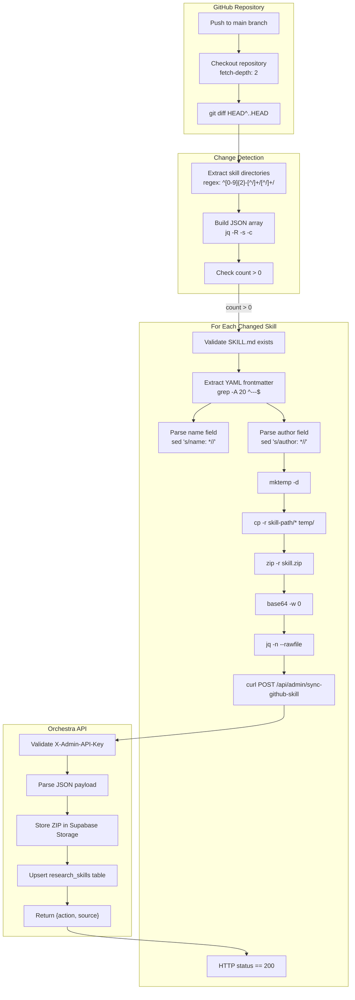
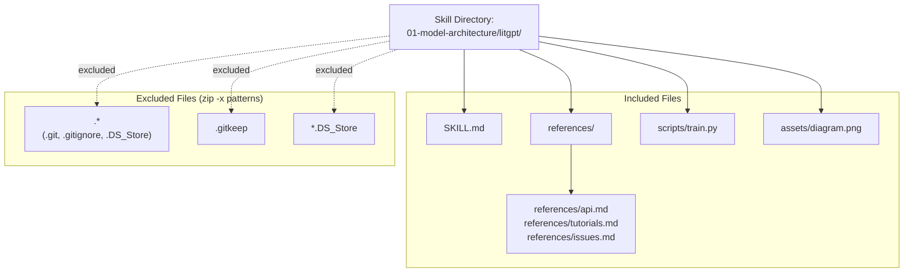
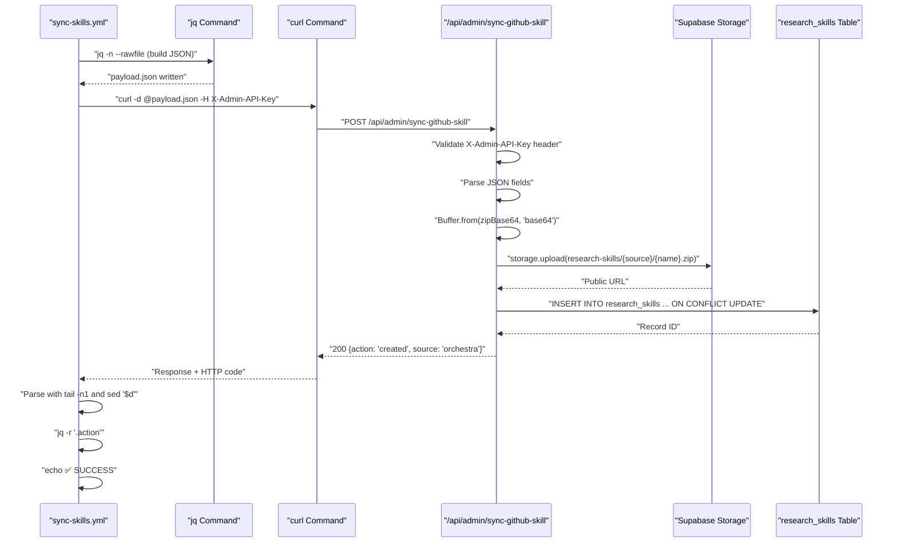
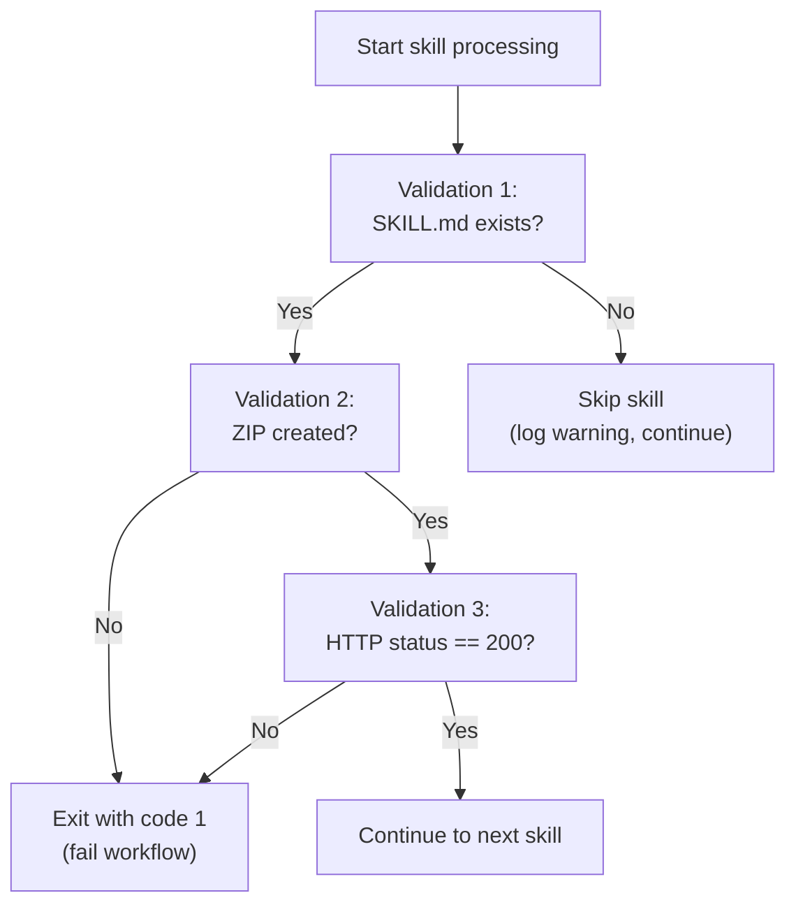
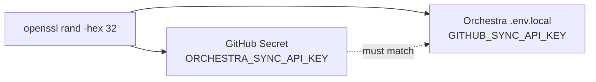
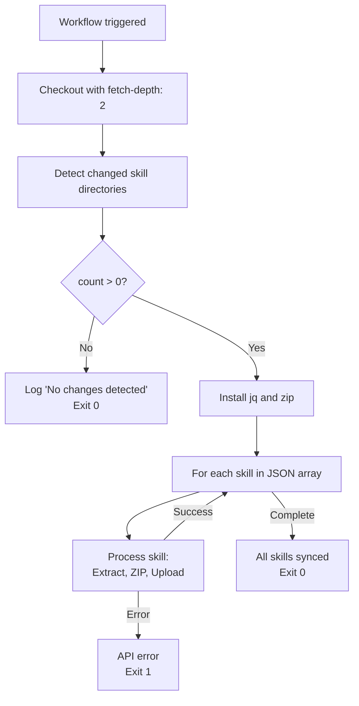

<!-- source: DeepWiki mcp.deepwiki.com · repo zechenzhangAGI/AI-research-SKILLs · page 6.1 Automated Sync Pipeline Architecture · fetched 2026-10-26 -->

# Automated Sync Pipeline Architecture

<details>
<summary>Relevant source files</summary>

The following files were used as context for generating this wiki page:

- [.github/workflows/sync-skills.yml](.github/workflows/sync-skills.yml)
- [01-model-architecture/litgpt/SKILL.md](01-model-architecture/litgpt/SKILL.md)
- [CLAUDE.md](CLAUDE.md)
- [dev_data/GITHUB_SKILLS_SYNC_SETUP.md](dev_data/GITHUB_SKILLS_SYNC_SETUP.md)

</details>


## Overview

The automated sync pipeline bridges the GitHub repository ([zechenzhangAGI/AI-research-SKILLs](https://github.com/zechenzhangAGI/AI-research-SKILLs)) to the Orchestra skill marketplace. Implemented as a GitHub Actions workflow at [.github/workflows/sync-skills.yml:1-178](), the pipeline detects changed skill directories via `git diff`, extracts YAML frontmatter metadata, packages skills as base64-encoded ZIPs, and POSTs to the Orchestra admin API endpoint.

**Key Components:**
- **Trigger**: Push to `main` branch or manual dispatch
- **Change Detection**: Git diff regex pattern matching
- **Metadata Extraction**: Shell text processing of YAML frontmatter
- **Packaging**: ZIP creation with base64 encoding
- **Distribution**: HTTP POST to `/api/admin/sync-github-skill`

**Related Pages:**
- Skill classification logic: [6.2 Skill Classification System](#6.2)
- Marketplace manifest structure: [6.3 Marketplace.json Structure](#6.3)

---

## Workflow File Structure
</thinking>

The sync pipeline is implemented as a single GitHub Actions workflow with multiple sequential steps:

```mermaid
graph TB
    subgraph "GitHub Actions Workflow"
        Push["on.push.branches: [main]<br/>on.workflow_dispatch"]
        Checkout["actions/checkout@v4<br/>fetch-depth: 2"]
        DetectStep["Detect changed skill folders<br/>id: changes"]
        ProcessStep["Process and sync skills<br/>if: steps.changes.outputs.count > 0"]
        NoChanges["No changes detected<br/>if: steps.changes.outputs.count == 0"]
    end
    
    subgraph "Change Detection (Shell)"
        GitDiff["git diff --name-only HEAD^..HEAD"]
        GrepPattern["grep -E '^[0-9]{2}-[^/]+/[^/]+/'"]
        SedExtract["sed -E 's|^([0-9]{2}-[^/]+/[^/]+)/.*|\\1|'"]
        SortUniq["sort -u"]
        JqArray["jq -R -s -c 'split(\"\\n\") | map(select(length > 0))'"]
    end
    
    subgraph "Per-Skill Processing Loop"
        ValidateSKILL["[ ! -f SKILL.md ] check"]
        GrepName["grep -A 20 '^---$' | grep '^name:'"]
        GrepAuthor["grep -A 20 '^---$' | grep '^author:'"]
        MktempDir["mktemp -d"]
        CopyFiles["cp -r skill-path/* temp/"]
        ZipCmd["zip -r skill.zip -x '*/.*' '*/.gitkeep'"]
        Base64Cmd["base64 -w 0 skill.zip"]
        JqPayload["jq -n --rawfile"]
        CurlPost["curl -X POST -H 'X-Admin-API-Key'"]
    end
    
    subgraph "Orchestra API Endpoint"
        RouteHandler["/api/admin/sync-github-skill"]
        ValidateKey["Validate X-Admin-API-Key header"]
        DecodeZip["Buffer.from(zipBase64, 'base64')"]
        SupabaseUpload["supabase.storage.upload()"]
        DBUpsert["INSERT INTO research_skills ON CONFLICT UPDATE"]
        Response200["{action: 'created'|'updated', source: 'orchestra'|'community'}"]
    end
    
    Push --> Checkout
    Checkout --> DetectStep
    DetectStep --> GitDiff
    GitDiff --> GrepPattern
    GrepPattern --> SedExtract
    SedExtract --> SortUniq
    SortUniq --> JqArray
    JqArray --> ProcessStep
    ProcessStep --> ValidateSKILL
    ValidateSKILL --> GrepName
    ValidateSKILL --> GrepAuthor
    GrepAuthor --> MktempDir
    MktempDir --> CopyFiles
    CopyFiles --> ZipCmd
    ZipCmd --> Base64Cmd
    Base64Cmd --> JqPayload
    JqPayload --> CurlPost
    CurlPost --> RouteHandler
    RouteHandler --> ValidateKey
    ValidateKey --> DecodeZip
    DecodeZip --> SupabaseUpload
    SupabaseUpload --> DBUpsert
    DBUpsert --> Response200
```

**Sources:** [.github/workflows/sync-skills.yml:1-178](), [dev_data/GITHUB_SKILLS_SYNC_SETUP.md:1-162]()

---

## Trigger Configuration
</old_str>
<new_str>
# Automated Sync Pipeline Architecture

## Overview

The automated sync pipeline bridges the GitHub repository ([zechenzhangAGI/AI-research-SKILLs](https://github.com/zechenzhangAGI/AI-research-SKILLs)) to the Orchestra skill marketplace. Implemented as a GitHub Actions workflow at [.github/workflows/sync-skills.yml:1-178](), the pipeline detects changed skill directories via `git diff`, extracts YAML frontmatter metadata, packages skills as base64-encoded ZIPs, and POSTs to the Orchestra admin API endpoint.

**Key Components:**
- **Trigger**: Push to `main` branch or manual dispatch
- **Change Detection**: Git diff regex pattern matching
- **Metadata Extraction**: Shell text processing of YAML frontmatter
- **Packaging**: ZIP creation with base64 encoding
- **Distribution**: HTTP POST to `/api/admin/sync-github-skill`

**Related Pages:**
- Skill classification logic: [6.2 Skill Classification System](#6.2)
- Marketplace manifest structure: [6.3 Marketplace.json Structure](#6.3)

---

## Workflow File Structure

The workflow consists of a single job (`sync-skills`) with sequential steps:

```mermaid
graph TB
    subgraph "Job: sync-skills (runs-on: ubuntu-latest)"
        Step1["Step 1: Checkout repository<br/>actions/checkout@v4<br/>fetch-depth: 2"]
        Step2["Step 2: Detect changed skill folders<br/>id: changes<br/>outputs: skills, count"]
        Step3["Step 3: Process and sync skills<br/>if: steps.changes.outputs.count > 0"]
        Step4["Step 4: No changes detected<br/>if: steps.changes.outputs.count == 0"]
    end
    
    subgraph "Step 2: Shell Script"
        GitDiff["CHANGED_FILES=$(git diff --name-only HEAD^..HEAD)"]
        Grep["grep -E '^[0-9]{2}-[^/]+/[^/]+/'"]
        Sed["sed -E 's|^([0-9]{2}-[^/]+/[^/]+)/.*|\\1|'"]
        Sort["sort -u"]
        Jq["jq -R -s -c 'split(\"\\n\") | map(select(length > 0))'"]
        Output["echo 'skills=$SKILLS_JSON' >> $GITHUB_OUTPUT"]
    end
    
    subgraph "Step 3: For-Each Loop"
        Loop["echo '$SKILLS' | jq -r '.[]' | while read SKILL_PATH"]
        ExtractMeta["grep -A 20 '^---$' SKILL.md"]
        CreateZip["zip -r skill.zip"]
        Base64["base64 -w 0 skill.zip"]
        BuildJSON["jq -n --rawfile"]
        CurlPOST["curl -X POST $ORCHESTRA_API_URL/api/admin/sync-github-skill"]
    end
    
    Step1 --> Step2
    Step2 --> GitDiff
    GitDiff --> Grep
    Grep --> Sed
    Sed --> Sort
    Sort --> Jq
    Jq --> Output
    Output --> Step3
    Step3 --> Loop
    Loop --> ExtractMeta
    ExtractMeta --> CreateZip
    CreateZip --> Base64
    Base64 --> BuildJSON
    BuildJSON --> CurlPOST
```

**Sources:** [.github/workflows/sync-skills.yml:1-178]()

---

## Trigger Configuration

The sync pipeline is implemented as a single GitHub Actions workflow with multiple sequential steps:



**Sources:** [.github/workflows/sync-skills.yml:1-178](), [dev_data/GITHUB_SKILLS_SYNC_SETUP.md:1-162]()

---

## Trigger Mechanisms

The workflow supports three trigger types:

| Trigger Type | Configuration | Use Case |
|--------------|---------------|----------|
| **Push to main** | `on.push.branches: [main]` | Automatic sync after merge |
| **Manual dispatch** | `on.workflow_dispatch` | Testing, full resync |
| **Scheduled** | Not configured by default | Could add cron schedule |

The workflow file declares triggers at [.github/workflows/sync-skills.yml:3-7]():

```yaml
on:
  push:
    branches:
      - main
  workflow_dispatch: # Allow manual trigger
```

Manual triggers can be executed from the GitHub Actions UI or via GitHub CLI:

```bash
gh workflow run sync-skills.yml --repo zechenzhangAGI/AI-research-SKILLs
```

**Sources:** [.github/workflows/sync-skills.yml:3-7](), [dev_data/GITHUB_SKILLS_SYNC_SETUP.md:117-126]()

---

## Change Detection Algorithm

The workflow detects modified skill directories using Git diff analysis and regex pattern matching.

### Git Diff Command Chain

Implemented at [.github/workflows/sync-skills.yml:19-41]():

```bash
# Step 1: Get changed files (last commit only)
CHANGED_FILES=$(git diff --name-only HEAD^..HEAD)

# Step 2: Extract skill directory paths
SKILL_DIRS=$(echo "$CHANGED_FILES" | \
  grep -E '^[0-9]{2}-[^/]+/[^/]+/' | \
  sed -E 's|^([0-9]{2}-[^/]+/[^/]+)/.*|\1|' | \
  sort -u)

# Step 3: Convert to JSON array for iteration
SKILLS_JSON=$(echo "$SKILL_DIRS" | \
  jq -R -s -c 'split("\n") | map(select(length > 0))')

# Step 4: Output to GitHub Actions
echo "skills=$SKILLS_JSON" >> $GITHUB_OUTPUT

# Step 5: Count skills for conditional execution
SKILL_COUNT=$(echo "$SKILL_DIRS" | grep -c . || echo "0")
echo "count=$SKILL_COUNT" >> $GITHUB_OUTPUT
```

### Regex Pattern Breakdown

The pattern `^[0-9]{2}-[^/]+/[^/]+/` matches skill directory structure:

```mermaid
graph LR
    Input["File Path:<br/>01-model-architecture/litgpt/SKILL.md"]
    Caret["^ (start of line)"]
    Digits["[0-9]{2} (category number)"]
    Dash["- (literal dash)"]
    Category["[^/]+ (category name)"]
    Slash1["/ (separator)"]
    Skill["[^/]+ (skill name)"]
    Slash2["/ (separator)"]
    Extract["Extracted:<br/>01-model-architecture/litgpt"]
    
    Input --> Caret
    Caret --> Digits
    Digits --> Dash
    Dash --> Category
    Category --> Slash1
    Slash1 --> Skill
    Skill --> Slash2
    Slash2 --> Extract
```



**Pattern Components:**

| Component | Matches | Example |
|-----------|---------|---------|
| `^[0-9]{2}` | Category number (2 digits) | `01`, `06`, `19` |
| `-[^/]+` | Category name (until `/`) | `-model-architecture`, `-post-training` |
| `/[^/]+/` | Skill name (until `/`) | `/litgpt/`, `/grpo-rl-training/` |

**Extraction Examples:**

| Input File Path | Regex Match | Extracted Directory |
|----------------|-------------|---------------------|
| `01-model-architecture/litgpt/SKILL.md` | ✅ | `01-model-architecture/litgpt` |
| `06-post-training/grpo-rl-training/references/api.md` | ✅ | `06-post-training/grpo-rl-training` |
| `README.md` | ❌ | (skipped) |
| `.github/workflows/sync-skills.yml` | ❌ | (skipped) |

### Deduplication with sort -u

Multiple files in the same skill directory produce duplicate paths. The `sort -u` command deduplicates:

```
Input (after sed):              Output (after sort -u):
06-post-training/grpo-rl-training    06-post-training/grpo-rl-training
06-post-training/grpo-rl-training    
06-post-training/grpo-rl-training    
01-model-architecture/litgpt         01-model-architecture/litgpt
01-model-architecture/litgpt
```

### Conditional Execution via count Output

The workflow uses `steps.changes.outputs.count` to conditionally execute processing:

```yaml
- name: Process and sync skills
  if: steps.changes.outputs.count > 0  # Skip if count == 0
  
- name: No changes detected
  if: steps.changes.outputs.count == 0  # Log message only
```

When `count == 0`, the workflow logs at [.github/workflows/sync-skills.yml:173-177]() and exits with status 0.

**Sources:** [.github/workflows/sync-skills.yml:19-41](), [dev_data/GITHUB_SKILLS_SYNC_SETUP.md:256-263]()

---

## Metadata Extraction Process

The workflow extracts YAML frontmatter fields from `SKILL.md` using shell text processing commands.

### YAML Frontmatter Format

Expected structure in `SKILL.md`:

```yaml
---
name: implementing-llms-litgpt
description: Implements and trains LLMs using LitGPT
version: 1.0.0
author: Orchestra Research
license: MIT
tags: [Model Architecture, LitGPT, Fine-Tuning]
dependencies: [litgpt, torch]
---
```

**Required for sync:** `name`, `author`  
**Optional:** `description`, `version`, `license`, `tags`, `dependencies`

### Extraction Command Pipeline

Implemented at [.github/workflows/sync-skills.yml:68-84]():

```bash
# Extract name field
SKILL_NAME=$(grep -A 20 "^---$" "$SKILL_PATH/SKILL.md" | \
  grep "^name:" | head -1 | \
  sed 's/name: *//;s/"//g;s/'\''//g' | \
  tr -d '\r')

# Extract author field
AUTHOR=$(grep -A 20 "^---$" "$SKILL_PATH/SKILL.md" | \
  grep "^author:" | head -1 | \
  sed 's/author: *//;s/"//g;s/'\''//g' | \
  tr -d '\r')
```

### Command Sequence Diagram

```mermaid
graph TB
    Input["SKILL.md file"]
    Grep1["grep -A 20 '^---$'<br/>(Extract 20 lines after first --- delimiter)"]
    Grep2["grep '^name:'<br/>(Filter to name: line)"]
    Head["head -1<br/>(Take first match)"]
    Sed["sed 's/name: *//'<br/>(Remove 'name:' prefix and spaces)"]
    SedQuotes["sed 's/\"//g;s/'//g'<br/>(Strip all quotes)"]
    Tr["tr -d '\\r'<br/>(Remove Windows CRLF)"]
    Output["SKILL_NAME variable"]
    
    Input --> Grep1
    Grep1 --> Grep2
    Grep2 --> Head
    Head --> Sed
    Sed --> SedQuotes
    SedQuotes --> Tr
    Tr --> Output
```

### Processing Steps

| Step | Command | Purpose | Example |
|------|---------|---------|---------|
| 1 | `grep -A 20 "^---$"` | Extract frontmatter block (20 lines after `---`) | Gets entire YAML block |
| 2 | `grep "^name:"` | Filter to line with `name:` prefix | `name: implementing-llms-litgpt` |
| 3 | `head -1` | Take first occurrence only | Handles duplicate `---` delimiters |
| 4 | `sed 's/name: *//'` | Remove `name:` and trailing spaces | `implementing-llms-litgpt` |
| 5 | `sed 's/"//g;s/'\''//g'` | Strip quotes (double and single) | Handles quoted values |
| 6 | `tr -d '\r'` | Remove Windows line endings | Ensures UNIX format |

### Default Value Fallbacks

When extraction fails, defaults are applied at [.github/workflows/sync-skills.yml:75-84]():

```bash
# Fallback 1: Use directory basename if no name field
if [ -z "$SKILL_NAME" ]; then
  SKILL_NAME=$(basename "$SKILL_PATH")
  echo "⚠️  No 'name' in frontmatter, using directory name: $SKILL_NAME"
fi

# Fallback 2: Default to Orchestra Research if no author field
if [ -z "$AUTHOR" ]; then
  AUTHOR="Orchestra Research"
  echo "⚠️  No 'author' in frontmatter, defaulting to: $AUTHOR"
fi
```

**Fallback Behavior:**

| Missing Field | Fallback Value | Warning Logged |
|---------------|----------------|----------------|
| `name` | Directory name (e.g., `litgpt`) | ⚠️  No 'name' in frontmatter |
| `author` | `Orchestra Research` | ⚠️  No 'author' in frontmatter |

**Sources:** [.github/workflows/sync-skills.yml:68-84](), [CLAUDE.md:53-75](), [01-model-architecture/litgpt/SKILL.md:1-9]()

---

## ZIP Packaging Process

Each skill directory is packaged as a ZIP archive for storage in Supabase and distribution via the marketplace.

### Packaging Command Sequence

Implemented at [.github/workflows/sync-skills.yml:90-118]():

```bash
# 1. Create temporary directory
TEMP_DIR=$(mktemp -d)
SKILL_DIR="$TEMP_DIR/$SKILL_NAME"
mkdir -p "$SKILL_DIR"

# 2. Copy all skill contents
cp -r "$SKILL_PATH"/* "$SKILL_DIR/" 2>/dev/null || true

# 3. Create ZIP with exclusions
ZIP_FILE="$TEMP_DIR/${SKILL_NAME}.zip"
cd "$TEMP_DIR"
zip -r "$ZIP_FILE" "$SKILL_NAME" -x "*/.*" "*/.gitkeep" "*.DS_Store"
cd -

# 4. Verify ZIP exists
if [ ! -f "$ZIP_FILE" ]; then
  echo "❌ ERROR: Failed to create zip file for $SKILL_NAME"
  exit 1
fi

# 5. Log ZIP size
echo "✓ Created zip: $(ls -lh "$ZIP_FILE" | awk '{print $5}')"

# 6. Base64 encode (GNU coreutils with -w 0, fallback for macOS)
ZIP_BASE64_FILE="$TEMP_DIR/base64.txt"
base64 -w 0 "$ZIP_FILE" > "$ZIP_BASE64_FILE" 2>/dev/null || \
  base64 "$ZIP_FILE" > "$ZIP_BASE64_FILE"
```

### File Inclusion Logic

The `zip -x` exclusion patterns control what enters the archive:



**Exclusion Pattern Table:**

| Pattern | Matches | Reason for Exclusion |
|---------|---------|----------------------|
| `"*/.*"` | All hidden files (`.git/`, `.gitignore`, `.vscode/`) | Git metadata, IDE configs |
| `"*/.gitkeep"` | Empty directory placeholders | Only needed for Git tracking |
| `"*.DS_Store"` | macOS Finder metadata | Platform-specific, not portable |

**Included Directory Structure:**

```
implementing-llms-litgpt.zip
├── SKILL.md                    (✅ Main documentation)
├── references/                 (✅ Deep documentation)
│   ├── api.md
│   ├── tutorials.md
│   ├── supported-models.md
│   └── training-recipes.md
├── scripts/                    (✅ If exists)
│   └── train.py
├── templates/                  (✅ If exists)
│   └── finetune_config.yaml
└── examples/                   (✅ If exists)
    └── example.ipynb
```

### Base64 Encoding for JSON Transport

The ZIP is base64-encoded to embed in JSON payload:

```bash
# GNU coreutils (Linux): -w 0 disables line wrapping
base64 -w 0 "$ZIP_FILE" > "$ZIP_BASE64_FILE" 2>/dev/null || \
  # macOS fallback: no -w flag
  base64 "$ZIP_FILE" > "$ZIP_BASE64_FILE"
```

**Why base64?** JSON cannot directly contain binary data. Base64 encodes binary as ASCII text (33% size increase).

### Size Logging

The workflow logs ZIP size using `ls -lh`:

```bash
echo "✓ Created zip: $(ls -lh "$ZIP_FILE" | awk '{print $5}')"
# Example output: ✓ Created zip: 2.3M
```

Large ZIPs (> 100MB) may fail upload due to GitHub Actions workspace limits (2GB total).

**Sources:** [.github/workflows/sync-skills.yml:90-118](), [dev_data/GITHUB_SKILLS_SYNC_SETUP.md:210-232]()

---

## API Communication Protocol

The workflow POSTs skill data to Orchestra's admin API endpoint using cURL.

### JSON Payload Construction

The workflow uses `jq` to build the payload at [.github/workflows/sync-skills.yml:121-133]():

```bash
# Write SKILL.md to temp file (avoid command line length limits)
SKILL_MD_FILE="$TEMP_DIR/skill.md"
cat "$SKILL_PATH/SKILL.md" > "$SKILL_MD_FILE"

# Build JSON with jq (--rawfile reads entire file into string)
JSON_PAYLOAD=$(jq -n \
  --arg skillName "$SKILL_NAME" \
  --arg skillPath "$SKILL_PATH" \
  --arg author "$AUTHOR" \
  --rawfile skillMdContent "$SKILL_MD_FILE" \
  --rawfile zipBase64 "$ZIP_BASE64_FILE" \
  '{
    skillName: $skillName,
    skillPath: $skillPath,
    author: $author,
    skillMdContent: $skillMdContent,
    zipBase64: $zipBase64
  }')

# Write payload to file (avoid argument length limits in curl)
JSON_FILE="$TEMP_DIR/payload.json"
echo "$JSON_PAYLOAD" > "$JSON_FILE"
```

### Payload Field Mapping

| JSON Field | Shell Variable | Source | Example Value |
|------------|----------------|--------|---------------|
| `skillName` | `$SKILL_NAME` | YAML `name:` field | `implementing-llms-litgpt` |
| `skillPath` | `$SKILL_PATH` | Git directory path | `01-model-architecture/litgpt` |
| `author` | `$AUTHOR` | YAML `author:` field | `Orchestra Research` |
| `skillMdContent` | `$SKILL_MD_FILE` | Full `SKILL.md` file | `---\nname: ...\n---\n# LitGPT...` |
| `zipBase64` | `$ZIP_BASE64_FILE` | Base64-encoded ZIP | `UEsDBBQAAAAIAA...` |

**Why --rawfile?** The `jq --rawfile` flag reads entire files into strings without shell interpretation, avoiding issues with quotes, newlines, and special characters.

### HTTP POST Request

The cURL command at [.github/workflows/sync-skills.yml:140-145]():

```bash
RESPONSE=$(curl -s -w "\n%{http_code}" -L \
  -X POST \
  -H "Content-Type: application/json" \
  -H "X-Admin-API-Key: $ORCHESTRA_SYNC_API_KEY" \
  -d @"$JSON_FILE" \
  "$ORCHESTRA_API_URL/api/admin/sync-github-skill")
```

**cURL Flags:**

| Flag | Purpose |
|------|---------|
| `-s` | Silent mode (no progress bar) |
| `-w "\n%{http_code}"` | Append HTTP status code to output |
| `-L` | Follow redirects |
| `-X POST` | HTTP method |
| `-H "Content-Type: application/json"` | JSON request body |
| `-H "X-Admin-API-Key: $ORCHESTRA_SYNC_API_KEY"` | Authentication header |
| `-d @"$JSON_FILE"` | Read request body from file |

### Authentication Mechanism

The API validates the `X-Admin-API-Key` header against the server-side `GITHUB_SYNC_API_KEY` environment variable:

```
Request Header:     X-Admin-API-Key: a1b2c3d4e5f6...
Server validates:   process.env.GITHUB_SYNC_API_KEY === headerValue
```

**Key Storage:**

| Location | Secret Name | Purpose |
|----------|-------------|---------|
| GitHub Secrets | `ORCHESTRA_SYNC_API_KEY` | Sent in request header |
| Orchestra `.env.local` | `GITHUB_SYNC_API_KEY` | Server validation |

Both must match exactly (64-character hex string).

### Response Parsing

The workflow extracts HTTP status and body at [.github/workflows/sync-skills.yml:147-161]():

```bash
# Extract HTTP status code (last line)
HTTP_CODE=$(echo "$RESPONSE" | tail -n1)

# Extract response body (all lines except last)
BODY=$(echo "$RESPONSE" | sed '$d')

# Parse based on status
if [ "$HTTP_CODE" = "200" ]; then
  ACTION=$(echo "$BODY" | jq -r '.action // "synced"')
  SOURCE=$(echo "$BODY" | jq -r '.source // "unknown"')
  echo "✅ SUCCESS: Skill $SKILL_NAME $ACTION (source: $SOURCE)"
else
  ERROR_MSG=$(echo "$BODY" | jq -r '.error // "Unknown error"')
  echo "❌ FAILED: $ERROR_MSG"
  exit 1
fi
```

### API Response Formats

**Success (HTTP 200):**

```json
{
  "action": "created",     // or "updated"
  "source": "orchestra"    // or "community"
}
```

**Error (HTTP 4xx/5xx):**

```json
{
  "error": "Invalid API key"  // or other error message
}
```

### End-to-End Communication Flow



**Sources:** [.github/workflows/sync-skills.yml:121-161](), [dev_data/GITHUB_SKILLS_SYNC_SETUP.md:52-58]()

---

## Error Handling and Validation

The workflow implements validation at multiple stages to prevent data corruption.

### Validation Stages



### Pre-Processing Validation

**Check 1: SKILL.md Exists** ([.github/workflows/sync-skills.yml:63-66]()):

```bash
if [ ! -f "$SKILL_PATH/SKILL.md" ]; then
  echo "⚠️  WARNING: No SKILL.md found in $SKILL_PATH, skipping"
  continue  # Skip to next skill in loop
fi
```

**Why skip instead of fail?** The change detection regex may match non-skill directories (e.g., documentation files). Skipping prevents false positives.

**Check 2: Metadata Extraction Fallbacks** ([.github/workflows/sync-skills.yml:75-84]()):

```bash
# Fallback for missing name field
if [ -z "$SKILL_NAME" ]; then
  SKILL_NAME=$(basename "$SKILL_PATH")
  echo "⚠️  No 'name' in frontmatter, using directory name: $SKILL_NAME"
fi

# Fallback for missing author field
if [ -z "$AUTHOR" ]; then
  AUTHOR="Orchestra Research"
  echo "⚠️  No 'author' in frontmatter, defaulting to: $AUTHOR"
fi
```

These fallbacks prevent pipeline failure but log warnings for manual review.

### Post-Processing Validation

**Check 3: ZIP Creation** ([.github/workflows/sync-skills.yml:104-108]()):

```bash
# Verify zip was created
if [ ! -f "$ZIP_FILE" ]; then
  echo "❌ ERROR: Failed to create zip file for $SKILL_NAME"
  continue  # Exit would be better, but continue allows other skills to process
fi
```

**Note:** The code uses `continue`, but the comment suggests `exit 1` would be better for failing fast.

**Check 4: HTTP Response Status** ([.github/workflows/sync-skills.yml:153-161]()):

```bash
if [ "$HTTP_CODE" = "200" ]; then
  # Success: Parse action and source
  ACTION=$(echo "$BODY" | jq -r '.action // "synced"')
  SOURCE=$(echo "$BODY" | jq -r '.source // "unknown"')
  echo "✅ SUCCESS: Skill $SKILL_NAME $ACTION (source: $SOURCE)"
else
  # Failure: Parse error and exit
  ERROR_MSG=$(echo "$BODY" | jq -r '.error // "Unknown error"')
  echo "❌ FAILED: $ERROR_MSG"
  exit 1  # Terminate workflow with failure status
fi
```

Any non-200 status immediately fails the entire workflow run.

### Cleanup Logic

Temporary files are removed after each skill at [.github/workflows/sync-skills.yml:163-164]():

```bash
# Cleanup temporary directory
rm -rf "$TEMP_DIR"
```

**Cleanup Guarantees:**

| Scenario | Cleanup Executed? | Files Removed |
|----------|-------------------|---------------|
| Success | ✅ Yes | `$TEMP_DIR/*` (ZIP, base64, JSON) |
| API error (exit 1) | ❌ No | Files remain in `/tmp/tmp.XXXXXX/` |
| SKILL.md missing (continue) | ✅ Yes | Nothing to clean |

**Note:** On `exit 1`, GitHub Actions runner cleans workspace, so orphaned files don't accumulate across runs.

### Logging Conventions

The workflow uses emoji prefixes for visual log parsing:

| Emoji | Level | Use Case | Example |
|-------|-------|----------|---------|
| `⚠️` | Warning | Non-fatal issues | `⚠️  No 'name' in frontmatter, using directory name` |
| `✅` | Success | Operation completed | `✅ SUCCESS: Skill litgpt created (source: orchestra)` |
| `❌` | Error | Fatal failure | `❌ FAILED: Invalid API key` |
| `✓` | Info | Status update | `✓ Created zip: 2.3M` |
| `📤` | Action | In progress | `📤 Uploading to Orchestra...` |
| `ℹ️` | Info | No action needed | `ℹ️  No skill changes detected in this commit` |

### Error Recovery Patterns

| Error Type | Workflow Behavior | Resolution |
|------------|-------------------|------------|
| Missing SKILL.md | Skip skill, continue loop | Add SKILL.md file |
| Missing YAML fields | Use defaults, log warning | Update frontmatter |
| ZIP creation failed | Log error, continue loop | Check disk space, file permissions |
| HTTP 401 (Invalid key) | Exit 1, fail workflow | Verify GitHub Secret matches `.env.local` |
| HTTP 500 (Server error) | Exit 1, fail workflow | Check Orchestra server logs |

**Sources:** [.github/workflows/sync-skills.yml:63-164](), [dev_data/GITHUB_SKILLS_SYNC_SETUP.md:236-301]()

---

## Environment Configuration

The workflow requires two GitHub Secrets accessed via the `secrets` context.

### Required Secrets

Defined at [.github/workflows/sync-skills.yml:45-47]():

```yaml
env:
  ORCHESTRA_API_URL: ${{ secrets.ORCHESTRA_API_URL }}
  ORCHESTRA_SYNC_API_KEY: ${{ secrets.ORCHESTRA_SYNC_API_KEY }}
```

**Secret Specifications:**

| Secret Name | Type | Example | Purpose |
|-------------|------|---------|---------|
| `ORCHESTRA_API_URL` | URL | `https://orchestra.com` | Base URL for API endpoint |
| `ORCHESTRA_SYNC_API_KEY` | Hex string | `a1b2c3d4e5f6...` (64 chars) | Authentication header value |

### Secret Configuration in GitHub

Secrets are stored in repository settings:

1. Navigate to repository **Settings** → **Secrets and variables** → **Actions**
2. Click **"New repository secret"**
3. Add `ORCHESTRA_API_URL` with production URL
4. Add `ORCHESTRA_SYNC_API_KEY` with generated key

### API Key Generation

Generate 256-bit entropy key using OpenSSL:

```bash
openssl rand -hex 32
# Output: a1b2c3d4e5f6789012345678901234567890123456789012345678901234567890
```

**Key Properties:**
- **Length:** 64 hexadecimal characters (32 bytes)
- **Entropy:** 256 bits
- **Format:** Lowercase hex string (`[0-9a-f]{64}`)

### Key Synchronization

The same key must exist in two locations:



**Configuration Files:**

| Location | Variable Name | Access Method |
|----------|---------------|---------------|
| GitHub Actions | `ORCHESTRA_SYNC_API_KEY` | `${{ secrets.ORCHESTRA_SYNC_API_KEY }}` |
| Orchestra Server | `GITHUB_SYNC_API_KEY` | `process.env.GITHUB_SYNC_API_KEY` |

### Secret Rotation Procedure

1. **Generate new key:**
   ```bash
   openssl rand -hex 32
   ```

2. **Update Orchestra:**
   ```bash
   # Edit .env.local
   GITHUB_SYNC_API_KEY=<new-key-value>
   
   # Restart server
   pnpm dev
   ```

3. **Update GitHub Secret:**
   - Repository → Settings → Secrets → Actions
   - Edit `ORCHESTRA_SYNC_API_KEY`
   - Paste new key value

4. **Test sync:**
   ```bash
   # Manual workflow trigger
   gh workflow run sync-skills.yml --repo zechenzhangAGI/AI-research-SKILLs
   ```

### Environment-Specific URLs

| Environment | `ORCHESTRA_API_URL` Value |
|-------------|---------------------------|
| Production | `https://orchestra.com` |
| Staging | `https://staging.orchestra.com` |
| Local Dev | `http://localhost:3000` |

**Sources:** [.github/workflows/sync-skills.yml:45-47](), [dev_data/GITHUB_SKILLS_SYNC_SETUP.md:22-108]()

---

## Manual Testing Procedures

The workflow can be tested without committing skill changes.

### Manual Workflow Dispatch

**Via GitHub UI:**

1. Navigate to repository **Actions** tab
2. Select "Sync Skills to Orchestra" workflow
3. Click "Run workflow" dropdown
4. Select branch (typically `main`)
5. Click "Run workflow" button

**Via GitHub CLI:**

```bash
gh workflow run sync-skills.yml \
  --repo zechenzhangAGI/AI-research-SKILLs \
  --ref main
```

### Test Commit Method

Create a minimal change to trigger the workflow:

```bash
# Add timestamp comment to trigger sync
echo "\n<!-- Updated $(date) -->" >> 01-model-architecture/litgpt/SKILL.md

git add .
git commit -m "test: trigger auto-sync"
git push origin main
```

### Verifying Sync Success

**1. GitHub Actions Logs:**
- Check workflow run status in Actions tab
- Review step logs for error messages
- Confirm HTTP 200 responses

**2. Orchestra Marketplace:**
- Navigate to `https://orchestra.com/research-skills`
- Search for synced skill name
- Verify metadata matches YAML frontmatter

**3. Supabase Storage:**
- Open Supabase Dashboard → Storage → `research-skills`
- Check for `orchestra/skill-name.zip` or `community/skill-name.zip`
- Verify ZIP file size is reasonable

**4. Database Records:**
- Query `research_skills` table
- Verify `created_at` or `updated_at` timestamp
- Confirm `source` field is `orchestra` or `community`

**Sources:** [dev_data/GITHUB_SKILLS_SYNC_SETUP.md:115-159](), [.github/workflows/sync-skills.yml:7]()

---

## Workflow Execution Context

### Runtime Environment

| Property | Value |
|----------|-------|
| **Runner** | `ubuntu-latest` (GitHub-hosted) |
| **Shell** | Bash |
| **Working Directory** | Repository root |
| **Fetch Depth** | 2 commits (for diff) |

### Installed Dependencies

The workflow installs required tools at [.github/workflows/sync-skills.yml:54]():

```bash
sudo apt-get update && sudo apt-get install -y jq zip
```

| Tool | Version | Purpose |
|------|---------|---------|
| `jq` | Latest apt | JSON parsing and construction |
| `zip` | Latest apt | ZIP archive creation |
| `base64` | Built-in | Binary encoding for JSON transport |
| `curl` | Built-in | HTTP client for API calls |
| `git` | Built-in | Change detection via diff |

### Execution Flow Summary



### Performance Characteristics

| Metric | Typical Value | Notes |
|--------|---------------|-------|
| **Workflow startup** | ~10-15 seconds | Runner provisioning |
| **Change detection** | < 1 second | Git diff operation |
| **Per-skill processing** | 5-10 seconds | ZIP + upload |
| **Multi-skill sync** | Linear scaling | Processed sequentially |

**Sources:** [.github/workflows/sync-skills.yml:10-177]()

---

