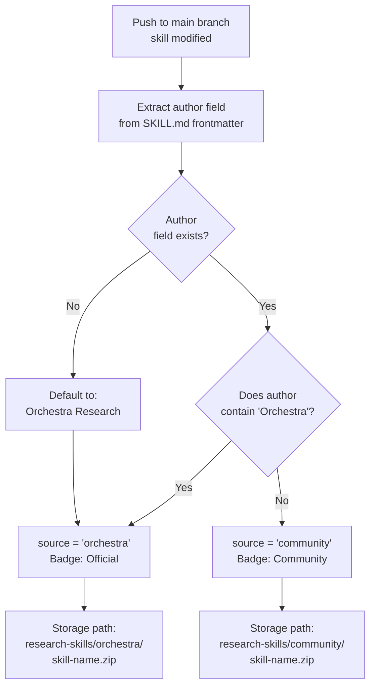
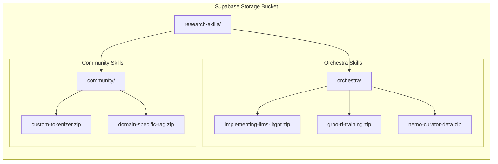
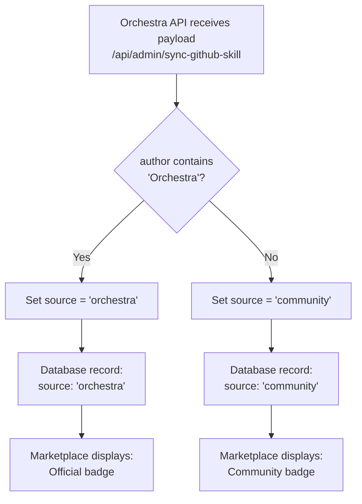

<!-- source: DeepWiki mcp.deepwiki.com · repo zechenzhangAGI/AI-research-SKILLs · page 6.2 Skill Classification System · fetched 2026-10-26 -->

# Skill Classification System

<details>
<summary>Relevant source files</summary>

The following files were used as context for generating this wiki page:

- [.github/workflows/sync-skills.yml](.github/workflows/sync-skills.yml)
- [01-model-architecture/litgpt/SKILL.md](01-model-architecture/litgpt/SKILL.md)
- [CLAUDE.md](CLAUDE.md)
- [dev_data/GITHUB_SKILLS_SYNC_SETUP.md](dev_data/GITHUB_SKILLS_SYNC_SETUP.md)

</details>


## Purpose and Scope

This document describes the skill classification system that determines whether a skill is displayed as "Official Orchestra" or "Community" in the Orchestra marketplace. The classification is based on the `author` field in a skill's YAML frontmatter and controls storage paths, marketplace badges, and visual presentation.

For information about the automated sync pipeline that uses this classification, see [Automated Sync Pipeline Architecture](#6.1). For details on the overall marketplace structure and category organization, see [Marketplace.json Structure](#6.3). For YAML frontmatter format requirements, see [Skill Structure & Documentation Standards](#5.1).

## Classification Overview

The skill classification system operates during the GitHub Actions sync pipeline. When a skill is pushed to the repository, the workflow extracts the `author` field from `SKILL.md` and determines whether the skill receives an "Orchestra" badge (official) or "Community" badge based on whether the author name contains the string "Orchestra".

### Classification Decision Flow



**Sources:** [.github/workflows/sync-skills.yml:68-88](), [dev_data/GITHUB_SKILLS_SYNC_SETUP.md:164-207]()

## Author Field Extraction

The GitHub Actions workflow extracts the author field from the YAML frontmatter at the beginning of each `SKILL.md` file using shell commands.

### Extraction Logic

The workflow uses `grep` and `sed` to parse YAML frontmatter:

```bash
# Extract author from SKILL.md
AUTHOR=$(grep -A 20 "^---$" "$SKILL_PATH/SKILL.md" | \
         grep "^author:" | head -1 | \
         sed 's/author: *//;s/"//g;s/'\''//g' | tr -d '\r')
```

**Extraction Process:**
1. Find YAML frontmatter delimiters (`---`)
2. Read next 20 lines after opening delimiter
3. Find line starting with `author:`
4. Strip field name, quotes, and whitespace
5. Remove carriage returns for cross-platform compatibility

**Sources:** [.github/workflows/sync-skills.yml:72-73]()

### Default Author Assignment

If no author field is found, the workflow assigns a default value:

```bash
if [ -z "$AUTHOR" ]; then
  AUTHOR="Orchestra Research"
  echo "⚠️  No 'author' in frontmatter, defaulting to: $AUTHOR"
fi
```

This default ensures that skills without explicit authors are classified as Orchestra skills.

**Sources:** [.github/workflows/sync-skills.yml:81-84]()

## Classification Rules

The classification determines the skill's source designation and affects storage location, marketplace display, and badging.

### Rule Table

| Author Field Value | Contains "Orchestra"? | Resulting Source | Badge Displayed | Storage Prefix |
|-------------------|-----------------------|------------------|-----------------|----------------|
| `Orchestra Research` | Yes | `orchestra` | Official | `orchestra/` |
| `Orchestra Team` | Yes | `orchestra` | Official | `orchestra/` |
| `Jane Doe` | No | `community` | Community | `community/` |
| `john.smith@company.com` | No | `community` | Community | `community/` |
| _(missing field)_ | _(defaults to "Orchestra Research")_ | `orchestra` | Official | `orchestra/` |

**Classification Logic:**

The string matching is case-sensitive. The author field must contain the exact string "Orchestra" (with capital O) to receive official classification.

**Sources:** [dev_data/GITHUB_SKILLS_SYNC_SETUP.md:166-206](), [CLAUDE.md:198-219]()

## Storage Path Structure

The classification determines the Supabase Storage path where the skill ZIP file is stored. This separation provides clear organizational structure and enables future permission controls.

### Storage Path Mapping



**Sources:** [dev_data/GITHUB_SKILLS_SYNC_SETUP.md:177-192]()

### Path Construction

The storage path follows this pattern:

```
research-skills/{source}/{skillName}.zip
```

Where:
- `{source}` is `"orchestra"` or `"community"` based on classification
- `{skillName}` is extracted from the `name` field in YAML frontmatter

**Example Paths:**

| Skill Name | Author | Storage Path |
|-----------|--------|--------------|
| `implementing-llms-litgpt` | `Orchestra Research` | `research-skills/orchestra/implementing-llms-litgpt.zip` |
| `custom-tokenizer` | `Jane Doe` | `research-skills/community/custom-tokenizer.zip` |

**Sources:** [dev_data/GITHUB_SKILLS_SYNC_SETUP.md:210-227]()

## Marketplace Display Integration

The classification result is sent to the Orchestra API endpoint as part of the sync payload and determines how the skill is displayed in the marketplace.

### API Payload Structure

The GitHub Actions workflow constructs a JSON payload that includes the author information:

```json
{
  "skillName": "implementing-llms-litgpt",
  "skillPath": "01-model-architecture/litgpt",
  "author": "Orchestra Research",
  "skillMdContent": "---\nname: implementing-llms-litgpt\n...",
  "zipBase64": "UEsDBBQAAAA..."
}
```

**Sources:** [.github/workflows/sync-skills.yml:121-133]()

### Classification to Badge Mapping



The Orchestra backend stores the `source` field in the `research_skills` database table and uses it to render the appropriate badge in the marketplace UI.

**Sources:** [dev_data/GITHUB_SKILLS_SYNC_SETUP.md:9-17](), [.github/workflows/sync-skills.yml:140-161]()

## Code Implementation Details

### Workflow File Structure

The classification logic is implemented in the GitHub Actions workflow file at `.github/workflows/sync-skills.yml`. Key sections:

**Author Extraction (lines 68-88):**
- Parses YAML frontmatter
- Handles missing author field
- Applies default value

**Payload Construction (lines 121-133):**
- Includes author in JSON payload
- Sends to Orchestra API endpoint

**Response Handling (lines 147-161):**
- Logs classification result
- Displays source (orchestra/community)
- Reports success/failure

**Sources:** [.github/workflows/sync-skills.yml:1-178]()

### YAML Frontmatter Examples

**Official Orchestra Skill:**

```yaml
---
name: implementing-llms-litgpt
description: Implements and trains LLMs using Lightning AI's LitGPT
version: 1.0.0
author: Orchestra Research
license: MIT
tags: [Model Architecture, LitGPT]
---
```

Result: `source = "orchestra"`, storage path `orchestra/implementing-llms-litgpt.zip`

**Community Skill:**

```yaml
---
name: custom-tokenizer
description: Custom tokenization for domain-specific text
version: 1.0.0
author: Jane Doe
license: MIT
tags: [Tokenization, Custom]
---
```

Result: `source = "community"`, storage path `community/custom-tokenizer.zip`

**Skill Without Author (Defaults to Orchestra):**

```yaml
---
name: some-skill
description: A skill without explicit author
version: 1.0.0
license: MIT
tags: [Utility]
---
```

Result: Author defaults to `"Orchestra Research"`, `source = "orchestra"`

**Sources:** [dev_data/GITHUB_SKILLS_SYNC_SETUP.md:166-206](), [01-model-architecture/litgpt/SKILL.md:1-9](), [CLAUDE.md:60-78]()

## Classification Edge Cases

### Case Sensitivity

The string matching for "Orchestra" is **case-sensitive**. The following variations will NOT match:

| Author Value | Contains "Orchestra"? | Result |
|-------------|----------------------|---------|
| `orchestra research` | No (lowercase) | Community |
| `ORCHESTRA TEAM` | No (all caps) | Community |
| `Orchestra Research` | Yes ✓ | Orchestra |
| `The Orchestra Team` | Yes ✓ | Orchestra |

**Sources:** Implementation in [.github/workflows/sync-skills.yml:72-88]() uses grep without case-insensitive flag

### Partial Matches

Any author field containing "Orchestra" as a substring will match:

```yaml
author: "Research by Orchestra"  # Matches → Orchestra
author: "Orchestra and Contributors"  # Matches → Orchestra
author: "Jane Doe (Orchestra)"  # Matches → Orchestra
author: "Jane Doe for Orchestra AI"  # Matches → Orchestra
```

**Sources:** [dev_data/GITHUB_SKILLS_SYNC_SETUP.md:287-290]()

### Multiple Authors

If multiple authors are listed, only the first `author:` line is used:

```yaml
---
name: collaborative-skill
author: Orchestra Research
# Second author line ignored
contributors: [Jane Doe, John Smith]
---
```

The workflow uses `head -1` to select only the first match.

**Sources:** [.github/workflows/sync-skills.yml:72]()

## Validation and Testing

### Manual Testing

To test classification for a new skill:

1. Add YAML frontmatter with desired author
2. Commit to a feature branch
3. Manually trigger workflow via GitHub Actions UI
4. Check logs for extracted author and resulting source
5. Verify storage path in Supabase

**Sources:** [dev_data/GITHUB_SKILLS_SYNC_SETUP.md:116-159]()

### Workflow Logs

The workflow logs show classification results:

```
Skill Name: implementing-llms-litgpt
Author: Orchestra Research
Path: 01-model-architecture/litgpt
...
✅ SUCCESS: Skill implementing-llms-litgpt synced (source: orchestra)
```

For community skills:

```
Skill Name: custom-tokenizer
Author: Jane Doe
Path: 99-community/custom-tokenizer
...
✅ SUCCESS: Skill custom-tokenizer synced (source: community)
```

**Sources:** [.github/workflows/sync-skills.yml:86-88](), [.github/workflows/sync-skills.yml:153-161]()

## Summary Table

| Component | Official Orchestra | Community |
|-----------|-------------------|-----------|
| **Author field** | Contains "Orchestra" | Does not contain "Orchestra" |
| **Source value** | `orchestra` | `community` |
| **Storage path** | `research-skills/orchestra/{name}.zip` | `research-skills/community/{name}.zip` |
| **Marketplace badge** | "Official" | "Community" |
| **Default behavior** | Yes (if author missing) | No |

**Sources:** [dev_data/GITHUB_SKILLS_SYNC_SETUP.md:164-207](), [CLAUDE.md:198-228]()

---

