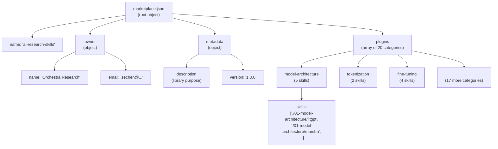
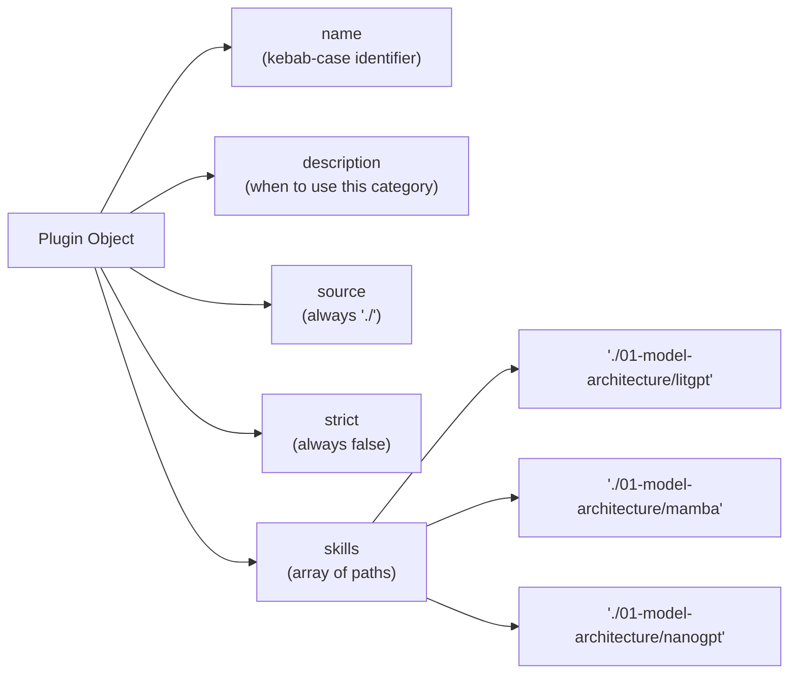
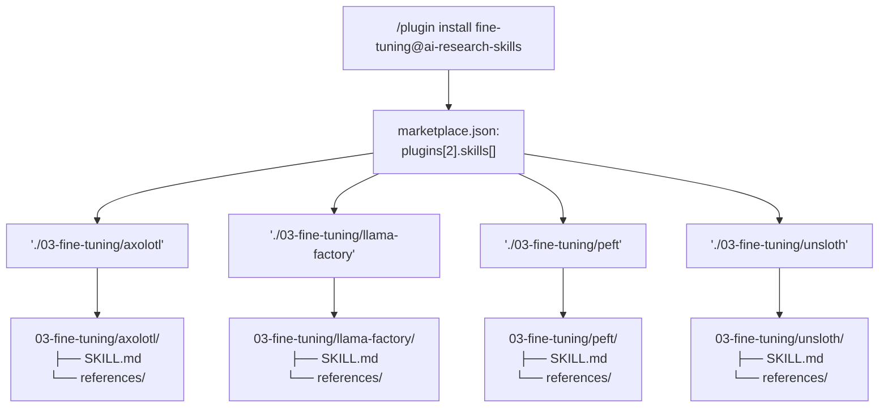
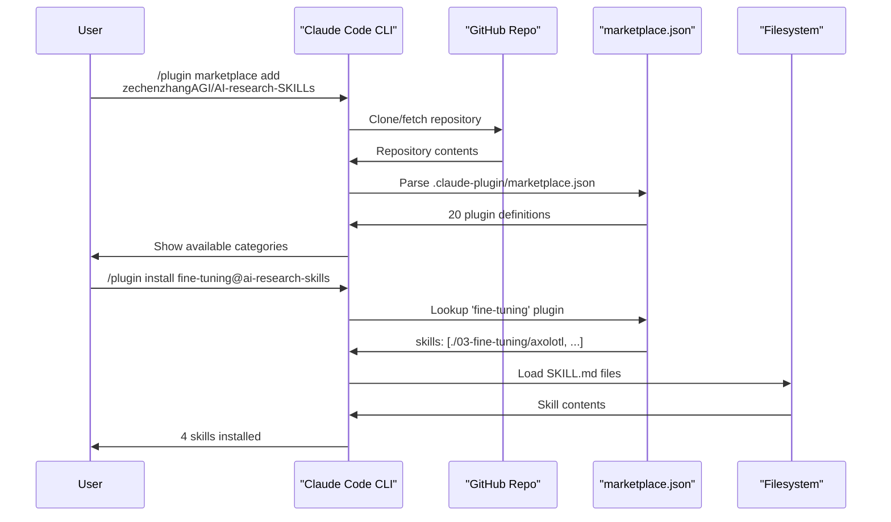
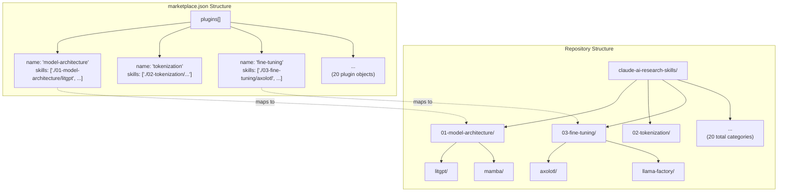
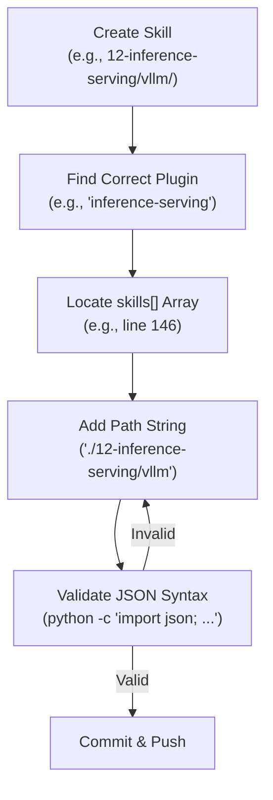
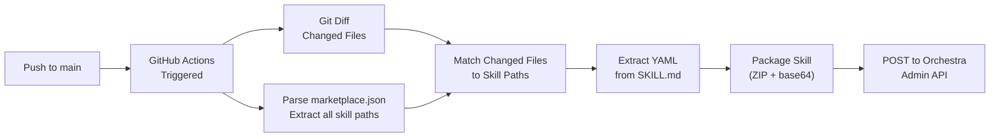

<!-- source: DeepWiki mcp.deepwiki.com · repo zechenzhangAGI/AI-research-SKILLs · page 6.3 Marketplace.json Structure · fetched 2026-10-26 -->

# Marketplace.json Structure

<details>
<summary>Relevant source files</summary>

The following files were used as context for generating this wiki page:

- [.claude-plugin/marketplace.json](.claude-plugin/marketplace.json)
- [CONTRIBUTING.md](CONTRIBUTING.md)
- [README.md](README.md)
- [demos/README.md](demos/README.md)
- [docs/ROADMAP.md](docs/ROADMAP.md)
- [docs/SKILL_CREATION_GUIDE.md](docs/SKILL_CREATION_GUIDE.md)
- [docs/SKILL_TEMPLATE.md](docs/SKILL_TEMPLATE.md)
- [docs/christmas-tree.svg](docs/christmas-tree.svg)
- [docs/tech-tree.svg](docs/tech-tree.svg)

</details>


This page documents the structure and purpose of the `marketplace.json` plugin manifest file that defines how AI Research Skills are organized, discovered, and installed via Claude Code CLI. For information about how this file is automatically synced to Orchestra, see [Automated Sync Pipeline Architecture](#6.1). For details on skill classification and badging, see [Skill Classification System](#6.2).

## Purpose and Scope

The `marketplace.json` file serves as the **single source of truth** for skill organization and discovery in the AI Research Skills library. It defines:

- Library-level metadata (name, owner, version)
- 20 skill categories as installable "plugins"
- Mapping from category names to file system paths
- Descriptions that guide Claude Code's skill selection

This file is consumed by:
1. **Claude Code CLI** - For skill discovery and installation via `/plugin` commands
2. **Orchestra Sync Pipeline** - To determine which skills have changed and need publishing
3. **Alternative tools** - Gemini, Cursor, or custom RAG systems that want to ingest skills

Sources: [.claude-plugin/marketplace.json:1-251](), [README.md:70-109]()

## Top-Level Structure

The `marketplace.json` file follows a three-tier hierarchical structure:



**Diagram: Three-tier hierarchy of marketplace.json structure**

Sources: [.claude-plugin/marketplace.json:1-10]()

## Root Object Fields

The root object contains four required fields:

| Field | Type | Purpose | Example |
|-------|------|---------|---------|
| `name` | string | Marketplace identifier used in CLI commands | `"ai-research-skills"` |
| `owner` | object | Contact information for maintainer | `{"name": "Orchestra Research", "email": "..."}` |
| `metadata` | object | Library-level information | `{"description": "...", "version": "1.0.0"}` |
| `plugins` | array | List of installable skill categories | Array of 20 plugin objects |

Sources: [.claude-plugin/marketplace.json:2-10]()

### Owner Object Structure

```json
{
  "owner": {
    "name": "Orchestra Research",
    "email": "zechen@orchestra-research.com"
  }
}
```

The owner information is used by the Orchestra sync pipeline to classify skills as "Orchestra" vs "community" contributions (see [Skill Classification System](#6.2)).

Sources: [.claude-plugin/marketplace.json:3-6]()

### Metadata Object Structure

```json
{
  "metadata": {
    "description": "Comprehensive library of 77 AI research engineering skills enabling autonomous AI research from hypothesis to experimental verification",
    "version": "1.0.0"
  }
}
```

The `description` field appears in Claude Code's marketplace listing. The `version` field follows semantic versioning.

Sources: [.claude-plugin/marketplace.json:7-10]()

## Plugins Array Structure

The `plugins` array contains 20 category definitions, one per skill category. Each plugin represents an installable unit via Claude Code CLI.



**Diagram: Plugin object structure with field definitions**

Sources: [.claude-plugin/marketplace.json:11-23]()

### Plugin Object Fields

Each plugin object has the following fields:

| Field | Type | Required | Purpose | Example |
|-------|------|----------|---------|---------|
| `name` | string | Yes | Category identifier for CLI commands | `"model-architecture"` |
| `description` | string | Yes | What the category covers and when to use it | `"LLM architectures and implementations..."` |
| `source` | string | Yes | Base path (always `"./"` for this repo) | `"./"` |
| `strict` | boolean | Yes | Strict mode flag (always `false` for this repo) | `false` |
| `skills` | array | Yes | List of relative paths to skill directories | `["./01-model-architecture/litgpt", ...]` |

Sources: [.claude-plugin/marketplace.json:13-23]()

### Category Naming Convention

Category names follow a consistent pattern:

| Category Name Pattern | Directory Pattern | Example |
|----------------------|-------------------|---------|
| `kebab-case-name` | `NN-kebab-case-name/` | `model-architecture` → `01-model-architecture/` |
| Singular or plural as appropriate | Matches directory exactly (minus number prefix) | `fine-tuning` → `03-fine-tuning/` |
| Compound terms hyphenated | Same hyphenation in directory | `inference-serving` → `12-inference-serving/` |

Sources: [.claude-plugin/marketplace.json:11-248](), [README.md:87-109]()

### Description Field Best Practices

Plugin descriptions follow a two-part pattern:

1. **What it covers** - List key frameworks/tools
2. **When to use it** - Specific use cases or triggers

Example from `fine-tuning` category:
```json
{
  "description": "LLM fine-tuning frameworks including Axolotl, LLaMA-Factory, PEFT, and Unsloth. Use when fine-tuning models with LoRA, QLoRA, or full fine-tuning."
}
```

This pattern helps Claude Code's skill selection system determine when to recommend the category.

Sources: [.claude-plugin/marketplace.json:35-37]()

## Skill Path Mapping

The `skills` array in each plugin maps category-level commands to individual skill directories:



**Diagram: Mapping from CLI command through marketplace.json to filesystem**

Each path in the `skills` array:
- Is relative to the repository root
- Points to a directory containing `SKILL.md` and optionally `references/`
- Must exist in the filesystem (validated during PR review)
- Follows the pattern `./NN-category-name/skill-name`

Sources: [.claude-plugin/marketplace.json:39-44](), [README.md:283-302]()

## Complete Plugin Example

Here is a complete plugin object annotated with field purposes:

```json
{
  "name": "post-training",                    // CLI identifier
  "description": "RLHF and preference alignment including TRL, GRPO, OpenRLHF, and SimPO. Use when aligning models with human preferences or training reward models.",  // Discovery text
  "source": "./",                             // Base path
  "strict": false,                            // Loose mode
  "skills": [                                 // 4 skills in this category
    "./06-post-training/grpo-rl-training",    // GRPO skill path
    "./06-post-training/openrlhf",            // OpenRLHF skill path
    "./06-post-training/simpo",               // SimPO skill path
    "./06-post-training/trl-fine-tuning"      // TRL skill path
  ]
}
```

Sources: [.claude-plugin/marketplace.json:69-79]()

## Integration with Claude Code CLI

The marketplace.json file enables the following Claude Code CLI workflow:



**Diagram: Claude Code CLI interaction flow with marketplace.json**

### CLI Commands Enabled by Marketplace.json

| Command | What It Does | Relies On |
|---------|--------------|-----------|
| `/plugin marketplace add <repo>` | Registers the marketplace | `name` field |
| `/plugin install <category>@<marketplace>` | Installs category skills | `plugins[].name` and `plugins[].skills[]` |
| `/plugin list` | Shows installed categories | `plugins[].name` and `plugins[].description` |
| `/plugin uninstall <category>` | Removes category skills | `plugins[].name` |

Sources: [README.md:72-84]()

## Relationship to Directory Structure

The marketplace.json structure mirrors the repository's directory organization:



**Diagram: Mapping between filesystem directories and marketplace.json plugins**

The directory numbering (01-20) provides ordering but is **not** part of the plugin name. For example, `01-model-architecture/` directory corresponds to `model-architecture` plugin name (no number prefix).

Sources: [.claude-plugin/marketplace.json:11-248](), [README.md:343-369]()

## Adding a New Skill to Marketplace.json

When contributing a new skill, you must update marketplace.json to make it discoverable. The workflow is:



**Diagram: Workflow for adding a new skill to marketplace.json**

### Step-by-Step Process

**1. Identify the correct plugin/category**

Match your skill's directory prefix to the plugin name:
- Skill in `12-inference-serving/` → plugin `"inference-serving"`
- Skill in `06-post-training/` → plugin `"post-training"`

**2. Locate the plugin object in marketplace.json**

Find the object where `"name"` matches your category:

```json
{
  "name": "inference-serving",
  "description": "...",
  "source": "./",
  "strict": false,
  "skills": [
    // Add your skill path here
  ]
}
```

**3. Add your skill path to the skills array**

Append a new path string:

```json
"skills": [
  "./12-inference-serving/llama-cpp",
  "./12-inference-serving/sglang",
  "./12-inference-serving/tensorrt-llm",
  "./12-inference-serving/vllm",
  "./12-inference-serving/your-new-skill"  // Add this line
]
```

**4. Validate JSON syntax**

Run validation before committing:

```bash
python3 -c "import json; json.load(open('.claude-plugin/marketplace.json'))"
```

If the command exits silently, JSON is valid. If it prints an error, fix the syntax (common issues: missing commas, trailing commas, unescaped quotes).

Sources: [CONTRIBUTING.md:196-227]()

## Field Validation Rules

The marketplace.json file must satisfy these constraints:

| Field | Constraint | Reason |
|-------|-----------|--------|
| Root `name` | Must match repository identifier | Used in CLI commands |
| Plugin `name` | kebab-case, no spaces | Becomes CLI argument |
| Plugin `description` | Non-empty, < 1024 chars | Displayed in CLI |
| Plugin `source` | Always `"./"` for this repo | Base path for all skills |
| Plugin `strict` | Always `false` for this repo | Allows flexible skill loading |
| Plugin `skills[]` | Valid relative paths | Must point to existing directories |
| Skill paths | Must start with `"./"` | Relative to repo root |
| Skill paths | Must contain `SKILL.md` | Required file in each skill |

Sources: [.claude-plugin/marketplace.json:1-251](), [docs/SKILL_CREATION_GUIDE.md:126-150]()

## All 20 Categories

Complete list of plugin categories in marketplace.json:

| Category Name | Directory | Skill Count | Line Range |
|--------------|-----------|-------------|------------|
| `model-architecture` | `01-model-architecture/` | 5 | [12-23]() |
| `tokenization` | `02-tokenization/` | 2 | [24-33]() |
| `fine-tuning` | `03-fine-tuning/` | 4 | [34-45]() |
| `mechanistic-interpretability` | `04-mechanistic-interpretability/` | 4 | [46-57]() |
| `data-processing` | `05-data-processing/` | 2 | [58-67]() |
| `post-training` | `06-post-training/` | 4 | [68-79]() |
| `safety-alignment` | `07-safety-alignment/` | 3 | [80-90]() |
| `distributed-training` | `08-distributed-training/` | 6 | [91-104]() |
| `infrastructure` | `09-infrastructure/` | 3 | [105-115]() |
| `optimization` | `10-optimization/` | 6 | [116-129]() |
| `evaluation` | `11-evaluation/` | 3 | [130-140]() |
| `inference-serving` | `12-inference-serving/` | 4 | [141-152]() |
| `mlops` | `13-mlops/` | 3 | [153-163]() |
| `agents` | `14-agents/` | 4 | [164-175]() |
| `rag` | `15-rag/` | 5 | [176-188]() |
| `prompt-engineering` | `16-prompt-engineering/` | 4 | [189-200]() |
| `observability` | `17-observability/` | 2 | [201-210]() |
| `multimodal` | `18-multimodal/` | 7 | [211-225]() |
| `emerging-techniques` | `19-emerging-techniques/` | 6 | [226-239]() |
| `ml-paper-writing` | `20-ml-paper-writing/` | 1 | [240-248]() |

Sources: [.claude-plugin/marketplace.json:11-250](), [README.md:86-109]()

## Sync Pipeline Integration

The marketplace.json file is read by the GitHub Actions sync pipeline to determine which skills need publishing to Orchestra:



**Diagram: How marketplace.json is used in the automated sync pipeline**

The sync pipeline:
1. Parses marketplace.json to get all valid skill paths
2. Compares git diff against these paths
3. Only syncs skills listed in marketplace.json
4. Uses the category name from the plugin object for classification

This ensures that only properly registered skills are published to Orchestra. See [Automated Sync Pipeline Architecture](#6.1) for detailed workflow.

Sources: [README.md:228-243]()

## Common Patterns and Examples

### Pattern 1: Single-Skill Category

Some categories contain only one skill:

```json
{
  "name": "ml-paper-writing",
  "description": "Write publication-ready ML/AI papers for NeurIPS, ICML, ICLR, ACL, AAAI, COLM. Includes LaTeX templates, citation verification, reviewer guidelines, and writing best practices from top researchers.",
  "source": "./",
  "strict": false,
  "skills": [
    "./20-ml-paper-writing"
  ]
}
```

Note that the skill path points directly to the category directory when there's only one skill. The directory still contains `SKILL.md` and `references/`.

Sources: [.claude-plugin/marketplace.json:240-248]()

### Pattern 2: Multi-Skill Category

Most categories contain multiple skills:

```json
{
  "name": "multimodal",
  "description": "Vision, audio, and multimodal models including CLIP, Whisper, LLaVA, BLIP-2, Segment Anything, Stable Diffusion, and AudioCraft. Use when working with images, audio, or multimodal tasks.",
  "source": "./",
  "strict": false,
  "skills": [
    "./18-multimodal/audiocraft",
    "./18-multimodal/blip-2",
    "./18-multimodal/clip",
    "./18-multimodal/llava",
    "./18-multimodal/segment-anything",
    "./18-multimodal/stable-diffusion",
    "./18-multimodal/whisper"
  ]
}
```

Skills are listed in alphabetical order within the array for consistency.

Sources: [.claude-plugin/marketplace.json:211-225]()

### Pattern 3: Compound Category Names

Categories with multi-word names use hyphens:

```json
{
  "name": "mechanistic-interpretability",
  "description": "Neural network interpretability tools including TransformerLens, SAELens, NNSight, and pyvene. Use when analyzing model internals, finding circuits, or understanding how models compute.",
  "source": "./",
  "strict": false,
  "skills": [
    "./04-mechanistic-interpretability/nnsight",
    "./04-mechanistic-interpretability/pyvene",
    "./04-mechanistic-interpretability/saelens",
    "./04-mechanistic-interpretability/transformer-lens"
  ]
}
```

The hyphenation is consistent across:
- Plugin `name` field
- Directory name (minus number prefix)
- CLI command usage

Sources: [.claude-plugin/marketplace.json:46-57]()

## Validation Checklist

Before committing changes to marketplace.json:

- [ ] JSON syntax is valid (no trailing commas, proper escaping)
- [ ] All `name` fields are unique across plugins
- [ ] All `name` fields use kebab-case (lowercase with hyphens)
- [ ] All `description` fields are < 1024 characters
- [ ] All `description` fields follow "what + when" pattern
- [ ] All `skills[]` paths start with `"./"` 
- [ ] All `skills[]` paths point to existing directories
- [ ] All referenced directories contain `SKILL.md`
- [ ] Plugin order matches directory numbering (01, 02, ... 20)
- [ ] Skills within each category are alphabetically sorted
- [ ] `source` is always `"./"`
- [ ] `strict` is always `false`

Run validation command:
```bash
python3 -c "import json; json.load(open('.claude-plugin/marketplace.json'))"
```

Sources: [CONTRIBUTING.md:196-227](), [.claude-plugin/marketplace.json:1-251]()

## Example: Full Update Workflow

Here's a complete example of adding a new vLLM skill:

**1. Create skill directory and files:**
```bash
mkdir -p 12-inference-serving/vllm/references
# Create SKILL.md with YAML frontmatter
# Populate references/ directory
```

**2. Edit marketplace.json:**

Locate the `inference-serving` plugin (lines 141-152):

```json
{
  "name": "inference-serving",
  "description": "Production LLM inference including vLLM, TensorRT-LLM, llama.cpp, and SGLang. Use when deploying models for production inference.",
  "source": "./",
  "strict": false,
  "skills": [
    "./12-inference-serving/llama-cpp",
    "./12-inference-serving/sglang",
    "./12-inference-serving/tensorrt-llm",
    "./12-inference-serving/vllm"  // Add this line
  ]
}
```

**3. Validate:**
```bash
python3 -c "import json; json.load(open('.claude-plugin/marketplace.json'))"
```

**4. Commit:**
```bash
git add .claude-plugin/marketplace.json
git add 12-inference-serving/vllm/
git commit -m "Add vLLM inference serving skill

- 356 lines SKILL.md with comprehensive workflows
- 4 reference files (README, API, tutorials, issues)
- Updated marketplace.json inference-serving category"
```

**5. Result after merge:**
- Claude Code CLI can install: `/plugin install inference-serving@ai-research-skills`
- vLLM skill loads automatically with other inference-serving skills
- Sync pipeline detects new skill and publishes to Orchestra

Sources: [CONTRIBUTING.md:196-254]()

---

